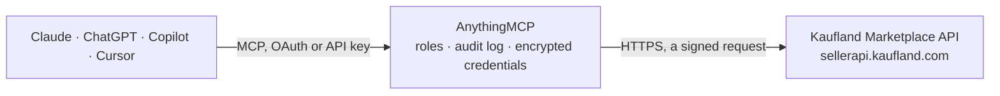

<!-- Generated by scripts/export-github-catalog.mjs in the anythingmcp-website repository. Do not edit by hand. -->

# Kaufland Marketplace MCP connector

Kaufland Marketplace (formerly real.de) seller API: orders and their units, storefronts, units, customer service tickets with their messages, returns and return units, warehouses, and tracking numbers for sent units. The AnythingMCP connector gives Claude, ChatGPT, Microsoft Copilot, Cursor and Gemini 14 MCP tools for Kaufland Marketplace: 12 read and 2 can change data.

**Category:** [E-commerce](../e-commerce.md) · **Tools:** 14 · **Setup guide:** [anythingmcp.com](https://anythingmcp.com/guides/kaufland-to-mcp) · [Deutsch](https://anythingmcp.com/de/guides/kaufland-to-mcp) · [Italiano](https://anythingmcp.com/it/guides/kaufland-to-mcp) · [Español](https://anythingmcp.com/es/guides/kaufland-to-mcp) · [日本語](https://anythingmcp.com/ja/guides/kaufland-to-mcp) · [Русский](https://anythingmcp.com/ru/guides/kaufland-to-mcp) · [中文](https://anythingmcp.com/zh/guides/kaufland-to-mcp)

## Start without code

No installation and no terminal: AnythingMCP Cloud runs the Kaufland Marketplace connector for you, operated by helpcode.ai in Frankfurt, Germany.

1. **Click the button above** and create an account or sign in. The Kaufland Marketplace connector opens, ready to install.
2. **Paste the API key or token from your Kaufland Marketplace account.** Every click is in the [step-by-step guide](https://anythingmcp.com/guides/kaufland-to-mcp).
3. **Click Install.** AnythingMCP shows the address of your MCP server.
4. **Add that address to your assistant:** [Claude](https://anythingmcp.com/guides/connect-kaufland-to-claude) · [ChatGPT](https://anythingmcp.com/guides/connect-kaufland-to-chatgpt) · [Microsoft Copilot](https://anythingmcp.com/guides/connect-kaufland-to-copilot) · [Cursor](https://anythingmcp.com/guides/connect-kaufland-to-cursor) · [Gemini CLI](https://anythingmcp.com/guides/connect-kaufland-to-gemini) · [Meta Muse](https://anythingmcp.com/guides/connect-kaufland-to-muse).
5. **Ask your first question**, for example: *Show full details for order KLM-2026-00421 (storefront de)*

Prefer help with the setup? [Talk to us](https://anythingmcp.com/contact).

## How it works

- **The AI client** speaks MCP (Streamable HTTP) to AnythingMCP and only sees tool names, descriptions and results. It never gets the Kaufland Marketplace credentials.
- **AnythingMCP** checks the client's role, builds the call from the tool definition, adds the credentials (a signed request), calls Kaufland Marketplace, logs the call and returns the result.
- **Kaufland Marketplace** sees an ordinary API client with the rights of the account the credentials belong to.

## Tools

| Tool | What it does | Access |
|---|---|---|
| [`kaufland_list_warehouses`](#kaufland_list_warehouses) | List the seller's warehouses with their id, name and address. | read |
| [`kaufland_list_orders`](#kaufland_list_orders) | List orders in a time window: id, storefront, creation time and number of units. | read |
| [`kaufland_get_order`](#kaufland_get_order) | Read one order in full: the buyer, the billing and shipping address and every order unit with its own price, status and delivery window. | read |
| [`kaufland_list_order_units`](#kaufland_list_order_units) | List individual order units — the level Kaufland actually fulfils, cancels and pays out at. | read |
| [`kaufland_list_units`](#kaufland_list_units) | List the seller's units (offers) with their EAN, condition, price, stock and the storefront each is listed on. | read |
| [`kaufland_list_tickets`](#kaufland_list_tickets) | List customer service tickets with their subject, status and the order they relate to — where a buyer complaint shows up before it becomes a rating. | read |
| [`kaufland_get_ticket_details`](#kaufland_get_ticket_details) | Read one customer service ticket: status, open reason (product_not_as_described, product_defect, product_not_delivered, product_return, contact_other),… | read |
| [`kaufland_list_ticket_messages`](#kaufland_list_ticket_messages) | List the latest ticket messages across all tickets: ticket id, author role (seller, buyer, system, customer_service) and name, text and time. | read |
| [`kaufland_search_returns`](#kaufland_search_returns) | List returns (Retouren): return id, storefront, status (return_requested, label_generated, package_sent, package_received, label_deleted), return carrier… | read |
| [`kaufland_get_return_details`](#kaufland_get_return_details) | Read one return: status, carrier and tracking code, and its return units with the order unit each belongs to, unit status (need_to_be_returned,… | read |
| [`kaufland_list_return_units`](#kaufland_list_return_units) | List return units, the returned items one by one: return unit id, return id, order unit id, status, reason and note. | read |
| [`kaufland_add_ticket_message`](#kaufland_add_ticket_message) | Answer a customer service ticket: the text is sent to the buyer (and Kaufland customer service) in the ticket conversation. | write |
| [`kaufland_add_tracking_to_order_unit`](#kaufland_add_tracking_to_order_unit) | Add a shipment (carrier code and tracking number) to an order unit that is already marked as sent, so the buyer can follow the parcel. | write |
| [`kaufland_list_storefronts`](#kaufland_list_storefronts) | List the storefronts (one per country) Kaufland runs, with the currency and locale of each. | read |

## Tool reference

Every parameter as the AI client sees it in `tools/list`. Source: [`packages/backend/src/adapters/de/kaufland.json`](../../../packages/backend/src/adapters/de/kaufland.json).

### `kaufland_list_warehouses`

List the seller's warehouses with their id, name and address. No parameters — the lightest call, and the quickest proof that the key pair and the host clock both line up.

**Access:** read · **Call:** `GET /warehouses`

No parameters.

### `kaufland_list_orders`

List orders in a time window: id, storefront, creation time and number of units. Call kaufland_get_order for the buyer, the addresses and the units. Bound the window explicitly: the default is short and a report that silently used it will understate the period.

**Access:** read · **Call:** `GET /orders`

| Parameter | Type | Required | Description |
|---|---|---|---|
| `storefront` | string | no | Storefront code, e.g. de. kaufland_list_storefronts lists them. |
| `ts_created_from` | string | no | Earliest order creation time, ISO 8601. |
| `ts_created_to` | string | no | Latest order creation time, ISO 8601. |
| `limit` | number | no | Rows per page (default 30, max 100). |
| `offset` | number | no | Rows to skip, for paging. |
| `sort` | string | no | Sort expression, e.g. ts_created:desc. |

### `kaufland_get_order`

Read one order in full: the buyer, the billing and shipping address and every order unit with its own price, status and delivery window.

**Access:** read · **Call:** `GET /orders/{id_order}`

| Parameter | Type | Required | Description |
|---|---|---|---|
| `id_order` | string | yes | Kaufland order id. |
| `embedded` | `order_invoices` \| `delivery` \| `kss_delivery` | no | One extra object to include: order_invoices, delivery or kss_delivery. Order units are always included. |

### `kaufland_list_order_units`

List individual order units — the level Kaufland actually fulfils, cancels and pays out at. A part-cancelled order is normal, so revenue should be summed here rather than from the order total.

**Access:** read · **Call:** `GET /order-units`

| Parameter | Type | Required | Description |
|---|---|---|---|
| `storefront` | string | no | Storefront code, e.g. de. kaufland_list_storefronts lists them. |
| `status` | string | no | Unit status, e.g. open, sent, cancelled, returned. |
| `ts_created_from` | string | no | Earliest creation time, ISO 8601. |
| `limit` | number | no | Rows per page (max 100). |
| `offset` | number | no | Rows to skip, for paging. |

### `kaufland_list_units`

List the seller's units (offers) with their EAN, condition, price, stock and the storefront each is listed on.

**Access:** read · **Call:** `GET /units`

| Parameter | Type | Required | Description |
|---|---|---|---|
| `storefront` | string | yes | Storefront code, e.g. de. kaufland_list_storefronts lists them. |
| `ean` | string | no | Restrict to one EAN. |
| `limit` | number | no | Rows per page (max 100). |
| `offset` | number | no | Rows to skip, for paging. |

### `kaufland_list_tickets`

List customer service tickets with their subject, status and the order they relate to — where a buyer complaint shows up before it becomes a rating.

**Access:** read · **Call:** `GET /tickets`

| Parameter | Type | Required | Description |
|---|---|---|---|
| `storefront` | string | no | Storefront code, e.g. de. kaufland_list_storefronts lists them. |
| `status` | string | no | Ticket status filter. |
| `limit` | number | no | Rows per page (max 30). |
| `offset` | number | no | Rows to skip, for paging. |

### `kaufland_get_ticket_details`

Read one customer service ticket: status, open reason (product_not_as_described, product_defect, product_not_delivered, product_return, contact_other), whether the seller has to act, the order unit ids and dates. embedded adds messages (the conversation), order_units, product, buyer or files. Use it before answering with kaufland_add_ticket_message.

**Access:** read · **Call:** `GET /tickets/{id_ticket}`

| Parameter | Type | Required | Description |
|---|---|---|---|
| `id_ticket` | string | yes | Ticket id from kaufland_list_tickets. |
| `embedded` | `messages` \| `order_units` \| `product` \| `buyer` \| `files`[] | no | Extras to include. Default ["messages"]. |

### `kaufland_list_ticket_messages`

List the latest ticket messages across all tickets: ticket id, author role (seller, buyer, system, customer_service) and name, text and time. Filter by creation time to see what came in since a moment; for one ticket use kaufland_get_ticket_details.

**Access:** read · **Call:** `GET /tickets/messages`

| Parameter | Type | Required | Description |
|---|---|---|---|
| `ts_created_from_iso` | string | no | Only messages created after this time, ISO 8601. |
| `sort` | `ts_created_iso:desc` \| `ts_created_iso:asc` | no | Sort by creation time. |
| `limit` | number | no | Rows per page (max 30). |
| `offset` | number | no | Rows to skip, for paging. |

### `kaufland_search_returns`

List returns (Retouren): return id, storefront, status (return_requested, label_generated, package_sent, package_received, label_deleted), return carrier and tracking code, fulfilment type and dates. Filter by storefront, status, tracking code or creation and update time. kaufland_get_return_details gives the units and reasons of one return.

**Access:** read · **Call:** `GET /returns`

| Parameter | Type | Required | Description |
|---|---|---|---|
| `storefront` | `de` \| `cz` \| `sk` \| `pl` \| `at` \| `fr` \| `it` \| `es` \| `nl` | no | Storefront code, e.g. de. kaufland_list_storefronts lists them. |
| `status` | `return_requested` \| `label_generated` \| `package_sent` \| `package_received` \| `label_deleted`[] | no | Return statuses. |
| `ts_created_from_iso` | string | no | Only returns created after this time, YYYY-MM-ddTHH:mm:ssZ. |
| `ts_updated_from_iso` | string | no | Only returns updated after this time, YYYY-MM-ddTHH:mm:ssZ. |
| `tracking_code` | string | no | Tracking code of the return parcel. |
| `sort` | `ts_created:desc` \| `ts_updated:desc` | no | Newest created (default) or newest updated first. |
| `limit` | number | no | Rows per page (default 30, max 100). |
| `offset` | number | no | Rows to skip, for paging. |

### `kaufland_get_return_details`

Read one return: status, carrier and tracking code, and its return units with the order unit each belongs to, unit status (need_to_be_returned, return_arrived, return_accepted, return_rejected, return_in_clarification and others), the buyer's reason and note. embedded can add the buyer.

**Access:** read · **Call:** `GET /returns/{id_return}`

| Parameter | Type | Required | Description |
|---|---|---|---|
| `id_return` | integer | yes | Return id from kaufland_search_returns. |
| `embedded` | `return_units` \| `buyer`[] | no | Extras to include. Default ["return_units"]. |

### `kaufland_list_return_units`

List return units, the returned items one by one: return unit id, return id, order unit id, status, reason and note. Filter by storefront, status (e.g. return_arrived for parcels waiting for a decision) or creation time.

**Access:** read · **Call:** `GET /return-units`

| Parameter | Type | Required | Description |
|---|---|---|---|
| `storefront` | `de` \| `cz` \| `sk` \| `pl` \| `at` \| `fr` \| `it` \| `es` \| `nl` | no | Storefront code, e.g. de. kaufland_list_storefronts lists them. |
| `status` | `need_to_be_returned` \| `return_arrived` \| `return_accepted` \| `return_rejected` \| `return_closed` \| `return_in_repair` \| `return_in_clarification` | no | Return unit status. |
| `ts_created_from_iso` | string | no | Only units created after this time, YYYY-MM-ddTHH:mm:ssZ. |
| `sort` | string | no | Sort expression. |
| `limit` | number | no | Rows per page (default 30, max 100). |
| `offset` | number | no | Rows to skip, for paging. |

### `kaufland_add_ticket_message`

Answer a customer service ticket: the text is sent to the buyer (and Kaufland customer service) in the ticket conversation. Read the ticket with kaufland_get_ticket_details first, show the user the exact text and ask for confirmation before calling.

**Access:** write · **Call:** `POST /tickets/{id_ticket}/messages`

| Parameter | Type | Required | Description |
|---|---|---|---|
| `id_ticket` | string | yes | Ticket id. |
| `text` | string | yes | Message text shown to the buyer, in the storefront language. |

### `kaufland_add_tracking_to_order_unit`

Add a shipment (carrier code and tracking number) to an order unit that is already marked as sent, so the buyer can follow the parcel. carrier_code must be one of the carrier codes in the Kaufland Seller API documentation. Show the user the unit and tracking number and ask for confirmation before calling.

**Access:** write · **Call:** `POST /shipments`

| Parameter | Type | Required | Description |
|---|---|---|---|
| `id_order_unit` | integer | yes | Order unit id from kaufland_get_order or kaufland_list_order_units. |
| `carrier_code` | string | yes | Carrier code from the Kaufland Seller API documentation. |
| `tracking_number` | string | yes | Tracking number of the parcel. |

### `kaufland_list_storefronts`

List the storefronts (one per country) Kaufland runs, with the currency and locale of each. Use it to find the storefront code the other tools need.

**Access:** read · **Call:** `GET /info/storefront`

No parameters.

## Run it yourself

AnythingMCP is open source (AGPL-3.0). [Run it with Docker](../../../README.md#run-it-yourself), open **Connectors → Store**, pick **Kaufland Marketplace** and enter `KAUFLAND_CLIENT_KEY`, `KAUFLAND_SECRET_KEY`, then add your MCP server URL to the AI client.

[← E-commerce connectors](../e-commerce.md) · [All categories](../README.md)
