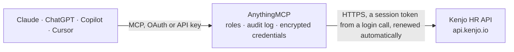

<!-- Generated by scripts/export-github-catalog.mjs in the anythingmcp-website repository. Do not edit by hand. -->

# Kenjo HR MCP connector

Read Kenjo HR data: employees with names, job titles and reporting lines, companies, offices, departments and teams, time-off requests and types, attendance entries and recruiting positions. The AnythingMCP connector gives Claude, ChatGPT, Microsoft Copilot, Cursor and Gemini 12 MCP tools for Kenjo HR, all read-only.

**Category:** [HR](../hr.md) · **Tools:** 12 · **Setup guide:** [anythingmcp.com](https://anythingmcp.com/guides/kenjo-to-mcp) · [Deutsch](https://anythingmcp.com/de/guides/kenjo-to-mcp) · [Italiano](https://anythingmcp.com/it/guides/kenjo-to-mcp) · [Español](https://anythingmcp.com/es/guides/kenjo-to-mcp) · [日本語](https://anythingmcp.com/ja/guides/kenjo-to-mcp) · [Русский](https://anythingmcp.com/ru/guides/kenjo-to-mcp) · [中文](https://anythingmcp.com/zh/guides/kenjo-to-mcp)

## Start without code

No installation and no terminal: AnythingMCP Cloud runs the Kenjo HR connector for you, operated by helpcode.ai in Frankfurt, Germany.

1. **Click the button above** and create an account or sign in. The Kenjo HR connector opens, ready to install.
2. **Paste the API key or token from your Kenjo HR account.** Every click is in the [step-by-step guide](https://anythingmcp.com/guides/kenjo-to-mcp).
3. **Click Install.** AnythingMCP shows the address of your MCP server.
4. **Add that address to your assistant:** [Claude](https://anythingmcp.com/guides/connect-kenjo-to-claude) · [ChatGPT](https://anythingmcp.com/guides/connect-kenjo-to-chatgpt) · [Microsoft Copilot](https://anythingmcp.com/guides/connect-kenjo-to-copilot) · [Cursor](https://anythingmcp.com/guides/connect-kenjo-to-cursor) · [Gemini CLI](https://anythingmcp.com/guides/connect-kenjo-to-gemini) · [Meta Muse](https://anythingmcp.com/guides/connect-kenjo-to-muse).
5. **Ask your first question**, for example: *What's Miriam Keller's employee record and her manager? email miriam.keller@sonnenpixel.de*

Prefer help with the setup? [Talk to us](https://anythingmcp.com/contact).

## How it works

- **The AI client** speaks MCP (Streamable HTTP) to AnythingMCP and only sees tool names, descriptions and results. It never gets the Kenjo HR credentials.
- **AnythingMCP** checks the client's role, builds the call from the tool definition, adds the credentials (a session token from a login call, renewed automatically), calls Kenjo HR, logs the call and returns the result.
- **Kenjo HR** sees an ordinary API client with the rights of the account the credentials belong to.

## Tools

| Tool | What it does | Access |
|---|---|---|
| [`kenjo_list_employees`](#kenjo_list_employees) | List all Kenjo employees with their _id, e-mail, first and last name, display name, job title, active status and company, office and department ids. | read |
| [`kenjo_get_employee`](#kenjo_get_employee) | Get every section of one Kenjo employee: account (e-mail, active), personal (name, birthdate, nationality), work (job title, start date, company, office,… | read |
| [`kenjo_list_employee_accounts`](#kenjo_list_employee_accounts) | List Kenjo employee accounts (_id, e-mail, external id, language, active status). | read |
| [`kenjo_list_employee_work_details`](#kenjo_list_employee_work_details) | List the work section of every employee: job title, start date, employee number, company, office, department, area and team ids, manager (reportsToId),… | read |
| [`kenjo_list_companies`](#kenjo_list_companies) | List the companies (legal entities) set up in Kenjo with _id, name, city and country. | read |
| [`kenjo_list_departments`](#kenjo_list_departments) | List the departments set up in Kenjo with _id and name. | read |
| [`kenjo_list_offices`](#kenjo_list_offices) | List the office locations in Kenjo with _id, name, company id, holiday calendar id, street, postal code, city and country. | read |
| [`kenjo_list_teams`](#kenjo_list_teams) | List the teams set up in Kenjo with _id and name. | read |
| [`kenjo_list_time_off_types`](#kenjo_list_time_off_types) | List the time-off types of the organisation (vacation, sick leave and so on) with _id and name. | read |
| [`kenjo_list_time_off_requests`](#kenjo_list_time_off_requests) | List time-off requests in a date range of at most 92 days, with employee id, type id, policy, status, from/to, duration and per-day split. | read |
| [`kenjo_list_attendances`](#kenjo_list_attendances) | List attendance (worked time) entries of all employees in a date range of at most 31 days: employee id and e-mail, start and end time, breaks, attendance… | read |
| [`kenjo_list_positions`](#kenjo_list_positions) | List recruiting positions (job openings) with _id, job title, company, office and department ids, position type, status and job description. | read |

## Tool reference

Every parameter as the AI client sees it in `tools/list`. Source: [`packages/backend/src/adapters/de/kenjo.json`](../../../packages/backend/src/adapters/de/kenjo.json).

### `kenjo_list_employees`

List all Kenjo employees with their _id, e-mail, first and last name, display name, job title, active status and company, office and department ids. No parameters; use it to find a person's _id and to check the API key.

**Access:** read · **Call:** `GET /user-accounts`

No parameters.

### `kenjo_get_employee`

Get every section of one Kenjo employee: account (e-mail, active), personal (name, birthdate, nationality), work (job title, start date, company, office, department, teams, manager in reportsToId), work schedule, address, home, emergency contact and, when the key allows it, confidential exit data. Bank and tax details are removed.

**Access:** read · **Call:** `GET /employees/{employeeId}`

| Parameter | Type | Required | Description |
|---|---|---|---|
| `employeeId` | string | yes | The employee _id from kenjo_list_employees, e.g. 60f0a916214987256be9c8ff. |

### `kenjo_list_employee_accounts`

List Kenjo employee accounts (_id, e-mail, external id, language, active status). Filter by e-mail or external id to look up one person, or by active status to list leavers.

**Access:** read · **Call:** `GET /employees/accounts`

| Parameter | Type | Required | Description |
|---|---|---|---|
| `email` | string | no | Kenjo e-mail address of the employee, exact match. |
| `externalId` | string | no | External id of the employee, as set in Kenjo. |
| `isActive` | boolean | no | True for active employees, false for deactivated ones. |

### `kenjo_list_employee_work_details`

List the work section of every employee: job title, start date, employee number, company, office, department, area and team ids, manager (reportsToId), contract end and probation end. Filter by department, office, company, manager or job title, e.g. to list a team or an org chart.

**Access:** read · **Call:** `GET /employees/works`

| Parameter | Type | Required | Description |
|---|---|---|---|
| `departmentId` | string | no | Department _id from kenjo_list_departments. |
| `officeId` | string | no | Office _id from kenjo_list_offices. |
| `companyId` | string | no | Company _id from kenjo_list_companies. |
| `reportsToId` | string | no | Employee _id of a manager: returns that person's direct reports. |
| `jobTitle` | string | no | Job title, exact match. |

### `kenjo_list_companies`

List the companies (legal entities) set up in Kenjo with _id, name, city and country. Use it to turn the companyId of an employee or office into a name.

**Access:** read · **Call:** `GET /companies`

| Parameter | Type | Required | Description |
|---|---|---|---|
| `name` | string | no | Company name, exact match. |

### `kenjo_list_departments`

List the departments set up in Kenjo with _id and name. Use it to turn the departmentId of an employee or position into a name.

**Access:** read · **Call:** `GET /departments`

| Parameter | Type | Required | Description |
|---|---|---|---|
| `name` | string | no | Department name, exact match. |

### `kenjo_list_offices`

List the office locations in Kenjo with _id, name, company id, holiday calendar id, street, postal code, city and country. Filter by company, city or name.

**Access:** read · **Call:** `GET /offices`

| Parameter | Type | Required | Description |
|---|---|---|---|
| `name` | string | no | Office name, exact match. |
| `companyId` | string | no | Company _id from kenjo_list_companies. |
| `city` | string | no | City of the office. |

### `kenjo_list_teams`

List the teams set up in Kenjo with _id and name. Use it to turn the teamIds of an employee into names.

**Access:** read · **Call:** `GET /teams`

| Parameter | Type | Required | Description |
|---|---|---|---|
| `name` | string | no | Team name, exact match. |

### `kenjo_list_time_off_types`

List the time-off types of the organisation (vacation, sick leave and so on) with _id and name. Paginated with limit and offset; needs the time-off collection enabled on the API key.

**Access:** read · **Call:** `GET /time-off/types`

| Parameter | Type | Required | Description |
|---|---|---|---|
| `name` | string | no | Time-off type name, e.g. Vacation. |
| `limit` | `25` \| `50` \| `100` | no | Page size: 25, 50 or 100. Default 50. |
| `offset` | integer | no | Page number, starting at 1. Default 1. |

### `kenjo_list_time_off_requests`

List time-off requests in a date range of at most 92 days, with employee id, type id, policy, status, from/to, duration and per-day split. Filter by employee, type or status, e.g. to see who is absent next week or what is waiting for approval. Paginated with limit and offset; check metadata.total.

**Access:** read · **Call:** `GET /time-off/requests`

| Parameter | Type | Required | Description |
|---|---|---|---|
| `from` | string | yes | Start of the range, YYYY-MM-DD, e.g. 2026-10-01. |
| `to` | string | yes | End of the range, YYYY-MM-DD, at most 92 days after from. |
| `userId` | string | no | Only this employee's requests: the employee _id. |
| `timeOffTypeId` | string | no | Only this time-off type: _id from kenjo_list_time_off_types. |
| `status` | `Approved` \| `Declined` \| `Cancelled` \| `Pending` \| `Submitted` \| `Processed` \| `CancelledAfterProcessed` \| `InApproval` | no | Only requests in this status. |
| `limit` | `25` \| `50` \| `100` | no | Page size: 25, 50 or 100. Default 50. |
| `offset` | integer | no | Page number, starting at 1. Default 1. |

### `kenjo_list_attendances`

List attendance (worked time) entries of all employees in a date range of at most 31 days: employee id and e-mail, start and end time, breaks, attendance category and comment. Needs the attendance collection enabled on the API key.

**Access:** read · **Call:** `GET /attendances`

| Parameter | Type | Required | Description |
|---|---|---|---|
| `from` | string | yes | Start of the range, YYYY-MM-DD, e.g. 2026-10-01. |
| `to` | string | yes | End of the range, YYYY-MM-DD, at most 31 days after from. |

### `kenjo_list_positions`

List recruiting positions (job openings) with _id, job title, company, office and department ids, position type, status and job description. Filter by status or organisation unit. Paginated: limit 25, 50 or 100 and offset as a page number from 1; check metadata.total.

**Access:** read · **Call:** `GET /recruiting/positions`

| Parameter | Type | Required | Description |
|---|---|---|---|
| `status` | `Active` \| `Draft` \| `Closed` \| `Archived` | no | Only positions in this status. |
| `positionType` | `Full-time` \| `Part-time` \| `Flexible` \| `Temporary` \| `Freelance` \| `Intern` \| `Student` \| `Apprentice` | no | Only positions of this type. |
| `companyId` | string | no | Company _id from kenjo_list_companies. |
| `officeId` | string | no | Office _id from kenjo_list_offices. |
| `departmentId` | string | no | Department _id from kenjo_list_departments. |
| `limit` | `25` \| `50` \| `100` | no | Page size: 25, 50 or 100. Default 50. |
| `offset` | integer | no | Page number, starting at 1. Default 1. |

## Run it yourself

AnythingMCP is open source (AGPL-3.0). [Run it with Docker](../../../README.md#run-it-yourself), open **Connectors → Store**, pick **Kenjo HR** and enter `KENJO_API_KEY`, then add your MCP server URL to the AI client.

[← HR connectors](../hr.md) · [All categories](../README.md)
