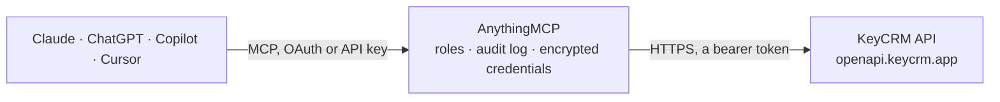

<!-- Generated by scripts/export-github-catalog.mjs in the anythingmcp-website repository. Do not edit by hand. -->

# KeyCRM MCP connector

KeyCRM (Ukraine) for online shops and sales teams: read orders, buyers, products, variants and stock, sales pipelines and their cards, order statuses and sources, and create orders through the KeyCRM OpenAPI. The AnythingMCP connector gives Claude, ChatGPT, Microsoft Copilot, Cursor and Gemini 14 MCP tools for KeyCRM: 13 read and 1 can change data.

**Category:** [CRM](../crm.md) · **Tools:** 14 · **Setup guide:** [anythingmcp.com](https://anythingmcp.com/guides/keycrm-to-mcp) · [Deutsch](https://anythingmcp.com/de/guides/keycrm-to-mcp) · [Italiano](https://anythingmcp.com/it/guides/keycrm-to-mcp) · [Español](https://anythingmcp.com/es/guides/keycrm-to-mcp) · [日本語](https://anythingmcp.com/ja/guides/keycrm-to-mcp) · [Русский](https://anythingmcp.com/ru/guides/keycrm-to-mcp) · [中文](https://anythingmcp.com/zh/guides/keycrm-to-mcp)

## Start without code

No installation and no terminal: AnythingMCP Cloud runs the KeyCRM connector for you, operated by helpcode.ai in Frankfurt, Germany.

1. **Click the button above** and create an account or sign in. The KeyCRM connector opens, ready to install.
2. **Paste the API key or token from your KeyCRM account.** Every click is in the [step-by-step guide](https://anythingmcp.com/guides/keycrm-to-mcp).
3. **Click Install.** AnythingMCP shows the address of your MCP server.
4. **Add that address to your assistant:** [Claude](https://anythingmcp.com/guides/connect-keycrm-to-claude) · [ChatGPT](https://anythingmcp.com/guides/connect-keycrm-to-chatgpt) · [Microsoft Copilot](https://anythingmcp.com/guides/connect-keycrm-to-copilot) · [Cursor](https://anythingmcp.com/guides/connect-keycrm-to-cursor) · [Gemini CLI](https://anythingmcp.com/guides/connect-keycrm-to-gemini) · [Meta Muse](https://anythingmcp.com/guides/connect-keycrm-to-muse).
5. **Ask your first question**, for example: *Show me orders placed by buyer olga@velvetcraft.ua in 2026-09-01 to 2026-09-30.*

Prefer help with the setup? [Talk to us](https://anythingmcp.com/contact).

## How it works

- **The AI client** speaks MCP (Streamable HTTP) to AnythingMCP and only sees tool names, descriptions and results. It never gets the KeyCRM credentials.
- **AnythingMCP** checks the client's role, builds the call from the tool definition, adds the credentials (a bearer token), calls KeyCRM, logs the call and returns the result.
- **KeyCRM** sees an ordinary API client with the rights of the account the credentials belong to.

## Tools

| Tool | What it does | Access |
|---|---|---|
| [`keycrm_list_orders`](#keycrm_list_orders) | List KeyCRM orders, newest first by default, filtered by status, source, buyer phone or email, payment status or created/updated/shipping date range. | read |
| [`keycrm_get_order`](#keycrm_get_order) | Get one KeyCRM order by id with its buyer, products and variants, status, payments, shipping and manager. | read |
| [`keycrm_list_order_statuses`](#keycrm_list_order_statuses) | List the active KeyCRM order statuses with their ids and names (e.g. New, Confirmed, Shipped). | read |
| [`keycrm_list_order_sources`](#keycrm_list_order_sources) | List KeyCRM order sources (shops, marketplaces, manual entry) with their ids. | read |
| [`keycrm_list_buyers`](#keycrm_list_buyers) | List or find KeyCRM buyers (customers) by id, phone, email or created/updated date range. | read |
| [`keycrm_get_buyer`](#keycrm_get_buyer) | Get one KeyCRM buyer by id with phones, emails, manager, company, shipping addresses and loyalty totals (discount, purchase sums). | read |
| [`keycrm_list_products`](#keycrm_list_products) | List products in the KeyCRM catalogue, optionally by product id, category id or archive state. | read |
| [`keycrm_list_offers`](#keycrm_list_offers) | List product variants (offers) with SKU, barcode, price, purchase price, quantity in stock and quantity in reserve. | read |
| [`keycrm_list_stocks`](#keycrm_list_stocks) | List stock levels per product variant (quantity and reserve), optionally split by warehouse with details=true. | read |
| [`keycrm_list_pipelines`](#keycrm_list_pipelines) | List the sales pipelines (Воронки) of the CRM with their ids. | read |
| [`keycrm_list_pipeline_statuses`](#keycrm_list_pipeline_statuses) | List the stages (statuses) of one KeyCRM pipeline. | read |
| [`keycrm_list_pipeline_cards`](#keycrm_list_pipeline_cards) | List pipeline cards (leads or deals) filtered by pipeline, stage, source or created/updated date range, with contact, manager and status. | read |
| [`keycrm_get_pipeline_card`](#keycrm_get_pipeline_card) | Get one KeyCRM pipeline card (lead or deal) by id with contact and buyer, products, manager, status, payments and custom fields. | read |
| [`keycrm_create_order`](#keycrm_create_order) | Create a new KeyCRM order. | write |

## Tool reference

Every parameter as the AI client sees it in `tools/list`. Source: [`packages/backend/src/adapters/intl/keycrm.json`](../../../packages/backend/src/adapters/intl/keycrm.json).

### `keycrm_list_orders`

List KeyCRM orders, newest first by default, filtered by status, source, buyer phone or email, payment status or created/updated/shipping date range. Page with page + 1 until next_page_url is null.

**Access:** read · **Call:** `GET /order`

| Parameter | Type | Required | Description |
|---|---|---|---|
| `status_id` | string | no | Order status id(s) from keycrm_list_order_statuses, comma-separated, e.g. 1,4. |
| `source_id` | string | no | Order source id(s) from keycrm_list_order_sources, comma-separated. |
| `source_uuid` | string | no | Order number in the source system (shop or marketplace). |
| `buyer_phone` | string | no | Buyer phone(s), comma-separated, international format, e.g. +380671234567. |
| `buyer_email` | string | no | Buyer email(s), comma-separated. |
| `payment_status` | string | no | Comma-separated: paid, overpaid, part_paid, not_paid. |
| `created_between` | string | no | Created in this UTC range: YYYY-MM-DD HH:MM:SS, YYYY-MM-DD HH:MM:SS. |
| `updated_between` | string | no | Updated in this UTC range, same format as created_between. |
| `shipping_between` | string | no | Shipping date in this UTC range, same format as created_between. |
| `has_tracking_code` | boolean | no | true for orders with a tracking number, false for orders without. |
| `include` | string | no | Comma-separated relations to add: buyer, products.offer, manager, tags, status, marketing, payments, shipping.lastHistory, shipping.deliveryService, expenses, custom_fields, assigned. Default buyer,status. |
| `sort` | string | no | id for oldest first, -id for newest first. Default -id. |
| `limit` | integer | no | Orders per page, up to 50. Default 50. |
| `page` | integer | no | Page number, starting at 1. |

### `keycrm_get_order`

Get one KeyCRM order by id with its buyer, products and variants, status, payments, shipping and manager.

**Access:** read · **Call:** `GET /order/{order_id}`

| Parameter | Type | Required | Description |
|---|---|---|---|
| `order_id` | integer | yes | Order id from keycrm_list_orders. |
| `include` | string | no | Comma-separated relations to add: buyer, products.offer, manager, tags, status, marketing, payments, shipping.lastHistory, shipping.deliveryService, expenses, custom_fields, assigned. |

### `keycrm_list_order_statuses`

List the active KeyCRM order statuses with their ids and names (e.g. New, Confirmed, Shipped). Use the ids to filter keycrm_list_orders.

**Access:** read · **Call:** `GET /order/status`

| Parameter | Type | Required | Description |
|---|---|---|---|
| `limit` | integer | no | Statuses per page, up to 50. Default 50. |
| `page` | integer | no | Page number, starting at 1. |

### `keycrm_list_order_sources`

List KeyCRM order sources (shops, marketplaces, manual entry) with their ids. keycrm_create_order needs a source_id from here.

**Access:** read · **Call:** `GET /order/source`

| Parameter | Type | Required | Description |
|---|---|---|---|
| `limit` | integer | no | Sources per page, up to 50. Default 50. |
| `page` | integer | no | Page number, starting at 1. |

### `keycrm_list_buyers`

List or find KeyCRM buyers (customers) by id, phone, email or created/updated date range. Page with page + 1 until next_page_url is null.

**Access:** read · **Call:** `GET /buyer`

| Parameter | Type | Required | Description |
|---|---|---|---|
| `buyer_id` | string | no | Buyer id(s), comma-separated. |
| `buyer_phone` | string | no | Phone(s), comma-separated, international format, e.g. +380671234567. |
| `buyer_email` | string | no | Email(s), comma-separated. |
| `created_between` | string | no | Created in this UTC range: YYYY-MM-DD HH:MM:SS, YYYY-MM-DD HH:MM:SS. |
| `updated_between` | string | no | Updated in this UTC range, same format as created_between. |
| `include` | string | no | Comma-separated relations to add: manager, shipping, company, loyalty, custom_fields. |
| `limit` | integer | no | Buyers per page, up to 50. Default 50. |
| `page` | integer | no | Page number, starting at 1. |

### `keycrm_get_buyer`

Get one KeyCRM buyer by id with phones, emails, manager, company, shipping addresses and loyalty totals (discount, purchase sums).

**Access:** read · **Call:** `GET /buyer/{buyer_id}`

| Parameter | Type | Required | Description |
|---|---|---|---|
| `buyer_id` | integer | yes | Buyer id from keycrm_list_buyers or an order's buyer. |
| `include` | string | no | Comma-separated relations to add: manager, shipping, company, loyalty, custom_fields. |

### `keycrm_list_products`

List products in the KeyCRM catalogue, optionally by product id, category id or archive state. Variants and their stock come from keycrm_list_offers.

**Access:** read · **Call:** `GET /products`

| Parameter | Type | Required | Description |
|---|---|---|---|
| `product_id` | string | no | Product id(s), comma-separated. |
| `category_id` | string | no | Category id(s), comma-separated. |
| `is_archived` | boolean | no | true for archived products only, false for active ones. |
| `include` | string | no | custom_fields to add custom field values. |
| `limit` | integer | no | Products per page, up to 50. Default 50. |
| `page` | integer | no | Page number, starting at 1. |

### `keycrm_list_offers`

List product variants (offers) with SKU, barcode, price, purchase price, quantity in stock and quantity in reserve. Filter by variant id, product id or SKU; include=product adds the parent product.

**Access:** read · **Call:** `GET /offers`

| Parameter | Type | Required | Description |
|---|---|---|---|
| `id` | string | no | Variant id(s), comma-separated. |
| `product_id` | string | no | Product id(s), comma-separated. |
| `sku` | string | no | SKU(s), comma-separated. |
| `is_archived` | boolean | no | true for archived variants only, false for active ones. |
| `include` | string | no | product to add the parent product. |
| `sort` | string | no | id for ascending, -id for descending. |
| `limit` | integer | no | Variants per page, up to 50. Default 50. |
| `page` | integer | no | Page number, starting at 1. |

### `keycrm_list_stocks`

List stock levels per product variant (quantity and reserve), optionally split by warehouse with details=true. Filter by variant id or SKU.

**Access:** read · **Call:** `GET /offers/stocks`

| Parameter | Type | Required | Description |
|---|---|---|---|
| `offers_id` | string | no | Variant id(s), comma-separated. |
| `offers_sku` | string | no | Variant SKU(s), comma-separated. |
| `details` | boolean | no | true to return the stock of each warehouse separately. |
| `limit` | integer | no | Rows per page, up to 50. Default 50. |
| `page` | integer | no | Page number, starting at 1. |

### `keycrm_list_pipelines`

List the sales pipelines (Воронки) of the CRM with their ids. Returns 400 Leads are not enabled when pipelines are switched off in the CRM settings.

**Access:** read · **Call:** `GET /pipelines`

| Parameter | Type | Required | Description |
|---|---|---|---|
| `limit` | integer | no | Pipelines per page, up to 50. Default 50. |
| `page` | integer | no | Page number, starting at 1. |

### `keycrm_list_pipeline_statuses`

List the stages (statuses) of one KeyCRM pipeline. Statuses are not shared between pipelines, so read them for the pipeline you work with.

**Access:** read · **Call:** `GET /pipelines/{pipeline_id}/statuses`

| Parameter | Type | Required | Description |
|---|---|---|---|
| `pipeline_id` | integer | yes | Pipeline id from keycrm_list_pipelines. |
| `limit` | integer | no | Statuses per page, up to 50. Default 50. |
| `page` | integer | no | Page number, starting at 1. |

### `keycrm_list_pipeline_cards`

List pipeline cards (leads or deals) filtered by pipeline, stage, source or created/updated date range, with contact, manager and status. Page with page + 1 until next_page_url is null.

**Access:** read · **Call:** `GET /pipelines/cards`

| Parameter | Type | Required | Description |
|---|---|---|---|
| `pipeline_id` | string | no | Pipeline id(s), comma-separated. |
| `status_id` | string | no | Pipeline status id(s), comma-separated. |
| `source_id` | string | no | Source id(s), comma-separated. |
| `created_between` | string | no | Created in this UTC range: YYYY-MM-DD HH:MM:SS, YYYY-MM-DD HH:MM:SS. |
| `updated_between` | string | no | Updated in this UTC range, same format as created_between. |
| `include` | string | no | Comma-separated relations to add: contact.client, products, manager, status, payments, custom_fields. Default contact.client,manager,status. |
| `limit` | integer | no | Cards per page, up to 50. Default 50. |
| `page` | integer | no | Page number, starting at 1. |

### `keycrm_get_pipeline_card`

Get one KeyCRM pipeline card (lead or deal) by id with contact and buyer, products, manager, status, payments and custom fields.

**Access:** read · **Call:** `GET /pipelines/cards/{card_id}`

| Parameter | Type | Required | Description |
|---|---|---|---|
| `card_id` | integer | yes | Card id from keycrm_list_pipeline_cards. |
| `include` | string | no | Comma-separated relations to add: contact.client, products, manager, status, payments, custom_fields. |

### `keycrm_create_order`

Create a new KeyCRM order. Writes real data and creates a new buyer when the contact is unknown: show the user the source, buyer and products and get confirmation first. Each call creates another order, so never retry a successful call.

**Access:** write · **Call:** `POST /order`

| Parameter | Type | Required | Description |
|---|---|---|---|
| `source_id` | integer | yes | Order source id from keycrm_list_order_sources. |
| `source_uuid` | string | no | Order number in the source system, if any. |
| `buyer_full_name` | string | yes | Buyer's full name. |
| `buyer_phone` | string | no | Buyer's phone in international format with +, e.g. +380671234567. |
| `buyer_email` | string | no | Buyer's email. |
| `products` | object[] | no | Order lines. Each item: sku (matches a catalogue variant), name, price (per unit), quantity; optional discount_percent, discount_amount, comment. |
| `manager_id` | integer | no | Responsible manager's user id. |
| `buyer_comment` | string | no | Comment from the buyer. |
| `manager_comment` | string | no | Internal comment from the manager. |
| `discount_percent` | number | no | Order discount in percent. |
| `discount_amount` | number | no | Fixed order discount. |
| `shipping_price` | number | no | Shipping cost. |
| `ordered_at` | string | no | Order time in UTC, YYYY-MM-DD HH:MM:SS. Defaults to now. |

## Run it yourself

AnythingMCP is open source (AGPL-3.0). [Run it with Docker](../../../README.md#run-it-yourself), open **Connectors → Store**, pick **KeyCRM** and enter `KEYCRM_API_KEY`, then add your MCP server URL to the AI client.

[← CRM connectors](../crm.md) · [All categories](../README.md)
