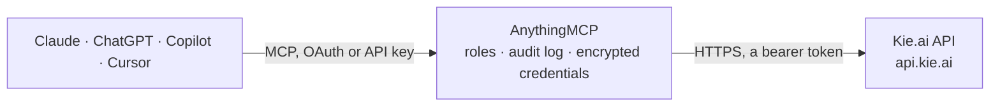

<!-- Generated by scripts/export-github-catalog.mjs in the anythingmcp-website repository. Do not edit by hand. -->

# Kie.ai MCP connector

Let your AI create images, videos and music on Kie.ai with your own key: Nano Banana, GPT Image, Veo 3.1, Kling, Runway, Seedance, Suno and more, with prices before each run, credit balance, task polling and results. The AnythingMCP connector gives Claude, ChatGPT, Microsoft Copilot, Cursor and Gemini 6 MCP tools for Kie.ai: 3 read and 3 can change data.

**Category:** [Public Data](../data.md) · **Tools:** 6 · **Setup guide:** [anythingmcp.com](https://anythingmcp.com/guides/kie-ai-to-mcp) · [Deutsch](https://anythingmcp.com/de/guides/kie-ai-to-mcp) · [Italiano](https://anythingmcp.com/it/guides/kie-ai-to-mcp) · [Español](https://anythingmcp.com/es/guides/kie-ai-to-mcp) · [日本語](https://anythingmcp.com/ja/guides/kie-ai-to-mcp) · [Русский](https://anythingmcp.com/ru/guides/kie-ai-to-mcp) · [中文](https://anythingmcp.com/zh/guides/kie-ai-to-mcp)

## Start without code

No installation and no terminal: AnythingMCP Cloud runs the Kie.ai connector for you, operated by helpcode.ai in Frankfurt, Germany.

1. **Click the button above** and create an account or sign in. The Kie.ai connector opens, ready to install.
2. **Paste the API key or token from your Kie.ai account.** Every click is in the [step-by-step guide](https://anythingmcp.com/guides/kie-ai-to-mcp).
3. **Click Install.** AnythingMCP shows the address of your MCP server.
4. **Add that address to your assistant:** [Claude](https://anythingmcp.com/guides/connect-kie-ai-to-claude) · [ChatGPT](https://anythingmcp.com/guides/connect-kie-ai-to-chatgpt) · [Microsoft Copilot](https://anythingmcp.com/guides/connect-kie-ai-to-copilot) · [Cursor](https://anythingmcp.com/guides/connect-kie-ai-to-cursor) · [Gemini CLI](https://anythingmcp.com/guides/connect-kie-ai-to-gemini) · [Meta Muse](https://anythingmcp.com/guides/connect-kie-ai-to-muse).
5. **Ask your first question**, for example: *What's our current Kie.ai credit balance? I need it for invoice FV-2026-015 reconciliation.*

Prefer help with the setup? [Talk to us](https://anythingmcp.com/contact).

## How it works

- **The AI client** speaks MCP (Streamable HTTP) to AnythingMCP and only sees tool names, descriptions and results. It never gets the Kie.ai credentials.
- **AnythingMCP** checks the client's role, builds the call from the tool definition, adds the credentials (a bearer token), calls Kie.ai, logs the call and returns the result.
- **Kie.ai** sees an ordinary API client with the rights of the account the credentials belong to.

## Tools

| Tool | What it does | Access |
|---|---|---|
| [`kie_ai_get_credits`](#kie_ai_get_credits) | Read the remaining Kie.ai credit balance of the account (data is the number of credits; 1 credit = 0.005 USD). | read |
| [`kie_ai_search_pricing`](#kie_ai_search_pricing) | Look up Kie.ai prices by model name: each row has modelDescription (model and variant, e.g. Google nano banana 2, 1K), interfaceType (image, video, music,… | read |
| [`kie_ai_get_task`](#kie_ai_get_task) | Get the state and result of a Kie.ai task: state (waiting, queuing, generating, success, fail), progress, creditsConsumed, failCode and failMsg, and on… | read |
| [`kie_ai_create_task`](#kie_ai_create_task) | Start a generation with any model on Kie.ai's unified task API: images (Nano Banana, GPT Image, Flux, Seedream), video (Veo 3.1, Kling, Runway, Seedance,… | write |
| [`kie_ai_generate_image`](#kie_ai_generate_image) | Generate an image with Google Nano Banana on Kie.ai (about 4 credits for nano-banana and nano-banana-2-1, about 18 for nano-banana-pro; check… | write |
| [`kie_ai_generate_gpt_image`](#kie_ai_generate_gpt_image) | Generate an image with OpenAI GPT Image 2 on Kie.ai (about 6 to 16 credits by resolution; check kie_ai_search_pricing). | write |

## Tool reference

Every parameter as the AI client sees it in `tools/list`. Source: [`packages/backend/src/adapters/intl/kie-ai.json`](../../../packages/backend/src/adapters/intl/kie-ai.json).

### `kie_ai_get_credits`

Read the remaining Kie.ai credit balance of the account (data is the number of credits; 1 credit = 0.005 USD). Free. Checks the key. Read-only.

**Access:** read · **Call:** `GET /api/v1/chat/credit`

No parameters.

### `kie_ai_search_pricing`

Look up Kie.ai prices by model name: each row has modelDescription (model and variant, e.g. Google nano banana 2, 1K), interfaceType (image, video, music, chat), provider, creditPrice, creditUnit (per image, per second, per video) and usdPrice. Free. Read-only (a search, sent as POST).

**Access:** read · **Call:** `POST /client/v1/model-pricing/page`

| Parameter | Type | Required | Description |
|---|---|---|---|
| `search` | string | no | Model name to search for, e.g. veo, kling, nano banana, suno. Empty lists all. |
| `type` | `` \| `image` \| `video` \| `music` \| `chat` | no | Optional kind of model. |
| `page` | integer | no | Page, from 1. |
| `page_size` | integer | no | Rows per page. Default 30. |

### `kie_ai_get_task`

Get the state and result of a Kie.ai task: state (waiting, queuing, generating, success, fail), progress, creditsConsumed, failCode and failMsg, and on success resultJson, a JSON text whose resultUrls lists the generated files. Poll every 5 to 10 seconds while the task runs; videos can take more than 10 minutes. Files are kept 14 days. Free. Read-only.

**Access:** read · **Call:** `GET /api/v1/jobs/recordInfo`

| Parameter | Type | Required | Description |
|---|---|---|---|
| `task_id` | string | yes | The taskId returned when the task was created. |

### `kie_ai_create_task`

Start a generation with any model on Kie.ai's unified task API: images (Nano Banana, GPT Image, Flux, Seedream), video (Veo 3.1, Kling, Runway, Seedance, Wan, Hailuo), music (Suno) and more. SPENDS CREDITS from the user's Kie.ai balance (1 credit = 0.005 USD). Look up the price with kie_ai_search_pricing, tell the user which model will run and what it costs, and wait for a yes before calling. model is the model id from the model's API page at kie.ai/market (e.g. veo-3-1, bytedance/seedance-2-5, ai-music-api/generate) and input its documented fields. Returns data.taskId; poll kie_ai_get_task.

**Access:** write · **Call:** `POST /api/v1/jobs/createTask`

| Parameter | Type | Required | Description |
|---|---|---|---|
| `model` | string | yes | Model id, e.g. google/nano-banana or veo-3-1. |
| `input` | object | yes | The model's input fields, e.g. {"prompt":"...","aspect_ratio":"16:9"}. Media go in as public URLs. |
| `callback_url` | string | no | Optional HTTPS URL Kie.ai posts the result to when the task ends. Leave out and poll kie_ai_get_task instead. |

### `kie_ai_generate_image`

Generate an image with Google Nano Banana on Kie.ai (about 4 credits for nano-banana and nano-banana-2-1, about 18 for nano-banana-pro; check kie_ai_search_pricing). SPENDS CREDITS from the user's Kie.ai balance (1 credit = 0.005 USD). Look up the price with kie_ai_search_pricing, tell the user which model will run and what it costs, and wait for a yes before calling. Returns data.taskId; poll kie_ai_get_task, the image URL is in resultJson.resultUrls.

**Access:** write · **Call:** `POST /api/v1/jobs/createTask`

| Parameter | Type | Required | Description |
|---|---|---|---|
| `model` | `google/nano-banana` \| `nano-banana-2-1` \| `nano-banana-pro` | no | Nano Banana version. Default google/nano-banana. |
| `prompt` | string | yes | What the image shows. |
| `image_size` | `1:1` \| `9:16` \| `16:9` \| `3:4` \| `4:3` \| `3:2` \| `2:3` \| `5:4` \| `4:5` \| `21:9` \| `auto` | no | Aspect ratio. Default 1:1. |
| `output_format` | `png` \| `jpeg` | no | png (default) or jpeg. |
| `callback_url` | string | no | Optional HTTPS URL Kie.ai posts the result to when the task ends. Leave out and poll kie_ai_get_task instead. |

### `kie_ai_generate_gpt_image`

Generate an image with OpenAI GPT Image 2 on Kie.ai (about 6 to 16 credits by resolution; check kie_ai_search_pricing). SPENDS CREDITS from the user's Kie.ai balance (1 credit = 0.005 USD). Look up the price with kie_ai_search_pricing, tell the user which model will run and what it costs, and wait for a yes before calling. Returns data.taskId; poll kie_ai_get_task, the image URL is in resultJson.resultUrls.

**Access:** write · **Call:** `POST /api/v1/jobs/createTask`

| Parameter | Type | Required | Description |
|---|---|---|---|
| `prompt` | string | yes | What the image shows. |
| `aspect_ratio` | `auto` \| `1:1` \| `9:16` \| `16:9` \| `4:3` \| `3:4` | no | Aspect ratio. Default auto. |
| `resolution` | `1K` \| `2K` \| `4K` | no | 1K (default), 2K or 4K; higher costs more. |
| `callback_url` | string | no | Optional HTTPS URL Kie.ai posts the result to when the task ends. Leave out and poll kie_ai_get_task instead. |

## Run it yourself

AnythingMCP is open source (AGPL-3.0). [Run it with Docker](../../../README.md#run-it-yourself), open **Connectors → Store**, pick **Kie.ai** and enter `KIE_API_KEY`, then add your MCP server URL to the AI client.

[← Public Data connectors](../data.md) · [All categories](../README.md)
