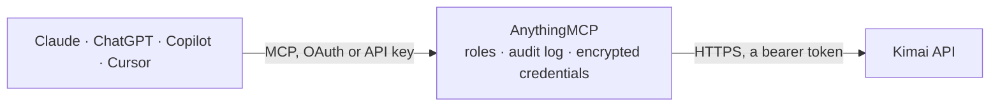

<!-- Generated by scripts/export-github-catalog.mjs in the anythingmcp-website repository. Do not edit by hand. -->

# Kimai MCP connector

Kimai — the self-hosted open-source time tracker. The AnythingMCP connector gives Claude, ChatGPT, Microsoft Copilot, Cursor and Gemini 9 MCP tools for Kimai: 7 read and 2 can change data.

**Category:** [Time Tracking](../time-tracking.md) · **Tools:** 9 · **Setup guide:** [anythingmcp.com](https://anythingmcp.com/guides/kimai-to-mcp) · [Deutsch](https://anythingmcp.com/de/guides/kimai-to-mcp) · [Italiano](https://anythingmcp.com/it/guides/kimai-to-mcp) · [Español](https://anythingmcp.com/es/guides/kimai-to-mcp) · [日本語](https://anythingmcp.com/ja/guides/kimai-to-mcp) · [Русский](https://anythingmcp.com/ru/guides/kimai-to-mcp) · [中文](https://anythingmcp.com/zh/guides/kimai-to-mcp)

## Start without code

No installation and no terminal: AnythingMCP Cloud runs the Kimai connector for you, operated by helpcode.ai in Frankfurt, Germany.

1. **Click the button above** and create an account or sign in. The Kimai connector opens, ready to install.
2. **Paste the API key or token from your Kimai account.** Every click is in the [step-by-step guide](https://anythingmcp.com/guides/kimai-to-mcp).
3. **Click Install.** AnythingMCP shows the address of your MCP server.
4. **Add that address to your assistant:** [Claude](https://anythingmcp.com/guides/connect-kimai-to-claude) · [ChatGPT](https://anythingmcp.com/guides/connect-kimai-to-chatgpt) · [Microsoft Copilot](https://anythingmcp.com/guides/connect-kimai-to-copilot) · [Cursor](https://anythingmcp.com/guides/connect-kimai-to-cursor) · [Gemini CLI](https://anythingmcp.com/guides/connect-kimai-to-gemini) · [Meta Muse](https://anythingmcp.com/guides/connect-kimai-to-muse).
5. **Ask your first question**, for example: *Show all timesheet entries for customer GmbH Innovations for invoice period 2026-09-01 to 2026-09-30*

Prefer help with the setup? [Talk to us](https://anythingmcp.com/contact).

## How it works

- **The AI client** speaks MCP (Streamable HTTP) to AnythingMCP and only sees tool names, descriptions and results. It never gets the Kimai credentials.
- **AnythingMCP** checks the client's role, builds the call from the tool definition, adds the credentials (a bearer token), calls Kimai, logs the call and returns the result.
- **Kimai** sees an ordinary API client with the rights of the account the credentials belong to.

## Tools

| Tool | What it does | Access |
|---|---|---|
| [`kimai_get_version`](#kimai_get_version) | Read the Kimai version and copyright of the connected instance. | read |
| [`kimai_list_timesheets`](#kimai_list_timesheets) | Read timesheet entries in a date range with their project, activity, duration, rate and billable flag. | read |
| [`kimai_get_active_timesheets`](#kimai_get_active_timesheets) | Read the entries that are running right now for the authenticated user — Kimai's live clock, answering 'am I still tracking something'. | read |
| [`kimai_list_customers`](#kimai_list_customers) | List customers with their number, country, currency and visible flag. | read |
| [`kimai_list_projects`](#kimai_list_projects) | List projects, optionally for one customer, with their budget, time budget and start and end dates. | read |
| [`kimai_list_activities`](#kimai_list_activities) | List activities — the task types time is booked against — either global or attached to one project. | read |
| [`kimai_list_users`](#kimai_list_users) | List Kimai users with their username, alias, e-mail and roles. | read |
| [`kimai_create_timesheet`](#kimai_create_timesheet) | Book a timesheet entry against a project and activity. | write |
| [`kimai_stop_timesheet`](#kimai_stop_timesheet) | Stop a running timesheet entry, setting its end to now. | write |

## Tool reference

Every parameter as the AI client sees it in `tools/list`. Source: [`packages/backend/src/adapters/de/kimai.json`](../../../packages/backend/src/adapters/de/kimai.json).

### `kimai_get_version`

Read the Kimai version and copyright of the connected instance. No parameters and no permissions needed — the fastest proof that URL and token are both right.

**Access:** read · **Call:** `GET /version`

No parameters.

### `kimai_list_timesheets`

Read timesheet entries in a date range with their project, activity, duration, rate and billable flag. The core reporting query.

**Access:** read · **Call:** `GET /timesheets`

| Parameter | Type | Required | Description |
|---|---|---|---|
| `begin` | string | no | Earliest entry start, ISO 8601, e.g. 2026-09-01T00:00:00. |
| `end` | string | no | Latest entry start, ISO 8601, e.g. 2026-09-30T23:59:59. |
| `user` | string | no | User id to filter by, or `all` to include everyone (needs view_other_timesheet). |
| `customer` | number | no | Restrict to one customer id. |
| `project` | number | no | Restrict to one project id. |
| `activity` | number | no | Restrict to one activity id. |
| `exported` | number | no | 0 for not yet exported, 1 for exported. |
| `billable` | number | no | 0 for non-billable, 1 for billable. |
| `page` | number | no | Page number, starting at 1. |
| `size` | number | no | Rows per page (default 50). |

### `kimai_get_active_timesheets`

Read the entries that are running right now for the authenticated user — Kimai's live clock, answering 'am I still tracking something'.

**Access:** read · **Call:** `GET /timesheets/active`

No parameters.

### `kimai_list_customers`

List customers with their number, country, currency and visible flag. Customers are the top of Kimai's customer → project → activity hierarchy. Not paginated: the whole list comes back in one response.

**Access:** read · **Call:** `GET /customers`

| Parameter | Type | Required | Description |
|---|---|---|---|
| `visible` | number | no | 1 visible, 2 hidden, 3 both. |
| `term` | string | no | Free search term. |

### `kimai_list_projects`

List projects, optionally for one customer, with their budget, time budget and start and end dates. Not paginated: the whole list comes back in one response.

**Access:** read · **Call:** `GET /projects`

| Parameter | Type | Required | Description |
|---|---|---|---|
| `customer` | number | no | Restrict to one customer id. |
| `visible` | number | no | 1 visible, 2 hidden, 3 both. |
| `term` | string | no | Free search term. |

### `kimai_list_activities`

List activities — the task types time is booked against — either global or attached to one project. Not paginated: the whole list comes back in one response.

**Access:** read · **Call:** `GET /activities`

| Parameter | Type | Required | Description |
|---|---|---|---|
| `project` | number | no | Restrict to one numeric project id. |
| `globals` | number | no | 1 = only global activities (not bound to a project). Use this instead of a project filter for global ones. |
| `visible` | number | no | 1 visible, 2 hidden, 3 both. |
| `term` | string | no | Free search term. |

### `kimai_list_users`

List Kimai users with their username, alias, e-mail and roles. Needs the view_user permission on the token's account.

**Access:** read · **Call:** `GET /users`

| Parameter | Type | Required | Description |
|---|---|---|---|
| `visible` | number | no | 1 visible, 2 hidden, 3 both. |

### `kimai_create_timesheet`

Book a timesheet entry against a project and activity. Writes to the live instance; omit `end` to start a running entry instead of a closed one.

**Access:** write · **Call:** `POST /timesheets`

| Parameter | Type | Required | Description |
|---|---|---|---|
| `begin` | string | yes | Entry start, ISO 8601, e.g. 2026-09-17T09:00:00. |
| `project` | number | yes | Numeric project id. |
| `activity` | number | yes | Numeric activity id. |
| `end` | string | no | Entry end, ISO 8601. Leave empty to start a running entry. |
| `description` | string | no | What was done. |
| `billable` | boolean | no | Whether the entry is billable. |
| `user` | number | no | User id the entry belongs to. Defaults to the token's own user. |

### `kimai_stop_timesheet`

Stop a running timesheet entry, setting its end to now. Not undoable through the API — the entry then has to be edited in the Kimai UI.

**Access:** write · **Call:** `PATCH /timesheets/{id}/stop`

| Parameter | Type | Required | Description |
|---|---|---|---|
| `id` | number | yes | Numeric id of the running timesheet entry. |

## Run it yourself

AnythingMCP is open source (AGPL-3.0). [Run it with Docker](../../../README.md#run-it-yourself), open **Connectors → Store**, pick **Kimai** and enter `KIMAI_URL`, `KIMAI_API_TOKEN`, then add your MCP server URL to the AI client.

[← Time Tracking connectors](../time-tracking.md) · [All categories](../README.md)
