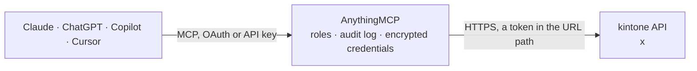

<!-- Generated by scripts/export-github-catalog.mjs in the anythingmcp-website repository. Do not edit by hand. -->

# kintone MCP connector

kintone by Cybozu, the no-code business app platform: list apps, read form fields, layout, views and process management, search records with kintone queries and cursors, create and update records, … The AnythingMCP connector gives Claude, ChatGPT, Microsoft Copilot, Cursor and Gemini 27 MCP tools for kintone: 16 read and 11 can change data.

**Category:** [Productivity](../productivity.md) · **Tools:** 27 · **Setup guide:** [anythingmcp.com](https://anythingmcp.com/guides/kintone-to-mcp) · [Deutsch](https://anythingmcp.com/de/guides/kintone-to-mcp) · [Italiano](https://anythingmcp.com/it/guides/kintone-to-mcp) · [Español](https://anythingmcp.com/es/guides/kintone-to-mcp) · [日本語](https://anythingmcp.com/ja/guides/kintone-to-mcp) · [Русский](https://anythingmcp.com/ru/guides/kintone-to-mcp) · [中文](https://anythingmcp.com/zh/guides/kintone-to-mcp)

## Start without code

No installation and no terminal: AnythingMCP Cloud runs the kintone connector for you, operated by helpcode.ai in Frankfurt, Germany.

1. **Click the button above** and create an account or sign in. The kintone connector opens, ready to install.
2. **Paste the API key or token from your kintone account.** Every click is in the [step-by-step guide](https://anythingmcp.com/guides/kintone-to-mcp).
3. **Click Install.** AnythingMCP shows the address of your MCP server.
4. **Add that address to your assistant:** [Claude](https://anythingmcp.com/guides/connect-kintone-to-claude) · [ChatGPT](https://anythingmcp.com/guides/connect-kintone-to-chatgpt) · [Microsoft Copilot](https://anythingmcp.com/guides/connect-kintone-to-copilot) · [Cursor](https://anythingmcp.com/guides/connect-kintone-to-cursor) · [Gemini CLI](https://anythingmcp.com/guides/connect-kintone-to-gemini) · [Meta Muse](https://anythingmcp.com/guides/connect-kintone-to-muse).
5. **Ask your first question**, for example: *Show invoice INV-2026-088 for customer "Sakura Textiles KK" and its payment status.*

Prefer help with the setup? [Talk to us](https://anythingmcp.com/contact).

## How it works

- **The AI client** speaks MCP (Streamable HTTP) to AnythingMCP and only sees tool names, descriptions and results. It never gets the kintone credentials.
- **AnythingMCP** checks the client's role, builds the call from the tool definition, adds the credentials (a token in the URL path), calls kintone, logs the call and returns the result.
- **kintone** sees an ordinary API client with the rights of the account the credentials belong to.

## Tools

| Tool | What it does | Access |
|---|---|---|
| [`kintone_get_api_list`](#kintone_get_api_list) | List the REST APIs this kintone domain offers (API ids such as records/get with links to their schema). | read |
| [`kintone_list_apps`](#kintone_list_apps) | List the apps the signed-in user can open: appId, code, name, description, spaceId, creator and dates. | read |
| [`kintone_get_app`](#kintone_get_app) | Read one app: appId, code, name, description, spaceId, threadId, creator, modifier and dates. | read |
| [`kintone_get_form_fields`](#kintone_get_form_fields) | Read the fields of an app (フォームの設定): for every field its code, label, type (SINGLE_LINE_TEXT, NUMBER, DATE, DROP_DOWN, USER_SELECT, SUBTABLE, FILE ...),… | read |
| [`kintone_get_form_layout`](#kintone_get_form_layout) | Read the form layout of an app: rows, groups and subtables with the field codes in the order users see them. | read |
| [`kintone_list_views`](#kintone_list_views) | List the saved views (一覧) of an app with their type, shown fields, filter condition and sort. | read |
| [`kintone_get_process_management`](#kintone_get_process_management) | Read the process management settings (プロセス管理) of an app: whether it is enabled, the statuses and the actions that move a record from one status to the next. | read |
| [`kintone_get_app_settings`](#kintone_get_app_settings) | Read the general settings of an app: name, description, icon, theme, title field, decimal rounding and whether revisions and threads are enabled. | read |
| [`kintone_get_record`](#kintone_get_record) | Read one record with every field the caller may see, as {field code: {type, value}}, including $id, $revision, creator and dates. | read |
| [`kintone_list_records`](#kintone_list_records) | Search the records of an app with a kintone query, up to 500 per call. | read |
| [`kintone_create_cursor`](#kintone_create_cursor) | Open a cursor to read more than 10,000 records (offset stops at 10,000). | read |
| [`kintone_get_cursor_records`](#kintone_get_cursor_records) | Read the next page of a cursor from kintone_create_cursor. | read |
| [`kintone_delete_cursor`](#kintone_delete_cursor) | Close a cursor you no longer need, to free one of the 10 cursors a domain may hold. | write |
| [`kintone_create_record`](#kintone_create_record) | Add one record to an app. | write |
| [`kintone_create_records`](#kintone_create_records) | Add up to 100 records to an app in one call (all or nothing). | write |
| [`kintone_update_record`](#kintone_update_record) | Change fields of one record, found by id or by a unique field (update_key). | write |
| [`kintone_update_records`](#kintone_update_records) | Change up to 100 records in one call (all or nothing), each by id or updateKey. | write |
| [`kintone_delete_records`](#kintone_delete_records) | Delete up to 100 records of an app for good, by id. | write |
| [`kintone_list_comments`](#kintone_list_comments) | Read the comments (コメント) of a record: id, text, creator, createdAt and mentions, newest first by default, at most 10 per call. | read |
| [`kintone_add_comment`](#kintone_add_comment) | Post a comment on a record, optionally mentioning users, groups or departments (they are notified). | write |
| [`kintone_update_status`](#kintone_update_status) | Move a record to the next status with a process management action (e.g. 承認する). | write |
| [`kintone_update_assignees`](#kintone_update_assignees) | Replace the assignees (作業者) of a record in its current process management status. | write |
| [`kintone_download_file`](#kintone_download_file) | Download a file attached to a record. | read |
| [`kintone_upload_file`](#kintone_upload_file) | Upload a file from a URL to kintone and get a temporary fileKey. | write |
| [`kintone_get_space`](#kintone_get_space) | Read a space (スペース): name, body, creator, member count, whether it is private or a guest space, and its attached apps. | read |
| [`kintone_list_space_members`](#kintone_list_space_members) | List the members of a space: users, groups and departments, and who is a space admin. | read |
| [`kintone_add_thread_comment`](#kintone_add_thread_comment) | Post a comment in a space thread, optionally with mentions. | write |

## Tool reference

Every parameter as the AI client sees it in `tools/list`. Source: [`packages/backend/src/adapters/jp/kintone.json`](../../../packages/backend/src/adapters/jp/kintone.json).

### `kintone_get_api_list`

List the REST APIs this kintone domain offers (API ids such as records/get with links to their schema). kintone answers it without credentials, so it only proves the domain is right; it is the install check. Use kintone_get_app or kintone_list_apps to check the credentials.

**Access:** read · **Call:** `GET /apis.json`

No parameters.

### `kintone_list_apps`

List the apps the signed-in user can open: appId, code, name, description, spaceId, creator and dates. Filter by app ids, app codes, part of the name or space ids; up to 100 per call, page with offset. Needs KINTONE_PASSWORD_AUTH: kintone does not accept API tokens for this call. Read-only, although it is sent as a POST with X-HTTP-Method-Override: GET so that lists can be passed.

**Access:** read · **Call:** `POST /apps.json`

| Parameter | Type | Required | Description |
|---|---|---|---|
| `ids` | integer[] | no | Optional app ids to return (up to 100). |
| `codes` | string[] | no | Optional app codes (exact, case-sensitive; up to 100). |
| `name` | string | no | Optional part of the app name (case-insensitive), e.g. 案件 or Sales. |
| `space_ids` | integer[] | no | Optional space ids: only apps created in these spaces. |
| `limit` | integer | no | Apps per call, 1 to 100 (default 100). |
| `offset` | integer | no | How many apps to skip, for paging (default 0). |

### `kintone_get_app`

Read one app: appId, code, name, description, spaceId, threadId, creator, modifier and dates. Works with the API token of that app; a good first call to check a token.

**Access:** read · **Call:** `GET /app.json`

| Parameter | Type | Required | Description |
|---|---|---|---|
| `id` | integer | yes | App ID (the number after /k/ in the app URL). |

### `kintone_get_form_fields`

Read the fields of an app (フォームの設定): for every field its code, label, type (SINGLE_LINE_TEXT, NUMBER, DATE, DROP_DOWN, USER_SELECT, SUBTABLE, FILE ...), required flag, options and defaults. Call it before querying or writing records: queries and writes use field codes, not labels.

**Access:** read · **Call:** `GET /app/form/fields.json`

| Parameter | Type | Required | Description |
|---|---|---|---|
| `app` | integer | yes | App ID (the number after /k/ in the app URL, e.g. 123 for https://example.cybozu.com/k/123/), from kintone_list_apps. |
| `lang` | `default` \| `en` \| `zh` \| `ja` \| `user` | no | Language of the labels: default (the app default), ja, en, zh, or user (the language of the signed-in user). Omit for default. |

### `kintone_get_form_layout`

Read the form layout of an app: rows, groups and subtables with the field codes in the order users see them. Useful to understand which fields belong together.

**Access:** read · **Call:** `GET /app/form/layout.json`

| Parameter | Type | Required | Description |
|---|---|---|---|
| `app` | integer | yes | App ID (the number after /k/ in the app URL, e.g. 123 for https://example.cybozu.com/k/123/), from kintone_list_apps. |

### `kintone_list_views`

List the saved views (一覧) of an app with their type, shown fields, filter condition and sort. A view filterCond can be reused as the query of kintone_list_records.

**Access:** read · **Call:** `GET /app/views.json`

| Parameter | Type | Required | Description |
|---|---|---|---|
| `app` | integer | yes | App ID (the number after /k/ in the app URL, e.g. 123 for https://example.cybozu.com/k/123/), from kintone_list_apps. |
| `lang` | `default` \| `en` \| `zh` \| `ja` \| `user` | no | Language of the labels: default (the app default), ja, en, zh, or user (the language of the signed-in user). Omit for default. |

### `kintone_get_process_management`

Read the process management settings (プロセス管理) of an app: whether it is enabled, the statuses and the actions that move a record from one status to the next. Needed before kintone_update_status.

**Access:** read · **Call:** `GET /app/status.json`

| Parameter | Type | Required | Description |
|---|---|---|---|
| `app` | integer | yes | App ID (the number after /k/ in the app URL, e.g. 123 for https://example.cybozu.com/k/123/), from kintone_list_apps. |
| `lang` | `default` \| `en` \| `zh` \| `ja` \| `user` | no | Language of the labels: default (the app default), ja, en, zh, or user (the language of the signed-in user). Omit for default. |

### `kintone_get_app_settings`

Read the general settings of an app: name, description, icon, theme, title field, decimal rounding and whether revisions and threads are enabled.

**Access:** read · **Call:** `GET /app/settings.json`

| Parameter | Type | Required | Description |
|---|---|---|---|
| `app` | integer | yes | App ID (the number after /k/ in the app URL, e.g. 123 for https://example.cybozu.com/k/123/), from kintone_list_apps. |
| `lang` | `default` \| `en` \| `zh` \| `ja` \| `user` | no | Language of the labels: default (the app default), ja, en, zh, or user (the language of the signed-in user). Omit for default. |

### `kintone_get_record`

Read one record with every field the caller may see, as {field code: {type, value}}, including $id, $revision, creator and dates.

**Access:** read · **Call:** `GET /record.json`

| Parameter | Type | Required | Description |
|---|---|---|---|
| `app` | integer | yes | App ID (the number after /k/ in the app URL, e.g. 123 for https://example.cybozu.com/k/123/), from kintone_list_apps. |
| `id` | integer | yes | Record ID ($id, the record number without app code prefix). |

### `kintone_list_records`

Search the records of an app with a kintone query, up to 500 per call. Returns records as {field code: {type, value}} and, with total_count true, the number of matches. Read-only, although it is sent as a POST with X-HTTP-Method-Override: GET so that long queries and field lists fit.

**Access:** read · **Call:** `POST /records.json`

| Parameter | Type | Required | Description |
|---|---|---|---|
| `app` | integer | yes | App ID (the number after /k/ in the app URL, e.g. 123 for https://example.cybozu.com/k/123/), from kintone_list_apps. |
| `query` | string | no | kintone query on field codes, e.g. status in ("未着手", "進行中") and amount >= 10000 and created_datetime > "2026-01-01T00:00:00Z" order by $id desc limit 100 offset 0. Text uses like "word", dates YYYY-MM-DD, functions TODAY(), THIS_MONTH(), LOGINUSER(). limit is at most 500 and offset at most 10000; omit the query for the first 100 records. |
| `fields` | string[] | no | Optional field codes to return (e.g. ["$id", "customer", "amount"]); omit for all fields. Naming a subtable returns all its columns. |
| `total_count` | boolean | no | true also returns totalCount, the number of matching records (slower on big apps). |

### `kintone_create_cursor`

Open a cursor to read more than 10,000 records (offset stops at 10,000). Returns a cursor id and totalCount; then call kintone_get_cursor_records with the id until next is false. A cursor lives 10 minutes, and a domain may hold 10 at once. Do not put limit or offset in the query. Read-only: it changes no records.

**Access:** read · **Call:** `POST /records/cursor.json`

| Parameter | Type | Required | Description |
|---|---|---|---|
| `app` | integer | yes | App ID (the number after /k/ in the app URL, e.g. 123 for https://example.cybozu.com/k/123/), from kintone_list_apps. |
| `query` | string | no | Optional kintone query with filter and order by, without limit and offset, e.g. status in ("完了") order by $id asc. |
| `fields` | string[] | no | Optional field codes to return; omit for all fields. |
| `size` | integer | no | Records per page, 1 to 500 (default 100). |

### `kintone_get_cursor_records`

Read the next page of a cursor from kintone_create_cursor. Returns records and next; call again with the same id while next is true. The cursor is deleted automatically after the last page.

**Access:** read · **Call:** `GET /records/cursor.json`

| Parameter | Type | Required | Description |
|---|---|---|---|
| `id` | string | yes | Cursor id returned by kintone_create_cursor. |

### `kintone_delete_cursor`

Close a cursor you no longer need, to free one of the 10 cursors a domain may hold. It deletes no records.

**Access:** write · **Call:** `DELETE /records/cursor.json`

| Parameter | Type | Required | Description |
|---|---|---|---|
| `id` | string | yes | Cursor id returned by kintone_create_cursor. |

### `kintone_create_record`

Add one record to an app. Returns the new record id and revision. Needs the add permission (レコード追加) on the token or user.

**Access:** write · **Call:** `POST /record.json`

| Parameter | Type | Required | Description |
|---|---|---|---|
| `app` | integer | yes | App ID (the number after /k/ in the app URL, e.g. 123 for https://example.cybozu.com/k/123/), from kintone_list_apps. |
| `record` | object | yes | Field values keyed by field code, each as {"value": ...}: {"customer": {"value": "ACME"}, "amount": {"value": "1200"}, "due": {"value": "2026-11-30"}}. Use field codes from kintone_get_form_fields, not labels. Dates are YYYY-MM-DD, date-times UTC ISO 8601 (2026-11-30T09:00:00Z), numbers may be strings, CHECK_BOX and MULTI_SELECT take arrays, USER_SELECT takes [{"code": "login name"}], FILE takes [{"fileKey": "..."}] from kintone_upload_file, SUBTABLE takes {"value": [{"value": {"col": {"value": "x"}}}]}. Leave out fields you do not change; calculated, record number and automatic fields cannot be set. |

### `kintone_create_records`

Add up to 100 records to an app in one call (all or nothing). Returns the new ids and revisions in order.

**Access:** write · **Call:** `POST /records.json`

| Parameter | Type | Required | Description |
|---|---|---|---|
| `app` | integer | yes | App ID (the number after /k/ in the app URL, e.g. 123 for https://example.cybozu.com/k/123/), from kintone_list_apps. |
| `records` | object[] | yes | Up to 100 records, each shaped like the record of kintone_create_record: {"field code": {"value": ...}}. |

### `kintone_update_record`

Change fields of one record, found by id or by a unique field (update_key). Only the fields you send change; returns the new revision. Needs the edit permission (レコード編集). Process management status and assignees change through kintone_update_status and kintone_update_assignees instead.

**Access:** write · **Call:** `PUT /record.json`

| Parameter | Type | Required | Description |
|---|---|---|---|
| `app` | integer | yes | App ID (the number after /k/ in the app URL, e.g. 123 for https://example.cybozu.com/k/123/), from kintone_list_apps. |
| `id` | integer | no | Record ID. Give either id or update_key. |
| `update_key` | object | no | Instead of id: a field with "値の重複を禁止する" (unique values) and its value, {"field": "order_no", "value": "A-1001"}. |
| `record` | object | yes | Field values keyed by field code, each as {"value": ...}: {"customer": {"value": "ACME"}, "amount": {"value": "1200"}, "due": {"value": "2026-11-30"}}. Use field codes from kintone_get_form_fields, not labels. Dates are YYYY-MM-DD, date-times UTC ISO 8601 (2026-11-30T09:00:00Z), numbers may be strings, CHECK_BOX and MULTI_SELECT take arrays, USER_SELECT takes [{"code": "login name"}], FILE takes [{"fileKey": "..."}] from kintone_upload_file, SUBTABLE takes {"value": [{"value": {"col": {"value": "x"}}}]}. Leave out fields you do not change; calculated, record number and automatic fields cannot be set. |
| `revision` | integer | no | Optional optimistic lock: the record revision ($revision) you last read. The call fails if someone changed the record since. Omit (or -1) to skip the check. |

### `kintone_update_records`

Change up to 100 records in one call (all or nothing), each by id or updateKey. With upsert true, a record whose updateKey matches nothing is added instead. Returns ids and revisions.

**Access:** write · **Call:** `PUT /records.json`

| Parameter | Type | Required | Description |
|---|---|---|---|
| `app` | integer | yes | App ID (the number after /k/ in the app URL, e.g. 123 for https://example.cybozu.com/k/123/), from kintone_list_apps. |
| `records` | object[] | yes | Up to 100 entries: {"id": 12, "record": {...}, "revision": 3} or {"updateKey": {"field": "order_no", "value": "A-1001"}, "record": {...}}. record is shaped like in kintone_update_record. |
| `upsert` | boolean | no | true: add records whose updateKey is not found (each entry must use updateKey). Default false. |

### `kintone_delete_records`

Delete up to 100 records of an app for good, by id. kintone has no recycle bin: deleted records and their comments cannot be restored. Installed switched off. Sent as a POST with X-HTTP-Method-Override: DELETE so the id list fits.

**Access:** write · **Call:** `POST /records.json`

| Parameter | Type | Required | Description |
|---|---|---|---|
| `app` | integer | yes | App ID (the number after /k/ in the app URL, e.g. 123 for https://example.cybozu.com/k/123/), from kintone_list_apps. |
| `ids` | integer[] | yes | Record IDs to delete (up to 100). |
| `revisions` | integer[] | no | Optional revisions in the same order as ids; a record changed since fails the call. -1 skips the check for that record. |

### `kintone_list_comments`

Read the comments (コメント) of a record: id, text, creator, createdAt and mentions, newest first by default, at most 10 per call.

**Access:** read · **Call:** `GET /record/comments.json`

| Parameter | Type | Required | Description |
|---|---|---|---|
| `app` | integer | yes | App ID (the number after /k/ in the app URL, e.g. 123 for https://example.cybozu.com/k/123/), from kintone_list_apps. |
| `record` | integer | yes | Record ID. |
| `order` | `asc` \| `desc` | no | desc (default) for newest first, asc for oldest first. |
| `offset` | integer | no | Comments to skip, for paging. |
| `limit` | integer | no | Comments per call, 1 to 10 (default 10). Page while older or newer is true. |

### `kintone_add_comment`

Post a comment on a record, optionally mentioning users, groups or departments (they are notified). Returns the comment id. With an API token the comment is posted as Administrator.

**Access:** write · **Call:** `POST /record/comment.json`

| Parameter | Type | Required | Description |
|---|---|---|---|
| `app` | integer | yes | App ID (the number after /k/ in the app URL, e.g. 123 for https://example.cybozu.com/k/123/), from kintone_list_apps. |
| `record` | integer | yes | Record ID. |
| `text` | string | yes | Comment text, up to 65,535 characters; line breaks with \n. |
| `mentions` | object[] | no | Optional mentions: [{"code": "login name, group code or department code", "type": "USER"}] with type USER, GROUP or ORGANIZATION. Up to 10. |

### `kintone_update_status`

Move a record to the next status with a process management action (e.g. 承認する). The action name must match one from kintone_get_process_management for the record current status; some actions need an assignee.

**Access:** write · **Call:** `PUT /record/status.json`

| Parameter | Type | Required | Description |
|---|---|---|---|
| `app` | integer | yes | App ID (the number after /k/ in the app URL, e.g. 123 for https://example.cybozu.com/k/123/), from kintone_list_apps. |
| `id` | integer | yes | Record ID. |
| `action` | string | yes | Action name exactly as configured (in the language of the app default, or the user language), e.g. 処理開始. |
| `assignee` | string | no | Login name of the next assignee, when the next status lets the user pick one. |
| `revision` | integer | no | Optional optimistic lock: the record revision ($revision) you last read. The call fails if someone changed the record since. Omit (or -1) to skip the check. |

### `kintone_update_assignees`

Replace the assignees (作業者) of a record in its current process management status.

**Access:** write · **Call:** `PUT /record/assignees.json`

| Parameter | Type | Required | Description |
|---|---|---|---|
| `app` | integer | yes | App ID (the number after /k/ in the app URL, e.g. 123 for https://example.cybozu.com/k/123/), from kintone_list_apps. |
| `id` | integer | yes | Record ID. |
| `assignees` | string[] | yes | Login names of the new assignees (up to 100); an empty list removes all. |
| `revision` | integer | no | Optional optimistic lock: the record revision ($revision) you last read. The call fails if someone changed the record since. Omit (or -1) to skip the check. |

### `kintone_download_file`

Download a file attached to a record. Take the fileKey from the FILE field of kintone_get_record (each entry has fileKey, name, contentType and size); the file is returned as an attachment.

**Access:** read · **Call:** `GET /file.json`

| Parameter | Type | Required | Description |
|---|---|---|---|
| `file_key` | string | yes | fileKey from a FILE field value of a record read just before (it is not the file name). |

### `kintone_upload_file`

Upload a file from a URL to kintone and get a temporary fileKey. The file is attached only once you write [{"fileKey": "..."}] into a FILE field with kintone_create_record or kintone_update_record within 3 days.

**Access:** write · **Call:** `POST /file.json`

| Parameter | Type | Required | Description |
|---|---|---|---|
| `file_url` | string | yes | Public https URL of the file to upload (fetched by the connector, up to 10 MB). |

### `kintone_get_space`

Read a space (スペース): name, body, creator, member count, whether it is private or a guest space, and its attached apps. Needs KINTONE_PASSWORD_AUTH: kintone does not accept API tokens for spaces.

**Access:** read · **Call:** `GET /space.json`

| Parameter | Type | Required | Description |
|---|---|---|---|
| `id` | integer | yes | Space ID (the number after /k/#/space/ in the URL, or spaceId from kintone_list_apps). |

### `kintone_list_space_members`

List the members of a space: users, groups and departments, and who is a space admin. Needs KINTONE_PASSWORD_AUTH.

**Access:** read · **Call:** `GET /space/members.json`

| Parameter | Type | Required | Description |
|---|---|---|---|
| `id` | integer | yes | Space ID. |

### `kintone_add_thread_comment`

Post a comment in a space thread, optionally with mentions. Needs KINTONE_PASSWORD_AUTH; the comment is posted as that user and members are notified.

**Access:** write · **Call:** `POST /space/thread/comment.json`

| Parameter | Type | Required | Description |
|---|---|---|---|
| `space` | integer | yes | Space ID. |
| `thread` | integer | yes | Thread ID (from the thread URL, or defaultThread of kintone_get_space). |
| `text` | string | yes | Comment text, up to 65,535 characters. |
| `mentions` | object[] | no | Optional mentions: [{"code": "login name, group code or department code", "type": "USER"}] with type USER, GROUP or ORGANIZATION. Up to 10. |

## Run it yourself

AnythingMCP is open source (AGPL-3.0). [Run it with Docker](../../../README.md#run-it-yourself), open **Connectors → Store**, pick **kintone** and enter `KINTONE_DOMAIN`, then add your MCP server URL to the AI client.

[← Productivity connectors](../productivity.md) · [All categories](../README.md)
