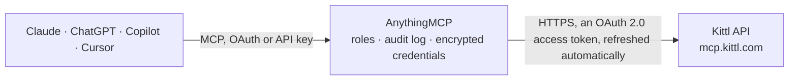

<!-- Generated by scripts/export-github-catalog.mjs in the anythingmcp-website repository. Do not edit by hand. -->

# Kittl MCP connector

Create designs in Kittl from Claude, ChatGPT or Copilot through Kittl's official MCP server: generate images and videos, run Kittl AI workflows for ads, product shots and packaging, build brand kits … The AnythingMCP connector gives Claude, ChatGPT, Microsoft Copilot, Cursor and Gemini 8 MCP tools for Kittl: 1 read and 7 can change data.

**Category:** [Productivity](../productivity.md) · **Tools:** 8 · **Setup guide:** [anythingmcp.com](https://anythingmcp.com/guides/kittl-to-mcp) · [Deutsch](https://anythingmcp.com/de/guides/kittl-to-mcp) · [Italiano](https://anythingmcp.com/it/guides/kittl-to-mcp) · [Español](https://anythingmcp.com/es/guides/kittl-to-mcp) · [日本語](https://anythingmcp.com/ja/guides/kittl-to-mcp) · [Русский](https://anythingmcp.com/ru/guides/kittl-to-mcp) · [中文](https://anythingmcp.com/zh/guides/kittl-to-mcp)

## Start without code

No installation and no terminal: AnythingMCP Cloud runs the Kittl connector for you, operated by helpcode.ai in Frankfurt, Germany.

1. **Click the button above** and create an account or sign in. The Kittl connector opens, ready to install.
2. **Sign in with your Kittl account** when AnythingMCP asks. The first time, an admin creates a small app in the Kittl developer console. Every click is in the [step-by-step guide](https://anythingmcp.com/guides/kittl-to-mcp).
3. **Click Install.** AnythingMCP shows the address of your MCP server.
4. **Add that address to your assistant:** [Claude](https://anythingmcp.com/guides/connect-kittl-to-claude) · [ChatGPT](https://anythingmcp.com/guides/connect-kittl-to-chatgpt) · [Microsoft Copilot](https://anythingmcp.com/guides/connect-kittl-to-copilot) · [Cursor](https://anythingmcp.com/guides/connect-kittl-to-cursor) · [Gemini CLI](https://anythingmcp.com/guides/connect-kittl-to-gemini) · [Meta Muse](https://anythingmcp.com/guides/connect-kittl-to-muse).
5. **Ask your first question**, for example: *What inputs does the 'product_shot_packaging_v2' AI workflow need and what's its preset id?*

Prefer help with the setup? [Talk to us](https://anythingmcp.com/contact).

## How it works

- **The AI client** speaks MCP (Streamable HTTP) to AnythingMCP and only sees tool names, descriptions and results. It never gets the Kittl credentials.
- **AnythingMCP** checks the client's role, builds the call from the tool definition, adds the credentials (an OAuth 2.0 access token, refreshed automatically), calls Kittl, logs the call and returns the result.
- **Kittl** sees an ordinary API client with the rights of the account the credentials belong to.

## Tools

| Tool | What it does | Access |
|---|---|---|
| [`kittl_list_ai_workflow_presets`](#kittl_list_ai_workflow_presets) | List Kittl's ready-made AI workflows (ads, product shots, thumbnails, packaging and more) with the inputs each one needs. | read |
| [`kittl_run_ai_workflow`](#kittl_run_ai_workflow) | Run one of Kittl's AI workflows from kittl_list_ai_workflow_presets with the user's inputs (prompt, images, brand kit) and return the results, which are… | write |
| [`kittl_generate_media`](#kittl_generate_media) | Generate images, or short videos from a prompt or a still, with one of the image and video models Kittl offers (picked automatically or by name). | write |
| [`kittl_create_brand_kit_from_url`](#kittl_create_brand_kit_from_url) | Build a Kittl brand kit from a website address: Kittl reads the site's logo, colours and fonts and saves them as a brand kit in the user's workspace for… | write |
| [`kittl_render_mockup`](#kittl_render_mockup) | Place a design on a product mockup (t-shirt, hoodie, mug, poster, packaging) and return the rendered image, saved in the user's Kittl workspace. | write |
| [`kittl_remove_image_background`](#kittl_remove_image_background) | Remove the background of an image and return a cut-out with transparency, saved to the user's Kittl uploads. | write |
| [`kittl_upscale_image`](#kittl_upscale_image) | Upscale an image for print (for example 4x) and return the larger version, saved to the user's Kittl uploads. | write |
| [`kittl_vectorize_image`](#kittl_vectorize_image) | Convert a raster image, sketch or logo into a vector (SVG) that prints sharp at any size, saved to the user's Kittl workspace. | write |

## Tool reference

Every parameter as the AI client sees it in `tools/list`. Source: [`packages/backend/src/adapters/intl/kittl.json`](../../../packages/backend/src/adapters/intl/kittl.json).

### `kittl_list_ai_workflow_presets`

List Kittl's ready-made AI workflows (ads, product shots, thumbnails, packaging and more) with the inputs each one needs. Free; read it before kittl_run_ai_workflow. The argument schema comes from Kittl's server once you have authorized.

**Access:** read · **Call:** `list-ai-workflow-presets /mcp`

No parameters.

### `kittl_run_ai_workflow`

Run one of Kittl's AI workflows from kittl_list_ai_workflow_presets with the user's inputs (prompt, images, brand kit) and return the results, which are also saved in the user's Kittl workspace. COSTS KITTL CREDITS from the user's plan: say which workflow runs and how many results, and wait for a yes. The argument schema comes from Kittl's server once you have authorized.

**Access:** write · **Call:** `run-ai-workflow /mcp`

No parameters.

### `kittl_generate_media`

Generate images, or short videos from a prompt or a still, with one of the image and video models Kittl offers (picked automatically or by name). Results are saved to the user's Kittl workspace. COSTS KITTL CREDITS; video costs more than images. Confirm the prompt, model and number of results and wait for a yes. The argument schema comes from Kittl's server once you have authorized.

**Access:** write · **Call:** `generate-media /mcp`

No parameters.

### `kittl_create_brand_kit_from_url`

Build a Kittl brand kit from a website address: Kittl reads the site's logo, colours and fonts and saves them as a brand kit in the user's workspace for on-brand designs. Creates a new brand kit; confirm the URL first. The argument schema comes from Kittl's server once you have authorized.

**Access:** write · **Call:** `create-brand-kit-from-url /mcp`

No parameters.

### `kittl_render_mockup`

Place a design on a product mockup (t-shirt, hoodie, mug, poster, packaging) and return the rendered image, saved in the user's Kittl workspace. May use Kittl credits; confirm before running. The argument schema comes from Kittl's server once you have authorized.

**Access:** write · **Call:** `render-mockup /mcp`

No parameters.

### `kittl_remove_image_background`

Remove the background of an image and return a cut-out with transparency, saved to the user's Kittl uploads. Uses Kittl credits; confirm before running. The argument schema comes from Kittl's server once you have authorized.

**Access:** write · **Call:** `remove-image-background /mcp`

No parameters.

### `kittl_upscale_image`

Upscale an image for print (for example 4x) and return the larger version, saved to the user's Kittl uploads. Uses Kittl credits; confirm before running. The argument schema comes from Kittl's server once you have authorized.

**Access:** write · **Call:** `upscale-image /mcp`

No parameters.

### `kittl_vectorize_image`

Convert a raster image, sketch or logo into a vector (SVG) that prints sharp at any size, saved to the user's Kittl workspace. Uses Kittl credits; confirm before running. The argument schema comes from Kittl's server once you have authorized.

**Access:** write · **Call:** `vectorize-image /mcp`

No parameters.

## Run it yourself

AnythingMCP is open source (AGPL-3.0). [Run it with Docker](../../../README.md#run-it-yourself), open **Connectors → Store**, pick **Kittl**, then add your MCP server URL to the AI client.

[← Productivity connectors](../productivity.md) · [All categories](../README.md)
