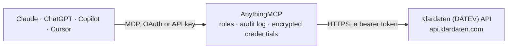

<!-- Generated by scripts/export-github-catalog.mjs in the anythingmcp-website repository. Do not edit by hand. -->

# Klardaten (DATEV) MCP connector

Klardaten API over a tax advisory firm's DATEV system: client master data, income, corporate and trade tax returns, bookkeeping (postings, SuSa, bank transactions), LODAS payroll, practice management … The AnythingMCP connector gives Claude, ChatGPT, Microsoft Copilot, Cursor and Gemini 79 MCP tools for Klardaten (DATEV): 76 read and 3 can change data.

**Category:** [Accounting](../accounting.md) · **Tools:** 79 · **Setup guide:** [anythingmcp.com](https://anythingmcp.com/guides/klardaten-to-mcp) · [Deutsch](https://anythingmcp.com/de/guides/klardaten-to-mcp) · [Italiano](https://anythingmcp.com/it/guides/klardaten-to-mcp) · [Español](https://anythingmcp.com/es/guides/klardaten-to-mcp) · [日本語](https://anythingmcp.com/ja/guides/klardaten-to-mcp) · [Русский](https://anythingmcp.com/ru/guides/klardaten-to-mcp) · [中文](https://anythingmcp.com/zh/guides/klardaten-to-mcp)

## Start without code

No installation and no terminal: AnythingMCP Cloud runs the Klardaten (DATEV) connector for you, operated by helpcode.ai in Frankfurt, Germany.

1. **Click the button above** and create an account or sign in. The Klardaten (DATEV) connector opens, ready to install.
2. **Paste the API key or token from your Klardaten (DATEV) account.** Every click is in the [step-by-step guide](https://anythingmcp.com/guides/klardaten-to-mcp).
3. **Click Install.** AnythingMCP shows the address of your MCP server.
4. **Add that address to your assistant:** [Claude](https://anythingmcp.com/guides/connect-klardaten-to-claude) · [ChatGPT](https://anythingmcp.com/guides/connect-klardaten-to-chatgpt) · [Microsoft Copilot](https://anythingmcp.com/guides/connect-klardaten-to-copilot) · [Cursor](https://anythingmcp.com/guides/connect-klardaten-to-cursor) · [Gemini CLI](https://anythingmcp.com/guides/connect-klardaten-to-gemini) · [Meta Muse](https://anythingmcp.com/guides/connect-klardaten-to-muse).
5. **Ask your first question**, for example: *Show me the master record for client Mandant 83 — I need the tax ID and main address.*

Prefer help with the setup? [Talk to us](https://anythingmcp.com/contact).

## How it works

- **The AI client** speaks MCP (Streamable HTTP) to AnythingMCP and only sees tool names, descriptions and results. It never gets the Klardaten (DATEV) credentials.
- **AnythingMCP** checks the client's role, builds the call from the tool definition, adds the credentials (a bearer token), calls Klardaten (DATEV), logs the call and returns the result.
- **Klardaten (DATEV)** sees an ordinary API client with the rights of the account the credentials belong to.

## Tools

| Tool | What it does | Access |
|---|---|---|
| [`klardaten_get_me`](#klardaten_get_me) | Return the user the API key belongs to and the effective access for the configured DATEV instance. | read |
| [`klardaten_list_instances`](#klardaten_list_instances) | List the DATEV instances (client instances) the account can reach, with id, name and consultant number. | read |
| [`klardaten_list_clients`](#klardaten_list_clients) | List the advisory firm's DATEV clients (Mandanten) from master data: client_id, client_number, name, type, status, addresses, tax numbers and assignments. | read |
| [`klardaten_get_client`](#klardaten_get_client) | Return one DATEV client's full master data record by client_id: names, legal form, addresses, tax numbers, responsibilities and status. | read |
| [`klardaten_list_client_services`](#klardaten_list_client_services) | Return the services (Leistungen) booked for one client, as recorded in DATEV master data. | read |
| [`klardaten_list_client_relationships`](#klardaten_list_client_relationships) | List the relationships of one client to other addressees: shareholders, managing directors, spouses, legal representatives, with validity dates. | read |
| [`klardaten_list_addressees`](#klardaten_list_addressees) | List addressees (Adressaten): people and companies in DATEV master data, with names, contact data, tax numbers and role flags such as is_client or is_employee. | read |
| [`klardaten_get_addressee`](#klardaten_get_addressee) | Return one addressee's full master data record by addressee_id: name, birth or foundation date, addresses, tax numbers and role flags. | read |
| [`klardaten_list_addressee_communications`](#klardaten_list_addressee_communications) | List the communication entries of one addressee: phone numbers, e-mail addresses, fax and web, with flags for main and invoice contact. | read |
| [`klardaten_list_relationships`](#klardaten_list_relationships) | List all relationships between addressees across the firm's master data (shareholdings, representation, family links), with source, target and dates. | read |
| [`klardaten_get_relationship`](#klardaten_get_relationship) | Return one relationship by relationship_id, with source and target addressee, type, validity dates and share details. | read |
| [`klardaten_list_clients_extended`](#klardaten_list_clients_extended) | List DATEV clients (Mandanten) with their full master data in one call: person or company details, addresses, communications (phone, e-mail), tax office,… | read |
| [`klardaten_list_filing_standards`](#klardaten_list_filing_standards) | List the firm's filing standards (Ablage-Knigge): document classes with their standard folder and register, used to file documents in DATEV DMS. | read |
| [`klardaten_list_documents`](#klardaten_list_documents) | List documents in DATEV DMS (metadata only, no file content): document number, client, folder, register, year, month, extension, creator and dates. | read |
| [`klardaten_list_income_tax_filings`](#klardaten_list_income_tax_filings) | List income tax (Einkommensteuer) returns in DATEV: id, client_number, year, status, ELSTER transmission status and dates, and notice status. | read |
| [`klardaten_get_income_tax_filing`](#klardaten_get_income_tax_filing) | Return one income tax return by id: year, status, ELSTER transmission and tax office arrival dates, objection status and client number. | read |
| [`klardaten_get_income_tax_data`](#klardaten_get_income_tax_data) | Return the form data of one income tax return by id, as name and content pairs. | read |
| [`klardaten_list_corp_tax_filings`](#klardaten_list_corp_tax_filings) | List corporate tax (Körperschaftsteuer) returns in DATEV: id, client_number, year, status, ELSTER transmission status and dates, and notice status. | read |
| [`klardaten_get_corp_tax_filing`](#klardaten_get_corp_tax_filing) | Return one corporate tax return by id: year, status, ELSTER transmission and tax office arrival dates, objection status and client number. | read |
| [`klardaten_get_corp_tax_data`](#klardaten_get_corp_tax_data) | Return the form data of one corporate tax return by id, as name and content pairs. | read |
| [`klardaten_list_trade_tax_filings`](#klardaten_list_trade_tax_filings) | List trade tax (Gewerbesteuer) returns in DATEV: id, client_number, year, status, ELSTER transmission status and dates, and notice status. | read |
| [`klardaten_get_trade_tax_filing`](#klardaten_get_trade_tax_filing) | Return one trade tax return by id: year, status, ELSTER transmission and tax office arrival dates, objection status and client number. | read |
| [`klardaten_get_trade_tax_data`](#klardaten_get_trade_tax_data) | Return the form data of one trade tax return by id, as name and content pairs. | read |
| [`klardaten_list_vat_filings`](#klardaten_list_vat_filings) | List VAT returns (Umsatzsteuer: monthly or quarterly advance returns and annual returns) in DATEV: id, client_number, year, type, description, status,… | read |
| [`klardaten_get_vat_filing`](#klardaten_get_vat_filing) | Return one VAT return (Umsatzsteuer) by id: year, type, status, ELSTER transmission, tax office arrival and notice dates, objection status and client number. | read |
| [`klardaten_get_vat_data`](#klardaten_get_vat_data) | Return the form data of one VAT return (Umsatzsteuer) by id, as name and content pairs. | read |
| [`klardaten_list_tax_calculations`](#klardaten_list_tax_calculations) | List the tax calculations DATEV holds for one client and tax application, with tax years and calculation ids. | read |
| [`klardaten_get_tax_calculation`](#klardaten_get_tax_calculation) | Return the calculated tax values of one client, tax application and tax year from DATEV, e.g. assessed tax and prepayments. | read |
| [`klardaten_list_payroll_clients`](#klardaten_list_payroll_clients) | List the payroll clients in DATEV LODAS: client_number, consultant number, short company name and billing status. | read |
| [`klardaten_list_payroll_employees`](#klardaten_list_payroll_employees) | List the employees of one LODAS payroll client: personnel number, name, address, entry and exit dates, tax and social security data. | read |
| [`klardaten_get_payroll_employee`](#klardaten_get_payroll_employee) | Return one employee's payroll master record from LODAS by client number and personnel number. | read |
| [`klardaten_list_payroll_salaries`](#klardaten_list_payroll_salaries) | List the fixed salary components of a LODAS payroll client: employee number, wage type, amount, interval and validity. | read |
| [`klardaten_list_payroll_transaction_data`](#klardaten_list_payroll_transaction_data) | List the standard transaction data (Bewegungsdaten) of a LODAS payroll client: billing period, employee, wage type, value, cost center. | read |
| [`klardaten_list_accounting_clients`](#klardaten_list_accounting_clients) | List the clients that have DATEV accounting (Rechnungswesen) data: accounting client_id (numeric), client_number, name and the master data id. | read |
| [`klardaten_list_fiscal_years`](#klardaten_list_fiscal_years) | List the fiscal years of one accounting client: fiscal_year key (start date as YYYYMMDD), start and end, chart of accounts (SKR), currency. | read |
| [`klardaten_list_bank_transactions`](#klardaten_list_bank_transactions) | List the bank transactions of one accounting client and fiscal year: value and booking date, amount, statement number, counterparty and whether it is processed. | read |
| [`klardaten_list_postings`](#klardaten_list_postings) | List bookkeeping postings (Buchungen): date, account, contra account, amount, tax, posting text and document fields. | read |
| [`klardaten_get_susa`](#klardaten_get_susa) | Return the monthly trial balance (Summen- und Saldenliste, SuSa) of one accounting client: per account the debit and credit totals and the balance up to the… | read |
| [`klardaten_list_firm_clients`](#klardaten_list_firm_clients) | Firm analytics: list clients as seen by the firm's own DATEV practice management, with client group, branch, subject area, responsible persons and mandate… | read |
| [`klardaten_list_firm_employees`](#klardaten_list_firm_employees) | Firm analytics: list the firm's own staff from DATEV practice management, with number, name, group, branch and employment dates. | read |
| [`klardaten_list_firm_orders`](#klardaten_list_firm_orders) | Firm analytics: list orders (Aufträge) with order number, description, assessment year, client, responsible person, cost center and status. | read |
| [`klardaten_list_firm_order_values`](#klardaten_list_firm_order_values) | Firm analytics: list order values per order: total fees, expenses, advances, outstanding fees and time costs. | read |
| [`klardaten_list_firm_expenses`](#klardaten_list_firm_expenses) | Firm analytics: list recorded efforts and expenses per order and sub-order, with employee, billing month, quantity and value. | read |
| [`klardaten_list_firm_processing_status`](#klardaten_list_firm_processing_status) | Firm analytics: list the processing status steps of orders, with planned and actual date and employee per step. | read |
| [`klardaten_list_firm_fees`](#klardaten_list_firm_fees) | Firm analytics: list fee positions per order and sub-order under the StBVV, with fee number, legal basis and amount. | read |
| [`klardaten_list_firm_partial_orders`](#klardaten_list_firm_partial_orders) | Firm analytics: list partial orders (Teilaufträge) with work period, invoicing milestones, revenue, fees, expenses and advance payments. | read |
| [`klardaten_list_firm_invoices`](#klardaten_list_firm_invoices) | Firm analytics: list the firm's outgoing invoices: invoice number and date, client, net, VAT and gross amount, credit and cancellation date. | read |
| [`klardaten_list_firm_capacity_planning`](#klardaten_list_firm_capacity_planning) | Firm analytics: list monthly capacity per employee: total, planned, free, overtime and non-plannable capacity. | read |
| [`klardaten_get_firm_order_categories`](#klardaten_get_firm_order_categories) | Firm analytics: return revenue, costs and contribution margins by order group for one client, for the latest fully invoiced year of each group. | read |
| [`klardaten_get_datevconnect_health`](#klardaten_get_datevconnect_health) | Return the latest service status changes of DATEVconnect on the configured instance (up to 100, last 30 days). | read |
| [`klardaten_get_usage_stats`](#klardaten_get_usage_stats) | Return API usage of the configured instance in time bins: request count and average response time per status class. | read |
| [`klardaten_get_instance`](#klardaten_get_instance) | Return the configured DATEV instance: name, consultant number, owner, connection type, status, time of the last reply from the DATEV server, connector… | read |
| [`klardaten_get_instance_required_services`](#klardaten_get_instance_required_services) | Return the state of the Windows services the configured DATEV instance needs (DATEVconnect, Klardaten connector and the DATEV services behind them). | read |
| [`klardaten_get_instance_metrics`](#klardaten_get_instance_metrics) | Return load metrics of the DATEV server behind the configured instance over time: CPU and memory of the machine and of the connector process, database CPU,… | read |
| [`klardaten_list_instance_logs`](#klardaten_list_instance_logs) | Read the connector log of the configured instance, to find the cause of 5xx answers and time-outs. | read |
| [`klardaten_list_audit_logs`](#klardaten_list_audit_logs) | List the audit log files of the configured instance (name, size, last modified). | read |
| [`klardaten_get_audit_log`](#klardaten_get_audit_log) | Return the content of one audit log file of the configured instance as text. | read |
| [`klardaten_list_data_change_webhooks`](#klardaten_list_data_change_webhooks) | List the data-change webhooks of the account: which DATEV entity changes are sent to which endpoint, for which instance. | read |
| [`klardaten_list_monitoring_webhooks`](#klardaten_list_monitoring_webhooks) | List the monitoring webhooks of the account: the endpoints notified when an instance goes offline or comes back. | read |
| [`klardaten_list_datevconnect_domains`](#klardaten_list_datevconnect_domains) | DATEVconnect diagnostics: list the DATEVconnect domains (API areas such as master data, accounting, law or order management) that the DATEV server offers. | read |
| [`klardaten_get_datevconnect_echo`](#klardaten_get_datevconnect_echo) | DATEVconnect diagnostics: DATEV's echo test. | read |
| [`klardaten_datevconnect_get`](#klardaten_datevconnect_get) | Read any DATEVconnect endpoint through the Klardaten gateway (GET only), for data the other tools do not cover, e.g. master-data/v1/clients or… | read |
| [`klardaten_search_documents`](#klardaten_search_documents) | Search the indexed DATEV DMS documents with a natural-language query in German or English and return the best matches with snippets. | read |
| [`klardaten_list_law_files`](#klardaten_list_law_files) | DATEV Anwalt: list the firm's legal files (Akten) with file number, name, department, partner, clerk, location and, under economic_data.client, the client… | read |
| [`klardaten_get_law_file`](#klardaten_get_law_file) | DATEV Anwalt: read one legal file (Akte) by its GUID, with file number, name, department, partner, clerk and client. | read |
| [`klardaten_list_law_file_parties`](#klardaten_list_law_file_parties) | DATEV Anwalt: the parties (Beteiligte) of a legal file with their roles. | read |
| [`klardaten_get_law_file_budget`](#klardaten_get_law_file_budget) | DATEV Anwalt: the budget of a legal file, i.e. the planned amounts set for the file and how much of them is used. | read |
| [`klardaten_list_law_file_jurisdiction_levels`](#klardaten_list_law_file_jurisdiction_levels) | DATEV Anwalt: the court instances (levels of jurisdiction) a legal file went through. | read |
| [`klardaten_list_law_file_custom_fields`](#klardaten_list_law_file_custom_fields) | DATEV Anwalt: the custom fields (Zusatzfelder) of a legal file with their values. | read |
| [`klardaten_get_law_file_reference_sheet`](#klardaten_get_law_file_reference_sheet) | DATEV Anwalt: the reference sheet (Handaktenbogen) of a legal file as HTML. | read |
| [`klardaten_list_law_expenses`](#klardaten_list_law_expenses) | DATEV Anwalt: expenses (Auslagen) booked on legal files, optionally only billed (true) or open (false) ones, or one category. | read |
| [`klardaten_list_law_catalog`](#klardaten_list_law_catalog) | DATEV Anwalt: read one of the module's reference lists: expense-types, expense-categories, party-roles, fee-versions, causes (Gegenstände), employees,… | read |
| [`klardaten_list_datev_users`](#klardaten_list_datev_users) | DATEV user management (SCIM, read-only): the DATEV users of the installation. | read |
| [`klardaten_get_datev_user`](#klardaten_get_datev_user) | DATEV user management (SCIM, read-only): one DATEV user by id. | read |
| [`klardaten_list_datev_groups`](#klardaten_list_datev_groups) | DATEV user management (SCIM, read-only): the user groups of the installation, with members. | read |
| [`klardaten_get_order`](#klardaten_get_order) | DATEV Eigenorganisation: read one order (Auftrag) in full. | read |
| [`klardaten_update_order`](#klardaten_update_order) | DATEV Eigenorganisation: change an order (Auftrag). | write |
| [`klardaten_create_expense_posting`](#klardaten_create_expense_posting) | DATEV Eigenorganisation: book a time or cost entry (Aufwandsbuchung) on a sub-order. | write |
| [`klardaten_set_client_responsibilities`](#klardaten_set_client_responsibilities) | DATEV master data: set the responsibilities (Zuständigkeiten) of a client. | write |

## Tool reference

Every parameter as the AI client sees it in `tools/list`. Source: [`packages/backend/src/adapters/de/klardaten.json`](../../../packages/backend/src/adapters/de/klardaten.json).

### `klardaten_get_me`

Return the user the API key belongs to and the effective access for the configured DATEV instance. Use it first to check that the key and instance id work.

**Access:** read · **Call:** `GET /api/users/me`

No parameters.

### `klardaten_list_instances`

List the DATEV instances (client instances) the account can reach, with id, name and consultant number. Use it to find the instance id for KLARDATEN_INSTANCE_ID.

**Access:** read · **Call:** `GET /api/client-instances`

| Parameter | Type | Required | Description |
|---|---|---|---|
| `unassigned` | boolean | no | Include instances not assigned to the current user. Defaults to false. |
| `include_deleted` | boolean | no | Include deleted instances. Defaults to false. |

### `klardaten_list_clients`

List the advisory firm's DATEV clients (Mandanten) from master data: client_id, client_number, name, type, status, addresses, tax numbers and assignments. Start here to get a client_id or client_number.

**Access:** read · **Call:** `GET /api/master-data/clients`

| Parameter | Type | Required | Description |
|---|---|---|---|
| `page` | integer | no | Page number, starting at 1. |
| `page_size` | integer | no | Items per page. Defaults to 100. |
| `order_by` | string | no | Sort order as field:direction pairs, comma-separated, e.g. updated_at:desc,client_number:asc. |
| `fields` | string | no | Comma-separated list of fields to return, e.g. client_id,client_number,client_name. Leave empty for all fields; narrowing keeps answers small. |
| `filter` | string | no | Filter expression 'field operator value'. Operators: eq, like, gt, gte, lt, lte, in, notin, is, isnot. Combine with AND / OR and parentheses, e.g. client_status eq 1 AND client_name like Müller. Useful fields: client_number, client_name, client_status, client_type, updated_at. |

### `klardaten_get_client`

Return one DATEV client's full master data record by client_id: names, legal form, addresses, tax numbers, responsibilities and status.

**Access:** read · **Call:** `GET /api/master-data/clients/{client_id}`

| Parameter | Type | Required | Description |
|---|---|---|---|
| `client_id` | string | yes | DATEV client id (UUID, field client_id) from klardaten_list_clients. |

### `klardaten_list_client_services`

Return the services (Leistungen) booked for one client, as recorded in DATEV master data. Use it to see which work the firm does for that client.

**Access:** read · **Call:** `GET /api/master-data/clients/{client_id}/services`

| Parameter | Type | Required | Description |
|---|---|---|---|
| `client_id` | string | yes | DATEV client id (UUID, field client_id) from klardaten_list_clients. |

### `klardaten_list_client_relationships`

List the relationships of one client to other addressees: shareholders, managing directors, spouses, legal representatives, with validity dates.

**Access:** read · **Call:** `GET /api/master-data/clients/{client_id}/relationships`

| Parameter | Type | Required | Description |
|---|---|---|---|
| `client_id` | string | yes | DATEV client id (UUID, field client_id) from klardaten_list_clients. |
| `page` | integer | no | Page number, starting at 1. |
| `page_size` | integer | no | Items per page. Defaults to 100. |
| `order_by` | string | no | Sort order as field:direction pairs, comma-separated, e.g. updated_at:desc,client_number:asc. |
| `fields` | string | no | Comma-separated list of fields to return, e.g. client_id,client_number,client_name. Leave empty for all fields; narrowing keeps answers small. |
| `filter` | string | no | Filter expression 'field operator value'. Operators: eq, like, gt, gte, lt, lte, in, notin, is, isnot. Combine with AND / OR and parentheses, e.g. client_status eq 1 AND client_name like Müller. |

### `klardaten_list_addressees`

List addressees (Adressaten): people and companies in DATEV master data, with names, contact data, tax numbers and role flags such as is_client or is_employee.

**Access:** read · **Call:** `GET /api/master-data/addressees`

| Parameter | Type | Required | Description |
|---|---|---|---|
| `page` | integer | no | Page number, starting at 1. |
| `page_size` | integer | no | Items per page. Defaults to 100. |
| `order_by` | string | no | Sort order as field:direction pairs, comma-separated, e.g. updated_at:desc,client_number:asc. |
| `fields` | string | no | Comma-separated list of fields to return, e.g. client_id,client_number,client_name. Leave empty for all fields; narrowing keeps answers small. |
| `filter` | string | no | Filter expression 'field operator value'. Operators: eq, like, gt, gte, lt, lte, in, notin, is, isnot. Combine with AND / OR and parentheses, e.g. client_status eq 1 AND client_name like Müller. Useful fields: full_name, addressee_type, is_client, main_email, updated_at. |

### `klardaten_get_addressee`

Return one addressee's full master data record by addressee_id: name, birth or foundation date, addresses, tax numbers and role flags.

**Access:** read · **Call:** `GET /api/master-data/addressees/{addressee_id}`

| Parameter | Type | Required | Description |
|---|---|---|---|
| `addressee_id` | string | yes | Addressee id (UUID, field addressee_id) from klardaten_list_addressees. |

### `klardaten_list_addressee_communications`

List the communication entries of one addressee: phone numbers, e-mail addresses, fax and web, with flags for main and invoice contact.

**Access:** read · **Call:** `GET /api/master-data/addressees/{addressee_id}/communications`

| Parameter | Type | Required | Description |
|---|---|---|---|
| `addressee_id` | string | yes | Addressee id (UUID, field addressee_id) from klardaten_list_addressees. |

### `klardaten_list_relationships`

List all relationships between addressees across the firm's master data (shareholdings, representation, family links), with source, target and dates.

**Access:** read · **Call:** `GET /api/master-data/relationships`

| Parameter | Type | Required | Description |
|---|---|---|---|
| `page` | integer | no | Page number, starting at 1. |
| `page_size` | integer | no | Items per page. Defaults to 100. |
| `order_by` | string | no | Sort order as field:direction pairs, comma-separated, e.g. updated_at:desc,client_number:asc. |
| `fields` | string | no | Comma-separated list of fields to return, e.g. client_id,client_number,client_name. Leave empty for all fields; narrowing keeps answers small. |
| `filter` | string | no | Filter expression 'field operator value'. Operators: eq, like, gt, gte, lt, lte, in, notin, is, isnot. Combine with AND / OR and parentheses, e.g. client_status eq 1 AND client_name like Müller. Useful fields: relationship_type, source_addressee_id, target_addressee_id, updated_at. |

### `klardaten_get_relationship`

Return one relationship by relationship_id, with source and target addressee, type, validity dates and share details.

**Access:** read · **Call:** `GET /api/master-data/relationships/{relationship_id}`

| Parameter | Type | Required | Description |
|---|---|---|---|
| `relationship_id` | string | yes | Relationship id from klardaten_list_relationships or klardaten_list_client_relationships. |

### `klardaten_list_clients_extended`

List DATEV clients (Mandanten) with their full master data in one call: person or company details, addresses, communications (phone, e-mail), tax office, bank accounts and relationships. On a large firm an unfiltered call can time out: always filter, e.g. by client_number, client_id or a phone number (communications.number like ...). For a plain list of clients use klardaten_list_clients.

**Access:** read · **Call:** `GET /api/master-data/clients/extended`

| Parameter | Type | Required | Description |
|---|---|---|---|
| `filter` | string | no | Filter expression 'field operator value' (eq, like, gt, gte, lt, lte, in, notin, is, isnot; combine with AND / OR), e.g. client_number eq 10023 or communications.number like %7612345%. Fields: client_id, client_number, client_name, short_name, alias_name, type, status, vat_id, updated_at, communications.number. |
| `order_by` | string | no | Sort order as field:direction, e.g. client_number:asc. Fields: client_number, client_name, short_name, type, status, updated_at, client_id. |

### `klardaten_list_filing_standards`

List the firm's filing standards (Ablage-Knigge): document classes with their standard folder and register, used to file documents in DATEV DMS.

**Access:** read · **Call:** `GET /api/master-data/documents/filing-standards`

| Parameter | Type | Required | Description |
|---|---|---|---|
| `page` | integer | no | Page number, starting at 1. |
| `page_size` | integer | no | Items per page. Defaults to 100. |
| `order_by` | string | no | Sort order as field:direction pairs, comma-separated, e.g. updated_at:desc,client_number:asc. |
| `fields` | string | no | Comma-separated list of fields to return, e.g. client_id,client_number,client_name. Leave empty for all fields; narrowing keeps answers small. |
| `filter` | string | no | Filter expression 'field operator value'. Operators: eq, like, gt, gte, lt, lte, in, notin, is, isnot. Combine with AND / OR and parentheses, e.g. client_status eq 1 AND client_name like Müller. Useful fields: document_class, name, standard_folder. |

### `klardaten_list_documents`

List documents in DATEV DMS (metadata only, no file content): document number, client, folder, register, year, month, extension, creator and dates.

**Access:** read · **Call:** `GET /api/master-data/documents`

| Parameter | Type | Required | Description |
|---|---|---|---|
| `page` | integer | no | Page number, starting at 1. |
| `page_size` | integer | no | Items per page. Defaults to 100. |
| `order_by` | string | no | Sort order as field:direction pairs, comma-separated, e.g. updated_at:desc,client_number:asc. |
| `fields` | string | no | Comma-separated list of fields to return, e.g. client_id,client_number,client_name. Leave empty for all fields; narrowing keeps answers small. |
| `filter` | string | no | Filter expression 'field operator value'. Operators: eq, like, gt, gte, lt, lte, in, notin, is, isnot. Combine with AND / OR and parentheses, e.g. client_status eq 1 AND client_name like Müller. Useful fields: object_id, year, month, folder, register, extension, created_at. |

### `klardaten_list_income_tax_filings`

List income tax (Einkommensteuer) returns in DATEV: id, client_number, year, status, ELSTER transmission status and dates, and notice status. Use the id with the get tools.

**Access:** read · **Call:** `GET /api/tax/income-tax`

| Parameter | Type | Required | Description |
|---|---|---|---|
| `page` | integer | no | Page number, starting at 1. |
| `page_size` | integer | no | Items per page. Defaults to 100. |
| `order_by` | string | no | Sort order as field:direction pairs, comma-separated, e.g. updated_at:desc,client_number:asc. |
| `fields` | string | no | Comma-separated list of fields to return, e.g. client_id,client_number,client_name. Leave empty for all fields; narrowing keeps answers small. |
| `filter` | string | no | Filter expression 'field operator value'. Operators: eq, like, gt, gte, lt, lte, in, notin, is, isnot. Combine with AND / OR and parentheses, e.g. client_status eq 1 AND client_name like Müller. Useful fields: client_number, year, status, transmission_status. |

### `klardaten_get_income_tax_filing`

Return one income tax return by id: year, status, ELSTER transmission and tax office arrival dates, objection status and client number.

**Access:** read · **Call:** `GET /api/tax/income-tax/{id}`

| Parameter | Type | Required | Description |
|---|---|---|---|
| `id` | string | yes | Return id (field id) from klardaten_list_income_tax_filings. |

### `klardaten_get_income_tax_data`

Return the form data of one income tax return by id, as name and content pairs. Use it to read the values entered in the return.

**Access:** read · **Call:** `GET /api/tax/income-tax/{id}/data`

| Parameter | Type | Required | Description |
|---|---|---|---|
| `id` | string | yes | Return id (field id) from klardaten_list_income_tax_filings. |

### `klardaten_list_corp_tax_filings`

List corporate tax (Körperschaftsteuer) returns in DATEV: id, client_number, year, status, ELSTER transmission status and dates, and notice status. Use the id with the get tools.

**Access:** read · **Call:** `GET /api/tax/corp-tax`

| Parameter | Type | Required | Description |
|---|---|---|---|
| `page` | integer | no | Page number, starting at 1. |
| `page_size` | integer | no | Items per page. Defaults to 100. |
| `order_by` | string | no | Sort order as field:direction pairs, comma-separated, e.g. updated_at:desc,client_number:asc. |
| `fields` | string | no | Comma-separated list of fields to return, e.g. client_id,client_number,client_name. Leave empty for all fields; narrowing keeps answers small. |
| `filter` | string | no | Filter expression 'field operator value'. Operators: eq, like, gt, gte, lt, lte, in, notin, is, isnot. Combine with AND / OR and parentheses, e.g. client_status eq 1 AND client_name like Müller. Useful fields: client_number, year, status, transmission_status. |

### `klardaten_get_corp_tax_filing`

Return one corporate tax return by id: year, status, ELSTER transmission and tax office arrival dates, objection status and client number.

**Access:** read · **Call:** `GET /api/tax/corp-tax/{id}`

| Parameter | Type | Required | Description |
|---|---|---|---|
| `id` | string | yes | Return id (field id) from klardaten_list_corp_tax_filings. |

### `klardaten_get_corp_tax_data`

Return the form data of one corporate tax return by id, as name and content pairs. Use it to read the values entered in the return.

**Access:** read · **Call:** `GET /api/tax/corp-tax/{id}/data`

| Parameter | Type | Required | Description |
|---|---|---|---|
| `id` | string | yes | Return id (field id) from klardaten_list_corp_tax_filings. |

### `klardaten_list_trade_tax_filings`

List trade tax (Gewerbesteuer) returns in DATEV: id, client_number, year, status, ELSTER transmission status and dates, and notice status. Use the id with the get tools.

**Access:** read · **Call:** `GET /api/tax/trade-tax`

| Parameter | Type | Required | Description |
|---|---|---|---|
| `page` | integer | no | Page number, starting at 1. |
| `page_size` | integer | no | Items per page. Defaults to 100. |
| `order_by` | string | no | Sort order as field:direction pairs, comma-separated, e.g. updated_at:desc,client_number:asc. |
| `fields` | string | no | Comma-separated list of fields to return, e.g. client_id,client_number,client_name. Leave empty for all fields; narrowing keeps answers small. |
| `filter` | string | no | Filter expression 'field operator value'. Operators: eq, like, gt, gte, lt, lte, in, notin, is, isnot. Combine with AND / OR and parentheses, e.g. client_status eq 1 AND client_name like Müller. Useful fields: client_number, year, status, transmission_status. |

### `klardaten_get_trade_tax_filing`

Return one trade tax return by id: year, status, ELSTER transmission and tax office arrival dates, objection status and client number.

**Access:** read · **Call:** `GET /api/tax/trade-tax/{id}`

| Parameter | Type | Required | Description |
|---|---|---|---|
| `id` | string | yes | Return id (field id) from klardaten_list_trade_tax_filings. |

### `klardaten_get_trade_tax_data`

Return the form data of one trade tax return by id, as name and content pairs. Use it to read the values entered in the return.

**Access:** read · **Call:** `GET /api/tax/trade-tax/{id}/data`

| Parameter | Type | Required | Description |
|---|---|---|---|
| `id` | string | yes | Return id (field id) from klardaten_list_trade_tax_filings. |

### `klardaten_list_vat_filings`

List VAT returns (Umsatzsteuer: monthly or quarterly advance returns and annual returns) in DATEV: id, client_number, year, type, description, status, ELSTER telenumber, transmission status and dates, tax office arrival and notice status. Use the id with klardaten_get_vat_filing and klardaten_get_vat_data.

**Access:** read · **Call:** `GET /api/tax/value-added-tax`

| Parameter | Type | Required | Description |
|---|---|---|---|
| `page` | integer | no | Page number, starting at 1. |
| `page_size` | integer | no | Items per page. Defaults to 100. |
| `order_by` | string | no | Sort order as field:direction pairs, comma-separated, e.g. transmission_date:desc,client_number:asc. |
| `fields` | string | no | Comma-separated list of fields to return, e.g. id,client_number,year,status,transmission_status. Leave empty for all fields; narrowing keeps answers small. |
| `filter` | string | no | Filter expression 'field operator value'. Operators: eq, like, gt, gte, lt, lte, in, notin, is, isnot. Combine with AND / OR and parentheses, e.g. client_number eq 10023 AND year eq 2026. Useful fields: client_number, year, type, status, transmission_status, transmission_date. |

### `klardaten_get_vat_filing`

Return one VAT return (Umsatzsteuer) by id: year, type, status, ELSTER transmission, tax office arrival and notice dates, objection status and client number.

**Access:** read · **Call:** `GET /api/tax/value-added-tax/{id}`

| Parameter | Type | Required | Description |
|---|---|---|---|
| `id` | string | yes | Return id (field id) from klardaten_list_vat_filings. |

### `klardaten_get_vat_data`

Return the form data of one VAT return (Umsatzsteuer) by id, as name and content pairs. Use it to read the values entered in the return, such as turnover and input tax lines.

**Access:** read · **Call:** `GET /api/tax/value-added-tax/{id}/data`

| Parameter | Type | Required | Description |
|---|---|---|---|
| `id` | string | yes | Return id (field id) from klardaten_list_vat_filings. |

### `klardaten_list_tax_calculations`

List the tax calculations DATEV holds for one client and tax application, with tax years and calculation ids. Use it before klardaten_get_tax_calculation.

**Access:** read · **Call:** `GET /api/tax/{application}/clients/{client_id}/calculations`

| Parameter | Type | Required | Description |
|---|---|---|---|
| `application` | `income-tax` \| `corp-tax` \| `trade-tax` \| `vat-return` | yes | DATEV tax application: income-tax, corp-tax, trade-tax or vat-return. |
| `client_id` | string | yes | DATEV client id (UUID, MandantenId) from klardaten_list_clients. |

### `klardaten_get_tax_calculation`

Return the calculated tax values of one client, tax application and tax year from DATEV, e.g. assessed tax and prepayments.

**Access:** read · **Call:** `GET /api/tax/{application}/clients/{client_id}/tax-years/{tax_year}/calculation`

| Parameter | Type | Required | Description |
|---|---|---|---|
| `application` | `income-tax` \| `corp-tax` \| `trade-tax` \| `vat-return` | yes | DATEV tax application: income-tax, corp-tax, trade-tax or vat-return. |
| `client_id` | string | yes | DATEV client id (UUID, MandantenId) from klardaten_list_clients. |
| `tax_year` | integer | yes | Tax year, four digits, e.g. 2025. |
| `calculation_id` | string | no | Calculation id from klardaten_list_tax_calculations. Needed only when the year has more than one calculation. |

### `klardaten_list_payroll_clients`

List the payroll clients in DATEV LODAS: client_number, consultant number, short company name and billing status. Start here for payroll; the client_number is used by the other payroll tools.

**Access:** read · **Call:** `GET /api/hr-lodas/clients`

| Parameter | Type | Required | Description |
|---|---|---|---|
| `page` | integer | no | Page number, starting at 1. |
| `page_size` | integer | no | Items per page. Defaults to 100. |
| `order_by` | string | no | Sort order as field:direction pairs, comma-separated, e.g. updated_at:desc,client_number:asc. |
| `fields` | string | no | Comma-separated list of fields to return, e.g. client_id,client_number,client_name. Leave empty for all fields; narrowing keeps answers small. |
| `filter` | string | no | Filter expression 'field operator value'. Operators: eq, like, gt, gte, lt, lte, in, notin, is, isnot. Combine with AND / OR and parentheses, e.g. client_status eq 1 AND client_name like Müller. Useful fields: client_number, company_name_short, billing_status. |

### `klardaten_list_payroll_employees`

List the employees of one LODAS payroll client: personnel number, name, address, entry and exit dates, tax and social security data.

**Access:** read · **Call:** `GET /api/hr-lodas/clients/{client_number}/employees`

| Parameter | Type | Required | Description |
|---|---|---|---|
| `client_number` | string | yes | LODAS client number (field client_number) from klardaten_list_payroll_clients. |
| `page` | integer | no | Page number, starting at 1. |
| `page_size` | integer | no | Items per page. Defaults to 100. |
| `order_by` | string | no | Sort order as field:direction pairs, comma-separated, e.g. updated_at:desc,client_number:asc. |
| `fields` | string | no | Comma-separated list of fields to return, e.g. client_id,client_number,client_name. Leave empty for all fields; narrowing keeps answers small. |
| `filter` | string | no | Filter expression 'field operator value'. Operators: eq, like, gt, gte, lt, lte, in, notin, is, isnot. Combine with AND / OR and parentheses, e.g. client_status eq 1 AND client_name like Müller. |

### `klardaten_get_payroll_employee`

Return one employee's payroll master record from LODAS by client number and personnel number.

**Access:** read · **Call:** `GET /api/hr-lodas/clients/{client_number}/employees/{employee_number}`

| Parameter | Type | Required | Description |
|---|---|---|---|
| `client_number` | string | yes | LODAS client number (field client_number) from klardaten_list_payroll_clients. |
| `employee_number` | string | yes | Personnel number of the employee from klardaten_list_payroll_employees. |

### `klardaten_list_payroll_salaries`

List the fixed salary components of a LODAS payroll client: employee number, wage type, amount, interval and validity. Contains pay data.

**Access:** read · **Call:** `GET /api/hr-lodas/clients/{client_number}/salaries`

| Parameter | Type | Required | Description |
|---|---|---|---|
| `client_number` | string | yes | LODAS client number (field client_number) from klardaten_list_payroll_clients. |
| `page` | integer | no | Page number, starting at 1. |
| `page_size` | integer | no | Items per page. Defaults to 100. |
| `order_by` | string | no | Sort order as field:direction pairs, comma-separated, e.g. updated_at:desc,client_number:asc. |
| `fields` | string | no | Comma-separated list of fields to return, e.g. client_id,client_number,client_name. Leave empty for all fields; narrowing keeps answers small. |
| `filter` | string | no | Filter expression 'field operator value'. Operators: eq, like, gt, gte, lt, lte, in, notin, is, isnot. Combine with AND / OR and parentheses, e.g. client_status eq 1 AND client_name like Müller. |

### `klardaten_list_payroll_transaction_data`

List the standard transaction data (Bewegungsdaten) of a LODAS payroll client: billing period, employee, wage type, value, cost center.

**Access:** read · **Call:** `GET /api/hr-lodas/clients/{client_number}/transaction-data/standard`

| Parameter | Type | Required | Description |
|---|---|---|---|
| `client_number` | string | yes | LODAS client number (field client_number) from klardaten_list_payroll_clients. |
| `page` | integer | no | Page number, starting at 1. |
| `page_size` | integer | no | Items per page. Defaults to 100. |
| `order_by` | string | no | Sort order as field:direction pairs, comma-separated, e.g. updated_at:desc,client_number:asc. |
| `fields` | string | no | Comma-separated list of fields to return, e.g. client_id,client_number,client_name. Leave empty for all fields; narrowing keeps answers small. |
| `filter` | string | no | Filter expression 'field operator value'. Operators: eq, like, gt, gte, lt, lte, in, notin, is, isnot. Combine with AND / OR and parentheses, e.g. client_status eq 1 AND client_name like Müller. |

### `klardaten_list_accounting_clients`

List the clients that have DATEV accounting (Rechnungswesen) data: accounting client_id (numeric), client_number, name and the master data id. Start here for bookkeeping.

**Access:** read · **Call:** `GET /api/accounting/clients`

No parameters.

### `klardaten_list_fiscal_years`

List the fiscal years of one accounting client: fiscal_year key (start date as YYYYMMDD), start and end, chart of accounts (SKR), currency.

**Access:** read · **Call:** `GET /api/accounting/clients/{client_id}/fiscal-years`

| Parameter | Type | Required | Description |
|---|---|---|---|
| `client_id` | integer | yes | Numeric accounting client id (field client_id) from klardaten_list_accounting_clients. Not the master data UUID. |

### `klardaten_list_bank_transactions`

List the bank transactions of one accounting client and fiscal year: value and booking date, amount, statement number, counterparty and whether it is processed.

**Access:** read · **Call:** `GET /api/accounting/clients/{client_id}/fiscal-years/{fiscal_year}/bank-transactions`

| Parameter | Type | Required | Description |
|---|---|---|---|
| `client_id` | integer | yes | Numeric accounting client id (field client_id) from klardaten_list_accounting_clients. Not the master data UUID. |
| `fiscal_year` | string | yes | Fiscal year key from klardaten_list_fiscal_years: the start date as YYYYMMDD, e.g. 20250101. |

### `klardaten_list_postings`

List bookkeeping postings (Buchungen): date, account, contra account, amount, tax, posting text and document fields. Always filter by client_id and fiscal_year, e.g. client_id eq 101 AND fiscal_year eq 20250101; across all clients a query takes a minute or times out.

**Access:** read · **Call:** `GET /api/accounting/postings`

| Parameter | Type | Required | Description |
|---|---|---|---|
| `page` | integer | no | Page number, starting at 1. |
| `page_size` | integer | no | Items per page. Defaults to 100. |
| `order_by` | string | no | Sort order as field:direction pairs, comma-separated, e.g. updated_at:desc,client_number:asc. |
| `fields` | string | no | Comma-separated list of fields to return, e.g. client_id,client_number,client_name. Leave empty for all fields; narrowing keeps answers small. |
| `filter` | string | no | Filter expression 'field operator value'. Operators: eq, like, gt, gte, lt, lte, in, notin, is, isnot. Combine with AND / OR and parentheses, e.g. client_status eq 1 AND client_name like Müller. Useful fields: client_id, fiscal_year, date, account_number, contra_account_number. |

### `klardaten_get_susa`

Return the monthly trial balance (Summen- und Saldenliste, SuSa) of one accounting client: per account the debit and credit totals and the balance up to the given month.

**Access:** read · **Call:** `GET /api/accounting/susa/monthly/{client_id}/{year}/{month}`

| Parameter | Type | Required | Description |
|---|---|---|---|
| `client_id` | integer | yes | Numeric accounting client id (field client_id) from klardaten_list_accounting_clients. Not the master data UUID. |
| `year` | integer | yes | Calendar year of the fiscal year, e.g. 2025. |
| `month` | integer | yes | Month 1 to 12; totals and balances include all months up to this one. |

### `klardaten_list_firm_clients`

Firm analytics: list clients as seen by the firm's own DATEV practice management, with client group, branch, subject area, responsible persons and mandate dates.

**Access:** read · **Call:** `GET /api/analytics/tax-advisory/clients`

| Parameter | Type | Required | Description |
|---|---|---|---|
| `page` | integer | no | Page number, starting at 1. |
| `page_size` | integer | no | Items per page. Defaults to 100. |
| `order_by` | string | no | Sort order as field:direction pairs, comma-separated, e.g. updated_at:desc,client_number:asc. |
| `fields` | string | no | Comma-separated list of fields to return, e.g. client_id,client_number,client_name. Leave empty for all fields; narrowing keeps answers small. |
| `filter` | string | no | Filter expression 'field operator value'. Operators: eq, like, gt, gte, lt, lte, in, notin, is, isnot. Combine with AND / OR and parentheses, e.g. client_status eq 1 AND client_name like Müller. Useful fields: client_number, client_name, client_group_code, branch_number. |

### `klardaten_list_firm_employees`

Firm analytics: list the firm's own staff from DATEV practice management, with number, name, group, branch and employment dates.

**Access:** read · **Call:** `GET /api/analytics/tax-advisory/employees`

| Parameter | Type | Required | Description |
|---|---|---|---|
| `page` | integer | no | Page number, starting at 1. |
| `page_size` | integer | no | Items per page. Defaults to 100. |
| `order_by` | string | no | Sort order as field:direction pairs, comma-separated, e.g. updated_at:desc,client_number:asc. |
| `fields` | string | no | Comma-separated list of fields to return, e.g. client_id,client_number,client_name. Leave empty for all fields; narrowing keeps answers small. |
| `filter` | string | no | Filter expression 'field operator value'. Operators: eq, like, gt, gte, lt, lte, in, notin, is, isnot. Combine with AND / OR and parentheses, e.g. client_status eq 1 AND client_name like Müller. Useful fields: employee_number, employee_last_name, branch_number. |

### `klardaten_list_firm_orders`

Firm analytics: list orders (Aufträge) with order number, description, assessment year, client, responsible person, cost center and status. Use for workload and billing questions.

**Access:** read · **Call:** `GET /api/analytics/tax-advisory/applications`

| Parameter | Type | Required | Description |
|---|---|---|---|
| `page` | integer | no | Page number, starting at 1. |
| `page_size` | integer | no | Items per page. Defaults to 100. |
| `order_by` | string | no | Sort order as field:direction pairs, comma-separated, e.g. updated_at:desc,client_number:asc. |
| `fields` | string | no | Comma-separated list of fields to return, e.g. client_id,client_number,client_name. Leave empty for all fields; narrowing keeps answers small. |
| `filter` | string | no | Filter expression 'field operator value'. Operators: eq, like, gt, gte, lt, lte, in, notin, is, isnot. Combine with AND / OR and parentheses, e.g. client_status eq 1 AND client_name like Müller. Useful fields: client_number, creation_year, assessment_year, application_number. |

### `klardaten_list_firm_order_values`

Firm analytics: list order values per order: total fees, expenses, advances, outstanding fees and time costs. Use to compare effort and revenue.

**Access:** read · **Call:** `GET /api/analytics/tax-advisory/order-values`

| Parameter | Type | Required | Description |
|---|---|---|---|
| `page` | integer | no | Page number, starting at 1. |
| `page_size` | integer | no | Items per page. Defaults to 100. |
| `order_by` | string | no | Sort order as field:direction pairs, comma-separated, e.g. updated_at:desc,client_number:asc. |
| `fields` | string | no | Comma-separated list of fields to return, e.g. client_id,client_number,client_name. Leave empty for all fields; narrowing keeps answers small. |
| `filter` | string | no | Filter expression 'field operator value'. Operators: eq, like, gt, gte, lt, lte, in, notin, is, isnot. Combine with AND / OR and parentheses, e.g. client_status eq 1 AND client_name like Müller. Useful fields: order_number, creation_year. |

### `klardaten_list_firm_expenses`

Firm analytics: list recorded efforts and expenses per order and sub-order, with employee, billing month, quantity and value.

**Access:** read · **Call:** `GET /api/analytics/tax-advisory/expenses`

| Parameter | Type | Required | Description |
|---|---|---|---|
| `page` | integer | no | Page number, starting at 1. |
| `page_size` | integer | no | Items per page. Defaults to 100. |
| `order_by` | string | no | Sort order as field:direction pairs, comma-separated, e.g. updated_at:desc,client_number:asc. |
| `fields` | string | no | Comma-separated list of fields to return, e.g. client_id,client_number,client_name. Leave empty for all fields; narrowing keeps answers small. |
| `filter` | string | no | Filter expression 'field operator value'. Operators: eq, like, gt, gte, lt, lte, in, notin, is, isnot. Combine with AND / OR and parentheses, e.g. client_status eq 1 AND client_name like Müller. Useful fields: order_number, employee_number, billing_month_start. |

### `klardaten_list_firm_processing_status`

Firm analytics: list the processing status steps of orders, with planned and actual date and employee per step. Use to see what is overdue.

**Access:** read · **Call:** `GET /api/analytics/tax-advisory/processing-status`

| Parameter | Type | Required | Description |
|---|---|---|---|
| `page` | integer | no | Page number, starting at 1. |
| `page_size` | integer | no | Items per page. Defaults to 100. |
| `order_by` | string | no | Sort order as field:direction pairs, comma-separated, e.g. updated_at:desc,client_number:asc. |
| `fields` | string | no | Comma-separated list of fields to return, e.g. client_id,client_number,client_name. Leave empty for all fields; narrowing keeps answers small. |
| `filter` | string | no | Filter expression 'field operator value'. Operators: eq, like, gt, gte, lt, lte, in, notin, is, isnot. Combine with AND / OR and parentheses, e.g. client_status eq 1 AND client_name like Müller. Useful fields: order_number, planned_date, actual_date. |

### `klardaten_list_firm_fees`

Firm analytics: list fee positions per order and sub-order under the StBVV, with fee number, legal basis and amount.

**Access:** read · **Call:** `GET /api/analytics/tax-advisory/fees`

| Parameter | Type | Required | Description |
|---|---|---|---|
| `page` | integer | no | Page number, starting at 1. |
| `page_size` | integer | no | Items per page. Defaults to 100. |
| `order_by` | string | no | Sort order as field:direction pairs, comma-separated, e.g. updated_at:desc,client_number:asc. |
| `fields` | string | no | Comma-separated list of fields to return, e.g. client_id,client_number,client_name. Leave empty for all fields; narrowing keeps answers small. |
| `filter` | string | no | Filter expression 'field operator value'. Operators: eq, like, gt, gte, lt, lte, in, notin, is, isnot. Combine with AND / OR and parentheses, e.g. client_status eq 1 AND client_name like Müller. Useful fields: order_number, creation_year, fee_number. |

### `klardaten_list_firm_partial_orders`

Firm analytics: list partial orders (Teilaufträge) with work period, invoicing milestones, revenue, fees, expenses and advance payments.

**Access:** read · **Call:** `GET /api/analytics/tax-advisory/partial-orders`

| Parameter | Type | Required | Description |
|---|---|---|---|
| `page` | integer | no | Page number, starting at 1. |
| `page_size` | integer | no | Items per page. Defaults to 100. |
| `order_by` | string | no | Sort order as field:direction pairs, comma-separated, e.g. updated_at:desc,client_number:asc. |
| `fields` | string | no | Comma-separated list of fields to return, e.g. client_id,client_number,client_name. Leave empty for all fields; narrowing keeps answers small. |
| `filter` | string | no | Filter expression 'field operator value'. Operators: eq, like, gt, gte, lt, lte, in, notin, is, isnot. Combine with AND / OR and parentheses, e.g. client_status eq 1 AND client_name like Müller. Useful fields: order_number, invoiced_date, billing_month_start. |

### `klardaten_list_firm_invoices`

Firm analytics: list the firm's outgoing invoices: invoice number and date, client, net, VAT and gross amount, credit and cancellation date.

**Access:** read · **Call:** `GET /api/analytics/tax-advisory/invoices`

| Parameter | Type | Required | Description |
|---|---|---|---|
| `page` | integer | no | Page number, starting at 1. |
| `page_size` | integer | no | Items per page. Defaults to 100. |
| `order_by` | string | no | Sort order as field:direction pairs, comma-separated, e.g. updated_at:desc,client_number:asc. |
| `fields` | string | no | Comma-separated list of fields to return, e.g. client_id,client_number,client_name. Leave empty for all fields; narrowing keeps answers small. |
| `filter` | string | no | Filter expression 'field operator value'. Operators: eq, like, gt, gte, lt, lte, in, notin, is, isnot. Combine with AND / OR and parentheses, e.g. client_status eq 1 AND client_name like Müller. Useful fields: client_number, invoice_year, invoice_date, invoice_number. |

### `klardaten_list_firm_capacity_planning`

Firm analytics: list monthly capacity per employee: total, planned, free, overtime and non-plannable capacity.

**Access:** read · **Call:** `GET /api/analytics/tax-advisory/capacity-planning/employees/monthly`

| Parameter | Type | Required | Description |
|---|---|---|---|
| `page` | integer | no | Page number, starting at 1. |
| `page_size` | integer | no | Items per page. Defaults to 100. |
| `order_by` | string | no | Sort order as field:direction pairs, comma-separated, e.g. updated_at:desc,client_number:asc. |
| `fields` | string | no | Comma-separated list of fields to return, e.g. client_id,client_number,client_name. Leave empty for all fields; narrowing keeps answers small. |
| `filter` | string | no | Filter expression 'field operator value'. Operators: eq, like, gt, gte, lt, lte, in, notin, is, isnot. Combine with AND / OR and parentheses, e.g. client_status eq 1 AND client_name like Müller. Useful fields: calendar_year, calendar_month, employee_number. |

### `klardaten_get_firm_order_categories`

Firm analytics: return revenue, costs and contribution margins by order group for one client, for the latest fully invoiced year of each group.

**Access:** read · **Call:** `GET /api/analytics/tax-advisory/order-categories-details/{client_number}`

| Parameter | Type | Required | Description |
|---|---|---|---|
| `client_number` | string | yes | Client number (field client_number) from klardaten_list_firm_clients. |
| `apply_ja_exception` | boolean | no | Apply the annual financial statement (JA) exception to the named order group and type. |
| `order_group_name` | string | no | Order group the JA exception applies to. |
| `order_type_name` | string | no | Order type the JA exception applies to. |

### `klardaten_get_datevconnect_health`

Return the latest service status changes of DATEVconnect on the configured instance (up to 100, last 30 days). Use it when DATEV calls fail or time out.

**Access:** read · **Call:** `GET /api/monitoring/instance/{{KLARDATEN_INSTANCE_ID}}/datev-connect-health`

| Parameter | Type | Required | Description |
|---|---|---|---|
| `from_date` | string | no | Start of the period, ISO 8601, e.g. 2026-10-01T00:00:00Z. Data is kept for 30 days. |
| `to_date` | string | no | End of the period, ISO 8601. |

### `klardaten_get_usage_stats`

Return API usage of the configured instance in time bins: request count and average response time per status class.

**Access:** read · **Call:** `GET /api/monitoring/instance/{{KLARDATEN_INSTANCE_ID}}/usage-stats`

| Parameter | Type | Required | Description |
|---|---|---|---|
| `from_date` | string | no | Start of the period, ISO 8601, e.g. 2026-10-01T00:00:00Z. Data is kept for 30 days. |
| `to_date` | string | no | End of the period, ISO 8601. |
| `granularity_minutes` | integer | no | Bin size in minutes, at least 1. |

### `klardaten_get_instance`

Return the configured DATEV instance: name, consultant number, owner, connection type, status, time of the last reply from the DATEV server, connector version and whether it is a test instance. A first check when DATEV calls fail.

**Access:** read · **Call:** `GET /api/client-instances/{{KLARDATEN_INSTANCE_ID}}`

No parameters.

### `klardaten_get_instance_required_services`

Return the state of the Windows services the configured DATEV instance needs (DATEVconnect, Klardaten connector and the DATEV services behind them). Use it when DATEV calls fail or time out.

**Access:** read · **Call:** `GET /api/client-instances/{{KLARDATEN_INSTANCE_ID}}/required-services`

No parameters.

### `klardaten_get_instance_metrics`

Return load metrics of the DATEV server behind the configured instance over time: CPU and memory of the machine and of the connector process, database CPU, memory and I/O, and the number of requests waiting and in progress. Use it to explain slow answers.

**Access:** read · **Call:** `GET /api/monitoring/instance/{{KLARDATEN_INSTANCE_ID}}/metrics`

| Parameter | Type | Required | Description |
|---|---|---|---|
| `from_date` | string | no | Start of the period, ISO 8601, e.g. 2026-10-01T00:00:00Z. Keep the window short: answers grow quickly. |
| `to_date` | string | no | End of the period, ISO 8601. |

### `klardaten_list_instance_logs`

Read the connector log of the configured instance, to find the cause of 5xx answers and time-outs. Returns log lines and a next_token; call again with next_token until it is missing. Narrow with filter_pattern and a short time window.

**Access:** read · **Call:** `GET /api/monitoring/instance/{{KLARDATEN_INSTANCE_ID}}/logs`

| Parameter | Type | Required | Description |
|---|---|---|---|
| `from_date` | string | no | Start of the period, ISO 8601, e.g. 2026-10-01T00:00:00Z. Keep the window short: answers grow quickly. |
| `to_date` | string | no | End of the period, ISO 8601. |
| `filter_pattern` | string | no | Text the log lines must contain, e.g. ERROR or a DATEV error code. |
| `next_token` | string | no | next_token from the previous page. |
| `oldest_first` | boolean | no | true returns the oldest lines first. Default: newest first. |

### `klardaten_list_audit_logs`

List the audit log files of the configured instance (name, size, last modified). They record which accesses to DATEV data took place. Read one with klardaten_get_audit_log.

**Access:** read · **Call:** `GET /api/monitoring/instance/{{KLARDATEN_INSTANCE_ID}}/audit-logs`

No parameters.

### `klardaten_get_audit_log`

Return the content of one audit log file of the configured instance as text. Files can be large; list them first with klardaten_list_audit_logs and pick the one for the day you need.

**Access:** read · **Call:** `GET /api/monitoring/instance/{{KLARDATEN_INSTANCE_ID}}/audit-logs/{log_name}/download`

| Parameter | Type | Required | Description |
|---|---|---|---|
| `log_name` | string | yes | File name (field name) from klardaten_list_audit_logs. |

### `klardaten_list_data_change_webhooks`

List the data-change webhooks of the account: which DATEV entity changes are sent to which endpoint, for which instance. The signing secret is removed from the answer.

**Access:** read · **Call:** `GET /api/data-changes/webhooks`

No parameters.

### `klardaten_list_monitoring_webhooks`

List the monitoring webhooks of the account: the endpoints notified when an instance goes offline or comes back. The signing secret is removed from the answer.

**Access:** read · **Call:** `GET /api/monitoring/webhooks`

No parameters.

### `klardaten_list_datevconnect_domains`

DATEVconnect diagnostics: list the DATEVconnect domains (API areas such as master data, accounting, law or order management) that the DATEV server offers. Use it to check whether the module a call needs is available on the server before reading it.

**Access:** read · **Call:** `GET /datevconnect/diagnostics/v1/domains`

No parameters.

### `klardaten_get_datevconnect_echo`

DATEVconnect diagnostics: DATEV's echo test. It answers with a timestamped message when the request reached DATEVconnect on the DATEV server through the Klardaten gateway, so it tells a connection problem apart from missing rights or licences. A working echo does not prove the profile may read client data.

**Access:** read · **Call:** `GET /datevconnect/diagnostics/v1/echo`

No parameters.

### `klardaten_datevconnect_get`

Read any DATEVconnect endpoint through the Klardaten gateway (GET only), for data the other tools do not cover, e.g. master-data/v1/clients or accounting/v1/clients. Returns DATEV's own JSON.

**Access:** read · **Call:** `GET /datevconnect/{path}`

| Parameter | Type | Required | Description |
|---|---|---|---|
| `path` | string | yes | DATEVconnect path without a leading slash, e.g. master-data/v1/clients or hr/v1/clients. See DATEV's DATEVconnect API documentation for the paths. |
| `query` | string | no | Optional query string without the leading ?, e.g. top=50&skip=0. Passed through to DATEVconnect unchanged. |

### `klardaten_search_documents`

Search the indexed DATEV DMS documents with a natural-language query in German or English and return the best matches with snippets. Needs Klardaten's document search add-on; installed switched off.

**Access:** read · **Call:** `POST /api/document-search`

| Parameter | Type | Required | Description |
|---|---|---|---|
| `query` | string | yes | What to look for, e.g. Rechnung 471102 Lieferant GmbH. |
| `top_k` | integer | no | Number of documents to return, 1 to 20. Defaults to 5. |
| `include_chunks` | boolean | no | Include the matched text passages. Defaults to false. |
| `filters` | object | no | Optional metadata filters, e.g. {"client_id": "..."}. Keys: client_id, dms_document_number, folder_id, register_id, extension, filename. |

### `klardaten_list_law_files`

DATEV Anwalt: list the firm's legal files (Akten) with file number, name, department, partner, clerk, location and, under economic_data.client, the client number and GUID. Filterable and sortable only on id, file_number, file_number_short, file_name, project_number, short_reason, reactivated, note. Needs the DATEV Anwalt module.

**Access:** read · **Call:** `GET /datevconnect/law/v1/files`

| Parameter | Type | Required | Description |
|---|---|---|---|
| `top` | integer | no | Number of records (DATEVconnect default 100). |
| `skip` | integer | no | Records to skip, for paging. |
| `filter` | string | no | DATEV filter expression, e.g. contains(file_name, 'Muster') or file_number_short eq '000115-26'. Text values in single quotes. |
| `select` | string | no | Comma-separated fields to return, keeps the answer small. |
| `orderby` | string | no | Sort, e.g. file_number_short desc. |

### `klardaten_get_law_file`

DATEV Anwalt: read one legal file (Akte) by its GUID, with file number, name, department, partner, clerk and client.

**Access:** read · **Call:** `GET /datevconnect/law/v1/files/{file_id}`

| Parameter | Type | Required | Description |
|---|---|---|---|
| `file_id` | string | yes | File GUID (id) from klardaten_list_law_files. |
| `select` | string | no | Comma-separated fields to return, keeps the answer small. |

### `klardaten_list_law_file_parties`

DATEV Anwalt: the parties (Beteiligte) of a legal file with their roles.

**Access:** read · **Call:** `GET /datevconnect/law/v1/files/{file_id}/parties`

| Parameter | Type | Required | Description |
|---|---|---|---|
| `file_id` | string | yes | File GUID (id) from klardaten_list_law_files. |
| `select` | string | no | Comma-separated fields to return, keeps the answer small. |

### `klardaten_get_law_file_budget`

DATEV Anwalt: the budget of a legal file, i.e. the planned amounts set for the file and how much of them is used.

**Access:** read · **Call:** `GET /datevconnect/law/v1/files/{file_id}/budget`

| Parameter | Type | Required | Description |
|---|---|---|---|
| `file_id` | string | yes | File GUID (id) from klardaten_list_law_files. |

### `klardaten_list_law_file_jurisdiction_levels`

DATEV Anwalt: the court instances (levels of jurisdiction) a legal file went through.

**Access:** read · **Call:** `GET /datevconnect/law/v1/files/{file_id}/levels-of-jurisdiction`

| Parameter | Type | Required | Description |
|---|---|---|---|
| `file_id` | string | yes | File GUID (id) from klardaten_list_law_files. |

### `klardaten_list_law_file_custom_fields`

DATEV Anwalt: the custom fields (Zusatzfelder) of a legal file with their values.

**Access:** read · **Call:** `GET /datevconnect/law/v1/files/{file_id}/custom-fields`

| Parameter | Type | Required | Description |
|---|---|---|---|
| `file_id` | string | yes | File GUID (id) from klardaten_list_law_files. |

### `klardaten_get_law_file_reference_sheet`

DATEV Anwalt: the reference sheet (Handaktenbogen) of a legal file as HTML. The switches choose which sections it contains.

**Access:** read · **Call:** `GET /datevconnect/law/v1/files/{file_id}/reference-sheet`

| Parameter | Type | Required | Description |
|---|---|---|---|
| `file_id` | string | yes | File GUID (id) from klardaten_list_law_files. |
| `show_participants` | boolean | no | Include the parties. |
| `show_appointments` | boolean | no | Include appointments and deadlines. |
| `show_invoices` | boolean | no | Include invoices. |
| `show_notes` | boolean | no | Include notes. |
| `show_period` | boolean | no | Include the period. |
| `show_vita` | boolean | no | Include the file's history. |

### `klardaten_list_law_expenses`

DATEV Anwalt: expenses (Auslagen) booked on legal files, optionally only billed (true) or open (false) ones, or one category.

**Access:** read · **Call:** `GET /datevconnect/law/v1/expenses`

| Parameter | Type | Required | Description |
|---|---|---|---|
| `top` | integer | no | Number of records (DATEVconnect default 100). |
| `skip` | integer | no | Records to skip, for paging. |
| `filter` | string | no | DATEV filter expression, e.g. contains(file_name, 'Muster') or file_number_short eq '000115-26'. Text values in single quotes. |
| `select` | string | no | Comma-separated fields to return, keeps the answer small. |
| `orderby` | string | no | Sort, e.g. file_number_short desc. |
| `billed` | boolean | no | true = billed only, false = open only. |
| `category` | string | no | Expense category. |

### `klardaten_list_law_catalog`

DATEV Anwalt: read one of the module's reference lists: expense-types, expense-categories, party-roles, fee-versions, causes (Gegenstände), employees, departments (Referate), security-zones, billing-categories, accounting-areas (Abrechnungskreise), levels-of-jurisdiction (court instance catalogue) or custom-fields (Zusatzfeld catalogue).

**Access:** read · **Call:** `GET /datevconnect/law/v1/{catalog}`

| Parameter | Type | Required | Description |
|---|---|---|---|
| `catalog` | `expense-types` \| `expense-categories` \| `party-roles` \| `fee-versions` \| `causes` \| `employees` \| `departments` \| `security-zones` \| `billing-categories` \| `accounting-areas` \| `levels-of-jurisdiction` \| `custom-fields` | yes | Which list to read. |
| `top` | integer | no | Number of records (DATEVconnect default 100). |
| `skip` | integer | no | Records to skip, for paging. |
| `filter` | string | no | DATEV filter expression, e.g. contains(file_name, 'Muster') or file_number_short eq '000115-26'. Text values in single quotes. |
| `select` | string | no | Comma-separated fields to return, keeps the answer small. |
| `orderby` | string | no | Sort, e.g. file_number_short desc. |

### `klardaten_list_datev_users`

DATEV user management (SCIM, read-only): the DATEV users of the installation. DATEV ignores count and startIndex and always returns every entry.

**Access:** read · **Call:** `GET /datevconnect/iam/v1/users`

No parameters.

### `klardaten_get_datev_user`

DATEV user management (SCIM, read-only): one DATEV user by id.

**Access:** read · **Call:** `GET /datevconnect/iam/v1/Users/{user_id}`

| Parameter | Type | Required | Description |
|---|---|---|---|
| `user_id` | string | yes | User id from klardaten_list_datev_users. |

### `klardaten_list_datev_groups`

DATEV user management (SCIM, read-only): the user groups of the installation, with members.

**Access:** read · **Call:** `GET /datevconnect/iam/v1/groups`

No parameters.

### `klardaten_get_order`

DATEV Eigenorganisation: read one order (Auftrag) in full. Read it right before klardaten_update_order and send the whole object back.

**Access:** read · **Call:** `GET /datevconnect/order-management/v1/orders/{order_id}`

| Parameter | Type | Required | Description |
|---|---|---|---|
| `order_id` | string | yes | order_id (integer) of the order. |

### `klardaten_update_order`

DATEV Eigenorganisation: change an order (Auftrag). PUT replaces the order: read it with klardaten_get_order, change only the fields the user asked for and send the complete object. DATEV accepts changes to order_responsible1_id, order_responsible2_id, order_partner_id, completion_status (interrupted, done, resumed, work completed), planned_start, planned_end, planned_turnover, planned_hours_time_units, planned_time_costs, planned_expenses_costs, planned_material_costs and planned_external_costs. Writes to the firm's DATEV; installed switched off.

**Access:** write · **Call:** `PUT /datevconnect/order-management/v1/orders/{order_id}`

| Parameter | Type | Required | Description |
|---|---|---|---|
| `order_id` | string | yes | order_id (integer) of the order. |
| `order` | object | yes | The complete order object as read with klardaten_get_order, with the intended changes. |

### `klardaten_create_expense_posting`

DATEV Eigenorganisation: book a time or cost entry (Aufwandsbuchung) on a sub-order. Creates a real posting and is not idempotent: after a timeout or 5xx, check the order's expense postings with klardaten_datevconnect_get (order-management/v1/orders/{order_id}/expensepostings) before retrying. The calling DATEV profile must be an Eigenorganisation employee (otherwise EODC10015); book only on open orders. Required: employee_id, work_date, cost_position. Time: time_units (1200 = 1 hour, 300 = 15 minutes), optionally start_time; day positions: number_of_days. cost_amount and number_of_units only for material, expense or third-party costs. By default the posting goes to the mass data entry (ZMA) for review; automatic_integration=true books it straight into the order. Installed switched off.

**Access:** write · **Call:** `POST /datevconnect/order-management/v1/orders/{order_id}/suborders/{suborder_id}/expensepostings`

| Parameter | Type | Required | Description |
|---|---|---|---|
| `order_id` | string | yes | order_id (integer). |
| `suborder_id` | string | yes | suborder_id (integer). |
| `employee_id` | string | yes | Employee GUID (DATEV master-data employees). |
| `work_date` | string | yes | Date of work, as in DATEV's example DD.MM.YYYY 00:00:00, e.g. 19.10.2026 00:00:00. |
| `cost_position` | string | yes | Cost position (Leistungsart), e.g. 9000. |
| `time_units` | integer | no | Time units, 1200 = 1 hour, 300 = 15 minutes (positions measured in hours only). |
| `start_time` | string | no | Start time hh:mm:ss, only together with time_units. |
| `number_of_days` | number | no | Number of days (positions measured in days only). |
| `cost_amount` | number | no | Amount; only material, expense or third-party costs. |
| `number_of_units` | number | no | Quantity; only material or expense costs calculated by quantity. |
| `fee_position` | string | no | Invoice standard position; must exist in the sub-order and belong to the cost position. |
| `object_number` | integer | no | Object number, when the same invoice position occurs more than once in the order. |
| `comment` | string | no | Note on the entry. |
| `is_billable` | boolean | no | Billable. |
| `automatic_integration` | boolean | no | true = check and book straight into the order; false (default) = only write to the mass data entry for manual integration. |
| `delete_mass_data_on_failure` | boolean | no | Only with automatic_integration=true: true deletes failed records, false leaves them in the mass data entry for correction. |

### `klardaten_set_client_responsibilities`

DATEV master data: set the responsibilities (Zuständigkeiten) of a client. Replaces the complete list: read the current list first (klardaten_datevconnect_get with master-data/v1/clients/{client_id}/responsibilities), keep the entries that stay and send them all. Installed switched off.

**Access:** write · **Call:** `PUT /datevconnect/master-data/v1/clients/{client_id}/responsibilities`

| Parameter | Type | Required | Description |
|---|---|---|---|
| `client_id` | string | yes | Client GUID (DATEV master data). |
| `responsibilities` | object[] | yes | The complete list: [{"area_of_responsibility_id": "...", "employee_id": "..."}, ...]. |

## Run it yourself

AnythingMCP is open source (AGPL-3.0). [Run it with Docker](../../../README.md#run-it-yourself), open **Connectors → Store**, pick **Klardaten (DATEV)** and enter `KLARDATEN_API_KEY`, `KLARDATEN_INSTANCE_ID`, then add your MCP server URL to the AI client.

[← Accounting connectors](../accounting.md) · [All categories](../README.md)
