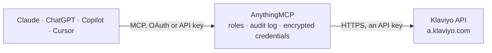

<!-- Generated by scripts/export-github-catalog.mjs in the anythingmcp-website repository. Do not edit by hand. -->

# Klaviyo MCP connector

Drive Klaviyo (e-commerce email + SMS) from any AI agent: profiles, lists, segments, events tracking, flows, campaigns, catalogs. 14 tools targeting the modern 2024+ API. The AnythingMCP connector gives Claude, ChatGPT, Microsoft Copilot, Cursor and Gemini 14 MCP tools for Klaviyo: 9 read and 5 can change data.

**Category:** [Marketing Automation](../marketing-automation.md) · **Tools:** 14 · **Setup guide:** [anythingmcp.com](https://anythingmcp.com/guides/klaviyo-to-mcp) · [Deutsch](https://anythingmcp.com/de/guides/klaviyo-to-mcp) · [Italiano](https://anythingmcp.com/it/guides/klaviyo-to-mcp) · [Español](https://anythingmcp.com/es/guides/klaviyo-to-mcp) · [日本語](https://anythingmcp.com/ja/guides/klaviyo-to-mcp) · [Русский](https://anythingmcp.com/ru/guides/klaviyo-to-mcp) · [中文](https://anythingmcp.com/zh/guides/klaviyo-to-mcp)

## Start without code

No installation and no terminal: AnythingMCP Cloud runs the Klaviyo connector for you, operated by helpcode.ai in Frankfurt, Germany.

1. **Click the button above** and create an account or sign in. The Klaviyo connector opens, ready to install.
2. **Paste the API key or token from your Klaviyo account.** Every click is in the [step-by-step guide](https://anythingmcp.com/guides/klaviyo-to-mcp).
3. **Click Install.** AnythingMCP shows the address of your MCP server.
4. **Add that address to your assistant:** [Claude](https://anythingmcp.com/guides/connect-klaviyo-to-claude) · [ChatGPT](https://anythingmcp.com/guides/connect-klaviyo-to-chatgpt) · [Microsoft Copilot](https://anythingmcp.com/guides/connect-klaviyo-to-copilot) · [Cursor](https://anythingmcp.com/guides/connect-klaviyo-to-cursor) · [Gemini CLI](https://anythingmcp.com/guides/connect-klaviyo-to-gemini) · [Meta Muse](https://anythingmcp.com/guides/connect-klaviyo-to-muse).
5. **Ask your first question**, for example: *Do we have a Klaviyo profile for emma@novopress.de and when was it created?*

Prefer help with the setup? [Talk to us](https://anythingmcp.com/contact).

## How it works

- **The AI client** speaks MCP (Streamable HTTP) to AnythingMCP and only sees tool names, descriptions and results. It never gets the Klaviyo credentials.
- **AnythingMCP** checks the client's role, builds the call from the tool definition, adds the credentials (an API key), calls Klaviyo, logs the call and returns the result.
- **Klaviyo** sees an ordinary API client with the rights of the account the credentials belong to.

## Tools

| Tool | What it does | Access |
|---|---|---|
| [`klaviyo_get_accounts`](#klaviyo_get_accounts) | Return account info: id, name, contact_info, industry, locale, timezone, public_api_key (for client-side tracking). | read |
| [`klaviyo_list_profiles`](#klaviyo_list_profiles) | List profiles (paginated). | read |
| [`klaviyo_get_profile`](#klaviyo_get_profile) | Fetch one profile by ID. | read |
| [`klaviyo_create_or_update_profile`](#klaviyo_create_or_update_profile) | Upsert a profile by email, phone_number, or external_id (in that priority). | write |
| [`klaviyo_list_lists`](#klaviyo_list_lists) | List all opted-in lists (newsletter subscriber lists). | read |
| [`klaviyo_add_profiles_to_list`](#klaviyo_add_profiles_to_list) | Subscribe profiles to a list (silent — does NOT send the double-opt-in email even on lists that require it; for double-opt-in respecting, use… | write |
| [`klaviyo_subscribe_profiles`](#klaviyo_subscribe_profiles) | Subscribe profiles to a list with CONSENT (triggers the double-opt-in email if the list requires it). | write |
| [`klaviyo_remove_profiles_from_list`](#klaviyo_remove_profiles_from_list) | Unsubscribe profiles from a list. | write |
| [`klaviyo_list_segments`](#klaviyo_list_segments) | List dynamic segments. | read |
| [`klaviyo_create_event`](#klaviyo_create_event) | Track an event on a profile — the cornerstone of Klaviyo's behavioral targeting. | write |
| [`klaviyo_list_events`](#klaviyo_list_events) | List events with filters. | read |
| [`klaviyo_list_metrics`](#klaviyo_list_metrics) | List metrics (event types) the account has seen. | read |
| [`klaviyo_list_campaigns`](#klaviyo_list_campaigns) | List email/SMS campaigns. | read |
| [`klaviyo_list_flows`](#klaviyo_list_flows) | List flows (triggered automation sequences). | read |

## Tool reference

Every parameter as the AI client sees it in `tools/list`. Source: [`packages/backend/src/adapters/intl/klaviyo.json`](../../../packages/backend/src/adapters/intl/klaviyo.json).

### `klaviyo_get_accounts`

Return account info: id, name, contact_info, industry, locale, timezone, public_api_key (for client-side tracking). Health check + identifies which Klaviyo account the key is for.

**Access:** read · **Call:** `GET /accounts`

No parameters.

### `klaviyo_list_profiles`

List profiles (paginated). Supports filtering by email, phone_number, external_id, created/updated date.

**Access:** read · **Call:** `GET /profiles`

| Parameter | Type | Required | Description |
|---|---|---|---|
| `filter` | string | no | Klaviyo filter DSL, e.g. equals(email,'a@b.com') or greater-than(updated,2024-01-01T00:00:00Z). |
| `fields_profile` | string | no | Comma-separated attributes to return (sparse fieldsets). |
| `include` | string | no | Side-load: lists, segments. |
| `sort` | string | no | Sort by created, updated, email, etc. Prefix with - for desc. |
| `page_cursor` | string | no | Pagination cursor (from prior links.next). |

### `klaviyo_get_profile`

Fetch one profile by ID. Returns email, phone_number, external_id, first/last_name, organization, properties (custom fields), created, updated, last_event_date.

**Access:** read · **Call:** `GET /profiles/{profileId}`

| Parameter | Type | Required | Description |
|---|---|---|---|
| `profileId` | string | yes | Klaviyo profile ID (starts with '01...'). |
| `include` | string | no | Side-load: lists, segments. |

### `klaviyo_create_or_update_profile`

Upsert a profile by email, phone_number, or external_id (in that priority). Returns the profile (status 201 if new, 200 if updated). Use this for onboarding new subscribers.

**Access:** write · **Call:** `POST /profile-import`

| Parameter | Type | Required | Description |
|---|---|---|---|
| `data` | object | yes | {type: 'profile', attributes: {email?, phone_number?, external_id?, first_name?, last_name?, organization?, title?, image?, location:{address1,city,country,...}, properties:{custom...}}}. Wrap inside {data:{...}}. At least one identifier (email/phone/external_id) required. |

### `klaviyo_list_lists`

List all opted-in lists (newsletter subscriber lists). Each list has name, created, updated, opt_in_process (single_opt_in or double_opt_in).

**Access:** read · **Call:** `GET /lists`

| Parameter | Type | Required | Description |
|---|---|---|---|
| `filter` | string | no | Filter DSL. |
| `page_cursor` | string | no | Pagination cursor. |

### `klaviyo_add_profiles_to_list`

Subscribe profiles to a list (silent — does NOT send the double-opt-in email even on lists that require it; for double-opt-in respecting, use klaviyo_subscribe_profiles instead).

**Access:** write · **Call:** `POST /lists/{listId}/relationships/profiles`

| Parameter | Type | Required | Description |
|---|---|---|---|
| `listId` | string | yes | List ID. |
| `data` | any[] | yes | Array of profile references: [{type:'profile', id:'01...'}, ...]. Each profile must already exist (use klaviyo_create_or_update_profile first). |

### `klaviyo_subscribe_profiles`

Subscribe profiles to a list with CONSENT (triggers the double-opt-in email if the list requires it). Use this instead of klaviyo_add_profiles_to_list for compliance-sensitive onboarding.

**Access:** write · **Call:** `POST /profile-subscription-bulk-create-jobs`

| Parameter | Type | Required | Description |
|---|---|---|---|
| `data` | object | yes | {type:'profile-subscription-bulk-create-job', attributes:{custom_source?:'string',profiles:{data:[{type:'profile',attributes:{email,subscriptions:{email:{marketing:{consent:'SUBSCRIBED'}}}}}]},relationships:{list:{data:{type:'list',id:'LIST_ID'}}}}}. Wrap in {data:{...}}. |

### `klaviyo_remove_profiles_from_list`

Unsubscribe profiles from a list. Removes them from the list — does NOT mark them as globally unsubscribed.

**Access:** write · **Call:** `DELETE /lists/{listId}/relationships/profiles`

| Parameter | Type | Required | Description |
|---|---|---|---|
| `listId` | string | yes | List ID. |
| `data` | any[] | yes | Array of profile references: [{type:'profile', id:'01...'}]. |

### `klaviyo_list_segments`

List dynamic segments. Each segment has name, definition, profile_count (estimated), is_active.

**Access:** read · **Call:** `GET /segments`

| Parameter | Type | Required | Description |
|---|---|---|---|
| `filter` | string | no | Filter DSL. |
| `page_cursor` | string | no | Pagination cursor. |

### `klaviyo_create_event`

Track an event on a profile — the cornerstone of Klaviyo's behavioral targeting. Use for purchases, page views, cart adds, support tickets, anything triggering a flow.

**Access:** write · **Call:** `POST /events`

| Parameter | Type | Required | Description |
|---|---|---|---|
| `data` | object | yes | {type:'event', attributes:{properties:{...}, metric:{data:{type:'metric',attributes:{name:'Placed Order',service:'api'}}}, profile:{data:{type:'profile',attributes:{email:'a@b.com'}}}, value?:99.99, value_currency?:'USD', unique_id?:'uuid', time?:'2025-01-15T12:00:00Z'}}. Wrap in {data:{...}}. |

### `klaviyo_list_events`

List events with filters. Each event has metric_id, profile_id, properties, datetime, uuid.

**Access:** read · **Call:** `GET /events`

| Parameter | Type | Required | Description |
|---|---|---|---|
| `filter` | string | no | Filter DSL: equals(metric_id,'METRIC_ID'), greater-than(datetime,2024-01-01T00:00:00Z), etc. |
| `include` | string | no | Side-load: profile, metric. |
| `sort` | string | no | datetime, -datetime, timestamp, -timestamp. |
| `page_cursor` | string | no | Pagination cursor. |

### `klaviyo_list_metrics`

List metrics (event types) the account has seen. Each metric has name, integration_id, created, updated. Use to discover metric IDs for event filtering.

**Access:** read · **Call:** `GET /metrics`

| Parameter | Type | Required | Description |
|---|---|---|---|
| `filter` | string | no | Filter DSL on name or integration name. |
| `page_cursor` | string | no | Pagination cursor. |

### `klaviyo_list_campaigns`

List email/SMS campaigns. Filter by channel (email|sms) and status (Sent/Draft/Scheduled/etc).

**Access:** read · **Call:** `GET /campaigns`

| Parameter | Type | Required | Description |
|---|---|---|---|
| `filter` | string | yes | REQUIRED: must include equals(messages.channel,'email') or 'sms'. E.g. 'and(equals(messages.channel,\'email\'),equals(status,\'Sent\'))'. |
| `include` | string | no | Side-load: campaign-messages, tags. |
| `sort` | string | no | created_at, scheduled_at. |
| `page_cursor` | string | no | Pagination cursor. |

### `klaviyo_list_flows`

List flows (triggered automation sequences). Each flow has name, status, trigger_type, created, updated. Filter by status (active/draft/manual).

**Access:** read · **Call:** `GET /flows`

| Parameter | Type | Required | Description |
|---|---|---|---|
| `filter` | string | no | Filter DSL. |
| `include` | string | no | Side-load: flow-actions, tags. |
| `sort` | string | no | id, name, status, created, updated, trigger_type. |
| `page_cursor` | string | no | Pagination cursor. |

## Run it yourself

AnythingMCP is open source (AGPL-3.0). [Run it with Docker](../../../README.md#run-it-yourself), open **Connectors → Store**, pick **Klaviyo** and enter `KLAVIYO_PRIVATE_API_KEY`, then add your MCP server URL to the AI client.

[← Marketing Automation connectors](../marketing-automation.md) · [All categories](../README.md)
