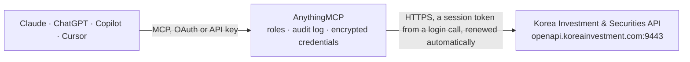

<!-- Generated by scripts/export-github-catalog.mjs in the anythingmcp-website repository. Do not edit by hand. -->

# Korea Investment & Securities MCP connector

Read Korean and overseas market data from the KIS Developers Open API of Korea Investment & Securities: stock and ETF quotes, daily and minute charts, order books, investor flows, KOSPI and KOSDAQ … The AnythingMCP connector gives Claude, ChatGPT, Microsoft Copilot, Cursor and Gemini 16 MCP tools for Korea Investment & Securities, all read-only.

**Category:** [Finance](../finance.md) · **Tools:** 16 · **Setup guide:** [anythingmcp.com](https://anythingmcp.com/guides/korea-investment-to-mcp) · [Deutsch](https://anythingmcp.com/de/guides/korea-investment-to-mcp) · [Italiano](https://anythingmcp.com/it/guides/korea-investment-to-mcp) · [Español](https://anythingmcp.com/es/guides/korea-investment-to-mcp) · [日本語](https://anythingmcp.com/ja/guides/korea-investment-to-mcp) · [Русский](https://anythingmcp.com/ru/guides/korea-investment-to-mcp) · [中文](https://anythingmcp.com/zh/guides/korea-investment-to-mcp)

## Start without code

No installation and no terminal: AnythingMCP Cloud runs the Korea Investment & Securities connector for you, operated by helpcode.ai in Frankfurt, Germany.

1. **Click the button above** and create an account or sign in. The Korea Investment & Securities connector opens, ready to install.
2. **Paste the API key or token from your Korea Investment & Securities account.** Every click is in the [step-by-step guide](https://anythingmcp.com/guides/korea-investment-to-mcp).
3. **Click Install.** AnythingMCP shows the address of your MCP server.
4. **Add that address to your assistant:** [Claude](https://anythingmcp.com/guides/connect-korea-investment-to-claude) · [ChatGPT](https://anythingmcp.com/guides/connect-korea-investment-to-chatgpt) · [Microsoft Copilot](https://anythingmcp.com/guides/connect-korea-investment-to-copilot) · [Cursor](https://anythingmcp.com/guides/connect-korea-investment-to-cursor) · [Gemini CLI](https://anythingmcp.com/guides/connect-korea-investment-to-gemini) · [Meta Muse](https://anythingmcp.com/guides/connect-korea-investment-to-muse).
5. **Ask your first question.**

Prefer help with the setup? [Talk to us](https://anythingmcp.com/contact).

## How it works

- **The AI client** speaks MCP (Streamable HTTP) to AnythingMCP and only sees tool names, descriptions and results. It never gets the Korea Investment & Securities credentials.
- **AnythingMCP** checks the client's role, builds the call from the tool definition, adds the credentials (a session token from a login call, renewed automatically), calls Korea Investment & Securities, logs the call and returns the result.
- **Korea Investment & Securities** sees an ordinary API client with the rights of the account the credentials belong to.

## Tools

| Tool | What it does | Access |
|---|---|---|
| [`korea_investment_get_stock_price`](#korea_investment_get_stock_price) | Current quote of one Korean stock, ETF or ETN: last price (stck_prpr), change and change rate against the previous close (prdy_vrss, prdy_ctrt), open, high,… | read |
| [`korea_investment_get_daily_prices`](#korea_investment_get_daily_prices) | Last 30 trading days (or 30 weeks or 30 months) of one Korean stock: per row the date (stck_bsop_date), open, high, low, close, change against the previous… | read |
| [`korea_investment_get_price_chart`](#korea_investment_get_price_chart) | Daily, weekly, monthly or yearly candles (OHLCV) of one Korean stock between two dates, at most 100 candles per call: output1 is the current quote summary,… | read |
| [`korea_investment_get_minute_chart`](#korea_investment_get_minute_chart) | One-minute candles of one Korean stock for today, up to 30 per call, ending at a given time: output1 is the quote summary, output2 the minute bars newest… | read |
| [`korea_investment_get_orderbook`](#korea_investment_get_orderbook) | Order book of one Korean stock: the ten best ask and bid prices with their remaining quantities (askp1..10, bidp1..10, askp_rsqn1..10, bidp_rsqn1..10),… | read |
| [`korea_investment_get_trades_by_time`](#korea_investment_get_trades_by_time) | Time-and-sales of one Korean stock today: executions at or before a given time with price, change, volume per print and execution strength (tday_rltv). | read |
| [`korea_investment_get_investor_flows`](#korea_investment_get_investor_flows) | Net buying by investor type for one Korean stock over the recent trading days: individuals (prsn_ntby_qty), foreigners (frgn_ntby_qty) and institutions… | read |
| [`korea_investment_get_stock_info`](#korea_investment_get_stock_info) | Basic master data of a Korean listed product: Korean and English names (prdt_name, prdt_eng_name), listing market, sector classification, listed shares, par… | read |
| [`korea_investment_get_index_price`](#korea_investment_get_index_price) | Current level of a Korean market or sector index: index value (bstp_nmix_prpr), change and change rate, open, high, low, volume and traded value, and the… | read |
| [`korea_investment_get_index_daily_prices`](#korea_investment_get_index_daily_prices) | History of a Korean market or sector index up to a given date, one row per day, week or month (about 100 rows per call): date, close, change, open, high,… | read |
| [`korea_investment_get_overseas_price`](#korea_investment_get_overseas_price) | Current quote of a foreign stock (US, Japan, Hong Kong, China, Vietnam): last price (last), previous close (base), change and change rate (diff, rate),… | read |
| [`korea_investment_get_overseas_price_detail`](#korea_investment_get_overseas_price_detail) | Detailed quote of a foreign stock: open, high, low, previous close, 52-week high and low with their dates, PER, PBR, EPS, BPS, market capitalisation, shares… | read |
| [`korea_investment_get_overseas_daily_prices`](#korea_investment_get_overseas_daily_prices) | Daily, weekly or monthly history of a foreign stock up to a given date, about 100 rows per call: date (xymd), close (clos), change, open, high, low, volume… | read |
| [`korea_investment_get_overseas_orderbook`](#korea_investment_get_overseas_orderbook) | Order book of a foreign stock: best ask and bid prices with quantities (ten levels for US stocks, one level elsewhere) and the current price summary. | read |
| [`korea_investment_get_overseas_index_chart`](#korea_investment_get_overseas_index_chart) | Daily, weekly, monthly or yearly candles of a foreign index, exchange rate, government bond or gold future between two dates (about 100 candles per call):… | read |
| [`korea_investment_get_overseas_stock_info`](#korea_investment_get_overseas_stock_info) | Master data of a foreign stock as KIS lists it: Korean and English names, exchange, currency, listing status, tick size, minimum order quantity and the sector. | read |

## Tool reference

Every parameter as the AI client sees it in `tools/list`. Source: [`packages/backend/src/adapters/intl/korea-investment.json`](../../../packages/backend/src/adapters/intl/korea-investment.json).

### `korea_investment_get_stock_price`

Current quote of one Korean stock, ETF or ETN: last price (stck_prpr), change and change rate against the previous close (prdy_vrss, prdy_ctrt), open, high, low, upper and lower price limits, accumulated volume and traded value, 52-week high and low, PER, PBR, EPS, BPS, market capitalisation (hts_avls, in 100 million KRW), foreign ownership ratio and the trading status. Use it first for any 'how is X trading' question. Read-only market data (tr_id FHKST01010100).

**Access:** read · **Call:** `GET /uapi/domestic-stock/v1/quotations/inquire-price`

| Parameter | Type | Required | Description |
|---|---|---|---|
| `stock_code` | string | yes | Six-digit KRX short code of the stock, ETF or ETN, e.g. 005930 (Samsung Electronics), 000660 (SK hynix), 069500 (KODEX 200). ETNs take a Q in front (Q500001). |
| `market` | `J` \| `NX` \| `UN` | no | Market to quote: J = KRX (Korea Exchange, default), NX = NXT (Nextrade alternative exchange), UN = both combined. |

### `korea_investment_get_daily_prices`

Last 30 trading days (or 30 weeks or 30 months) of one Korean stock: per row the date (stck_bsop_date), open, high, low, close, change against the previous period, volume, and foreign ownership change. For a custom date range use korea_investment_get_price_chart. Read-only (tr_id FHKST01010400).

**Access:** read · **Call:** `GET /uapi/domestic-stock/v1/quotations/inquire-daily-price`

| Parameter | Type | Required | Description |
|---|---|---|---|
| `stock_code` | string | yes | Six-digit KRX short code of the stock, ETF or ETN, e.g. 005930 (Samsung Electronics), 000660 (SK hynix), 069500 (KODEX 200). ETNs take a Q in front (Q500001). |
| `market` | `J` \| `NX` \| `UN` | no | Market to quote: J = KRX (Korea Exchange, default), NX = NXT (Nextrade alternative exchange), UN = both combined. |
| `period` | `D` \| `W` \| `M` | no | D = one row per day for the last 30 trading days (default), W = per week for 30 weeks, M = per month for 30 months. |
| `adjusted` | `0` \| `1` | no | Price adjustment flag passed to KIS as FID_ORG_ADJ_PRC: 1 (default, the value KIS's own samples send) or 0. It controls whether past prices are restated for stock splits and consolidations; KIS documents its meaning inconsistently between endpoints, so keep the default unless the user asks for raw prices. |

### `korea_investment_get_price_chart`

Daily, weekly, monthly or yearly candles (OHLCV) of one Korean stock between two dates, at most 100 candles per call: output1 is the current quote summary, output2 the candles newest first (stck_bsop_date, stck_oprc, stck_hgpr, stck_lwpr, stck_clpr, acml_vol, acml_tr_pbmn). For longer ranges call again with an earlier end_date. Read-only (tr_id FHKST03010100).

**Access:** read · **Call:** `GET /uapi/domestic-stock/v1/quotations/inquire-daily-itemchartprice`

| Parameter | Type | Required | Description |
|---|---|---|---|
| `stock_code` | string | yes | Six-digit KRX short code of the stock, ETF or ETN, e.g. 005930 (Samsung Electronics), 000660 (SK hynix), 069500 (KODEX 200). ETNs take a Q in front (Q500001). |
| `market` | `J` \| `NX` \| `UN` | no | Market to quote: J = KRX (Korea Exchange, default), NX = NXT (Nextrade alternative exchange), UN = both combined. |
| `start_date` | string | yes | First day of the range as YYYYMMDD (Korean dates), e.g. 20260105. |
| `end_date` | string | yes | Last day of the range as YYYYMMDD (Korean dates), e.g. 20260105. |
| `period` | `D` \| `W` \| `M` \| `Y` | no | Candle size: D = day (default), W = week, M = month, Y = year. |
| `price_type` | `0` \| `1` | no | 0 = prices adjusted for splits and consolidations (default), 1 = original prices. |

### `korea_investment_get_minute_chart`

One-minute candles of one Korean stock for today, up to 30 per call, ending at a given time: output1 is the quote summary, output2 the minute bars newest first (stck_cntg_hour, stck_prpr, stck_oprc, stck_hgpr, stck_lwpr, cntg_vol). To go further back, call again with the earliest stck_cntg_hour returned. A time in the future returns the latest bars. Read-only (tr_id FHKST03010200).

**Access:** read · **Call:** `GET /uapi/domestic-stock/v1/quotations/inquire-time-itemchartprice`

| Parameter | Type | Required | Description |
|---|---|---|---|
| `stock_code` | string | yes | Six-digit KRX short code of the stock, ETF or ETN, e.g. 005930 (Samsung Electronics), 000660 (SK hynix), 069500 (KODEX 200). ETNs take a Q in front (Q500001). |
| `market` | `J` \| `NX` \| `UN` | no | Market to quote: J = KRX (Korea Exchange, default), NX = NXT (Nextrade alternative exchange), UN = both combined. |
| `time` | string | yes | End time as HHMMSS in Korean time (KST), e.g. 153000 for the close or 100000 for 10:00. |
| `include_past` | `Y` \| `N` | no | Y (default) to include earlier bars before the requested time, N for only that minute. |

### `korea_investment_get_orderbook`

Order book of one Korean stock: the ten best ask and bid prices with their remaining quantities (askp1..10, bidp1..10, askp_rsqn1..10, bidp_rsqn1..10), total ask and bid quantities, and the expected auction price and volume (output2) during the opening and closing auctions. Read-only (tr_id FHKST01010200).

**Access:** read · **Call:** `GET /uapi/domestic-stock/v1/quotations/inquire-asking-price-exp-ccn`

| Parameter | Type | Required | Description |
|---|---|---|---|
| `stock_code` | string | yes | Six-digit KRX short code of the stock, ETF or ETN, e.g. 005930 (Samsung Electronics), 000660 (SK hynix), 069500 (KODEX 200). ETNs take a Q in front (Q500001). |
| `market` | `J` \| `NX` \| `UN` | no | Market to quote: J = KRX (Korea Exchange, default), NX = NXT (Nextrade alternative exchange), UN = both combined. |

### `korea_investment_get_trades_by_time`

Time-and-sales of one Korean stock today: executions at or before a given time with price, change, volume per print and execution strength (tday_rltv). Use it to see how the price moved during the session. Read-only (tr_id FHPST01060000).

**Access:** read · **Call:** `GET /uapi/domestic-stock/v1/quotations/inquire-time-itemconclusion`

| Parameter | Type | Required | Description |
|---|---|---|---|
| `stock_code` | string | yes | Six-digit KRX short code of the stock, ETF or ETN, e.g. 005930 (Samsung Electronics), 000660 (SK hynix), 069500 (KODEX 200). ETNs take a Q in front (Q500001). |
| `market` | `J` \| `NX` \| `UN` | no | Market to quote: J = KRX (Korea Exchange, default), NX = NXT (Nextrade alternative exchange), UN = both combined. |
| `time` | string | yes | Time as HHMMSS in KST; executions up to this time are returned, e.g. 113000. |

### `korea_investment_get_investor_flows`

Net buying by investor type for one Korean stock over the recent trading days: individuals (prsn_ntby_qty), foreigners (frgn_ntby_qty) and institutions (orgn_ntby_qty), as quantities and as traded value (..._tr_pbmn, in million KRW), with the close of each day. Today's figures are filled in after the market closes. Read-only (tr_id FHKST01010900).

**Access:** read · **Call:** `GET /uapi/domestic-stock/v1/quotations/inquire-investor`

| Parameter | Type | Required | Description |
|---|---|---|---|
| `stock_code` | string | yes | Six-digit KRX short code of the stock, ETF or ETN, e.g. 005930 (Samsung Electronics), 000660 (SK hynix), 069500 (KODEX 200). ETNs take a Q in front (Q500001). |
| `market` | `J` \| `NX` | no | Market: J = KRX (default) or NX = NXT. |

### `korea_investment_get_stock_info`

Basic master data of a Korean listed product: Korean and English names (prdt_name, prdt_eng_name), listing market, sector classification, listed shares, par value, capital, listing date and whether it is suspended or under administrative designation. Use it to confirm what a six-digit code refers to. Read-only (tr_id CTPF1002R).

**Access:** read · **Call:** `GET /uapi/domestic-stock/v1/quotations/search-stock-info`

| Parameter | Type | Required | Description |
|---|---|---|---|
| `stock_code` | string | yes | Six-digit KRX code, e.g. 005930. ETNs start with Q (Q500001). |
| `product_type` | `300` \| `301` \| `302` \| `306` | no | 300 = stocks, ETFs, ETNs and ELWs (default), 301 = futures and options, 302 = bonds, 306 = ELS. |

### `korea_investment_get_index_price`

Current level of a Korean market or sector index: index value (bstp_nmix_prpr), change and change rate, open, high, low, volume and traded value, and the number of rising, unchanged and falling issues. Read-only (tr_id FHPUP02100000).

**Access:** read · **Call:** `GET /uapi/domestic-stock/v1/quotations/inquire-index-price`

| Parameter | Type | Required | Description |
|---|---|---|---|
| `index_code` | string | no | Four-digit KRX index code: 0001 = KOSPI (default), 1001 = KOSDAQ, 2001 = KOSPI 200. Sector codes are listed in the KIS sector master file. |

### `korea_investment_get_index_daily_prices`

History of a Korean market or sector index up to a given date, one row per day, week or month (about 100 rows per call): date, close, change, open, high, low, volume and traded value. Read-only (tr_id FHPUP02120000).

**Access:** read · **Call:** `GET /uapi/domestic-stock/v1/quotations/inquire-index-daily-price`

| Parameter | Type | Required | Description |
|---|---|---|---|
| `index_code` | string | no | Four-digit KRX index code: 0001 = KOSPI (default), 1001 = KOSDAQ, 2001 = KOSPI 200. |
| `end_date` | string | yes | Most recent day to return as YYYYMMDD (Korean dates), e.g. 20260105. |
| `period` | `D` \| `W` \| `M` | no | D = daily (default), W = weekly, M = monthly. |

### `korea_investment_get_overseas_price`

Current quote of a foreign stock (US, Japan, Hong Kong, China, Vietnam): last price (last), previous close (base), change and change rate (diff, rate), volume (tvol), traded value (tamt) and whether it can be ordered through KIS (ordy). Prices are in the stock's local currency; US quotes may be delayed unless the account has a real-time US data subscription. Read-only (tr_id HHDFS00000300).

**Access:** read · **Call:** `GET /uapi/overseas-price/v1/quotations/price`

| Parameter | Type | Required | Description |
|---|---|---|---|
| `exchange` | `NAS` \| `NYS` \| `AMS` \| `TSE` \| `HKS` \| `SHS` \| `SZS` \| `SHI` \| `SZI` \| `HSX` \| `HNX` \| `BAQ` \| `BAY` \| `BAA` | yes | Exchange code: NAS = Nasdaq, NYS = NYSE, AMS = NYSE American (AMEX), TSE = Tokyo, HKS = Hong Kong, SHS = Shanghai, SZS = Shenzhen, SHI = Shanghai index, SZI = Shenzhen index, HSX = Ho Chi Minh, HNX = Hanoi, BAQ / BAY / BAA = US day-time trading for Nasdaq / NYSE / AMEX. |
| `symbol` | string | yes | Ticker on that exchange, e.g. AAPL, TSLA, NVDA on NAS; 7203 on TSE; 00700 on HKS; 600519 on SHS. |

### `korea_investment_get_overseas_price_detail`

Detailed quote of a foreign stock: open, high, low, previous close, 52-week high and low with their dates, PER, PBR, EPS, BPS, market capitalisation, shares outstanding, currency, tick size, sector name and the exchange rate KIS applies. Read-only (tr_id HHDFS76200200).

**Access:** read · **Call:** `GET /uapi/overseas-price/v1/quotations/price-detail`

| Parameter | Type | Required | Description |
|---|---|---|---|
| `exchange` | `NAS` \| `NYS` \| `AMS` \| `TSE` \| `HKS` \| `SHS` \| `SZS` \| `SHI` \| `SZI` \| `HSX` \| `HNX` \| `BAQ` \| `BAY` \| `BAA` | yes | Exchange code: NAS = Nasdaq, NYS = NYSE, AMS = NYSE American (AMEX), TSE = Tokyo, HKS = Hong Kong, SHS = Shanghai, SZS = Shenzhen, SHI = Shanghai index, SZI = Shenzhen index, HSX = Ho Chi Minh, HNX = Hanoi, BAQ / BAY / BAA = US day-time trading for Nasdaq / NYSE / AMEX. |
| `symbol` | string | yes | Ticker on that exchange, e.g. AAPL, TSLA, NVDA on NAS; 7203 on TSE; 00700 on HKS; 600519 on SHS. |

### `korea_investment_get_overseas_daily_prices`

Daily, weekly or monthly history of a foreign stock up to a given date, about 100 rows per call: date (xymd), close (clos), change, open, high, low, volume and traded value. Call again with an earlier base_date for older data. Read-only (tr_id HHDFS76240000).

**Access:** read · **Call:** `GET /uapi/overseas-price/v1/quotations/dailyprice`

| Parameter | Type | Required | Description |
|---|---|---|---|
| `exchange` | `NAS` \| `NYS` \| `AMS` \| `TSE` \| `HKS` \| `SHS` \| `SZS` \| `SHI` \| `SZI` \| `HSX` \| `HNX` \| `BAQ` \| `BAY` \| `BAA` | yes | Exchange code: NAS = Nasdaq, NYS = NYSE, AMS = NYSE American (AMEX), TSE = Tokyo, HKS = Hong Kong, SHS = Shanghai, SZS = Shenzhen, SHI = Shanghai index, SZI = Shenzhen index, HSX = Ho Chi Minh, HNX = Hanoi, BAQ / BAY / BAA = US day-time trading for Nasdaq / NYSE / AMEX. |
| `symbol` | string | yes | Ticker on that exchange, e.g. AAPL, TSLA, NVDA on NAS; 7203 on TSE; 00700 on HKS; 600519 on SHS. |
| `base_date` | string | yes | Most recent day to return (use today for the latest data) as YYYYMMDD (Korean dates), e.g. 20260105. |
| `period` | `0` \| `1` \| `2` | no | 0 = daily (default), 1 = weekly, 2 = monthly. |
| `adjusted` | `0` \| `1` | no | 1 = prices adjusted for splits (default), 0 = raw prices. |

### `korea_investment_get_overseas_orderbook`

Order book of a foreign stock: best ask and bid prices with quantities (ten levels for US stocks, one level elsewhere) and the current price summary. Read-only (tr_id HHDFS76200100).

**Access:** read · **Call:** `GET /uapi/overseas-price/v1/quotations/inquire-asking-price`

| Parameter | Type | Required | Description |
|---|---|---|---|
| `exchange` | `NAS` \| `NYS` \| `AMS` \| `TSE` \| `HKS` \| `SHS` \| `SZS` \| `SHI` \| `SZI` \| `HSX` \| `HNX` \| `BAQ` \| `BAY` \| `BAA` | yes | Exchange code: NAS = Nasdaq, NYS = NYSE, AMS = NYSE American (AMEX), TSE = Tokyo, HKS = Hong Kong, SHS = Shanghai, SZS = Shenzhen, SHI = Shanghai index, SZI = Shenzhen index, HSX = Ho Chi Minh, HNX = Hanoi, BAQ / BAY / BAA = US day-time trading for Nasdaq / NYSE / AMEX. |
| `symbol` | string | yes | Ticker on that exchange, e.g. AAPL, TSLA, NVDA on NAS; 7203 on TSE; 00700 on HKS; 600519 on SHS. |

### `korea_investment_get_overseas_index_chart`

Daily, weekly, monthly or yearly candles of a foreign index, exchange rate, government bond or gold future between two dates (about 100 candles per call): output1 is the latest value, output2 the candles (stck_bsop_date, ovrs_nmix_prpr close, open, high, low). Examples with market N: SPX (S&P 500), .DJI (Dow Jones Industrial Average). Codes for other indices, exchange rates, bonds and gold come from the KIS overseas index master file (KIS Developers forum, FAQ, overseas symbol download). For US stocks only Dow 30, Nasdaq 100 and S&P 500 members work here; use korea_investment_get_overseas_daily_prices for other stocks. Read-only (tr_id FHKST03030100).

**Access:** read · **Call:** `GET /uapi/overseas-price/v1/quotations/inquire-daily-chartprice`

| Parameter | Type | Required | Description |
|---|---|---|---|
| `market` | `N` \| `X` \| `I` \| `S` | no | N = overseas index (default), X = exchange rate, I = government bond, S = gold future. |
| `code` | string | yes | Instrument code from the KIS overseas index master, e.g. SPX or .DJI. |
| `start_date` | string | yes | First day of the range as YYYYMMDD (Korean dates), e.g. 20260105. |
| `end_date` | string | yes | Last day of the range as YYYYMMDD (Korean dates), e.g. 20260105. |
| `period` | `D` \| `W` \| `M` \| `Y` | no | D = day (default), W = week, M = month, Y = year. |

### `korea_investment_get_overseas_stock_info`

Master data of a foreign stock as KIS lists it: Korean and English names, exchange, currency, listing status, tick size, minimum order quantity and the sector. Use it to check a ticker before quoting it. Read-only (tr_id CTPF1702R).

**Access:** read · **Call:** `GET /uapi/overseas-price/v1/quotations/search-info`

| Parameter | Type | Required | Description |
|---|---|---|---|
| `symbol` | string | yes | Ticker, e.g. AAPL. |
| `product_type` | `512` \| `513` \| `529` \| `515` \| `501` \| `543` \| `558` \| `507` \| `508` \| `551` \| `552` | no | Market: 512 = Nasdaq (default), 513 = NYSE, 529 = NYSE American (AMEX), 515 = Japan, 501 = Hong Kong, 543 = Hong Kong CNY, 558 = Hong Kong USD, 507 = Hanoi, 508 = Ho Chi Minh, 551 = Shanghai A, 552 = Shenzhen A. |

## Run it yourself

AnythingMCP is open source (AGPL-3.0). [Run it with Docker](../../../README.md#run-it-yourself), open **Connectors → Store**, pick **Korea Investment & Securities** and enter `KIS_APP_KEY`, `KIS_APP_SECRET`, then add your MCP server URL to the AI client.

[← Finance connectors](../finance.md) · [All categories](../README.md)
