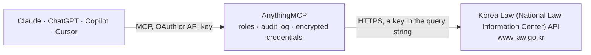

<!-- Generated by scripts/export-github-catalog.mjs in the anythingmcp-website repository. Do not edit by hand. -->

# Korea Law (National Law Information Center) MCP connector

Official Open API of Korea's National Law Information Center (법제처 국가법령정보센터): statutes and articles, court precedents, Constitutional Court decisions, statutory interpretations, administrative rules, … The AnythingMCP connector gives Claude, ChatGPT, Microsoft Copilot, Cursor and Gemini 16 MCP tools for Korea Law (National Law Information Center), all read-only.

**Category:** [Government](../government.md) · **Tools:** 16 · **Setup guide:** [anythingmcp.com](https://anythingmcp.com/guides/korea-law-to-mcp) · [Deutsch](https://anythingmcp.com/de/guides/korea-law-to-mcp) · [Italiano](https://anythingmcp.com/it/guides/korea-law-to-mcp) · [Español](https://anythingmcp.com/es/guides/korea-law-to-mcp) · [日本語](https://anythingmcp.com/ja/guides/korea-law-to-mcp) · [Русский](https://anythingmcp.com/ru/guides/korea-law-to-mcp) · [中文](https://anythingmcp.com/zh/guides/korea-law-to-mcp)

## Start without code

No installation and no terminal: AnythingMCP Cloud runs the Korea Law (National Law Information Center) connector for you, operated by helpcode.ai in Frankfurt, Germany.

1. **Click the button above** and create an account or sign in. The Korea Law (National Law Information Center) connector opens, ready to install.
2. **Paste the API key or token from your Korea Law (National Law Information Center) account.** Every click is in the [step-by-step guide](https://anythingmcp.com/guides/korea-law-to-mcp).
3. **Click Install.** AnythingMCP shows the address of your MCP server.
4. **Add that address to your assistant:** [Claude](https://anythingmcp.com/guides/connect-korea-law-to-claude) · [ChatGPT](https://anythingmcp.com/guides/connect-korea-law-to-chatgpt) · [Microsoft Copilot](https://anythingmcp.com/guides/connect-korea-law-to-copilot) · [Cursor](https://anythingmcp.com/guides/connect-korea-law-to-cursor) · [Gemini CLI](https://anythingmcp.com/guides/connect-korea-law-to-gemini) · [Meta Muse](https://anythingmcp.com/guides/connect-korea-law-to-muse).
5. **Ask your first question**, for example: *상법에서 회사의 결산보고 기한 규정 있는지 2026-01-01 기준으로 '상법' 검색하고 조문 047101(제101조) 읽어줘*

Prefer help with the setup? [Talk to us](https://anythingmcp.com/contact).

## How it works

- **The AI client** speaks MCP (Streamable HTTP) to AnythingMCP and only sees tool names, descriptions and results. It never gets the Korea Law (National Law Information Center) credentials.
- **AnythingMCP** checks the client's role, builds the call from the tool definition, adds the credentials (a key in the query string), calls Korea Law (National Law Information Center), logs the call and returns the result.
- **Korea Law (National Law Information Center)** sees an ordinary API client with the rights of the account the credentials belong to.

## Tools

| Tool | What it does | Access |
|---|---|---|
| [`korea_law_search_laws`](#korea_law_search_laws) | Search current Korean statutes (Acts, Enforcement Decrees and Rules) by name or full text. | read |
| [`korea_law_get_law`](#korea_law_get_law) | Get the text of a current Korean statute: basic information, articles (조문), addenda and amendment reasons. | read |
| [`korea_law_search_precedents`](#korea_law_search_precedents) | Search Korean court precedents (Supreme Court and lower courts) by case name or full text, court, referenced statute, decision date or case number. | read |
| [`korea_law_get_precedent`](#korea_law_get_precedent) | Get one court precedent in full: holdings (판시사항), summary (판결요지), referenced articles and precedents, and the full judgment text. | read |
| [`korea_law_search_interpretations`](#korea_law_search_interpretations) | Search official statutory interpretations (법령해석례) issued by the Ministry of Government Legislation and other bodies, by title or full text. | read |
| [`korea_law_get_interpretation`](#korea_law_get_interpretation) | Get one statutory interpretation in full: question (질의요지), answer (회답), reasoning (이유), agencies and dates. | read |
| [`korea_law_search_admin_rules`](#korea_law_search_admin_rules) | Search administrative rules (행정규칙: directives, established rules, public notices, guidelines) by name or full text, kind, ministry or issue date. | read |
| [`korea_law_get_admin_rule`](#korea_law_get_admin_rule) | Get one administrative rule in full: basic information, articles, addenda, tables and attachment links. | read |
| [`korea_law_search_english_laws`](#korea_law_search_english_laws) | Search the official English translations of Korean statutes by Korean or English name, e.g. insurance. | read |
| [`korea_law_get_english_law`](#korea_law_get_english_law) | Get the English translation of a Korean statute: articles (JoSection), addenda and basic information. | read |
| [`korea_law_search_legal_terms`](#korea_law_search_legal_terms) | Search the dictionary of legal terms (법령용어) defined in Korean statutes. | read |
| [`korea_law_get_legal_term`](#korea_law_get_legal_term) | Get the statutory definitions of one legal term: each definition with the law and article it comes from. | read |
| [`korea_law_search_constitutional_decisions`](#korea_law_search_constitutional_decisions) | Search decisions of the Constitutional Court (헌재결정례) by case name or full text, decision date or case number. | read |
| [`korea_law_get_constitutional_decision`](#korea_law_get_constitutional_decision) | Get one Constitutional Court decision in full: provisions under review, holdings, summary, referenced articles and precedents, and the full text. | read |
| [`korea_law_search_ordinances`](#korea_law_search_ordinances) | Search local laws (자치법규: ordinances and rules of provinces, cities and districts) by name or full text, local government or kind. | read |
| [`korea_law_get_ordinance`](#korea_law_get_ordinance) | Get one local law in full: basic information, articles, addenda and reasons. | read |

## Tool reference

Every parameter as the AI client sees it in `tools/list`. Source: [`packages/backend/src/adapters/intl/korea-law.json`](../../../packages/backend/src/adapters/intl/korea-law.json).

### `korea_law_search_laws`

Search current Korean statutes (Acts, Enforcement Decrees and Rules) by name or full text. Returns law name, law ID (법령ID), serial number (법령일련번호, the MST), type, ministry, promulgation and effective dates. Start here to find a law's ID.

**Access:** read · **Call:** `GET /lawSearch.do`

| Parameter | Type | Required | Description |
|---|---|---|---|
| `query` | string | no | Search words for the law name, in Korean, e.g. 자동차. Omit to list everything. |
| `search` | `1` \| `2` | no | 1 (default) searches the law name only, 2 searches the full text. |
| `display` | integer | no | Results per page, 1 to 100 (default 20). |
| `page` | integer | no | Page number, starting at 1. |
| `sort` | `lasc` \| `ldes` \| `dasc` \| `ddes` \| `nasc` \| `ndes` \| `efasc` \| `efdes` | no | lasc/ldes law name, dasc/ddes promulgation date, nasc/ndes promulgation number, efasc/efdes effective date (asc/desc). Default lasc. |
| `effective_date_range` | string | no | Effective date (시행일자) range as YYYYMMDD~YYYYMMDD, e.g. 20240101~20241231. |
| `promulgation_date_range` | string | no | Promulgation date (공포일자) range as YYYYMMDD~YYYYMMDD, e.g. 20240101~20241231. |

### `korea_law_get_law`

Get the text of a current Korean statute: basic information, articles (조문), addenda and amendment reasons. A whole code can exceed 500 KB, so pass article to read one article. Give law_id or mst from korea_law_search_laws.

**Access:** read · **Call:** `GET /lawService.do`

| Parameter | Type | Required | Description |
|---|---|---|---|
| `law_id` | string | no | Law ID (법령ID), 6 digits with leading zeros, e.g. 001706 for the Civil Act (민법). |
| `mst` | string | no | Law serial number (법령일련번호 / MST) of one specific version. Use instead of law_id. |
| `article` | string | no | One article only, as 6 digits: article number (4) + branch number (2). 000300 is Article 3, 001002 is Article 10-2. Omit for the whole law. |
| `language` | `KO` \| `ORI` | no | KO (default) for the Hangul text, ORI for the original text with Hanja. |

### `korea_law_search_precedents`

Search Korean court precedents (Supreme Court and lower courts) by case name or full text, court, referenced statute, decision date or case number. Returns case name and number, court, decision date and the precedent serial number for korea_law_get_precedent.

**Access:** read · **Call:** `GET /lawSearch.do`

| Parameter | Type | Required | Description |
|---|---|---|---|
| `query` | string | no | Search words for the case name, in Korean, e.g. 자동차. Omit to list everything. |
| `search` | `1` \| `2` | no | 1 (default) searches the case name only, 2 searches the full text. |
| `display` | integer | no | Results per page, 1 to 100 (default 20). |
| `page` | integer | no | Page number, starting at 1. |
| `court_type` | `400201` \| `400202` | no | 400201 Supreme Court (대법원), 400202 lower courts. |
| `court` | string | no | Court name in Korean, e.g. 대법원, 서울고등법원, 인천지방법원. |
| `referenced_law` | string | no | Name of a statute the decision refers to, e.g. 형법 or 민법. |
| `decision_date_range` | string | no | Decision date (선고일자) range as YYYYMMDD~YYYYMMDD, e.g. 20240101~20241231. |
| `case_number` | string | no | Case number(s), comma separated, e.g. 2021도3451. |
| `sort` | `lasc` \| `ldes` \| `dasc` \| `ddes` \| `nasc` \| `ndes` | no | lasc/ldes case name, dasc/ddes decision date (ddes is the default), nasc/ndes court name. |

### `korea_law_get_precedent`

Get one court precedent in full: holdings (판시사항), summary (판결요지), referenced articles and precedents, and the full judgment text. Precedents from the National Tax Service source are only available as HTML on law.go.kr.

**Access:** read · **Call:** `GET /lawService.do`

| Parameter | Type | Required | Description |
|---|---|---|---|
| `precedent_id` | string | yes | Precedent serial number (판례일련번호) from korea_law_search_precedents, e.g. 228541. |

### `korea_law_search_interpretations`

Search official statutory interpretations (법령해석례) issued by the Ministry of Government Legislation and other bodies, by title or full text. Returns title, case number, requesting and answering agency, reply date and the serial number.

**Access:** read · **Call:** `GET /lawSearch.do`

| Parameter | Type | Required | Description |
|---|---|---|---|
| `query` | string | no | Search words for the interpretation title, in Korean, e.g. 자동차. Omit to list everything. |
| `search` | `1` \| `2` | no | 1 (default) searches the title only, 2 searches the full text. |
| `display` | integer | no | Results per page, 1 to 100 (default 20). |
| `page` | integer | no | Page number, starting at 1. |
| `interpretation_date_range` | string | no | Interpretation date (해석일자) range as YYYYMMDD~YYYYMMDD, e.g. 20240101~20241231. |
| `item_number` | string | no | Case number without the dash, e.g. 130217 for 13-0217. |
| `sort` | `lasc` \| `ldes` \| `dasc` \| `ddes` \| `nasc` \| `ndes` | no | lasc/ldes title, dasc/ddes interpretation date, nasc/ndes case number. Default lasc. |

### `korea_law_get_interpretation`

Get one statutory interpretation in full: question (질의요지), answer (회답), reasoning (이유), agencies and dates.

**Access:** read · **Call:** `GET /lawService.do`

| Parameter | Type | Required | Description |
|---|---|---|---|
| `interpretation_id` | string | yes | Interpretation serial number (법령해석례일련번호) from korea_law_search_interpretations. |

### `korea_law_search_admin_rules`

Search administrative rules (행정규칙: directives, established rules, public notices, guidelines) by name or full text, kind, ministry or issue date. Returns name, kind, ministry, dates and the serial number.

**Access:** read · **Call:** `GET /lawSearch.do`

| Parameter | Type | Required | Description |
|---|---|---|---|
| `query` | string | no | Search words for the rule name, in Korean, e.g. 자동차. Omit to list everything. |
| `search` | `1` \| `2` | no | 1 (default) searches the rule name only, 2 searches the full text. |
| `display` | integer | no | Results per page, 1 to 100 (default 20). |
| `page` | integer | no | Page number, starting at 1. |
| `kind` | `1` \| `2` \| `3` \| `4` \| `5` \| `6` | no | 1 directive (훈령), 2 established rule (예규), 3 public notice (고시), 4 announcement (공고), 5 guideline (지침), 6 other. |
| `status` | `1` \| `2` | no | 1 current rules (default), 2 historical versions. |
| `issue_date_range` | string | no | Issue date (발령일자) range as YYYYMMDD~YYYYMMDD, e.g. 20240101~20241231. |
| `ministry_code` | string | no | Code of the responsible ministry (소관부처코드), e.g. 1741000; codes appear in search results. |
| `sort` | `lasc` \| `ldes` \| `dasc` \| `ddes` \| `nasc` \| `ndes` \| `efasc` \| `efdes` | no | lasc/ldes name, dasc/ddes issue date, nasc/ndes issue number, efasc/efdes effective date. |

### `korea_law_get_admin_rule`

Get one administrative rule in full: basic information, articles, addenda, tables and attachment links. Give rule_serial (행정규칙일련번호) or rule_id (행정규칙ID).

**Access:** read · **Call:** `GET /lawService.do`

| Parameter | Type | Required | Description |
|---|---|---|---|
| `rule_serial` | string | no | Rule serial number (행정규칙일련번호) of one version, from korea_law_search_admin_rules. |
| `rule_id` | string | no | Rule ID (행정규칙ID), the same across versions. Use instead of rule_serial. |

### `korea_law_search_english_laws`

Search the official English translations of Korean statutes by Korean or English name, e.g. insurance. Returns Korean and English names, law ID, serial number and dates. Not every law has a translation.

**Access:** read · **Call:** `GET /lawSearch.do`

| Parameter | Type | Required | Description |
|---|---|---|---|
| `query` | string | no | Search words in English or Korean, e.g. insurance or 보험. |
| `search` | `1` \| `2` | no | 1 (default) searches the law name only, 2 searches the full text. |
| `display` | integer | no | Results per page, 1 to 100 (default 20). |
| `page` | integer | no | Page number, starting at 1. |

### `korea_law_get_english_law`

Get the English translation of a Korean statute: articles (JoSection), addenda and basic information. Give law_id or mst from korea_law_search_english_laws. The translation can lag behind the Korean text, which is the binding one.

**Access:** read · **Call:** `GET /lawService.do`

| Parameter | Type | Required | Description |
|---|---|---|---|
| `law_id` | string | no | Law ID (법령ID), e.g. 000744. |
| `mst` | string | no | Law serial number (MST) of the translated version, e.g. 127280. Use instead of law_id. |

### `korea_law_search_legal_terms`

Search the dictionary of legal terms (법령용어) defined in Korean statutes. Returns term name, ID and source type; use korea_law_get_legal_term for the definitions.

**Access:** read · **Call:** `GET /lawSearch.do`

| Parameter | Type | Required | Description |
|---|---|---|---|
| `query` | string | no | Term to look for, in Korean, e.g. 선박. |
| `display` | integer | no | Results per page, 1 to 100 (default 20). |
| `page` | integer | no | Page number, starting at 1. |

### `korea_law_get_legal_term`

Get the statutory definitions of one legal term: each definition with the law and article it comes from. A common term can have dozens of definitions across laws.

**Access:** read · **Call:** `GET /lawService.do`

| Parameter | Type | Required | Description |
|---|---|---|---|
| `term` | string | yes | Exact term in Korean, e.g. 선박. |

### `korea_law_search_constitutional_decisions`

Search decisions of the Constitutional Court (헌재결정례) by case name or full text, decision date or case number. Returns case name and number, decision date and serial number.

**Access:** read · **Call:** `GET /lawSearch.do`

| Parameter | Type | Required | Description |
|---|---|---|---|
| `query` | string | no | Search words for the case name, in Korean, e.g. 자동차. Omit to list everything. |
| `search` | `1` \| `2` | no | 1 (default) searches the case name only, 2 searches the full text. |
| `display` | integer | no | Results per page, 1 to 100 (default 20). |
| `page` | integer | no | Page number, starting at 1. |
| `decision_date_range` | string | no | Final decision date (종국일자) range as YYYYMMDD~YYYYMMDD, e.g. 20240101~20241231. |
| `sort` | `lasc` \| `ldes` \| `dasc` \| `ddes` \| `nasc` \| `ndes` \| `efasc` \| `efdes` | no | lasc/ldes case name, dasc/ddes decision date, nasc/ndes case number, efasc/efdes final date. |

### `korea_law_get_constitutional_decision`

Get one Constitutional Court decision in full: provisions under review, holdings, summary, referenced articles and precedents, and the full text.

**Access:** read · **Call:** `GET /lawService.do`

| Parameter | Type | Required | Description |
|---|---|---|---|
| `decision_id` | string | yes | Decision serial number (헌재결정례일련번호) from korea_law_search_constitutional_decisions. |

### `korea_law_search_ordinances`

Search local laws (자치법규: ordinances and rules of provinces, cities and districts) by name or full text, local government or kind. Returns name, local government, kind, dates and IDs.

**Access:** read · **Call:** `GET /lawSearch.do`

| Parameter | Type | Required | Description |
|---|---|---|---|
| `query` | string | no | Search words for the ordinance name, in Korean, e.g. 자동차. Omit to list everything. |
| `search` | `1` \| `2` | no | 1 (default) searches the ordinance name only, 2 searches the full text. |
| `display` | integer | no | Results per page, 1 to 100 (default 20). |
| `page` | integer | no | Page number, starting at 1. |
| `region_code` | string | no | Code of the province or metropolitan city, e.g. 6110000 for Seoul. |
| `kind` | string | no | 30001 ordinance (조례), 30002 rule (규칙), 30003 directive (훈령), 30004 established rule (예규), 30010 notice (고시), 30011 council rule (의회규칙), 30006 other. |

### `korea_law_get_ordinance`

Get one local law in full: basic information, articles, addenda and reasons. Give ordinance_id (자치법규ID) or mst (자치법규일련번호) from korea_law_search_ordinances.

**Access:** read · **Call:** `GET /lawService.do`

| Parameter | Type | Required | Description |
|---|---|---|---|
| `ordinance_id` | string | no | Ordinance ID (자치법규ID), e.g. 2251458. |
| `mst` | string | no | Ordinance serial number (자치법규일련번호). Use instead of ordinance_id. |

## Run it yourself

AnythingMCP is open source (AGPL-3.0). [Run it with Docker](../../../README.md#run-it-yourself), open **Connectors → Store**, pick **Korea Law (National Law Information Center)** and enter `KOREA_LAW_OC`, then add your MCP server URL to the AI client.

[← Government connectors](../government.md) · [All categories](../README.md)
