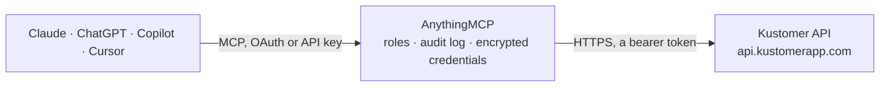

<!-- Generated by scripts/export-github-catalog.mjs in the anythingmcp-website repository. Do not edit by hand. -->

# Kustomer MCP connector

Drive Kustomer (modern customer service CRM, Meta-owned) from any AI agent: conversations, messages, customers, notes, custom objects. 10 tools, Bearer auth. The AnythingMCP connector gives Claude, ChatGPT, Microsoft Copilot, Cursor and Gemini 10 MCP tools for Kustomer: 6 read and 4 can change data.

**Category:** [Customer Support](../support.md) · **Tools:** 10 · **Setup guide:** [anythingmcp.com](https://anythingmcp.com/guides/kustomer-to-mcp) · [Deutsch](https://anythingmcp.com/de/guides/kustomer-to-mcp) · [Italiano](https://anythingmcp.com/it/guides/kustomer-to-mcp) · [Español](https://anythingmcp.com/es/guides/kustomer-to-mcp) · [日本語](https://anythingmcp.com/ja/guides/kustomer-to-mcp) · [Русский](https://anythingmcp.com/ru/guides/kustomer-to-mcp) · [中文](https://anythingmcp.com/zh/guides/kustomer-to-mcp)

## Start without code

No installation and no terminal: AnythingMCP Cloud runs the Kustomer connector for you, operated by helpcode.ai in Frankfurt, Germany.

1. **Click the button above** and create an account or sign in. The Kustomer connector opens, ready to install.
2. **Paste the API key or token from your Kustomer account.** Every click is in the [step-by-step guide](https://anythingmcp.com/guides/kustomer-to-mcp).
3. **Click Install.** AnythingMCP shows the address of your MCP server.
4. **Add that address to your assistant:** [Claude](https://anythingmcp.com/guides/connect-kustomer-to-claude) · [ChatGPT](https://anythingmcp.com/guides/connect-kustomer-to-chatgpt) · [Microsoft Copilot](https://anythingmcp.com/guides/connect-kustomer-to-copilot) · [Cursor](https://anythingmcp.com/guides/connect-kustomer-to-cursor) · [Gemini CLI](https://anythingmcp.com/guides/connect-kustomer-to-gemini) · [Meta Muse](https://anythingmcp.com/guides/connect-kustomer-to-muse).
5. **Ask your first question**, for example: *Show me customer record for email clara.voss@brightfield.de and any open conversations.*

Prefer help with the setup? [Talk to us](https://anythingmcp.com/contact).

## How it works

- **The AI client** speaks MCP (Streamable HTTP) to AnythingMCP and only sees tool names, descriptions and results. It never gets the Kustomer credentials.
- **AnythingMCP** checks the client's role, builds the call from the tool definition, adds the credentials (a bearer token), calls Kustomer, logs the call and returns the result.
- **Kustomer** sees an ordinary API client with the rights of the account the credentials belong to.

## Tools

| Tool | What it does | Access |
|---|---|---|
| [`kustomer_get_current_tracking_id`](#kustomer_get_current_tracking_id) | Return the org / org details — sanity check for API key validity. | read |
| [`kustomer_search_customers`](#kustomer_search_customers) | Search customers via the v1 search endpoint (Kustomer's Lucene-style query). | read |
| [`kustomer_get_customer`](#kustomer_get_customer) | Fetch a customer by ID. | read |
| [`kustomer_create_customer`](#kustomer_create_customer) | Create a customer. | write |
| [`kustomer_search_conversations`](#kustomer_search_conversations) | Search conversations. | read |
| [`kustomer_get_conversation`](#kustomer_get_conversation) | Fetch a conversation by ID. | read |
| [`kustomer_update_conversation`](#kustomer_update_conversation) | Update a conversation — change status (open/snoozed/done), assignee, queue, priority, tags. | write |
| [`kustomer_add_note_to_conversation`](#kustomer_add_note_to_conversation) | Add an internal note (private — not sent to customer). | write |
| [`kustomer_create_outbound_message`](#kustomer_create_outbound_message) | Send a public message in a conversation (email/SMS/chat reply). | write |
| [`kustomer_list_users`](#kustomer_list_users) | List org users (agents). | read |

## Tool reference

Every parameter as the AI client sees it in `tools/list`. Source: [`packages/backend/src/adapters/intl/kustomer.json`](../../../packages/backend/src/adapters/intl/kustomer.json).

### `kustomer_get_current_tracking_id`

Return the org / org details — sanity check for API key validity.

**Access:** read · **Call:** `GET /orgs/current`

No parameters.

### `kustomer_search_customers`

Search customers via the v1 search endpoint (Kustomer's Lucene-style query).

**Access:** read · **Call:** `POST /customers/search`

| Parameter | Type | Required | Description |
|---|---|---|---|
| `queryQueries` | any[] | no | Array of {and:[{name:'fieldname',operator:'equals',value:'X'},...], or:[]}. |
| `queryContext` | string | no | customer (default), conversation, message. |
| `pageSize` | integer | no | Per page. |
| `pageNumber` | integer | no | 1-based page. |

### `kustomer_get_customer`

Fetch a customer by ID. Pass include=conversations,messages,notes to side-load timeline.

**Access:** read · **Call:** `GET /customers/{customerId}`

| Parameter | Type | Required | Description |
|---|---|---|---|
| `customerId` | string | yes | Customer ID. |
| `include` | string | no | Comma-separated relationships. |

### `kustomer_create_customer`

Create a customer. Required: name OR emails (at least one identifier).

**Access:** write · **Call:** `POST /customers`

| Parameter | Type | Required | Description |
|---|---|---|---|
| `name` | string | no | Full name. |
| `displayName` | string | no | Display name override. |
| `emails` | any[] | no | [{email, type:'work'\|'home'\|'other', verified?:bool}]. |
| `phones` | any[] | no | [{phone:'+15551234567', type, verified?}]. |
| `socials` | any[] | no | [{type:'twitter'\|'facebook'\|..., identifier:'@handle'}]. |
| `tags` | any[] | no | Tag strings. |
| `locale` | string | no | User locale. |
| `timeZone` | string | no | TZ database name. |
| `custom` | object | no | Custom attributes (must be defined in org settings first). |

### `kustomer_search_conversations`

Search conversations.

**Access:** read · **Call:** `POST /conversations/search`

| Parameter | Type | Required | Description |
|---|---|---|---|
| `queryQueries` | any[] | no | Kustomer query array. |
| `pageSize` | integer | no | Per page. |
| `pageNumber` | integer | no | Page. |

### `kustomer_get_conversation`

Fetch a conversation by ID.

**Access:** read · **Call:** `GET /conversations/{conversationId}`

| Parameter | Type | Required | Description |
|---|---|---|---|
| `conversationId` | string | yes | Conversation ID. |
| `include` | string | no | Side-load (messages, notes, customer). |

### `kustomer_update_conversation`

Update a conversation — change status (open/snoozed/done), assignee, queue, priority, tags.

**Access:** write · **Call:** `PUT /conversations/{conversationId}`

| Parameter | Type | Required | Description |
|---|---|---|---|
| `conversationId` | string | yes | Conversation ID. |
| `status` | string | no | open, snoozed, done. |
| `assignedUsers` | any[] | no | Array of user IDs. |
| `assignedTeams` | any[] | no | Array of team IDs. |
| `queue` | string | no | Queue ID. |
| `priority` | integer | no | 1=Urgent, 2=High, 3=Medium, 4=Low. |
| `tags` | any[] | no | Replace tag set. |

### `kustomer_add_note_to_conversation`

Add an internal note (private — not sent to customer).

**Access:** write · **Call:** `POST /conversations/{conversationId}/notes`

| Parameter | Type | Required | Description |
|---|---|---|---|
| `conversationId` | string | yes | Conversation ID. |
| `body` | string | yes | Note body. |
| `user` | string | no | User ID who authored. |

### `kustomer_create_outbound_message`

Send a public message in a conversation (email/SMS/chat reply). The exact required fields depend on channel.

**Access:** write · **Call:** `POST /conversations/{conversationId}/messages`

| Parameter | Type | Required | Description |
|---|---|---|---|
| `conversationId` | string | yes | Conversation ID. |
| `channel` | string | yes | email, sms, chat. |
| `to` | string | yes | Recipient address (email/phone). |
| `from` | string | yes | Sender address (verified). |
| `subject` | string | no | Email subject. |
| `body` | string | yes | Plain-text body. |
| `html` | string | no | HTML body (email). |

### `kustomer_list_users`

List org users (agents).

**Access:** read · **Call:** `GET /users`

No parameters.

## Run it yourself

AnythingMCP is open source (AGPL-3.0). [Run it with Docker](../../../README.md#run-it-yourself), open **Connectors → Store**, pick **Kustomer** and enter `KUSTOMER_API_KEY`, `KUSTOMER_SUBDOMAIN`, then add your MCP server URL to the AI client.

[← Customer Support connectors](../support.md) · [All categories](../README.md)
