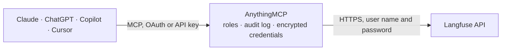

<!-- Generated by scripts/export-github-catalog.mjs in the anythingmcp-website repository. Do not edit by hand. -->

# Langfuse MCP connector

Let your AI read a Langfuse project: LLM traces, observations and sessions with cost, tokens and latency, metrics over time, scores and evaluations, prompts with their versions and labels, datasets, … The AnythingMCP connector gives Claude, ChatGPT, Microsoft Copilot, Cursor and Gemini 20 MCP tools for Langfuse: 15 read and 5 can change data.

**Category:** [Monitoring](../monitoring.md) · **Tools:** 20 · **Setup guide:** [anythingmcp.com](https://anythingmcp.com/guides/langfuse-to-mcp) · [Deutsch](https://anythingmcp.com/de/guides/langfuse-to-mcp) · [Italiano](https://anythingmcp.com/it/guides/langfuse-to-mcp) · [Español](https://anythingmcp.com/es/guides/langfuse-to-mcp) · [日本語](https://anythingmcp.com/ja/guides/langfuse-to-mcp) · [Русский](https://anythingmcp.com/ru/guides/langfuse-to-mcp) · [中文](https://anythingmcp.com/zh/guides/langfuse-to-mcp)

## Start without code

No installation and no terminal: AnythingMCP Cloud runs the Langfuse connector for you, operated by helpcode.ai in Frankfurt, Germany.

1. **Click the button above** and create an account or sign in. The Langfuse connector opens, ready to install.
2. **Paste the API key or token from your Langfuse account.** Every click is in the [step-by-step guide](https://anythingmcp.com/guides/langfuse-to-mcp).
3. **Click Install.** AnythingMCP shows the address of your MCP server.
4. **Add that address to your assistant:** [Claude](https://anythingmcp.com/guides/connect-langfuse-to-claude) · [ChatGPT](https://anythingmcp.com/guides/connect-langfuse-to-chatgpt) · [Microsoft Copilot](https://anythingmcp.com/guides/connect-langfuse-to-copilot) · [Cursor](https://anythingmcp.com/guides/connect-langfuse-to-cursor) · [Gemini CLI](https://anythingmcp.com/guides/connect-langfuse-to-gemini) · [Meta Muse](https://anythingmcp.com/guides/connect-langfuse-to-muse).
5. **Ask your first question**, for example: *Show the trace for traceId trc-2026-09-17-77 from session sess-2026-09-17-11, include model, tokens and errors.*

Prefer help with the setup? [Talk to us](https://anythingmcp.com/contact).

## How it works

- **The AI client** speaks MCP (Streamable HTTP) to AnythingMCP and only sees tool names, descriptions and results. It never gets the Langfuse credentials.
- **AnythingMCP** checks the client's role, builds the call from the tool definition, adds the credentials (user name and password), calls Langfuse, logs the call and returns the result.
- **Langfuse** sees an ordinary API client with the rights of the account the credentials belong to.

## Tools

| Tool | What it does | Access |
|---|---|---|
| [`langfuse_get_project`](#langfuse_get_project) | Show the Langfuse project this key pair belongs to: id, name, organization and retention settings. | read |
| [`langfuse_get_health`](#langfuse_get_health) | Check that the Langfuse server and its database are up and read the Langfuse version (v4 or later is needed for the observation and metrics tools). | read |
| [`langfuse_list_observations`](#langfuse_list_observations) | List observations (LLM generations, spans, tool calls, events) of the Langfuse project, newest first, with the chosen field groups. | read |
| [`langfuse_get_trace`](#langfuse_get_trace) | Read one Langfuse trace: all of its observations with input, output, model, token usage, cost and latency, newest first. | read |
| [`langfuse_get_session`](#langfuse_get_session) | Read one Langfuse session (for example a chat conversation): by default one row per trace, the entry point of each turn, with input, output and trace name,… | read |
| [`langfuse_query_metrics`](#langfuse_query_metrics) | Aggregate Langfuse data (Metrics API v2): counts, tokens, cost, latency percentiles or score values, grouped by dimensions such as model, trace name or… | read |
| [`langfuse_list_scores`](#langfuse_list_scores) | List Langfuse scores (evaluations, user feedback, annotations) newest first, with name, value, data type, source, comment and the trace, observation or… | read |
| [`langfuse_create_score`](#langfuse_create_score) | Add one score to a Langfuse trace, observation, session or experiment run, e.g. a quality rating or a correctness check. | write |
| [`langfuse_list_score_configs`](#langfuse_list_score_configs) | List the score configs of the Langfuse project: name, data type, numeric range or categories, description and whether archived. | read |
| [`langfuse_list_prompts`](#langfuse_list_prompts) | List the prompts of the Langfuse project: name, type, versions, labels, tags and last update. | read |
| [`langfuse_get_prompt`](#langfuse_get_prompt) | Read one Langfuse prompt version: its text or chat messages, config (model, temperature), labels, tags, version and commit message. | read |
| [`langfuse_create_prompt_version`](#langfuse_create_prompt_version) | Publish a new version of a Langfuse prompt (a new name creates the prompt). | write |
| [`langfuse_update_prompt_labels`](#langfuse_update_prompt_labels) | Set the deployment labels of one Langfuse prompt version, e.g. promote version 4 to production. | write |
| [`langfuse_list_datasets`](#langfuse_list_datasets) | List the datasets of the Langfuse project with id, name, description, metadata and dates. | read |
| [`langfuse_get_dataset`](#langfuse_get_dataset) | Read one Langfuse dataset by name: description, metadata, input and expected-output JSON schemas and dates. | read |
| [`langfuse_create_dataset`](#langfuse_create_dataset) | Create a Langfuse dataset for evaluations and experiments, optionally with JSON schemas that every item's input and expected output must match. | write |
| [`langfuse_list_dataset_items`](#langfuse_list_dataset_items) | List the items of Langfuse datasets: input, expected output, metadata, status (ACTIVE or ARCHIVED) and the trace or observation they came from. | read |
| [`langfuse_get_dataset_item`](#langfuse_get_dataset_item) | Read one Langfuse dataset item: input, expected output, metadata, status, source trace and observation, dataset and dates. | read |
| [`langfuse_upsert_dataset_item`](#langfuse_upsert_dataset_item) | Add an item to a Langfuse dataset, or update it when item_id already exists: input, expected output, metadata, the source trace or observation, and status… | write |
| [`langfuse_list_experiments`](#langfuse_list_experiments) | List Langfuse experiments and dataset runs with recent activity first: name, dataset, metadata and, with fields scores, their aggregated scores. | read |

## Tool reference

Every parameter as the AI client sees it in `tools/list`. Source: [`packages/backend/src/adapters/intl/langfuse.json`](../../../packages/backend/src/adapters/intl/langfuse.json).

### `langfuse_get_project`

Show the Langfuse project this key pair belongs to: id, name, organization and retention settings. Use it to check the connection.

**Access:** read · **Call:** `GET /projects`

No parameters.

### `langfuse_get_health`

Check that the Langfuse server and its database are up and read the Langfuse version (v4 or later is needed for the observation and metrics tools).

**Access:** read · **Call:** `GET /health`

No parameters.

### `langfuse_list_observations`

List observations (LLM generations, spans, tool calls, events) of the Langfuse project, newest first, with the chosen field groups. Bound it with from_start_time and to_start_time. Page with cursor = meta.cursor until it is missing.

**Access:** read · **Call:** `GET /v2/observations`

| Parameter | Type | Required | Description |
|---|---|---|---|
| `from_start_time` | string | no | Only observations that started at or after this ISO 8601 time, e.g. 2026-10-01T00:00:00Z. |
| `to_start_time` | string | no | Only observations that started before this ISO 8601 time. |
| `fields` | string | no | Comma-separated field groups: core, basic, time, io, metadata, model, usage, prompt, metrics, trace_context. Default core,basic,usage; add io for input and output. |
| `type` | string | no | Observation type: GENERATION, SPAN, EVENT, AGENT, TOOL, CHAIN, RETRIEVER, EVALUATOR, EMBEDDING, GUARDRAIL. |
| `name` | string | no | Exact observation name. |
| `user_id` | string | no | Only observations of this user id. |
| `session_id` | string | no | Only observations of this session id. |
| `trace_id` | string | no | Only observations of this trace id. |
| `level` | `DEBUG` \| `DEFAULT` \| `WARNING` \| `ERROR` | no | Only observations with this level; ERROR finds failures. |
| `environment` | string[] | no | Only these environments, e.g. ["production"]. |
| `is_root_observation` | boolean | no | true: only the entry point of each trace (one row per trace). |
| `version` | string | no | Only observations with this version. |
| `filter` | string | no | Structured filter as a JSON string, overriding the simple filters: [{"type": "string", "column": "traceName", "operator": "=", "value": "support-chat"}]. Types: string, number, datetime, boolean, stringOptions, arrayOptions (tags), stringObject (metadata, with key), null. |
| `limit` | integer | no | Rows per page, default 50, at most 1000. |
| `cursor` | string | no | meta.cursor of the previous page. |

### `langfuse_get_trace`

Read one Langfuse trace: all of its observations with input, output, model, token usage, cost and latency, newest first. The root observation has no parentObservationId and carries the trace's input and output.

**Access:** read · **Call:** `GET /v2/observations`

| Parameter | Type | Required | Description |
|---|---|---|---|
| `trace_id` | string | yes | Trace id, e.g. from langfuse_list_observations. |
| `fields` | string | no | Field groups, default core,basic,time,io,model,usage,metrics,trace_context. |
| `from_start_time` | string | no | Optional lower time bound (ISO 8601) to speed up the lookup. |
| `to_start_time` | string | no | Optional upper time bound (ISO 8601). |
| `limit` | integer | no | Observations per page, default 200. |
| `cursor` | string | no | meta.cursor of the previous page, for very long traces. |

### `langfuse_get_session`

Read one Langfuse session (for example a chat conversation): by default one row per trace, the entry point of each turn, with input, output and trace name, newest first. Set root_only false for every observation of the session.

**Access:** read · **Call:** `GET /v2/observations`

| Parameter | Type | Required | Description |
|---|---|---|---|
| `session_id` | string | yes | Session id as set by the application. |
| `root_only` | boolean | no | true (default): one row per trace; false: every observation. |
| `fields` | string | no | Field groups, default core,basic,io,usage,trace_context. |
| `from_start_time` | string | no | Optional lower time bound (ISO 8601). |
| `to_start_time` | string | no | Optional upper time bound (ISO 8601). |
| `limit` | integer | no | Rows per page, default 100. |
| `cursor` | string | no | meta.cursor of the previous page. |

### `langfuse_query_metrics`

Aggregate Langfuse data (Metrics API v2): counts, tokens, cost, latency percentiles or score values, grouped by dimensions such as model, trace name or prompt, optionally per minute, hour, day, week or month. Replaces the deprecated daily metrics endpoint.

**Access:** read · **Call:** `GET /v2/metrics`

| Parameter | Type | Required | Description |
|---|---|---|---|
| `query` | string | yes | The query as a JSON string: {"view": "observations", "metrics": [{"measure": "totalCost", "aggregation": "sum"}], "dimensions": [{"field": "providedModelName"}], "timeDimension": {"granularity": "day"}, "filters": [], "fromTimestamp": "2026-10-01T00:00:00Z", "toTimestamp": "2026-10-31T00:00:00Z"}. view, metrics, fromTimestamp and toTimestamp are required. |

### `langfuse_list_scores`

List Langfuse scores (evaluations, user feedback, annotations) newest first, with name, value, data type, source, comment and the trace, observation or session they belong to. Filters take comma-separated lists. Page with cursor = meta.cursor.

**Access:** read · **Call:** `GET /v3/scores`

| Parameter | Type | Required | Description |
|---|---|---|---|
| `name` | string | no | Score names, comma-separated. |
| `source` | string | no | Sources, comma-separated: API, ANNOTATION, EVAL. |
| `data_type` | string | no | Data types, comma-separated: NUMERIC, BOOLEAN, CATEGORICAL, TEXT, CORRECTION. |
| `trace_id` | string | no | Trace ids, comma-separated. |
| `session_id` | string | no | Session ids, comma-separated (not together with trace_id). |
| `observation_id` | string | no | Observation ids, comma-separated; needs trace_id. |
| `experiment_id` | string | no | Experiment (dataset run) ids, comma-separated. |
| `config_id` | string | no | Score config ids, comma-separated. |
| `environment` | string | no | Environments, comma-separated. |
| `value_min` | number | no | Lowest numeric value, with data_type NUMERIC. |
| `value_max` | number | no | Highest numeric value, with data_type NUMERIC. |
| `from_timestamp` | string | no | Only scores at or after this ISO 8601 time. |
| `to_timestamp` | string | no | Only scores before this ISO 8601 time. |
| `fields` | string | no | Extra field groups, e.g. details. |
| `limit` | integer | no | Scores per page, default 50, at most 100. |
| `cursor` | string | no | meta.cursor of the previous page. |

### `langfuse_create_score`

Add one score to a Langfuse trace, observation, session or experiment run, e.g. a quality rating or a correctness check. Processed asynchronously (HTTP 202). Pass the same score_id again to overwrite a score.

**Access:** write · **Call:** `POST /scores`

| Parameter | Type | Required | Description |
|---|---|---|---|
| `name` | string | yes | Score name, e.g. correctness or user-feedback. |
| `value` | any | yes | The value: a number for NUMERIC, 0 or 1 for BOOLEAN, a string for CATEGORICAL and TEXT. |
| `data_type` | `NUMERIC` \| `BOOLEAN` \| `CATEGORICAL` \| `TEXT` | no | Data type; inferred from value when omitted. |
| `trace_id` | string | no | Trace the score belongs to. |
| `observation_id` | string | no | Observation the score belongs to (with trace_id). |
| `session_id` | string | no | Session the score belongs to. |
| `dataset_run_id` | string | no | Experiment (dataset run) the score belongs to. |
| `comment` | string | no | Explanation of the score. |
| `config_id` | string | no | Score config id from langfuse_list_score_configs; enforces its range or categories. |
| `score_id` | string | no | Your own id for the score, to update it later. |
| `environment` | string | no | Environment, e.g. production. |
| `metadata` | object | no | Extra key-value metadata. |

### `langfuse_list_score_configs`

List the score configs of the Langfuse project: name, data type, numeric range or categories, description and whether archived.

**Access:** read · **Call:** `GET /score-configs`

| Parameter | Type | Required | Description |
|---|---|---|---|
| `page` | integer | no | Page number, from 1. |
| `limit` | integer | no | Configs per page, default 50. |

### `langfuse_list_prompts`

List the prompts of the Langfuse project: name, type, versions, labels, tags and last update. Filter by name, label or tag.

**Access:** read · **Call:** `GET /v2/prompts`

| Parameter | Type | Required | Description |
|---|---|---|---|
| `name` | string | no | Exact prompt name. |
| `label` | string | no | Only prompts with a version carrying this label, e.g. production. |
| `tag` | string | no | Only prompts with this tag. |
| `from_updated_at` | string | no | Only versions updated at or after this ISO 8601 time. |
| `to_updated_at` | string | no | Only versions updated before this ISO 8601 time. |
| `page` | integer | no | Page number, from 1. |
| `limit` | integer | no | Prompts per page, default 50. |

### `langfuse_get_prompt`

Read one Langfuse prompt version: its text or chat messages, config (model, temperature), labels, tags, version and commit message. Without version or label the version labelled production is returned.

**Access:** read · **Call:** `GET /v2/prompts/{prompt_name}`

| Parameter | Type | Required | Description |
|---|---|---|---|
| `prompt_name` | string | yes | Prompt name including any folder path, e.g. support/greeting. |
| `version` | integer | no | A specific version number. |
| `label` | string | no | A label such as production, staging or latest. |
| `resolve` | boolean | no | false returns prompt references unresolved; default true. |

### `langfuse_create_prompt_version`

Publish a new version of a Langfuse prompt (a new name creates the prompt). Text prompts take a string with {{variables}}, chat prompts a list of messages. Labels such as production change what applications fetch: confirm with the user before setting them.

**Access:** write · **Call:** `POST /v2/prompts`

| Parameter | Type | Required | Description |
|---|---|---|---|
| `name` | string | yes | Prompt name including any folder path, at most 255 characters. |
| `type` | `text` \| `chat` | no | text (default) or chat. |
| `prompt` | any | yes | For text: the prompt string, e.g. Summarise {{text}} in {{language}}. For chat: [{"role": "system", "content": "..."}, {"role": "user", "content": "{{question}}"}]. |
| `config` | object | no | Free-form config stored with the version, e.g. {"model": "gpt-4o", "temperature": 0.2}. |
| `labels` | string[] | no | Labels for this version, e.g. ["staging"]; latest is set automatically. |
| `tags` | string[] | no | Tags for all versions of the prompt. |
| `commit_message` | string | no | What changed in this version. |

### `langfuse_update_prompt_labels`

Set the deployment labels of one Langfuse prompt version, e.g. promote version 4 to production. A label moves away from the version that had it. Confirm with the user before moving production.

**Access:** write · **Call:** `PATCH /v2/prompts/{prompt_name}/versions/{version}`

| Parameter | Type | Required | Description |
|---|---|---|---|
| `prompt_name` | string | yes | Prompt name including any folder path. |
| `version` | integer | yes | Version number to label. |
| `new_labels` | string[] | yes | Labels to put on this version, e.g. ["production"]. latest is reserved. |

### `langfuse_list_datasets`

List the datasets of the Langfuse project with id, name, description, metadata and dates.

**Access:** read · **Call:** `GET /v2/datasets`

| Parameter | Type | Required | Description |
|---|---|---|---|
| `page` | integer | no | Page number, from 1. |
| `limit` | integer | no | Datasets per page, default 50. |

### `langfuse_get_dataset`

Read one Langfuse dataset by name: description, metadata, input and expected-output JSON schemas and dates.

**Access:** read · **Call:** `GET /v2/datasets/{dataset_name}`

| Parameter | Type | Required | Description |
|---|---|---|---|
| `dataset_name` | string | yes | Dataset name, including any folder path. |

### `langfuse_create_dataset`

Create a Langfuse dataset for evaluations and experiments, optionally with JSON schemas that every item's input and expected output must match.

**Access:** write · **Call:** `POST /v2/datasets`

| Parameter | Type | Required | Description |
|---|---|---|---|
| `name` | string | yes | Dataset name; folders with /. |
| `description` | string | no | What the dataset is for. |
| `metadata` | object | no | Key-value metadata. |
| `input_schema` | object | no | JSON Schema the items' input must match. |
| `expected_output_schema` | object | no | JSON Schema the items' expected output must match. |

### `langfuse_list_dataset_items`

List the items of Langfuse datasets: input, expected output, metadata, status (ACTIVE or ARCHIVED) and the trace or observation they came from. Filter by dataset or source; version shows a dataset as it was at a point in time.

**Access:** read · **Call:** `GET /dataset-items`

| Parameter | Type | Required | Description |
|---|---|---|---|
| `dataset_name` | string | no | Only items of this dataset. |
| `source_trace_id` | string | no | Only items created from this trace. |
| `source_observation_id` | string | no | Only items created from this observation. |
| `version` | string | no | ISO 8601 UTC time: items as they were then; needs dataset_name. |
| `page` | integer | no | Page number, from 1. |
| `limit` | integer | no | Items per page, default 50. |

### `langfuse_get_dataset_item`

Read one Langfuse dataset item: input, expected output, metadata, status, source trace and observation, dataset and dates.

**Access:** read · **Call:** `GET /dataset-items/{item_id}`

| Parameter | Type | Required | Description |
|---|---|---|---|
| `item_id` | string | yes | Dataset item id. |

### `langfuse_upsert_dataset_item`

Add an item to a Langfuse dataset, or update it when item_id already exists: input, expected output, metadata, the source trace or observation, and status ARCHIVED to retire it.

**Access:** write · **Call:** `POST /dataset-items`

| Parameter | Type | Required | Description |
|---|---|---|---|
| `dataset_name` | string | yes | Dataset the item belongs to. |
| `input` | any | no | Input of the test case: any JSON value. |
| `expected_output` | any | no | Expected output: any JSON value. |
| `metadata` | any | no | Metadata: any JSON value. |
| `source_trace_id` | string | no | Trace the item was taken from. |
| `source_observation_id` | string | no | Observation the item was taken from. |
| `item_id` | string | no | Your own id; an existing id updates that item. Unique per project, at most 255 characters. |
| `status` | `ACTIVE` \| `ARCHIVED` | no | ACTIVE (default) or ARCHIVED. |

### `langfuse_list_experiments`

List Langfuse experiments and dataset runs with recent activity first: name, dataset, metadata and, with fields scores, their aggregated scores. from_start_time is required. Page with cursor = meta.cursor.

**Access:** read · **Call:** `GET /experiments`

| Parameter | Type | Required | Description |
|---|---|---|---|
| `from_start_time` | string | yes | Required lower bound: experiments with events at or after this ISO 8601 time. |
| `to_start_time` | string | no | Upper bound (ISO 8601). |
| `name` | string | no | Experiment names, comma-separated. |
| `dataset_id` | string | no | Dataset ids, comma-separated. |
| `fields` | string | no | Field groups: core, metadata, scores. Default core,scores. |
| `limit` | integer | no | Experiments per page, default 50. |
| `cursor` | string | no | meta.cursor of the previous page. |

## Run it yourself

AnythingMCP is open source (AGPL-3.0). [Run it with Docker](../../../README.md#run-it-yourself), open **Connectors → Store**, pick **Langfuse** and enter `LANGFUSE_HOST`, `LANGFUSE_PUBLIC_KEY`, `LANGFUSE_SECRET_KEY`, then add your MCP server URL to the AI client.

[← Monitoring connectors](../monitoring.md) · [All categories](../README.md)
