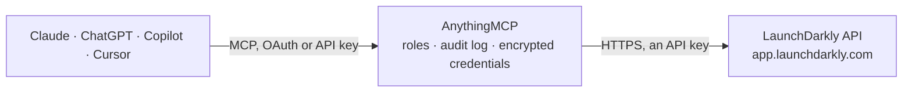

<!-- Generated by scripts/export-github-catalog.mjs in the anythingmcp-website repository. Do not edit by hand. -->

# LaunchDarkly MCP connector

LaunchDarkly feature flags: projects and environments, flags with state and evaluation status, segments, metrics and experiments, the audit log, members and teams. The AnythingMCP connector gives Claude, ChatGPT, Microsoft Copilot, Cursor and Gemini 27 MCP tools for LaunchDarkly: 21 read and 6 can change data.

**Category:** [Infrastructure](../infrastructure.md) · **Tools:** 27 · **Setup guide:** [anythingmcp.com](https://anythingmcp.com/guides/launchdarkly-to-mcp) · [Deutsch](https://anythingmcp.com/de/guides/launchdarkly-to-mcp) · [Italiano](https://anythingmcp.com/it/guides/launchdarkly-to-mcp) · [Español](https://anythingmcp.com/es/guides/launchdarkly-to-mcp) · [日本語](https://anythingmcp.com/ja/guides/launchdarkly-to-mcp) · [Русский](https://anythingmcp.com/ru/guides/launchdarkly-to-mcp) · [中文](https://anythingmcp.com/zh/guides/launchdarkly-to-mcp)

## Start without code

No installation and no terminal: AnythingMCP Cloud runs the LaunchDarkly connector for you, operated by helpcode.ai in Frankfurt, Germany.

1. **Click the button above** and create an account or sign in. The LaunchDarkly connector opens, ready to install.
2. **Paste the API key or token from your LaunchDarkly account.** Every click is in the [step-by-step guide](https://anythingmcp.com/guides/launchdarkly-to-mcp).
3. **Click Install.** AnythingMCP shows the address of your MCP server.
4. **Add that address to your assistant:** [Claude](https://anythingmcp.com/guides/connect-launchdarkly-to-claude) · [ChatGPT](https://anythingmcp.com/guides/connect-launchdarkly-to-chatgpt) · [Microsoft Copilot](https://anythingmcp.com/guides/connect-launchdarkly-to-copilot) · [Cursor](https://anythingmcp.com/guides/connect-launchdarkly-to-cursor) · [Gemini CLI](https://anythingmcp.com/guides/connect-launchdarkly-to-gemini) · [Meta Muse](https://anythingmcp.com/guides/connect-launchdarkly-to-muse).
5. **Ask your first question**, for example: *Is the invoice-pdf-v2 flag on in production for project billing right now?*

Prefer help with the setup? [Talk to us](https://anythingmcp.com/contact).

## How it works

- **The AI client** speaks MCP (Streamable HTTP) to AnythingMCP and only sees tool names, descriptions and results. It never gets the LaunchDarkly credentials.
- **AnythingMCP** checks the client's role, builds the call from the tool definition, adds the credentials (an API key), calls LaunchDarkly, logs the call and returns the result.
- **LaunchDarkly** sees an ordinary API client with the rights of the account the credentials belong to.

## Tools

| Tool | What it does | Access |
|---|---|---|
| [`launchdarkly_get_caller_identity`](#launchdarkly_get_caller_identity) | Show what the access token is: account, token name and kind (personal or service), the member it belongs to and its scopes. | read |
| [`launchdarkly_list_projects`](#launchdarkly_list_projects) | List the projects with key, name, tags and default client-side settings. | read |
| [`launchdarkly_get_project`](#launchdarkly_get_project) | Get one project with its settings; add `expand: environments` for its environments (SDK keys are left out). | read |
| [`launchdarkly_list_environments`](#launchdarkly_list_environments) | List the environments of a project (e.g. Production, Test) with key, name, colour, client-side id, approval and comment settings. | read |
| [`launchdarkly_get_environment`](#launchdarkly_get_environment) | Get one environment with its settings: client-side id, default TTL, secure mode, whether changes need comments, confirmation or approval, and its tags. | read |
| [`launchdarkly_list_flags`](#launchdarkly_list_flags) | List the feature flags of a project: key, name, description, kind (boolean or multivariate), variations, tags, temporary flag, maintainer and creation date. | read |
| [`launchdarkly_get_flag`](#launchdarkly_get_flag) | Get one feature flag with its variations (with their `_id`), defaults and, per environment, whether it is on, its targets, rules (with `_id`), fallthrough,… | read |
| [`launchdarkly_list_flag_statuses`](#launchdarkly_list_flag_statuses) | List the evaluation status of every flag in one environment: new, active, inactive (not evaluated for 7 days) or launched (serving one variation to… | read |
| [`launchdarkly_get_flag_status`](#launchdarkly_get_flag_status) | Get the evaluation status of one flag in one environment (new, active, inactive, launched) and when it was last requested. | read |
| [`launchdarkly_create_flag`](#launchdarkly_create_flag) | Create a feature flag in a project, by default a boolean flag (variations true and false) that is off in every environment. | write |
| [`launchdarkly_toggle_flag`](#launchdarkly_toggle_flag) | Turn a feature flag on or off in one environment. | write |
| [`launchdarkly_update_flag`](#launchdarkly_update_flag) | Change a feature flag with semantic patch instructions: targeting (addRule, removeRule, addClauses, addTargets, removeTargets,… | write |
| [`launchdarkly_delete_flag`](#launchdarkly_delete_flag) | Delete a feature flag from every environment of the project. | write |
| [`launchdarkly_list_segments`](#launchdarkly_list_segments) | List the segments of an environment: key, name, description, tags, whether it is a big segment, and when it changed. | read |
| [`launchdarkly_get_segment`](#launchdarkly_get_segment) | Get one segment with its included and excluded targets, rules (with `_id`) and version. | read |
| [`launchdarkly_create_segment`](#launchdarkly_create_segment) | Create an empty segment in one environment; add targets and rules afterwards with `launchdarkly_update_segment`. | write |
| [`launchdarkly_update_segment`](#launchdarkly_update_segment) | Change a segment with semantic patch instructions: addIncludedTargets, removeIncludedTargets, addExcludedTargets, removeExcludedTargets, addRule,… | write |
| [`launchdarkly_list_metrics`](#launchdarkly_list_metrics) | List the metrics of a project (conversions, clicks, page views, numeric custom events) with key, name, kind, event key, unit, success criteria and how many… | read |
| [`launchdarkly_get_metric`](#launchdarkly_get_metric) | Get one metric with its definition and, with `expand`, the experiments and metric groups that use it. | read |
| [`launchdarkly_list_experiments`](#launchdarkly_list_experiments) | List the experiments of a project across environments: key, name, hypothesis, environment, current iteration status (not started, running, stopped) and flag. | read |
| [`launchdarkly_get_experiment`](#launchdarkly_get_experiment) | Get one experiment with its hypothesis, current iteration (status, start date, treatments and traffic allocation, primary and secondary metrics) and flag. | read |
| [`launchdarkly_list_audit_log`](#launchdarkly_list_audit_log) | List audit log entries, newest first: who changed what (flags, segments, environments, members) and when, with the title, description and the resource. | read |
| [`launchdarkly_get_audit_log_entry`](#launchdarkly_get_audit_log_entry) | Get one audit log entry with the full change: the JSON patch or semantic instructions applied, the previous and current version of the resource and the comment. | read |
| [`launchdarkly_list_members`](#launchdarkly_list_members) | List the account members: id, email, name, role (reader, writer, admin, owner, no_access) or custom roles, teams, last seen and whether they verified their… | read |
| [`launchdarkly_get_member`](#launchdarkly_get_member) | Get one account member with role, custom roles, teams and permission grants. | read |
| [`launchdarkly_list_teams`](#launchdarkly_list_teams) | List the teams: key, name, description, member count and the roles they hold. | read |
| [`launchdarkly_get_team`](#launchdarkly_get_team) | Get one team with its description and, with `expand`, members, roles, projects and maintainers. | read |

## Tool reference

Every parameter as the AI client sees it in `tools/list`. Source: [`packages/backend/src/adapters/intl/launchdarkly.json`](../../../packages/backend/src/adapters/intl/launchdarkly.json).

### `launchdarkly_get_caller_identity`

Show what the access token is: account, token name and kind (personal or service), the member it belongs to and its scopes. Use it to check the token.

**Access:** read · **Call:** `GET /api/v2/caller-identity`

No parameters.

### `launchdarkly_list_projects`

List the projects with key, name, tags and default client-side settings. Add `expand: environments` to include each project's environments (SDK keys are left out).

**Access:** read · **Call:** `GET /api/v2/projects`

| Parameter | Type | Required | Description |
|---|---|---|---|
| `filter` | string | no | Filters, comma-separated `field:value`, e.g. `query:mobile` (key or name contains) or `tags:core`. |
| `sort` | string | no | Sort field, `-` for descending: `name`, `-createdOn`. |
| `expand` | string | no | `environments` to include the environments. |
| `limit` | integer | no | Results per page (default 20). |
| `offset` | integer | no | Items to skip, for the next page: the previous offset plus limit (or follow `_links.next`). |

### `launchdarkly_get_project`

Get one project with its settings; add `expand: environments` for its environments (SDK keys are left out).

**Access:** read · **Call:** `GET /api/v2/projects/{project_key}`

| Parameter | Type | Required | Description |
|---|---|---|---|
| `project_key` | string | yes | Project key, from `launchdarkly_list_projects` (e.g. `default`). |
| `expand` | string | no | `environments` to include the environments. |

### `launchdarkly_list_environments`

List the environments of a project (e.g. Production, Test) with key, name, colour, client-side id, approval and comment settings. SDK and mobile keys are left out.

**Access:** read · **Call:** `GET /api/v2/projects/{project_key}/environments`

| Parameter | Type | Required | Description |
|---|---|---|---|
| `project_key` | string | yes | Project key, from `launchdarkly_list_projects` (e.g. `default`). |
| `filter` | string | no | Filters, comma-separated `field:value`, e.g. `query:prod`. |
| `sort` | string | no | Sort field, `-` for descending, e.g. `name`. |
| `limit` | integer | no | Results per page (default 20). |
| `offset` | integer | no | Items to skip, for the next page: the previous offset plus limit (or follow `_links.next`). |

### `launchdarkly_get_environment`

Get one environment with its settings: client-side id, default TTL, secure mode, whether changes need comments, confirmation or approval, and its tags. SDK and mobile keys are left out.

**Access:** read · **Call:** `GET /api/v2/projects/{project_key}/environments/{environment_key}`

| Parameter | Type | Required | Description |
|---|---|---|---|
| `project_key` | string | yes | Project key, from `launchdarkly_list_projects` (e.g. `default`). |
| `environment_key` | string | yes | Environment key within the project, from `launchdarkly_list_environments` (e.g. `production`, `test`). |

### `launchdarkly_list_flags`

List the feature flags of a project: key, name, description, kind (boolean or multivariate), variations, tags, temporary flag, maintainer and creation date. With `env`, each flag also shows whether it is on in that environment and what it serves.

**Access:** read · **Call:** `GET /api/v2/flags/{project_key}`

| Parameter | Type | Required | Description |
|---|---|---|---|
| `project_key` | string | yes | Project key, from `launchdarkly_list_projects` (e.g. `default`). |
| `env` | string | no | Environment key(s) whose state to include, e.g. `production`. Strongly recommended: without it the answer has no on or off state. |
| `filter` | string | no | Filters, comma-separated `field:value`: `query:checkout` (key or name contains), `tags:beta+web`, `state:live` (or deprecated, archived), `maintainerId:<member id>`, `hasExperiment:true`, `evaluated:{"after":<unix ms>},filterEnv:production`, `codeReferences.max:0`. |
| `tag` | string | no | Only flags with this tag. |
| `sort` | string | no | Sort field, `-` for descending: `creationDate`, `-creationDate`, `name`, `key`, `maintainerId`, `targetingModifiedDate`. |
| `summary` | boolean | no | true (default): leave out targeting rules and targets. false together with `env`: include the full targeting of that environment. |
| `expand` | string | no | Extra fields, comma-separated: `evaluation`, `codeReferences`, `migrationSettings`. |
| `limit` | integer | no | Results per page (default 20, up to 100). |
| `offset` | integer | no | Items to skip, for the next page: the previous offset plus limit (or follow `_links.next`). |

### `launchdarkly_get_flag`

Get one feature flag with its variations (with their `_id`), defaults and, per environment, whether it is on, its targets, rules (with `_id`), fallthrough, off variation, prerequisites and version. Rule and variation ids are what `launchdarkly_update_flag` instructions need.

**Access:** read · **Call:** `GET /api/v2/flags/{project_key}/{flag_key}`

| Parameter | Type | Required | Description |
|---|---|---|---|
| `project_key` | string | yes | Project key, from `launchdarkly_list_projects` (e.g. `default`). |
| `flag_key` | string | yes | Feature flag key (the key used in code), from `launchdarkly_list_flags`. |
| `env` | string | no | Only these environment keys (comma-separated) in `environments`, to keep the answer small. |
| `expand` | string | no | Extra fields, comma-separated: `evaluation` (context kinds evaluated in the last 30 days), `migrationSettings`. |

### `launchdarkly_list_flag_statuses`

List the evaluation status of every flag in one environment: new, active, inactive (not evaluated for 7 days) or launched (serving one variation to everyone), with the last time it was requested. Use it to find stale flags.

**Access:** read · **Call:** `GET /api/v2/flag-statuses/{project_key}/{environment_key}`

| Parameter | Type | Required | Description |
|---|---|---|---|
| `project_key` | string | yes | Project key, from `launchdarkly_list_projects` (e.g. `default`). |
| `environment_key` | string | yes | Environment key within the project, from `launchdarkly_list_environments` (e.g. `production`, `test`). |

### `launchdarkly_get_flag_status`

Get the evaluation status of one flag in one environment (new, active, inactive, launched) and when it was last requested.

**Access:** read · **Call:** `GET /api/v2/flag-statuses/{project_key}/{environment_key}/{flag_key}`

| Parameter | Type | Required | Description |
|---|---|---|---|
| `project_key` | string | yes | Project key, from `launchdarkly_list_projects` (e.g. `default`). |
| `environment_key` | string | yes | Environment key within the project, from `launchdarkly_list_environments` (e.g. `production`, `test`). |
| `flag_key` | string | yes | Feature flag key (the key used in code), from `launchdarkly_list_flags`. |

### `launchdarkly_create_flag`

Create a feature flag in a project, by default a boolean flag (variations true and false) that is off in every environment.

**Access:** write · **Call:** `POST /api/v2/flags/{project_key}`

| Parameter | Type | Required | Description |
|---|---|---|---|
| `project_key` | string | yes | Project key, from `launchdarkly_list_projects` (e.g. `default`). |
| `key` | string | yes | Flag key used in code, e.g. `new-checkout`. Letters, numbers, `.`, `_`, `-`. |
| `name` | string | yes | Human-readable name. |
| `description` | string | no | What the flag is for. |
| `temporary` | boolean | no | true (default) for a release flag that will be removed; false for a permanent flag. |
| `tags` | string[] | no | Tags, e.g. ["checkout", "web"]. |
| `variations` | object[] | no | Variations for a multivariate flag, each `{"value": ..., "name": "...", "description": "..."}`. Leave empty for a boolean flag. |
| `defaults` | object | no | Which variation (by index) new environments serve: `{"onVariation": 0, "offVariation": 1}`. |
| `maintainer_id` | string | no | Member id of the maintainer, from `launchdarkly_list_members` (default the token owner). |
| `maintainer_team_key` | string | no | Team key of the maintaining team, from `launchdarkly_list_teams`. |
| `clone` | string | no | Copy the full targeting of this existing flag key into the new flag. |

### `launchdarkly_toggle_flag`

Turn a feature flag on or off in one environment. Off serves the off variation to everyone; on applies the targeting. This changes what live users get immediately.

**Access:** write · **Call:** `PATCH /api/v2/flags/{project_key}/{flag_key}`

| Parameter | Type | Required | Description |
|---|---|---|---|
| `project_key` | string | yes | Project key, from `launchdarkly_list_projects` (e.g. `default`). |
| `flag_key` | string | yes | Feature flag key (the key used in code), from `launchdarkly_list_flags`. |
| `environment_key` | string | yes | Environment key within the project, from `launchdarkly_list_environments` (e.g. `production`, `test`). |
| `action` | `turnFlagOn` \| `turnFlagOff` | yes | `turnFlagOn` or `turnFlagOff`. |
| `comment` | string | no | Why: shown in the audit log (required when the environment demands comments). |
| `dry_run` | boolean | no | Validate only and return the flag as it would be, without saving. |

### `launchdarkly_update_flag`

Change a feature flag with semantic patch instructions: targeting (addRule, removeRule, addClauses, addTargets, removeTargets, updateFallthroughVariationOrRollout, updateOffVariation, addPrerequisite), settings (updateName, updateDescription, addTags, removeTags, updateMaintainerMember, markTemporary, markPermanent) or lifecycle (deprecateFlag, archiveFlag, restoreFlag). Get rule and variation ids from `launchdarkly_get_flag` first.

**Access:** write · **Call:** `PATCH /api/v2/flags/{project_key}/{flag_key}`

| Parameter | Type | Required | Description |
|---|---|---|---|
| `project_key` | string | yes | Project key, from `launchdarkly_list_projects` (e.g. `default`). |
| `flag_key` | string | yes | Feature flag key (the key used in code), from `launchdarkly_list_flags`. |
| `environment_key` | string | no | Environment key; required for targeting instructions, not for settings such as updateName or addTags. |
| `instructions` | object[] | yes | Semantic patch instructions, each with `kind` and its parameters, e.g. [{"kind": "addTargets", "contextKind": "user", "values": ["user-key-1"], "variationId": "<variation _id>"}] or [{"kind": "updateFallthroughVariationOrRollout", "rolloutWeights": {"<variation _id>": 10000, "<other _id>": 90000}}] (weights in thousandths of a percent, total 100000). |
| `comment` | string | no | Why: shown in the audit log. |
| `dry_run` | boolean | no | Validate only and return the flag as it would be, without saving. |

### `launchdarkly_delete_flag`

Delete a feature flag from every environment of the project. SDKs then serve the fallback value from code. Prefer archiving it with `launchdarkly_update_flag` (`archiveFlag`), which can be restored.

**Access:** write · **Call:** `DELETE /api/v2/flags/{project_key}/{flag_key}`

| Parameter | Type | Required | Description |
|---|---|---|---|
| `project_key` | string | yes | Project key, from `launchdarkly_list_projects` (e.g. `default`). |
| `flag_key` | string | yes | Feature flag key (the key used in code), from `launchdarkly_list_flags`. |

### `launchdarkly_list_segments`

List the segments of an environment: key, name, description, tags, whether it is a big segment, and when it changed.

**Access:** read · **Call:** `GET /api/v2/segments/{project_key}/{environment_key}`

| Parameter | Type | Required | Description |
|---|---|---|---|
| `project_key` | string | yes | Project key, from `launchdarkly_list_projects` (e.g. `default`). |
| `environment_key` | string | yes | Environment key within the project, from `launchdarkly_list_environments` (e.g. `production`, `test`). |
| `filter` | string | no | Filters, comma-separated `field:value`: `query:beta`, `tags:web`, `unbounded:true`, `includedKeys:user-1`. |
| `sort` | string | no | `name`, `creationDate` or `lastModified`, `-` for descending. |
| `limit` | integer | no | Results per page (default 20, up to 50). |
| `offset` | integer | no | Items to skip, for the next page: the previous offset plus limit (or follow `_links.next`). |

### `launchdarkly_get_segment`

Get one segment with its included and excluded targets, rules (with `_id`) and version.

**Access:** read · **Call:** `GET /api/v2/segments/{project_key}/{environment_key}/{segment_key}`

| Parameter | Type | Required | Description |
|---|---|---|---|
| `project_key` | string | yes | Project key, from `launchdarkly_list_projects` (e.g. `default`). |
| `environment_key` | string | yes | Environment key within the project, from `launchdarkly_list_environments` (e.g. `production`, `test`). |
| `segment_key` | string | yes | Segment key, from `launchdarkly_list_segments`. |

### `launchdarkly_create_segment`

Create an empty segment in one environment; add targets and rules afterwards with `launchdarkly_update_segment`.

**Access:** write · **Call:** `POST /api/v2/segments/{project_key}/{environment_key}`

| Parameter | Type | Required | Description |
|---|---|---|---|
| `project_key` | string | yes | Project key, from `launchdarkly_list_projects` (e.g. `default`). |
| `environment_key` | string | yes | Environment key within the project, from `launchdarkly_list_environments` (e.g. `production`, `test`). |
| `key` | string | yes | Segment key, e.g. `beta-testers`. |
| `name` | string | yes | Human-readable name. |
| `description` | string | no | What the segment is for. |
| `tags` | string[] | no | Tags. |
| `unbounded` | boolean | no | true for a big segment (synced or imported lists of many contexts); false (default) for a standard segment. |

### `launchdarkly_update_segment`

Change a segment with semantic patch instructions: addIncludedTargets, removeIncludedTargets, addExcludedTargets, removeExcludedTargets, addRule, removeRule, addClauses, updateName, addTags and more.

**Access:** write · **Call:** `PATCH /api/v2/segments/{project_key}/{environment_key}/{segment_key}`

| Parameter | Type | Required | Description |
|---|---|---|---|
| `project_key` | string | yes | Project key, from `launchdarkly_list_projects` (e.g. `default`). |
| `environment_key` | string | yes | Environment key within the project, from `launchdarkly_list_environments` (e.g. `production`, `test`). |
| `segment_key` | string | yes | Segment key, from `launchdarkly_list_segments`. |
| `instructions` | object[] | yes | Semantic patch instructions, e.g. [{"kind": "addIncludedTargets", "contextKind": "user", "values": ["user-key-1", "user-key-2"]}]. |
| `comment` | string | no | Why: shown in the audit log. |
| `dry_run` | boolean | no | Validate only, without saving. |

### `launchdarkly_list_metrics`

List the metrics of a project (conversions, clicks, page views, numeric custom events) with key, name, kind, event key, unit, success criteria and how many experiments use them.

**Access:** read · **Call:** `GET /api/v2/metrics/{project_key}`

| Parameter | Type | Required | Description |
|---|---|---|---|
| `project_key` | string | yes | Project key, from `launchdarkly_list_projects` (e.g. `default`). |
| `filter` | string | no | Filter expression with operators, e.g. `query equals "checkout"`, `tags contains ["revenue"]`, `eventKind equals custom`, `isNumeric equals true`, `metricUsedIn equals experiments`; join several with a comma. |
| `sort` | string | no | `name` or `createdAt`, `-` for descending. |
| `expand` | string | no | Extra fields, comma-separated: `experimentCount`, `metricGroupCount`. |
| `limit` | integer | no | Results per page (default 20, up to 50). |
| `offset` | integer | no | Items to skip, for the next page: the previous offset plus limit (or follow `_links.next`). |

### `launchdarkly_get_metric`

Get one metric with its definition and, with `expand`, the experiments and metric groups that use it.

**Access:** read · **Call:** `GET /api/v2/metrics/{project_key}/{metric_key}`

| Parameter | Type | Required | Description |
|---|---|---|---|
| `project_key` | string | yes | Project key, from `launchdarkly_list_projects` (e.g. `default`). |
| `metric_key` | string | yes | Metric key, from `launchdarkly_list_metrics`. |
| `expand` | string | no | Extra fields, comma-separated: `experiments`, `experimentCount`, `metricGroups`, `metricGroupCount`. |

### `launchdarkly_list_experiments`

List the experiments of a project across environments: key, name, hypothesis, environment, current iteration status (not started, running, stopped) and flag.

**Access:** read · **Call:** `GET /api/v2/projects/{project_key}/experiments`

| Parameter | Type | Required | Description |
|---|---|---|---|
| `project_key` | string | yes | Project key, from `launchdarkly_list_projects` (e.g. `default`). |
| `filter` | string | no | Filters, comma-separated `field:value`: `flagKey:new-checkout`, `metricKey:conversion`, `status:running` (or not_started, stopped). |
| `expand` | string | no | Extra fields, comma-separated: `previousIterations`, `draftIteration`, `secondaryMetrics`, `treatments`, `analysisConfig`. |
| `lifecycle_state` | string | no | `active` (default), `archived` or `active,archived`. |
| `limit` | integer | no | Results per page (default 20). |
| `offset` | integer | no | Items to skip, for the next page: the previous offset plus limit (or follow `_links.next`). |

### `launchdarkly_get_experiment`

Get one experiment with its hypothesis, current iteration (status, start date, treatments and traffic allocation, primary and secondary metrics) and flag.

**Access:** read · **Call:** `GET /api/v2/projects/{project_key}/environments/{environment_key}/experiments/{experiment_key}`

| Parameter | Type | Required | Description |
|---|---|---|---|
| `project_key` | string | yes | Project key, from `launchdarkly_list_projects` (e.g. `default`). |
| `environment_key` | string | yes | Environment key within the project, from `launchdarkly_list_environments` (e.g. `production`, `test`). |
| `experiment_key` | string | yes | Experiment key, from `launchdarkly_list_experiments`. |
| `expand` | string | no | Extra fields, comma-separated: `previousIterations`, `draftIteration`, `secondaryMetrics`, `treatments`. |

### `launchdarkly_list_audit_log`

List audit log entries, newest first: who changed what (flags, segments, environments, members) and when, with the title, description and the resource. Filter by time, text, resource specifier and member.

**Access:** read · **Call:** `GET /api/v2/auditlog`

| Parameter | Type | Required | Description |
|---|---|---|---|
| `before` | integer | no | Only entries before this time, Unix milliseconds. |
| `after` | integer | no | Only entries after this time, Unix milliseconds. |
| `q` | string | no | Text to search for, e.g. a flag key or name. |
| `spec` | string | no | Resource specifier, e.g. `proj/default:env/production:flag/new-checkout` or `proj/*:env/production:flag/*`. |
| `member` | string | no | Only changes by this member id, from `launchdarkly_list_members`. |
| `limit` | integer | no | Entries to return, 1 to 20 (default 10). For older entries pass `before` = the date of the last entry. |

### `launchdarkly_get_audit_log_entry`

Get one audit log entry with the full change: the JSON patch or semantic instructions applied, the previous and current version of the resource and the comment.

**Access:** read · **Call:** `GET /api/v2/auditlog/{entry_id}`

| Parameter | Type | Required | Description |
|---|---|---|---|
| `entry_id` | string | yes | Audit log entry id, from `launchdarkly_list_audit_log` (`items[]._id`). |

### `launchdarkly_list_members`

List the account members: id, email, name, role (reader, writer, admin, owner, no_access) or custom roles, teams, last seen and whether they verified their email.

**Access:** read · **Call:** `GET /api/v2/members`

| Parameter | Type | Required | Description |
|---|---|---|---|
| `filter` | string | no | Filters, comma-separated `field:value`: `query:jane` (name or email), `role:admin\|writer`, `team:platform`, `noteam:true`, `email:jane@example.com`, `lastSeen:{"before":<unix ms>}` or `lastSeen:{"never":true}`. |
| `sort` | string | no | Sort field, `-` for descending: `displayName`, `lastSeen`, `role`. |
| `expand` | string | no | `customRoles` or `roleAttributes`. |
| `limit` | integer | no | Results per page (default 20, up to 1000). |
| `offset` | integer | no | Items to skip, for the next page: the previous offset plus limit (or follow `_links.next`). |

### `launchdarkly_get_member`

Get one account member with role, custom roles, teams and permission grants.

**Access:** read · **Call:** `GET /api/v2/members/{member_id}`

| Parameter | Type | Required | Description |
|---|---|---|---|
| `member_id` | string | yes | Member id, from `launchdarkly_list_members` (or `me` for the token owner). |
| `expand` | string | no | `customRoles` or `roleAttributes`. |

### `launchdarkly_list_teams`

List the teams: key, name, description, member count and the roles they hold.

**Access:** read · **Call:** `GET /api/v2/teams`

| Parameter | Type | Required | Description |
|---|---|---|---|
| `filter` | string | no | Filters, comma-separated `field:value`: `query:platform`, `nomembers:true`. |
| `sort` | string | no | `name` or `memberCount`, `-` for descending. |
| `expand` | string | no | Extra fields, comma-separated: `members`, `roles`, `projects`, `maintainers`. |
| `limit` | integer | no | Results per page (default 20, up to 100). |
| `offset` | integer | no | Items to skip, for the next page: the previous offset plus limit (or follow `_links.next`). |

### `launchdarkly_get_team`

Get one team with its description and, with `expand`, members, roles, projects and maintainers.

**Access:** read · **Call:** `GET /api/v2/teams/{team_key}`

| Parameter | Type | Required | Description |
|---|---|---|---|
| `team_key` | string | yes | Team key, from `launchdarkly_list_teams`. |
| `expand` | string | no | Extra fields, comma-separated: `members`, `roles`, `projects`, `maintainers`. |

## Run it yourself

AnythingMCP is open source (AGPL-3.0). [Run it with Docker](../../../README.md#run-it-yourself), open **Connectors → Store**, pick **LaunchDarkly** and enter `LAUNCHDARKLY_API_TOKEN`, then add your MCP server URL to the AI client.

[← Infrastructure connectors](../infrastructure.md) · [All categories](../README.md)
