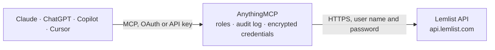

<!-- Generated by scripts/export-github-catalog.mjs in the anythingmcp-website repository. Do not edit by hand. -->

# Lemlist MCP connector

Drive Lemlist (cold email + multichannel outreach) from any AI agent: campaigns, leads (in-campaign prospects), team members, hooks. 11 tools, API-key Basic auth. The AnythingMCP connector gives Claude, ChatGPT, Microsoft Copilot, Cursor and Gemini 11 MCP tools for Lemlist: 6 read and 5 can change data.

**Category:** [CRM](../crm.md) · **Tools:** 11 · **Setup guide:** [anythingmcp.com](https://anythingmcp.com/guides/lemlist-to-mcp) · [Deutsch](https://anythingmcp.com/de/guides/lemlist-to-mcp) · [Italiano](https://anythingmcp.com/it/guides/lemlist-to-mcp) · [Español](https://anythingmcp.com/es/guides/lemlist-to-mcp) · [日本語](https://anythingmcp.com/ja/guides/lemlist-to-mcp) · [Русский](https://anythingmcp.com/ru/guides/lemlist-to-mcp) · [中文](https://anythingmcp.com/zh/guides/lemlist-to-mcp)

## Start without code

No installation and no terminal: AnythingMCP Cloud runs the Lemlist connector for you, operated by helpcode.ai in Frankfurt, Germany.

1. **Click the button above** and create an account or sign in. The Lemlist connector opens, ready to install.
2. **Paste the API key or token from your Lemlist account.** Every click is in the [step-by-step guide](https://anythingmcp.com/guides/lemlist-to-mcp).
3. **Click Install.** AnythingMCP shows the address of your MCP server.
4. **Add that address to your assistant:** [Claude](https://anythingmcp.com/guides/connect-lemlist-to-claude) · [ChatGPT](https://anythingmcp.com/guides/connect-lemlist-to-chatgpt) · [Microsoft Copilot](https://anythingmcp.com/guides/connect-lemlist-to-copilot) · [Cursor](https://anythingmcp.com/guides/connect-lemlist-to-cursor) · [Gemini CLI](https://anythingmcp.com/guides/connect-lemlist-to-gemini) · [Meta Muse](https://anythingmcp.com/guides/connect-lemlist-to-muse).
5. **Ask your first question**, for example: *In campaign Q4-product-launch what's the lead record for emily@oriontech.ie?*

Prefer help with the setup? [Talk to us](https://anythingmcp.com/contact).

## How it works

- **The AI client** speaks MCP (Streamable HTTP) to AnythingMCP and only sees tool names, descriptions and results. It never gets the Lemlist credentials.
- **AnythingMCP** checks the client's role, builds the call from the tool definition, adds the credentials (user name and password), calls Lemlist, logs the call and returns the result.
- **Lemlist** sees an ordinary API client with the rights of the account the credentials belong to.

## Tools

| Tool | What it does | Access |
|---|---|---|
| [`lemlist_get_team`](#lemlist_get_team) | Return the team the API key belongs to (id, name, plan, members). | read |
| [`lemlist_list_campaigns`](#lemlist_list_campaigns) | List campaigns. | read |
| [`lemlist_get_campaign_stats`](#lemlist_get_campaign_stats) | Get aggregated stats for a campaign: leads counts by status, emails sent/opened/clicked/replied/bounced, deliverability score. | read |
| [`lemlist_list_campaign_leads`](#lemlist_list_campaign_leads) | List leads (prospects) in a campaign. | read |
| [`lemlist_add_lead_to_campaign`](#lemlist_add_lead_to_campaign) | Add a new prospect to a campaign. | write |
| [`lemlist_pause_lead`](#lemlist_pause_lead) | Pause a lead in a campaign (stops further touches without unsubscribing them). | write |
| [`lemlist_resume_lead`](#lemlist_resume_lead) | Resume a previously-paused lead. | write |
| [`lemlist_delete_lead_from_campaign`](#lemlist_delete_lead_from_campaign) | Remove a lead from a campaign. | write |
| [`lemlist_unsubscribe_lead`](#lemlist_unsubscribe_lead) | Mark a lead as unsubscribed globally — they will no longer receive any Lemlist email from your team across all campaigns. | write |
| [`lemlist_list_unsubscribes`](#lemlist_list_unsubscribes) | List all unsubscribed emails on the team (compliance reporting). | read |
| [`lemlist_list_hooks`](#lemlist_list_hooks) | List webhook subscriptions configured on the team (event delivery to your hosted endpoint). | read |

## Tool reference

Every parameter as the AI client sees it in `tools/list`. Source: [`packages/backend/src/adapters/intl/lemlist.json`](../../../packages/backend/src/adapters/intl/lemlist.json).

### `lemlist_get_team`

Return the team the API key belongs to (id, name, plan, members). Health check + identifies the workspace.

**Access:** read · **Call:** `GET /team`

No parameters.

### `lemlist_list_campaigns`

List campaigns. Each campaign has _id, name, labels, createdBy, status, scheduleTimezone, multichannel?.

**Access:** read · **Call:** `GET /campaigns`

| Parameter | Type | Required | Description |
|---|---|---|---|
| `limit` | integer | no | Max per page (default 100, max 100). |
| `offset` | integer | no | Pagination offset. |
| `version` | string | no | Use 'v2' for the multichannel campaign schema. |

### `lemlist_get_campaign_stats`

Get aggregated stats for a campaign: leads counts by status, emails sent/opened/clicked/replied/bounced, deliverability score.

**Access:** read · **Call:** `GET /campaigns/{campaignId}/stats`

| Parameter | Type | Required | Description |
|---|---|---|---|
| `campaignId` | string | yes | Campaign ID. |

### `lemlist_list_campaign_leads`

List leads (prospects) in a campaign. Each lead has _id, email, firstName, lastName, companyName, status, isPaused, customVariables.

**Access:** read · **Call:** `GET /campaigns/{campaignId}/leads`

| Parameter | Type | Required | Description |
|---|---|---|---|
| `campaignId` | string | yes | Campaign ID. |
| `limit` | integer | no | Per page. |
| `offset` | integer | no | Pagination offset. |
| `version` | string | no | Use 'v2' for multichannel. |

### `lemlist_add_lead_to_campaign`

Add a new prospect to a campaign. Required: campaignId + email. customVariables fill template placeholders. deduplicate=true skips if email already in the campaign.

**Access:** write · **Call:** `POST /campaigns/{campaignId}/leads/{email}`

| Parameter | Type | Required | Description |
|---|---|---|---|
| `campaignId` | string | yes | Campaign ID. |
| `email` | string | yes | Prospect email. |
| `firstName` | string | no | First name. |
| `lastName` | string | no | Last name. |
| `companyName` | string | no | Company name. |
| `picture` | string | no | Picture URL (used in image-personalization templates). |
| `linkedinUrl` | string | no | LinkedIn URL. |
| `phone` | string | no | Phone for LinkedIn voice/SMS steps. |
| `customVariables` | object | no | Arbitrary {{key}} → value used in templates. |
| `deduplicate` | boolean | no | Skip if email already exists in the campaign. Default false. |

### `lemlist_pause_lead`

Pause a lead in a campaign (stops further touches without unsubscribing them).

**Access:** write · **Call:** `POST /campaigns/{campaignId}/leads/{email}/pause`

| Parameter | Type | Required | Description |
|---|---|---|---|
| `campaignId` | string | yes | Campaign ID. |
| `email` | string | yes | Lead email. |

### `lemlist_resume_lead`

Resume a previously-paused lead.

**Access:** write · **Call:** `POST /campaigns/{campaignId}/leads/{email}/resume`

| Parameter | Type | Required | Description |
|---|---|---|---|
| `campaignId` | string | yes | Campaign ID. |
| `email` | string | yes | Lead email. |

### `lemlist_delete_lead_from_campaign`

Remove a lead from a campaign. They stop receiving touches but stay in your database.

**Access:** write · **Call:** `DELETE /campaigns/{campaignId}/leads/{email}`

| Parameter | Type | Required | Description |
|---|---|---|---|
| `campaignId` | string | yes | Campaign ID. |
| `email` | string | yes | Lead email. |

### `lemlist_unsubscribe_lead`

Mark a lead as unsubscribed globally — they will no longer receive any Lemlist email from your team across all campaigns. Compliance-friendly.

**Access:** write · **Call:** `POST /unsubscribes/{email}`

| Parameter | Type | Required | Description |
|---|---|---|---|
| `email` | string | yes | Lead email. |

### `lemlist_list_unsubscribes`

List all unsubscribed emails on the team (compliance reporting).

**Access:** read · **Call:** `GET /unsubscribes`

| Parameter | Type | Required | Description |
|---|---|---|---|
| `limit` | integer | no | Per page. |
| `offset` | integer | no | Pagination offset. |

### `lemlist_list_hooks`

List webhook subscriptions configured on the team (event delivery to your hosted endpoint).

**Access:** read · **Call:** `GET /hooks`

No parameters.

## Run it yourself

AnythingMCP is open source (AGPL-3.0). [Run it with Docker](../../../README.md#run-it-yourself), open **Connectors → Store**, pick **Lemlist** and enter `LEMLIST_API_KEY`, then add your MCP server URL to the AI client.

[← CRM connectors](../crm.md) · [All categories](../README.md)
