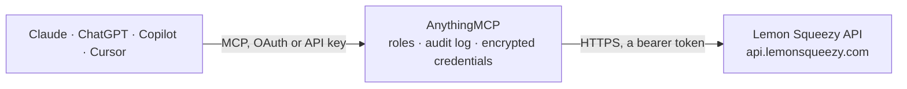

<!-- Generated by scripts/export-github-catalog.mjs in the anythingmcp-website repository. Do not edit by hand. -->

# Lemon Squeezy MCP connector

Read and act on Lemon Squeezy commerce data — orders, subscriptions, customers, products, variants, license keys, discounts, payouts — from any AI agent. 14 tools, Bearer auth. The AnythingMCP connector gives Claude, ChatGPT, Microsoft Copilot, Cursor and Gemini 14 MCP tools for Lemon Squeezy: 13 read and 1 can change data.

**Category:** [Payments](../payments.md) · **Tools:** 14 · **Setup guide:** [anythingmcp.com](https://anythingmcp.com/guides/lemonsqueezy-to-mcp) · [Deutsch](https://anythingmcp.com/de/guides/lemonsqueezy-to-mcp) · [Italiano](https://anythingmcp.com/it/guides/lemonsqueezy-to-mcp) · [Español](https://anythingmcp.com/es/guides/lemonsqueezy-to-mcp) · [日本語](https://anythingmcp.com/ja/guides/lemonsqueezy-to-mcp) · [Русский](https://anythingmcp.com/ru/guides/lemonsqueezy-to-mcp) · [中文](https://anythingmcp.com/zh/guides/lemonsqueezy-to-mcp)

## Start without code

No installation and no terminal: AnythingMCP Cloud runs the Lemon Squeezy connector for you, operated by helpcode.ai in Frankfurt, Germany.

1. **Click the button above** and create an account or sign in. The Lemon Squeezy connector opens, ready to install.
2. **Paste the API key or token from your Lemon Squeezy account.** Every click is in the [step-by-step guide](https://anythingmcp.com/guides/lemonsqueezy-to-mcp).
3. **Click Install.** AnythingMCP shows the address of your MCP server.
4. **Add that address to your assistant:** [Claude](https://anythingmcp.com/guides/connect-lemonsqueezy-to-claude) · [ChatGPT](https://anythingmcp.com/guides/connect-lemonsqueezy-to-chatgpt) · [Microsoft Copilot](https://anythingmcp.com/guides/connect-lemonsqueezy-to-copilot) · [Cursor](https://anythingmcp.com/guides/connect-lemonsqueezy-to-cursor) · [Gemini CLI](https://anythingmcp.com/guides/connect-lemonsqueezy-to-gemini) · [Meta Muse](https://anythingmcp.com/guides/connect-lemonsqueezy-to-muse).
5. **Ask your first question**, for example: *What's order #SQ-2026-1142 for customer emma@byteforge.dev — total, status and created date?*

Prefer help with the setup? [Talk to us](https://anythingmcp.com/contact).

## How it works

- **The AI client** speaks MCP (Streamable HTTP) to AnythingMCP and only sees tool names, descriptions and results. It never gets the Lemon Squeezy credentials.
- **AnythingMCP** checks the client's role, builds the call from the tool definition, adds the credentials (a bearer token), calls Lemon Squeezy, logs the call and returns the result.
- **Lemon Squeezy** sees an ordinary API client with the rights of the account the credentials belong to.

## Tools

| Tool | What it does | Access |
|---|---|---|
| [`lemonsqueezy_get_current_user`](#lemonsqueezy_get_current_user) | Return the user the API key belongs to (whoami). | read |
| [`lemonsqueezy_list_stores`](#lemonsqueezy_list_stores) | List stores the API key has access to. | read |
| [`lemonsqueezy_list_products`](#lemonsqueezy_list_products) | List products for a store. | read |
| [`lemonsqueezy_list_variants`](#lemonsqueezy_list_variants) | List variants — the SKUs of a product (e.g. monthly vs annual plan, or different licensing tiers). | read |
| [`lemonsqueezy_list_customers`](#lemonsqueezy_list_customers) | List customers for a store. | read |
| [`lemonsqueezy_get_customer`](#lemonsqueezy_get_customer) | Fetch one customer with their full purchase history (use include=orders,subscriptions). | read |
| [`lemonsqueezy_list_orders`](#lemonsqueezy_list_orders) | List orders for a store with optional filters. | read |
| [`lemonsqueezy_get_order`](#lemonsqueezy_get_order) | Fetch one order with full details. | read |
| [`lemonsqueezy_list_subscriptions`](#lemonsqueezy_list_subscriptions) | List subscriptions with status filters. | read |
| [`lemonsqueezy_get_subscription`](#lemonsqueezy_get_subscription) | Fetch one subscription with detailed billing state. | read |
| [`lemonsqueezy_cancel_subscription`](#lemonsqueezy_cancel_subscription) | Cancel a subscription. | write |
| [`lemonsqueezy_list_license_keys`](#lemonsqueezy_list_license_keys) | List license keys (relevant for products with has_license_keys=true). | read |
| [`lemonsqueezy_list_discounts`](#lemonsqueezy_list_discounts) | List discount codes for a store. | read |
| [`lemonsqueezy_list_payouts`](#lemonsqueezy_list_payouts) | List payouts to your bank account (Lemon Squeezy as Merchant of Record handles tax + remits net to you). | read |

## Tool reference

Every parameter as the AI client sees it in `tools/list`. Source: [`packages/backend/src/adapters/intl/lemonsqueezy.json`](../../../packages/backend/src/adapters/intl/lemonsqueezy.json).

### `lemonsqueezy_get_current_user`

Return the user the API key belongs to (whoami). Also confirms the key is valid.

**Access:** read · **Call:** `GET /users/me`

No parameters.

### `lemonsqueezy_list_stores`

List stores the API key has access to. Returns each store's id, name, slug, domain, url, currency, plan, payment_processors[], default_currency, total_sales, total_revenue.

**Access:** read · **Call:** `GET /stores`

| Parameter | Type | Required | Description |
|---|---|---|---|
| `page_number` | integer | no | Page number, default 1. |
| `page_size` | integer | no | Per page, max 100. |

### `lemonsqueezy_list_products`

List products for a store. Each product has name, slug, description, price (cents), thumb_url, status (published/draft), variants_count.

**Access:** read · **Call:** `GET /products`

| Parameter | Type | Required | Description |
|---|---|---|---|
| `store_id` | integer | no | Filter by store ID. |
| `include` | string | no | Side-load related resources: 'variants', 'store'. |
| `page_number` | integer | no | Page number. |
| `page_size` | integer | no | Per page. |

### `lemonsqueezy_list_variants`

List variants — the SKUs of a product (e.g. monthly vs annual plan, or different licensing tiers). Each variant has price, interval, interval_count, is_subscription, has_license_keys.

**Access:** read · **Call:** `GET /variants`

| Parameter | Type | Required | Description |
|---|---|---|---|
| `product_id` | integer | no | Filter by product ID. |
| `include` | string | no | Side-load: 'product', 'price-model'. |
| `page_number` | integer | no | Page number. |
| `page_size` | integer | no | Per page. |

### `lemonsqueezy_list_customers`

List customers for a store. Each customer has email, name, status, country, total_spent, total_revenue_currency.

**Access:** read · **Call:** `GET /customers`

| Parameter | Type | Required | Description |
|---|---|---|---|
| `store_id` | integer | no | Filter by store. |
| `email` | string | no | Exact-match filter by email. |
| `page_number` | integer | no | Page number. |
| `page_size` | integer | no | Per page. |

### `lemonsqueezy_get_customer`

Fetch one customer with their full purchase history (use include=orders,subscriptions).

**Access:** read · **Call:** `GET /customers/{customerId}`

| Parameter | Type | Required | Description |
|---|---|---|---|
| `customerId` | integer | yes | Customer ID. |
| `include` | string | no | Side-load: 'orders', 'subscriptions', 'license-keys'. |

### `lemonsqueezy_list_orders`

List orders for a store with optional filters. Each order has identifier, order_number, user_email, currency, subtotal, tax, total (cents), status (paid/refunded/pending/failed), refunded, refunded_at, created_at.

**Access:** read · **Call:** `GET /orders`

| Parameter | Type | Required | Description |
|---|---|---|---|
| `store_id` | integer | no | Store filter. |
| `user_email` | string | no | Filter by customer email. |
| `status` | string | no | paid, refunded, pending, failed. |
| `include` | string | no | Side-load: 'order-items', 'customer', 'subscription'. |
| `page_number` | integer | no | Page number. |
| `page_size` | integer | no | Per page. |

### `lemonsqueezy_get_order`

Fetch one order with full details. Include order-items to see line items.

**Access:** read · **Call:** `GET /orders/{orderId}`

| Parameter | Type | Required | Description |
|---|---|---|---|
| `orderId` | integer | yes | Order ID. |
| `include` | string | no | Side-load order-items, store, customer. |

### `lemonsqueezy_list_subscriptions`

List subscriptions with status filters. Each subscription has status (on_trial/active/past_due/unpaid/cancelled/expired), renews_at, ends_at, trial_ends_at, billing_anchor, urls (update_payment_method, customer_portal).

**Access:** read · **Call:** `GET /subscriptions`

| Parameter | Type | Required | Description |
|---|---|---|---|
| `store_id` | integer | no | Store filter. |
| `status` | string | no | on_trial, active, past_due, unpaid, cancelled, expired. |
| `user_email` | string | no | Filter by customer email. |
| `product_id` | integer | no | Filter by product. |
| `include` | string | no | Side-load: 'customer', 'order', 'variant', 'subscription-invoices'. |
| `page_number` | integer | no | Page number. |
| `page_size` | integer | no | Per page. |

### `lemonsqueezy_get_subscription`

Fetch one subscription with detailed billing state.

**Access:** read · **Call:** `GET /subscriptions/{subscriptionId}`

| Parameter | Type | Required | Description |
|---|---|---|---|
| `subscriptionId` | integer | yes | Subscription ID. |
| `include` | string | no | Side-load order, customer, variant, product, subscription-invoices. |

### `lemonsqueezy_cancel_subscription`

Cancel a subscription. By default cancels at period end (renews_at). The customer keeps access until renews_at. Use this for self-service cancellation flows; for immediate termination + refund, refund via lemonsqueezy_get_order's refund link instead.

**Access:** write · **Call:** `DELETE /subscriptions/{subscriptionId}`

| Parameter | Type | Required | Description |
|---|---|---|---|
| `subscriptionId` | integer | yes | Subscription ID. |

### `lemonsqueezy_list_license_keys`

List license keys (relevant for products with has_license_keys=true). Each key has key (the actual license string), status (inactive/active/expired/disabled), activation_limit, instances_count, expires_at, customer_id.

**Access:** read · **Call:** `GET /license-keys`

| Parameter | Type | Required | Description |
|---|---|---|---|
| `store_id` | integer | no | Store filter. |
| `product_id` | integer | no | Product filter. |
| `order_id` | integer | no | Filter by issuing order. |
| `order_item_id` | integer | no | Filter by issuing order-item. |
| `include` | string | no | Side-load: 'customer', 'product', 'order', 'license-key-instances'. |
| `page_number` | integer | no | Page number. |
| `page_size` | integer | no | Per page. |

### `lemonsqueezy_list_discounts`

List discount codes for a store. Each discount has name, code, amount, amount_type (percent/fixed), starts_at, expires_at, status, uses, max_uses.

**Access:** read · **Call:** `GET /discounts`

| Parameter | Type | Required | Description |
|---|---|---|---|
| `store_id` | integer | no | Store filter. |
| `page_number` | integer | no | Page number. |
| `page_size` | integer | no | Per page. |

### `lemonsqueezy_list_payouts`

List payouts to your bank account (Lemon Squeezy as Merchant of Record handles tax + remits net to you). Each payout has amount, status, date_paid, currency.

**Access:** read · **Call:** `GET /payouts`

| Parameter | Type | Required | Description |
|---|---|---|---|
| `store_id` | integer | no | Store filter. |
| `page_number` | integer | no | Page number. |
| `page_size` | integer | no | Per page. |

## Run it yourself

AnythingMCP is open source (AGPL-3.0). [Run it with Docker](../../../README.md#run-it-yourself), open **Connectors → Store**, pick **Lemon Squeezy** and enter `LEMONSQUEEZY_API_KEY`, then add your MCP server URL to the AI client.

[← Payments connectors](../payments.md) · [All categories](../README.md)
