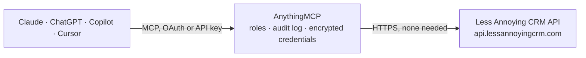

<!-- Generated by scripts/export-github-catalog.mjs in the anythingmcp-website repository. Do not edit by hand. -->

# Less Annoying CRM MCP connector

Manage Less Annoying CRM (contacts, companies, notes, tasks, pipelines) from any AI agent. 8 tools, dual-header API auth. The AnythingMCP connector gives Claude, ChatGPT, Microsoft Copilot, Cursor and Gemini 8 MCP tools for Less Annoying CRM: 4 read and 4 can change data.

**Category:** [CRM](../crm.md) · **Tools:** 8 · **Setup guide:** [anythingmcp.com](https://anythingmcp.com/guides/less-annoying-crm-to-mcp) · [Deutsch](https://anythingmcp.com/de/guides/less-annoying-crm-to-mcp) · [Italiano](https://anythingmcp.com/it/guides/less-annoying-crm-to-mcp) · [Español](https://anythingmcp.com/es/guides/less-annoying-crm-to-mcp) · [日本語](https://anythingmcp.com/ja/guides/less-annoying-crm-to-mcp) · [Русский](https://anythingmcp.com/ru/guides/less-annoying-crm-to-mcp) · [中文](https://anythingmcp.com/zh/guides/less-annoying-crm-to-mcp)

## Start without code

No installation and no terminal: AnythingMCP Cloud runs the Less Annoying CRM connector for you, operated by helpcode.ai in Frankfurt, Germany.

1. **Click the button above** and create an account or sign in. The Less Annoying CRM connector opens, ready to install.
2. **Nothing to enter:** this connector needs no credentials. Every click is in the [step-by-step guide](https://anythingmcp.com/guides/less-annoying-crm-to-mcp).
3. **Click Install.** AnythingMCP shows the address of your MCP server.
4. **Add that address to your assistant:** [Claude](https://anythingmcp.com/guides/connect-less-annoying-crm-to-claude) · [ChatGPT](https://anythingmcp.com/guides/connect-less-annoying-crm-to-chatgpt) · [Microsoft Copilot](https://anythingmcp.com/guides/connect-less-annoying-crm-to-copilot) · [Cursor](https://anythingmcp.com/guides/connect-less-annoying-crm-to-cursor) · [Gemini CLI](https://anythingmcp.com/guides/connect-less-annoying-crm-to-gemini) · [Meta Muse](https://anythingmcp.com/guides/connect-less-annoying-crm-to-muse).
5. **Ask your first question**, for example: *Do we have a contact record for Mariana Costa at SolarBright GmbH and what's her mobile and last note?*

Prefer help with the setup? [Talk to us](https://anythingmcp.com/contact).

## How it works

- **The AI client** speaks MCP (Streamable HTTP) to AnythingMCP and only sees tool names, descriptions and results. It never gets the Less Annoying CRM credentials.
- **AnythingMCP** checks the client's role, builds the call from the tool definition, adds the credentials (none needed), calls Less Annoying CRM, logs the call and returns the result.
- **Less Annoying CRM** sees an ordinary API client with the rights of the account the credentials belong to.

## Tools

| Tool | What it does | Access |
|---|---|---|
| [`lacrm_search_contacts`](#lacrm_search_contacts) | Search contacts by name, email, phone, etc. | read |
| [`lacrm_get_contact`](#lacrm_get_contact) | Get a single contact by LACRM Contact ID. | read |
| [`lacrm_create_contact`](#lacrm_create_contact) | Create a contact. | write |
| [`lacrm_update_contact`](#lacrm_update_contact) | Update a contact — pass ContactId + only the fields to change. | write |
| [`lacrm_create_note`](#lacrm_create_note) | Add a note to a contact. | write |
| [`lacrm_create_task`](#lacrm_create_task) | Create a task assigned to one or more users, optionally linked to a contact. | write |
| [`lacrm_get_pipeline_report`](#lacrm_get_pipeline_report) | Get the pipeline (opportunities) report. | read |
| [`lacrm_get_custom_fields`](#lacrm_get_custom_fields) | List all custom fields defined in the account — returns id, name, type. | read |

## Tool reference

Every parameter as the AI client sees it in `tools/list`. Source: [`packages/backend/src/adapters/intl/less-annoying-crm.json`](../../../packages/backend/src/adapters/intl/less-annoying-crm.json).

### `lacrm_search_contacts`

Search contacts by name, email, phone, etc.

**Access:** read · **Call:** `POST /`

| Parameter | Type | Required | Description |
|---|---|---|---|
| `search_term` | string | yes | Free-text search. |
| `page` | integer | no | 1-based page. |

### `lacrm_get_contact`

Get a single contact by LACRM Contact ID.

**Access:** read · **Call:** `POST /`

| Parameter | Type | Required | Description |
|---|---|---|---|
| `contact_id` | string | yes | Contact ID. |

### `lacrm_create_contact`

Create a contact.

**Access:** write · **Call:** `POST /`

| Parameter | Type | Required | Description |
|---|---|---|---|
| `name` | string | yes | Full name. |
| `company_name` | string | no | Company name. |
| `email` | any[] | no | Array of {Text, Type:'Work'\|'Personal'}. |
| `phone` | any[] | no | Array of {Text, Type}. |
| `address` | any[] | no | Array of {Street, City, State, Zip, Country, Type}. |
| `background_info` | string | no | Free-text background. |
| `custom_fields` | object | no | Map of CustomFieldId → value. |

### `lacrm_update_contact`

Update a contact — pass ContactId + only the fields to change.

**Access:** write · **Call:** `POST /`

| Parameter | Type | Required | Description |
|---|---|---|---|
| `contact_id` | string | yes | Contact ID. |
| `name` | string | no | New name. |
| `company_name` | string | no | New company. |
| `background_info` | string | no | New background. |
| `custom_fields` | object | no | CustomFieldId → value. |

### `lacrm_create_note`

Add a note to a contact.

**Access:** write · **Call:** `POST /`

| Parameter | Type | Required | Description |
|---|---|---|---|
| `contact_id` | string | yes | Contact ID. |
| `note` | string | yes | Note body. |

### `lacrm_create_task`

Create a task assigned to one or more users, optionally linked to a contact.

**Access:** write · **Call:** `POST /`

| Parameter | Type | Required | Description |
|---|---|---|---|
| `name` | string | yes | Task description. |
| `due_date` | string | no | YYYY-MM-DD. |
| `assigned_to` | any[] | no | Array of LACRM user codes. |
| `contact_id` | string | no | Linked contact. |
| `priority` | string | no | High, Medium, Low. |

### `lacrm_get_pipeline_report`

Get the pipeline (opportunities) report.

**Access:** read · **Call:** `POST /`

| Parameter | Type | Required | Description |
|---|---|---|---|
| `pipeline_id` | string | no | Pipeline ID (optional — defaults to all). |
| `sort_by` | string | no | Field name to sort by. |
| `num_rows` | integer | no | Max rows (default 25). |

### `lacrm_get_custom_fields`

List all custom fields defined in the account — returns id, name, type. Call this first to discover CustomFieldId values you'll need for create/update.

**Access:** read · **Call:** `POST /`

No parameters.

## Run it yourself

AnythingMCP is open source (AGPL-3.0). [Run it with Docker](../../../README.md#run-it-yourself), open **Connectors → Store**, pick **Less Annoying CRM** and enter `LACRM_USER_CODE`, `LACRM_API_TOKEN`, then add your MCP server URL to the AI client.

[← CRM connectors](../crm.md) · [All categories](../README.md)
