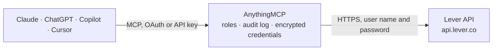

<!-- Generated by scripts/export-github-catalog.mjs in the anythingmcp-website repository. Do not edit by hand. -->

# Lever MCP connector

Manage Lever ATS (candidates, opportunities, postings, stages, feedback) from any AI agent. 10 tools, basic-auth. The AnythingMCP connector gives Claude, ChatGPT, Microsoft Copilot, Cursor and Gemini 10 MCP tools for Lever: 7 read and 3 can change data.

**Category:** [HR](../hr.md) · **Tools:** 10 · **Setup guide:** [anythingmcp.com](https://anythingmcp.com/guides/lever-to-mcp) · [Deutsch](https://anythingmcp.com/de/guides/lever-to-mcp) · [Italiano](https://anythingmcp.com/it/guides/lever-to-mcp) · [Español](https://anythingmcp.com/es/guides/lever-to-mcp) · [日本語](https://anythingmcp.com/ja/guides/lever-to-mcp) · [Русский](https://anythingmcp.com/ru/guides/lever-to-mcp) · [中文](https://anythingmcp.com/zh/guides/lever-to-mcp)

## Start without code

No installation and no terminal: AnythingMCP Cloud runs the Lever connector for you, operated by helpcode.ai in Frankfurt, Germany.

1. **Click the button above** and create an account or sign in. The Lever connector opens, ready to install.
2. **Paste the API key or token from your Lever account.** Every click is in the [step-by-step guide](https://anythingmcp.com/guides/lever-to-mcp).
3. **Click Install.** AnythingMCP shows the address of your MCP server.
4. **Add that address to your assistant:** [Claude](https://anythingmcp.com/guides/connect-lever-to-claude) · [ChatGPT](https://anythingmcp.com/guides/connect-lever-to-chatgpt) · [Microsoft Copilot](https://anythingmcp.com/guides/connect-lever-to-copilot) · [Cursor](https://anythingmcp.com/guides/connect-lever-to-cursor) · [Gemini CLI](https://anythingmcp.com/guides/connect-lever-to-gemini) · [Meta Muse](https://anythingmcp.com/guides/connect-lever-to-muse).
5. **Ask your first question**, for example: *Find the opportunity for candidate Martina Berger for the Senior Backend Engineer posting and show contact details.*

Prefer help with the setup? [Talk to us](https://anythingmcp.com/contact).

## How it works

- **The AI client** speaks MCP (Streamable HTTP) to AnythingMCP and only sees tool names, descriptions and results. It never gets the Lever credentials.
- **AnythingMCP** checks the client's role, builds the call from the tool definition, adds the credentials (user name and password), calls Lever, logs the call and returns the result.
- **Lever** sees an ordinary API client with the rights of the account the credentials belong to.

## Tools

| Tool | What it does | Access |
|---|---|---|
| [`lever_list_opportunities`](#lever_list_opportunities) | List opportunities (candidate × posting). | read |
| [`lever_get_opportunity`](#lever_get_opportunity) | Get one opportunity with full contact, links, tags, applications. | read |
| [`lever_create_opportunity`](#lever_create_opportunity) | Create an opportunity (candidate with associated posting). | write |
| [`lever_update_opportunity_stage`](#lever_update_opportunity_stage) | Move an opportunity to a different stage. | write |
| [`lever_archive_opportunity`](#lever_archive_opportunity) | Archive an opportunity with an archive reason. | write |
| [`lever_list_postings`](#lever_list_postings) | List job postings. | read |
| [`lever_list_stages`](#lever_list_stages) | List pipeline stages. | read |
| [`lever_list_users`](#lever_list_users) | List Lever users (recruiters, hiring managers). | read |
| [`lever_list_archive_reasons`](#lever_list_archive_reasons) | List archive reasons configured in the org. | read |
| [`lever_list_feedback`](#lever_list_feedback) | List interview feedback forms attached to an opportunity. | read |

## Tool reference

Every parameter as the AI client sees it in `tools/list`. Source: [`packages/backend/src/adapters/intl/lever.json`](../../../packages/backend/src/adapters/intl/lever.json).

### `lever_list_opportunities`

List opportunities (candidate × posting). Filter by stage, posting, owner, created_at.

**Access:** read · **Call:** `GET /opportunities`

| Parameter | Type | Required | Description |
|---|---|---|---|
| `stage_id` | string | no | Filter by stage. |
| `posting_id` | string | no | Filter by posting. |
| `owner_id` | string | no | Filter by owner. |
| `archived` | boolean | no | Include archived. |
| `created_at_start` | integer | no | UNIX epoch ms. |
| `created_at_end` | integer | no | UNIX epoch ms. |
| `limit` | integer | no | Max per page. |
| `offset` | string | no | Cursor from previous response. |

### `lever_get_opportunity`

Get one opportunity with full contact, links, tags, applications.

**Access:** read · **Call:** `GET /opportunities/{opportunity_id}`

| Parameter | Type | Required | Description |
|---|---|---|---|
| `opportunity_id` | string | yes | Opportunity ID. |

### `lever_create_opportunity`

Create an opportunity (candidate with associated posting). Required: name + at least one email; perform_as is the Lever user ID acting.

**Access:** write · **Call:** `POST /opportunities`

| Parameter | Type | Required | Description |
|---|---|---|---|
| `perform_as` | string | yes | Lever user ID making the create. |
| `name` | string | yes | Candidate name. |
| `emails` | any[] | yes | Array of email strings. |
| `phones` | any[] | no | Array of {type, value}. |
| `location` | object | no | {name} location. |
| `postings` | any[] | no | Array of posting ID strings to apply to. |
| `stage` | string | no | Initial stage ID. |
| `owner` | string | no | Lever user ID owner. |
| `tags` | any[] | no | Tag strings. |
| `origin` | string | no | applied, referred, sourced. |

### `lever_update_opportunity_stage`

Move an opportunity to a different stage.

**Access:** write · **Call:** `PUT /opportunities/{opportunity_id}/stage`

| Parameter | Type | Required | Description |
|---|---|---|---|
| `opportunity_id` | string | yes | Opportunity ID. |
| `perform_as` | string | yes | Lever user ID. |
| `stage` | string | yes | Target stage ID. |

### `lever_archive_opportunity`

Archive an opportunity with an archive reason.

**Access:** write · **Call:** `PUT /opportunities/{opportunity_id}/archived`

| Parameter | Type | Required | Description |
|---|---|---|---|
| `opportunity_id` | string | yes | Opportunity ID. |
| `perform_as` | string | yes | Lever user ID. |
| `reason` | string | yes | Archive reason ID. |

### `lever_list_postings`

List job postings.

**Access:** read · **Call:** `GET /postings`

| Parameter | Type | Required | Description |
|---|---|---|---|
| `state` | string | no | published, internal, closed, draft, pending, rejected. |
| `team` | string | no | Filter by team. |
| `location` | string | no | Filter by location. |
| `limit` | integer | no | Max per page. |
| `offset` | string | no | Cursor. |

### `lever_list_stages`

List pipeline stages.

**Access:** read · **Call:** `GET /stages`

No parameters.

### `lever_list_users`

List Lever users (recruiters, hiring managers).

**Access:** read · **Call:** `GET /users`

| Parameter | Type | Required | Description |
|---|---|---|---|
| `access_role` | string | no | Filter by role. |
| `email` | string | no | Filter by email. |
| `limit` | integer | no | Max per page. |

### `lever_list_archive_reasons`

List archive reasons configured in the org. Use this to find valid `reason` IDs for archive calls.

**Access:** read · **Call:** `GET /archive_reasons`

No parameters.

### `lever_list_feedback`

List interview feedback forms attached to an opportunity.

**Access:** read · **Call:** `GET /opportunities/{opportunity_id}/feedback`

| Parameter | Type | Required | Description |
|---|---|---|---|
| `opportunity_id` | string | yes | Opportunity ID. |

## Run it yourself

AnythingMCP is open source (AGPL-3.0). [Run it with Docker](../../../README.md#run-it-yourself), open **Connectors → Store**, pick **Lever** and enter `LEVER_API_KEY`, then add your MCP server URL to the AI client.

[← HR connectors](../hr.md) · [All categories](../README.md)
