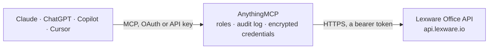

<!-- Generated by scripts/export-github-catalog.mjs in the anythingmcp-website repository. Do not edit by hand. -->

# Lexware Office MCP connector

Lexware Office (formerly lexoffice) — Germany's most-used SMB bookkeeping app. The AnythingMCP connector gives Claude, ChatGPT, Microsoft Copilot, Cursor and Gemini 21 MCP tools for Lexware Office: 15 read and 6 can change data.

**Category:** [Accounting](../accounting.md) · **Tools:** 21 · **Setup guide:** [anythingmcp.com](https://anythingmcp.com/guides/lexware-office-to-mcp) · [Deutsch](https://anythingmcp.com/de/guides/lexware-office-to-mcp) · [Italiano](https://anythingmcp.com/it/guides/lexware-office-to-mcp) · [Español](https://anythingmcp.com/es/guides/lexware-office-to-mcp) · [日本語](https://anythingmcp.com/ja/guides/lexware-office-to-mcp) · [Русский](https://anythingmcp.com/ru/guides/lexware-office-to-mcp) · [中文](https://anythingmcp.com/zh/guides/lexware-office-to-mcp)

## Start without code

No installation and no terminal: AnythingMCP Cloud runs the Lexware Office connector for you, operated by helpcode.ai in Frankfurt, Germany.

1. **Click the button above** and create an account or sign in. The Lexware Office connector opens, ready to install.
2. **Paste the API key or token from your Lexware Office account.** Every click is in the [step-by-step guide](https://anythingmcp.com/guides/lexware-office-to-mcp).
3. **Click Install.** AnythingMCP shows the address of your MCP server.
4. **Add that address to your assistant:** [Claude](https://anythingmcp.com/guides/connect-lexware-office-to-claude) · [ChatGPT](https://anythingmcp.com/guides/connect-lexware-office-to-chatgpt) · [Microsoft Copilot](https://anythingmcp.com/guides/connect-lexware-office-to-copilot) · [Cursor](https://anythingmcp.com/guides/connect-lexware-office-to-cursor) · [Gemini CLI](https://anythingmcp.com/guides/connect-lexware-office-to-gemini) · [Meta Muse](https://anythingmcp.com/guides/connect-lexware-office-to-muse).
5. **Ask your first question**, for example: *Show unpaid invoice for customer 'Müller Gebäudetechnik GmbH' invoice number RE-2026-0143*

Prefer help with the setup? [Talk to us](https://anythingmcp.com/contact).

## How it works

- **The AI client** speaks MCP (Streamable HTTP) to AnythingMCP and only sees tool names, descriptions and results. It never gets the Lexware Office credentials.
- **AnythingMCP** checks the client's role, builds the call from the tool definition, adds the credentials (a bearer token), calls Lexware Office, logs the call and returns the result.
- **Lexware Office** sees an ordinary API client with the rights of the account the credentials belong to.

## Tools

| Tool | What it does | Access |
|---|---|---|
| [`lexware_office_get_profile`](#lexware_office_get_profile) | Read the connected company profile: company name, tax number, VAT id, the connection's user id and the small-business (Kleinunternehmer) flag. | read |
| [`lexware_office_list_contacts`](#lexware_office_list_contacts) | List contacts (customers and vendors) with paging. | read |
| [`lexware_office_get_contact`](#lexware_office_get_contact) | Read one contact by its Lexware id, including all addresses, the customer/vendor roles, contact persons, e-mail addresses and phone numbers. | read |
| [`lexware_office_list_vouchers`](#lexware_office_list_vouchers) | Search the voucher list — the bookkeeping view across sales invoices, purchase invoices, credit notes, down payments and receipts. | read |
| [`lexware_office_get_invoice`](#lexware_office_get_invoice) | Read one sales invoice in full: header, addressee, every line item with net/gross and tax rate, the total amounts, the payment terms and the shipping date. | read |
| [`lexware_office_get_quotation`](#lexware_office_get_quotation) | Read one quotation (Angebot) in full, including its line items, totals, validity date and current status. | read |
| [`lexware_office_get_credit_note`](#lexware_office_get_credit_note) | Read one credit note (Rechnungskorrektur) in full: the invoice it corrects, its line items and its totals. | read |
| [`lexware_office_get_voucher`](#lexware_office_get_voucher) | Read one bookkeeping voucher (voucher-list voucherType salesinvoice, salescreditnote, purchaseinvoice or purchasecreditnote): contact, voucher items grouped… | read |
| [`lexware_office_get_sales_document`](#lexware_office_get_sales_document) | Read one down payment invoice, order confirmation, delivery note or dunning by id. | read |
| [`lexware_office_list_articles`](#lexware_office_list_articles) | List articles (Artikel) from the product catalogue, optionally narrowed by article number or type, so an invoice line can reference a real product. | read |
| [`lexware_office_list_countries`](#lexware_office_list_countries) | List the country codes Lexware Office accepts in an address, with their tax classification (intra-community, third country). | read |
| [`lexware_office_create_contact`](#lexware_office_create_contact) | Create a new company contact with the customer and/or vendor role. | write |
| [`lexware_office_create_invoice`](#lexware_office_create_invoice) | Create a sales invoice. | write |
| [`lexware_office_get_delivery_note`](#lexware_office_get_delivery_note) | Read one delivery note (Lieferschein) in full: line items, status (draft or open), voucher date (= delivery date), address, shipping conditions and related… | read |
| [`lexware_office_get_delivery_note_pdf`](#lexware_office_get_delivery_note_pdf) | Download the PDF of a delivery note, returned as a file. | read |
| [`lexware_office_get_invoice_pdf`](#lexware_office_get_invoice_pdf) | Download the PDF of a sales invoice, returned as a file. | read |
| [`lexware_office_create_delivery_note`](#lexware_office_create_delivery_note) | Create a delivery note (Lieferschein) as a draft. | write |
| [`lexware_office_create_quotation_draft`](#lexware_office_create_quotation_draft) | Create a quotation (Angebot) as a draft. | write |
| [`lexware_office_get_article`](#lexware_office_get_article) | Read one article with its price and version. | read |
| [`lexware_office_create_article`](#lexware_office_create_article) | Create an article in the product catalogue. | write |
| [`lexware_office_update_article`](#lexware_office_update_article) | Replace an article completely (PUT): read it with lexware_office_get_article, keep every field, change only what the user asked for and send the current… | write |

## Tool reference

Every parameter as the AI client sees it in `tools/list`. Source: [`packages/backend/src/adapters/de/lexware-office.json`](../../../packages/backend/src/adapters/de/lexware-office.json).

### `lexware_office_get_profile`

Read the connected company profile: company name, tax number, VAT id, the connection's user id and the small-business (Kleinunternehmer) flag. Fast call — use it to verify the token works.

**Access:** read · **Call:** `GET /profile`

No parameters.

### `lexware_office_list_contacts`

List contacts (customers and vendors) with paging. Filter by role or by a free-text name fragment to find the party before reading or creating a document for them.

**Access:** read · **Call:** `GET /contacts`

| Parameter | Type | Required | Description |
|---|---|---|---|
| `page` | number | no | Zero-based page index (default 0). |
| `size` | number | no | Page size, 1–250 (default 25). |
| `email` | string | no | Exact e-mail address to filter by. |
| `name` | string | no | Name fragment; matches company name or last name. |
| `customer` | boolean | no | When true, only contacts that have the customer role. |
| `vendor` | boolean | no | When true, only contacts that have the vendor role. |

### `lexware_office_get_contact`

Read one contact by its Lexware id, including all addresses, the customer/vendor roles, contact persons, e-mail addresses and phone numbers.

**Access:** read · **Call:** `GET /contacts/{id}`

| Parameter | Type | Required | Description |
|---|---|---|---|
| `id` | string | yes | Contact UUID as returned by lexware_office_list_contacts. |

### `lexware_office_list_vouchers`

Search the voucher list — the bookkeeping view across sales invoices, purchase invoices, credit notes, down payments and receipts. This is the tool for questions like 'what is still open' or 'what did we book in Q3'.

**Access:** read · **Call:** `GET /voucherlist`

| Parameter | Type | Required | Description |
|---|---|---|---|
| `voucherType` | string | yes | Required by Lexware. Comma-separated list, or `any` for all types: salesinvoice, salescreditnote, purchaseinvoice, purchasecreditnote (bookkeeping vouchers: read one with lexware_office_get_voucher), invoice (lexware_office_get_invoice), creditnote (lexware_office_get_credit_note), quotation (lexware_office_get_quotation), downpaymentinvoice, orderconfirmation, deliverynote (lexware_office_get_sales_document). |
| `voucherStatus` | string | yes | Required by Lexware. Comma-separated list, or `any`: draft, open, paid, paidoff, voided, transferred, sepadebit, accepted/rejected (quotations only), unchecked (bookkeeping vouchers only), overdue. `overdue` must be sent ALONE (voucherStatus=overdue), never combined with other statuses: Lexware answers 400 otherwise. Overdue vouchers are already included in `open`, so for 'everything unpaid' use `open,sepadebit,transferred`. |
| `archived` | boolean | no | When true, include archived vouchers. |
| `contactId` | string | no | Restrict to one contact's vouchers (UUID). |
| `voucherDateFrom` | string | no | Earliest voucher date, YYYY-MM-DD. |
| `voucherDateTo` | string | no | Latest voucher date, YYYY-MM-DD. |
| `page` | number | no | Zero-based page index (default 0). |
| `size` | number | no | Page size, 1-250 (default 25). Lexware returns at most 10,000 results in total; narrow by date beyond that. |
| `voucherNumber` | string | no | Exact voucher number, e.g. RE0042. |
| `createdDateFrom` | string | no | Created on or after, YYYY-MM-DD. |
| `createdDateTo` | string | no | Created on or before, YYYY-MM-DD. |
| `updatedDateFrom` | string | no | Updated on or after, YYYY-MM-DD. |
| `updatedDateTo` | string | no | Updated on or before, YYYY-MM-DD. |
| `sort` | string | no | voucherDate, voucherNumber, createdDate or updatedDate, optionally followed by ,ASC or ,DESC, e.g. voucherDate,DESC. |

### `lexware_office_get_invoice`

Read one sales invoice in full: header, addressee, every line item with net/gross and tax rate, the total amounts, the payment terms and the shipping date.

**Access:** read · **Call:** `GET /invoices/{id}`

| Parameter | Type | Required | Description |
|---|---|---|---|
| `id` | string | yes | Invoice UUID. Only for voucher-list rows whose voucherType is `invoice`. For salesinvoice, purchaseinvoice, salescreditnote or purchasecreditnote use lexware_office_get_voucher; for downpaymentinvoice, orderconfirmation or deliverynote use lexware_office_get_sales_document. A wrong pairing answers 404. |

### `lexware_office_get_quotation`

Read one quotation (Angebot) in full, including its line items, totals, validity date and current status.

**Access:** read · **Call:** `GET /quotations/{id}`

| Parameter | Type | Required | Description |
|---|---|---|---|
| `id` | string | yes | Quotation UUID. |

### `lexware_office_get_credit_note`

Read one credit note (Rechnungskorrektur) in full: the invoice it corrects, its line items and its totals.

**Access:** read · **Call:** `GET /credit-notes/{id}`

| Parameter | Type | Required | Description |
|---|---|---|---|
| `id` | string | yes | Credit note UUID. |

### `lexware_office_get_voucher`

Read one bookkeeping voucher (voucher-list voucherType salesinvoice, salescreditnote, purchaseinvoice or purchasecreditnote): contact, voucher items grouped by tax rate, totals, due date and attached file ids.

**Access:** read · **Call:** `GET /vouchers/{id}`

| Parameter | Type | Required | Description |
|---|---|---|---|
| `id` | string | yes | Voucher UUID from lexware_office_list_vouchers whose voucherType is salesinvoice, salescreditnote, purchaseinvoice or purchasecreditnote. |

### `lexware_office_get_sales_document`

Read one down payment invoice, order confirmation, delivery note or dunning by id.

**Access:** read · **Call:** `GET /{resource}/{id}`

| Parameter | Type | Required | Description |
|---|---|---|---|
| `resource` | `down-payment-invoices` \| `order-confirmations` \| `delivery-notes` \| `dunnings` | yes | downpaymentinvoice → down-payment-invoices, orderconfirmation → order-confirmations, deliverynote → delivery-notes. |
| `id` | string | yes | UUID from the voucher list. |

### `lexware_office_list_articles`

List articles (Artikel) from the product catalogue, optionally narrowed by article number or type, so an invoice line can reference a real product.

**Access:** read · **Call:** `GET /articles`

| Parameter | Type | Required | Description |
|---|---|---|---|
| `articleNumber` | string | no | Exact article number to look up. |
| `type` | string | no | Either `PRODUCT` or `SERVICE`. |
| `page` | number | no | Zero-based page index (default 0). |
| `size` | number | no | Page size, 1–250 (default 25). |

### `lexware_office_list_countries`

List the country codes Lexware Office accepts in an address, with their tax classification (intra-community, third country). Useful before creating a contact with a foreign address.

**Access:** read · **Call:** `GET /countries`

No parameters.

### `lexware_office_create_contact`

Create a new company contact with the customer and/or vendor role. Writes to the live company: check with lexware_office_list_contacts first that the party does not already exist.

**Access:** write · **Call:** `POST /contacts`

| Parameter | Type | Required | Description |
|---|---|---|---|
| `companyName` | string | yes | Company name. |
| `roles` | object | no | Roles as an object: {"customer":{}} (default), {"vendor":{}}, or both {"customer":{},"vendor":{}}. |
| `billingAddress` | object | no | Billing address: {"street":"Musterstr. 1","zip":"79098","city":"Freiburg","countryCode":"DE"}. countryCode (ISO 3166-1 alpha-2) is required when an address is given. Omit for no address. |
| `email` | string | no | Primary business e-mail address. |
| `phone` | string | no | Primary business phone number. |

### `lexware_office_create_invoice`

Create a sales invoice. With finalize=false it is saved as a draft that can still be edited or deleted; with finalize=true it is booked and becomes legally immutable under GoBD.

**Access:** write · **Call:** `POST /invoices`

| Parameter | Type | Required | Description |
|---|---|---|---|
| `contactId` | string | yes | UUID of the customer the invoice is addressed to. |
| `voucherDate` | string | no | Invoice date in ISO 8601, e.g. 2026-09-17T00:00:00.000+02:00. |
| `lineItems` | object[] | yes | Array of line items. Each: {type: 'custom', name, quantity, unitName, unitPrice: {currency: 'EUR', netAmount, taxRatePercentage}}. |
| `taxType` | string | no | Tax treatment: `net`, `gross`, `vatfree`, `intraCommunitySupply`, `constructionService13b` or `externalService13b`. |
| `finalize` | boolean | no | When true the invoice is booked immediately instead of saved as a draft. |
| `introduction` | string | no | Text printed above the line items. |
| `remark` | string | no | Text printed below the line items, e.g. payment terms. |

### `lexware_office_get_delivery_note`

Read one delivery note (Lieferschein) in full: line items, status (draft or open), voucher date (= delivery date), address, shipping conditions and related vouchers. Find ids with lexware_office_list_vouchers and voucherType=deliverynote.

**Access:** read · **Call:** `GET /delivery-notes/{id}`

| Parameter | Type | Required | Description |
|---|---|---|---|
| `id` | string | yes | Delivery note UUID. |

### `lexware_office_get_delivery_note_pdf`

Download the PDF of a delivery note, returned as a file. Only for issued delivery notes (status open); a draft answers 409.

**Access:** read · **Call:** `GET /delivery-notes/{id}/file`

| Parameter | Type | Required | Description |
|---|---|---|---|
| `id` | string | yes | Delivery note UUID. |

### `lexware_office_get_invoice_pdf`

Download the PDF of a sales invoice, returned as a file. Only for finalized invoices (open, paid, voided); a draft answers 409.

**Access:** read · **Call:** `GET /invoices/{id}/file`

| Parameter | Type | Required | Description |
|---|---|---|---|
| `id` | string | yes | Invoice UUID. |

### `lexware_office_create_delivery_note`

Create a delivery note (Lieferschein) as a draft. It is not finalized: it can still be checked, edited or deleted in Lexware Office, and an invoice can be created from it there. Confirm the line items with the user before calling.

**Access:** write · **Call:** `POST /delivery-notes`

| Parameter | Type | Required | Description |
|---|---|---|---|
| `voucherDate` | string | yes | Delivery date in ISO 8601 with time and offset, e.g. 2026-10-13T00:00:00.000+02:00. |
| `address` | object | yes | Recipient. Either {"contactId": "<uuid>"} for an existing contact, or {"name", "street", "zip", "city", "countryCode"} for a one-off address. |
| `lineItems` | object[] | yes | Up to 300 items. Article: {"type": "material", "id": "<article uuid>", "name", "quantity", "unitName", "unitPrice": {"currency": "EUR", "netAmount", "taxRatePercentage"}}. Free item: type "custom" without id. Text line: {"type": "text", "name", "description"}. |
| `taxConditions` | object | yes | {"taxType": "net"} (or gross, vatfree, intraCommunitySupply, ...). |
| `shippingConditions` | object | yes | {"shippingType": "delivery", "shippingDate": "<ISO 8601>"}. |
| `title` | string | no | Document title, default Lieferschein. |
| `introduction` | string | no | Text above the line items, e.g. the order reference. |
| `remark` | string | no | Text below the line items. |
| `deliveryTerms` | string | no | Delivery terms, e.g. Lieferung frei Haus. |

### `lexware_office_create_quotation_draft`

Create a quotation (Angebot) as a draft. It is not finalized or sent: it can still be edited or deleted in Lexware Office. Confirm the line items and validity date with the user before calling.

**Access:** write · **Call:** `POST /quotations`

| Parameter | Type | Required | Description |
|---|---|---|---|
| `voucherDate` | string | yes | Quotation date in ISO 8601 with time and offset, e.g. 2026-10-22T00:00:00.000+02:00. |
| `expirationDate` | string | yes | Valid until, ISO 8601 like voucherDate. |
| `address` | object | yes | Recipient: {"contactId": "<uuid>"} or a one-off address {"name", "street", "zip", "city", "countryCode"}. |
| `lineItems` | object[] | yes | Items like on an invoice: {"type": "custom" \| "material" \| "service" \| "text", "name", "quantity", "unitName", "unitPrice": {"currency": "EUR", "netAmount", "taxRatePercentage"}, "discountPercentage"}. |
| `totalPrice` | object | yes | {"currency": "EUR"}; Lexware computes the totals. Optionally totalDiscountPercentage. |
| `taxConditions` | object | yes | {"taxType": "net"} (or gross, vatfree, ...). |
| `paymentConditions` | object | no | Optional, e.g. {"paymentTermLabel": "Zahlbar in 14 Tagen", "paymentTermDuration": 14}. |
| `title` | string | no | Document title, default Angebot. |
| `introduction` | string | no | Text above the line items. |
| `remark` | string | no | Text below the line items. |
| `printLayoutId` | string | no | Optional print layout UUID. |

### `lexware_office_get_article`

Read one article with its price and version. The version is required to update the article.

**Access:** read · **Call:** `GET /articles/{id}`

| Parameter | Type | Required | Description |
|---|---|---|---|
| `id` | string | yes | Article UUID from lexware_office_list_articles. |

### `lexware_office_create_article`

Create an article in the product catalogue. Check with lexware_office_list_articles (articleNumber) that it does not exist yet, and confirm the data with the user first.

**Access:** write · **Call:** `POST /articles`

| Parameter | Type | Required | Description |
|---|---|---|---|
| `title` | string | yes | Article name. |
| `type` | `PRODUCT` \| `SERVICE` | yes | PRODUCT for goods, SERVICE for work and fees. |
| `unitName` | string | yes | Unit, e.g. Stück, kg, Stunde. |
| `price` | object | yes | {"netPrice": 10.0, "grossPrice": 11.9, "leadingPrice": "NET", "taxRate": 19}. leadingPrice NET or GROSS says which of the two prices is authoritative. |
| `articleNumber` | string | no | Your own article number. |
| `gtin` | string | no | EAN/GTIN, 8 to 14 digits. |
| `description` | string | no | Additional text. |
| `note` | string | no | Internal note. |

### `lexware_office_update_article`

Replace an article completely (PUT): read it with lexware_office_get_article, keep every field, change only what the user asked for and send the current version. Fields left out are cleared. A stale version answers 409.

**Access:** write · **Call:** `PUT /articles/{id}`

| Parameter | Type | Required | Description |
|---|---|---|---|
| `id` | string | yes | Article UUID. |
| `version` | integer | yes | Current version from lexware_office_get_article. |
| `title` | string | yes | Article name. |
| `type` | `PRODUCT` \| `SERVICE` | yes | PRODUCT for goods, SERVICE for work and fees. |
| `unitName` | string | yes | Unit, e.g. Stück. |
| `price` | object | yes | {"netPrice", "grossPrice", "leadingPrice": "NET" \| "GROSS", "taxRate"}. |
| `articleNumber` | string | no | Your own article number. |
| `gtin` | string | no | EAN/GTIN, 8 to 14 digits. |
| `description` | string | no | Additional text. |
| `note` | string | no | Internal note. |

## Run it yourself

AnythingMCP is open source (AGPL-3.0). [Run it with Docker](../../../README.md#run-it-yourself), open **Connectors → Store**, pick **Lexware Office** and enter `LEXWARE_API_KEY`, then add your MCP server URL to the AI client.

[← Accounting connectors](../accounting.md) · [All categories](../README.md)
