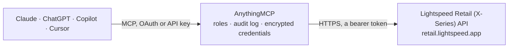

<!-- Generated by scripts/export-github-catalog.mjs in the anythingmcp-website repository. Do not edit by hand. -->

# Lightspeed Retail (X-Series) MCP connector

Lightspeed Retail X-Series (formerly Vend) point of sale: outlets, registers, sales search by date, products and product families, categories, brands, suppliers, price books and promotions, stock … The AnythingMCP connector gives Claude, ChatGPT, Microsoft Copilot, Cursor and Gemini 58 MCP tools for Lightspeed Retail (X-Series): 44 read and 14 can change data.

**Category:** [E-commerce](../e-commerce.md) · **Tools:** 58 · **Setup guide:** [anythingmcp.com](https://anythingmcp.com/guides/lightspeed-retail-to-mcp) · [Deutsch](https://anythingmcp.com/de/guides/lightspeed-retail-to-mcp) · [Italiano](https://anythingmcp.com/it/guides/lightspeed-retail-to-mcp) · [Español](https://anythingmcp.com/es/guides/lightspeed-retail-to-mcp) · [日本語](https://anythingmcp.com/ja/guides/lightspeed-retail-to-mcp) · [Русский](https://anythingmcp.com/ru/guides/lightspeed-retail-to-mcp) · [中文](https://anythingmcp.com/zh/guides/lightspeed-retail-to-mcp)

## Start without code

No installation and no terminal: AnythingMCP Cloud runs the Lightspeed Retail (X-Series) connector for you, operated by helpcode.ai in Frankfurt, Germany.

1. **Click the button above** and create an account or sign in. The Lightspeed Retail (X-Series) connector opens, ready to install.
2. **Paste the API key or token from your Lightspeed Retail (X-Series) account.** Every click is in the [step-by-step guide](https://anythingmcp.com/guides/lightspeed-retail-to-mcp).
3. **Click Install.** AnythingMCP shows the address of your MCP server.
4. **Add that address to your assistant:** [Claude](https://anythingmcp.com/guides/connect-lightspeed-retail-to-claude) · [ChatGPT](https://anythingmcp.com/guides/connect-lightspeed-retail-to-chatgpt) · [Microsoft Copilot](https://anythingmcp.com/guides/connect-lightspeed-retail-to-copilot) · [Cursor](https://anythingmcp.com/guides/connect-lightspeed-retail-to-cursor) · [Gemini CLI](https://anythingmcp.com/guides/connect-lightspeed-retail-to-gemini) · [Meta Muse](https://anythingmcp.com/guides/connect-lightspeed-retail-to-muse).
5. **Ask your first question**, for example: *Find sale with invoice number INV-2026-0483 and tell me customer, date and total.*

Prefer help with the setup? [Talk to us](https://anythingmcp.com/contact).

## How it works

- **The AI client** speaks MCP (Streamable HTTP) to AnythingMCP and only sees tool names, descriptions and results. It never gets the Lightspeed Retail (X-Series) credentials.
- **AnythingMCP** checks the client's role, builds the call from the tool definition, adds the credentials (a bearer token), calls Lightspeed Retail (X-Series), logs the call and returns the result.
- **Lightspeed Retail (X-Series)** sees an ordinary API client with the rights of the account the credentials belong to.

## Tools

| Tool | What it does | Access |
|---|---|---|
| [`lightspeed_retail_get_retailer`](#lightspeed_retail_get_retailer) | Get the retailer (store account): name, domain prefix, currency, time zone, tax settings and loyalty settings. | read |
| [`lightspeed_retail_get_current_user`](#lightspeed_retail_get_current_user) | Get the user the personal token belongs to: name, email, account type (admin, manager, cashier) and the outlets they can use. | read |
| [`lightspeed_retail_list_outlets`](#lightspeed_retail_list_outlets) | List the outlets (store locations) with name, address, time zone, default tax and receipt settings. | read |
| [`lightspeed_retail_get_outlet`](#lightspeed_retail_get_outlet) | Get one outlet (store location) by id with its address, time zone, default tax and settings. | read |
| [`lightspeed_retail_list_registers`](#lightspeed_retail_list_registers) | List registers (tills) with outlet, name, open or closed state, current register opening and invoice numbering. | read |
| [`lightspeed_retail_get_register`](#lightspeed_retail_get_register) | Get one register (till) by id with outlet, whether it is open and the current register opening (shift). | read |
| [`lightspeed_retail_get_register_payments_summary`](#lightspeed_retail_get_register_payments_summary) | Get the payments summary of the current opening of one register: expected amounts per payment type, cash movements and totals, as used to close the till. | read |
| [`lightspeed_retail_list_payment_types`](#lightspeed_retail_list_payment_types) | List payment types (cash, card, gift card, store credit, on account, custom) with their id and config. | read |
| [`lightspeed_retail_list_taxes`](#lightspeed_retail_list_taxes) | List sales taxes with name, rate (a fraction, 0.2 = 20%) and components. | read |
| [`lightspeed_retail_get_tax`](#lightspeed_retail_get_tax) | Get one sales tax by id with its name, rate as a fraction (0.2 = 20%) and tax components. | read |
| [`lightspeed_retail_list_users`](#lightspeed_retail_list_users) | List users (staff) with name, email, account type and outlets. | read |
| [`lightspeed_retail_get_user`](#lightspeed_retail_get_user) | Get one user (staff member) by id with name, display name, email, account type and outlets. | read |
| [`lightspeed_retail_list_shifts`](#lightspeed_retail_list_shifts) | List staff shifts (clock in and clock out) with user, outlet, start and end time. | read |
| [`lightspeed_retail_list_products`](#lightspeed_retail_list_products) | List products (each sellable item or variant) with name, SKU and codes, prices, family, supplier codes and active state. | read |
| [`lightspeed_retail_get_product`](#lightspeed_retail_get_product) | Get one product by id: variant name, codes, prices including and excluding tax, family, measurements, suppliers, outlet taxes and inventory. | read |
| [`lightspeed_retail_get_product_family`](#lightspeed_retail_get_product_family) | Get a product family by id: name, description, classification (STANDARD, VARIANT, COMPOSITE), brand, category, tags and all member products. | read |
| [`lightspeed_retail_get_product_family_of_product`](#lightspeed_retail_get_product_family_of_product) | Get the product family a product belongs to, with all its sibling variants or composite components. | read |
| [`lightspeed_retail_create_product_family`](#lightspeed_retail_create_product_family) | Create a product family with its products: a STANDARD product, a VARIANT family (variant attributes, one product per variant) or a COMPOSITE. | write |
| [`lightspeed_retail_update_product_family`](#lightspeed_retail_update_product_family) | Update the shared data of a product family: name, description, brand, category, tags, inventory tracking or composite components. | write |
| [`lightspeed_retail_add_products_to_family`](#lightspeed_retail_add_products_to_family) | Add products (new variants) to an existing product family, each with its codes, variant attribute values and prices. | write |
| [`lightspeed_retail_update_product`](#lightspeed_retail_update_product) | Update one product: prices, codes, supplier codes and prices, outlet taxes, inventory settings, measurements or whether it is active in store and online. | write |
| [`lightspeed_retail_delete_product`](#lightspeed_retail_delete_product) | Delete one product. | write |
| [`lightspeed_retail_list_product_categories`](#lightspeed_retail_list_product_categories) | List the product category tree (id, name, parent and path). | read |
| [`lightspeed_retail_list_product_types`](#lightspeed_retail_list_product_types) | List the legacy product types with id and name. | read |
| [`lightspeed_retail_list_brands`](#lightspeed_retail_list_brands) | List the product brands of the store with id and name, paged by version. | read |
| [`lightspeed_retail_list_tags`](#lightspeed_retail_list_tags) | List the product tags of the store with id and name, paged by version. | read |
| [`lightspeed_retail_list_suppliers`](#lightspeed_retail_list_suppliers) | List suppliers with name, description, default markup and contact details. | read |
| [`lightspeed_retail_get_supplier`](#lightspeed_retail_get_supplier) | Get one supplier by id with contact person, email, phone, addresses, description and default markup. | read |
| [`lightspeed_retail_create_supplier`](#lightspeed_retail_create_supplier) | Create a supplier with a name, description, default markup and contact details (company, person, email, phone, address). | write |
| [`lightspeed_retail_list_price_books`](#lightspeed_retail_list_price_books) | List price books (special prices per customer group, outlet and validity dates) with their settings. | read |
| [`lightspeed_retail_list_promotions`](#lightspeed_retail_list_promotions) | List promotions (discounts, buy X get Y, promo codes) with conditions, outlets, customer groups and validity dates. | read |
| [`lightspeed_retail_get_promotion`](#lightspeed_retail_get_promotion) | Get one promotion by id with its conditions, actions, outlets, customer groups, channels and validity dates. | read |
| [`lightspeed_retail_list_inventory_levels`](#lightspeed_retail_list_inventory_levels) | List stock levels per product and outlet with counts, average cost, reorder point and amount. | read |
| [`lightspeed_retail_get_product_inventory_levels`](#lightspeed_retail_get_product_inventory_levels) | Get the stock of one product in every outlet: current count, average cost, reorder point and reorder amount. | read |
| [`lightspeed_retail_list_inventory_records`](#lightspeed_retail_list_inventory_records) | List raw inventory records (product, outlet, count, reorder settings) by version, for one product or the whole store. | read |
| [`lightspeed_retail_list_stock_adjustments`](#lightspeed_retail_list_stock_adjustments) | List stock adjustments (damage, theft, stock found, internal use and custom reasons) with product, outlet, quantity and reason. | read |
| [`lightspeed_retail_create_stock_adjustments`](#lightspeed_retail_create_stock_adjustments) | Adjust stock up or down with a reason (damage, expiry, theft, internal use, donation, stock found, sample). | write |
| [`lightspeed_retail_list_consignments`](#lightspeed_retail_list_consignments) | List consignments: supplier orders, outlet transfers, returns and stocktakes, with status, outlet, supplier and dates. | read |
| [`lightspeed_retail_get_consignment`](#lightspeed_retail_get_consignment) | Get one consignment by id: type, status, outlet, source outlet or supplier, reference, due and received dates and cost and count totals. | read |
| [`lightspeed_retail_list_consignment_products`](#lightspeed_retail_list_consignment_products) | List the products of a consignment with ordered and received counts and cost, for checking a delivery or stocktake. | read |
| [`lightspeed_retail_create_consignment`](#lightspeed_retail_create_consignment) | Create a consignment: a supplier order, an outlet transfer, a supplier return or a stocktake, in OPEN status. | write |
| [`lightspeed_retail_list_purchase_orders`](#lightspeed_retail_list_purchase_orders) | List purchase orders to suppliers with number, supplier, outlet, status, ordered and received totals. | read |
| [`lightspeed_retail_get_purchase_order`](#lightspeed_retail_get_purchase_order) | Get one purchase order by id with supplier, outlet, status, dates, totals and delivery information. | read |
| [`lightspeed_retail_list_sales`](#lightspeed_retail_list_sales) | List sales by version (oldest changes first) with line items, payments, totals, customer, user, register and status. | read |
| [`lightspeed_retail_get_sale`](#lightspeed_retail_get_sale) | Get one sale by id: invoice number, status, date, line items with price, discount, tax and cost, payments, customer, user and register. | read |
| [`lightspeed_retail_search`](#lightspeed_retail_search) | Search sales, products or customers. | read |
| [`lightspeed_retail_create_sale`](#lightspeed_retail_create_sale) | Record a sale: line items with product, quantity, price and tax, payments and customer. | write |
| [`lightspeed_retail_update_sale`](#lightspeed_retail_update_sale) | Update a parked or pending sale (lines, payments, customer, note) or complete it by setting state to closed. | write |
| [`lightspeed_retail_return_sale`](#lightspeed_retail_return_sale) | Start a return (refund) of a closed sale: Lightspeed creates a return sale linked to the original on the register. | write |
| [`lightspeed_retail_list_customers`](#lightspeed_retail_list_customers) | List customers by version with name, code, contact details, group, loyalty balance and on-account balance. | read |
| [`lightspeed_retail_get_customer`](#lightspeed_retail_get_customer) | Get one customer by id: name, code, email, phone, addresses, group, loyalty balance, store credit and on-account balance and year to date spend. | read |
| [`lightspeed_retail_create_customer`](#lightspeed_retail_create_customer) | Create a customer with name, contact details, address, customer group, loyalty enrolment and marketing consent. | write |
| [`lightspeed_retail_update_customer`](#lightspeed_retail_update_customer) | Update a customer: contact details, address, group, note, loyalty or marketing consent. | write |
| [`lightspeed_retail_delete_customer`](#lightspeed_retail_delete_customer) | Delete a customer. | write |
| [`lightspeed_retail_list_customer_groups`](#lightspeed_retail_list_customer_groups) | List customer groups (e.g. Retail, Wholesale, VIP) with id and name; price books and promotions target them. | read |
| [`lightspeed_retail_get_customer_store_credit`](#lightspeed_retail_get_customer_store_credit) | Get the store credit of one customer: current balance and the list of store credit transactions (issued, redeemed, reversed). | read |
| [`lightspeed_retail_list_gift_cards`](#lightspeed_retail_list_gift_cards) | List gift cards with number, balance, status (ACTIVE, REDEEMED, VOIDED, EXPIRED) and expiry, newest first. | read |
| [`lightspeed_retail_get_gift_card`](#lightspeed_retail_get_gift_card) | Get a gift card by its card number with balance, status, expiry and the transactions (issue, redeem, reverse). | read |

## Tool reference

Every parameter as the AI client sees it in `tools/list`. Source: [`packages/backend/src/adapters/intl/lightspeed-retail.json`](../../../packages/backend/src/adapters/intl/lightspeed-retail.json).

### `lightspeed_retail_get_retailer`

Get the retailer (store account): name, domain prefix, currency, time zone, tax settings and loyalty settings. Use it to check the token.

**Access:** read · **Call:** `GET /retailer`

No parameters.

### `lightspeed_retail_get_current_user`

Get the user the personal token belongs to: name, email, account type (admin, manager, cashier) and the outlets they can use.

**Access:** read · **Call:** `GET /user`

No parameters.

### `lightspeed_retail_list_outlets`

List the outlets (store locations) with name, address, time zone, default tax and receipt settings. Outlet ids filter sales, stock and payment types.

**Access:** read · **Call:** `GET /outlets`

| Parameter | Type | Required | Description |
|---|---|---|---|
| `after` | integer | no | Version cursor: only records with a version above this one. Pass version.max of the previous page to get the next page (0 or empty for the first page). |
| `before` | integer | no | Only records with a version below this one. |
| `page_size` | integer | no | Records per page (the API documents 200 as the usual maximum). |
| `deleted` | boolean | no | true to include deleted records. |

### `lightspeed_retail_get_outlet`

Get one outlet (store location) by id with its address, time zone, default tax and settings.

**Access:** read · **Call:** `GET /outlets/{outlet_id}`

| Parameter | Type | Required | Description |
|---|---|---|---|
| `outlet_id` | string | yes | Outlet id (UUID). |

### `lightspeed_retail_list_registers`

List registers (tills) with outlet, name, open or closed state, current register opening and invoice numbering.

**Access:** read · **Call:** `GET /registers`

| Parameter | Type | Required | Description |
|---|---|---|---|
| `after` | integer | no | Version cursor: only records with a version above this one. Pass version.max of the previous page to get the next page (0 or empty for the first page). |
| `before` | integer | no | Only records with a version below this one. |
| `page_size` | integer | no | Records per page (the API documents 200 as the usual maximum). |
| `deleted` | boolean | no | true to include deleted records. |

### `lightspeed_retail_get_register`

Get one register (till) by id with outlet, whether it is open and the current register opening (shift).

**Access:** read · **Call:** `GET /registers/{register_id}`

| Parameter | Type | Required | Description |
|---|---|---|---|
| `register_id` | string | yes | Register id (UUID). |

### `lightspeed_retail_get_register_payments_summary`

Get the payments summary of the current opening of one register: expected amounts per payment type, cash movements and totals, as used to close the till.

**Access:** read · **Call:** `GET /registers/{register_id}/payments_summary`

| Parameter | Type | Required | Description |
|---|---|---|---|
| `register_id` | string | yes | Register id (UUID). |

### `lightspeed_retail_list_payment_types`

List payment types (cash, card, gift card, store credit, on account, custom) with their id and config. Sales payments reference them.

**Access:** read · **Call:** `GET /payment_types`

| Parameter | Type | Required | Description |
|---|---|---|---|
| `after` | integer | no | Version cursor: only records with a version above this one. Pass version.max of the previous page to get the next page (0 or empty for the first page). |
| `before` | integer | no | Only records with a version below this one. |
| `page_size` | integer | no | Records per page (the API documents 200 as the usual maximum). |
| `deleted` | boolean | no | true to include deleted records. |
| `outlet_id` | string | no | Only payment types available at this outlet. |
| `currency` | string | no | Only payment types for this currency, ISO 4217. |

### `lightspeed_retail_list_taxes`

List sales taxes with name, rate (a fraction, 0.2 = 20%) and components. Products and outlets reference them through tax_id.

**Access:** read · **Call:** `GET /taxes`

| Parameter | Type | Required | Description |
|---|---|---|---|
| `after` | integer | no | Version cursor: only records with a version above this one. Pass version.max of the previous page to get the next page (0 or empty for the first page). |
| `before` | integer | no | Only records with a version below this one. |
| `page_size` | integer | no | Records per page (the API documents 200 as the usual maximum). |

### `lightspeed_retail_get_tax`

Get one sales tax by id with its name, rate as a fraction (0.2 = 20%) and tax components.

**Access:** read · **Call:** `GET /taxes/{tax_id}`

| Parameter | Type | Required | Description |
|---|---|---|---|
| `tax_id` | string | yes | Tax id (UUID). |

### `lightspeed_retail_list_users`

List users (staff) with name, email, account type and outlets. Sales reference them as user_id.

**Access:** read · **Call:** `GET /users`

| Parameter | Type | Required | Description |
|---|---|---|---|
| `after` | integer | no | Version cursor: only records with a version above this one. Pass version.max of the previous page to get the next page (0 or empty for the first page). |
| `before` | integer | no | Only records with a version below this one. |
| `page_size` | integer | no | Records per page (the API documents 200 as the usual maximum). |

### `lightspeed_retail_get_user`

Get one user (staff member) by id with name, display name, email, account type and outlets.

**Access:** read · **Call:** `GET /users/{user_id}`

| Parameter | Type | Required | Description |
|---|---|---|---|
| `user_id` | string | yes | User id (UUID). |

### `lightspeed_retail_list_shifts`

List staff shifts (clock in and clock out) with user, outlet, start and end time.

**Access:** read · **Call:** `GET /shifts`

| Parameter | Type | Required | Description |
|---|---|---|---|
| `after` | integer | no | Version cursor: only records with a version above this one. Pass version.max of the previous page to get the next page (0 or empty for the first page). |
| `before` | integer | no | Only records with a version below this one. |
| `page_size` | integer | no | Records per page (the API documents 200 as the usual maximum). |

### `lightspeed_retail_list_products`

List products (each sellable item or variant) with name, SKU and codes, prices, family, supplier codes and active state. Find one product by SKU with sku.

**Access:** read · **Call:** `GET /products`

| Parameter | Type | Required | Description |
|---|---|---|---|
| `after` | integer | no | Version cursor: only records with a version above this one. Pass version.max of the previous page to get the next page (0 or empty for the first page). |
| `page_size` | integer | no | Records per page (the API documents 200 as the usual maximum). |
| `sku` | string | no | Return only the product with this SKU (other filters are ignored). |
| `includes` | `families` \| `brands` \| `categories` \| `suppliers` \| `tags` \| `variant_attributes` \| `customizations` \| `composite_components`[] | no | Related data to side-load: families, brands, categories, suppliers, tags, variant_attributes, customizations, composite_components (brands to customizations need families too). |

### `lightspeed_retail_get_product`

Get one product by id: variant name, codes, prices including and excluding tax, family, measurements, suppliers, outlet taxes and inventory.

**Access:** read · **Call:** `GET /products/{product_id}`

| Parameter | Type | Required | Description |
|---|---|---|---|
| `product_id` | string | yes | Product id (UUID). |
| `includes` | `families` \| `brands` \| `categories` \| `suppliers` \| `tags` \| `variant_attributes` \| `customizations` \| `composite_components`[] | no | Related data to side-load: families, brands, categories, suppliers, tags, variant_attributes, customizations, composite_components (brands to customizations need families too). |

### `lightspeed_retail_get_product_family`

Get a product family by id: name, description, classification (STANDARD, VARIANT, COMPOSITE), brand, category, tags and all member products.

**Access:** read · **Call:** `GET /product_families/{family_id}`

| Parameter | Type | Required | Description |
|---|---|---|---|
| `family_id` | string | yes | Product family id. |
| `includes` | `families` \| `brands` \| `categories` \| `suppliers` \| `tags` \| `variant_attributes` \| `customizations` \| `composite_components`[] | no | Related data to side-load: families, brands, categories, suppliers, tags, variant_attributes, customizations, composite_components (brands to customizations need families too). |

### `lightspeed_retail_get_product_family_of_product`

Get the product family a product belongs to, with all its sibling variants or composite components.

**Access:** read · **Call:** `GET /products/{product_id}/family`

| Parameter | Type | Required | Description |
|---|---|---|---|
| `product_id` | string | yes | Product id (UUID). |
| `includes` | `families` \| `brands` \| `categories` \| `suppliers` \| `tags` \| `variant_attributes` \| `customizations` \| `composite_components`[] | no | Related data to side-load: families, brands, categories, suppliers, tags, variant_attributes, customizations, composite_components (brands to customizations need families too). |

### `lightspeed_retail_create_product_family`

Create a product family with its products: a STANDARD product, a VARIANT family (variant attributes, one product per variant) or a COMPOSITE. Each product needs at least one code.

**Access:** write · **Call:** `POST /product_families`

| Parameter | Type | Required | Description |
|---|---|---|---|
| `name` | string | yes | Family (product) name. |
| `classification` | `STANDARD` \| `VARIANT` \| `COMPOSITE` | yes | STANDARD (one product), VARIANT (variants) or COMPOSITE (bundle). |
| `products` | object[] | yes | Products: [{codes: [{type: CUSTOM\|EAN\|UPC\|ISBN\|JAN\|ITF, code}], prices?: {price_excluding_tax, price_including_tax}, variant_attributes?: [value ids], suppliers?: [{supplier_id, code, price}], outlet_inventories?: [{outlet_id, current_amount, reorder_point, reorder_amount}], outlet_taxes?: [{outlet_id, tax_id}]}]. Prices are decimal strings. |
| `description` | string | no | Description (HTML allowed). |
| `brand_id` | string | no | Brand id. |
| `category_id` | string | no | Product category id. |
| `tag_ids` | string[] | no | Tag ids. |
| `track_inventory` | boolean | no | Track stock for the products. |
| `variant_attribute_ids` | string[] | no | For VARIANT families: variant attribute ids, e.g. Size and Colour. |
| `composite_components` | object[] | no | For COMPOSITE families: [{product_id, quantity}]. |

### `lightspeed_retail_update_product_family`

Update the shared data of a product family: name, description, brand, category, tags, inventory tracking or composite components. Prices and codes are per product.

**Access:** write · **Call:** `PATCH /product_families/{family_id}`

| Parameter | Type | Required | Description |
|---|---|---|---|
| `family_id` | string | yes | Product family id. |
| `name` | string | no | Family name. |
| `description` | string | no | Description. |
| `brand_id` | string | no | Brand id. |
| `category_id` | string | no | Product category id. |
| `tag_ids` | string[] | no | Tag ids (replaces the list). |
| `track_inventory` | boolean | no | Track stock. |
| `composite_components` | object[] | no | Composite components: [{product_id, quantity}]. |

### `lightspeed_retail_add_products_to_family`

Add products (new variants) to an existing product family, each with its codes, variant attribute values and prices.

**Access:** write · **Call:** `POST /product_families/{family_id}/products`

| Parameter | Type | Required | Description |
|---|---|---|---|
| `family_id` | string | yes | Product family id. |
| `products` | object[] | yes | Products to add, same shape as in lightspeed_retail_create_product_family. |

### `lightspeed_retail_update_product`

Update one product: prices, codes, supplier codes and prices, outlet taxes, inventory settings, measurements or whether it is active in store and online.

**Access:** write · **Call:** `PATCH /products/{product_id}`

| Parameter | Type | Required | Description |
|---|---|---|---|
| `product_id` | string | yes | Product id (UUID). |
| `prices` | object | no | Prices as decimal strings: {price_excluding_tax, price_including_tax, loyalty_amount}. |
| `codes` | object[] | no | Codes (replaces the list): [{type, code}]. |
| `suppliers` | object[] | no | Suppliers: [{supplier_id, code, price}]. |
| `outlet_taxes` | object[] | no | Tax per outlet: [{outlet_id, tax_id}]. |
| `outlet_inventories` | object[] | no | Reorder settings per outlet: [{outlet_id, reorder_point, reorder_amount}]. |
| `active` | object | no | {in_store: boolean, ecwid: boolean} (ecwid = the online store). |
| `measurements` | object | no | {weight, weight_unit, dimensions_length, dimensions_width, dimensions_height, dimensions_unit}. |
| `tax_id` | string | no | Default tax id. |

### `lightspeed_retail_delete_product`

Delete one product. Its sales history stays, but the product can no longer be sold and the deletion cannot be undone; confirm with the user first.

**Access:** write · **Call:** `DELETE /products/{product_id}`

| Parameter | Type | Required | Description |
|---|---|---|---|
| `product_id` | string | yes | Product id (UUID). |

### `lightspeed_retail_list_product_categories`

List the product category tree (id, name, parent and path). Use parent=none for the top level.

**Access:** read · **Call:** `GET /product_categories`

| Parameter | Type | Required | Description |
|---|---|---|---|
| `parent` | string | no | A category id to list its subcategories, or none for the top level. |
| `include` | `family` \| `children` | no | family (default, the whole hierarchy) or children (direct children only). |
| `page_size` | integer | no | Categories per page (default 1000). |
| `after` | string | no | Category id after which to continue. |

### `lightspeed_retail_list_product_types`

List the legacy product types with id and name. Newer stores organise products with categories instead.

**Access:** read · **Call:** `GET /product_types`

| Parameter | Type | Required | Description |
|---|---|---|---|
| `after` | integer | no | Version cursor: only records with a version above this one. Pass version.max of the previous page to get the next page (0 or empty for the first page). |
| `before` | integer | no | Only records with a version below this one. |
| `page_size` | integer | no | Records per page (the API documents 200 as the usual maximum). |
| `deleted` | boolean | no | true to include deleted records. |

### `lightspeed_retail_list_brands`

List the product brands of the store with id and name, paged by version. Families reference them as brand_id.

**Access:** read · **Call:** `GET /brands`

| Parameter | Type | Required | Description |
|---|---|---|---|
| `after` | integer | no | Version cursor: only records with a version above this one. Pass version.max of the previous page to get the next page (0 or empty for the first page). |
| `before` | integer | no | Only records with a version below this one. |
| `page_size` | integer | no | Records per page (the API documents 200 as the usual maximum). |
| `deleted` | boolean | no | true to include deleted records. |

### `lightspeed_retail_list_tags`

List the product tags of the store with id and name, paged by version. Families reference them as tag_ids.

**Access:** read · **Call:** `GET /tags`

| Parameter | Type | Required | Description |
|---|---|---|---|
| `after` | integer | no | Version cursor: only records with a version above this one. Pass version.max of the previous page to get the next page (0 or empty for the first page). |
| `before` | integer | no | Only records with a version below this one. |
| `page_size` | integer | no | Records per page (the API documents 200 as the usual maximum). |
| `deleted` | boolean | no | true to include deleted records. |

### `lightspeed_retail_list_suppliers`

List suppliers with name, description, default markup and contact details. Products and purchase orders reference them.

**Access:** read · **Call:** `GET /suppliers`

| Parameter | Type | Required | Description |
|---|---|---|---|
| `after` | integer | no | Version cursor: only records with a version above this one. Pass version.max of the previous page to get the next page (0 or empty for the first page). |
| `before` | integer | no | Only records with a version below this one. |
| `page_size` | integer | no | Records per page (the API documents 200 as the usual maximum). |
| `deleted` | boolean | no | true to include deleted records. |

### `lightspeed_retail_get_supplier`

Get one supplier by id with contact person, email, phone, addresses, description and default markup.

**Access:** read · **Call:** `GET /suppliers/{supplier_id}`

| Parameter | Type | Required | Description |
|---|---|---|---|
| `supplier_id` | string | yes | Supplier id (UUID). |

### `lightspeed_retail_create_supplier`

Create a supplier with a name, description, default markup and contact details (company, person, email, phone, address).

**Access:** write · **Call:** `POST /suppliers`

| Parameter | Type | Required | Description |
|---|---|---|---|
| `name` | string | yes | Supplier name. |
| `description` | string | no | Description. |
| `default_markup` | number | no | Default markup in percent. |
| `contact` | object | yes | Contact: {company_name, first_name, last_name, email, phone, mobile, website, physical_address1, physical_city, physical_postcode, physical_country_id}. |

### `lightspeed_retail_list_price_books`

List price books (special prices per customer group, outlet and validity dates) with their settings.

**Access:** read · **Call:** `GET /price_books`

| Parameter | Type | Required | Description |
|---|---|---|---|
| `after` | integer | no | Version cursor: only records with a version above this one. Pass version.max of the previous page to get the next page (0 or empty for the first page). |
| `before` | integer | no | Only records with a version below this one. |
| `page_size` | integer | no | Records per page (the API documents 200 as the usual maximum). |
| `deleted` | boolean | no | true to include deleted records. |
| `customer_group_id` | string | no | Only price books of this customer group. |
| `order` | string | no | Sort field. |
| `direction` | `ASC` \| `DESC` | no | Sort direction. |

### `lightspeed_retail_list_promotions`

List promotions (discounts, buy X get Y, promo codes) with conditions, outlets, customer groups and validity dates.

**Access:** read · **Call:** `GET /promotions`

| Parameter | Type | Required | Description |
|---|---|---|---|
| `end_time_from` | string | no | Only promotions ending at or after this UTC time, e.g. 2026-10-01T00:00:00Z. |
| `end_time_to` | string | no | Only promotions ending at or before this UTC time. |
| `page_size` | integer | no | Records per page (the API documents 200 as the usual maximum). |

### `lightspeed_retail_get_promotion`

Get one promotion by id with its conditions, actions, outlets, customer groups, channels and validity dates.

**Access:** read · **Call:** `GET /promotions/{promotion_id}`

| Parameter | Type | Required | Description |
|---|---|---|---|
| `promotion_id` | string | yes | Promotion id. |

### `lightspeed_retail_list_inventory_levels`

List stock levels per product and outlet with counts, average cost, reorder point and amount. Filter by outlet, product or supplier and sort by count or cost. Read-only.

**Access:** read · **Call:** `POST /inventory_levels`

| Parameter | Type | Required | Description |
|---|---|---|---|
| `location_ids` | string[] | no | Only these outlet ids. |
| `product_ids` | string[] | no | Only these product ids. |
| `supplier_ids` | string[] | no | Only products of these supplier ids. |
| `include_inactive` | boolean | no | Include inactive products. |
| `include_composites` | boolean | no | Include composite products. |
| `group_variants` | boolean | no | Group the variants of a family into one row. |
| `to_be_procured_only` | boolean | no | Only products at or below their reorder point. |
| `sort_type` | `total_count` \| `total_cost` \| `average_cost` \| `reorder_point` \| `reorder_amount` \| `product_name` \| `created_at` | no | Sort by. |
| `sort_direction` | `asc` \| `desc` | no | Sort direction. |
| `size` | integer | no | Rows per page. |
| `offset` | integer | no | Rows to skip, for the next page. |

### `lightspeed_retail_get_product_inventory_levels`

Get the stock of one product in every outlet: current count, average cost, reorder point and reorder amount.

**Access:** read · **Call:** `GET /inventory_levels/{product_id}`

| Parameter | Type | Required | Description |
|---|---|---|---|
| `product_id` | string | yes | Product id (UUID). |
| `include_inactive` | boolean | no | Include the product even when inactive. |

### `lightspeed_retail_list_inventory_records`

List raw inventory records (product, outlet, count, reorder settings) by version, for one product or the whole store. Read-only.

**Access:** read · **Call:** `POST /inventory`

| Parameter | Type | Required | Description |
|---|---|---|---|
| `product_id` | string | no | Only this product id. |
| `after` | integer | no | Version cursor for the next page. |
| `before` | integer | no | Only records below this version. |
| `size` | integer | no | Records per page. |
| `include_deleted` | boolean | no | Include deleted records. |
| `variants` | boolean | no | Include the variants of the product. |
| `sort_direction` | `asc` \| `desc` | no | Sort direction. |

### `lightspeed_retail_list_stock_adjustments`

List stock adjustments (damage, theft, stock found, internal use and custom reasons) with product, outlet, quantity and reason.

**Access:** read · **Call:** `GET /stock_adjustments`

| Parameter | Type | Required | Description |
|---|---|---|---|
| `after` | integer | no | Version cursor: only records with a version above this one. Pass version.max of the previous page to get the next page (0 or empty for the first page). |
| `before` | integer | no | Only records with a version below this one. |
| `page_size` | integer | no | Records per page (the API documents 200 as the usual maximum). |

### `lightspeed_retail_create_stock_adjustments`

Adjust stock up or down with a reason (damage, expiry, theft, internal use, donation, stock found, sample). quantity is the change, negative to remove. Confirm with the user.

**Access:** write · **Call:** `POST /stock_adjustments`

| Parameter | Type | Required | Description |
|---|---|---|---|
| `stock_adjustments` | object[] | yes | Adjustments: [{product_id, outlet_id, quantity (string, e.g. "-2"), reason: DAMAGE\|EXPIRY\|INTERNAL_USE\|THEFT\|DONATION\|STOCK_FOUND\|SAMPLE_FOR_SALE\|CUSTOM, custom_inventory_adjustment_reason_id?}]. |

### `lightspeed_retail_list_consignments`

List consignments: supplier orders, outlet transfers, returns and stocktakes, with status, outlet, supplier and dates.

**Access:** read · **Call:** `GET /consignments`

| Parameter | Type | Required | Description |
|---|---|---|---|
| `type` | `SUPPLIER` \| `OUTLET` \| `STOCKTAKE` \| `RETURN` | no | Consignment type. |
| `status` | `OPEN` \| `SENT` \| `DISPATCHED` \| `RECEIVED` \| `STOCKTAKE_IN_PROGRESS` \| `STOCKTAKE_SCHEDULED` \| `STOCKTAKE_IN_PROGRESS_PROCESSED` \| `STOCKTAKE_COMPLETE` \| `CLOSED` \| `CANCELLED` | no | Consignment status. |
| `outlet_id` | string | no | Only consignments of this outlet. |
| `after` | integer | no | Version cursor: only records with a version above this one. Pass version.max of the previous page to get the next page (0 or empty for the first page). |
| `before` | integer | no | Only records with a version below this one. |
| `page_size` | integer | no | Records per page (the API documents 200 as the usual maximum). |

### `lightspeed_retail_get_consignment`

Get one consignment by id: type, status, outlet, source outlet or supplier, reference, due and received dates and cost and count totals.

**Access:** read · **Call:** `GET /consignments/{consignment_id}`

| Parameter | Type | Required | Description |
|---|---|---|---|
| `consignment_id` | string | yes | Consignment id. |

### `lightspeed_retail_list_consignment_products`

List the products of a consignment with ordered and received counts and cost, for checking a delivery or stocktake.

**Access:** read · **Call:** `GET /consignments/{consignment_id}/products`

| Parameter | Type | Required | Description |
|---|---|---|---|
| `consignment_id` | string | yes | Consignment id. |
| `after` | integer | no | Version cursor: only records with a version above this one. Pass version.max of the previous page to get the next page (0 or empty for the first page). |
| `before` | integer | no | Only records with a version below this one. |
| `page_size` | integer | no | Records per page (the API documents 200 as the usual maximum). |

### `lightspeed_retail_create_consignment`

Create a consignment: a supplier order, an outlet transfer, a supplier return or a stocktake, in OPEN status. Products are added in Lightspeed or later.

**Access:** write · **Call:** `POST /consignments`

| Parameter | Type | Required | Description |
|---|---|---|---|
| `name` | string | yes | Consignment name, e.g. Order 2026-10-30. |
| `type` | `SUPPLIER` \| `OUTLET` \| `RETURN` \| `STOCKTAKE` | yes | SUPPLIER (order), OUTLET (transfer), RETURN or STOCKTAKE. |
| `outlet_id` | string | yes | Receiving outlet (or the outlet counted). |
| `source_outlet_id` | string | no | For OUTLET transfers: the sending outlet. |
| `supplier_id` | string | no | For SUPPLIER orders and returns: the supplier. |
| `reference` | string | no | Your reference, e.g. a purchase order number. |
| `due_at` | string | no | Due date, e.g. 2026-11-05T00:00:00Z. |
| `status` | string | no | Initial status, usually OPEN. |

### `lightspeed_retail_list_purchase_orders`

List purchase orders to suppliers with number, supplier, outlet, status, ordered and received totals.

**Access:** read · **Call:** `GET /purchase_orders`

| Parameter | Type | Required | Description |
|---|---|---|---|
| `after` | integer | no | Version cursor: only records with a version above this one. Pass version.max of the previous page to get the next page (0 or empty for the first page). |
| `before` | integer | no | Only records with a version below this one. |
| `page_size` | integer | no | Records per page (default 100, at most 1000). |

### `lightspeed_retail_get_purchase_order`

Get one purchase order by id with supplier, outlet, status, dates, totals and delivery information.

**Access:** read · **Call:** `GET /purchase_orders/{purchase_order_id}`

| Parameter | Type | Required | Description |
|---|---|---|---|
| `purchase_order_id` | string | yes | Purchase order id. |

### `lightspeed_retail_list_sales`

List sales by version (oldest changes first) with line items, payments, totals, customer, user, register and status. For a date range, an invoice number or a customer use lightspeed_retail_search instead.

**Access:** read · **Call:** `GET /sales`

| Parameter | Type | Required | Description |
|---|---|---|---|
| `after` | integer | no | Version cursor: only records with a version above this one. Pass version.max of the previous page to get the next page (0 or empty for the first page). |
| `before` | integer | no | Only records with a version below this one. |
| `page_size` | integer | no | Records per page (the API documents 200 as the usual maximum). |

### `lightspeed_retail_get_sale`

Get one sale by id: invoice number, status, date, line items with price, discount, tax and cost, payments, customer, user and register.

**Access:** read · **Call:** `GET /sales/{sale_id}`

| Parameter | Type | Required | Description |
|---|---|---|---|
| `sale_id` | string | yes | Sale id (UUID). |

### `lightspeed_retail_search`

Search sales, products or customers. Sales by date range (date_from, date_to), outlet, register, user, customer, invoice number, state or product; products by SKU, supplier, brand or tag; customers by email, name, code or phone.

**Access:** read · **Call:** `GET /search`

| Parameter | Type | Required | Description |
|---|---|---|---|
| `type` | `sales` \| `products` \| `customers` | yes | What to search. |
| `order_by` | string | no | Sort field, e.g. date for sales. |
| `order_direction` | `asc` \| `desc` | no | Sort direction. |
| `page_size` | integer | no | Results per page, at most 1000. |
| `offset` | integer | no | Results to skip, for the next page. |
| `deleted` | boolean | no | Include deleted records. |
| `date_from` | string | no | Sales: from this UTC time, e.g. 2026-10-01T00:00:00Z. |
| `date_to` | string | no | Sales: up to this UTC time. |
| `timezone` | string | no | Sales: IANA time zone for time_from and time_to, e.g. Europe/London. |
| `time_from` | string | no | Sales: from this local time of day, HH:MM. |
| `time_to` | string | no | Sales: up to this local time of day, HH:MM. |
| `state` | string | no | Sales: state, e.g. closed, parked, pending, voided. |
| `invoice_number` | string | no | Sales: invoice number. |
| `outlet_id` | string | no | Sales: outlet id. |
| `register_id` | string | no | Sales: register id. |
| `user_id` | string | no | Sales: user (staff) id. |
| `customer_id` | string | no | Sales: customer id. |
| `product_id` | string | no | Sales: contains this product id. |
| `payment_type_id` | string | no | Sales: paid with this payment type id. |
| `sku` | string | no | Products: SKU. |
| `supplier_id` | string | no | Products: supplier id. |
| `brand_id` | string | no | Products: brand id. |
| `tag_id` | string | no | Products: tag id. |
| `email` | string | no | Customers: email address. |
| `first_name` | string | no | Customers: first name. |
| `last_name` | string | no | Customers: last name. |
| `company_name` | string | no | Customers: company name. |
| `customer_code` | string | no | Customers: customer code. |
| `phone` | string | no | Customers: phone number. |
| `mobile` | string | no | Customers: mobile number. |

### `lightspeed_retail_create_sale`

Record a sale: line items with product, quantity, price and tax, payments and customer. state closed completes it, parked or pending saves it for later. It counts in reports and stock at once; confirm with the user.

**Access:** write · **Call:** `POST /sales`

| Parameter | Type | Required | Description |
|---|---|---|---|
| `state` | `closed` \| `parked` \| `pending` | yes | closed (completed), parked or pending (on account, layby). |
| `user_id` | string | yes | Id of the user (staff) recording the sale. |
| `register_id` | string | yes | Register (till) id. |
| `customer_id` | string | no | Customer id. |
| `date` | string | no | Sale time in UTC, e.g. 2026-10-30T14:00:00Z. Default now. |
| `note` | string | no | Sale note. |
| `invoice_number` | string | no | Invoice number; generated when left out. |
| `line_items` | object[] | yes | Lines: [{product: {id}, quantity, pricing: {price (per unit, excluding tax), discount?, cost?}, tax: {id, amount (per unit)}}]. |
| `payments` | object[] | no | Payments: [{type: {config_id: payment type id}, amount, date?}]. For closed sales they must cover the total. |
| `attributes` | string[] | no | Sale attributes, e.g. ["onaccount"] or ["layby"]. |

### `lightspeed_retail_update_sale`

Update a parked or pending sale (lines, payments, customer, note) or complete it by setting state to closed. The whole sale is sent again, so read it first with lightspeed_retail_get_sale.

**Access:** write · **Call:** `PUT /sales/{sale_id}`

| Parameter | Type | Required | Description |
|---|---|---|---|
| `sale_id` | string | yes | Sale id (UUID). |
| `state` | `closed` \| `parked` \| `pending` \| `voided` | yes | New state. |
| `user_id` | string | yes | Id of the user making the change. |
| `register_id` | string | no | Register (till) id. |
| `customer_id` | string | no | Customer id. |
| `note` | string | no | Sale note. |
| `line_items` | object[] | no | All lines of the sale (with their id to keep them). |
| `payments` | object[] | no | All payments of the sale. |

### `lightspeed_retail_return_sale`

Start a return (refund) of a closed sale: Lightspeed creates a return sale linked to the original on the register. It refunds the customer and cannot be undone; confirm with the user.

**Access:** write · **Call:** `POST /sales/{sale_id}/actions/return`

| Parameter | Type | Required | Description |
|---|---|---|---|
| `sale_id` | string | yes | Id of the sale to return. |
| `register_id` | string | no | Register for the return sale (default the register of the original sale). |

### `lightspeed_retail_list_customers`

List customers by version with name, code, contact details, group, loyalty balance and on-account balance. To find one customer use lightspeed_retail_search with type customers.

**Access:** read · **Call:** `GET /customers`

| Parameter | Type | Required | Description |
|---|---|---|---|
| `after` | integer | no | Version cursor: only records with a version above this one. Pass version.max of the previous page to get the next page (0 or empty for the first page). |
| `before` | integer | no | Only records with a version below this one. |
| `page_size` | integer | no | Records per page (the API documents 200 as the usual maximum). |
| `deleted` | boolean | no | true to include deleted records. |

### `lightspeed_retail_get_customer`

Get one customer by id: name, code, email, phone, addresses, group, loyalty balance, store credit and on-account balance and year to date spend.

**Access:** read · **Call:** `GET /customers/{customer_id}`

| Parameter | Type | Required | Description |
|---|---|---|---|
| `customer_id` | string | yes | Customer id (UUID). |

### `lightspeed_retail_create_customer`

Create a customer with name, contact details, address, customer group, loyalty enrolment and marketing consent.

**Access:** write · **Call:** `POST /customers`

| Parameter | Type | Required | Description |
|---|---|---|---|
| `first_name` | string | yes | First name. |
| `last_name` | string | yes | Last name. |
| `company_name` | string | no | Company name. |
| `email` | string | no | Email address. |
| `phone` | string | no | Phone number. |
| `mobile` | string | no | Mobile number. |
| `customer_code` | string | no | Customer code (unique, generated when left out on create). |
| `customer_group_id` | string | no | Customer group id (for price books and discounts). |
| `date_of_birth` | string | no | Date of birth, YYYY-MM-DD. |
| `gender` | string | no | Gender: M, F or X. |
| `note` | string | no | Note. |
| `enable_loyalty` | boolean | no | Enrol in loyalty. |
| `do_not_email` | boolean | no | Do not send marketing email. |
| `tax_id` | string | no | Tax id of the customer. |
| `physical_address_1` | string | no | Street address. |
| `physical_address_2` | string | no | Address line 2. |
| `physical_suburb` | string | no | Suburb or district. |
| `physical_city` | string | no | City. |
| `physical_postcode` | string | no | Postcode. |
| `physical_state` | string | no | State or region. |
| `physical_country_id` | string | no | Country, ISO 3166-1 alpha-2, e.g. US. |
| `on_account_limit` | number | no | On-account credit limit. |

### `lightspeed_retail_update_customer`

Update a customer: contact details, address, group, note, loyalty or marketing consent. first_name and last_name are required by the API.

**Access:** write · **Call:** `PUT /customers/{customer_id}`

| Parameter | Type | Required | Description |
|---|---|---|---|
| `customer_id` | string | yes | Customer id (UUID). |
| `first_name` | string | yes | First name. |
| `last_name` | string | yes | Last name. |
| `company_name` | string | no | Company name. |
| `email` | string | no | Email address. |
| `phone` | string | no | Phone number. |
| `mobile` | string | no | Mobile number. |
| `customer_code` | string | no | Customer code (unique, generated when left out on create). |
| `customer_group_id` | string | no | Customer group id (for price books and discounts). |
| `date_of_birth` | string | no | Date of birth, YYYY-MM-DD. |
| `gender` | string | no | Gender: M, F or X. |
| `note` | string | no | Note. |
| `enable_loyalty` | boolean | no | Enrol in loyalty. |
| `do_not_email` | boolean | no | Do not send marketing email. |
| `tax_id` | string | no | Tax id of the customer. |
| `physical_address_1` | string | no | Street address. |
| `physical_address_2` | string | no | Address line 2. |
| `physical_suburb` | string | no | Suburb or district. |
| `physical_city` | string | no | City. |
| `physical_postcode` | string | no | Postcode. |
| `physical_state` | string | no | State or region. |
| `physical_country_id` | string | no | Country, ISO 3166-1 alpha-2, e.g. US. |
| `on_account_limit` | number | no | On-account credit limit. |

### `lightspeed_retail_delete_customer`

Delete a customer. Their past sales keep the history but the record and its loyalty balance are gone and cannot be restored; confirm with the user first.

**Access:** write · **Call:** `DELETE /customers/{customer_id}`

| Parameter | Type | Required | Description |
|---|---|---|---|
| `customer_id` | string | yes | Customer id (UUID). |

### `lightspeed_retail_list_customer_groups`

List customer groups (e.g. Retail, Wholesale, VIP) with id and name; price books and promotions target them.

**Access:** read · **Call:** `GET /customer_groups`

| Parameter | Type | Required | Description |
|---|---|---|---|
| `after` | integer | no | Version cursor: only records with a version above this one. Pass version.max of the previous page to get the next page (0 or empty for the first page). |
| `before` | integer | no | Only records with a version below this one. |
| `page_size` | integer | no | Records per page (the API documents 200 as the usual maximum). |
| `deleted` | boolean | no | true to include deleted records. |

### `lightspeed_retail_get_customer_store_credit`

Get the store credit of one customer: current balance and the list of store credit transactions (issued, redeemed, reversed).

**Access:** read · **Call:** `GET /store_credits/{customer_id}`

| Parameter | Type | Required | Description |
|---|---|---|---|
| `customer_id` | string | yes | Customer id (UUID). |

### `lightspeed_retail_list_gift_cards`

List gift cards with number, balance, status (ACTIVE, REDEEMED, VOIDED, EXPIRED) and expiry, newest first. Filter by number or status.

**Access:** read · **Call:** `GET /gift_cards`

| Parameter | Type | Required | Description |
|---|---|---|---|
| `card_number` | string | no | Only the gift card with this number. |
| `status` | `ACTIVE` \| `INACTIVE` \| `REDEEMED` \| `VOIDED` \| `EXPIRED` | no | Gift card status. |
| `page_size` | integer | no | Cards per page (default and maximum 1000). |
| `before` | string | no | Id of the last gift card of the previous page, to continue with older cards. |

### `lightspeed_retail_get_gift_card`

Get a gift card by its card number with balance, status, expiry and the transactions (issue, redeem, reverse).

**Access:** read · **Call:** `GET /gift_cards/by_number/{card_number}`

| Parameter | Type | Required | Description |
|---|---|---|---|
| `card_number` | string | yes | Gift card number. |

## Run it yourself

AnythingMCP is open source (AGPL-3.0). [Run it with Docker](../../../README.md#run-it-yourself), open **Connectors → Store**, pick **Lightspeed Retail (X-Series)** and enter `LIGHTSPEED_DOMAIN_PREFIX`, `LIGHTSPEED_PERSONAL_TOKEN`, then add your MCP server URL to the AI client.

[← E-commerce connectors](../e-commerce.md) · [All categories](../README.md)
