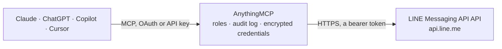

<!-- Generated by scripts/export-github-catalog.mjs in the anythingmcp-website repository. Do not edit by hand. -->

# LINE Messaging API MCP connector

Send push, reply and broadcast messages from a LINE Official Account, the main chat app in Japan, Taiwan and Thailand, and check the bot, its monthly message quota and user profiles. The AnythingMCP connector gives Claude, ChatGPT, Microsoft Copilot, Cursor and Gemini 8 MCP tools for LINE Messaging API: 5 read and 3 can change data.

**Category:** [Messaging](../messaging.md) · **Tools:** 8 · **Setup guide:** [anythingmcp.com](https://anythingmcp.com/guides/line-messaging-to-mcp) · [Deutsch](https://anythingmcp.com/de/guides/line-messaging-to-mcp) · [Italiano](https://anythingmcp.com/it/guides/line-messaging-to-mcp) · [Español](https://anythingmcp.com/es/guides/line-messaging-to-mcp) · [日本語](https://anythingmcp.com/ja/guides/line-messaging-to-mcp) · [Русский](https://anythingmcp.com/ru/guides/line-messaging-to-mcp) · [中文](https://anythingmcp.com/zh/guides/line-messaging-to-mcp)

## Start without code

No installation and no terminal: AnythingMCP Cloud runs the LINE Messaging API connector for you, operated by helpcode.ai in Frankfurt, Germany.

1. **Click the button above** and create an account or sign in. The LINE Messaging API connector opens, ready to install.
2. **Paste the API key or token from your LINE Messaging API account.** Every click is in the [step-by-step guide](https://anythingmcp.com/guides/line-messaging-to-mcp).
3. **Click Install.** AnythingMCP shows the address of your MCP server.
4. **Add that address to your assistant:** [Claude](https://anythingmcp.com/guides/connect-line-messaging-to-claude) · [ChatGPT](https://anythingmcp.com/guides/connect-line-messaging-to-chatgpt) · [Microsoft Copilot](https://anythingmcp.com/guides/connect-line-messaging-to-copilot) · [Cursor](https://anythingmcp.com/guides/connect-line-messaging-to-cursor) · [Gemini CLI](https://anythingmcp.com/guides/connect-line-messaging-to-gemini) · [Meta Muse](https://anythingmcp.com/guides/connect-line-messaging-to-muse).
5. **Ask your first question**, for example: *Get the LINE profile for customer user U4f3a9c2b7e6d4a1b9c8d0e2f5a6b7c1*

Prefer help with the setup? [Talk to us](https://anythingmcp.com/contact).

## How it works

- **The AI client** speaks MCP (Streamable HTTP) to AnythingMCP and only sees tool names, descriptions and results. It never gets the LINE Messaging API credentials.
- **AnythingMCP** checks the client's role, builds the call from the tool definition, adds the credentials (a bearer token), calls LINE Messaging API, logs the call and returns the result.
- **LINE Messaging API** sees an ordinary API client with the rights of the account the credentials belong to.

## Tools

| Tool | What it does | Access |
|---|---|---|
| [`line_get_bot_info`](#line_get_bot_info) | Basic information about the Official Account behind the token: its bot userId, basic id (@...), display name, picture, chat mode and whether messages are… | read |
| [`line_push_message`](#line_push_message) | Send a push message to a specific userId, groupId, or roomId. | write |
| [`line_reply_message`](#line_reply_message) | Reply to a message a user just sent, using the replyToken from that webhook event. | write |
| [`line_broadcast_message`](#line_broadcast_message) | Broadcast a message to ALL friends of the Official Account. | write |
| [`line_get_profile`](#line_get_profile) | Get a user's display name, profile picture URL, status message and language. | read |
| [`line_get_message_quota`](#line_get_message_quota) | The monthly limit of push and broadcast messages of the account: type (none for unlimited, limited) and value, the number of messages per month. | read |
| [`line_get_message_quota_consumption`](#line_get_message_quota_consumption) | How many push and broadcast messages the account has sent this month (totalUsage). | read |
| [`line_list_follower_ids`](#line_list_follower_ids) | List the userIds of the users who added the Official Account as a friend, up to 1000 per page, to use with line_get_profile or line_push_message. | read |

## Tool reference

Every parameter as the AI client sees it in `tools/list`. Source: [`packages/backend/src/adapters/jp/line-messaging.json`](../../../packages/backend/src/adapters/jp/line-messaging.json).

### `line_get_bot_info`

Basic information about the Official Account behind the token: its bot userId, basic id (@...), display name, picture, chat mode and whether messages are marked as read automatically. Free; a good first call to check the token.

**Access:** read · **Call:** `GET /v2/bot/info`

No parameters.

### `line_push_message`

Send a push message to a specific userId, groupId, or roomId. Counts against the monthly message quota (line_get_message_quota). Use line_reply_message instead whenever you have a fresh replyToken.

**Access:** write · **Call:** `POST /v2/bot/message/push`

| Parameter | Type | Required | Description |
|---|---|---|---|
| `to` | string | yes | Destination: a userId (U followed by 32 hex characters), groupId (C...) or roomId (R...) from a webhook event or from line_list_follower_ids. Never a display name, and never made up. |
| `messages` | object[] | yes | Array of 1–5 LINE message objects. Simplest text: [{"type": "text", "text": "Hello"}]. See https://developers.line.biz/en/reference/messaging-api/#message-objects for full schema. |
| `notificationDisabled` | boolean | no | If true, the user is not notified (silent push). Default false. |

### `line_reply_message`

Reply to a message a user just sent, using the replyToken from that webhook event. Free and unlimited (does not count against the push quota). The replyToken is single-use and expires about a minute after the user's message; this connector receives no webhooks, so only call this with a real token the user gave you. Never make one up: without a token use line_push_message.

**Access:** write · **Call:** `POST /v2/bot/message/reply`

| Parameter | Type | Required | Description |
|---|---|---|---|
| `replyToken` | string | yes | The replyToken of a webhook event, exactly as received. Single-use and short-lived. Do not invent or use a placeholder. |
| `messages` | object[] | yes | Array of 1–5 LINE message objects. |
| `notificationDisabled` | boolean | no | If true, the user is not notified (silent reply). Default false. |

### `line_broadcast_message`

Broadcast a message to ALL friends of the Official Account. Heavy on the monthly push quota (1 message × N friends = N counted pushes). Use sparingly. Returns 202 Accepted; delivery happens asynchronously.

**Access:** write · **Call:** `POST /v2/bot/message/broadcast`

| Parameter | Type | Required | Description |
|---|---|---|---|
| `messages` | object[] | yes | Array of 1–5 LINE message objects to broadcast. |
| `notificationDisabled` | boolean | no | If true, recipients are not notified. Default false. |

### `line_get_profile`

Get a user's display name, profile picture URL, status message and language. Only for users who added the Official Account as a friend. Needs a real userId (U followed by 32 hex characters) from a webhook event or line_list_follower_ids.

**Access:** read · **Call:** `GET /v2/bot/profile/{userId}`

| Parameter | Type | Required | Description |
|---|---|---|---|
| `userId` | string | yes | LINE userId, U followed by 32 hex characters, from a webhook event or line_list_follower_ids. Not a display name; do not guess one. |

### `line_get_message_quota`

The monthly limit of push and broadcast messages of the account: type (none for unlimited, limited) and value, the number of messages per month.

**Access:** read · **Call:** `GET /v2/bot/message/quota`

No parameters.

### `line_get_message_quota_consumption`

How many push and broadcast messages the account has sent this month (totalUsage). Compare with line_get_message_quota before a push or broadcast. Reply messages are not counted.

**Access:** read · **Call:** `GET /v2/bot/message/quota/consumption`

No parameters.

### `line_list_follower_ids`

List the userIds of the users who added the Official Account as a friend, up to 1000 per page, to use with line_get_profile or line_push_message. LINE only offers this to verified and premium accounts; other accounts get 403. Users who blocked the account or have not agreed to share their profile are left out.

**Access:** read · **Call:** `GET /v2/bot/followers/ids`

| Parameter | Type | Required | Description |
|---|---|---|---|
| `limit` | integer | no | UserIds per page, at most 1000. |
| `start` | string | no | Continuation token: the next value from the previous page. |

## Run it yourself

AnythingMCP is open source (AGPL-3.0). [Run it with Docker](../../../README.md#run-it-yourself), open **Connectors → Store**, pick **LINE Messaging API** and enter `LINE_CHANNEL_ACCESS_TOKEN`, then add your MCP server URL to the AI client.

[← Messaging connectors](../messaging.md) · [All categories](../README.md)
