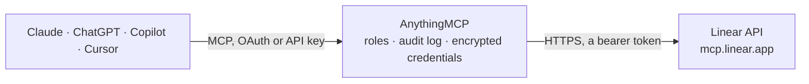

<!-- Generated by scripts/export-github-catalog.mjs in the anythingmcp-website repository. Do not edit by hand. -->

# Linear MCP connector

Work with Linear from Claude, ChatGPT or Copilot through Linear's official MCP server: find and update issues, plan projects, cycles and milestones, write comments and documents, and post status updates. The AnythingMCP connector gives Claude, ChatGPT, Microsoft Copilot, Cursor and Gemini 76 MCP tools for Linear: 41 read and 35 can change data.

**Category:** [Project Management](../project-management.md) · **Tools:** 76 · **Setup guide:** [anythingmcp.com](https://anythingmcp.com/guides/linear-to-mcp) · [Deutsch](https://anythingmcp.com/de/guides/linear-to-mcp) · [Italiano](https://anythingmcp.com/it/guides/linear-to-mcp) · [Español](https://anythingmcp.com/es/guides/linear-to-mcp) · [日本語](https://anythingmcp.com/ja/guides/linear-to-mcp) · [Русский](https://anythingmcp.com/ru/guides/linear-to-mcp) · [中文](https://anythingmcp.com/zh/guides/linear-to-mcp)

## Start without code

No installation and no terminal: AnythingMCP Cloud runs the Linear connector for you, operated by helpcode.ai in Frankfurt, Germany.

1. **Click the button above** and create an account or sign in. The Linear connector opens, ready to install.
2. **Paste the API key or token from your Linear account.** Every click is in the [step-by-step guide](https://anythingmcp.com/guides/linear-to-mcp).
3. **Click Install.** AnythingMCP shows the address of your MCP server.
4. **Add that address to your assistant:** [Claude](https://anythingmcp.com/guides/connect-linear-to-claude) · [ChatGPT](https://anythingmcp.com/guides/connect-linear-to-chatgpt) · [Microsoft Copilot](https://anythingmcp.com/guides/connect-linear-to-copilot) · [Cursor](https://anythingmcp.com/guides/connect-linear-to-cursor) · [Gemini CLI](https://anythingmcp.com/guides/connect-linear-to-gemini) · [Meta Muse](https://anythingmcp.com/guides/connect-linear-to-muse).
5. **Ask your first question**, for example: *What's the current status, assignee and due date for issue WEB-412?*

Prefer help with the setup? [Talk to us](https://anythingmcp.com/contact).

## How it works

- **The AI client** speaks MCP (Streamable HTTP) to AnythingMCP and only sees tool names, descriptions and results. It never gets the Linear credentials.
- **AnythingMCP** checks the client's role, builds the call from the tool definition, adds the credentials (a bearer token), calls Linear, logs the call and returns the result.
- **Linear** sees an ordinary API client with the rights of the account the credentials belong to.

## Tools

| Tool | What it does | Access |
|---|---|---|
| [`linear_create_attachment`](#linear_create_attachment) | Deprecated fallback for tiny files only. | write |
| [`linear_create_attachment_from_upload`](#linear_create_attachment_from_upload) | Link an already-uploaded Linear assetUrl to an existing issue as an attachment. | write |
| [`linear_create_initiative_label`](#linear_create_initiative_label) | Create a new Linear initiative label. | write |
| [`linear_create_issue_label`](#linear_create_issue_label) | Create a new Linear issue label. | write |
| [`linear_delete_attachment`](#linear_delete_attachment) | Delete an attachment by ID. | write |
| [`linear_delete_comment`](#linear_delete_comment) | Delete a Linear comment. | write |
| [`linear_delete_diff_comment`](#linear_delete_diff_comment) | Delete a comment or persisted draft from a Linear diff. | write |
| [`linear_delete_status_update`](#linear_delete_status_update) | Delete (archive) a project or initiative status update. | write |
| [`linear_extract_images`](#linear_extract_images) | Extract and fetch images from markdown content. | read |
| [`linear_get_agent_skill`](#linear_get_agent_skill) | Retrieve a Linear Agent skill by ID, including its full markdown instructions. | read |
| [`linear_get_attachment`](#linear_get_attachment) | Retrieve an issue attachment by ID. | read |
| [`linear_get_diff`](#linear_get_diff) | Exact lookup for a Linear diff. | read |
| [`linear_get_diff_threads`](#linear_get_diff_threads) | Exact lookup for diff threads and the authenticated user's drafts. | read |
| [`linear_get_document`](#linear_get_document) | Retrieve a Linear document by ID or slug, including its title and markdown content. | read |
| [`linear_get_initiative`](#linear_get_initiative) | Retrieve detailed information about a specific initiative in Linear | read |
| [`linear_get_issue`](#linear_get_issue) | Retrieve detailed information about an issue by ID, including attachments, git branch name, and active Triage Intelligence suggestions when the issue is in… | read |
| [`linear_get_issue_status`](#linear_get_issue_status) | Retrieve detailed information about an issue status in Linear by name or ID | read |
| [`linear_get_milestone`](#linear_get_milestone) | Retrieve details of a specific milestone by ID or name, within the project given by name, ID, identifier or slug. | read |
| [`linear_get_notifications`](#linear_get_notifications) | Get a page of notifications from the authenticated user's Linear inbox. | read |
| [`linear_get_project`](#linear_get_project) | Retrieve details of a specific project in Linear by name, ID, identifier or slug; optionally with members, milestones, resources and customer needs. | read |
| [`linear_get_release`](#linear_get_release) | Retrieve details of a release by ID or slug, optionally with its associated release notes. | read |
| [`linear_get_release_note`](#linear_get_release_note) | Retrieve release notes by ID or slug, including markdown content. | read |
| [`linear_get_status_updates`](#linear_get_status_updates) | List or get project/initiative status updates. | read |
| [`linear_get_team`](#linear_get_team) | Retrieve details of a specific Linear team by its UUID, key (e.g. ENG) or name. | read |
| [`linear_get_template`](#linear_get_template) | Retrieve a Linear template by ID or name: the content it pre-fills, the ids it applies, its sub-issues, and its form fields. | read |
| [`linear_get_triage_responsibility`](#linear_get_triage_responsibility) | Retrieve who is responsible for a team's triage: the person on triage now, what happens when an issue enters triage, and the upcoming shifts of the team's… | read |
| [`linear_get_user`](#linear_get_user) | Retrieve details of a specific Linear user by ID, name or email; pass "me" for the user the API key belongs to. | read |
| [`linear_get_workspace`](#linear_get_workspace) | Retrieve the connected Linear workspace: the organization the API key belongs to, with its name and URL key. | read |
| [`linear_list_agent_skills`](#linear_list_agent_skills) | List Linear Agent skills available to the authenticated user. | read |
| [`linear_list_comments`](#linear_list_comments) | List comments on a Linear issue, project, initiative, document, project milestone, or project/initiative status update. | read |
| [`linear_list_custom_views`](#linear_list_custom_views) | Find saved issue, project, and initiative views accessible to the user, including personal, workspace, and team views. | read |
| [`linear_list_cycles`](#linear_list_cycles) | Retrieve cycles for a specific Linear team; filter to the current, previous or next cycle, or omit the filter for all. | read |
| [`linear_list_diffs`](#linear_list_diffs) | List Linear diff pull requests visible to the authenticated user | read |
| [`linear_list_documents`](#linear_list_documents) | List documents in the user's Linear workspace, with search, creator, project, initiative and team filters and cursor paging. | read |
| [`linear_list_initiative_labels`](#linear_list_initiative_labels) | List available initiative labels in the Linear workspace. | read |
| [`linear_list_initiatives`](#linear_list_initiatives) | List initiatives in the user's Linear workspace, filtered by owner, status, label, lead team, parent initiative or saved view. | read |
| [`linear_list_issue_labels`](#linear_list_issue_labels) | List available issue labels in a Linear workspace or team. | read |
| [`linear_list_issue_statuses`](#linear_list_issue_statuses) | List available issue statuses in a Linear team (for example Backlog, Todo, In Progress, Done), with their IDs and types. | read |
| [`linear_list_issues`](#linear_list_issues) | List issues in the user's Linear workspace, including active Triage Intelligence suggestions for issues in triage. | read |
| [`linear_list_milestones`](#linear_list_milestones) | List all milestones in a Linear project, given by project name, ID, identifier or slug. | read |
| [`linear_list_project_labels`](#linear_list_project_labels) | List available project labels in a Linear workspace or team. | read |
| [`linear_list_projects`](#linear_list_projects) | List projects in the user's Linear workspace, filtered by team, member, initiative, label, state or saved view, with cursor paging. | read |
| [`linear_list_release_notes`](#linear_list_release_notes) | List release notes in the workspace, optionally filtered by pipeline or covered release. | read |
| [`linear_list_release_pipelines`](#linear_list_release_pipelines) | List release pipelines in the workspace, optionally with their stages and teams, filtered by name, team or type. | read |
| [`linear_list_releases`](#linear_list_releases) | List releases in the workspace, with optional filtering by pipeline, stage, version, and text. | read |
| [`linear_list_teams`](#linear_list_teams) | List teams in the user's Linear workspace, with their IDs and keys; supports search, archived teams and cursor paging. | read |
| [`linear_list_templates`](#linear_list_templates) | List the Linear issue, project, and document templates available to the authenticated user. | read |
| [`linear_list_users`](#linear_list_users) | Retrieve users in the Linear workspace, filtered by name, email or team, with cursor paging. | read |
| [`linear_mark_notification`](#linear_mark_notification) | Mark a Linear inbox notification as read or unread, or snooze or unsnooze it. | write |
| [`linear_merge_diff`](#linear_merge_diff) | Merge a Linear diff or add it to the repository's merge queue | write |
| [`linear_prepare_attachment_upload`](#linear_prepare_attachment_upload) | Prepare a direct Linear file upload for an existing issue. | write |
| [`linear_resolve_diff_thread`](#linear_resolve_diff_thread) | Resolve or reopen a top-level comment thread on a Linear diff | write |
| [`linear_restore_initiative_label`](#linear_restore_initiative_label) | Restore a retired Linear initiative label, making it available for use on initiatives again. | write |
| [`linear_restore_issue_label`](#linear_restore_issue_label) | Restore a retired Linear issue label, making it available for use on issues again. | write |
| [`linear_restore_project_label`](#linear_restore_project_label) | Restore a retired Linear project label, making it available for use on projects again. | write |
| [`linear_retire_initiative_label`](#linear_retire_initiative_label) | Retire a Linear initiative label so it cannot be applied to new initiatives. | write |
| [`linear_retire_issue_label`](#linear_retire_issue_label) | Retire a Linear issue label so it cannot be applied to new issues. | write |
| [`linear_retire_project_label`](#linear_retire_project_label) | Retire a Linear project label so it cannot be applied to new projects. | write |
| [`linear_save_comment`](#linear_save_comment) | Create or update a comment on a Linear issue, project, initiative, document, project milestone, or project/initiative status update. | write |
| [`linear_save_diff_comment`](#linear_save_diff_comment) | Create, reply to, or edit a comment or persisted draft on a Linear diff. | write |
| [`linear_save_document`](#linear_save_document) | Create or update a Linear document. | write |
| [`linear_save_initiative`](#linear_save_initiative) | Create or update a Linear initiative. | write |
| [`linear_save_initiative_label`](#linear_save_initiative_label) | Create or update a Linear initiative label. | write |
| [`linear_save_issue`](#linear_save_issue) | Create or update a Linear issue. | write |
| [`linear_save_issue_label`](#linear_save_issue_label) | Create or update a Linear issue label. | write |
| [`linear_save_milestone`](#linear_save_milestone) | Create or update a milestone in a Linear project. | write |
| [`linear_save_project`](#linear_save_project) | Create or update a Linear project. | write |
| [`linear_save_project_label`](#linear_save_project_label) | Create or update a Linear project label. | write |
| [`linear_save_release`](#linear_save_release) | Create or update a release. | write |
| [`linear_save_release_note`](#linear_save_release_note) | Create or update release notes. | write |
| [`linear_save_status_update`](#linear_save_status_update) | Create or update a project/initiative status update. | write |
| [`linear_search_documentation`](#linear_search_documentation) | Search Linear's documentation to learn about features and usage | read |
| [`linear_share_issue`](#linear_share_issue) | Share an issue with a workspace user who cannot otherwise access it. | write |
| [`linear_submit_diff_review`](#linear_submit_diff_review) | Approve a Linear diff, request changes, or submit a review comment | write |
| [`linear_unshare_issue`](#linear_unshare_issue) | Remove a workspace user's shared access to an issue. | write |
| [`linear_update_diff`](#linear_update_diff) | Update a Linear diff's title, description, reviewer requests, issue links, or status. | write |

## Tool reference

Every parameter as the AI client sees it in `tools/list`. Source: [`packages/backend/src/adapters/intl/linear.json`](../../../packages/backend/src/adapters/intl/linear.json).

### `linear_create_attachment`

Deprecated fallback for tiny files only. Accepts base64 file content, verifies SHA-256 checksum, and uploads it through the MCP worker. Prefer `prepare_attachment_upload` plus direct PUT plus `create_attachment_from_upload`. CRITICAL: Do not print base64Content and then copy it into this tool call. Opaque base64 copied through model-visible text is easy to corrupt. Generate base64Content mechanically from the source bytes and pass it through a programmatic argument construction path whenever available. Before calling this tool, verify the values are consistent: Unix-like shells: file="/path/to/file" base64Content=$(base64 < "$file" | tr -d '\n\r') sha256=$(shasum -a 256 "$file" | awk '{print $1}') decodedSha256=$(printf '%s' "$base64Content" | base64 -d | shasum -a 256 | awk '{print $1}') size=$(wc -c < "$file" | tr -d ' ') # optional; stat can also get file byte size decodedSize=$(printf '%s' "$base64Content" | base64 -d | wc -c | tr -d ' ') PowerShell: $file = 'C:\path\to\file' $bytes = [IO.File]::ReadAllBytes($file) $base64Content = [Convert]::ToBase64String($bytes) $sha256 = (Get-FileHash -Algorithm SHA256 -Path $file).Hash.ToLower() $size = $bytes.Length # optional $decoded = [Convert]::FromBase64String($base64Content) $decodedStream = [IO.MemoryStream]::new($decoded) $decodedSha256 = (Get-FileHash -Algorithm SHA256 -InputStream $decodedStream).Hash.ToLower() $decodedSize = $decoded.Length decodedSha256 must equal sha256. If you pass size, decodedSize must equal size. Pass `sha256`. Passing `size` is optional, but recommended for clearer mismatch errors.

**Access:** write · **Call:** `create_attachment /mcp`

| Parameter | Type | Required | Description |
|---|---|---|---|
| `base64Content` | string | yes | Deprecated base64-encoded file content to upload |
| `contentType` | string | yes | MIME type for the upload (e.g., 'image/png', 'application/pdf') |
| `filename` | string | yes | Filename for the upload (e.g., 'screenshot.png') |
| `issue` | string | yes | Issue ID or identifier (e.g., LIN-123). P-prefixed identifiers (e.g., P-ENG-123) are projects, not issues |
| `sha256` | string | yes | Expected SHA-256 hex digest of the decoded file bytes. |
| `size` | integer | no | Optional expected decoded file size in bytes. Rejects the upload if it does not match. |
| `subtitle` | string | no | Optional subtitle for the attachment |
| `title` | string | no | Optional title for the attachment |

### `linear_create_attachment_from_upload`

Link an already-uploaded Linear assetUrl to an existing issue as an attachment. Use this only after: 1. prepare_attachment_upload returned an assetUrl and uploadRequest. 2. The client successfully PUT raw file bytes to uploadRequest.url. This tool does not upload file content. It only creates the Linear attachment row. If the direct upload failed or the signed URL expired, rerun prepare_attachment_upload and upload again.

**Access:** write · **Call:** `create_attachment_from_upload /mcp`

| Parameter | Type | Required | Description |
|---|---|---|---|
| `assetUrl` | string | yes | Linear upload assetUrl returned by prepare_attachment_upload |
| `issue` | string | yes | Issue ID or identifier (e.g., LIN-123). P-prefixed identifiers (e.g., P-ENG-123) are projects, not issues |
| `subtitle` | string | no | Optional attachment subtitle |
| `title` | string | no | Attachment title. Defaults to filename or asset URL |

### `linear_create_initiative_label`

Create a new Linear initiative label. Deprecated: use `save_initiative_label`, which can also update labels.

**Access:** write · **Call:** `create_initiative_label /mcp`

| Parameter | Type | Required | Description |
|---|---|---|---|
| `color` | string | no | Hex color code |
| `description` | string | no | Label description |
| `isGroup` | boolean | no | Whether the label is a group |
| `name` | string | yes | Label name |
| `parent` | string | no | Parent label group name or ID |

### `linear_create_issue_label`

Create a new Linear issue label. Deprecated: use `save_issue_label`, which can also update labels.

**Access:** write · **Call:** `create_issue_label /mcp`

| Parameter | Type | Required | Description |
|---|---|---|---|
| `color` | string | no | Hex color code |
| `description` | string | no | Label description |
| `isGroup` | boolean | no | Whether the label is a group |
| `name` | string | yes | Label name |
| `parent` | string | no | Parent label group name or ID |
| `teamId` | string | no | Team UUID (omit for workspace label) |

### `linear_delete_attachment`

Delete an attachment by ID. The file or link is removed from the Linear issue it was attached to.

**Access:** write · **Call:** `delete_attachment /mcp`

| Parameter | Type | Required | Description |
|---|---|---|---|
| `id` | string | yes | Attachment ID |

### `linear_delete_comment`

Delete a Linear comment. Inline description comments (those with non-null `quotedText`) anchor a mark in the editor, so their root cannot be deleted; delete the replies individually or resolve the thread instead.

**Access:** write · **Call:** `delete_comment /mcp`

| Parameter | Type | Required | Description |
|---|---|---|---|
| `id` | string | yes | Comment ID |

### `linear_delete_diff_comment`

Delete a comment or persisted draft from a Linear diff. Pass commentId for a submitted comment or draftId for a draft.

**Access:** write · **Call:** `delete_diff_comment /mcp`

| Parameter | Type | Required | Description |
|---|---|---|---|
| `commentId` | string | no | Submitted diff comment ID to delete |
| `draftId` | string | no | Persisted diff comment draft ID to delete |

### `linear_delete_status_update`

Delete (archive) a project or initiative status update. Pass the update ID and whether it belongs to a project or an initiative.

**Access:** write · **Call:** `delete_status_update /mcp`

| Parameter | Type | Required | Description |
|---|---|---|---|
| `id` | string | yes | Status update ID |
| `type` | `project` \| `initiative` | yes | Type of status update |

### `linear_extract_images`

Extract and fetch images from markdown content. Use this to view screenshots, diagrams, or other images embedded in Linear issues, comments, or documents. Pass the markdown content (e.g., issue description) and receive the images as viewable data.

**Access:** read · **Call:** `extract_images /mcp`

| Parameter | Type | Required | Description |
|---|---|---|---|
| `markdown` | string | yes | Markdown content containing image references (e.g., issue description, comment body) |

### `linear_get_agent_skill`

Retrieve a Linear Agent skill by ID, including its full markdown instructions.

**Access:** read · **Call:** `get_agent_skill /mcp`

| Parameter | Type | Required | Description |
|---|---|---|---|
| `id` | string | yes | Agent skill ID |

### `linear_get_attachment`

Retrieve an issue attachment by ID. Use format=url to get its title and download URL without fetching the file content. Linear upload URLs are signed for five minutes; call again to refresh. External URLs are returned unchanged. Files embedded in comments have no issue attachment ID; use the URLs in list_comments attachments instead. Download and process documents with your own file tools.

**Access:** read · **Call:** `get_attachment /mcp`

| Parameter | Type | Required | Description |
|---|---|---|---|
| `format` | `content` \| `url` | no | Response format. Defaults to content. |
| `id` | string | yes | Attachment ID |

### `linear_get_diff`

Exact lookup for a Linear diff. Use with review URLs, GitHub PR URLs, Linear full identifiers, UUIDs, or slugs.

**Access:** read · **Call:** `get_diff /mcp`

| Parameter | Type | Required | Description |
|---|---|---|---|
| `urlOrId` | string | yes | Linear review URL, diff slug, pull request ID, Linear full identifier, or GitHub PR URL |

### `linear_get_diff_threads`

Exact lookup for diff threads and the authenticated user's drafts. Use with review URLs, GitHub PR URLs, Linear full identifiers, UUIDs, or slugs.

**Access:** read · **Call:** `get_diff_threads /mcp`

| Parameter | Type | Required | Description |
|---|---|---|---|
| `orderBy` | `createdAt` \| `updatedAt` | no | Sort: createdAt \| updatedAt |
| `resolved` | boolean | no | Filter returned threads by resolved state |
| `threadId` | string | no | Optional Linear comment UUID of any comment in the thread (not its `externalThreadId`); a reply's UUID resolves to its thread root |
| `urlOrId` | string | yes | Linear review URL, diff slug, pull request ID, Linear full identifier, or GitHub PR URL |

### `linear_get_document`

Retrieve a Linear document by ID or slug, including its title and markdown content.

**Access:** read · **Call:** `get_document /mcp`

| Parameter | Type | Required | Description |
|---|---|---|---|
| `id` | string | yes | Document ID or slug |

### `linear_get_initiative`

Retrieve detailed information about a specific initiative in Linear

**Access:** read · **Call:** `get_initiative /mcp`

| Parameter | Type | Required | Description |
|---|---|---|---|
| `includeProjects` | boolean | no | Include projects |
| `includeSubInitiatives` | boolean | no | Include sub-initiatives |
| `query` | string | yes | Initiative name, ID, identifier (e.g., I-123), or slug |

### `linear_get_issue`

Retrieve detailed information about an issue by ID, including attachments, git branch name, and active Triage Intelligence suggestions when the issue is in triage. A nonempty fields selection overrides the include options; request optional fields directly in fields.

**Access:** read · **Call:** `get_issue /mcp`

| Parameter | Type | Required | Description |
|---|---|---|---|
| `fields` | `id` \| `uuid` \| `title` \| `description` \| `projectMilestone` \| `priority` \| `estimate` \| `url` \| `gitBranchName` \| `createdAt` \| `updatedAt` \| `archivedAt` \| `completedAt` \| `startedAt` \| `canceledAt` \| `startedTriageAt` \| `triagedAt` \| `dueDate` \| `slaStartedAt` \| `slaMediumRiskAt` \| `slaHighRiskAt` \| `slaBreachesAt` \| `slaType` \| `status` \| `statusType` \| `labels` \| `triageIntel` \| `createdBy` \| `createdById` \| `assignee` \| `assigneeId` \| `delegate` \| `delegateId` \| `project` \| `projectId` \| `parentId` \| `team` \| `teamId` \| `cycleId` \| `attachments` \| `documents` \| `stateHistory` \| `relations` \| `customerNeeds` \| `releases`[] | no | Fields to include in each result. Explicitly requested fields with no value return null. `id` is always included. Omit or pass an empty array for the default response. |
| `id` | string | yes | Issue ID or identifier (e.g., LIN-123). P-prefixed identifiers (e.g., P-ENG-123) are projects, not issues |
| `includeCustomerNeeds` | boolean | no | Include associated customer needs |
| `includeRelations` | boolean | no | Include blocking/related/duplicate relations |
| `includeReleases` | boolean | no | Include associated releases |

### `linear_get_issue_status`

Retrieve detailed information about an issue status in Linear by name or ID

**Access:** read · **Call:** `get_issue_status /mcp`

| Parameter | Type | Required | Description |
|---|---|---|---|
| `id` | string | yes | Status ID |
| `name` | string | yes | Status name |
| `team` | string | yes | Team name or ID |

### `linear_get_milestone`

Retrieve details of a specific milestone by ID or name, within the project given by name, ID, identifier or slug.

**Access:** read · **Call:** `get_milestone /mcp`

| Parameter | Type | Required | Description |
|---|---|---|---|
| `project` | string | yes | Project name, ID, identifier (e.g., P-ENG-123), or slug |
| `query` | string | yes | Milestone name or ID |

### `linear_get_notifications`

Get a page of notifications from the authenticated user's Linear inbox.

**Access:** read · **Call:** `get_notifications /mcp`

| Parameter | Type | Required | Description |
|---|---|---|---|
| `cursor` | string | no | Next page cursor |
| `limit` | number | no | Max results (default 50, max 250) |
| `unreadOnly` | boolean | no | Only return unread notifications |

### `linear_get_project`

Retrieve details of a specific project in Linear by name, ID, identifier or slug; optionally with members, milestones, resources and customer needs.

**Access:** read · **Call:** `get_project /mcp`

| Parameter | Type | Required | Description |
|---|---|---|---|
| `customerNeedsCursor` | string | no | Next customer-needs page: pass customerNeedsPageInfo.endCursor with includeCustomerNeeds true |
| `customerNeedsLimit` | integer | no | Customer needs per page when includeCustomerNeeds is true (default 10, max 50) |
| `includeCustomerNeeds` | boolean | no | Include one page of customer needs attached directly to the project |
| `includeMembers` | boolean | no | Include project members |
| `includeMilestones` | boolean | no | Include milestones |
| `includeResources` | boolean | no | Include resources (documents, links, attachments) |
| `query` | string | yes | Project name, ID, identifier (e.g., P-ENG-123), or slug |

### `linear_get_release`

Retrieve details of a release by ID or slug, optionally with its associated release notes.

**Access:** read · **Call:** `get_release /mcp`

| Parameter | Type | Required | Description |
|---|---|---|---|
| `id` | string | yes | Release ID or slug |
| `includeReleaseNotes` | boolean | no | Include associated release notes |

### `linear_get_release_note`

Retrieve release notes by ID or slug, including markdown content.

**Access:** read · **Call:** `get_release_note /mcp`

| Parameter | Type | Required | Description |
|---|---|---|---|
| `id` | string | yes | Release notes ID or slug |
| `includeReleases` | boolean | no | Include associated releases |

### `linear_get_status_updates`

List or get project/initiative status updates. Pass `id` to get a specific update, or filter to list.

**Access:** read · **Call:** `get_status_updates /mcp`

| Parameter | Type | Required | Description |
|---|---|---|---|
| `createdAt` | string | no | Created after: ISO-8601 date/duration (e.g., -P1D) |
| `cursor` | string | no | Next page cursor |
| `id` | string | no | Status update ID - if provided, returns this specific update |
| `includeArchived` | boolean | no | Include archived items |
| `initiative` | string | no | Initiative name, ID, identifier (e.g., I-123), or slug |
| `limit` | number | no | Max results (default 50, max 250) |
| `orderBy` | `createdAt` \| `updatedAt` | no | Sort: createdAt \| updatedAt |
| `project` | string | no | Project name, ID, identifier (e.g., P-ENG-123), or slug |
| `type` | `project` \| `initiative` | yes | Type of status update |
| `updatedAt` | string | no | Updated after: ISO-8601 date/duration (e.g., -P1D) |
| `user` | string | no | User ID, name, email, or "me" |

### `linear_get_team`

Retrieve details of a specific Linear team by its UUID, key (e.g. ENG) or name.

**Access:** read · **Call:** `get_team /mcp`

| Parameter | Type | Required | Description |
|---|---|---|---|
| `query` | string | yes | Team UUID, key, or name |

### `linear_get_template`

Retrieve a Linear template by ID or name: the content it pre-fills, the ids it applies, its sub-issues, and its form fields. Pass the template to save_issue or save_project to apply it. References come back as ids, so read a name with the matching tool when you need one. A form template collects its answers through a form, so applying one here creates an issue with the form unanswered.

**Access:** read · **Call:** `get_template /mcp`

| Parameter | Type | Required | Description |
|---|---|---|---|
| `id` | string | yes | Template ID or name |

### `linear_get_triage_responsibility`

Retrieve who is responsible for a team's triage: the person on triage now, what happens when an issue enters triage, and the upcoming shifts of the team's triage rotation. Pass `user` to get only that person's shifts, for example to find when their next triage duty starts, even when it is weeks away.

**Access:** read · **Call:** `get_triage_responsibility /mcp`

| Parameter | Type | Required | Description |
|---|---|---|---|
| `limit` | integer | no | Max upcoming shifts to return (default 10, max 50) |
| `team` | string | yes | Team name or ID |
| `user` | string | no | Only return shifts of this user: User ID, name, email, or "me" |

### `linear_get_user`

Retrieve details of a specific Linear user by ID, name or email; pass "me" for the user the API key belongs to.

**Access:** read · **Call:** `get_user /mcp`

| Parameter | Type | Required | Description |
|---|---|---|---|
| `query` | string | yes | User ID, name, email, or "me" |

### `linear_get_workspace`

Retrieve the connected Linear workspace: the organization the API key belongs to, with its name and URL key.

**Access:** read · **Call:** `get_workspace /mcp`

No parameters.

### `linear_list_agent_skills`

List Linear Agent skills available to the authenticated user.

**Access:** read · **Call:** `list_agent_skills /mcp`

| Parameter | Type | Required | Description |
|---|---|---|---|
| `cursor` | string | no | Next page cursor |
| `limit` | number | no | Max results (default 50, max 250) |
| `orderBy` | `createdAt` \| `updatedAt` | no | Sort: createdAt \| updatedAt |

### `linear_list_comments`

List comments on a Linear issue, project, initiative, document, project milestone, or project/initiative status update. Provide exactly one of `issueId`, `projectId`, `initiativeId`, `documentId`, `milestoneId`, or `statusUpdateId`. For issues, projects, and initiatives this returns both top-level discussion threads and inline description comments. Inline (anchored) comments carry a non-null `quotedText` set to the snippet of description text they reference. Returned comments include `author` and nullable `onBehalfOf`; when set, `onBehalfOf` identifies the user the agent author acted for. Files uploaded in comment bodies are returned in `attachments` with titles and download URLs, not issue attachment IDs. Signed upload URLs expire after five minutes; call list_comments again to refresh them. Download documents using these URLs and process them with your own file tools.

**Access:** read · **Call:** `list_comments /mcp`

| Parameter | Type | Required | Description |
|---|---|---|---|
| `cursor` | string | no | Next page cursor |
| `documentId` | string | no | Document ID or slug (provide exactly one parent) |
| `initiativeId` | string | no | Initiative name, ID, identifier (e.g., I-123), or slug (provide exactly one parent) |
| `issueId` | string | no | Issue ID or identifier (e.g., LIN-123). P-prefixed identifiers (e.g., P-ENG-123) are projects, not issues (provide exactly one parent) |
| `limit` | number | no | Max results (default 50, max 250) |
| `milestoneId` | string | no | Milestone UUID (provide exactly one parent). Resolve milestone names via `list_milestones` first. |
| `orderBy` | `createdAt` \| `updatedAt` | no | Sort: createdAt \| updatedAt |
| `projectId` | string | no | Project name, ID, identifier (e.g., P-ENG-123), or slug (provide exactly one parent) |
| `statusUpdateId` | string | no | Status update UUID (provide exactly one parent). Resolve status updates via `get_status_updates` first. |
| `statusUpdateType` | `project` \| `initiative` | no | Type of status update named by `statusUpdateId`, as returned by `get_status_updates`. Only valid together with `statusUpdateId`; omit to check both project and initiative status updates. |

### `linear_list_custom_views`

Find saved issue, project, and initiative views accessible to the user, including personal, workspace, and team views. Excludes archived views and views scoped to a project or initiative. Returns view metadata, not the records matching its filters.

**Access:** read · **Call:** `list_custom_views /mcp`

| Parameter | Type | Required | Description |
|---|---|---|---|
| `cursor` | string | no | Next page cursor |
| `limit` | number | no | Max results (default 50, max 250) |
| `orderBy` | `createdAt` \| `updatedAt` | no | Sort: createdAt \| updatedAt |
| `query` | string | no | Search custom view names |
| `shared` | boolean | no | True for shared views, false for personal views |
| `team` | string | no | Team name or ID |
| `type` | `Issue` \| `Project` \| `Initiative` | no | Entity type displayed by the view |

### `linear_list_cycles`

Retrieve cycles for a specific Linear team; filter to the current, previous or next cycle, or omit the filter for all.

**Access:** read · **Call:** `list_cycles /mcp`

| Parameter | Type | Required | Description |
|---|---|---|---|
| `teamId` | string | yes | Team ID |
| `type` | `current` \| `previous` \| `next` | no | Filter: current, previous, next, or all |

### `linear_list_diffs`

List Linear diff pull requests visible to the authenticated user

**Access:** read · **Call:** `list_diffs /mcp`

| Parameter | Type | Required | Description |
|---|---|---|---|
| `author` | string | no | Filter by author ID, name, email, or "me" |
| `cursor` | string | no | Next page cursor |
| `limit` | number | no | Max results (default 50, max 250) |
| `orderBy` | `createdAt` \| `updatedAt` | no | Sort: createdAt \| updatedAt |
| `owner` | string | no | Filter returned diffs by repository owner |
| `query` | string | no | Broad search by title, branch, PR number, or bare slug |
| `repo` | string | no | Filter returned diffs by repository name |
| `reviewState` | `pending` \| `approved` \| `changesRequested` \| `commented` \| `dismissed` | no | Reviewer state; requires reviewer and defaults to pending when reviewer is set |
| `reviewer` | string | no | Filter by reviewer ID, name, email, or "me" |
| `status` | string | no | Filter returned diffs by pull request status |

### `linear_list_documents`

List documents in the user's Linear workspace, with search, creator, project, initiative and team filters and cursor paging.

**Access:** read · **Call:** `list_documents /mcp`

| Parameter | Type | Required | Description |
|---|---|---|---|
| `createdAt` | string | no | Created after: ISO-8601 date/duration (e.g., -P1D) |
| `creatorId` | string | no | Filter by creator ID |
| `cursor` | string | no | Next page cursor |
| `fields` | `id` \| `title` \| `content` \| `url` \| `createdAt` \| `updatedAt` \| `archivedAt` \| `creator` \| `updatedBy` \| `project` \| `initiative` \| `team` \| `issue`[] | no | Fields to include in each result. Explicitly requested fields with no value return null. `id` is always included. Omit or pass an empty array for the default response. |
| `includeArchived` | boolean | no | Include archived items |
| `initiativeId` | string | no | Filter by initiative ID, identifier (e.g., 'I-123'), or slug |
| `limit` | number | no | Max results (default 50, max 250) |
| `orderBy` | `createdAt` \| `updatedAt` | no | Sort: createdAt \| updatedAt |
| `projectId` | string | no | Filter by project ID, identifier (e.g., 'P-ENG-123'), or slug |
| `query` | string | no | Search query |
| `teamId` | string | no | Filter by team ID |
| `updatedAt` | string | no | Updated after: ISO-8601 date/duration (e.g., -P1D) |

### `linear_list_initiative_labels`

List available initiative labels in the Linear workspace. A retired label carries `retiredAt` and cannot be applied to new initiatives.

**Access:** read · **Call:** `list_initiative_labels /mcp`

| Parameter | Type | Required | Description |
|---|---|---|---|
| `cursor` | string | no | Next page cursor |
| `includeArchived` | boolean | no | Include archived items |
| `includeGroups` | boolean | no | Include label groups in the results, marked with `isGroup`. A group cannot be applied directly; retiring or restoring one cascades to its child labels |
| `limit` | number | no | Max results (default 50, max 250) |
| `name` | string | no | Filter by name |
| `orderBy` | `createdAt` \| `updatedAt` | no | Sort: createdAt \| updatedAt |

### `linear_list_initiatives`

List initiatives in the user's Linear workspace, filtered by owner, status, label, lead team, parent initiative or saved view.

**Access:** read · **Call:** `list_initiatives /mcp`

| Parameter | Type | Required | Description |
|---|---|---|---|
| `createdAt` | string | no | Created after: ISO-8601 date/duration (e.g., -P1D) |
| `cursor` | string | no | Next page cursor |
| `customView` | string | no | Saved view ID, URL, slug, or exact name. Use list_custom_views to discover views. Applies saved filters and scope; other filters narrow the results. Uses list ordering, not saved display settings |
| `fields` | `id` \| `uuid` \| `name` \| `summary` \| `description` \| `url` \| `status` \| `priority` \| `targetDate` \| `health` \| `createdAt` \| `updatedAt` \| `owner` \| `creator` \| `leadTeam` \| `parentInitiatives` \| `labels` \| `projects` \| `subInitiatives`[] | no | Fields to include in each result. Explicitly requested fields with no value return null. `id` is always included. Omit or pass an empty array for the default response. |
| `includeArchived` | boolean | no | Include archived items |
| `includeProjects` | boolean | no | Include projects |
| `includeSubInitiatives` | boolean | no | Include sub-initiatives |
| `label` | string | no | Label name or ID |
| `leadTeam` | string | no | Lead team name, key, or ID |
| `limit` | number | no | Max results (default 50, max 250) |
| `orderBy` | `createdAt` \| `updatedAt` | no | Sort: createdAt \| updatedAt |
| `owner` | string | no | User ID, name, email, or "me" |
| `parentInitiative` | string | no | Parent initiative. Initiative name, ID, identifier (e.g., I-123), or slug |
| `query` | string | no | Search initiative name |
| `status` | string | no | Status of the initiative |
| `updatedAt` | string | no | Updated after: ISO-8601 date/duration (e.g., -P1D) |

### `linear_list_issue_labels`

List available issue labels in a Linear workspace or team. A retired label carries `retiredAt` and cannot be applied to new issues.

**Access:** read · **Call:** `list_issue_labels /mcp`

| Parameter | Type | Required | Description |
|---|---|---|---|
| `cursor` | string | no | Next page cursor |
| `includeArchived` | boolean | no | Include archived items |
| `includeGroups` | boolean | no | Include label groups in the results, marked with `isGroup`. A group cannot be applied directly; retiring or restoring one cascades to its child labels |
| `limit` | number | no | Max results (default 50, max 250) |
| `name` | string | no | Filter by name |
| `orderBy` | `createdAt` \| `updatedAt` | no | Sort: createdAt \| updatedAt |
| `team` | string | no | Team name or ID |

### `linear_list_issue_statuses`

List available issue statuses in a Linear team (for example Backlog, Todo, In Progress, Done), with their IDs and types.

**Access:** read · **Call:** `list_issue_statuses /mcp`

| Parameter | Type | Required | Description |
|---|---|---|---|
| `team` | string | yes | Team name or ID |

### `linear_list_issues`

List issues in the user's Linear workspace, including active Triage Intelligence suggestions for issues in triage. For issues assigned to me, use "me" as the assignee. For issues created by me, use "me" as the creator. Use "null" for no assignee.

**Access:** read · **Call:** `list_issues /mcp`

| Parameter | Type | Required | Description |
|---|---|---|---|
| `assignee` | string,null | no | User ID, name, email, or "me" |
| `createdAt` | string | no | Created after: ISO-8601 date/duration (e.g., -P1D) |
| `creator` | string | no | User ID, name, email, or "me" |
| `cursor` | string | no | Next page cursor |
| `customView` | string | no | Saved view ID, URL, slug, or exact name. Use list_custom_views to discover views. Applies saved filters and scope; other filters narrow the results. Uses list ordering, not saved display settings |
| `cycle` | string | no | Cycle name, number, or ID |
| `delegate` | string | no | Agent name or ID. When the user asks to delegate to "Linear" or "the Linear agent", this refers to the "Linear" app user specifically |
| `fields` | `id` \| `uuid` \| `title` \| `description` \| `projectMilestone` \| `priority` \| `estimate` \| `url` \| `gitBranchName` \| `createdAt` \| `updatedAt` \| `archivedAt` \| `completedAt` \| `startedAt` \| `canceledAt` \| `startedTriageAt` \| `triagedAt` \| `dueDate` \| `slaStartedAt` \| `slaMediumRiskAt` \| `slaHighRiskAt` \| `slaBreachesAt` \| `slaType` \| `status` \| `statusType` \| `labels` \| `triageIntel` \| `createdBy` \| `createdById` \| `assignee` \| `assigneeId` \| `delegate` \| `delegateId` \| `project` \| `projectId` \| `parentId` \| `team` \| `teamId` \| `cycleId`[] | no | Fields to include in each result. Explicitly requested fields with no value return null. `id` is always included. Omit or pass an empty array for the default response. |
| `includeArchived` | boolean | no | Include archived items |
| `label` | string | no | Label name or ID |
| `limit` | number | no | Max results (default 50, max 250) |
| `orderBy` | `createdAt` \| `updatedAt` | no | Sort: createdAt \| updatedAt |
| `parentId` | string | no | Parent issue ID or identifier (e.g., LIN-123) |
| `priority` | number | no | 0=None, 1=Urgent, 2=High, 3=Medium, 4=Low |
| `project` | string | no | Project name, ID, identifier (e.g., P-ENG-123), or slug |
| `query` | string | no | Search issue title or description. Cannot be combined with customView |
| `release` | string | no | Release ID or slug |
| `state` | string | no | State type, name, or ID |
| `team` | string | no | Team name or ID |
| `triagedAt` | string | no | Left triage after: ISO-8601 date/duration (e.g., -P1D). Issues still in triage have no triagedAt; list them with state "triage" |
| `updatedAt` | string | no | Updated after: ISO-8601 date/duration (e.g., -P1D) |

### `linear_list_milestones`

List all milestones in a Linear project, given by project name, ID, identifier or slug.

**Access:** read · **Call:** `list_milestones /mcp`

| Parameter | Type | Required | Description |
|---|---|---|---|
| `project` | string | yes | Project name, ID, identifier (e.g., P-ENG-123), or slug |

### `linear_list_project_labels`

List available project labels in a Linear workspace or team. Returns workspace labels by default; pass `team` to also include that team's labels. A team-scoped label carries a `team` field; different teams can hold same-named labels, so check it before acting on an ID. A retired label carries `retiredAt` and cannot be applied to new projects.

**Access:** read · **Call:** `list_project_labels /mcp`

| Parameter | Type | Required | Description |
|---|---|---|---|
| `cursor` | string | no | Next page cursor |
| `includeArchived` | boolean | no | Include archived items |
| `includeGroups` | boolean | no | Include label groups in the results, marked with `isGroup`. A group cannot be applied directly; retiring or restoring one cascades to its child labels |
| `limit` | number | no | Max results (default 50, max 250) |
| `name` | string | no | Filter by name |
| `orderBy` | `createdAt` \| `updatedAt` | no | Sort: createdAt \| updatedAt |
| `team` | string | no | Team name or ID |

### `linear_list_projects`

List projects in the user's Linear workspace, filtered by team, member, initiative, label, state or saved view, with cursor paging.

**Access:** read · **Call:** `list_projects /mcp`

| Parameter | Type | Required | Description |
|---|---|---|---|
| `createdAt` | string | no | Created after: ISO-8601 date/duration (e.g., -P1D) |
| `cursor` | string | no | Next page cursor |
| `customView` | string | no | Saved view ID, URL, slug, or exact name. Use list_custom_views to discover views. Applies saved filters and scope; other filters narrow the results. Uses list ordering, not saved display settings |
| `fields` | `id` \| `uuid` \| `name` \| `summary` \| `description` \| `url` \| `trashed` \| `createdAt` \| `updatedAt` \| `startedAt` \| `completedAt` \| `canceledAt` \| `startDate` \| `startDateResolution` \| `targetDate` \| `targetDateResolution` \| `priority` \| `sortOrder` \| `labels` \| `initiatives` \| `lead` \| `leadTeam` \| `status` \| `teams` \| `members` \| `milestones`[] | no | Fields to include in each result. Explicitly requested fields with no value return null. `id` is always included. Omit or pass an empty array for the default response. |
| `includeArchived` | boolean | no | Include archived items |
| `includeMembers` | boolean | no | Include project members |
| `includeMilestones` | boolean | no | Include milestones |
| `initiative` | string | no | Initiative name, ID, identifier (e.g., I-123), or slug |
| `label` | string | no | Label name or ID |
| `limit` | number | no | Max results (default 50, max 50) |
| `member` | string | no | User ID, name, email, or "me" |
| `orderBy` | `createdAt` \| `updatedAt` | no | Sort: createdAt \| updatedAt |
| `query` | string | no | Search project name |
| `state` | string | no | State type, name, or ID |
| `team` | string | no | Team name or ID |
| `updatedAt` | string | no | Updated after: ISO-8601 date/duration (e.g., -P1D) |

### `linear_list_release_notes`

List release notes in the workspace, optionally filtered by pipeline or covered release.

**Access:** read · **Call:** `list_release_notes /mcp`

| Parameter | Type | Required | Description |
|---|---|---|---|
| `createdAt` | string | no | Created after: ISO-8601 date/duration (e.g., -P1D) |
| `cursor` | string | no | Next page cursor |
| `includeArchived` | boolean | no | Include archived items |
| `includeContent` | boolean | no | Include markdown release notes content |
| `includeReleases` | boolean | no | Include associated releases |
| `limit` | number | no | Max results (default 50, max 250) |
| `orderBy` | `createdAt` \| `updatedAt` | no | Sort: createdAt \| updatedAt |
| `pipeline` | string | no | Release pipeline ID, slug, or exact name |
| `query` | string | no | Search release notes title |
| `release` | string | no | Release ID or slug |
| `updatedAt` | string | no | Updated after: ISO-8601 date/duration (e.g., -P1D) |

### `linear_list_release_pipelines`

List release pipelines in the workspace, optionally with their stages and teams, filtered by name, team or type.

**Access:** read · **Call:** `list_release_pipelines /mcp`

| Parameter | Type | Required | Description |
|---|---|---|---|
| `createdAt` | string | no | Created after: ISO-8601 date/duration (e.g., -P1D) |
| `cursor` | string | no | Next page cursor |
| `includeArchived` | boolean | no | Include archived items |
| `includeStages` | boolean | no | Include each pipeline's stages |
| `includeTeams` | boolean | no | Include each pipeline's teams |
| `isProduction` | boolean | no | Filter by production pipeline flag |
| `limit` | number | no | Max results (default 50, max 250) |
| `orderBy` | `createdAt` \| `updatedAt` | no | Sort: createdAt \| updatedAt |
| `query` | string | no | Search pipeline name |
| `team` | string | no | Team name or ID |
| `type` | `continuous` \| `scheduled` | no | Pipeline type: continuous \| scheduled |
| `updatedAt` | string | no | Updated after: ISO-8601 date/duration (e.g., -P1D) |

### `linear_list_releases`

List releases in the workspace, with optional filtering by pipeline, stage, version, and text.

**Access:** read · **Call:** `list_releases /mcp`

| Parameter | Type | Required | Description |
|---|---|---|---|
| `createdAt` | string | no | Created after: ISO-8601 date/duration (e.g., -P1D) |
| `cursor` | string | no | Next page cursor |
| `hasReleaseNotes` | boolean | no | Filter to releases that do (true) or do not (false) have release notes |
| `includeArchived` | boolean | no | Include archived items |
| `includeReleaseNotes` | boolean | no | Include associated release notes |
| `limit` | number | no | Max results (default 50, max 250) |
| `orderBy` | `createdAt` \| `updatedAt` | no | Sort: createdAt \| updatedAt |
| `pipeline` | string | no | Release pipeline ID, slug, or exact name |
| `query` | string | no | Search release name or version |
| `stage` | string | no | Release stage ID or exact name |
| `stageType` | `planned` \| `started` \| `completed` \| `canceled` | no | Filter by stage lifecycle type |
| `updatedAt` | string | no | Updated after: ISO-8601 date/duration (e.g., -P1D) |
| `version` | string | no | Exact version match |

### `linear_list_teams`

List teams in the user's Linear workspace, with their IDs and keys; supports search, archived teams and cursor paging.

**Access:** read · **Call:** `list_teams /mcp`

| Parameter | Type | Required | Description |
|---|---|---|---|
| `createdAt` | string | no | Created after: ISO-8601 date/duration (e.g., -P1D) |
| `cursor` | string | no | Next page cursor |
| `includeArchived` | boolean | no | Include archived items |
| `limit` | number | no | Max results (default 50, max 250) |
| `orderBy` | `createdAt` \| `updatedAt` | no | Sort: createdAt \| updatedAt |
| `query` | string | no | Search query |
| `updatedAt` | string | no | Updated after: ISO-8601 date/duration (e.g., -P1D) |

### `linear_list_templates`

List the Linear issue, project, and document templates available to the authenticated user. Use this to find the template a team expects, then call get_template for its content.

**Access:** read · **Call:** `list_templates /mcp`

| Parameter | Type | Required | Description |
|---|---|---|---|
| `team` | string | no | Team name or ID. Returns that team's templates plus workspace-level ones |
| `type` | `issue` \| `project` \| `document` | no | Filter by template type. Omit to return every type |

### `linear_list_users`

Retrieve users in the Linear workspace, filtered by name, email or team, with cursor paging.

**Access:** read · **Call:** `list_users /mcp`

| Parameter | Type | Required | Description |
|---|---|---|---|
| `cursor` | string | no | Next page cursor |
| `limit` | number | no | Max results (default 50, max 250) |
| `orderBy` | `createdAt` \| `updatedAt` | no | Sort: createdAt \| updatedAt |
| `query` | string | no | Filter by name or email |
| `team` | string | no | Team name or ID |

### `linear_mark_notification`

Mark a Linear inbox notification as read or unread, or snooze or unsnooze it.

**Access:** write · **Call:** `mark_notification /mcp`

| Parameter | Type | Required | Description |
|---|---|---|---|
| `id` | string | yes | Notification ID |
| `read` | boolean | no | Whether the notification should be marked as read |
| `snoozedUntilAt` | any | no | ISO-8601 time to snooze until, or null to unsnooze |

### `linear_merge_diff`

Merge a Linear diff or add it to the repository's merge queue

**Access:** write · **Call:** `merge_diff /mcp`

| Parameter | Type | Required | Description |
|---|---|---|---|
| `mergeMethod` | `MERGE` \| `REBASE` \| `SQUASH` | no | Merge method; omit to use the repository default |
| `urlOrId` | string | yes | Linear review URL, diff slug, pull request ID, Linear full identifier, or GitHub PR URL |

### `linear_prepare_attachment_upload`

Prepare a direct Linear file upload for an existing issue. Workflow: 1. Call this tool with issue, filename, contentType, and size. 2. Upload raw bytes with PUT to uploadRequest.url outside MCP. 3. All headers in uploadRequest.headers are part of the signed request, so send them verbatim. 4. After PUT succeeds, call create_attachment_from_upload with assetUrl to link it to the issue. Do not base64-encode or transform the file. Use curl --data-binary @path or fetch(url, { method: 'PUT', body: blob }). Omitting or modifying any signed header, including casing, will return HTTP 403. The signed URL must be used within 60 seconds or it will expire. Upload sequencing: Prepare, PUT, and finalize one file before calling this tool for another file. Do not batch multiple prepare_attachment_upload calls before starting the PUTs because earlier signed URLs can expire while later files are prepared. Example: curl -X PUT --data-binary @file.png \ -H "content-type: image/png" \ -H "x-goog-content-length-range: N,N" \ -H "cache-control: public, max-age=31536000" \ -H 'Content-Disposition: attachment; filename="file.png"' \ "<uploadRequest.url>"

**Access:** write · **Call:** `prepare_attachment_upload /mcp`

| Parameter | Type | Required | Description |
|---|---|---|---|
| `contentType` | string | yes | MIME type, e.g. image/png or application/pdf |
| `filename` | string | yes | Filename for the upload, e.g. screenshot.png |
| `issue` | string | yes | Issue ID or identifier (e.g., LIN-123). P-prefixed identifiers (e.g., P-ENG-123) are projects, not issues |
| `size` | integer | yes | Exact file size in bytes. Must be smaller than 2 GB. |
| `subtitle` | string | no | Suggested attachment subtitle for the finalize step |
| `title` | string | no | Suggested attachment title for the finalize step |

### `linear_resolve_diff_thread`

Resolve or reopen a top-level comment thread on a Linear diff

**Access:** write · **Call:** `resolve_diff_thread /mcp`

| Parameter | Type | Required | Description |
|---|---|---|---|
| `resolved` | boolean | no | True to resolve the thread; false to reopen it |
| `threadId` | string | yes | Top-level diff thread/comment ID |

### `linear_restore_initiative_label`

Restore a retired Linear initiative label, making it available for use on initiatives again. Restoring a label group also restores every child label, including any that were retired separately.

**Access:** write · **Call:** `restore_initiative_label /mcp`

| Parameter | Type | Required | Description |
|---|---|---|---|
| `id` | string | yes | Label or label group ID |

### `linear_restore_issue_label`

Restore a retired Linear issue label, making it available for use on issues again. Restoring a label group also restores every child label, including any that were retired separately.

**Access:** write · **Call:** `restore_issue_label /mcp`

| Parameter | Type | Required | Description |
|---|---|---|---|
| `id` | string | yes | Label or label group ID |

### `linear_restore_project_label`

Restore a retired Linear project label, making it available for use on projects again. Restoring a label group also restores every child label, including any that were retired separately.

**Access:** write · **Call:** `restore_project_label /mcp`

| Parameter | Type | Required | Description |
|---|---|---|---|
| `id` | string | yes | Label or label group ID |

### `linear_retire_initiative_label`

Retire a Linear initiative label so it cannot be applied to new initiatives. The label stays visible on initiatives that already have it. Retiring a label group also retires its child labels. Undo with `restore_initiative_label`.

**Access:** write · **Call:** `retire_initiative_label /mcp`

| Parameter | Type | Required | Description |
|---|---|---|---|
| `id` | string | yes | Label or label group ID |

### `linear_retire_issue_label`

Retire a Linear issue label so it cannot be applied to new issues. The label stays visible on issues that already have it. Retiring a label group also retires its child labels. Undo with `restore_issue_label`.

**Access:** write · **Call:** `retire_issue_label /mcp`

| Parameter | Type | Required | Description |
|---|---|---|---|
| `id` | string | yes | Label or label group ID |

### `linear_retire_project_label`

Retire a Linear project label so it cannot be applied to new projects. The label stays visible on projects that already have it. Retiring a label group also retires its child labels. Undo with `restore_project_label`.

**Access:** write · **Call:** `retire_project_label /mcp`

| Parameter | Type | Required | Description |
|---|---|---|---|
| `id` | string | yes | Label or label group ID |

### `linear_save_comment`

Create or update a comment on a Linear issue, project, initiative, document, project milestone, or project/initiative status update. If `id` is provided, updates the existing comment; otherwise creates a new one. To start a new thread, pass `body` and exactly one of `issueId`, `projectId`, `initiativeId`, `documentId`, `milestoneId`, or `statusUpdateId`; comments on issues/projects/initiatives become top-level discussion threads; comments on documents/milestones become description comments. A status update holds a single thread, so a comment on an update that already has one is added to it as a reply. To reply to an existing thread, pass `parentId` and `body`; the reply inherits the parent's thread type, so no entity reference is needed. Parent reference fields are ignored when `id` or `parentId` is provided (`statusUpdateType` is rejected instead).

**Access:** write · **Call:** `save_comment /mcp`

| Parameter | Type | Required | Description |
|---|---|---|---|
| `body` | string | yes | Content as Markdown. Do not escape the string; use literal newlines and special characters, not escape sequences. To mention a user, use @displayName (e.g., @johndoe) |
| `documentId` | string | no | Document ID or slug (provide exactly one parent) |
| `id` | string | no | Comment ID. If provided, updates the existing comment |
| `initiativeId` | string | no | Initiative name, ID, identifier (e.g., I-123), or slug (provide exactly one parent) |
| `issueId` | string | no | Issue ID or identifier (e.g., LIN-123). P-prefixed identifiers (e.g., P-ENG-123) are projects, not issues (provide exactly one parent) |
| `milestoneId` | string | no | Milestone UUID (provide exactly one parent). Resolve milestone names via `list_milestones` first. |
| `parentId` | string | no | Parent comment ID (for replies, only when creating) |
| `projectId` | string | no | Project name, ID, identifier (e.g., P-ENG-123), or slug (provide exactly one parent) |
| `statusUpdateId` | string | no | Status update UUID (provide exactly one parent). Resolve status updates via `get_status_updates` first. |
| `statusUpdateType` | `project` \| `initiative` | no | Type of status update named by `statusUpdateId`, as returned by `get_status_updates`. Only valid together with `statusUpdateId`; omit to check both project and initiative status updates. |

### `linear_save_diff_comment`

Create, reply to, or edit a comment or persisted draft on a Linear diff. Set draft to true to save without submitting. Provide draftId to edit or submit a persisted draft, and commentId only to edit a submitted comment. Submitting an inline draft reuses its saved anchor; submitting a reply draft requires parentId again.

**Access:** write · **Call:** `save_diff_comment /mcp`

| Parameter | Type | Required | Description |
|---|---|---|---|
| `anchor` | object | no | Optional comment anchor copied from a diff thread or built for a file or diff hunk |
| `anchorContent` | string | no | Exact source text of the anchor's end line; stored with an inline draft so it can be re-anchored after the diff receives new revisions |
| `body` | string | yes | Content as Markdown. Do not escape the string; use literal newlines and special characters, not escape sequences |
| `commentId` | string | no | Existing comment ID to edit |
| `draft` | boolean | no | Save as a private persisted draft without submitting |
| `draftId` | string | no | Existing persisted draft ID to edit or submit |
| `parentId` | string | no | Top-level comment ID to reply to; also required when submitting a persisted reply draft |
| `urlOrId` | string | no | Linear review URL, diff slug, pull request ID, Linear full identifier, or GitHub PR URL |

### `linear_save_document`

Create or update a Linear document. If `id` is provided, edits the existing document; otherwise creates a new one. When creating, `title` is required and exactly one parent (`project`, `issue`, `initiative`, `cycle`, or `team`) must be specified. On update, passing a parent reparents the document. To change parts of the content without resending all of it, pass `patch` instead of `content`.

**Access:** write · **Call:** `save_document /mcp`

| Parameter | Type | Required | Description |
|---|---|---|---|
| `color` | string | no | Hex color |
| `content` | string | no | Content as Markdown. Do not escape the string; use literal newlines and special characters, not escape sequences. To mention a user, use @displayName (e.g., @johndoe) |
| `cycle` | string | no | Cycle name, number, or ID. When passing a name or number, also pass `team` to disambiguate. |
| `icon` | string | no | Icon name or emoji code (e.g. "Rocket" or ":eagle:"), not a raw Unicode emoji |
| `id` | string | no | Document ID or slug to update. Omit to create a new document. |
| `initiative` | string | no | Initiative name, ID, identifier (e.g., I-123), or slug |
| `issue` | string | no | Issue ID or identifier (e.g., LIN-123). P-prefixed identifiers (e.g., P-ENG-123) are projects, not issues |
| `patch` | any[] | no | Partial edits applied to the current content, in order and atomically (one failing operation aborts the whole save). Every anchor string must match the current content exactly once. Only valid on update, in place of the full content/description field |
| `project` | string | no | Project name, ID, identifier (e.g., P-ENG-123), or slug |
| `team` | string | no | Team name or ID. Attaches the document to the team, unless `cycle` is also passed, in which case it disambiguates the cycle. |
| `title` | string | no | Document title (required when creating) |

### `linear_save_initiative`

Create or update a Linear initiative. If `id` is provided, updates the existing initiative; otherwise creates a new one. When creating, `name` is required. To change parts of the description without resending all of it, pass `patch` instead of `description`.

**Access:** write · **Call:** `save_initiative /mcp`

| Parameter | Type | Required | Description |
|---|---|---|---|
| `color` | string | no | Hex color |
| `description` | string | no | Content as Markdown. Do not escape the string; use literal newlines and special characters, not escape sequences. To mention a user, use @displayName (e.g., @johndoe) |
| `icon` | string | no | Icon name or emoji code (e.g. "Rocket" or ":eagle:"), not a raw Unicode emoji |
| `id` | string | no | Initiative name, ID, identifier (e.g., I-123), or slug. If provided, updates the existing initiative |
| `labels` | string[] | no | Label names or IDs as a JSON array of strings (e.g. ["Bug", "Urgent"]). Replaces the full label set; existing labels not included are removed. Omit to leave labels unchanged |
| `leadTeam` | string,null | no | Lead team name, key, or ID. Null to remove the lead team |
| `name` | string | no | Initiative name (required when creating) |
| `owner` | string,null | no | User ID, name, email, or "me". Null to remove |
| `parentInitiatives` | string[] | no | Parent initiatives to add. Initiative name, ID, identifier (e.g., I-123), or slug. Appended to existing parents |
| `patch` | any[] | no | Partial edits applied to the current content, in order and atomically (one failing operation aborts the whole save). Every anchor string must match the current content exactly once. Only valid on update, in place of the full content/description field |
| `priority` | integer | no | 0=None, 1=Urgent, 2=High, 3=Medium, 4=Low |
| `status` | string | no | Initiative status (Proposed, Planned, Active, Completed, Canceled) |
| `summary` | string | no | Short summary (max 255 chars) |
| `targetDate` | string | no | Target date (ISO format) |

### `linear_save_initiative_label`

Create or update a Linear initiative label. If `id` is provided, updates the existing label; otherwise creates a new one. When creating, `name` is required.

**Access:** write · **Call:** `save_initiative_label /mcp`

| Parameter | Type | Required | Description |
|---|---|---|---|
| `color` | string | no | Hex color code |
| `description` | string,null | no | Label description. Null to clear it |
| `id` | string | no | Label name or ID. If provided, updates the existing label |
| `isGroup` | boolean | no | Whether the label is a group |
| `name` | string | no | Label name (required when creating) |
| `parent` | string,null | no | Parent label group name or ID. Null to remove from its group |

### `linear_save_issue`

Create or update a Linear issue. If `id` is provided, updates the existing issue; otherwise creates a new one. When creating, `team` is required, and `title` is required unless `template` is set. Note: use `assignee` (not `assigneeId`) to set the assignee; it accepts a user ID, name, email, or "me".

**Access:** write · **Call:** `save_issue /mcp`

| Parameter | Type | Required | Description |
|---|---|---|---|
| `addLabels` | string[] | no | Label names or IDs as a JSON array of strings (e.g. ["Bug", "Urgent"]) to add. Append-only; existing labels are never removed. Cannot be combined with a team change |
| `addReleases` | string[] | no | Release IDs or slugs to add. Append-only; existing releases are never removed |
| `assignee` | string,null | no | User ID, name, email, or "me". Null to remove |
| `blockedBy` | string[] | no | Issue IDs/identifiers blocking this. Append-only; existing relations are never removed |
| `blocks` | string[] | no | Issue IDs/identifiers this blocks. Append-only; existing relations are never removed |
| `cycle` | string,null | no | Cycle name, number, or ID. Null to remove |
| `delegate` | string,null | no | Agent name or ID. When the user asks to delegate to "Linear" or "the Linear agent", this refers to the "Linear" app user specifically. Null to remove |
| `description` | string | no | Content as Markdown. Do not escape the string; use literal newlines and special characters, not escape sequences. To mention a user, use @displayName (e.g., @johndoe) |
| `dueDate` | string,null | no | Due date (ISO format). On update, pass null to remove the due date |
| `duplicateOf` | string,null | no | Duplicate of issue ID/identifier. Null to remove |
| `estimate` | number,null | no | Issue estimate value. On create, pass null or omit for no estimate. On update, pass null to clear the estimate; omitting leaves it unchanged. 0 is a real estimate only on teams that allow zero estimates. |
| `id` | string | no | Only for updating an existing issue. Pass the issue ID or identifier (e.g., LIN-123). Do NOT pass this parameter when creating a new issue. |
| `labels` | string[] | no | Label names or IDs as a JSON array of strings (e.g. ["Bug", "Urgent"]). Replaces the full label set; existing labels not included are removed. Omit to leave labels unchanged. Cannot be combined with addLabels/removeLabels; prefer those for incremental changes |
| `links` | object[] | no | Link attachments to add [{url, title}]. Append-only; existing links are never removed |
| `milestone` | string | no | Milestone name or ID |
| `parentId` | string,null | no | Parent issue ID or identifier (e.g., LIN-123). Null to remove |
| `patch` | any[] | no | Partial edits applied to the current content, in order and atomically (one failing operation aborts the whole save). Every anchor string must match the current content exactly once. Only valid on update, in place of the full content/description field |
| `priority` | number | no | 0=None, 1=Urgent, 2=High, 3=Medium, 4=Low |
| `project` | string,null | no | Project name, ID, identifier (e.g., P-ENG-123), or slug. Null to remove |
| `relatedTo` | string[] | no | Related issue IDs/identifiers. Append-only; existing relations are never removed |
| `removeBlockedBy` | string[] | no | Issue IDs/identifiers to remove as blockers of this issue |
| `removeBlocks` | string[] | no | Issue IDs/identifiers to stop blocking |
| `removeLabels` | string[] | no | Label names or IDs as a JSON array of strings (e.g. ["Bug", "Urgent"]) to remove. Only valid when updating an existing issue. Cannot be combined with a team change |
| `removeRelatedTo` | string[] | no | Related issue IDs/identifiers to remove |
| `removeReleases` | string[] | no | Release IDs or slugs to remove. Only valid when updating an existing issue |
| `setReleases` | string[] | no | Replace all releases on the issue with these. Cannot be combined with addReleases/removeReleases |
| `slaBreachesAt` | any | no | ISO-8601 timestamp when the SLA will breach. On update, pass null to remove the SLA |
| `slaType` | any | no | SLA day counting type: "all" or "onlyBusinessDays". Only use with slaBreachesAt; null means unset |
| `state` | string | no | State type, name, or ID |
| `team` | string | no | Team name or ID (required when creating) |
| `template` | string | no | Template name or ID. Applied on create only. The template fills in the content, fields, and sub-issues server-side. A `description` replaces the template body rather than merging with it, but an empty `description` keeps the template body. Labels merge with the template's own |
| `title` | string | no | Issue title (required when creating, unless template is set) |

### `linear_save_issue_label`

Create or update a Linear issue label. If `id` is provided, updates the existing label; otherwise creates a new one. When creating, `name` is required.

**Access:** write · **Call:** `save_issue_label /mcp`

| Parameter | Type | Required | Description |
|---|---|---|---|
| `color` | string | no | Hex color code |
| `description` | string,null | no | Label description. Null to clear it |
| `groupType` | `singleSelect` \| `multiSelect` | no | Selection mode for label groups. Defaults to singleSelect when creating; omit to keep it unchanged when updating |
| `id` | string | no | Label name or ID. If provided, updates the existing label |
| `isGroup` | boolean | no | Whether the label is a group |
| `name` | string | no | Label name (required when creating) |
| `parent` | string,null | no | Parent label group name or ID. Null to remove from its group |
| `teamId` | string | no | Team UUID (omit for workspace label). When updating, only disambiguates `id` by name; a label's team cannot be changed |

### `linear_save_milestone`

Create or update a milestone in a Linear project. If `id` is provided, updates the existing milestone; otherwise creates a new one. When creating, `name` is required.

**Access:** write · **Call:** `save_milestone /mcp`

| Parameter | Type | Required | Description |
|---|---|---|---|
| `description` | string | no | Milestone description |
| `id` | string | no | Milestone name or ID |
| `name` | string | no | Milestone name (required when creating) |
| `project` | string | yes | Project name, ID, identifier (e.g., P-ENG-123), or slug |
| `targetDate` | string,null | no | Target completion date (ISO format, null to remove) |

### `linear_save_project`

Create or update a Linear project. If `id` is provided, updates the existing project; otherwise creates a new one. When creating, `name` and at least one team (via `addTeams` or `setTeams`) are required. Pass `template` to create the project from a project template. To change parts of the description without resending all of it, pass `patch` instead of `description`. `state` resolves against the project statuses of the lead team, so pass `leadTeam` when creating a multi-team project whose teams use different statuses.

**Access:** write · **Call:** `save_project /mcp`

| Parameter | Type | Required | Description |
|---|---|---|---|
| `addInitiatives` | string[] | no | Initiatives to add. Initiative name, ID, identifier (e.g., I-123), or slug |
| `addTeams` | string[] | no | Team name or ID to add |
| `color` | string | no | Hex color |
| `description` | string | no | Content as Markdown. Do not escape the string; use literal newlines and special characters, not escape sequences. To mention a user, use @displayName (e.g., @johndoe) |
| `icon` | string | no | Icon name or emoji code (e.g. "Rocket" or ":eagle:"), not a raw Unicode emoji |
| `id` | string | no | Project name, ID, identifier (e.g., P-ENG-123), or slug. If provided, updates the existing project |
| `labels` | string[] | no | Label names or IDs as a JSON array of strings (e.g. ["Bug", "Urgent"]). Replaces the full label set; existing labels not included are removed. Omit to leave labels unchanged |
| `lead` | string,null | no | User ID, name, email, or "me". Null to remove, except on create with a template that names a lead |
| `leadTeam` | string | no | Team that leads the project. Team name or ID. Overrides the default lead team; added to the project's teams when not among them |
| `links` | object[] | no | External resource links to add [{url, title}]. Append-only; existing links are never removed |
| `name` | string | no | Project name (required when creating) |
| `patch` | any[] | no | Partial edits applied to the current content, in order and atomically (one failing operation aborts the whole save). Every anchor string must match the current content exactly once. Only valid on update, in place of the full content/description field |
| `priority` | integer | no | 0=None, 1=Urgent, 2=High, 3=Medium, 4=Low |
| `removeInitiatives` | string[] | no | Initiatives to remove. Initiative name, ID, identifier (e.g., I-123), or slug |
| `removeTeams` | string[] | no | Team name or ID to remove |
| `setInitiatives` | string[] | no | Replace all initiatives with these. Initiative name, ID, identifier (e.g., I-123), or slug. Cannot combine with addInitiatives/removeInitiatives |
| `setTeams` | string[] | no | Replace all teams with these. Cannot combine with addTeams/removeTeams |
| `startDate` | string | no | Start date (ISO format). Pair with startDateResolution to indicate precision (e.g. month, quarter) |
| `startDateResolution` | `halfYear` \| `month` \| `quarter` \| `year` | no | Start date resolution |
| `state` | string | no | Project status name, type, or ID. Names resolve within the lead team's project statuses. If the lead team is unknown, standard labels resolve as status types; custom names require a status ID or leadTeam |
| `summary` | string | no | Short summary (max 255 chars) |
| `targetDate` | string | no | Target date (ISO format). Pair with targetDateResolution to indicate precision (e.g. month, quarter) |
| `targetDateResolution` | `halfYear` \| `month` \| `quarter` \| `year` | no | Target date resolution |
| `template` | string | no | Template name or ID. Applied on create only. The template fills in the content, fields, and sub-issues server-side. A `description` replaces the template body rather than merging with it, but an empty `description` keeps the template body. Labels merge with the template's own |

### `linear_save_project_label`

Create or update a Linear project label. If `id` is provided, updates the existing label; otherwise creates a new one. When creating, `name` is required.

**Access:** write · **Call:** `save_project_label /mcp`

| Parameter | Type | Required | Description |
|---|---|---|---|
| `color` | string | no | Hex color code |
| `description` | string,null | no | Label description. Null to clear it |
| `id` | string | no | Label name or ID. If provided, updates the existing label |
| `isGroup` | boolean | no | Whether the label is a group |
| `name` | string | no | Label name (required when creating) |
| `parent` | string,null | no | Parent label group name or ID. Null to remove from its group |
| `teamId` | string | no | Team UUID (omit for workspace label). When updating, only disambiguates `id` by name; a label's team cannot be changed |

### `linear_save_release`

Create or update a release. If `id` is provided, updates the existing release; otherwise creates a new one. When creating, `name` and `pipeline` are required. Release status is modeled as the release pipeline stage.

**Access:** write · **Call:** `save_release /mcp`

| Parameter | Type | Required | Description |
|---|---|---|---|
| `commitSha` | string | no | Commit SHA associated with the release |
| `completedAt` | string,null | no | Completed timestamp (ISO DateTime, null to remove) |
| `createdAt` | string | no | Import/create timestamp (ISO DateTime) |
| `description` | string | no | Release description |
| `id` | string | no | Release ID or slug to update. Omit to create a new release. |
| `name` | string | no | Release name (required when creating) |
| `pipeline` | string | no | Release pipeline ID, slug, or exact name (required when creating) |
| `stage` | string | no | Release stage ID, exact name, or lifecycle type within the release pipeline |
| `startDate` | string,null | no | Estimated start date (ISO YYYY-MM-DD, null to remove) |
| `startedAt` | string,null | no | Started timestamp (ISO DateTime, null to remove) |
| `targetDate` | string,null | no | Estimated completion date (ISO YYYY-MM-DD, null to remove) |
| `version` | string | no | Version identifier |

### `linear_save_release_note`

Create or update release notes. If `id` is provided, updates the existing release notes; otherwise creates a new one. When creating, `pipeline` and either `releases` or a release range are required. To change parts of the content without resending all of it, pass `patch` instead of `content`.

**Access:** write · **Call:** `save_release_note /mcp`

| Parameter | Type | Required | Description |
|---|---|---|---|
| `content` | string | no | Content as Markdown. Do not escape the string; use literal newlines and special characters, not escape sequences. To mention a user, use @displayName (e.g., @johndoe) |
| `id` | string | no | Release notes ID or slug to update. Omit to create new release notes. |
| `patch` | any[] | no | Partial edits applied to the current content, in order and atomically (one failing operation aborts the whole save). Every anchor string must match the current content exactly once. Only valid on update, in place of the full content/description field |
| `pipeline` | string | no | Release pipeline ID, slug, or exact name (required when creating) |
| `rangeFromRelease` | string | no | Oldest release ID or slug in the note range |
| `rangeToRelease` | string | no | Newest release ID or slug in the note range |
| `releases` | string[] | no | Release IDs or slugs to include in the note |
| `title` | string | no | Release notes title |

### `linear_save_status_update`

Create or update a project/initiative status update. Omit `id` to create, provide `id` to update.

**Access:** write · **Call:** `save_status_update /mcp`

| Parameter | Type | Required | Description |
|---|---|---|---|
| `body` | string | no | Content as Markdown. Do not escape the string; use literal newlines and special characters, not escape sequences. To mention a user, use @displayName (e.g., @johndoe) |
| `health` | `onTrack` \| `atRisk` \| `offTrack` | no | onTrack \| atRisk \| offTrack |
| `id` | string | no | Status update ID - if provided, updates this existing update |
| `initiative` | string | no | Initiative name, ID, identifier (e.g., I-123), or slug |
| `isDiffHidden` | boolean | no | Deprecated. Hide diff with previous update (create only) |
| `project` | string | no | Project name, ID, identifier (e.g., P-ENG-123), or slug |
| `type` | `project` \| `initiative` | yes | Type of status update |

### `linear_search_documentation`

Search Linear's documentation to learn about features and usage

**Access:** read · **Call:** `search_documentation /mcp`

| Parameter | Type | Required | Description |
|---|---|---|---|
| `page` | number | no | Page number |
| `query` | string | yes | Search query |

### `linear_share_issue`

Share an issue with a workspace user who cannot otherwise access it. Use this tool only when the user explicitly asks to share the issue.

**Access:** write · **Call:** `share_issue /mcp`

| Parameter | Type | Required | Description |
|---|---|---|---|
| `issue` | string | yes | Issue ID or identifier (e.g., LIN-123). P-prefixed identifiers (e.g., P-ENG-123) are projects, not issues |
| `user` | string | yes | User ID, name, email, or "me" Must be an email address or UUID. |

### `linear_submit_diff_review`

Approve a Linear diff, request changes, or submit a review comment

**Access:** write · **Call:** `submit_diff_review /mcp`

| Parameter | Type | Required | Description |
|---|---|---|---|
| `body` | string | no | Content as Markdown. Do not escape the string; use literal newlines and special characters, not escape sequences. Required when requesting changes or commenting |
| `decision` | `approved` \| `changesRequested` \| `commented` | yes | Review decision: approved, changesRequested, or commented |
| `urlOrId` | string | yes | Linear review URL, diff slug, pull request ID, Linear full identifier, or GitHub PR URL |

### `linear_unshare_issue`

Remove a workspace user's shared access to an issue. Use this tool only when the user explicitly asks to stop sharing the issue.

**Access:** write · **Call:** `unshare_issue /mcp`

| Parameter | Type | Required | Description |
|---|---|---|---|
| `issue` | string | yes | Issue ID or identifier (e.g., LIN-123). P-prefixed identifiers (e.g., P-ENG-123) are projects, not issues |
| `user` | string | yes | User ID, name, email, or "me" Must be an email address or UUID. |

### `linear_update_diff`

Update a Linear diff's title, description, reviewer requests, issue links, or status. Provide at least one update. Combined updates can partially succeed; inspect the result before retrying. Use merge_diff to merge and submit_diff_review to approve or request changes.

**Access:** write · **Call:** `update_diff /mcp`

| Parameter | Type | Required | Description |
|---|---|---|---|
| `addedIssueLinks` | object[] | no | Add issue links or change the relationship of an existing link |
| `addedReviewRequests` | any[] | no | Request or re-request reviews; existing pending requests are unchanged |
| `description` | string | no | New description as Markdown; an empty string clears it |
| `removedIssueLinks` | string[] | no | Linear issue identifiers or UUIDs to unlink |
| `removedReviewRequests` | any[] | no | Withdraw pending review requests; submitted reviews are preserved |
| `statusAction` | `markReadyForReview` \| `convertToDraft` \| `close` \| `reopen` | no | Status transition to perform after metadata is updated |
| `title` | string | no | New diff title |
| `urlOrId` | string | yes | Linear review URL, diff slug, pull request ID, Linear full identifier, or GitHub PR URL |

## Run it yourself

AnythingMCP is open source (AGPL-3.0). [Run it with Docker](../../../README.md#run-it-yourself), open **Connectors → Store**, pick **Linear** and enter `LINEAR_API_KEY`, then add your MCP server URL to the AI client.

[← Project Management connectors](../project-management.md) · [All categories](../README.md)
