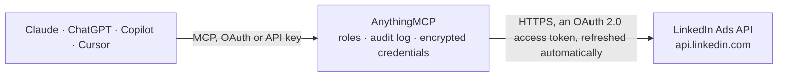

<!-- Generated by scripts/export-github-catalog.mjs in the anythingmcp-website repository. Do not edit by hand. -->

# LinkedIn Ads MCP connector

Read LinkedIn Campaign Manager through the Marketing API: ad accounts, campaign groups, campaigns and creatives, and ad analytics (impressions, clicks, spend, conversions, leads) by campaign, … The AnythingMCP connector gives Claude, ChatGPT, Microsoft Copilot, Cursor and Gemini 12 MCP tools for LinkedIn Ads, all read-only.

**Category:** [Advertising](../advertising.md) · **Tools:** 12 · **Setup guide:** [anythingmcp.com](https://anythingmcp.com/guides/linkedin-ads-to-mcp) · [Deutsch](https://anythingmcp.com/de/guides/linkedin-ads-to-mcp) · [Italiano](https://anythingmcp.com/it/guides/linkedin-ads-to-mcp) · [Español](https://anythingmcp.com/es/guides/linkedin-ads-to-mcp) · [日本語](https://anythingmcp.com/ja/guides/linkedin-ads-to-mcp) · [Русский](https://anythingmcp.com/ru/guides/linkedin-ads-to-mcp) · [中文](https://anythingmcp.com/zh/guides/linkedin-ads-to-mcp)

## Start without code

No installation and no terminal: AnythingMCP Cloud runs the LinkedIn Ads connector for you, operated by helpcode.ai in Frankfurt, Germany.

1. **Click the button above** and create an account or sign in. The LinkedIn Ads connector opens, ready to install.
2. **Sign in with your LinkedIn Ads account** when AnythingMCP asks. The first time, an admin creates a small app in the LinkedIn Ads developer console. Every click is in the [step-by-step guide](https://anythingmcp.com/guides/linkedin-ads-to-mcp).
3. **Click Install.** AnythingMCP shows the address of your MCP server.
4. **Add that address to your assistant:** [Claude](https://anythingmcp.com/guides/connect-linkedin-ads-to-claude) · [ChatGPT](https://anythingmcp.com/guides/connect-linkedin-ads-to-chatgpt) · [Microsoft Copilot](https://anythingmcp.com/guides/connect-linkedin-ads-to-copilot) · [Cursor](https://anythingmcp.com/guides/connect-linkedin-ads-to-cursor) · [Gemini CLI](https://anythingmcp.com/guides/connect-linkedin-ads-to-gemini) · [Meta Muse](https://anythingmcp.com/guides/connect-linkedin-ads-to-muse).
5. **Ask your first question**, for example: *Show ad account details for 'Berg & Sohn Werbe GmbH' — I need the account id, currency and status*

Prefer help with the setup? [Talk to us](https://anythingmcp.com/contact).

## How it works

- **The AI client** speaks MCP (Streamable HTTP) to AnythingMCP and only sees tool names, descriptions and results. It never gets the LinkedIn Ads credentials.
- **AnythingMCP** checks the client's role, builds the call from the tool definition, adds the credentials (an OAuth 2.0 access token, refreshed automatically), calls LinkedIn Ads, logs the call and returns the result.
- **LinkedIn Ads** sees an ordinary API client with the rights of the account the credentials belong to.

## Tools

| Tool | What it does | Access |
|---|---|---|
| [`linkedin_ads_list_my_ad_accounts`](#linkedin_ads_list_my_ad_accounts) | List the ad accounts the authorized LinkedIn member has a role on, as account URNs (urn:li:sponsoredAccount:<id>) with the role (VIEWER, CREATIVE_MANAGER,… | read |
| [`linkedin_ads_search_ad_accounts`](#linkedin_ads_search_ad_accounts) | Search the ad accounts the member can reach by status, with id, name, currency, type (BUSINESS or ENTERPRISE), status, servingStatuses (RUNNABLE or the hold… | read |
| [`linkedin_ads_get_ad_account`](#linkedin_ads_get_ad_account) | Get one ad account by id: name, currency, type, status, servingStatuses, test flag and the organization or person it advertises for. | read |
| [`linkedin_ads_list_campaign_groups`](#linkedin_ads_list_campaign_groups) | List the campaign groups of an ad account with id, name, status, total budget, run schedule, objective and servingStatuses. | read |
| [`linkedin_ads_get_campaign_group`](#linkedin_ads_get_campaign_group) | Get one campaign group by id with its budget, schedule, objective, status and serving statuses. | read |
| [`linkedin_ads_list_campaigns`](#linkedin_ads_list_campaigns) | List the campaigns of an ad account with id, name, campaignGroup, type, objectiveType, status, costType, dailyBudget, totalBudget, unitCost (bid),… | read |
| [`linkedin_ads_get_campaign`](#linkedin_ads_get_campaign) | Get one campaign by id with budget, bid, cost type, objective, schedule, full targeting criteria, locale and serving statuses. | read |
| [`linkedin_ads_list_creatives`](#linkedin_ads_list_creatives) | List the creatives (ads) of an ad account with id, campaign, intendedStatus, isServing, servingHoldReasons, review status and the content reference (post or… | read |
| [`linkedin_ads_list_campaign_creatives`](#linkedin_ads_list_campaign_creatives) | List the creatives of one campaign with id, intendedStatus, isServing, servingHoldReasons, review status and content reference. | read |
| [`linkedin_ads_get_creative`](#linkedin_ads_get_creative) | Get one creative by id: campaign, content reference, intended and serving status, review outcome and hold reasons. | read |
| [`linkedin_ads_get_account_analytics`](#linkedin_ads_get_account_analytics) | Get performance for a whole ad account over a date range, grouped by one pivot: by CAMPAIGN (default), CREATIVE, CAMPAIGN_GROUP, or by member demographics… | read |
| [`linkedin_ads_get_campaign_analytics`](#linkedin_ads_get_campaign_analytics) | Get performance for one campaign over a date range, grouped by one pivot: by CREATIVE (default), by day with time_granularity DAILY, or by member demographics. | read |

## Tool reference

Every parameter as the AI client sees it in `tools/list`. Source: [`packages/backend/src/adapters/intl/linkedin-ads.json`](../../../packages/backend/src/adapters/intl/linkedin-ads.json).

### `linkedin_ads_list_my_ad_accounts`

List the ad accounts the authorized LinkedIn member has a role on, as account URNs (urn:li:sponsoredAccount:<id>) with the role (VIEWER, CREATIVE_MANAGER, CAMPAIGN_MANAGER, ACCOUNT_MANAGER, ACCOUNT_BILLING_ADMIN). Start here: the number in the URN is the account_id for every other tool.

**Access:** read · **Call:** `GET /adAccountUsers`

No parameters.

### `linkedin_ads_search_ad_accounts`

Search the ad accounts the member can reach by status, with id, name, currency, type (BUSINESS or ENTERPRISE), status, servingStatuses (RUNNABLE or the hold reason) and the organization it advertises for. Page with page_token.

**Access:** read · **Call:** `GET /adAccounts`

| Parameter | Type | Required | Description |
|---|---|---|---|
| `status` | string | no | Comma-separated statuses: ACTIVE, DRAFT, CANCELED, PENDING_DELETION, REMOVED. |
| `sort_order` | `ASCENDING` \| `DESCENDING` | no | Sort by account id. |
| `page_size` | integer | no | Items per page (default 100, max 1000; creatives max 100). |
| `page_token` | string | no | metadata.nextPageToken from the previous answer, to read the next page. |

### `linkedin_ads_get_ad_account`

Get one ad account by id: name, currency, type, status, servingStatuses, test flag and the organization or person it advertises for. Use it to read the account currency before interpreting costInLocalCurrency.

**Access:** read · **Call:** `GET /adAccounts/{account_id}`

| Parameter | Type | Required | Description |
|---|---|---|---|
| `account_id` | string | yes | Numeric ad account id (the number after urn:li:sponsoredAccount:), from linkedin_ads_list_my_ad_accounts. |

### `linkedin_ads_list_campaign_groups`

List the campaign groups of an ad account with id, name, status, total budget, run schedule, objective and servingStatuses. Filter by status; page with page_token.

**Access:** read · **Call:** `GET /adAccounts/{account_id}/adCampaignGroups`

| Parameter | Type | Required | Description |
|---|---|---|---|
| `account_id` | string | yes | Numeric ad account id (the number after urn:li:sponsoredAccount:), from linkedin_ads_list_my_ad_accounts. |
| `status` | string | no | Comma-separated statuses: ACTIVE, PAUSED, DRAFT, ARCHIVED, CANCELED, PENDING_DELETION, REMOVED. |
| `sort_order` | `ASCENDING` \| `DESCENDING` | no | Sort by campaign group id. |
| `page_size` | integer | no | Items per page (default 100, max 1000; creatives max 100). |
| `page_token` | string | no | metadata.nextPageToken from the previous answer, to read the next page. |

### `linkedin_ads_get_campaign_group`

Get one campaign group by id with its budget, schedule, objective, status and serving statuses. Use it to explain why the campaigns under a group are not delivering.

**Access:** read · **Call:** `GET /adAccounts/{account_id}/adCampaignGroups/{campaign_group_id}`

| Parameter | Type | Required | Description |
|---|---|---|---|
| `account_id` | string | yes | Numeric ad account id (the number after urn:li:sponsoredAccount:), from linkedin_ads_list_my_ad_accounts. |
| `campaign_group_id` | string | yes | Numeric campaign group id (the number after urn:li:sponsoredCampaignGroup:). |

### `linkedin_ads_list_campaigns`

List the campaigns of an ad account with id, name, campaignGroup, type, objectiveType, status, costType, dailyBudget, totalBudget, unitCost (bid), runSchedule, targetingCriteria and servingStatuses. Filter by status; page with page_token.

**Access:** read · **Call:** `GET /adAccounts/{account_id}/adCampaigns`

| Parameter | Type | Required | Description |
|---|---|---|---|
| `account_id` | string | yes | Numeric ad account id (the number after urn:li:sponsoredAccount:), from linkedin_ads_list_my_ad_accounts. |
| `status` | string | no | Comma-separated statuses: ACTIVE, PAUSED, DRAFT, ARCHIVED, COMPLETED, CANCELED, PENDING_DELETION, REMOVED. |
| `sort_order` | `ASCENDING` \| `DESCENDING` | no | Sort by campaign id. |
| `page_size` | integer | no | Items per page (default 100, max 1000; creatives max 100). |
| `page_token` | string | no | metadata.nextPageToken from the previous answer, to read the next page. |

### `linkedin_ads_get_campaign`

Get one campaign by id with budget, bid, cost type, objective, schedule, full targeting criteria, locale and serving statuses. Use it to review a campaign's setup or the reason it does not serve.

**Access:** read · **Call:** `GET /adAccounts/{account_id}/adCampaigns/{campaign_id}`

| Parameter | Type | Required | Description |
|---|---|---|---|
| `account_id` | string | yes | Numeric ad account id (the number after urn:li:sponsoredAccount:), from linkedin_ads_list_my_ad_accounts. |
| `campaign_id` | string | yes | Numeric campaign id (the number after urn:li:sponsoredCampaign:). |

### `linkedin_ads_list_creatives`

List the creatives (ads) of an ad account with id, campaign, intendedStatus, isServing, servingHoldReasons, review status and the content reference (post or ad format). Optionally filter by intended status. Page with page_token (max 100 per page).

**Access:** read · **Call:** `GET /adAccounts/{account_id}/creatives`

| Parameter | Type | Required | Description |
|---|---|---|---|
| `account_id` | string | yes | Numeric ad account id (the number after urn:li:sponsoredAccount:), from linkedin_ads_list_my_ad_accounts. |
| `intended_statuses` | string | no | Optional comma-separated statuses: ACTIVE, PAUSED, DRAFT, ARCHIVED, CANCELED, PENDING_DELETION, REMOVED. |
| `sort_order` | `ASCENDING` \| `DESCENDING` | no | Sort by creative id. |
| `page_size` | integer | no | Items per page (default 100, max 1000; creatives max 100). |
| `page_token` | string | no | metadata.nextPageToken from the previous answer, to read the next page. |

### `linkedin_ads_list_campaign_creatives`

List the creatives of one campaign with id, intendedStatus, isServing, servingHoldReasons, review status and content reference. Use it to see which ads run in a campaign or why one is held. Page with page_token.

**Access:** read · **Call:** `GET /adAccounts/{account_id}/creatives?q=criteria&campaigns=List(urn%3Ali%3AsponsoredCampaign%3A{campaign_id})`

| Parameter | Type | Required | Description |
|---|---|---|---|
| `account_id` | string | yes | Numeric ad account id (the number after urn:li:sponsoredAccount:), from linkedin_ads_list_my_ad_accounts. |
| `campaign_id` | string | yes | Numeric campaign id from linkedin_ads_list_campaigns. |
| `page_size` | integer | no | Items per page (default 100, max 1000; creatives max 100). |
| `page_token` | string | no | metadata.nextPageToken from the previous answer, to read the next page. |

### `linkedin_ads_get_creative`

Get one creative by id: campaign, content reference, intended and serving status, review outcome and hold reasons. Use it to put details on a creative URN from an analytics row.

**Access:** read · **Call:** `GET /adAccounts/{account_id}/creatives/urn%3Ali%3AsponsoredCreative%3A{creative_id}`

| Parameter | Type | Required | Description |
|---|---|---|---|
| `account_id` | string | yes | Numeric ad account id (the number after urn:li:sponsoredAccount:), from linkedin_ads_list_my_ad_accounts. |
| `creative_id` | string | yes | Numeric creative id (the number after urn:li:sponsoredCreative:). |

### `linkedin_ads_get_account_analytics`

Get performance for a whole ad account over a date range, grouped by one pivot: by CAMPAIGN (default), CREATIVE, CAMPAIGN_GROUP, or by member demographics such as company, job function or seniority. Returns impressions, clicks, spend (costInLocalCurrency), conversions, leads and more per row.

**Access:** read · **Call:** `GET /adAnalytics?q=analytics&accounts=List(urn%3Ali%3AsponsoredAccount%3A{account_id})`

| Parameter | Type | Required | Description |
|---|---|---|---|
| `account_id` | string | yes | Numeric ad account id (the number after urn:li:sponsoredAccount:), from linkedin_ads_list_my_ad_accounts. |
| `pivot` | string | no | How rows are grouped: ACCOUNT, CAMPAIGN_GROUP, CAMPAIGN, CREATIVE, CONVERSION, or a demographic pivot such as MEMBER_COMPANY, MEMBER_JOB_FUNCTION, MEMBER_SENIORITY, MEMBER_INDUSTRY, MEMBER_COMPANY_SIZE, MEMBER_COUNTRY_V2, MEMBER_REGION_V2. |
| `time_granularity` | `ALL` \| `DAILY` \| `MONTHLY` \| `YEARLY` | no | ALL for one total per pivot value over the range, DAILY or MONTHLY for a time series. |
| `start_year` | integer | yes | Start date: year, e.g. 2026. |
| `start_month` | integer | yes | Start date: month, 1 to 12. |
| `start_day` | integer | yes | Start date: day of month, 1 to 31. |
| `end_year` | integer | yes | End date (inclusive): year. |
| `end_month` | integer | yes | End date: month, 1 to 12. |
| `end_day` | integer | yes | End date: day of month. |
| `fields` | string | no | Comma-separated metrics, at most 20. Without pivotValues and dateRange the rows cannot be told apart. |

### `linkedin_ads_get_campaign_analytics`

Get performance for one campaign over a date range, grouped by one pivot: by CREATIVE (default), by day with time_granularity DAILY, or by member demographics. Returns impressions, clicks, spend, conversions, leads and more per row.

**Access:** read · **Call:** `GET /adAnalytics?q=analytics&campaigns=List(urn%3Ali%3AsponsoredCampaign%3A{campaign_id})`

| Parameter | Type | Required | Description |
|---|---|---|---|
| `campaign_id` | string | yes | Numeric campaign id from linkedin_ads_list_campaigns. |
| `pivot` | string | no | How rows are grouped: ACCOUNT, CAMPAIGN_GROUP, CAMPAIGN, CREATIVE, CONVERSION, or a demographic pivot such as MEMBER_COMPANY, MEMBER_JOB_FUNCTION, MEMBER_SENIORITY, MEMBER_INDUSTRY, MEMBER_COMPANY_SIZE, MEMBER_COUNTRY_V2, MEMBER_REGION_V2. |
| `time_granularity` | `ALL` \| `DAILY` \| `MONTHLY` \| `YEARLY` | no | ALL for one total per pivot value over the range, DAILY or MONTHLY for a time series. |
| `start_year` | integer | yes | Start date: year, e.g. 2026. |
| `start_month` | integer | yes | Start date: month, 1 to 12. |
| `start_day` | integer | yes | Start date: day of month, 1 to 31. |
| `end_year` | integer | yes | End date (inclusive): year. |
| `end_month` | integer | yes | End date: month, 1 to 12. |
| `end_day` | integer | yes | End date: day of month. |
| `fields` | string | no | Comma-separated metrics, at most 20. Without pivotValues and dateRange the rows cannot be told apart. |

## Run it yourself

AnythingMCP is open source (AGPL-3.0). [Run it with Docker](../../../README.md#run-it-yourself), open **Connectors → Store**, pick **LinkedIn Ads** and enter `LINKEDIN_ADS_CLIENT_ID`, `LINKEDIN_ADS_CLIENT_SECRET`, then add your MCP server URL to the AI client.

[← Advertising connectors](../advertising.md) · [All categories](../README.md)
