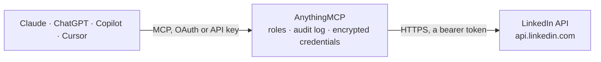

<!-- Generated by scripts/export-github-catalog.mjs in the anythingmcp-website repository. Do not edit by hand. -->

# LinkedIn MCP connector

Post to LinkedIn as the signed-in member and read their basic profile: create and delete posts, register image uploads. The AnythingMCP connector gives Claude, ChatGPT, Microsoft Copilot, Cursor and Gemini 5 MCP tools for LinkedIn: 2 read and 3 can change data.

**Category:** [Social Media](../social.md) · **Tools:** 5 · **Setup guide:** [anythingmcp.com](https://anythingmcp.com/guides/linkedin-to-mcp) · [Deutsch](https://anythingmcp.com/de/guides/linkedin-to-mcp) · [Italiano](https://anythingmcp.com/it/guides/linkedin-to-mcp) · [Español](https://anythingmcp.com/es/guides/linkedin-to-mcp) · [日本語](https://anythingmcp.com/ja/guides/linkedin-to-mcp) · [Русский](https://anythingmcp.com/ru/guides/linkedin-to-mcp) · [中文](https://anythingmcp.com/zh/guides/linkedin-to-mcp)

## Start without code

No installation and no terminal: AnythingMCP Cloud runs the LinkedIn connector for you, operated by helpcode.ai in Frankfurt, Germany.

1. **Click the button above** and create an account or sign in. The LinkedIn connector opens, ready to install.
2. **Paste the API key or token from your LinkedIn account.** Every click is in the [step-by-step guide](https://anythingmcp.com/guides/linkedin-to-mcp).
3. **Click Install.** AnythingMCP shows the address of your MCP server.
4. **Add that address to your assistant:** [Claude](https://anythingmcp.com/guides/connect-linkedin-to-claude) · [ChatGPT](https://anythingmcp.com/guides/connect-linkedin-to-chatgpt) · [Microsoft Copilot](https://anythingmcp.com/guides/connect-linkedin-to-copilot) · [Cursor](https://anythingmcp.com/guides/connect-linkedin-to-cursor) · [Gemini CLI](https://anythingmcp.com/guides/connect-linkedin-to-gemini) · [Meta Muse](https://anythingmcp.com/guides/connect-linkedin-to-muse).
5. **Ask your first question**, for example: *What's my LinkedIn member id, full name and verified email for the current token?*

Prefer help with the setup? [Talk to us](https://anythingmcp.com/contact).

## How it works

- **The AI client** speaks MCP (Streamable HTTP) to AnythingMCP and only sees tool names, descriptions and results. It never gets the LinkedIn credentials.
- **AnythingMCP** checks the client's role, builds the call from the tool definition, adds the credentials (a bearer token), calls LinkedIn, logs the call and returns the result.
- **LinkedIn** sees an ordinary API client with the rights of the account the credentials belong to.

## Tools

| Tool | What it does | Access |
|---|---|---|
| [`linkedin_userinfo`](#linkedin_userinfo) | Get the signed-in member's profile from the OpenID Connect userinfo endpoint: sub (the member id, used as urn:li:person:), name, given_name,… | read |
| [`linkedin_create_post`](#linkedin_create_post) | Publish a post on the member's feed. | write |
| [`linkedin_get_post`](#linkedin_get_post) | Get a post by its URN. | read |
| [`linkedin_delete_post`](#linkedin_delete_post) | Delete a post the member authored. | write |
| [`linkedin_register_image_upload`](#linkedin_register_image_upload) | Step 1 of an image post: register the upload. | write |

## Tool reference

Every parameter as the AI client sees it in `tools/list`. Source: [`packages/backend/src/adapters/intl/linkedin.json`](../../../packages/backend/src/adapters/intl/linkedin.json).

### `linkedin_userinfo`

Get the signed-in member's profile from the OpenID Connect userinfo endpoint: sub (the member id, used as urn:li:person:), name, given_name, family_name, picture, locale, and email and email_verified when the token has the email scope.

**Access:** read · **Call:** `GET /userinfo`

No parameters.

### `linkedin_create_post`

Publish a post on the member's feed. Required: author (urn:li:person: from linkedin_userinfo) and commentary. Needs the w_member_social scope. The new post's URN comes back in the x-restli-id response header.

**Access:** write · **Call:** `POST https://api.linkedin.com/rest/posts`

| Parameter | Type | Required | Description |
|---|---|---|---|
| `author` | string | yes | URN of the author: urn:li:person:, with sub from linkedin_userinfo. |
| `commentary` | string | yes | The post text, up to 3000 characters. Mention or hashtag syntax follows LinkedIn's little text format. |
| `visibility` | `PUBLIC` \| `CONNECTIONS` | no | PUBLIC (anyone) or CONNECTIONS (the member's network only). |
| `distribution` | object | no | Where the post appears. Leave it out for the main feed: {feedDistribution: 'MAIN_FEED', targetEntities: [], thirdPartyDistributionChannels: []}. |
| `isReshareDisabledByAuthor` | boolean | no | True to stop others from resharing the post. |
| `content` | object | no | Optional. An image: {media: {id: 'urn:li:image:...', altText: '...'}} after linkedin_register_image_upload and the PUT of the file. A link: {article: {source: 'https://...', title: '...', description: '...'}}; LinkedIn does not fetch the preview itself. Leave out for a text post. |

### `linkedin_get_post`

Get a post by its URN. Needs the r_member_social scope, which LinkedIn grants to approved apps only: with the self-serve products this answers 403, even for the member's own posts.

**Access:** read · **Call:** `GET https://api.linkedin.com/rest/posts/{postUrn}`

| Parameter | Type | Required | Description |
|---|---|---|---|
| `postUrn` | string | yes | The post URN as returned, e.g. urn:li:share:7123456789012345678 or urn:li:ugcPost:7123456789012345678. Not URL-encoded; the connector encodes it. |

### `linkedin_delete_post`

Delete a post the member authored. Needs the w_member_social scope. Deleting an already deleted post also succeeds (204).

**Access:** write · **Call:** `DELETE https://api.linkedin.com/rest/posts/{postUrn}`

| Parameter | Type | Required | Description |
|---|---|---|---|
| `postUrn` | string | yes | The post URN as returned by linkedin_create_post, e.g. urn:li:share:7123456789012345678. Not URL-encoded; the connector encodes it. |

### `linkedin_register_image_upload`

Step 1 of an image post: register the upload. Returns value.uploadUrl and value.image (urn:li:image:...). Send the file to uploadUrl with an HTTP PUT outside this connector, then pass the image URN in linkedin_create_post's content.media.id. Needs the w_member_social scope.

**Access:** write · **Call:** `POST https://api.linkedin.com/rest/images?action=initializeUpload`

| Parameter | Type | Required | Description |
|---|---|---|---|
| `initializeUploadRequest` | object | yes | {owner: 'urn:li:person:'}, with sub from linkedin_userinfo. |

## Run it yourself

AnythingMCP is open source (AGPL-3.0). [Run it with Docker](../../../README.md#run-it-yourself), open **Connectors → Store**, pick **LinkedIn** and enter `LINKEDIN_ACCESS_TOKEN`, then add your MCP server URL to the AI client.

[← Social Media connectors](../social.md) · [All categories](../README.md)
