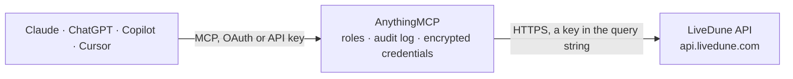

<!-- Generated by scripts/export-github-catalog.mjs in the anythingmcp-website repository. Do not edit by hand. -->

# LiveDune MCP connector

LiveDune social media analytics: tracked Instagram, VK, Telegram, YouTube, TikTok and other accounts, period analytics and daily history, posts, stories and videos with their metrics, audience … The AnythingMCP connector gives Claude, ChatGPT, Microsoft Copilot, Cursor and Gemini 20 MCP tools for LiveDune: 14 read and 6 can change data.

**Category:** [Social Media](../social.md) · **Tools:** 20 · **Setup guide:** [anythingmcp.com](https://anythingmcp.com/guides/livedune-to-mcp) · [Deutsch](https://anythingmcp.com/de/guides/livedune-to-mcp) · [Italiano](https://anythingmcp.com/it/guides/livedune-to-mcp) · [Español](https://anythingmcp.com/es/guides/livedune-to-mcp) · [日本語](https://anythingmcp.com/ja/guides/livedune-to-mcp) · [Русский](https://anythingmcp.com/ru/guides/livedune-to-mcp) · [中文](https://anythingmcp.com/zh/guides/livedune-to-mcp)

## Start without code

No installation and no terminal: AnythingMCP Cloud runs the LiveDune connector for you, operated by helpcode.ai in Frankfurt, Germany.

1. **Click the button above** and create an account or sign in. The LiveDune connector opens, ready to install.
2. **Paste the API key or token from your LiveDune account.** Every click is in the [step-by-step guide](https://anythingmcp.com/guides/livedune-to-mcp).
3. **Click Install.** AnythingMCP shows the address of your MCP server.
4. **Add that address to your assistant:** [Claude](https://anythingmcp.com/guides/connect-livedune-to-claude) · [ChatGPT](https://anythingmcp.com/guides/connect-livedune-to-chatgpt) · [Microsoft Copilot](https://anythingmcp.com/guides/connect-livedune-to-copilot) · [Cursor](https://anythingmcp.com/guides/connect-livedune-to-cursor) · [Gemini CLI](https://anythingmcp.com/guides/connect-livedune-to-gemini) · [Meta Muse](https://anythingmcp.com/guides/connect-livedune-to-muse).
5. **Ask your first question.**

Prefer help with the setup? [Talk to us](https://anythingmcp.com/contact).

## How it works

- **The AI client** speaks MCP (Streamable HTTP) to AnythingMCP and only sees tool names, descriptions and results. It never gets the LiveDune credentials.
- **AnythingMCP** checks the client's role, builds the call from the tool definition, adds the credentials (a key in the query string), calls LiveDune, logs the call and returns the result.
- **LiveDune** sees an ordinary API client with the rights of the account the credentials belong to.

## Tools

| Tool | What it does | Access |
|---|---|---|
| [`livedune_get_tariff_info`](#livedune_get_tariff_info) | Get the API quota and plan: total requests, used and left across all packages, the base tariff package with its end date, extra packages, and the history… | read |
| [`livedune_list_projects`](#livedune_list_projects) | List the dashboard projects (account groups): id (0 is the default project), name and accounts_count. | read |
| [`livedune_list_accounts`](#livedune_list_accounts) | List the social accounts tracked on the LiveDune dashboard, up to 100 per page: id (use it as accountId), social_id, type (instagram_new, vk_group,… | read |
| [`livedune_list_tags`](#livedune_list_tags) | List the dashboard tags used to group accounts: id, tag title and color. | read |
| [`livedune_search_account`](#livedune_search_account) | Find a social account by its URL. | read |
| [`livedune_get_account_analytics`](#livedune_get_account_analytics) | Get an account's summary for a date range: followers at the end and their change (followers_diff), posts, likes, comments, reposts, shares, views and reels… | read |
| [`livedune_get_account_history`](#livedune_get_account_history) | Get an account's day-by-day history for a date range: followers, gained and lost, average likes, comments, views, reposts and reach per post, posts and… | read |
| [`livedune_get_audience`](#livedune_get_audience) | Get an account's audience demographics history by gender and age, per date. | read |
| [`livedune_list_posts`](#livedune_list_posts) | List an account's posts in a date range, up to 100 per page: post_id, type, text, created, url, preview image, reactions (likes, comments, reposts ...),… | read |
| [`livedune_get_post_stats`](#livedune_get_post_stats) | Get the statistics of one post: type, url, preview image, text, reels views, reach, impressions, ad flag and categories, as the network provides them. | read |
| [`livedune_list_stories`](#livedune_list_stories) | List an account's stories in a date range (VK, Instagram and Telegram): id, image, type, created, text, url, reach, impressions and actions where available. | read |
| [`livedune_list_videos`](#livedune_list_videos) | List an account's videos in a date range (VK and own Facebook accounts): id, preview image, type (video, clip, live), created, reactions and impressions. | read |
| [`livedune_get_video_stats`](#livedune_get_video_stats) | Get the statistics of one video (VK and own Facebook accounts): id, preview image, type (video, clip, live), created, reactions and impressions. | read |
| [`livedune_list_scheduled_posts`](#livedune_list_scheduled_posts) | List an account's autoposting posts that are not published yet: id, text, publication_time, timezone, status (draft or scheduled) and content_url. | read |
| [`livedune_add_account`](#livedune_add_account) | Add a social account to the LiveDune dashboard so its statistics are collected. | write |
| [`livedune_create_tag`](#livedune_create_tag) | Create a dashboard tag to group accounts. | write |
| [`livedune_remove_account`](#livedune_remove_account) | Remove an account from the LiveDune dashboard; its collected statistics stop. | write |
| [`livedune_create_scheduled_post`](#livedune_create_scheduled_post) | Create an autoposting post for a linked account: text and/or one media URL (an existing image or video), publication time and time zone, and type (post,… | write |
| [`livedune_update_scheduled_post`](#livedune_update_scheduled_post) | Update an autoposting post that is not published yet: time, time zone, text, media URL (replaces attachments), type and status (draft or scheduled). | write |
| [`livedune_delete_scheduled_post`](#livedune_delete_scheduled_post) | Delete an autoposting post that is not published yet. | write |

## Tool reference

Every parameter as the AI client sees it in `tools/list`. Source: [`packages/backend/src/adapters/intl/livedune.json`](../../../packages/backend/src/adapters/intl/livedune.json).

### `livedune_get_tariff_info`

Get the API quota and plan: total requests, used and left across all packages, the base tariff package with its end date, extra packages, and the history window (period.from to period.to) that history endpoints can return. Not counted against the quota; use it to check the token.

**Access:** read · **Call:** `GET /info`

No parameters.

### `livedune_list_projects`

List the dashboard projects (account groups): id (0 is the default project), name and accounts_count.

**Access:** read · **Call:** `GET /projects`

No parameters.

### `livedune_list_accounts`

List the social accounts tracked on the LiveDune dashboard, up to 100 per page: id (use it as accountId), social_id, type (instagram_new, vk_group, telegram, youtube, tiktok, dzen, fb_page, ok_group, twitter, max ...), name, short_name, url, is_linked (own account connected with full statistics), followers_stat, posts_stat, tags and project. Start here.

**Access:** read · **Call:** `GET /accounts`

| Parameter | Type | Required | Description |
|---|---|---|---|
| `after` | integer | no | Cursor: the `after` value of the previous page. |

### `livedune_list_tags`

List the dashboard tags used to group accounts: id, tag title and color.

**Access:** read · **Call:** `GET /accounts/tags`

No parameters.

### `livedune_search_account`

Find a social account by its URL. If it is on the dashboard the answer is its id; otherwise LiveDune registers it for a fast analysis and returns a temporary UUID that the account tools accept as accountId. Use it to analyse a competitor or any public account.

**Access:** read · **Call:** `GET /search`

| Parameter | Type | Required | Description |
|---|---|---|---|
| `url` | string | yes | Account URL, e.g. https://instagram.com/livedune or https://t.me/channel. |

### `livedune_get_account_analytics`

Get an account's summary for a date range: followers at the end and their change (followers_diff), posts, likes, comments, reposts, shares, views and reels views with their averages per post, and the engagement rates er and erv. Some are null depending on network and account type.

**Access:** read · **Call:** `GET /accounts/{accountId}/analytics`

| Parameter | Type | Required | Description |
|---|---|---|---|
| `accountId` | integer | yes | LiveDune account id from livedune_list_accounts (or the id livedune_search_account returns). |
| `date_from` | string | no | First day, YYYY-MM-DD, within the history window of your plan (livedune_get_tariff_info). |
| `date_to` | string | no | Last day, YYYY-MM-DD. |

### `livedune_get_account_history`

Get an account's day-by-day history for a date range: followers, gained and lost, average likes, comments, views, reposts and reach per post, posts and their views, stories and their views, videos and reels views. Up to 100 days per page; page with after.

**Access:** read · **Call:** `GET /accounts/{accountId}/history`

| Parameter | Type | Required | Description |
|---|---|---|---|
| `accountId` | integer | yes | LiveDune account id from livedune_list_accounts (or the id livedune_search_account returns). |
| `date_from` | string | no | First day, YYYY-MM-DD, within the history window of your plan (livedune_get_tariff_info). |
| `date_to` | string | no | Last day, YYYY-MM-DD. |
| `after` | integer | no | Cursor: the `after` value of the previous page. |

### `livedune_get_audience`

Get an account's audience demographics history by gender and age, per date. Only Instagram, Threads, VK and OK accounts; categories vary by network.

**Access:** read · **Call:** `GET /accounts/{accountId}/audience/{mode}`

| Parameter | Type | Required | Description |
|---|---|---|---|
| `accountId` | integer | yes | LiveDune account id from livedune_list_accounts (or the id livedune_search_account returns). |
| `mode` | `all` \| `age` \| `gender` | yes | all (gender-age pairs), age or gender. |
| `date_from` | string | no | First day, YYYY-MM-DD, within the history window of your plan (livedune_get_tariff_info). |
| `date_to` | string | no | Last day, YYYY-MM-DD. |
| `after` | integer | no | Cursor: the `after` value of the previous page. |

### `livedune_list_posts`

List an account's posts in a date range, up to 100 per page: post_id, type, text, created, url, preview image, reactions (likes, comments, reposts ...), actions, reach, impressions, ad flag and categories, where the network provides them.

**Access:** read · **Call:** `GET /accounts/{accountId}/posts`

| Parameter | Type | Required | Description |
|---|---|---|---|
| `accountId` | integer | yes | LiveDune account id from livedune_list_accounts (or the id livedune_search_account returns). |
| `date_from` | string | no | First day, YYYY-MM-DD, within the history window of your plan (livedune_get_tariff_info). |
| `date_to` | string | no | Last day, YYYY-MM-DD. |
| `after` | integer | no | Cursor: the `after` value of the previous page. |

### `livedune_get_post_stats`

Get the statistics of one post: type, url, preview image, text, reels views, reach, impressions, ad flag and categories, as the network provides them.

**Access:** read · **Call:** `GET /accounts/{accountId}/posts/{post_id}`

| Parameter | Type | Required | Description |
|---|---|---|---|
| `accountId` | integer | yes | LiveDune account id from livedune_list_accounts (or the id livedune_search_account returns). |
| `post_id` | string | yes | post_id from livedune_list_posts. |

### `livedune_list_stories`

List an account's stories in a date range (VK, Instagram and Telegram): id, image, type, created, text, url, reach, impressions and actions where available. Telegram works without a linked account; its cursor is timestamp:story_id.

**Access:** read · **Call:** `GET /accounts/{accountId}/stories`

| Parameter | Type | Required | Description |
|---|---|---|---|
| `accountId` | integer | yes | LiveDune account id from livedune_list_accounts (or the id livedune_search_account returns). |
| `date_from` | string | no | First day, YYYY-MM-DD, within the history window of your plan (livedune_get_tariff_info). |
| `date_to` | string | no | Last day, YYYY-MM-DD. |
| `after` | string | no | Cursor from the previous page (Unix timestamp, or timestamp:story_id for Telegram); 0 means no next page. |
| `limit` | integer | no | Stories per page, at most 100. |

### `livedune_list_videos`

List an account's videos in a date range (VK and own Facebook accounts): id, preview image, type (video, clip, live), created, reactions and impressions.

**Access:** read · **Call:** `GET /accounts/{accountId}/video`

| Parameter | Type | Required | Description |
|---|---|---|---|
| `accountId` | integer | yes | LiveDune account id from livedune_list_accounts (or the id livedune_search_account returns). |
| `date_from` | string | no | First day, YYYY-MM-DD, within the history window of your plan (livedune_get_tariff_info). |
| `date_to` | string | no | Last day, YYYY-MM-DD. |
| `after` | integer | no | Cursor: the `after` value of the previous page. |

### `livedune_get_video_stats`

Get the statistics of one video (VK and own Facebook accounts): id, preview image, type (video, clip, live), created, reactions and impressions.

**Access:** read · **Call:** `GET /accounts/{accountId}/video/{video_id}`

| Parameter | Type | Required | Description |
|---|---|---|---|
| `accountId` | integer | yes | LiveDune account id from livedune_list_accounts (or the id livedune_search_account returns). |
| `video_id` | string | yes | Video id from livedune_list_videos. |

### `livedune_list_scheduled_posts`

List an account's autoposting posts that are not published yet: id, text, publication_time, timezone, status (draft or scheduled) and content_url.

**Access:** read · **Call:** `GET /posting/{accountId}`

| Parameter | Type | Required | Description |
|---|---|---|---|
| `accountId` | integer | yes | LiveDune account id from livedune_list_accounts (or the id livedune_search_account returns). |
| `after` | integer | no | Cursor: the `after` value of the previous page. |

### `livedune_add_account`

Add a social account to the LiveDune dashboard so its statistics are collected. Counts against the number of accounts in your plan. Returns the new account id; when it is already on the dashboard the error carries its id. Installed switched off.

**Access:** write · **Call:** `POST /accounts`

| Parameter | Type | Required | Description |
|---|---|---|---|
| `name` | string | yes | Account name or handle as on the network (Latin characters). |
| `social` | `instagram_new` \| `youtube` \| `twitter` \| `fb_page` \| `vk_group` \| `ok_group` \| `telegram` \| `dzen` \| `max` \| `tiktok` | yes | Social network. |
| `project_id` | integer | no | Project to add it to (livedune_list_projects). |
| `tags` | string | no | Comma-separated dashboard tag ids. |

### `livedune_create_tag`

Create a dashboard tag to group accounts. color must be one of LiveDune's #RGB colors; an invalid color answers with the list of approved colors, an existing title with its id.

**Access:** write · **Call:** `POST /accounts/tags`

| Parameter | Type | Required | Description |
|---|---|---|---|
| `tag` | string | yes | Tag title. |
| `color` | string | yes | #RGB color, e.g. #f90043. |

### `livedune_remove_account`

Remove an account from the LiveDune dashboard; its collected statistics stop. Irreversible; installed switched off.

**Access:** write · **Call:** `DELETE /accounts`

| Parameter | Type | Required | Description |
|---|---|---|---|
| `id` | integer | yes | LiveDune account id. |

### `livedune_create_scheduled_post`

Create an autoposting post for a linked account: text and/or one media URL (an existing image or video), publication time and time zone, and type (post, reels, stories, tiktok_video, shorts). Scheduled posts are published to the social network automatically. Installed switched off.

**Access:** write · **Call:** `POST /posting/{accountId}`

| Parameter | Type | Required | Description |
|---|---|---|---|
| `accountId` | integer | yes | LiveDune account id from livedune_list_accounts (or the id livedune_search_account returns). |
| `publication_time` | string | yes | Publication date-time in the given time zone, e.g. 2026-11-20 10:00:00. |
| `timezone` | string | yes | Time zone, e.g. Europe/Moscow. |
| `text` | string | no | Post text; required when content_url is empty. |
| `content_url` | string | no | URL of a prepared image or video in a format the network accepts; required when text is empty. |
| `type` | `post` \| `reels` \| `stories` \| `tiktok_video` \| `shorts` | no | Post type, default post. |
| `reels_as_post` | boolean | no | Instagram reels only: also show the reel in the feed. |

### `livedune_update_scheduled_post`

Update an autoposting post that is not published yet: time, time zone, text, media URL (replaces attachments), type and status (draft or scheduled). Installed switched off.

**Access:** write · **Call:** `POST /posting/{accountId}/{postId}`

| Parameter | Type | Required | Description |
|---|---|---|---|
| `accountId` | integer | yes | LiveDune account id from livedune_list_accounts (or the id livedune_search_account returns). |
| `postId` | integer | yes | Autoposting post id from livedune_list_scheduled_posts. |
| `publication_time` | string | yes | Publication date-time in the given time zone. |
| `timezone` | string | yes | Time zone, e.g. Europe/Moscow. |
| `status` | `draft` \| `scheduled` | yes | draft keeps it unpublished; scheduled publishes it at publication_time. |
| `text` | string | no | Post text; required when content_url is empty. |
| `content_url` | string | no | URL of a prepared image or video; replaces existing attachments. |
| `type` | `post` \| `reels` \| `stories` \| `tiktok_video` \| `shorts` | no | Post type. |
| `reels_as_post` | boolean | no | Instagram reels only: also show the reel in the feed. |

### `livedune_delete_scheduled_post`

Delete an autoposting post that is not published yet. Irreversible; installed switched off.

**Access:** write · **Call:** `DELETE /posting/{accountId}/{postId}`

| Parameter | Type | Required | Description |
|---|---|---|---|
| `accountId` | integer | yes | LiveDune account id from livedune_list_accounts (or the id livedune_search_account returns). |
| `postId` | integer | yes | Autoposting post id. |

## Run it yourself

AnythingMCP is open source (AGPL-3.0). [Run it with Docker](../../../README.md#run-it-yourself), open **Connectors → Store**, pick **LiveDune** and enter `LIVEDUNE_ACCESS_TOKEN`, then add your MCP server URL to the AI client.

[← Social Media connectors](../social.md) · [All categories](../README.md)
