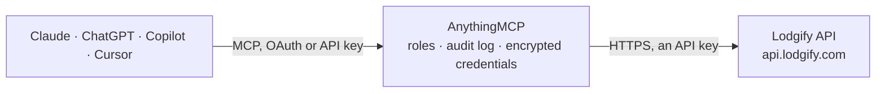

<!-- Generated by scripts/export-github-catalog.mjs in the anythingmcp-website repository. Do not edit by hand. -->

# Lodgify MCP connector

Vacation rental management in Lodgify: properties and room types, availability, nightly rates, quotes, bookings and enquiries, guest message threads, check-in and check-out, key codes and booking status changes. The AnythingMCP connector gives Claude, ChatGPT, Microsoft Copilot, Cursor and Gemini 35 MCP tools for Lodgify: 22 read and 13 can change data.

**Category:** [Travel](../travel.md) · **Tools:** 35 · **Setup guide:** [anythingmcp.com](https://anythingmcp.com/guides/lodgify-to-mcp) · [Deutsch](https://anythingmcp.com/de/guides/lodgify-to-mcp) · [Italiano](https://anythingmcp.com/it/guides/lodgify-to-mcp) · [Español](https://anythingmcp.com/es/guides/lodgify-to-mcp) · [日本語](https://anythingmcp.com/ja/guides/lodgify-to-mcp) · [Русский](https://anythingmcp.com/ru/guides/lodgify-to-mcp) · [中文](https://anythingmcp.com/zh/guides/lodgify-to-mcp)

## Start without code

No installation and no terminal: AnythingMCP Cloud runs the Lodgify connector for you, operated by helpcode.ai in Frankfurt, Germany.

1. **Click the button above** and create an account or sign in. The Lodgify connector opens, ready to install.
2. **Paste the API key or token from your Lodgify account.** Every click is in the [step-by-step guide](https://anythingmcp.com/guides/lodgify-to-mcp).
3. **Click Install.** AnythingMCP shows the address of your MCP server.
4. **Add that address to your assistant:** [Claude](https://anythingmcp.com/guides/connect-lodgify-to-claude) · [ChatGPT](https://anythingmcp.com/guides/connect-lodgify-to-chatgpt) · [Microsoft Copilot](https://anythingmcp.com/guides/connect-lodgify-to-copilot) · [Cursor](https://anythingmcp.com/guides/connect-lodgify-to-cursor) · [Gemini CLI](https://anythingmcp.com/guides/connect-lodgify-to-gemini) · [Meta Muse](https://anythingmcp.com/guides/connect-lodgify-to-muse).
5. **Ask your first question**, for example: *What's the status and amount due for booking 4821 arriving 2026-07-15 at Villa Marisol?*

Prefer help with the setup? [Talk to us](https://anythingmcp.com/contact).

## How it works

- **The AI client** speaks MCP (Streamable HTTP) to AnythingMCP and only sees tool names, descriptions and results. It never gets the Lodgify credentials.
- **AnythingMCP** checks the client's role, builds the call from the tool definition, adds the credentials (an API key), calls Lodgify, logs the call and returns the result.
- **Lodgify** sees an ordinary API client with the rights of the account the credentials belong to.

## Tools

| Tool | What it does | Access |
|---|---|---|
| [`lodgify_list_properties`](#lodgify_list_properties) | List the properties (rentals) of the account with id, name, address, coordinates, currency, check-in and check-out times and room types. | read |
| [`lodgify_get_property`](#lodgify_get_property) | One property with address, description, amenities, rating, currency, room types and, optionally, check-in and check-out hours. | read |
| [`lodgify_list_property_rooms`](#lodgify_list_property_rooms) | Room types of a property with id, name, max people, bedrooms, bathrooms and amenities. | read |
| [`lodgify_get_room`](#lodgify_get_room) | Details of one room type of a property (Public API v1): name, description, max people, beds, images and amenities. | read |
| [`lodgify_list_deleted_properties`](#lodgify_list_deleted_properties) | Properties deleted from the account since a date, so a synced list can drop them. | read |
| [`lodgify_list_property_addons`](#lodgify_list_property_addons) | Add-ons (extras such as cleaning, pets or late check-out) that can be booked for a property, optionally only those valid for a stay and room type. | read |
| [`lodgify_list_property_payment_options`](#lodgify_list_property_payment_options) | Payment options configured for a property (for example bank transfer or card), useful when creating a booking. | read |
| [`lodgify_get_availability`](#lodgify_get_availability) | Availability calendar of all properties and room types of the account for a period: for each day whether units are available, and with include_details the… | read |
| [`lodgify_get_property_availability`](#lodgify_get_property_availability) | Availability calendar of one property (all its room types) for a period, with the number of available units per period and, optionally, the bookings and blocks. | read |
| [`lodgify_get_room_type_availability`](#lodgify_get_room_type_availability) | Availability calendar of one room type of a property for a period. | read |
| [`lodgify_get_rates_calendar`](#lodgify_get_rates_calendar) | Nightly rates of a room type for a period: price per night, minimum stay and rate settings per day, in the property currency. | read |
| [`lodgify_get_rate_settings`](#lodgify_get_rate_settings) | Rate settings of a property: currency, taxes, fees, deposit and cancellation rules and the price per additional guest. | read |
| [`lodgify_get_quote`](#lodgify_get_quote) | Price quote for a possible stay in one room type: total, breakdown of room rate, fees, taxes, add-ons and promotion, per rate plan. | read |
| [`lodgify_list_bookings`](#lodgify_list_bookings) | List bookings with id, property, room types, guest, arrival and departure, status (Booked, Tentative, Open, Declined), source (Manual, AirbnbIntegration,… | read |
| [`lodgify_get_booking`](#lodgify_get_booking) | One booking with guest (name, email, phone, country), rooms and guest breakdown, status, source, totals, subtotals, amount paid and due, quote,… | read |
| [`lodgify_list_external_bookings`](#lodgify_list_external_bookings) | Channel bookings (Airbnb, Booking.com, Vrbo, ...) linked to a Lodgify booking. | read |
| [`lodgify_get_booking_payment_link`](#lodgify_get_booking_payment_link) | The guest payment link of a booking's current quote, with amount and expiry, to share with the guest. | read |
| [`lodgify_get_booking_quote`](#lodgify_get_booking_quote) | The current quote of a booking (Public API v1): room rates, fees, taxes, discounts, add-ons, total and payment schedule. | read |
| [`lodgify_list_inbox`](#lodgify_list_inbox) | List the inbox (Public API v1): bookings and enquiries together, newest first, with status, property, guest, dates, replied and read flags. | read |
| [`lodgify_count_unread`](#lodgify_count_unread) | Number of bookings and enquiries whose messages are not read yet. | read |
| [`lodgify_get_enquiry`](#lodgify_get_enquiry) | One enquiry (a guest request that is not a booking yet) with guest, property, dates, people, status and messages. | read |
| [`lodgify_get_thread`](#lodgify_get_thread) | The message thread of a booking or enquiry: guest name and email, read and closed flags and every message with sender, subject, text and date. | read |
| [`lodgify_create_booking`](#lodgify_create_booking) | Create a booking for a property and stay (Public API v1); returns the new booking id. | write |
| [`lodgify_set_booking_booked`](#lodgify_set_booking_booked) | Confirm a booking: status Booked, the dates are blocked in the calendar. | write |
| [`lodgify_set_booking_tentative`](#lodgify_set_booking_tentative) | Set a booking to Tentative (dates held until it is confirmed or expires). | write |
| [`lodgify_decline_booking`](#lodgify_decline_booking) | Decline a booking: status Declined, the dates become free again. | write |
| [`lodgify_reopen_booking`](#lodgify_reopen_booking) | Reopen a booking: status Open. | write |
| [`lodgify_check_in_booking`](#lodgify_check_in_booking) | Check a booking in: record the time the guest arrived (or will arrive) on the booking. | write |
| [`lodgify_check_out_booking`](#lodgify_check_out_booking) | Check a booking out: record the time the guest left (or will leave) on the booking. | write |
| [`lodgify_update_key_codes`](#lodgify_update_key_codes) | Set the access key codes (door or lockbox codes) of the rooms of a booking, shown to the guest. | write |
| [`lodgify_add_booking_messages`](#lodgify_add_booking_messages) | Add messages to the thread of a booking, for example a reply to the guest or an internal comment. | write |
| [`lodgify_add_enquiry_messages`](#lodgify_add_enquiry_messages) | Add messages to the thread of an enquiry, for example an answer to a guest question. | write |
| [`lodgify_mark_booking_replied`](#lodgify_mark_booking_replied) | Mark a booking's thread as replied, so it leaves the to-answer list in the inbox. | write |
| [`lodgify_mark_booking_not_replied`](#lodgify_mark_booking_not_replied) | Mark a booking's thread as not replied, so it shows again in the to-answer list. | write |
| [`lodgify_request_payment`](#lodgify_request_payment) | Email the guest a payment request for the next due amount of a booking. | write |

## Tool reference

Every parameter as the AI client sees it in `tools/list`. Source: [`packages/backend/src/adapters/intl/lodgify.json`](../../../packages/backend/src/adapters/intl/lodgify.json).

### `lodgify_list_properties`

List the properties (rentals) of the account with id, name, address, coordinates, currency, check-in and check-out times and room types. Paged, 50 per page by default.

**Access:** read · **Call:** `GET /v2/properties`

| Parameter | Type | Required | Description |
|---|---|---|---|
| `page` | integer | no | Page number, starting at 1 (default 1). |
| `size` | integer | no | Items per page (default 50). |
| `include_count` | boolean | no | Return the total count of properties as count. |
| `include_in_out` | boolean | no | Include the check-in and check-out hours. |
| `updated_since` | string | no | Only properties changed since this date and time (ISO 8601). |
| `wid` | integer | no | Website id, to limit to the properties of one Lodgify website. |

### `lodgify_get_property`

One property with address, description, amenities, rating, currency, room types and, optionally, check-in and check-out hours.

**Access:** read · **Call:** `GET /v2/properties/{property_id}`

| Parameter | Type | Required | Description |
|---|---|---|---|
| `property_id` | integer | yes | Property id (the house id), from lodgify_list_properties. |
| `include_in_out` | boolean | no | Include the check-in and check-out hours. |
| `wid` | integer | no | Website id, for the texts of one website. |

### `lodgify_list_property_rooms`

Room types of a property with id, name, max people, bedrooms, bathrooms and amenities. The room type id is needed for rates, availability, quotes and bookings.

**Access:** read · **Call:** `GET /v2/properties/{property_id}/rooms`

| Parameter | Type | Required | Description |
|---|---|---|---|
| `property_id` | integer | yes | Property id (the house id), from lodgify_list_properties. |
| `wid` | integer | no | Website id, for the texts of one website. |

### `lodgify_get_room`

Details of one room type of a property (Public API v1): name, description, max people, beds, images and amenities.

**Access:** read · **Call:** `GET /v1/properties/{property_id}/rooms/{room_type_id}`

| Parameter | Type | Required | Description |
|---|---|---|---|
| `property_id` | integer | yes | Property id (the house id), from lodgify_list_properties. |
| `room_type_id` | integer | yes | Room type id of the property, from lodgify_list_property_rooms (most rentals have a single room type). |
| `wid` | integer | no | Website id, for the texts of one website. |

### `lodgify_list_deleted_properties`

Properties deleted from the account since a date, so a synced list can drop them.

**Access:** read · **Call:** `GET /v2/deletedproperties`

| Parameter | Type | Required | Description |
|---|---|---|---|
| `deleted_since` | string | no | Only properties deleted since this date and time (ISO 8601). |

### `lodgify_list_property_addons`

Add-ons (extras such as cleaning, pets or late check-out) that can be booked for a property, optionally only those valid for a stay and room type. Their ids go into lodgify_get_quote.

**Access:** read · **Call:** `GET /v1/properties/{property_id}/rates/addons`

| Parameter | Type | Required | Description |
|---|---|---|---|
| `property_id` | integer | yes | Property id (the house id), from lodgify_list_properties. |
| `start` | string | no | Stay start. Date, YYYY-MM-DD. |
| `end` | string | no | Stay end. Date, YYYY-MM-DD. |
| `room_type_id` | integer | no | Only add-ons valid for this room type. |

### `lodgify_list_property_payment_options`

Payment options configured for a property (for example bank transfer or card), useful when creating a booking.

**Access:** read · **Call:** `GET /v1/properties/{property_id}/payments`

| Parameter | Type | Required | Description |
|---|---|---|---|
| `property_id` | integer | yes | Property id (the house id), from lodgify_list_properties. |

### `lodgify_get_availability`

Availability calendar of all properties and room types of the account for a period: for each day whether units are available, and with include_details the bookings and closed periods that block them.

**Access:** read · **Call:** `GET /v2/availability`

| Parameter | Type | Required | Description |
|---|---|---|---|
| `start` | string | yes | First day. Date, YYYY-MM-DD. |
| `end` | string | yes | Last day. Date, YYYY-MM-DD. |
| `include_details` | boolean | no | Include the bookings and blocks behind each period. |

### `lodgify_get_property_availability`

Availability calendar of one property (all its room types) for a period, with the number of available units per period and, optionally, the bookings and blocks.

**Access:** read · **Call:** `GET /v2/availability/{property_id}`

| Parameter | Type | Required | Description |
|---|---|---|---|
| `property_id` | integer | yes | Property id (the house id), from lodgify_list_properties. |
| `start` | string | yes | First day. Date, YYYY-MM-DD. |
| `end` | string | yes | Last day. Date, YYYY-MM-DD. |
| `include_details` | boolean | no | Include the bookings and blocks behind each period. |

### `lodgify_get_room_type_availability`

Availability calendar of one room type of a property for a period. Use it to check whether a stay is free before quoting or booking.

**Access:** read · **Call:** `GET /v2/availability/{property_id}/{room_type_id}`

| Parameter | Type | Required | Description |
|---|---|---|---|
| `property_id` | integer | yes | Property id (the house id), from lodgify_list_properties. |
| `room_type_id` | integer | yes | Room type id of the property, from lodgify_list_property_rooms (most rentals have a single room type). |
| `start` | string | yes | First day. Date, YYYY-MM-DD. |
| `end` | string | yes | Last day. Date, YYYY-MM-DD. |
| `include_details` | boolean | no | Include the bookings and blocks behind each period. |

### `lodgify_get_rates_calendar`

Nightly rates of a room type for a period: price per night, minimum stay and rate settings per day, in the property currency.

**Access:** read · **Call:** `GET /v2/rates/calendar`

| Parameter | Type | Required | Description |
|---|---|---|---|
| `property_id` | integer | yes | Property id (the house id), from lodgify_list_properties. |
| `room_type_id` | integer | yes | Room type id of the property, from lodgify_list_property_rooms (most rentals have a single room type). |
| `start_date` | string | yes | First night. Date, YYYY-MM-DD. |
| `end_date` | string | yes | Last night. Date, YYYY-MM-DD. |

### `lodgify_get_rate_settings`

Rate settings of a property: currency, taxes, fees, deposit and cancellation rules and the price per additional guest.

**Access:** read · **Call:** `GET /v2/rates/settings`

| Parameter | Type | Required | Description |
|---|---|---|---|
| `property_id` | integer | no | Property id (the house id), from lodgify_list_properties. |

### `lodgify_get_quote`

Price quote for a possible stay in one room type: total, breakdown of room rate, fees, taxes, add-ons and promotion, per rate plan. Use it to answer "how much would it cost" before lodgify_create_booking.

**Access:** read · **Call:** `GET /v2/quote/{property_id}`

| Parameter | Type | Required | Description |
|---|---|---|---|
| `property_id` | integer | yes | Property id (the house id), from lodgify_list_properties. |
| `arrival` | string | yes | Arrival. Date, YYYY-MM-DD. |
| `departure` | string | yes | Departure. Date, YYYY-MM-DD. |
| `room_type_id` | integer | yes | Room type id of the property, from lodgify_list_property_rooms (most rentals have a single room type). |
| `people` | integer | no | Total number of guests. |
| `adults` | integer | yes | Number of adults. |
| `children` | integer | no | Number of children. |
| `infants` | integer | no | Number of infants. |
| `pets` | integer | no | Number of pets. |
| `addon_id` | integer | no | Optional add-on id from lodgify_list_property_addons. |
| `addon_units` | integer | no | Units of that add-on. |
| `promotion_code` | string | no | Promotion code to apply. |

### `lodgify_list_bookings`

List bookings with id, property, room types, guest, arrival and departure, status (Booked, Tentative, Open, Declined), source (Manual, AirbnbIntegration, BookingCom, ...), totals, amount paid and due, and the message thread id. Filter by stay: Upcoming, Current, Historic, All, or ArrivalDate and DepartureDate with stay_filter_date.

**Access:** read · **Call:** `GET /v2/reservations/bookings`

| Parameter | Type | Required | Description |
|---|---|---|---|
| `page` | integer | no | Page number, starting at 1 (default 1). |
| `size` | integer | no | Items per page (default 50). |
| `include_count` | boolean | no | Return the total count as count. |
| `stay_filter` | `Upcoming` \| `Current` \| `Historic` \| `All` \| `ArrivalDate` \| `DepartureDate` | no | Which stays: Upcoming, Current, Historic, All, ArrivalDate or DepartureDate. |
| `stay_filter_date` | string | no | Date for stay_filter ArrivalDate or DepartureDate (ISO 8601). |
| `updated_since` | string | no | Only bookings changed since this date and time (ISO 8601). |
| `include_transactions` | boolean | no | Include payments and refunds. |
| `include_external` | boolean | no | Include bookings imported from channels (Airbnb, Booking.com, ...). |
| `include_quote_details` | boolean | no | Include the price breakdown. |
| `trash` | `False` \| `True` \| `All` | no | False (default) for active bookings, True for trashed ones, All for both. |

### `lodgify_get_booking`

One booking with guest (name, email, phone, country), rooms and guest breakdown, status, source, totals, subtotals, amount paid and due, quote, transactions, notes, key codes, check-in and check-out and thread_uid for the messages.

**Access:** read · **Call:** `GET /v2/reservations/bookings/{booking_id}`

| Parameter | Type | Required | Description |
|---|---|---|---|
| `booking_id` | integer | yes | Booking id, from lodgify_list_bookings. |

### `lodgify_list_external_bookings`

Channel bookings (Airbnb, Booking.com, Vrbo, ...) linked to a Lodgify booking.

**Access:** read · **Call:** `GET /v2/reservations/bookings/{booking_id}/externalBookings`

| Parameter | Type | Required | Description |
|---|---|---|---|
| `booking_id` | integer | yes | Booking id, from lodgify_list_bookings. |

### `lodgify_get_booking_payment_link`

The guest payment link of a booking's current quote, with amount and expiry, to share with the guest.

**Access:** read · **Call:** `GET /v2/reservations/bookings/{booking_id}/quote/paymentLink`

| Parameter | Type | Required | Description |
|---|---|---|---|
| `booking_id` | integer | yes | Booking id, from lodgify_list_bookings. |

### `lodgify_get_booking_quote`

The current quote of a booking (Public API v1): room rates, fees, taxes, discounts, add-ons, total and payment schedule.

**Access:** read · **Call:** `GET /v1/reservation/booking/{booking_id}/quote`

| Parameter | Type | Required | Description |
|---|---|---|---|
| `booking_id` | integer | yes | Booking id, from lodgify_list_bookings. |

### `lodgify_list_inbox`

List the inbox (Public API v1): bookings and enquiries together, newest first, with status, property, guest, dates, replied and read flags. Filter by status (Booked, Open, Tentative, Declined), property, stay period or change date.

**Access:** read · **Call:** `GET /v1/reservation`

| Parameter | Type | Required | Description |
|---|---|---|---|
| `offset` | integer | no | Items to skip (default 0). |
| `limit` | integer | no | Items to return (default 10). |
| `status` | string | no | Only this status, for example Booked, Open, Tentative or Declined. |
| `trash` | boolean | no | true to list trashed items instead (default false). |
| `property_id` | integer | no | Only this property. |
| `period_start` | string | no | Only stays from this date. Date, YYYY-MM-DD. |
| `period_end` | string | no | Only stays until this date. Date, YYYY-MM-DD. |
| `modified_since` | string | no | Only items changed since this date and time (ISO 8601). |

### `lodgify_count_unread`

Number of bookings and enquiries whose messages are not read yet.

**Access:** read · **Call:** `GET /v1/reservation/not_read`

No parameters.

### `lodgify_get_enquiry`

One enquiry (a guest request that is not a booking yet) with guest, property, dates, people, status and messages.

**Access:** read · **Call:** `GET /v1/reservation/enquiry/{enquiry_id}`

| Parameter | Type | Required | Description |
|---|---|---|---|
| `enquiry_id` | integer | yes | Enquiry id, from lodgify_list_inbox. |

### `lodgify_get_thread`

The message thread of a booking or enquiry: guest name and email, read and closed flags and every message with sender, subject, text and date.

**Access:** read · **Call:** `GET /v2/messaging/{thread_uid}`

| Parameter | Type | Required | Description |
|---|---|---|---|
| `thread_uid` | string | yes | Thread id (a GUID), the thread_uid of a booking or enquiry. |

### `lodgify_create_booking`

Create a booking for a property and stay (Public API v1); returns the new booking id. Lodgify ignores status here: call lodgify_set_booking_booked or lodgify_set_booking_tentative afterwards. Pass from to turn an existing enquiry into the booking.

**Access:** write · **Call:** `POST /v1/reservation/booking`

| Parameter | Type | Required | Description |
|---|---|---|---|
| `property_id` | integer | yes | Property id (the house id), from lodgify_list_properties. |
| `arrival` | string | yes | Arrival. Date, YYYY-MM-DD. |
| `departure` | string | yes | Departure. Date, YYYY-MM-DD. |
| `guest` | object | yes | Guest: {"guest_name": {"first_name": "Anna", "last_name": "Muster"}, "email": "anna@example.com", "phone": "+49 ...", "country_code": "DE", "locale": "de"}. guest_name is required. |
| `rooms` | object[] | yes | Room types booked: [{"room_type_id": 123, "guest_breakdown": {"adults": 2, "children": 0, "infants": 0, "pets": 0}, "people": 2}]. |
| `source_text` | string | no | Where the booking came from, free text (for example Phone). |
| `total` | number | no | Total price to store on the booking, in currency_code. |
| `currency_code` | string | no | Currency, ISO 4217 (EUR, USD). |
| `payment_type` | string | no | Payment option, from lodgify_list_property_payment_options. |
| `messages` | object[] | no | Optional first messages: [{"subject": "...", "message": "...", "type": "Owner", "send_notification": false}]. |
| `from_enquiry_id` | integer | no | Enquiry id to upgrade into this booking. |

### `lodgify_set_booking_booked`

Confirm a booking: status Booked, the dates are blocked in the calendar. request_payment also emails the guest a payment request.

**Access:** write · **Call:** `PUT /v1/reservation/booking/{booking_id}/book`

| Parameter | Type | Required | Description |
|---|---|---|---|
| `booking_id` | integer | yes | Booking id, from lodgify_list_bookings. |
| `request_payment` | boolean | no | Send the guest a payment request (default false). |

### `lodgify_set_booking_tentative`

Set a booking to Tentative (dates held until it is confirmed or expires). request_payment also emails the guest a payment request.

**Access:** write · **Call:** `PUT /v1/reservation/booking/{booking_id}/tentative`

| Parameter | Type | Required | Description |
|---|---|---|---|
| `booking_id` | integer | yes | Booking id, from lodgify_list_bookings. |
| `request_payment` | boolean | no | Send the guest a payment request (default false). |

### `lodgify_decline_booking`

Decline a booking: status Declined, the dates become free again. lodgify_reopen_booking sets it back to Open.

**Access:** write · **Call:** `PUT /v1/reservation/booking/{booking_id}/decline`

| Parameter | Type | Required | Description |
|---|---|---|---|
| `booking_id` | integer | yes | Booking id, from lodgify_list_bookings. |

### `lodgify_reopen_booking`

Reopen a booking: status Open. A Booked booking frees its dates in the calendar.

**Access:** write · **Call:** `PUT /v1/reservation/booking/{booking_id}/reopen`

| Parameter | Type | Required | Description |
|---|---|---|---|
| `booking_id` | integer | yes | Booking id, from lodgify_list_bookings. |

### `lodgify_check_in_booking`

Check a booking in: record the time the guest arrived (or will arrive) on the booking.

**Access:** write · **Call:** `PUT /v2/reservations/bookings/{booking_id}/checkin`

| Parameter | Type | Required | Description |
|---|---|---|---|
| `booking_id` | integer | yes | Booking id, from lodgify_list_bookings. |
| `time` | string | yes | Check-in time in the property's time zone, HH:mm:ss (for example 15:30:00). |

### `lodgify_check_out_booking`

Check a booking out: record the time the guest left (or will leave) on the booking.

**Access:** write · **Call:** `PUT /v2/reservations/bookings/{booking_id}/checkout`

| Parameter | Type | Required | Description |
|---|---|---|---|
| `booking_id` | integer | yes | Booking id, from lodgify_list_bookings. |
| `time` | string | yes | Check-out time in the property's time zone, HH:mm:ss (for example 10:45:00). |

### `lodgify_update_key_codes`

Set the access key codes (door or lockbox codes) of the rooms of a booking, shown to the guest.

**Access:** write · **Call:** `PUT /v2/reservations/bookings/{booking_id}/keyCodes`

| Parameter | Type | Required | Description |
|---|---|---|---|
| `booking_id` | integer | yes | Booking id, from lodgify_list_bookings. |
| `rooms` | object[] | yes | [{"room_type_id": 123, "key_code": "4711"}], one entry per booked room type. |

### `lodgify_add_booking_messages`

Add messages to the thread of a booking, for example a reply to the guest or an internal comment. With send_notification true the guest gets the message by email.

**Access:** write · **Call:** `POST /v1/reservation/booking/{booking_id}/messages`

| Parameter | Type | Required | Description |
|---|---|---|---|
| `booking_id` | integer | yes | Booking id, from lodgify_list_bookings. |
| `messages` | object[] | yes | Messages: [{"subject": "Your stay", "message": "Hello Anna, ...", "type": "Owner", "send_notification": true}]. type is Owner (from you), Renter (from the guest) or Comment (internal note, not sent); send_notification true emails it. |

### `lodgify_add_enquiry_messages`

Add messages to the thread of an enquiry, for example an answer to a guest question. With send_notification true the guest gets the message by email.

**Access:** write · **Call:** `POST /v1/reservation/enquiry/{enquiry_id}/messages`

| Parameter | Type | Required | Description |
|---|---|---|---|
| `enquiry_id` | integer | yes | Enquiry id. |
| `messages` | object[] | yes | Messages: [{"subject": "Your stay", "message": "Hello Anna, ...", "type": "Owner", "send_notification": true}]. type is Owner (from you), Renter (from the guest) or Comment (internal note, not sent); send_notification true emails it. |

### `lodgify_mark_booking_replied`

Mark a booking's thread as replied, so it leaves the to-answer list in the inbox.

**Access:** write · **Call:** `PUT /v1/reservation/booking/{booking_id}/replied`

| Parameter | Type | Required | Description |
|---|---|---|---|
| `booking_id` | integer | yes | Booking id, from lodgify_list_bookings. |

### `lodgify_mark_booking_not_replied`

Mark a booking's thread as not replied, so it shows again in the to-answer list.

**Access:** write · **Call:** `PUT /v1/reservation/booking/{booking_id}/not_replied`

| Parameter | Type | Required | Description |
|---|---|---|---|
| `booking_id` | integer | yes | Booking id, from lodgify_list_bookings. |

### `lodgify_request_payment`

Email the guest a payment request for the next due amount of a booking.

**Access:** write · **Call:** `PUT /v1/reservation/booking/{booking_id}/request_payment`

| Parameter | Type | Required | Description |
|---|---|---|---|
| `booking_id` | integer | yes | Booking id, from lodgify_list_bookings. |

## Run it yourself

AnythingMCP is open source (AGPL-3.0). [Run it with Docker](../../../README.md#run-it-yourself), open **Connectors → Store**, pick **Lodgify** and enter `LODGIFY_API_KEY`, then add your MCP server URL to the AI client.

[← Travel connectors](../travel.md) · [All categories](../README.md)
