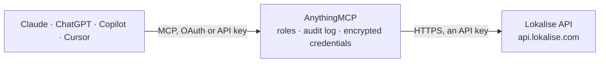

<!-- Generated by scripts/export-github-catalog.mjs in the anythingmcp-website repository. Do not edit by hand. -->

# Lokalise MCP connector

Lokalise translation management: projects, keys and translations, languages, contributors, translation and review tasks, file exports as background processes, comments, screenshot metadata, branches and the glossary. The AnythingMCP connector gives Claude, ChatGPT, Microsoft Copilot, Cursor and Gemini 37 MCP tools for Lokalise: 24 read and 13 can change data.

**Category:** [Productivity](../productivity.md) · **Tools:** 37 · **Setup guide:** [anythingmcp.com](https://anythingmcp.com/guides/lokalise-to-mcp) · [Deutsch](https://anythingmcp.com/de/guides/lokalise-to-mcp) · [Italiano](https://anythingmcp.com/it/guides/lokalise-to-mcp) · [Español](https://anythingmcp.com/es/guides/lokalise-to-mcp) · [日本語](https://anythingmcp.com/ja/guides/lokalise-to-mcp) · [Русский](https://anythingmcp.com/ru/guides/lokalise-to-mcp) · [中文](https://anythingmcp.com/zh/guides/lokalise-to-mcp)

## Start without code

No installation and no terminal: AnythingMCP Cloud runs the Lokalise connector for you, operated by helpcode.ai in Frankfurt, Germany.

1. **Click the button above** and create an account or sign in. The Lokalise connector opens, ready to install.
2. **Paste the API key or token from your Lokalise account.** Every click is in the [step-by-step guide](https://anythingmcp.com/guides/lokalise-to-mcp).
3. **Click Install.** AnythingMCP shows the address of your MCP server.
4. **Add that address to your assistant:** [Claude](https://anythingmcp.com/guides/connect-lokalise-to-claude) · [ChatGPT](https://anythingmcp.com/guides/connect-lokalise-to-chatgpt) · [Microsoft Copilot](https://anythingmcp.com/guides/connect-lokalise-to-copilot) · [Cursor](https://anythingmcp.com/guides/connect-lokalise-to-cursor) · [Gemini CLI](https://anythingmcp.com/guides/connect-lokalise-to-gemini) · [Meta Muse](https://anythingmcp.com/guides/connect-lokalise-to-muse).
5. **Ask your first question**, for example: *In project 'PixelFrame Web' what's the German translation for key 'onboarding.welcome.title'?*

Prefer help with the setup? [Talk to us](https://anythingmcp.com/contact).

## How it works

- **The AI client** speaks MCP (Streamable HTTP) to AnythingMCP and only sees tool names, descriptions and results. It never gets the Lokalise credentials.
- **AnythingMCP** checks the client's role, builds the call from the tool definition, adds the credentials (an API key), calls Lokalise, logs the call and returns the result.
- **Lokalise** sees an ordinary API client with the rights of the account the credentials belong to.

## Tools

| Tool | What it does | Access |
|---|---|---|
| [`lokalise_list_projects`](#lokalise_list_projects) | Projects the token can reach, with id, name, type (localization_files, paged_documents, ...), base language, team and, on request, statistics (progress,… | read |
| [`lokalise_get_project`](#lokalise_get_project) | One project with its settings and statistics: progress, keys, words and QA issues per language, base language and team. | read |
| [`lokalise_list_keys`](#lokalise_list_keys) | Translation keys of a project with name per platform, description, tags, filenames and, with include_translations 1, the translations. | read |
| [`lokalise_get_key`](#lokalise_get_key) | One key with all its translations, tags, platforms, filenames, description, context, character limit and custom attributes. | read |
| [`lokalise_create_keys`](#lokalise_create_keys) | Create one or more keys, with their translations if known. | write |
| [`lokalise_update_key`](#lokalise_update_key) | Update a key's name, description, platforms, filenames, tags (merge_tags to add rather than replace), plural settings, hidden or archived flag, context or… | write |
| [`lokalise_bulk_update_keys`](#lokalise_bulk_update_keys) | Update several keys in one call. | write |
| [`lokalise_delete_key`](#lokalise_delete_key) | Delete a key and all its translations from a software project. | write |
| [`lokalise_list_translations`](#lokalise_list_translations) | Translations of a project, one row per key and language, with the text, reviewed and unverified flags, custom statuses, words and modification time. | read |
| [`lokalise_get_translation`](#lokalise_get_translation) | One translation by id: key, language, text, reviewed and unverified flags, custom statuses, word count and who changed it last. | read |
| [`lokalise_update_translation`](#lokalise_update_translation) | Change the text of one translation and its reviewed, unverified or custom status flags. | write |
| [`lokalise_list_project_languages`](#lokalise_list_project_languages) | Languages of a project with lang_id, lang_iso, name, right-to-left flag and plural forms. | read |
| [`lokalise_add_languages`](#lokalise_add_languages) | Add languages to a project by ISO code, e.g. de or pt_BR, optionally with a custom code or name. | write |
| [`lokalise_list_system_languages`](#lokalise_list_system_languages) | All languages Lokalise supports, with lang_id, lang_iso, name and plural forms. | read |
| [`lokalise_list_contributors`](#lokalise_list_contributors) | Contributors of a project with email, name, admin and reviewer flags, role and the languages each may translate or review. | read |
| [`lokalise_get_contributor`](#lokalise_get_contributor) | One contributor of a project by user id, with rights and languages. | read |
| [`lokalise_get_my_contributor`](#lokalise_get_my_contributor) | The token owner as a contributor of a project: user id, rights and languages. | read |
| [`lokalise_add_contributors`](#lokalise_add_contributors) | Invite people to a project by email with their languages and rights. | write |
| [`lokalise_list_tasks`](#lokalise_list_tasks) | Tasks of a project with title, status, type (translation, review, automatic_translation, lqa_by_ai), due date, languages with assignees and progress. | read |
| [`lokalise_get_task`](#lokalise_get_task) | One task with its languages, assignees, keys count, progress, closing tags and settings. | read |
| [`lokalise_create_task`](#lokalise_create_task) | Create a translation or review task for some keys and languages, assigned to users or groups, with a due date. | write |
| [`lokalise_update_task`](#lokalise_update_task) | Change a task's title, description, due date, languages or assignees, its auto-close settings, or close it with close_task. | write |
| [`lokalise_list_files`](#lokalise_list_files) | Files of a project with filename, key count and the date they were last imported. | read |
| [`lokalise_download_files`](#lokalise_download_files) | Start an export of the project's translations as language files (json, xliff, strings, xml, po, yaml, ...). | read |
| [`lokalise_get_process`](#lokalise_get_process) | Status of a background process (file download or upload): queued, running, finished or failed, with details; for a download, details.download_url is the zip… | read |
| [`lokalise_list_project_comments`](#lokalise_list_project_comments) | All comments of a project, with the key they belong to, author and time. | read |
| [`lokalise_list_key_comments`](#lokalise_list_key_comments) | Comments on one key, with comment id, text, author and time, newest first. | read |
| [`lokalise_add_key_comments`](#lokalise_add_key_comments) | Add one or more comments to a key, e.g. a question to translators or context for a string. | write |
| [`lokalise_list_screenshots`](#lokalise_list_screenshots) | Screenshots of a project (metadata only): title, description, URL, size, tags and the keys linked to them. | read |
| [`lokalise_get_screenshot`](#lokalise_get_screenshot) | One screenshot's metadata: title, description, URL, width and height, tags and linked key ids. | read |
| [`lokalise_list_branches`](#lokalise_list_branches) | Branches of a project with branch id, name and creation time. | read |
| [`lokalise_create_branch`](#lokalise_create_branch) | Create a branch of a project (a copy of the main content to change in isolation and merge later). | write |
| [`lokalise_list_glossary_terms`](#lokalise_list_glossary_terms) | Glossary terms of a project with description, case sensitivity, translatable and forbidden flags, translations and tags. | read |
| [`lokalise_get_glossary_term`](#lokalise_get_glossary_term) | One glossary term with description, translations per language, tags and flags. | read |
| [`lokalise_create_glossary_terms`](#lokalise_create_glossary_terms) | Add terms to the project glossary, e.g. brand names that must not be translated (translatable false) or words that must never be used (forbidden true). | write |
| [`lokalise_update_glossary_terms`](#lokalise_update_glossary_terms) | Change glossary terms by id: text, description, flags, translations or tags. | write |
| [`lokalise_list_translation_statuses`](#lokalise_list_translation_statuses) | Custom translation statuses of a project (e.g. Needs legal review) with id, title and color, for custom_translation_status_ids. | read |

## Tool reference

Every parameter as the AI client sees it in `tools/list`. Source: [`packages/backend/src/adapters/intl/lokalise.json`](../../../packages/backend/src/adapters/intl/lokalise.json).

### `lokalise_list_projects`

Projects the token can reach, with id, name, type (localization_files, paged_documents, ...), base language, team and, on request, statistics (progress, keys, words per language) and settings.

**Access:** read · **Call:** `GET /projects`

| Parameter | Type | Required | Description |
|---|---|---|---|
| `filter_names` | string | no | Comma-separated project names. |
| `filter_team_id` | integer | no | Only projects of this team id. |
| `include_statistics` | `0` \| `1` | no | 1 to include progress and counts. |
| `include_settings` | `0` \| `1` | no | 1 to include project settings. |
| `limit` | integer | no | Items per page (default 100). |
| `page` | integer | no | Page number, starting at 1. |

### `lokalise_get_project`

One project with its settings and statistics: progress, keys, words and QA issues per language, base language and team.

**Access:** read · **Call:** `GET /projects/{project_id}`

| Parameter | Type | Required | Description |
|---|---|---|---|
| `project_id` | string | yes | Project id, e.g. 767946315e9866d013c1d0.08299127. For a branch append it after a colon: <project id>:<branch name>. |

### `lokalise_list_keys`

Translation keys of a project with name per platform, description, tags, filenames and, with include_translations 1, the translations. Filter by key name, tag, filename, platform, language, untranslated or QA issues. Supports cursor paging (pagination cursor) for large projects.

**Access:** read · **Call:** `GET /projects/{project_id}/keys`

| Parameter | Type | Required | Description |
|---|---|---|---|
| `project_id` | string | yes | Project id, e.g. 767946315e9866d013c1d0.08299127. For a branch append it after a colon: <project id>:<branch name>. |
| `filter_keys` | string | no | Comma-separated key names. |
| `filter_key_ids` | string | no | Comma-separated key ids. |
| `filter_tags` | string | no | Comma-separated tags. |
| `filter_filenames` | string | no | Comma-separated file names. |
| `filter_platforms` | string | no | Comma-separated platforms: ios, android, web, other. |
| `filter_untranslated` | `0` \| `1` | no | 1 for keys with at least one untranslated language. |
| `filter_qa_issues` | string | no | Comma-separated QA issues, e.g. placeholders,spelling_and_grammar,html. |
| `filter_archived` | `exclude` \| `include` \| `only` | no | Archived keys. |
| `include_translations` | `0` \| `1` | no | 1 to include the translations. |
| `filter_translation_lang_ids` | string | no | With include_translations: only these language ids, comma-separated. |
| `include_comments` | `0` \| `1` | no | 1 to include comments. |
| `include_screenshots` | `0` \| `1` | no | 1 to include screenshots. |
| `disable_references` | `0` \| `1` | no | 1 to return key references as they are, not resolved. |
| `pagination` | `offset` \| `cursor` | no | offset (default) or cursor. |
| `cursor` | string | no | The x-pagination-next-cursor header value of the previous page, with pagination cursor. |
| `limit` | integer | no | Keys per page (max 500). |
| `page` | integer | no | Page number, offset paging only. |

### `lokalise_get_key`

One key with all its translations, tags, platforms, filenames, description, context, character limit and custom attributes.

**Access:** read · **Call:** `GET /projects/{project_id}/keys/{key_id}`

| Parameter | Type | Required | Description |
|---|---|---|---|
| `project_id` | string | yes | Project id, e.g. 767946315e9866d013c1d0.08299127. For a branch append it after a colon: <project id>:<branch name>. |
| `key_id` | integer | yes | Numeric key id. |
| `disable_references` | `0` \| `1` | no | 1 to return references unresolved. |

### `lokalise_create_keys`

Create one or more keys, with their translations if known. Each key needs key_name and platforms.

**Access:** write · **Call:** `POST /projects/{project_id}/keys`

| Parameter | Type | Required | Description |
|---|---|---|---|
| `project_id` | string | yes | Project id, e.g. 767946315e9866d013c1d0.08299127. For a branch append it after a colon: <project id>:<branch name>. |
| `keys` | object[] | yes | Keys, e.g. [{"key_name": "checkout.title", "platforms": ["web"], "description": "Checkout page title", "tags": ["checkout"], "translations": [{"language_iso": "en", "translation": "Checkout"}]}]. key_name may also be {"ios": ..., "android": ..., "web": ..., "other": ...}. |
| `use_automations` | boolean | no | Run the project's automations (machine translation and so on) on the new translations. |

### `lokalise_update_key`

Update a key's name, description, platforms, filenames, tags (merge_tags to add rather than replace), plural settings, hidden or archived flag, context or character limit.

**Access:** write · **Call:** `PUT /projects/{project_id}/keys/{key_id}`

| Parameter | Type | Required | Description |
|---|---|---|---|
| `project_id` | string | yes | Project id, e.g. 767946315e9866d013c1d0.08299127. For a branch append it after a colon: <project id>:<branch name>. |
| `key_id` | integer | yes | Numeric key id. |
| `key` | object | yes | Fields to change, e.g. {"description": "Shown on the cart", "tags": ["cart"], "merge_tags": true, "char_limit": 40, "is_archived": false}. |

### `lokalise_bulk_update_keys`

Update several keys in one call. Each entry carries key_id and the fields to change, including translations.

**Access:** write · **Call:** `PUT /projects/{project_id}/keys`

| Parameter | Type | Required | Description |
|---|---|---|---|
| `project_id` | string | yes | Project id, e.g. 767946315e9866d013c1d0.08299127. For a branch append it after a colon: <project id>:<branch name>. |
| `keys` | object[] | yes | Changes, e.g. [{"key_id": 331223, "tags": ["v2"], "merge_tags": true}, {"key_id": 331224, "description": "..."}]. |
| `use_automations` | boolean | no | Run the project's automations on changed translations. |

### `lokalise_delete_key`

Delete a key and all its translations from a software project.

**Access:** write · **Call:** `DELETE /projects/{project_id}/keys/{key_id}`

| Parameter | Type | Required | Description |
|---|---|---|---|
| `project_id` | string | yes | Project id, e.g. 767946315e9866d013c1d0.08299127. For a branch append it after a colon: <project id>:<branch name>. |
| `key_id` | integer | yes | Numeric key id. |

### `lokalise_list_translations`

Translations of a project, one row per key and language, with the text, reviewed and unverified flags, custom statuses, words and modification time. Filter by language, reviewed, unverified, untranslated, QA issues or active task.

**Access:** read · **Call:** `GET /projects/{project_id}/translations`

| Parameter | Type | Required | Description |
|---|---|---|---|
| `project_id` | string | yes | Project id, e.g. 767946315e9866d013c1d0.08299127. For a branch append it after a colon: <project id>:<branch name>. |
| `filter_lang_id` | integer | no | Only this language id. |
| `filter_is_reviewed` | `0` \| `1` | no | 1 reviewed only, 0 not reviewed. |
| `filter_unverified` | `0` \| `1` | no | 1 unverified only. |
| `filter_untranslated` | `0` \| `1` | no | 1 empty translations only. |
| `filter_qa_issues` | string | no | Comma-separated QA issues. |
| `filter_active_task_id` | integer | no | Only translations in this task id. |
| `disable_references` | `0` \| `1` | no | 1 to return references unresolved. |
| `pagination` | `offset` \| `cursor` | no | offset (default) or cursor. |
| `cursor` | string | no | The x-pagination-next-cursor header value, with pagination cursor. |
| `limit` | integer | no | Rows per page (max 5000). |
| `page` | integer | no | Page number, offset paging only. |

### `lokalise_get_translation`

One translation by id: key, language, text, reviewed and unverified flags, custom statuses, word count and who changed it last.

**Access:** read · **Call:** `GET /projects/{project_id}/translations/{translation_id}`

| Parameter | Type | Required | Description |
|---|---|---|---|
| `project_id` | string | yes | Project id, e.g. 767946315e9866d013c1d0.08299127. For a branch append it after a colon: <project id>:<branch name>. |
| `translation_id` | integer | yes | Numeric translation id. |
| `disable_references` | `0` \| `1` | no | 1 to return references unresolved. |

### `lokalise_update_translation`

Change the text of one translation and its reviewed, unverified or custom status flags. Plural keys take a JSON string with the forms.

**Access:** write · **Call:** `PUT /projects/{project_id}/translations/{translation_id}`

| Parameter | Type | Required | Description |
|---|---|---|---|
| `project_id` | string | yes | Project id, e.g. 767946315e9866d013c1d0.08299127. For a branch append it after a colon: <project id>:<branch name>. |
| `translation_id` | integer | yes | Numeric translation id. |
| `translation` | string | yes | The new text. For a plural key a JSON string such as {"one": "1 item", "other": "%d items"}. |
| `is_reviewed` | boolean | no | Mark as reviewed. |
| `is_unverified` | boolean | no | Mark as unverified (needs another look). |
| `custom_translation_status_ids` | string[] | no | Custom translation status ids to set. |

### `lokalise_list_project_languages`

Languages of a project with lang_id, lang_iso, name, right-to-left flag and plural forms.

**Access:** read · **Call:** `GET /projects/{project_id}/languages`

| Parameter | Type | Required | Description |
|---|---|---|---|
| `project_id` | string | yes | Project id, e.g. 767946315e9866d013c1d0.08299127. For a branch append it after a colon: <project id>:<branch name>. |
| `limit` | integer | no | Items per page (default 100). |
| `page` | integer | no | Page number, starting at 1. |

### `lokalise_add_languages`

Add languages to a project by ISO code, e.g. de or pt_BR, optionally with a custom code or name.

**Access:** write · **Call:** `POST /projects/{project_id}/languages`

| Parameter | Type | Required | Description |
|---|---|---|---|
| `project_id` | string | yes | Project id, e.g. 767946315e9866d013c1d0.08299127. For a branch append it after a colon: <project id>:<branch name>. |
| `languages` | object[] | yes | Languages, e.g. [{"lang_iso": "de"}, {"lang_iso": "pt_BR", "custom_name": "Portuguese (Brazil)"}]. |

### `lokalise_list_system_languages`

All languages Lokalise supports, with lang_id, lang_iso, name and plural forms. Use it to find the right ISO code.

**Access:** read · **Call:** `GET /system/languages`

| Parameter | Type | Required | Description |
|---|---|---|---|
| `limit` | integer | no | Items per page (default 100). |
| `page` | integer | no | Page number, starting at 1. |

### `lokalise_list_contributors`

Contributors of a project with email, name, admin and reviewer flags, role and the languages each may translate or review.

**Access:** read · **Call:** `GET /projects/{project_id}/contributors`

| Parameter | Type | Required | Description |
|---|---|---|---|
| `project_id` | string | yes | Project id, e.g. 767946315e9866d013c1d0.08299127. For a branch append it after a colon: <project id>:<branch name>. |
| `limit` | integer | no | Items per page (default 100). |
| `page` | integer | no | Page number, starting at 1. |

### `lokalise_get_contributor`

One contributor of a project by user id, with rights and languages.

**Access:** read · **Call:** `GET /projects/{project_id}/contributors/{contributor_id}`

| Parameter | Type | Required | Description |
|---|---|---|---|
| `project_id` | string | yes | Project id, e.g. 767946315e9866d013c1d0.08299127. For a branch append it after a colon: <project id>:<branch name>. |
| `contributor_id` | integer | yes | User id of the contributor. |

### `lokalise_get_my_contributor`

The token owner as a contributor of a project: user id, rights and languages. Useful to know whose name writes go under.

**Access:** read · **Call:** `GET /projects/{project_id}/contributors/me`

| Parameter | Type | Required | Description |
|---|---|---|---|
| `project_id` | string | yes | Project id, e.g. 767946315e9866d013c1d0.08299127. For a branch append it after a colon: <project id>:<branch name>. |

### `lokalise_add_contributors`

Invite people to a project by email with their languages and rights. They receive an invitation email.

**Access:** write · **Call:** `POST /projects/{project_id}/contributors`

| Parameter | Type | Required | Description |
|---|---|---|---|
| `project_id` | string | yes | Project id, e.g. 767946315e9866d013c1d0.08299127. For a branch append it after a colon: <project id>:<branch name>. |
| `contributors` | object[] | yes | Contributors, e.g. [{"email": "translator@example.com", "fullname": "Ana", "languages": [{"lang_iso": "es", "is_writable": true}], "role_id": 3}]. Role ids 1 to 5 map to the role templates (see the Lokalise docs). |

### `lokalise_list_tasks`

Tasks of a project with title, status, type (translation, review, automatic_translation, lqa_by_ai), due date, languages with assignees and progress.

**Access:** read · **Call:** `GET /projects/{project_id}/tasks`

| Parameter | Type | Required | Description |
|---|---|---|---|
| `project_id` | string | yes | Project id, e.g. 767946315e9866d013c1d0.08299127. For a branch append it after a colon: <project id>:<branch name>. |
| `filter_title` | string | no | Only tasks with this title. |
| `filter_statuses` | string | no | Comma-separated statuses: created, queued, in_progress, completed. |
| `limit` | integer | no | Items per page (default 100). |
| `page` | integer | no | Page number, starting at 1. |

### `lokalise_get_task`

One task with its languages, assignees, keys count, progress, closing tags and settings.

**Access:** read · **Call:** `GET /projects/{project_id}/tasks/{task_id}`

| Parameter | Type | Required | Description |
|---|---|---|---|
| `project_id` | string | yes | Project id, e.g. 767946315e9866d013c1d0.08299127. For a branch append it after a colon: <project id>:<branch name>. |
| `task_id` | integer | yes | Numeric task id. |

### `lokalise_create_task`

Create a translation or review task for some keys and languages, assigned to users or groups, with a due date. automatic_translation uses machine translation.

**Access:** write · **Call:** `POST /projects/{project_id}/tasks`

| Parameter | Type | Required | Description |
|---|---|---|---|
| `project_id` | string | yes | Project id, e.g. 767946315e9866d013c1d0.08299127. For a branch append it after a colon: <project id>:<branch name>. |
| `title` | string | yes | Task title. |
| `description` | string | no | Instructions for the assignees. |
| `due_date` | string | no | Due date, YYYY-MM-DD HH:MM:SS in UTC. |
| `keys` | string[] | no | Key ids to include. |
| `languages` | object[] | no | Languages and assignees, e.g. [{"language_iso": "de", "users": [421], "groups": []}]. |
| `task_type` | `translation` \| `automatic_translation` \| `lqa_by_ai` \| `review` | no | Task type. |
| `source_language_iso` | string | no | Source language, default the base language. |
| `auto_close_languages` | boolean | no | Close a language when all its items are done. |
| `auto_close_task` | boolean | no | Close the task when all languages are done. |
| `closing_tags` | string[] | no | Tags added to the keys when the task closes. |
| `do_lock_translations` | boolean | no | Lock the translations to the assignees while the task is open. |
| `parent_task_id` | integer | no | Parent task id, for a review task following a translation task. |

### `lokalise_update_task`

Change a task's title, description, due date, languages or assignees, its auto-close settings, or close it with close_task.

**Access:** write · **Call:** `PUT /projects/{project_id}/tasks/{task_id}`

| Parameter | Type | Required | Description |
|---|---|---|---|
| `project_id` | string | yes | Project id, e.g. 767946315e9866d013c1d0.08299127. For a branch append it after a colon: <project id>:<branch name>. |
| `task_id` | integer | yes | Numeric task id. |
| `task` | object | yes | Fields to change, e.g. {"due_date": "2026-12-01 18:00:00", "languages": [{"language_iso": "de", "users": [421]}]} or {"close_task": true}. |

### `lokalise_list_files`

Files of a project with filename, key count and the date they were last imported.

**Access:** read · **Call:** `GET /projects/{project_id}/files`

| Parameter | Type | Required | Description |
|---|---|---|---|
| `project_id` | string | yes | Project id, e.g. 767946315e9866d013c1d0.08299127. For a branch append it after a colon: <project id>:<branch name>. |
| `filter_filename` | string | no | Only this file name. |
| `limit` | integer | no | Items per page (default 100). |
| `page` | integer | no | Page number, starting at 1. |

### `lokalise_download_files`

Start an export of the project's translations as language files (json, xliff, strings, xml, po, yaml, ...). Returns a process_id: poll lokalise_get_process until status is finished, then use details.download_url (a zip). Read-only for the project, although it is a POST.

**Access:** read · **Call:** `POST /projects/{project_id}/files/async-download`

| Parameter | Type | Required | Description |
|---|---|---|---|
| `project_id` | string | yes | Project id, e.g. 767946315e9866d013c1d0.08299127. For a branch append it after a colon: <project id>:<branch name>. |
| `format` | string | yes | File format, e.g. json, json_structured, xliff, strings, stringsdict, xml, po, yaml, csv, xlsx, arb, properties. |
| `original_filenames` | boolean | no | Keep the files as uploaded (default true); false bundles by bundle_structure. |
| `bundle_structure` | string | no | Path pattern when original_filenames is false, e.g. locale/%LANG_ISO%.json. |
| `filter_langs` | string[] | no | Only these language ISO codes. |
| `filter_data` | string[] | no | Only translations with these states: translated, untranslated, reviewed, reviewed_only, last_reviewed_only, verified, nonhidden, nonarchived. |
| `filter_filenames` | string[] | no | Only these files. |
| `include_tags` | string[] | no | Only keys with these tags. |
| `exclude_tags` | string[] | no | Leave keys with these tags out. |
| `export_empty_as` | `base` \| `empty` \| `null` \| `skip` | no | What to do with empty translations. |
| `plural_format` | string | no | Plural format, e.g. i18next_v4 or icu. |
| `placeholder_format` | string | no | Placeholder format, e.g. icu, printf, ios. |
| `filter_task_id` | integer | no | Only the keys of this task. |

### `lokalise_get_process`

Status of a background process (file download or upload): queued, running, finished or failed, with details; for a download, details.download_url is the zip to fetch.

**Access:** read · **Call:** `GET /projects/{project_id}/processes/{process_id}`

| Parameter | Type | Required | Description |
|---|---|---|---|
| `project_id` | string | yes | Project id, e.g. 767946315e9866d013c1d0.08299127. For a branch append it after a colon: <project id>:<branch name>. |
| `process_id` | string | yes | Process id returned by lokalise_download_files. |

### `lokalise_list_project_comments`

All comments of a project, with the key they belong to, author and time.

**Access:** read · **Call:** `GET /projects/{project_id}/comments`

| Parameter | Type | Required | Description |
|---|---|---|---|
| `project_id` | string | yes | Project id, e.g. 767946315e9866d013c1d0.08299127. For a branch append it after a colon: <project id>:<branch name>. |
| `limit` | integer | no | Items per page (default 100). |
| `page` | integer | no | Page number, starting at 1. |

### `lokalise_list_key_comments`

Comments on one key, with comment id, text, author and time, newest first.

**Access:** read · **Call:** `GET /projects/{project_id}/keys/{key_id}/comments`

| Parameter | Type | Required | Description |
|---|---|---|---|
| `project_id` | string | yes | Project id, e.g. 767946315e9866d013c1d0.08299127. For a branch append it after a colon: <project id>:<branch name>. |
| `key_id` | integer | yes | Numeric key id. |
| `limit` | integer | no | Items per page (default 100). |
| `page` | integer | no | Page number, starting at 1. |

### `lokalise_add_key_comments`

Add one or more comments to a key, e.g. a question to translators or context for a string.

**Access:** write · **Call:** `POST /projects/{project_id}/keys/{key_id}/comments`

| Parameter | Type | Required | Description |
|---|---|---|---|
| `project_id` | string | yes | Project id, e.g. 767946315e9866d013c1d0.08299127. For a branch append it after a colon: <project id>:<branch name>. |
| `key_id` | integer | yes | Numeric key id. |
| `comments` | object[] | yes | Comments, e.g. [{"comment": "This is the button label, keep it under 20 characters."}]. |

### `lokalise_list_screenshots`

Screenshots of a project (metadata only): title, description, URL, size, tags and the keys linked to them.

**Access:** read · **Call:** `GET /projects/{project_id}/screenshots`

| Parameter | Type | Required | Description |
|---|---|---|---|
| `project_id` | string | yes | Project id, e.g. 767946315e9866d013c1d0.08299127. For a branch append it after a colon: <project id>:<branch name>. |
| `limit` | integer | no | Items per page (default 100). |
| `page` | integer | no | Page number, starting at 1. |

### `lokalise_get_screenshot`

One screenshot's metadata: title, description, URL, width and height, tags and linked key ids.

**Access:** read · **Call:** `GET /projects/{project_id}/screenshots/{screenshot_id}`

| Parameter | Type | Required | Description |
|---|---|---|---|
| `project_id` | string | yes | Project id, e.g. 767946315e9866d013c1d0.08299127. For a branch append it after a colon: <project id>:<branch name>. |
| `screenshot_id` | integer | yes | Numeric screenshot id. |

### `lokalise_list_branches`

Branches of a project with branch id, name and creation time. Use project_id:branch_name in other tools to work on a branch.

**Access:** read · **Call:** `GET /projects/{project_id}/branches`

| Parameter | Type | Required | Description |
|---|---|---|---|
| `project_id` | string | yes | Project id, e.g. 767946315e9866d013c1d0.08299127. For a branch append it after a colon: <project id>:<branch name>. |
| `limit` | integer | no | Items per page (default 100). |
| `page` | integer | no | Page number, starting at 1. |

### `lokalise_create_branch`

Create a branch of a project (a copy of the main content to change in isolation and merge later).

**Access:** write · **Call:** `POST /projects/{project_id}/branches`

| Parameter | Type | Required | Description |
|---|---|---|---|
| `project_id` | string | yes | Project id, e.g. 767946315e9866d013c1d0.08299127. For a branch append it after a colon: <project id>:<branch name>. |
| `name` | string | yes | Branch name, e.g. feature-checkout. |

### `lokalise_list_glossary_terms`

Glossary terms of a project with description, case sensitivity, translatable and forbidden flags, translations and tags. Paged with a cursor.

**Access:** read · **Call:** `GET /projects/{project_id}/glossary-terms`

| Parameter | Type | Required | Description |
|---|---|---|---|
| `project_id` | string | yes | Project id, e.g. 767946315e9866d013c1d0.08299127. For a branch append it after a colon: <project id>:<branch name>. |
| `limit` | integer | no | Terms per page. |
| `cursor` | string | no | Cursor from the previous answer. |

### `lokalise_get_glossary_term`

One glossary term with description, translations per language, tags and flags.

**Access:** read · **Call:** `GET /projects/{project_id}/glossary-terms/{term_id}`

| Parameter | Type | Required | Description |
|---|---|---|---|
| `project_id` | string | yes | Project id, e.g. 767946315e9866d013c1d0.08299127. For a branch append it after a colon: <project id>:<branch name>. |
| `term_id` | integer | yes | Numeric glossary term id. |

### `lokalise_create_glossary_terms`

Add terms to the project glossary, e.g. brand names that must not be translated (translatable false) or words that must never be used (forbidden true).

**Access:** write · **Call:** `POST /projects/{project_id}/glossary-terms`

| Parameter | Type | Required | Description |
|---|---|---|---|
| `project_id` | string | yes | Project id, e.g. 767946315e9866d013c1d0.08299127. For a branch append it after a colon: <project id>:<branch name>. |
| `terms` | object[] | yes | Terms, e.g. [{"term": "AnyBrand", "description": "Product name", "caseSensitive": true, "translatable": false, "forbidden": false, "translations": [], "tags": ["brand"]}]. All five flags and description are required. |

### `lokalise_update_glossary_terms`

Change glossary terms by id: text, description, flags, translations or tags.

**Access:** write · **Call:** `PUT /projects/{project_id}/glossary-terms`

| Parameter | Type | Required | Description |
|---|---|---|---|
| `project_id` | string | yes | Project id, e.g. 767946315e9866d013c1d0.08299127. For a branch append it after a colon: <project id>:<branch name>. |
| `terms` | object[] | yes | Changes, e.g. [{"id": 5012, "description": "Company name, never translate"}]. |

### `lokalise_list_translation_statuses`

Custom translation statuses of a project (e.g. Needs legal review) with id, title and color, for custom_translation_status_ids.

**Access:** read · **Call:** `GET /projects/{project_id}/custom_translation_statuses`

| Parameter | Type | Required | Description |
|---|---|---|---|
| `project_id` | string | yes | Project id, e.g. 767946315e9866d013c1d0.08299127. For a branch append it after a colon: <project id>:<branch name>. |
| `limit` | integer | no | Items per page (default 100). |
| `page` | integer | no | Page number, starting at 1. |

## Run it yourself

AnythingMCP is open source (AGPL-3.0). [Run it with Docker](../../../README.md#run-it-yourself), open **Connectors → Store**, pick **Lokalise** and enter `LOKALISE_API_TOKEN`, then add your MCP server URL to the AI client.

[← Productivity connectors](../productivity.md) · [All categories](../README.md)
