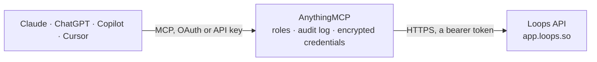

<!-- Generated by scripts/export-github-catalog.mjs in the anythingmcp-website repository. Do not edit by hand. -->

# Loops MCP connector

Send transactional emails, fire product events and manage contacts in Loops (the modern product-email tool for SaaS) from any AI agent. 9 tools, Bearer-token auth. The AnythingMCP connector gives Claude, ChatGPT, Microsoft Copilot, Cursor and Gemini 9 MCP tools for Loops: 4 read and 5 can change data.

**Category:** [Email](../email.md) · **Tools:** 9 · **Setup guide:** [anythingmcp.com](https://anythingmcp.com/guides/loops-to-mcp) · [Deutsch](https://anythingmcp.com/de/guides/loops-to-mcp) · [Italiano](https://anythingmcp.com/it/guides/loops-to-mcp) · [Español](https://anythingmcp.com/es/guides/loops-to-mcp) · [日本語](https://anythingmcp.com/ja/guides/loops-to-mcp) · [Русский](https://anythingmcp.com/ru/guides/loops-to-mcp) · [中文](https://anythingmcp.com/zh/guides/loops-to-mcp)

## Start without code

No installation and no terminal: AnythingMCP Cloud runs the Loops connector for you, operated by helpcode.ai in Frankfurt, Germany.

1. **Click the button above** and create an account or sign in. The Loops connector opens, ready to install.
2. **Paste the API key or token from your Loops account.** Every click is in the [step-by-step guide](https://anythingmcp.com/guides/loops-to-mcp).
3. **Click Install.** AnythingMCP shows the address of your MCP server.
4. **Add that address to your assistant:** [Claude](https://anythingmcp.com/guides/connect-loops-to-claude) · [ChatGPT](https://anythingmcp.com/guides/connect-loops-to-chatgpt) · [Microsoft Copilot](https://anythingmcp.com/guides/connect-loops-to-copilot) · [Cursor](https://anythingmcp.com/guides/connect-loops-to-cursor) · [Gemini CLI](https://anythingmcp.com/guides/connect-loops-to-gemini) · [Meta Muse](https://anythingmcp.com/guides/connect-loops-to-muse).
5. **Ask your first question**, for example: *Find contact for billing@novocell.io and tell me their userGroup, userId and whether they're subscribed.*

Prefer help with the setup? [Talk to us](https://anythingmcp.com/contact).

## How it works

- **The AI client** speaks MCP (Streamable HTTP) to AnythingMCP and only sees tool names, descriptions and results. It never gets the Loops credentials.
- **AnythingMCP** checks the client's role, builds the call from the tool definition, adds the credentials (a bearer token), calls Loops, logs the call and returns the result.
- **Loops** sees an ordinary API client with the rights of the account the credentials belong to.

## Tools

| Tool | What it does | Access |
|---|---|---|
| [`loops_test_api_key`](#loops_test_api_key) | Verify the API key works and return account info (team name, type). | read |
| [`loops_find_contact`](#loops_find_contact) | Find a contact by email or userId. | read |
| [`loops_create_contact`](#loops_create_contact) | Create a new contact. | write |
| [`loops_update_contact`](#loops_update_contact) | Update an existing contact's fields. | write |
| [`loops_delete_contact`](#loops_delete_contact) | Permanently delete a contact. | write |
| [`loops_send_event`](#loops_send_event) | Send a product/behavioral event to trigger a Loops automation. | write |
| [`loops_send_transactional_email`](#loops_send_transactional_email) | Send a transactional email using a pre-built Loops transactional template. | write |
| [`loops_list_mailing_lists`](#loops_list_mailing_lists) | List mailing lists configured on the account. | read |
| [`loops_list_custom_fields`](#loops_list_custom_fields) | List custom contact properties defined on the account, with their data types. | read |

## Tool reference

Every parameter as the AI client sees it in `tools/list`. Source: [`packages/backend/src/adapters/intl/loops.json`](../../../packages/backend/src/adapters/intl/loops.json).

### `loops_test_api_key`

Verify the API key works and return account info (team name, type). Health check.

**Access:** read · **Call:** `GET /api-key`

No parameters.

### `loops_find_contact`

Find a contact by email or userId. Returns the contact object with email, firstName, lastName, userGroup, userId, custom properties, subscribed flag.

**Access:** read · **Call:** `GET /contacts/find`

| Parameter | Type | Required | Description |
|---|---|---|---|
| `email` | string | no | Email to look up. Either email or userId required. |
| `userId` | string | no | External user ID. |

### `loops_create_contact`

Create a new contact. Required: email. Errors if email already exists (use loops_update_contact or loops_upsert_contact).

**Access:** write · **Call:** `POST /contacts/create`

| Parameter | Type | Required | Description |
|---|---|---|---|
| `email` | string | yes | Contact email. |
| `firstName` | string | no | First name. |
| `lastName` | string | no | Last name. |
| `userGroup` | string | no | Bucket (e.g. 'free', 'pro', 'trial'). |
| `userId` | string | no | External user ID for joining. |
| `subscribed` | boolean | no | Subscribed to marketing emails. Default true. |
| `mailingLists` | object | no | Map of mailing list IDs → boolean (subscribed?). |

### `loops_update_contact`

Update an existing contact's fields. Errors if contact doesn't exist (use loops_upsert_contact for upsert).

**Access:** write · **Call:** `PUT /contacts/update`

| Parameter | Type | Required | Description |
|---|---|---|---|
| `email` | string | yes | Email of contact to update (required). |
| `firstName` | string | no | New first name. |
| `lastName` | string | no | New last name. |
| `userGroup` | string | no | New bucket. |
| `userId` | string | no | Update external user ID. |
| `subscribed` | boolean | no | Subscribed flag. |
| `mailingLists` | object | no | Mailing list memberships. |

### `loops_delete_contact`

Permanently delete a contact. GDPR-friendly. Irreversible.

**Access:** write · **Call:** `POST /contacts/delete`

| Parameter | Type | Required | Description |
|---|---|---|---|
| `email` | string | no | Contact email. |
| `userId` | string | no | Or by external user ID. |

### `loops_send_event`

Send a product/behavioral event to trigger a Loops automation. Required: email (or userId) + eventName. Any eventProperties become merge variables in the triggered emails.

**Access:** write · **Call:** `POST /events/send`

| Parameter | Type | Required | Description |
|---|---|---|---|
| `email` | string | no | Contact email. Either email or userId required. |
| `userId` | string | no | External user ID. |
| `eventName` | string | yes | Event name matching a Loops trigger (e.g. 'subscription.upgraded'). |
| `contactProperties` | object | no | Properties to also update on the contact (upsert). |
| `eventProperties` | object | no | Event-specific properties — usable as {{eventProperties.X}} in triggered emails. |
| `mailingLists` | object | no | Update list memberships in same call. |

### `loops_send_transactional_email`

Send a transactional email using a pre-built Loops transactional template. The `transactionalId` comes from the Loops UI. Variables in the template are filled from `dataVariables`.

**Access:** write · **Call:** `POST /transactional`

| Parameter | Type | Required | Description |
|---|---|---|---|
| `transactionalId` | string | yes | ID of the published transactional template (from Loops UI). |
| `email` | string | yes | Recipient email. |
| `dataVariables` | object | no | Object filling template variables: {firstName:'Jane', resetLink:'...'}. |
| `addToAudience` | boolean | no | If true, also create the recipient as a contact if missing. Default false. |
| `attachments` | any[] | no | Array of {filename, contentType, data (base64)} attachments. Optional. |

### `loops_list_mailing_lists`

List mailing lists configured on the account. Returns each list's id, name, description, isPublic, createdAt.

**Access:** read · **Call:** `GET /lists`

No parameters.

### `loops_list_custom_fields`

List custom contact properties defined on the account, with their data types. Required to know which keys are valid in `contactProperties` / contact updates.

**Access:** read · **Call:** `GET /contacts/customFields`

No parameters.

## Run it yourself

AnythingMCP is open source (AGPL-3.0). [Run it with Docker](../../../README.md#run-it-yourself), open **Connectors → Store**, pick **Loops** and enter `LOOPS_API_KEY`, then add your MCP server URL to the AI client.

[← Email connectors](../email.md) · [All categories](../README.md)
