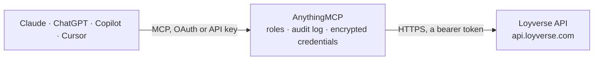

<!-- Generated by scripts/export-github-catalog.mjs in the anythingmcp-website repository. Do not edit by hand. -->

# Loyverse MCP connector

Loyverse point of sale: sales and refund receipts, shifts and cash, items with variants, categories, modifiers, discounts and taxes, stock per store, loyalty customers, employees, stores, POS … The AnythingMCP connector gives Claude, ChatGPT, Microsoft Copilot, Cursor and Gemini 40 MCP tools for Loyverse: 28 read and 12 can change data.

**Category:** [E-commerce](../e-commerce.md) · **Tools:** 40 · **Setup guide:** [anythingmcp.com](https://anythingmcp.com/guides/loyverse-to-mcp) · [Deutsch](https://anythingmcp.com/de/guides/loyverse-to-mcp) · [Italiano](https://anythingmcp.com/it/guides/loyverse-to-mcp) · [Español](https://anythingmcp.com/es/guides/loyverse-to-mcp) · [日本語](https://anythingmcp.com/ja/guides/loyverse-to-mcp) · [Русский](https://anythingmcp.com/ru/guides/loyverse-to-mcp) · [中文](https://anythingmcp.com/zh/guides/loyverse-to-mcp)

## Start without code

No installation and no terminal: AnythingMCP Cloud runs the Loyverse connector for you, operated by helpcode.ai in Frankfurt, Germany.

1. **Click the button above** and create an account or sign in. The Loyverse connector opens, ready to install.
2. **Paste the API key or token from your Loyverse account.** Every click is in the [step-by-step guide](https://anythingmcp.com/guides/loyverse-to-mcp).
3. **Click Install.** AnythingMCP shows the address of your MCP server.
4. **Add that address to your assistant:** [Claude](https://anythingmcp.com/guides/connect-loyverse-to-claude) · [ChatGPT](https://anythingmcp.com/guides/connect-loyverse-to-chatgpt) · [Microsoft Copilot](https://anythingmcp.com/guides/connect-loyverse-to-copilot) · [Cursor](https://anythingmcp.com/guides/connect-loyverse-to-cursor) · [Gemini CLI](https://anythingmcp.com/guides/connect-loyverse-to-gemini) · [Meta Muse](https://anythingmcp.com/guides/connect-loyverse-to-muse).
5. **Ask your first question**, for example: *Show receipt 1-1023 from Milano Store on 2026-09-12, I need totals and payments*

Prefer help with the setup? [Talk to us](https://anythingmcp.com/contact).

## How it works

- **The AI client** speaks MCP (Streamable HTTP) to AnythingMCP and only sees tool names, descriptions and results. It never gets the Loyverse credentials.
- **AnythingMCP** checks the client's role, builds the call from the tool definition, adds the credentials (a bearer token), calls Loyverse, logs the call and returns the result.
- **Loyverse** sees an ordinary API client with the rights of the account the credentials belong to.

## Tools

| Tool | What it does | Access |
|---|---|---|
| [`loyverse_get_merchant`](#loyverse_get_merchant) | Get the Loyverse account (merchant) behind the token: business name, email, country and currency with its decimal places. | read |
| [`loyverse_list_stores`](#loyverse_list_stores) | List the stores of the account with name, address, phone and description. | read |
| [`loyverse_get_store`](#loyverse_get_store) | Get one store by its id (UUID) with name, address, phone number and description, as shown in the Back Office. | read |
| [`loyverse_list_pos_devices`](#loyverse_list_pos_devices) | List the POS devices (registers) of the account, optionally for one store, with name, store id and whether the device is activated. | read |
| [`loyverse_list_receipts`](#loyverse_list_receipts) | List sales and refund receipts, newest first, with line items, discounts, taxes, payments, totals, store, employee, customer and POS device. | read |
| [`loyverse_get_receipt`](#loyverse_get_receipt) | Get one receipt by its receipt number (e.g. 1-1001) with all line items, modifiers, discounts, taxes, payments and the refund link. | read |
| [`loyverse_create_receipt`](#loyverse_create_receipt) | Record a sales receipt in Loyverse (e.g. a sale made in another channel). | write |
| [`loyverse_refund_receipt`](#loyverse_refund_receipt) | Create a refund receipt for some or all lines of a sales receipt. | write |
| [`loyverse_list_shifts`](#loyverse_list_shifts) | List closed cash register shifts with opening and closing time, cash movements, expected and actual cash, gross and net sales, taxes and payments per type. | read |
| [`loyverse_get_shift`](#loyverse_get_shift) | Get one shift by id with cash drawer amounts, cash movements, sales totals, taxes and payment totals per payment type. | read |
| [`loyverse_list_payment_types`](#loyverse_list_payment_types) | List payment types (cash, card, check and custom ones) with their id and type. | read |
| [`loyverse_get_payment_type`](#loyverse_get_payment_type) | Get one payment type by id with its name, type (CASH, NONINTEGRATEDCARD, CHECK, OTHER and so on) and stores. | read |
| [`loyverse_list_items`](#loyverse_list_items) | List items of the catalog with category, taxes, modifiers, options and their variants (SKU, barcode, cost, default price and price per store). | read |
| [`loyverse_get_item`](#loyverse_get_item) | Get one item by id with its variants, prices per store, category, tax ids, modifier ids, stock tracking and composite components. | read |
| [`loyverse_save_item`](#loyverse_save_item) | Create an item, or update it when id is given (Loyverse upserts with POST). | write |
| [`loyverse_delete_item`](#loyverse_delete_item) | Delete an item and its variants from the catalog. | write |
| [`loyverse_list_variants`](#loyverse_list_variants) | List item variants with SKU, barcode, option values, cost, default price and per-store price and availability. | read |
| [`loyverse_get_variant`](#loyverse_get_variant) | Get one item variant by id with SKU, barcode, option values, cost and the price and availability in each store. | read |
| [`loyverse_save_variant`](#loyverse_save_variant) | Create a variant of an existing item, or update it when variant_id is given (upsert with POST). | write |
| [`loyverse_list_categories`](#loyverse_list_categories) | List item categories with name and colour. | read |
| [`loyverse_get_category`](#loyverse_get_category) | Get one item category by id (UUID) with its name, colour and creation and deletion times. | read |
| [`loyverse_save_category`](#loyverse_save_category) | Create an item category, or rename or recolour it when id is given (Loyverse upserts with POST). | write |
| [`loyverse_list_modifiers`](#loyverse_list_modifiers) | List modifiers (e.g. Milk: whole, oat) with their options and prices and the stores where they are used. | read |
| [`loyverse_list_discounts`](#loyverse_list_discounts) | List discounts with type (fixed or variable, percent or amount, by points), value, stores and whether access is restricted. | read |
| [`loyverse_get_discount`](#loyverse_get_discount) | Get one discount by id (UUID) with its type, amount or percent, stores and restricted access flag. | read |
| [`loyverse_save_discount`](#loyverse_save_discount) | Create a discount, or update it when id is given (upsert with POST). | write |
| [`loyverse_list_taxes`](#loyverse_list_taxes) | List taxes with rate, type (included in the price or added to it) and stores. | read |
| [`loyverse_get_tax`](#loyverse_get_tax) | Get one tax by id (UUID) with its name, rate in percent, type (INCLUDED or ADDED) and stores. | read |
| [`loyverse_save_tax`](#loyverse_save_tax) | Create a tax, or update it when id is given (upsert with POST). | write |
| [`loyverse_list_suppliers`](#loyverse_list_suppliers) | List suppliers with contact name, email, phone, website, address and note. | read |
| [`loyverse_list_inventory`](#loyverse_list_inventory) | List stock levels per item variant and store (in_stock). | read |
| [`loyverse_set_inventory`](#loyverse_set_inventory) | Set the stock of item variants in stores. | write |
| [`loyverse_list_customers`](#loyverse_list_customers) | List loyalty customers with contact details, customer code, note, first and last visit, total visits, total spent and points balance. | read |
| [`loyverse_get_customer`](#loyverse_get_customer) | Get one customer by id with contact details, address, customer code, visits, total spent and loyalty points. | read |
| [`loyverse_save_customer`](#loyverse_save_customer) | Create a customer, or update one when id is given (upsert with POST). | write |
| [`loyverse_delete_customer`](#loyverse_delete_customer) | Delete a customer with their loyalty points. | write |
| [`loyverse_list_employees`](#loyverse_list_employees) | List employees with name, email, phone, role and the stores they work in. | read |
| [`loyverse_get_employee`](#loyverse_get_employee) | Get one employee by id (UUID) with name, email, phone number, owner flag and the stores they work in. | read |
| [`loyverse_list_webhooks`](#loyverse_list_webhooks) | List the webhooks of the account with event type, target URL and status (ENABLED or DISABLED after failed deliveries). | read |
| [`loyverse_create_webhook`](#loyverse_create_webhook) | Subscribe an HTTPS URL to one event: receipts, items, customers or inventory changes, or closed shifts. | write |

## Tool reference

Every parameter as the AI client sees it in `tools/list`. Source: [`packages/backend/src/adapters/intl/loyverse.json`](../../../packages/backend/src/adapters/intl/loyverse.json).

### `loyverse_get_merchant`

Get the Loyverse account (merchant) behind the token: business name, email, country and currency with its decimal places. Use it to check the token.

**Access:** read · **Call:** `GET /merchant/`

No parameters.

### `loyverse_list_stores`

List the stores of the account with name, address, phone and description. Store ids filter receipts, shifts, inventory and POS devices.

**Access:** read · **Call:** `GET /stores`

| Parameter | Type | Required | Description |
|---|---|---|---|
| `store_ids` | string | no | Only these store ids, comma-separated. |
| `created_at_min` | string | no | Only records created at or after this UTC time, ISO 8601, e.g. 2026-03-30T00:00:00.000Z. |
| `created_at_max` | string | no | Only records created at or before this UTC time, ISO 8601. |
| `updated_at_min` | string | no | Only records updated at or after this UTC time, ISO 8601. |
| `updated_at_max` | string | no | Only records updated at or before this UTC time, ISO 8601. |
| `show_deleted` | boolean | no | true to include soft-deleted records (they carry deleted_at). |

### `loyverse_get_store`

Get one store by its id (UUID) with name, address, phone number and description, as shown in the Back Office.

**Access:** read · **Call:** `GET /stores/{store_id}`

| Parameter | Type | Required | Description |
|---|---|---|---|
| `store_id` | string | yes | Store id (UUID). |

### `loyverse_list_pos_devices`

List the POS devices (registers) of the account, optionally for one store, with name, store id and whether the device is activated.

**Access:** read · **Call:** `GET /pos_devices`

| Parameter | Type | Required | Description |
|---|---|---|---|
| `store_id` | string | no | Only devices of this store id. |
| `show_deleted` | boolean | no | true to include soft-deleted records (they carry deleted_at). |

### `loyverse_list_receipts`

List sales and refund receipts, newest first, with line items, discounts, taxes, payments, totals, store, employee, customer and POS device. Filter by store, date range or receipt numbers.

**Access:** read · **Call:** `GET /receipts`

| Parameter | Type | Required | Description |
|---|---|---|---|
| `receipt_numbers` | string | no | Only these receipt numbers, comma-separated, e.g. 1-1001,1-1002. |
| `since_receipt_number` | string | no | Receipts created at or after the receipt with this number. |
| `before_receipt_number` | string | no | Receipts created up to the receipt with this number. |
| `store_id` | string | no | Only receipts of this store id. |
| `order` | string | no | Only receipts with this order name or number (the order field of the receipt). |
| `source` | string | no | Only receipts from this source, e.g. point of sale or the name of the app that created them. |
| `created_at_min` | string | no | Only records created at or after this UTC time, ISO 8601, e.g. 2026-03-30T00:00:00.000Z. |
| `created_at_max` | string | no | Only records created at or before this UTC time, ISO 8601. |
| `updated_at_min` | string | no | Only records updated at or after this UTC time, ISO 8601. |
| `updated_at_max` | string | no | Only records updated at or before this UTC time, ISO 8601. |
| `limit` | integer | no | Objects per page, 1 to 250 (default 50). |
| `cursor` | string | no | Cursor from the previous response (its cursor field) to get the next page. Absent in the response on the last page. |

### `loyverse_get_receipt`

Get one receipt by its receipt number (e.g. 1-1001) with all line items, modifiers, discounts, taxes, payments and the refund link.

**Access:** read · **Call:** `GET /receipts/{receipt_number}`

| Parameter | Type | Required | Description |
|---|---|---|---|
| `receipt_number` | string | yes | Receipt number as printed, e.g. 1-1001. |

### `loyverse_create_receipt`

Record a sales receipt in Loyverse (e.g. a sale made in another channel). Stock is reduced for tracked items. Payments must add up to the receipt total. Confirm the lines and amounts with the user first.

**Access:** write · **Call:** `POST /receipts`

| Parameter | Type | Required | Description |
|---|---|---|---|
| `store_id` | string | yes | Store id where the sale is recorded. |
| `employee_id` | string | no | Employee id credited with the sale. |
| `customer_id` | string | no | Customer id to attach (earns points). |
| `order` | string | no | Order name or number to store on the receipt. |
| `source` | string | no | Free text naming where the sale came from, e.g. Online shop. |
| `receipt_date` | string | no | Sale time in UTC, ISO 8601. Default now. |
| `note` | string | no | Receipt note. |
| `line_items` | object[] | yes | Lines: {variant_id, quantity, price?, cost?, line_note?, line_taxes?: [{id}], line_discounts?: [{id}], line_modifiers?: [{modifier_option_id}]}. |
| `total_discounts` | object[] | no | Receipt-level discounts: [{id, scope: RECEIPT}]. |
| `payments` | object[] | yes | Payments: [{payment_type_id, money_amount, paid_at?}]. The sum must equal the receipt total. |

### `loyverse_refund_receipt`

Create a refund receipt for some or all lines of a sales receipt. It cannot be undone and returns money to the customer, so show the lines to the user and wait for a yes.

**Access:** write · **Call:** `POST /receipts/{receipt_number}/refund`

| Parameter | Type | Required | Description |
|---|---|---|---|
| `receipt_number` | string | yes | Number of the sales receipt to refund, e.g. 1-1001. |
| `line_items` | object[] | yes | Lines to refund: [{id, quantity}], where id is the line item id from the sales receipt. |
| `store_id` | string | no | Store id where the refund is made (default the store of the sale). |
| `employee_id` | string | no | Employee id making the refund. |
| `source` | string | no | Free text naming where the refund came from. |
| `receipt_date` | string | no | Refund time in UTC, ISO 8601. Default now. |

### `loyverse_list_shifts`

List closed cash register shifts with opening and closing time, cash movements, expected and actual cash, gross and net sales, taxes and payments per type.

**Access:** read · **Call:** `GET /shifts`

| Parameter | Type | Required | Description |
|---|---|---|---|
| `store_ids` | string | no | Only shifts of these store ids, comma-separated. |
| `created_at_min` | string | no | Only shifts opened at or after this UTC time, ISO 8601. |
| `created_at_max` | string | no | Only shifts opened at or before this UTC time, ISO 8601. |
| `limit` | integer | no | Objects per page, 1 to 250 (default 50). |
| `cursor` | string | no | Cursor from the previous response (its cursor field) to get the next page. Absent in the response on the last page. |

### `loyverse_get_shift`

Get one shift by id with cash drawer amounts, cash movements, sales totals, taxes and payment totals per payment type.

**Access:** read · **Call:** `GET /shifts/{shift_id}`

| Parameter | Type | Required | Description |
|---|---|---|---|
| `shift_id` | string | yes | Shift id (UUID). |

### `loyverse_list_payment_types`

List payment types (cash, card, check and custom ones) with their id and type. Receipts reference them in payments.

**Access:** read · **Call:** `GET /payment_types`

| Parameter | Type | Required | Description |
|---|---|---|---|
| `payment_type_ids` | string | no | Only these payment type ids, comma-separated. |
| `created_at_min` | string | no | Only records created at or after this UTC time, ISO 8601, e.g. 2026-03-30T00:00:00.000Z. |
| `created_at_max` | string | no | Only records created at or before this UTC time, ISO 8601. |
| `updated_at_min` | string | no | Only records updated at or after this UTC time, ISO 8601. |
| `updated_at_max` | string | no | Only records updated at or before this UTC time, ISO 8601. |
| `show_deleted` | boolean | no | true to include soft-deleted records (they carry deleted_at). |

### `loyverse_get_payment_type`

Get one payment type by id with its name, type (CASH, NONINTEGRATEDCARD, CHECK, OTHER and so on) and stores.

**Access:** read · **Call:** `GET /payment_types/{payment_type_id}`

| Parameter | Type | Required | Description |
|---|---|---|---|
| `payment_type_id` | string | yes | Payment type id (UUID). |

### `loyverse_list_items`

List items of the catalog with category, taxes, modifiers, options and their variants (SKU, barcode, cost, default price and price per store).

**Access:** read · **Call:** `GET /items`

| Parameter | Type | Required | Description |
|---|---|---|---|
| `items_ids` | string | no | Only these item ids, comma-separated. |
| `created_at_min` | string | no | Only records created at or after this UTC time, ISO 8601, e.g. 2026-03-30T00:00:00.000Z. |
| `created_at_max` | string | no | Only records created at or before this UTC time, ISO 8601. |
| `updated_at_min` | string | no | Only records updated at or after this UTC time, ISO 8601. |
| `updated_at_max` | string | no | Only records updated at or before this UTC time, ISO 8601. |
| `show_deleted` | boolean | no | true to include soft-deleted records (they carry deleted_at). |
| `limit` | integer | no | Objects per page, 1 to 250 (default 50). |
| `cursor` | string | no | Cursor from the previous response (its cursor field) to get the next page. Absent in the response on the last page. |

### `loyverse_get_item`

Get one item by id with its variants, prices per store, category, tax ids, modifier ids, stock tracking and composite components.

**Access:** read · **Call:** `GET /items/{item_id}`

| Parameter | Type | Required | Description |
|---|---|---|---|
| `item_id` | string | yes | Item id (UUID). |

### `loyverse_save_item`

Create an item, or update it when id is given (Loyverse upserts with POST). Send the full item: fields left out on an update are reset. Prices are per variant.

**Access:** write · **Call:** `POST /items`

| Parameter | Type | Required | Description |
|---|---|---|---|
| `id` | string | no | Item id to update; leave out to create. |
| `item_name` | string | yes | Item name. |
| `description` | string | no | Description. |
| `reference_id` | string | no | Your own reference. |
| `category_id` | string | no | Category id. |
| `track_stock` | boolean | no | Track inventory for this item. |
| `sold_by_weight` | boolean | no | Sold by weight. |
| `is_composite` | boolean | no | Composite item made of components. |
| `use_production` | boolean | no | Produce composite items in advance (stock of the composite itself). |
| `components` | object[] | no | For composite items: [{variant_id, quantity}]. |
| `primary_supplier_id` | string | no | Supplier id. |
| `tax_ids` | string[] | no | Tax ids applied to the item. |
| `modifiers_ids` | string[] | no | Modifier ids available on the item. |
| `option1_name` | string | no | Name of the first option, e.g. Size. |
| `option2_name` | string | no | Name of the second option. |
| `option3_name` | string | no | Name of the third option. |
| `form` | `SQUARE` \| `CIRCLE` \| `SUN` \| `OCTAGON` | no | Shape shown on the POS when there is no image. |
| `color` | `GREY` \| `RED` \| `PINK` \| `ORANGE` \| `YELLOW` \| `GREEN` \| `BLUE` \| `PURPLE` | no | Colour shown on the POS. |
| `variants` | object[] | no | Variants: [{variant_id? (to update), sku, barcode, option1_value, cost, purchase_cost, default_pricing_type: FIXED\|VARIABLE, default_price, stores: [{store_id, pricing_type, price, available_for_sale, optimal_stock, low_stock}]}]. |

### `loyverse_delete_item`

Delete an item and its variants from the catalog. It cannot be undone through the API, so confirm with the user first.

**Access:** write · **Call:** `DELETE /items/{item_id}`

| Parameter | Type | Required | Description |
|---|---|---|---|
| `item_id` | string | yes | Item id (UUID). |

### `loyverse_list_variants`

List item variants with SKU, barcode, option values, cost, default price and per-store price and availability. Find a variant by SKU here.

**Access:** read · **Call:** `GET /variants`

| Parameter | Type | Required | Description |
|---|---|---|---|
| `variants_ids` | string | no | Only these variant ids, comma-separated. |
| `items_ids` | string | no | Only variants of these item ids, comma-separated. |
| `sku` | string | no | Only the variant with this SKU. |
| `created_at_min` | string | no | Only records created at or after this UTC time, ISO 8601, e.g. 2026-03-30T00:00:00.000Z. |
| `created_at_max` | string | no | Only records created at or before this UTC time, ISO 8601. |
| `updated_at_min` | string | no | Only records updated at or after this UTC time, ISO 8601. |
| `updated_at_max` | string | no | Only records updated at or before this UTC time, ISO 8601. |
| `show_deleted` | boolean | no | true to include soft-deleted records (they carry deleted_at). |
| `limit` | integer | no | Objects per page, 1 to 250 (default 50). |
| `cursor` | string | no | Cursor from the previous response (its cursor field) to get the next page. Absent in the response on the last page. |

### `loyverse_get_variant`

Get one item variant by id with SKU, barcode, option values, cost and the price and availability in each store.

**Access:** read · **Call:** `GET /variants/{variant_id}`

| Parameter | Type | Required | Description |
|---|---|---|---|
| `variant_id` | string | yes | Variant id (UUID). |

### `loyverse_save_variant`

Create a variant of an existing item, or update it when variant_id is given (upsert with POST). Prices and availability are set per store.

**Access:** write · **Call:** `POST /variants`

| Parameter | Type | Required | Description |
|---|---|---|---|
| `variant_id` | string | no | Variant id to update; leave out to create. |
| `item_id` | string | yes | Item the variant belongs to. |
| `sku` | string | no | SKU (unique). |
| `reference_variant_id` | string | no | Your own reference. |
| `option1_value` | string | no | Value of the first option, e.g. Large. |
| `option2_value` | string | no | Value of the second option. |
| `option3_value` | string | no | Value of the third option. |
| `barcode` | string | no | Barcode. |
| `cost` | number | no | Cost price. |
| `purchase_cost` | number | no | Purchase cost from the supplier. |
| `default_pricing_type` | `FIXED` \| `VARIABLE` | no | FIXED price or VARIABLE (entered at sale). |
| `default_price` | number | no | Default selling price in the account currency. |
| `stores` | object[] | no | Per store: [{store_id, pricing_type, price, available_for_sale, optimal_stock, low_stock}]. |

### `loyverse_list_categories`

List item categories with name and colour. Items reference them through category_id.

**Access:** read · **Call:** `GET /categories`

| Parameter | Type | Required | Description |
|---|---|---|---|
| `categories_ids` | string | no | Only these category ids, comma-separated. |
| `show_deleted` | boolean | no | true to include soft-deleted records (they carry deleted_at). |
| `limit` | integer | no | Objects per page, 1 to 250 (default 50). |
| `cursor` | string | no | Cursor from the previous response (its cursor field) to get the next page. Absent in the response on the last page. |

### `loyverse_get_category`

Get one item category by id (UUID) with its name, colour and creation and deletion times.

**Access:** read · **Call:** `GET /categories/{category_id}`

| Parameter | Type | Required | Description |
|---|---|---|---|
| `category_id` | string | yes | Category id (UUID). |

### `loyverse_save_category`

Create an item category, or rename or recolour it when id is given (Loyverse upserts with POST).

**Access:** write · **Call:** `POST /categories`

| Parameter | Type | Required | Description |
|---|---|---|---|
| `id` | string | no | Category id to update; leave out to create. |
| `name` | string | yes | Category name. |
| `color` | `GREY` \| `RED` \| `PINK` \| `ORANGE` \| `YELLOW` \| `GREEN` \| `BLUE` \| `PURPLE` | no | Colour shown on the POS. |

### `loyverse_list_modifiers`

List modifiers (e.g. Milk: whole, oat) with their options and prices and the stores where they are used.

**Access:** read · **Call:** `GET /modifiers`

| Parameter | Type | Required | Description |
|---|---|---|---|
| `modifier_ids` | string | no | Only these modifier ids, comma-separated. |
| `created_at_min` | string | no | Only records created at or after this UTC time, ISO 8601, e.g. 2026-03-30T00:00:00.000Z. |
| `created_at_max` | string | no | Only records created at or before this UTC time, ISO 8601. |
| `updated_at_min` | string | no | Only records updated at or after this UTC time, ISO 8601. |
| `updated_at_max` | string | no | Only records updated at or before this UTC time, ISO 8601. |
| `show_deleted` | boolean | no | true to include soft-deleted records (they carry deleted_at). |
| `limit` | integer | no | Objects per page, 1 to 250 (default 50). |
| `cursor` | string | no | Cursor from the previous response (its cursor field) to get the next page. Absent in the response on the last page. |

### `loyverse_list_discounts`

List discounts with type (fixed or variable, percent or amount, by points), value, stores and whether access is restricted.

**Access:** read · **Call:** `GET /discounts`

| Parameter | Type | Required | Description |
|---|---|---|---|
| `discount_ids` | string | no | Only these discount ids, comma-separated. |
| `created_at_min` | string | no | Only records created at or after this UTC time, ISO 8601, e.g. 2026-03-30T00:00:00.000Z. |
| `created_at_max` | string | no | Only records created at or before this UTC time, ISO 8601. |
| `updated_at_min` | string | no | Only records updated at or after this UTC time, ISO 8601. |
| `updated_at_max` | string | no | Only records updated at or before this UTC time, ISO 8601. |
| `show_deleted` | boolean | no | true to include soft-deleted records (they carry deleted_at). |

### `loyverse_get_discount`

Get one discount by id (UUID) with its type, amount or percent, stores and restricted access flag.

**Access:** read · **Call:** `GET /discounts/{discount_id}`

| Parameter | Type | Required | Description |
|---|---|---|---|
| `discount_id` | string | yes | Discount id (UUID). |

### `loyverse_save_discount`

Create a discount, or update it when id is given (upsert with POST). Fixed discounts carry an amount or a percent; variable ones are entered at sale.

**Access:** write · **Call:** `POST /discounts`

| Parameter | Type | Required | Description |
|---|---|---|---|
| `id` | string | no | Discount id to update; leave out to create. |
| `name` | string | yes | Discount name. |
| `type` | `FIXED_PERCENT` \| `FIXED_AMOUNT` \| `VARIABLE_PERCENT` \| `VARIABLE_AMOUNT` \| `DISCOUNT_BY_POINTS` | yes | Discount type. |
| `discount_amount` | number | no | Amount off for FIXED_AMOUNT, in the account currency. |
| `discount_percent` | number | no | Percent off for FIXED_PERCENT, e.g. 10. |
| `stores` | string[] | no | Store ids where the discount is available. |
| `restricted_access` | boolean | no | Only employees with the right may apply it. |

### `loyverse_list_taxes`

List taxes with rate, type (included in the price or added to it) and stores. Items reference them through tax_ids.

**Access:** read · **Call:** `GET /taxes`

| Parameter | Type | Required | Description |
|---|---|---|---|
| `tax_ids` | string | no | Only these tax ids, comma-separated. |
| `created_at_min` | string | no | Only records created at or after this UTC time, ISO 8601, e.g. 2026-03-30T00:00:00.000Z. |
| `created_at_max` | string | no | Only records created at or before this UTC time, ISO 8601. |
| `updated_at_min` | string | no | Only records updated at or after this UTC time, ISO 8601. |
| `updated_at_max` | string | no | Only records updated at or before this UTC time, ISO 8601. |
| `show_deleted` | boolean | no | true to include soft-deleted records (they carry deleted_at). |

### `loyverse_get_tax`

Get one tax by id (UUID) with its name, rate in percent, type (INCLUDED or ADDED) and stores.

**Access:** read · **Call:** `GET /taxes/{tax_id}`

| Parameter | Type | Required | Description |
|---|---|---|---|
| `tax_id` | string | yes | Tax id (UUID). |

### `loyverse_save_tax`

Create a tax, or update it when id is given (upsert with POST). A tax is INCLUDED in prices or ADDED on top, with a rate in percent.

**Access:** write · **Call:** `POST /taxes`

| Parameter | Type | Required | Description |
|---|---|---|---|
| `id` | string | no | Tax id to update; leave out to create. |
| `name` | string | yes | Tax name, e.g. VAT 20%. |
| `type` | `INCLUDED` \| `ADDED` | yes | INCLUDED in the price or ADDED to it. |
| `rate` | number | yes | Rate in percent, e.g. 20. |
| `stores` | string[] | no | Store ids where the tax applies. |

### `loyverse_list_suppliers`

List suppliers with contact name, email, phone, website, address and note. Items reference them through primary_supplier_id.

**Access:** read · **Call:** `GET /suppliers/`

| Parameter | Type | Required | Description |
|---|---|---|---|
| `limit` | integer | no | Objects per page, 1 to 250 (default 50). |
| `cursor` | string | no | Cursor from the previous response (its cursor field) to get the next page. Absent in the response on the last page. |

### `loyverse_list_inventory`

List stock levels per item variant and store (in_stock). Filter by store, variant or update time to see what changed.

**Access:** read · **Call:** `GET /inventory`

| Parameter | Type | Required | Description |
|---|---|---|---|
| `store_ids` | string | no | Only these store ids, comma-separated. |
| `variant_ids` | string | no | Only these variant ids, comma-separated. |
| `updated_at_min` | string | no | Only levels updated at or after this UTC time, ISO 8601. |
| `updated_at_max` | string | no | Only levels updated at or before this UTC time, ISO 8601. |
| `limit` | integer | no | Objects per page, 1 to 250 (default 50). |
| `cursor` | string | no | Cursor from the previous response (its cursor field) to get the next page. Absent in the response on the last page. |

### `loyverse_set_inventory`

Set the stock of item variants in stores. stock_after is the new absolute quantity, not a change: read the current level first and confirm the new values with the user.

**Access:** write · **Call:** `POST /inventory`

| Parameter | Type | Required | Description |
|---|---|---|---|
| `inventory_levels` | object[] | yes | Levels to set: [{variant_id, store_id, stock_after}], up to 250 per call. |

### `loyverse_list_customers`

List loyalty customers with contact details, customer code, note, first and last visit, total visits, total spent and points balance. Search by email.

**Access:** read · **Call:** `GET /customers`

| Parameter | Type | Required | Description |
|---|---|---|---|
| `customer_ids` | string | no | Only these customer ids, comma-separated. |
| `email` | string | no | Only the customer with this email. |
| `created_at_min` | string | no | Only records created at or after this UTC time, ISO 8601, e.g. 2026-03-30T00:00:00.000Z. |
| `created_at_max` | string | no | Only records created at or before this UTC time, ISO 8601. |
| `updated_at_min` | string | no | Only records updated at or after this UTC time, ISO 8601. |
| `updated_at_max` | string | no | Only records updated at or before this UTC time, ISO 8601. |
| `limit` | integer | no | Objects per page, 1 to 250 (default 50). |
| `cursor` | string | no | Cursor from the previous response (its cursor field) to get the next page. Absent in the response on the last page. |

### `loyverse_get_customer`

Get one customer by id with contact details, address, customer code, visits, total spent and loyalty points.

**Access:** read · **Call:** `GET /customers/{customer_id}`

| Parameter | Type | Required | Description |
|---|---|---|---|
| `customer_id` | string | yes | Customer id (UUID). |

### `loyverse_save_customer`

Create a customer, or update one when id is given (upsert with POST). total_points sets the loyalty balance.

**Access:** write · **Call:** `POST /customers`

| Parameter | Type | Required | Description |
|---|---|---|---|
| `id` | string | no | Customer id to update; leave out to create. |
| `name` | string | yes | Full name. |
| `email` | string | no | Email address. |
| `phone_number` | string | no | Phone number. |
| `address` | string | no | Street address. |
| `city` | string | no | City. |
| `region` | string | no | Region or state. |
| `postal_code` | string | no | Postal code. |
| `country_code` | string | no | Country, ISO 3166-1 alpha-2, e.g. GB. |
| `customer_code` | string | no | Your own customer code or loyalty card number. |
| `note` | string | no | Note. |
| `total_points` | number | no | Loyalty points balance to set. |

### `loyverse_delete_customer`

Delete a customer with their loyalty points. It cannot be undone through the API, so confirm with the user first.

**Access:** write · **Call:** `DELETE /customers/{customer_id}`

| Parameter | Type | Required | Description |
|---|---|---|---|
| `customer_id` | string | yes | Customer id (UUID). |

### `loyverse_list_employees`

List employees with name, email, phone, role and the stores they work in. Receipts and shifts reference them through employee_id.

**Access:** read · **Call:** `GET /employees`

| Parameter | Type | Required | Description |
|---|---|---|---|
| `employee_ids` | string | no | Only these employee ids, comma-separated. |
| `created_at_min` | string | no | Only records created at or after this UTC time, ISO 8601, e.g. 2026-03-30T00:00:00.000Z. |
| `created_at_max` | string | no | Only records created at or before this UTC time, ISO 8601. |
| `updated_at_min` | string | no | Only records updated at or after this UTC time, ISO 8601. |
| `updated_at_max` | string | no | Only records updated at or before this UTC time, ISO 8601. |
| `show_deleted` | boolean | no | true to include soft-deleted records (they carry deleted_at). |
| `limit` | integer | no | Objects per page, 1 to 250 (default 50). |
| `cursor` | string | no | Cursor from the previous response (its cursor field) to get the next page. Absent in the response on the last page. |

### `loyverse_get_employee`

Get one employee by id (UUID) with name, email, phone number, owner flag and the stores they work in.

**Access:** read · **Call:** `GET /employees/{employee_id}`

| Parameter | Type | Required | Description |
|---|---|---|---|
| `employee_id` | string | yes | Employee id (UUID). |

### `loyverse_list_webhooks`

List the webhooks of the account with event type, target URL and status (ENABLED or DISABLED after failed deliveries).

**Access:** read · **Call:** `GET /webhooks/`

No parameters.

### `loyverse_create_webhook`

Subscribe an HTTPS URL to one event: receipts, items, customers or inventory changes, or closed shifts. Event type plus URL must be unique.

**Access:** write · **Call:** `POST /webhooks/`

| Parameter | Type | Required | Description |
|---|---|---|---|
| `url` | string | yes | HTTPS URL that receives the POST notifications. |
| `type` | `inventory_levels.update` \| `items.update` \| `customers.update` \| `receipts.update` \| `shifts.create` | yes | Event to subscribe to. |
| `status` | `ENABLED` \| `DISABLED` | no | ENABLED (default) or DISABLED. |

## Run it yourself

AnythingMCP is open source (AGPL-3.0). [Run it with Docker](../../../README.md#run-it-yourself), open **Connectors → Store**, pick **Loyverse** and enter `LOYVERSE_ACCESS_TOKEN`, then add your MCP server URL to the AI client.

[← E-commerce connectors](../e-commerce.md) · [All categories](../README.md)
