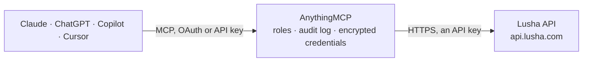

<!-- Generated by scripts/export-github-catalog.mjs in the anythingmcp-website repository. Do not edit by hand. -->

# Lusha MCP connector

Give your AI Lusha B2B data: find contacts and companies by name, email, LinkedIn URL or domain, prospect by job title, seniority, industry, size and location, check your credits, and reveal emails, … The AnythingMCP connector gives Claude, ChatGPT, Microsoft Copilot, Cursor and Gemini 13 MCP tools for Lusha: 9 read and 4 can change data.

**Category:** [Data Enrichment](../enrichment.md) · **Tools:** 13 · **Setup guide:** [anythingmcp.com](https://anythingmcp.com/guides/lusha-to-mcp) · [Deutsch](https://anythingmcp.com/de/guides/lusha-to-mcp) · [Italiano](https://anythingmcp.com/it/guides/lusha-to-mcp) · [Español](https://anythingmcp.com/es/guides/lusha-to-mcp) · [日本語](https://anythingmcp.com/ja/guides/lusha-to-mcp) · [Русский](https://anythingmcp.com/ru/guides/lusha-to-mcp) · [中文](https://anythingmcp.com/zh/guides/lusha-to-mcp)

## Start without code

No installation and no terminal: AnythingMCP Cloud runs the Lusha connector for you, operated by helpcode.ai in Frankfurt, Germany.

1. **Click the button above** and create an account or sign in. The Lusha connector opens, ready to install.
2. **Paste the API key or token from your Lusha account.** Every click is in the [step-by-step guide](https://anythingmcp.com/guides/lusha-to-mcp).
3. **Click Install.** AnythingMCP shows the address of your MCP server.
4. **Add that address to your assistant:** [Claude](https://anythingmcp.com/guides/connect-lusha-to-claude) · [ChatGPT](https://anythingmcp.com/guides/connect-lusha-to-chatgpt) · [Microsoft Copilot](https://anythingmcp.com/guides/connect-lusha-to-copilot) · [Cursor](https://anythingmcp.com/guides/connect-lusha-to-cursor) · [Gemini CLI](https://anythingmcp.com/guides/connect-lusha-to-gemini) · [Meta Muse](https://anythingmcp.com/guides/connect-lusha-to-muse).
5. **Ask your first question**, for example: *Do we have a Lusha contact for Marco Rinaldi at SolisData Srl, CTO, email marco.rinaldi@solisdata.it*

Prefer help with the setup? [Talk to us](https://anythingmcp.com/contact).

## How it works

- **The AI client** speaks MCP (Streamable HTTP) to AnythingMCP and only sees tool names, descriptions and results. It never gets the Lusha credentials.
- **AnythingMCP** checks the client's role, builds the call from the tool definition, adds the credentials (an API key), calls Lusha, logs the call and returns the result.
- **Lusha** sees an ordinary API client with the rights of the account the credentials belong to.

## Tools

| Tool | What it does | Access |
|---|---|---|
| [`lusha_get_account_usage`](#lusha_get_account_usage) | Show the Lusha account: credits total, used and remaining in the current period, rate-limit usage (minute, hour, day), the plan and its renewal dates, and… | read |
| [`lusha_list_filters`](#lusha_list_filters) | List the filter types Lusha prospecting accepts, for contacts or for companies, and whether each needs a search text to list its values. | read |
| [`lusha_get_filter_values`](#lusha_get_filter_values) | List the valid values of one Lusha prospecting filter, e.g. seniority ids, departments, countries, company sizes, revenue ranges, industries… | read |
| [`lusha_search_contacts`](#lusha_search_contacts) | Find up to 100 people you already know in Lusha and get a preview of each: Lusha id, name, job title, seniority, department, company, location, LinkedIn… | read |
| [`lusha_search_companies`](#lusha_search_companies) | Find up to 100 companies you already know in Lusha by id, name or domain and get a preview of each: Lusha company id, name, domain, employee count range,… | read |
| [`lusha_prospect_contacts`](#lusha_prospect_contacts) | Find new contacts in Lusha by ICP filters and get a page of previews (Lusha id, name, job title, seniority, company, location, has, canReveal); no emails or… | write |
| [`lusha_prospect_companies`](#lusha_prospect_companies) | Find new companies in Lusha by firmographic filters and get a page of previews (Lusha company id, name, domain, employee range, industry, location). | write |
| [`lusha_enrich_contacts`](#lusha_enrich_contacts) | Reveal the emails and phone numbers (plus job, company, location, social links and previous employment) of up to 100 contacts by their Lusha ids from… | write |
| [`lusha_get_enrich_job`](#lusha_get_enrich_job) | Read a Lusha enrichment job that lusha_enrich_contacts returned in job (Data Waterfall). | read |
| [`lusha_enrich_companies`](#lusha_enrich_companies) | Reveal the full profile of up to 100 companies by their Lusha ids from lusha_search_companies or lusha_prospect_companies: description, company type,… | write |
| [`lusha_list_signal_types`](#lusha_list_signal_types) | List the signal types Lusha tracks for contacts (promotion, companyChange) or for companies (hiring surges, headcount changes, website traffic, IT spend,… | read |
| [`lusha_get_contact_signals`](#lusha_get_contact_signals) | Get recent job changes and promotions of up to 100 contacts by Lusha contact id, e.g. to reach someone who just started a new role. | read |
| [`lusha_get_company_signals`](#lusha_get_company_signals) | Get recent events at up to 100 companies by Lusha company id: hiring surges, headcount increases or decreases, website traffic and IT spend changes, news… | read |

## Tool reference

Every parameter as the AI client sees it in `tools/list`. Source: [`packages/backend/src/adapters/intl/lusha.json`](../../../packages/backend/src/adapters/intl/lusha.json).

### `lusha_get_account_usage`

Show the Lusha account: credits total, used and remaining in the current period, rate-limit usage (minute, hour, day), the plan and its renewal dates, and the credit price of every billable action (pricing, e.g. api_search, reveal_company, email, phone). Use it to estimate a cost before spending credits. Free, but Lusha allows only 5 calls a minute. Read-only.

**Access:** read · **Call:** `GET /v3/account/usage`

No parameters.

### `lusha_list_filters`

List the filter types Lusha prospecting accepts, for contacts or for companies, and whether each needs a search text to list its values. Use it before lusha_get_filter_values. Free: uses no credits. Read-only.

**Access:** read · **Call:** `GET /v3/{entity}/prospecting/filters`

| Parameter | Type | Required | Description |
|---|---|---|---|
| `entity` | `contacts` \| `companies` | yes | contacts for contact prospecting filters, companies for company prospecting filters. |

### `lusha_get_filter_values`

List the valid values of one Lusha prospecting filter, e.g. seniority ids, departments, countries, company sizes, revenue ranges, industries (industriesLabels with their ids), SIC and NAICS codes, intent topics. Contacts: departments, seniority, existingDataPoints, countries, locations (needs query). Companies: sizes, revenues, sics, naics, intentTopics, industriesLabels, names, technologies and locations (the last three need query). Use the values in lusha_prospect_contacts and lusha_prospect_companies. Free: uses no credits. Read-only.

**Access:** read · **Call:** `GET /v3/{entity}/prospecting/filters/{filter_type}`

| Parameter | Type | Required | Description |
|---|---|---|---|
| `entity` | `contacts` \| `companies` | yes | contacts or companies. |
| `filter_type` | `departments` \| `seniority` \| `existingDataPoints` \| `countries` \| `locations` \| `names` \| `sizes` \| `revenues` \| `sics` \| `naics` \| `industriesLabels` \| `intentTopics` \| `technologies` | yes | The filter whose values you need. Contacts accept departments, seniority, existingDataPoints, countries, locations; companies accept names, sizes, revenues, locations, sics, naics, industriesLabels, intentTopics, technologies. |
| `query` | string | no | Search text, 2 to 256 characters. Required for locations, names and technologies, e.g. Munich or Salesforce. |

### `lusha_search_contacts`

Find up to 100 people you already know in Lusha and get a preview of each: Lusha id, name, job title, seniority, department, company, location, LinkedIn URL, which data points exist (has) and what an enrichment would reveal and cost (canReveal, e.g. emails 1 credit, phones 5 credits). No emails or phone numbers yet. Give each contact one identifier: id, linkedinUrl, email, or firstName plus lastName plus companyName or companyDomain. COSTS CREDITS: a small api_search charge per contact found (NOT_FOUND is free); ask the user before searching many. Returns personal data: use it only for a legitimate B2B purpose.

**Access:** read · **Call:** `POST /v3/contacts/search`

| Parameter | Type | Required | Description |
|---|---|---|---|
| `contacts` | object[] | yes | 1 to 100 people, e.g. [{"firstName": "Anna", "lastName": "Schmidt", "companyDomain": "example.com"}]. |
| `include_partial_profiles` | boolean | no | Also return profiles with incomplete data. |

### `lusha_search_companies`

Find up to 100 companies you already know in Lusha by id, name or domain and get a preview of each: Lusha company id, name, domain, employee count range, industry, location, LinkedIn URL and which data points an enrichment would reveal (has). COSTS CREDITS: a small api_search charge per company found (NOT_FOUND is free). Use the ids with lusha_enrich_companies.

**Access:** read · **Call:** `POST /v3/companies/search`

| Parameter | Type | Required | Description |
|---|---|---|---|
| `companies` | object[] | yes | 1 to 100 companies, e.g. [{"domain": "example.com"}]. |
| `include_partial_profiles` | boolean | no | Also return profiles with incomplete data. |

### `lusha_prospect_contacts`

Find new contacts in Lusha by ICP filters and get a page of previews (Lusha id, name, job title, seniority, company, location, has, canReveal); no emails or phones. Filters go in filters with contacts and/or companies, each with include and exclude, e.g. {"contacts": {"include": {"jobTitles": ["head of procurement"], "seniorityIds": [4, 5], "locations": [{"country": "Germany"}], "existingDataPoints": ["work_email"]}}, "companies": {"include": {"sizes": [{"min": 51, "max": 500}], "mainIndustriesIds": [4]}}}. Contact fields: jobTitles, jobTitlesExactMatch, seniorityIds, departments, locations, countries, existingDataPoints, skills, searchText, signals. Company fields: names, domains, sizes, revenues, locations, mainIndustriesIds, subIndustriesIds, technologies, intentTopics, sicCodes, naicsCodes, businessModel, companyType, foundedYear, funding. Look values up with lusha_get_filter_values. COSTS CREDITS: billed per result returned (api_search, see pricing in lusha_get_account_usage), plus a charge per matched signal when filtering by signals; keep size small and tell the user before larger pages. Returns personal data: use it only for a legitimate B2B purpose.

**Access:** write · **Call:** `POST /v3/contacts/prospecting`

| Parameter | Type | Required | Description |
|---|---|---|---|
| `filters` | object | yes | Lusha prospecting filters: {"contacts": {"include": {...}, "exclude": {...}}, "companies": {"include": {...}, "exclude": {...}}}. At least one of contacts or companies. |
| `page` | integer | no | Page number, starting at 0. |
| `size` | integer | no | Results per page, 10 to 100 (default 10). Every result is billed. |
| `include_partial_profiles` | boolean | no | Include contacts with incomplete data (Lusha default true). |
| `exclude_dnc` | boolean | no | Leave out contacts whose phone numbers are all on Do Not Call lists. Not on every plan (403 otherwise). |
| `max_contacts_per_company` | integer | no | At most this many contacts from one company, 1 to 20. |

### `lusha_prospect_companies`

Find new companies in Lusha by firmographic filters and get a page of previews (Lusha company id, name, domain, employee range, industry, location). Filters go in filters.companies with include and exclude, e.g. {"companies": {"include": {"locations": [{"country": "Germany"}], "sizes": [{"min": 51, "max": 500}], "technologies": ["Salesforce"], "mainIndustriesIds": [4]}, "exclude": {"domains": ["example.com"]}}}. Fields: names, domains, sizes, revenues, locations, mainIndustriesIds, subIndustriesIds, technologies with technologiesCondition, intentTopics, sicCodes, naicsCodes, businessModel (B2B, B2C, B2G), companyType, foundedYear, funding, keywords, signals. Look values up with lusha_get_filter_values. COSTS CREDITS: billed per result returned (api_search, see pricing in lusha_get_account_usage), plus a charge per matched signal when filtering by signals; keep size small.

**Access:** write · **Call:** `POST /v3/companies/prospecting`

| Parameter | Type | Required | Description |
|---|---|---|---|
| `filters` | object | yes | Lusha prospecting filters: {"companies": {"include": {...}, "exclude": {...}}}. |
| `page` | integer | no | Page number, starting at 0. |
| `size` | integer | no | Results per page, 10 to 100 (default 10). Every result is billed. |

### `lusha_enrich_contacts`

Reveal the emails and phone numbers (plus job, company, location, social links and previous employment) of up to 100 contacts by their Lusha ids from lusha_search_contacts or lusha_prospect_contacts. COSTS CREDITS: charged per revealed email and per revealed phone (a phone usually costs several times an email; canReveal in the search result shows the price, 0 when already revealed). Before calling, list the contacts and the expected cost to the user and wait for their yes; ask only for what they need (reveal ["emails"] or ["phones"]). If the answer has a job, wait job.retryAfter seconds and call lusha_get_enrich_job. Returns personal data: use it only for a legitimate B2B purpose, under GDPR and CAN-SPAM, and respect doNotCall on phone numbers.

**Access:** write · **Call:** `POST /v3/contacts/enrich`

| Parameter | Type | Required | Description |
|---|---|---|---|
| `ids` | string[] | yes | Lusha contact ids from a search or prospecting result. |
| `reveal` | `emails` \| `phones`[] | no | What to reveal: ["emails"], ["phones"] or both. Omitted means both, which costs the most. |
| `waterfall_enabled` | boolean | no | false keeps this call to Lusha's own data even when Data Waterfall (third-party providers, extra credits) is switched on for the account. |

### `lusha_get_enrich_job`

Read a Lusha enrichment job that lusha_enrich_contacts returned in job (Data Waterfall). While status is processing, wait retryAfter seconds and call again; on complete, contacts holds the data that arrived late, merge it by id; on expired or failed, keep what the enrichment already returned. 404 means the job is gone: stop. Free: polling uses no credits (creditsCharged is what the late data cost). Read-only. Returns personal data.

**Access:** read · **Call:** `GET /v3/contacts/jobs/{job_id}`

| Parameter | Type | Required | Description |
|---|---|---|---|
| `job_id` | string | yes | job.id from lusha_enrich_contacts. |

### `lusha_enrich_companies`

Reveal the full profile of up to 100 companies by their Lusha ids from lusha_search_companies or lusha_prospect_companies: description, company type, founding year, employee count, industry and SIC and NAICS codes, headquarters and other locations, social links, revenue range, funding, technologies. reveal adds breakdowns such as employeesByDepartment, competitors, intent, openJobsTotal, directParent or ultimateParent. COSTS CREDITS: charged per company found (reveal_company), and some reveal fields add their own charge; tell the user the expected cost and wait for their yes before calling.

**Access:** write · **Call:** `POST /v3/companies/enrich`

| Parameter | Type | Required | Description |
|---|---|---|---|
| `ids` | string[] | yes | Lusha company ids from a search or prospecting result. |
| `reveal` | `employeesByDepartment` \| `employeesByLocation` \| `employeesBySeniority` \| `competitors` \| `intent` \| `estimatedAnnualItSpend` \| `monthlyWebsiteTraffic` \| `openJobsTotal` \| `openJobsByDepartment` \| `openJobsByLocation` \| `openJobsBySeniority` \| `directParent` \| `ultimateParent`[] | no | Optional extra data points; leave empty for the standard firmographics. |

### `lusha_list_signal_types`

List the signal types Lusha tracks for contacts (promotion, companyChange) or for companies (hiring surges, headcount changes, website traffic, IT spend, news categories, intent changes). Use the names in lusha_get_contact_signals and lusha_get_company_signals. Free: uses no credits. Read-only.

**Access:** read · **Call:** `GET /v3/{entity}/signals/types`

| Parameter | Type | Required | Description |
|---|---|---|---|
| `entity` | `contacts` \| `companies` | yes | contacts or companies. |

### `lusha_get_contact_signals`

Get recent job changes and promotions of up to 100 contacts by Lusha contact id, e.g. to reach someone who just started a new role. signal_types: promotion, companyChange or allSignals. COSTS CREDITS: charged per matched signal per contact (no match, no charge); tell the user before running it on many contacts. Returns personal data: use it only for a legitimate B2B purpose.

**Access:** read · **Call:** `POST /v3/contacts/signals`

| Parameter | Type | Required | Description |
|---|---|---|---|
| `ids` | string[] | yes | Lusha contact ids. |
| `signal_types` | `allSignals` \| `promotion` \| `companyChange`[] | no | Which signals to return. |
| `start_date` | string | no | Only signals on or after this date, YYYY-MM-DD. |
| `max_results_per_signal` | integer | no | At most this many events per signal type and contact. |

### `lusha_get_company_signals`

Get recent events at up to 100 companies by Lusha company id: hiring surges, headcount increases or decreases, website traffic and IT spend changes, news (risk, funding, people, product and more) and week-over-week intent changes. allSignals covers everything except the four intent types (newIntentTopic, intentScoreIncrease, intentScoreDecrease, intentTopicRemoved), which must be named. See lusha_list_signal_types. COSTS CREDITS: charged per matched signal per company (no match, no charge); tell the user before running it on many companies.

**Access:** read · **Call:** `POST /v3/companies/signals`

| Parameter | Type | Required | Description |
|---|---|---|---|
| `ids` | string[] | yes | Lusha company ids. |
| `signal_types` | string[] | no | Signal types from lusha_list_signal_types, e.g. ["surgeInHiring", "headcountIncrease3m"] or ["allSignals"]. |
| `start_date` | string | no | Only signals on or after this date, YYYY-MM-DD. |
| `max_results_per_signal` | integer | no | At most this many events per signal type and company. |

## Run it yourself

AnythingMCP is open source (AGPL-3.0). [Run it with Docker](../../../README.md#run-it-yourself), open **Connectors → Store**, pick **Lusha** and enter `LUSHA_API_KEY`, then add your MCP server URL to the AI client.

[← Data Enrichment connectors](../enrichment.md) · [All categories](../README.md)
