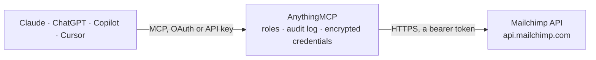

<!-- Generated by scripts/export-github-catalog.mjs in the anythingmcp-website repository. Do not edit by hand. -->

# Mailchimp MCP connector

Drive Mailchimp's Marketing API from any AI agent: audiences (lists), members, tags, campaigns, templates, segments and account info. 16 ready-to-use tools. The AnythingMCP connector gives Claude, ChatGPT, Microsoft Copilot, Cursor and Gemini 16 MCP tools for Mailchimp: 10 read and 6 can change data.

**Category:** [Email](../email.md) · **Tools:** 16 · **Setup guide:** [anythingmcp.com](https://anythingmcp.com/guides/mailchimp-to-mcp) · [Deutsch](https://anythingmcp.com/de/guides/mailchimp-to-mcp) · [Italiano](https://anythingmcp.com/it/guides/mailchimp-to-mcp) · [Español](https://anythingmcp.com/es/guides/mailchimp-to-mcp) · [日本語](https://anythingmcp.com/ja/guides/mailchimp-to-mcp) · [Русский](https://anythingmcp.com/ru/guides/mailchimp-to-mcp) · [中文](https://anythingmcp.com/zh/guides/mailchimp-to-mcp)

## Start without code

No installation and no terminal: AnythingMCP Cloud runs the Mailchimp connector for you, operated by helpcode.ai in Frankfurt, Germany.

1. **Click the button above** and create an account or sign in. The Mailchimp connector opens, ready to install.
2. **Paste the API key or token from your Mailchimp account.** Every click is in the [step-by-step guide](https://anythingmcp.com/guides/mailchimp-to-mcp).
3. **Click Install.** AnythingMCP shows the address of your MCP server.
4. **Add that address to your assistant:** [Claude](https://anythingmcp.com/guides/connect-mailchimp-to-claude) · [ChatGPT](https://anythingmcp.com/guides/connect-mailchimp-to-chatgpt) · [Microsoft Copilot](https://anythingmcp.com/guides/connect-mailchimp-to-copilot) · [Cursor](https://anythingmcp.com/guides/connect-mailchimp-to-cursor) · [Gemini CLI](https://anythingmcp.com/guides/connect-mailchimp-to-gemini) · [Meta Muse](https://anythingmcp.com/guides/connect-mailchimp-to-muse).
5. **Ask your first question**, for example: *What's the subscription status and last_changed for invoice381@helden-logistics.de in our Billing Subscribers audience?*

Prefer help with the setup? [Talk to us](https://anythingmcp.com/contact).

## How it works

- **The AI client** speaks MCP (Streamable HTTP) to AnythingMCP and only sees tool names, descriptions and results. It never gets the Mailchimp credentials.
- **AnythingMCP** checks the client's role, builds the call from the tool definition, adds the credentials (a bearer token), calls Mailchimp, logs the call and returns the result.
- **Mailchimp** sees an ordinary API client with the rights of the account the credentials belong to.

## Tools

| Tool | What it does | Access |
|---|---|---|
| [`mailchimp_ping`](#mailchimp_ping) | Health check — returns 'Everything's Chimpy!' if the API key and datacenter are valid. | read |
| [`mailchimp_get_account_info`](#mailchimp_get_account_info) | Return account-level info: company name, contact, plan type, total subscribers across all audiences, industry, language, last login. | read |
| [`mailchimp_list_audiences`](#mailchimp_list_audiences) | List all audiences (formerly 'lists') on the account. | read |
| [`mailchimp_get_audience`](#mailchimp_get_audience) | Fetch a single audience by ID. | read |
| [`mailchimp_create_audience`](#mailchimp_create_audience) | Create a new audience. | write |
| [`mailchimp_list_members`](#mailchimp_list_members) | List members of an audience, optionally filtered by status or subscription date. | read |
| [`mailchimp_get_member`](#mailchimp_get_member) | Fetch a single member by their subscriber_hash (MD5 of lowercase email). | read |
| [`mailchimp_upsert_member`](#mailchimp_upsert_member) | Add a member to an audience if missing, or update them if they already exist. | write |
| [`mailchimp_update_member_tags`](#mailchimp_update_member_tags) | Add or remove tags on a member. | write |
| [`mailchimp_delete_member_permanently`](#mailchimp_delete_member_permanently) | PERMANENTLY delete a member from an audience — cannot be re-added later (Mailchimp keeps a deletion hash forever for compliance). | write |
| [`mailchimp_list_segments`](#mailchimp_list_segments) | List segments of an audience. | read |
| [`mailchimp_list_campaigns`](#mailchimp_list_campaigns) | List campaigns on the account, optionally filtered by status, type, audience or date range. | read |
| [`mailchimp_get_campaign`](#mailchimp_get_campaign) | Fetch a single campaign by ID. | read |
| [`mailchimp_create_campaign`](#mailchimp_create_campaign) | Create a new campaign (does NOT send it). | write |
| [`mailchimp_send_campaign`](#mailchimp_send_campaign) | Send (deliver) a previously-created campaign immediately. | write |
| [`mailchimp_list_templates`](#mailchimp_list_templates) | List templates (user-created and Mailchimp-provided) available on the account. | read |

## Tool reference

Every parameter as the AI client sees it in `tools/list`. Source: [`packages/backend/src/adapters/intl/mailchimp.json`](../../../packages/backend/src/adapters/intl/mailchimp.json).

### `mailchimp_ping`

Health check — returns 'Everything's Chimpy!' if the API key and datacenter are valid. Call this at agent startup to confirm credentials before any real work.

**Access:** read · **Call:** `GET /ping`

No parameters.

### `mailchimp_get_account_info`

Return account-level info: company name, contact, plan type, total subscribers across all audiences, industry, language, last login. Useful to introduce the agent to the account context.

**Access:** read · **Call:** `GET /`

No parameters.

### `mailchimp_list_audiences`

List all audiences (formerly 'lists') on the account. Returns each audience's id, name, member_count, date_created, contact info, and default sender. Use this once to discover the list_id you'll pass to other tools.

**Access:** read · **Call:** `GET /lists`

| Parameter | Type | Required | Description |
|---|---|---|---|
| `count` | integer | no | Max audiences per page (default 10, max 1000). |
| `offset` | integer | no | Pagination offset. |
| `fields` | string | no | Comma-separated paths of fields to return (e.g. 'lists.id,lists.name,lists.stats.member_count'). Trims response. |

### `mailchimp_get_audience`

Fetch a single audience by ID. Returns full details including stats (member_count, unsubscribe_count, open_rate, click_rate), permission_reminder, double_optin setting, and default sender info.

**Access:** read · **Call:** `GET /lists/{listId}`

| Parameter | Type | Required | Description |
|---|---|---|---|
| `listId` | string | yes | 10-character audience (list) ID. |

### `mailchimp_create_audience`

Create a new audience. Many fields are required by Mailchimp's compliance rules — contact address, permission reminder, sender from_name/from_email — without them the audience can't legally send emails. Returns the new list id.

**Access:** write · **Call:** `POST /lists`

| Parameter | Type | Required | Description |
|---|---|---|---|
| `name` | string | yes | Audience name (e.g. 'Newsletter subscribers'). |
| `contact` | object | yes | Required postal address: {company, address1, address2, city, state, zip, country (2-letter code), phone}. Mailchimp displays this in the email footer per CAN-SPAM. |
| `permission_reminder` | string | yes | Short text shown in every email explaining why the subscriber is receiving it (e.g. 'You signed up for updates at acme.com'). |
| `campaign_defaults` | object | yes | {from_name, from_email, subject, language}. Required defaults applied to new campaigns on this list. |
| `email_type_option` | boolean | no | If true, let subscribers choose HTML vs plain-text. Default false. |
| `double_optin` | boolean | no | If true, new subscribers must confirm via email (GDPR-friendly). Default false. |

### `mailchimp_list_members`

List members of an audience, optionally filtered by status or subscription date. Supports pagination via count + offset.

**Access:** read · **Call:** `GET /lists/{listId}/members`

| Parameter | Type | Required | Description |
|---|---|---|---|
| `listId` | string | yes | Audience ID. |
| `status` | string | no | Filter by status: subscribed, unsubscribed, cleaned, pending, transactional, archived. |
| `count` | integer | no | Max per page (default 10, max 1000). |
| `offset` | integer | no | Pagination offset. |
| `since_timestamp_opt` | string | no | Filter members who opted in after this ISO 8601 timestamp. |
| `fields` | string | no | Comma-separated dotted paths to return. |

### `mailchimp_get_member`

Fetch a single member by their subscriber_hash (MD5 of lowercase email). Returns email, status, merge_fields (e.g. FNAME, LNAME), tags, stats, last_changed timestamp.

**Access:** read · **Call:** `GET /lists/{listId}/members/{subscriberHash}`

| Parameter | Type | Required | Description |
|---|---|---|---|
| `listId` | string | yes | Audience ID. |
| `subscriberHash` | string | yes | MD5 hash of the lowercase email address. |

### `mailchimp_upsert_member`

Add a member to an audience if missing, or update them if they already exist. Uses PUT — idempotent. Pass the MD5 lowercase-email hash as subscriberHash; `email_address` and `status_if_new` are required for the create path.

**Access:** write · **Call:** `PUT /lists/{listId}/members/{subscriberHash}`

| Parameter | Type | Required | Description |
|---|---|---|---|
| `listId` | string | yes | Audience ID. |
| `subscriberHash` | string | yes | MD5 hash of the lowercase email. |
| `email_address` | string | yes | Recipient email (lowercase). Required. |
| `status_if_new` | string | yes | Status when creating a new member: subscribed, unsubscribed, cleaned, pending, transactional. Required. |
| `status` | string | no | Status when updating an existing member (overrides status_if_new on update). |
| `merge_fields` | object | no | Merge tags object, e.g. {FNAME: 'Jane', LNAME: 'Doe'}. |
| `tags` | any[] | no | Array of tag names to apply, e.g. ['vip', 'newsletter']. Replaces existing tags. |
| `language` | string | no | BCP-47 language tag, e.g. 'en', 'es', 'de'. |
| `vip` | boolean | no | Mark member as VIP. |
| `ip_signup` | string | no | IP from which the member signed up (consent record). |

### `mailchimp_update_member_tags`

Add or remove tags on a member. Pass an array like [{name: 'vip', status: 'active'}, {name: 'cold', status: 'inactive'}]. 'active' adds the tag; 'inactive' removes it.

**Access:** write · **Call:** `POST /lists/{listId}/members/{subscriberHash}/tags`

| Parameter | Type | Required | Description |
|---|---|---|---|
| `listId` | string | yes | Audience ID. |
| `subscriberHash` | string | yes | MD5 hash of the lowercase email. |
| `tags` | any[] | yes | Array of {name, status} objects. status is 'active' (add) or 'inactive' (remove). |

### `mailchimp_delete_member_permanently`

PERMANENTLY delete a member from an audience — cannot be re-added later (Mailchimp keeps a deletion hash forever for compliance). Use for GDPR right-to-be-forgotten requests only. For normal unsubscribe, use mailchimp_upsert_member with status='unsubscribed'.

**Access:** write · **Call:** `POST /lists/{listId}/members/{subscriberHash}/actions/delete-permanent`

| Parameter | Type | Required | Description |
|---|---|---|---|
| `listId` | string | yes | Audience ID. |
| `subscriberHash` | string | yes | MD5 hash of the lowercase email. |

### `mailchimp_list_segments`

List segments of an audience. Segments are saved filter expressions on members (e.g. 'opened last campaign + lives in EU'). Returns each segment's id, name, member_count, type (static/saved/fuzzy).

**Access:** read · **Call:** `GET /lists/{listId}/segments`

| Parameter | Type | Required | Description |
|---|---|---|---|
| `listId` | string | yes | Audience ID. |
| `count` | integer | no | Max per page. |
| `type` | string | no | Filter by segment type: saved, static, fuzzy. |

### `mailchimp_list_campaigns`

List campaigns on the account, optionally filtered by status, type, audience or date range. Returns each campaign's id, type, status, send_time, recipients (list_id, segment_id), settings (subject_line, from_name, reply_to), and report_summary (opens, clicks).

**Access:** read · **Call:** `GET /campaigns`

| Parameter | Type | Required | Description |
|---|---|---|---|
| `status` | string | no | Filter by status: save, paused, schedule, sending, sent. |
| `type` | string | no | Filter by type: regular, plaintext, absplit, rss, variate. |
| `list_id` | string | no | Filter by audience. |
| `since_send_time` | string | no | ISO 8601: only campaigns sent after this time. |
| `before_send_time` | string | no | ISO 8601: only campaigns sent before this time. |
| `count` | integer | no | Max per page. |
| `offset` | integer | no | Pagination offset. |

### `mailchimp_get_campaign`

Fetch a single campaign by ID. Returns settings, recipients, tracking config, send_time, and a report_summary with open/click/bounce stats if already sent.

**Access:** read · **Call:** `GET /campaigns/{campaignId}`

| Parameter | Type | Required | Description |
|---|---|---|---|
| `campaignId` | string | yes | Campaign ID (web_id is a different short numeric ID — use the alphanumeric id). |

### `mailchimp_create_campaign`

Create a new campaign (does NOT send it). After creation you set its content (template / HTML) via Mailchimp's UI or the `/campaigns/{id}/content` endpoint, then call mailchimp_send_campaign. The recipients object MUST reference an existing list_id and optionally a segment.

**Access:** write · **Call:** `POST /campaigns`

| Parameter | Type | Required | Description |
|---|---|---|---|
| `type` | string | yes | Campaign type: regular, plaintext, absplit, rss, variate. Most agent uses → regular. |
| `recipients` | object | yes | {list_id: '...', segment_opts: {saved_segment_id: ...}} — required. |
| `settings` | object | yes | {subject_line, preview_text, title, from_name, reply_to, to_name, folder_id, authenticate, auto_footer, inline_css, auto_tweet}. subject_line + reply_to + from_name are typically required. |
| `tracking` | object | no | {opens, html_clicks, text_clicks, goal_tracking, ecomm360, google_analytics, clicktale}. Most defaults are fine. |

### `mailchimp_send_campaign`

Send (deliver) a previously-created campaign immediately. The campaign must have content set and pass the Mailchimp checklist (subject line, recipient audience, sender, etc.) — otherwise returns 400 with the failing checks.

**Access:** write · **Call:** `POST /campaigns/{campaignId}/actions/send`

| Parameter | Type | Required | Description |
|---|---|---|---|
| `campaignId` | string | yes | Campaign ID to send. |

### `mailchimp_list_templates`

List templates (user-created and Mailchimp-provided) available on the account. Returns each template's id, name, type (user/base/gallery), category, date_created, thumbnail.

**Access:** read · **Call:** `GET /templates`

| Parameter | Type | Required | Description |
|---|---|---|---|
| `type` | string | no | Filter by type: user, base, gallery. |
| `category` | string | no | Filter by category. |
| `count` | integer | no | Max per page. |
| `offset` | integer | no | Pagination offset. |

## Run it yourself

AnythingMCP is open source (AGPL-3.0). [Run it with Docker](../../../README.md#run-it-yourself), open **Connectors → Store**, pick **Mailchimp** and enter `MAILCHIMP_API_KEY`, `MAILCHIMP_DC`, then add your MCP server URL to the AI client.

[← Email connectors](../email.md) · [All categories](../README.md)
