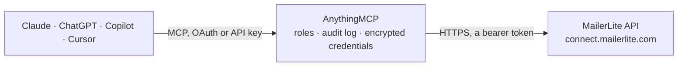

<!-- Generated by scripts/export-github-catalog.mjs in the anythingmcp-website repository. Do not edit by hand. -->

# MailerLite MCP connector

Manage MailerLite (email marketing: subscribers, groups, campaigns, automations, fields) from any AI agent. 10 tools, Bearer token. The AnythingMCP connector gives Claude, ChatGPT, Microsoft Copilot, Cursor and Gemini 10 MCP tools for MailerLite: 6 read and 4 can change data.

**Category:** [Email](../email.md) · **Tools:** 10 · **Setup guide:** [anythingmcp.com](https://anythingmcp.com/guides/mailerlite-to-mcp) · [Deutsch](https://anythingmcp.com/de/guides/mailerlite-to-mcp) · [Italiano](https://anythingmcp.com/it/guides/mailerlite-to-mcp) · [Español](https://anythingmcp.com/es/guides/mailerlite-to-mcp) · [日本語](https://anythingmcp.com/ja/guides/mailerlite-to-mcp) · [Русский](https://anythingmcp.com/ru/guides/mailerlite-to-mcp) · [中文](https://anythingmcp.com/zh/guides/mailerlite-to-mcp)

## Start without code

No installation and no terminal: AnythingMCP Cloud runs the MailerLite connector for you, operated by helpcode.ai in Frankfurt, Germany.

1. **Click the button above** and create an account or sign in. The MailerLite connector opens, ready to install.
2. **Paste the API key or token from your MailerLite account.** Every click is in the [step-by-step guide](https://anythingmcp.com/guides/mailerlite-to-mcp).
3. **Click Install.** AnythingMCP shows the address of your MCP server.
4. **Add that address to your assistant:** [Claude](https://anythingmcp.com/guides/connect-mailerlite-to-claude) · [ChatGPT](https://anythingmcp.com/guides/connect-mailerlite-to-chatgpt) · [Microsoft Copilot](https://anythingmcp.com/guides/connect-mailerlite-to-copilot) · [Cursor](https://anythingmcp.com/guides/connect-mailerlite-to-cursor) · [Gemini CLI](https://anythingmcp.com/guides/connect-mailerlite-to-gemini) · [Meta Muse](https://anythingmcp.com/guides/connect-mailerlite-to-muse).
5. **Ask your first question**, for example: *Do we have an active subscriber for maria.lopez@verdetec-gmbh.de and which groups is she in?*

Prefer help with the setup? [Talk to us](https://anythingmcp.com/contact).

## How it works

- **The AI client** speaks MCP (Streamable HTTP) to AnythingMCP and only sees tool names, descriptions and results. It never gets the MailerLite credentials.
- **AnythingMCP** checks the client's role, builds the call from the tool definition, adds the credentials (a bearer token), calls MailerLite, logs the call and returns the result.
- **MailerLite** sees an ordinary API client with the rights of the account the credentials belong to.

## Tools

| Tool | What it does | Access |
|---|---|---|
| [`mailerlite_list_subscribers`](#mailerlite_list_subscribers) | List subscribers. | read |
| [`mailerlite_get_subscriber`](#mailerlite_get_subscriber) | Get one subscriber by ID or email. | read |
| [`mailerlite_upsert_subscriber`](#mailerlite_upsert_subscriber) | Create or update a subscriber (idempotent on email). | write |
| [`mailerlite_delete_subscriber`](#mailerlite_delete_subscriber) | Permanently delete a subscriber. | write |
| [`mailerlite_list_groups`](#mailerlite_list_groups) | List groups. | read |
| [`mailerlite_create_group`](#mailerlite_create_group) | Create a group. | write |
| [`mailerlite_assign_to_group`](#mailerlite_assign_to_group) | Add a subscriber to a group. | write |
| [`mailerlite_list_campaigns`](#mailerlite_list_campaigns) | List campaigns. | read |
| [`mailerlite_get_campaign`](#mailerlite_get_campaign) | Get one campaign with delivery stats. | read |
| [`mailerlite_list_fields`](#mailerlite_list_fields) | List subscriber fields (built-in + custom). | read |

## Tool reference

Every parameter as the AI client sees it in `tools/list`. Source: [`packages/backend/src/adapters/intl/mailerlite.json`](../../../packages/backend/src/adapters/intl/mailerlite.json).

### `mailerlite_list_subscribers`

List subscribers. Filter by status, group, search.

**Access:** read · **Call:** `GET /subscribers`

| Parameter | Type | Required | Description |
|---|---|---|---|
| `status` | string | no | active, unsubscribed, junk, unconfirmed, bounced. |
| `filter_search` | string | no | Email/name search. |
| `limit` | integer | no | Max 100. |
| `cursor` | string | no | Pagination cursor. |

### `mailerlite_get_subscriber`

Get one subscriber by ID or email.

**Access:** read · **Call:** `GET /subscribers/{subscriber_id_or_email}`

| Parameter | Type | Required | Description |
|---|---|---|---|
| `subscriber_id_or_email` | string | yes | Numeric ID OR email. |

### `mailerlite_upsert_subscriber`

Create or update a subscriber (idempotent on email). `fields` is a flat map of field-name → value.

**Access:** write · **Call:** `POST /subscribers`

| Parameter | Type | Required | Description |
|---|---|---|---|
| `email` | string | yes | Email (required). |
| `fields` | object | no | Custom field map (e.g. {name:'Jane', city:'Berlin'}). |
| `groups` | any[] | no | Array of group ID strings to add to. |
| `status` | string | no | active, unsubscribed, unconfirmed, ... |
| `subscribed_at` | string | no | ISO 8601 datetime. |
| `ip_address` | string | no | Subscriber IP. |

### `mailerlite_delete_subscriber`

Permanently delete a subscriber.

**Access:** write · **Call:** `DELETE /subscribers/{subscriber_id}`

| Parameter | Type | Required | Description |
|---|---|---|---|
| `subscriber_id` | string | yes | Subscriber ID. |

### `mailerlite_list_groups`

List groups.

**Access:** read · **Call:** `GET /groups`

| Parameter | Type | Required | Description |
|---|---|---|---|
| `limit` | integer | no | Max 100. |
| `filter_name` | string | no | Filter by name. |

### `mailerlite_create_group`

Create a group.

**Access:** write · **Call:** `POST /groups`

| Parameter | Type | Required | Description |
|---|---|---|---|
| `name` | string | yes | Group name. |

### `mailerlite_assign_to_group`

Add a subscriber to a group.

**Access:** write · **Call:** `POST /subscribers/{subscriber_id}/groups/{group_id}`

| Parameter | Type | Required | Description |
|---|---|---|---|
| `subscriber_id` | string | yes | Subscriber ID. |
| `group_id` | string | yes | Group ID. |

### `mailerlite_list_campaigns`

List campaigns. Filter by status (draft, sent, ready, queued).

**Access:** read · **Call:** `GET /campaigns`

| Parameter | Type | Required | Description |
|---|---|---|---|
| `status` | string | no | draft, sent, ready, queued, canceled. |
| `limit` | integer | no | Max 100. |

### `mailerlite_get_campaign`

Get one campaign with delivery stats.

**Access:** read · **Call:** `GET /campaigns/{campaign_id}`

| Parameter | Type | Required | Description |
|---|---|---|---|
| `campaign_id` | string | yes | Campaign ID. |

### `mailerlite_list_fields`

List subscriber fields (built-in + custom). Use to discover what `fields` keys you can populate.

**Access:** read · **Call:** `GET /fields`

No parameters.

## Run it yourself

AnythingMCP is open source (AGPL-3.0). [Run it with Docker](../../../README.md#run-it-yourself), open **Connectors → Store**, pick **MailerLite** and enter `MAILERLITE_API_TOKEN`, then add your MCP server URL to the AI client.

[← Email connectors](../email.md) · [All categories](../README.md)
