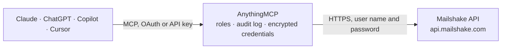

<!-- Generated by scripts/export-github-catalog.mjs in the anythingmcp-website repository. Do not edit by hand. -->

# Mailshake MCP connector

Drive Mailshake (cold email / sales engagement) from any AI agent: campaigns, recipients, leads, replies. 8 tools, Basic auth (API key as user). The AnythingMCP connector gives Claude, ChatGPT, Microsoft Copilot, Cursor and Gemini 8 MCP tools for Mailshake: 4 read and 4 can change data.

**Category:** [CRM](../crm.md) · **Tools:** 8 · **Setup guide:** [anythingmcp.com](https://anythingmcp.com/guides/mailshake-to-mcp) · [Deutsch](https://anythingmcp.com/de/guides/mailshake-to-mcp) · [Italiano](https://anythingmcp.com/it/guides/mailshake-to-mcp) · [Español](https://anythingmcp.com/es/guides/mailshake-to-mcp) · [日本語](https://anythingmcp.com/ja/guides/mailshake-to-mcp) · [Русский](https://anythingmcp.com/ru/guides/mailshake-to-mcp) · [中文](https://anythingmcp.com/zh/guides/mailshake-to-mcp)

## Start without code

No installation and no terminal: AnythingMCP Cloud runs the Mailshake connector for you, operated by helpcode.ai in Frankfurt, Germany.

1. **Click the button above** and create an account or sign in. The Mailshake connector opens, ready to install.
2. **Paste the API key or token from your Mailshake account.** Every click is in the [step-by-step guide](https://anythingmcp.com/guides/mailshake-to-mcp).
3. **Click Install.** AnythingMCP shows the address of your MCP server.
4. **Add that address to your assistant:** [Claude](https://anythingmcp.com/guides/connect-mailshake-to-claude) · [ChatGPT](https://anythingmcp.com/guides/connect-mailshake-to-chatgpt) · [Microsoft Copilot](https://anythingmcp.com/guides/connect-mailshake-to-copilot) · [Cursor](https://anythingmcp.com/guides/connect-mailshake-to-cursor) · [Gemini CLI](https://anythingmcp.com/guides/connect-mailshake-to-gemini) · [Meta Muse](https://anythingmcp.com/guides/connect-mailshake-to-muse).
5. **Ask your first question**, for example: *What's the status for recipient emily.wu@valortech.eu in campaign 'Q4 Outreach 2026'?*

Prefer help with the setup? [Talk to us](https://anythingmcp.com/contact).

## How it works

- **The AI client** speaks MCP (Streamable HTTP) to AnythingMCP and only sees tool names, descriptions and results. It never gets the Mailshake credentials.
- **AnythingMCP** checks the client's role, builds the call from the tool definition, adds the credentials (user name and password), calls Mailshake, logs the call and returns the result.
- **Mailshake** sees an ordinary API client with the rights of the account the credentials belong to.

## Tools

| Tool | What it does | Access |
|---|---|---|
| [`mailshake_me`](#mailshake_me) | Return the user/team the API key belongs to. | read |
| [`mailshake_list_campaigns`](#mailshake_list_campaigns) | List campaigns. | read |
| [`mailshake_get_campaign`](#mailshake_get_campaign) | Get a campaign by ID. | read |
| [`mailshake_pause_campaign`](#mailshake_pause_campaign) | Pause a campaign (stops all future sends until resumed). | write |
| [`mailshake_unpause_campaign`](#mailshake_unpause_campaign) | Resume a paused campaign. | write |
| [`mailshake_add_recipients_to_campaign`](#mailshake_add_recipients_to_campaign) | Add recipients to a campaign. | write |
| [`mailshake_list_recipients`](#mailshake_list_recipients) | List recipients in a campaign with filters. | read |
| [`mailshake_pause_recipient`](#mailshake_pause_recipient) | Pause a recipient by emailAddress + campaignID (stops further emails to them without unsubscribing). | write |

## Tool reference

Every parameter as the AI client sees it in `tools/list`. Source: [`packages/backend/src/adapters/intl/mailshake.json`](../../../packages/backend/src/adapters/intl/mailshake.json).

### `mailshake_me`

Return the user/team the API key belongs to. Useful as a first call to verify the API key works.

**Access:** read · **Call:** `GET /me`

No parameters.

### `mailshake_list_campaigns`

List campaigns.

**Access:** read · **Call:** `POST /campaigns/list`

| Parameter | Type | Required | Description |
|---|---|---|---|
| `perPage` | integer | no | Per page (default 25, max 100). |
| `cursor` | string | no | Pagination cursor. |
| `search` | string | no | Name substring filter. |

### `mailshake_get_campaign`

Get a campaign by ID.

**Access:** read · **Call:** `POST /campaigns/get`

| Parameter | Type | Required | Description |
|---|---|---|---|
| `id` | integer | yes | Campaign ID. |

### `mailshake_pause_campaign`

Pause a campaign (stops all future sends until resumed).

**Access:** write · **Call:** `POST /campaigns/pause`

| Parameter | Type | Required | Description |
|---|---|---|---|
| `id` | integer | yes | Campaign ID. |

### `mailshake_unpause_campaign`

Resume a paused campaign.

**Access:** write · **Call:** `POST /campaigns/unpause`

| Parameter | Type | Required | Description |
|---|---|---|---|
| `id` | integer | yes | Campaign ID. |

### `mailshake_add_recipients_to_campaign`

Add recipients to a campaign. recipients is array of {emailAddress, fullName?, firstName?, lastName?, phone?, companyName?, ...customFields}.

**Access:** write · **Call:** `POST /recipients/add`

| Parameter | Type | Required | Description |
|---|---|---|---|
| `campaignID` | integer | yes | Campaign ID. |
| `recipients` | any[] | yes | [{emailAddress, fullName?, firstName?, lastName?, phone?, companyName?, ...any custom variables defined in the campaign}]. |
| `addDuplicates` | boolean | no | If true, add even if email already in campaign. |

### `mailshake_list_recipients`

List recipients in a campaign with filters.

**Access:** read · **Call:** `POST /recipients/list`

| Parameter | Type | Required | Description |
|---|---|---|---|
| `campaignID` | integer | no | Campaign ID. |
| `perPage` | integer | no | Per page. |
| `cursor` | string | no | Cursor. |
| `status` | string | no | pending, sending, paused, finished, replied, bounced, unsubscribed. |
| `search` | string | no | Substring filter. |

### `mailshake_pause_recipient`

Pause a recipient by emailAddress + campaignID (stops further emails to them without unsubscribing).

**Access:** write · **Call:** `POST /recipients/pause`

| Parameter | Type | Required | Description |
|---|---|---|---|
| `emailAddress` | string | yes | Recipient email. |
| `campaignID` | integer | yes | Campaign ID. |

## Run it yourself

AnythingMCP is open source (AGPL-3.0). [Run it with Docker](../../../README.md#run-it-yourself), open **Connectors → Store**, pick **Mailshake** and enter `MAILSHAKE_API_KEY`, then add your MCP server URL to the AI client.

[← CRM connectors](../crm.md) · [All categories](../README.md)
