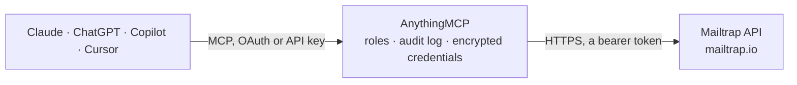

<!-- Generated by scripts/export-github-catalog.mjs in the anythingmcp-website repository. Do not edit by hand. -->

# Mailtrap MCP connector

Mailtrap email platform: send transactional, bulk and batch emails, test them in Email Sandbox (messages, spam and HTML reports), manage sending domains, suppressions, templates, Email Marketing … The AnythingMCP connector gives Claude, ChatGPT, Microsoft Copilot, Cursor and Gemini 53 MCP tools for Mailtrap: 29 read and 24 can change data.

**Category:** [Email](../email.md) · **Tools:** 53 · **Setup guide:** [anythingmcp.com](https://anythingmcp.com/guides/mailtrap-to-mcp) · [Deutsch](https://anythingmcp.com/de/guides/mailtrap-to-mcp) · [Italiano](https://anythingmcp.com/it/guides/mailtrap-to-mcp) · [Español](https://anythingmcp.com/es/guides/mailtrap-to-mcp) · [日本語](https://anythingmcp.com/ja/guides/mailtrap-to-mcp) · [Русский](https://anythingmcp.com/ru/guides/mailtrap-to-mcp) · [中文](https://anythingmcp.com/zh/guides/mailtrap-to-mcp)

## Start without code

No installation and no terminal: AnythingMCP Cloud runs the Mailtrap connector for you, operated by helpcode.ai in Frankfurt, Germany.

1. **Click the button above** and create an account or sign in. The Mailtrap connector opens, ready to install.
2. **Paste the API key or token from your Mailtrap account.** Every click is in the [step-by-step guide](https://anythingmcp.com/guides/mailtrap-to-mcp).
3. **Click Install.** AnythingMCP shows the address of your MCP server.
4. **Add that address to your assistant:** [Claude](https://anythingmcp.com/guides/connect-mailtrap-to-claude) · [ChatGPT](https://anythingmcp.com/guides/connect-mailtrap-to-chatgpt) · [Microsoft Copilot](https://anythingmcp.com/guides/connect-mailtrap-to-copilot) · [Cursor](https://anythingmcp.com/guides/connect-mailtrap-to-cursor) · [Gemini CLI](https://anythingmcp.com/guides/connect-mailtrap-to-gemini) · [Meta Muse](https://anythingmcp.com/guides/connect-mailtrap-to-muse).
5. **Ask your first question**, for example: *Which messages are in sandbox A/B test inbox sandbox-7 this week for subject 'Reset your password'?*

Prefer help with the setup? [Talk to us](https://anythingmcp.com/contact).

## How it works

- **The AI client** speaks MCP (Streamable HTTP) to AnythingMCP and only sees tool names, descriptions and results. It never gets the Mailtrap credentials.
- **AnythingMCP** checks the client's role, builds the call from the tool definition, adds the credentials (a bearer token), calls Mailtrap, logs the call and returns the result.
- **Mailtrap** sees an ordinary API client with the rights of the account the credentials belong to.

## Tools

| Tool | What it does | Access |
|---|---|---|
| [`mailtrap_list_accounts`](#mailtrap_list_accounts) | Mailtrap accounts the API token can reach, with id, name and access_levels (1000 owner, 100 admin, 10 viewer). | read |
| [`mailtrap_get_billing_usage`](#mailtrap_get_billing_usage) | Usage of the current billing cycle: plan names and sent or stored message counts against their limits for Email Sending, Email Sandbox and Email Marketing. | read |
| [`mailtrap_send_email`](#mailtrap_send_email) | Send one transactional email through the Email API (send.api.mailtrap.io): to up to 1000 recipients, with text and/or HTML, or from a stored template with… | write |
| [`mailtrap_send_batch_emails`](#mailtrap_send_batch_emails) | Send up to 500 different transactional emails in one call (send.api.mailtrap.io/api/batch): shared fields in base, one entry per message in requests. | write |
| [`mailtrap_send_bulk_email`](#mailtrap_send_bulk_email) | Send one marketing or bulk email through the Bulk stream (bulk.api.mailtrap.io), which keeps promotional traffic apart from transactional mail. | write |
| [`mailtrap_send_bulk_batch_emails`](#mailtrap_send_bulk_batch_emails) | Send up to 500 different bulk (marketing) emails in one call through the Bulk stream (bulk.api.mailtrap.io/api/batch). | write |
| [`mailtrap_list_sending_domains`](#mailtrap_list_sending_domains) | Sending domains of the account with their id, DNS verification and compliance status and tracking settings. | read |
| [`mailtrap_get_sending_domain`](#mailtrap_get_sending_domain) | One sending domain with the DNS records to publish (SPF, DKIM, DMARC, return path) and whether each is verified, plus compliance status and tracking and… | read |
| [`mailtrap_create_sending_domain`](#mailtrap_create_sending_domain) | Add a sending domain. | write |
| [`mailtrap_send_domain_setup_instructions`](#mailtrap_send_domain_setup_instructions) | Email the DNS setup instructions of a sending domain to someone, e.g. the person who manages DNS. | write |
| [`mailtrap_list_suppressions`](#mailtrap_list_suppressions) | Addresses Mailtrap no longer sends to (hard bounce, unsubscription, spam complaint, manual import), up to 1000 per call, with the message that caused it. | read |
| [`mailtrap_create_suppression`](#mailtrap_create_suppression) | Stop sending to an address on one domain and stream. | write |
| [`mailtrap_delete_suppression`](#mailtrap_delete_suppression) | Remove a suppression so the address receives email again. | write |
| [`mailtrap_get_sending_stats`](#mailtrap_get_sending_stats) | Sending totals for a date range: delivery, bounce, open, click and spam counts and rates, optionally limited to domains, streams, categories or mailbox… | read |
| [`mailtrap_get_sending_stats_grouped`](#mailtrap_get_sending_stats_grouped) | The same sending stats split by sending domain, category, recipient mailbox provider or day. | read |
| [`mailtrap_list_email_logs`](#mailtrap_list_email_logs) | Sent messages of the account, newest first, with status, recipient, subject, category, opens and clicks. | read |
| [`mailtrap_get_email_log`](#mailtrap_get_email_log) | One sent message with its delivery events (delivery, open, click, bounce with the provider response), custom variables, template and a link to the raw message. | read |
| [`mailtrap_list_sandbox_projects`](#mailtrap_list_sandbox_projects) | Email Sandbox projects with the sandboxes (test inboxes) in each. | read |
| [`mailtrap_list_sandboxes`](#mailtrap_list_sandboxes) | All sandboxes (test inboxes) with id, name, project, message and unread counts and the sandbox email address. | read |
| [`mailtrap_get_sandbox`](#mailtrap_get_sandbox) | One sandbox: name, project, message counts, size limits, SMTP host and ports and its email address. | read |
| [`mailtrap_list_sandbox_messages`](#mailtrap_list_sandbox_messages) | Messages caught in a sandbox, newest first, 30 per page: id, subject, sender, recipient, sent time, size and read state (SMTP details and blacklist reports… | read |
| [`mailtrap_get_sandbox_message`](#mailtrap_get_sandbox_message) | One sandbox message: sender, recipient, subject, size, SMTP details and blacklist report summary. | read |
| [`mailtrap_get_sandbox_message_body`](#mailtrap_get_sandbox_message_body) | The body of a sandbox message: txt (plain text), html (sanitized for preview), htmlsource (the HTML as sent) or raw (the whole MIME message). | read |
| [`mailtrap_get_sandbox_message_headers`](#mailtrap_get_sandbox_message_headers) | The mail headers of a sandbox message (From, To, Subject, Message-ID, List-Unsubscribe, ...). | read |
| [`mailtrap_get_sandbox_spam_report`](#mailtrap_get_sandbox_spam_report) | SpamAssassin report of a sandbox message: total score, threshold and the rules that matched. | read |
| [`mailtrap_get_sandbox_html_analysis`](#mailtrap_get_sandbox_html_analysis) | HTML check of a sandbox message: which elements and CSS properties are unsupported by which email clients, with an overall support score. | read |
| [`mailtrap_list_sandbox_attachments`](#mailtrap_list_sandbox_attachments) | Attachments of a sandbox message with filename, content type, size and download path. | read |
| [`mailtrap_send_sandbox_email`](#mailtrap_send_sandbox_email) | Send a test email into a sandbox (sandbox.api.mailtrap.io): it is caught there and never reaches the recipients, so it is safe for trying templates and content. | write |
| [`mailtrap_create_sandbox`](#mailtrap_create_sandbox) | Create a sandbox (test inbox) in a project; the answer carries its id and email address, SMTP credentials left out. | write |
| [`mailtrap_clean_sandbox`](#mailtrap_clean_sandbox) | Delete every message in a sandbox. | write |
| [`mailtrap_list_contacts`](#mailtrap_list_contacts) | Email Marketing contacts, 25 per page by default (at most 50), with id, email, status, list ids and fields. | read |
| [`mailtrap_get_contact`](#mailtrap_get_contact) | One contact by id or email: status, lists, fields and timestamps. | read |
| [`mailtrap_create_contact`](#mailtrap_create_contact) | Add a contact, optionally with fields (by merge tag) and lists. | write |
| [`mailtrap_update_contact`](#mailtrap_update_contact) | Change a contact: email, fields, list membership or subscription status. | write |
| [`mailtrap_delete_contact`](#mailtrap_delete_contact) | Delete a contact for good, e.g. on an erasure request. | write |
| [`mailtrap_create_contact_event`](#mailtrap_create_contact_event) | Record a custom event for a contact (e.g. purchase, trial_started) with parameters, for automations and segments. | write |
| [`mailtrap_list_contact_lists`](#mailtrap_list_contact_lists) | Contact lists with id and name; search filters by the start of the name. | read |
| [`mailtrap_create_contact_list`](#mailtrap_create_contact_list) | Create an Email Marketing contact list; add contacts with list_ids or list_ids_included afterwards. | write |
| [`mailtrap_list_contact_fields`](#mailtrap_list_contact_fields) | Contact fields with id, name, data type and the merge tag used in contact fields and templates. | read |
| [`mailtrap_import_contacts`](#mailtrap_import_contacts) | Create or update up to 50,000 contacts in one asynchronous import, matched by email. | write |
| [`mailtrap_get_contact_import`](#mailtrap_get_contact_import) | Status of a contact import (created, started, finished, failed) with the counts of created and updated contacts and those over the plan limit. | read |
| [`mailtrap_list_templates`](#mailtrap_list_templates) | Email templates of the account with id, uuid (used to send), name, category and subject. | read |
| [`mailtrap_get_template`](#mailtrap_get_template) | One email template with subject, HTML and text body (Handlebars variables such as {{user_name}}). | read |
| [`mailtrap_create_template`](#mailtrap_create_template) | Create an email template. | write |
| [`mailtrap_update_template`](#mailtrap_update_template) | Change an email template; only the fields you pass change. | write |
| [`mailtrap_list_campaigns`](#mailtrap_list_campaigns) | Email Marketing campaigns, newest first, with id, name, state and schedule. | read |
| [`mailtrap_get_campaign`](#mailtrap_get_campaign) | One campaign: state, sender, audience lists and segments, delivery mode, template and schedule. | read |
| [`mailtrap_get_campaign_stats`](#mailtrap_get_campaign_stats) | Results of a campaign: delivered, opened, clicked, bounced, spam and unsubscribed counts and rates, optionally for a date window. | read |
| [`mailtrap_create_campaign`](#mailtrap_create_campaign) | Create a campaign as a draft: sender, audience, subject and design. | write |
| [`mailtrap_update_campaign`](#mailtrap_update_campaign) | Change a draft campaign; only the fields you pass change. | write |
| [`mailtrap_schedule_campaign`](#mailtrap_schedule_campaign) | Schedule a draft campaign to go out at a set time, at most one month ahead. | write |
| [`mailtrap_start_campaign`](#mailtrap_start_campaign) | Start sending a draft campaign now to its whole audience. | write |
| [`mailtrap_cancel_campaign`](#mailtrap_cancel_campaign) | Cancel a scheduled campaign before it goes out; it goes back to draft and can be edited again. | write |

## Tool reference

Every parameter as the AI client sees it in `tools/list`. Source: [`packages/backend/src/adapters/intl/mailtrap.json`](../../../packages/backend/src/adapters/intl/mailtrap.json).

### `mailtrap_list_accounts`

Mailtrap accounts the API token can reach, with id, name and access_levels (1000 owner, 100 admin, 10 viewer). Needs no parameters; use it to check the token.

**Access:** read · **Call:** `GET /api/accounts`

No parameters.

### `mailtrap_get_billing_usage`

Usage of the current billing cycle: plan names and sent or stored message counts against their limits for Email Sending, Email Sandbox and Email Marketing.

**Access:** read · **Call:** `GET /api/billing/usage`

No parameters.

### `mailtrap_send_email`

Send one transactional email through the Email API (send.api.mailtrap.io): to up to 1000 recipients, with text and/or HTML, or from a stored template with variables. Real email: confirm recipients, subject and content with the user first. Returns message_ids, one per recipient.

**Access:** write · **Call:** `POST https://send.api.mailtrap.io/api/send`

| Parameter | Type | Required | Description |
|---|---|---|---|
| `from_email` | string | yes | Sender address. For live sending it must be on a verified sending domain of the account (see mailtrap_list_sending_domains). |
| `from_name` | string | no | Display name of the sender. |
| `to` | object[] | yes | Recipients, at most 1000: [{"email": "jane@example.com", "name": "Jane"}]. |
| `cc` | object[] | no | Cc recipients, same shape as to. |
| `bcc` | object[] | no | Bcc recipients, same shape as to. |
| `reply_to` | object | no | Reply-To address: {"email": "support@example.com", "name": "Support"}. |
| `subject` | string | no | Subject line. Leave out when sending with template_uuid. |
| `text` | string | no | Plain-text body. text, html or both are required unless template_uuid is given. |
| `html` | string | no | HTML body. |
| `category` | string | no | Category for statistics and logs, e.g. "Password reset" (max 255 characters). Not allowed together with template_uuid. |
| `template_uuid` | string | no | UUID of a Mailtrap email template (mailtrap_list_templates, field uuid). Subject and bodies then come from the template; leave subject, text, html and category out. |
| `template_variables` | object | no | Values for the template variables, e.g. {"user_name": "Jane", "reset_link": "https://..."}. |
| `attachments` | object[] | no | Attachments: [{"filename": "invoice.pdf", "content": "<Base64>", "type": "application/pdf", "disposition": "attachment"}]. Use disposition "inline" with content_id to embed an image referenced as cid:<content_id>. |
| `headers` | object | no | Extra MIME headers as string pairs, e.g. {"X-Message-Source": "app"}. |
| `custom_variables` | object | no | Your own string values stored with the message and sent back in webhooks and email logs, e.g. {"order_id": "123"}. |

### `mailtrap_send_batch_emails`

Send up to 500 different transactional emails in one call (send.api.mailtrap.io/api/batch): shared fields in base, one entry per message in requests. Real email: confirm first. Answers 200 even when single messages fail; check success and errors of every entry in responses.

**Access:** write · **Call:** `POST https://send.api.mailtrap.io/api/batch`

| Parameter | Type | Required | Description |
|---|---|---|---|
| `base` | object | no | Fields shared by every message: from, reply_to, subject, text, html, category, template_uuid, template_variables, attachments, headers, custom_variables. Example: {"from": {"email": "news@example.com", "name": "Example"}, "template_uuid": "..."}. |
| `requests` | object[] | yes | The messages, at most 500 (50 MB in total). Each takes the same fields as base plus to, cc and bcc; a field set here overrides base. Example: [{"to": [{"email": "jane@example.com"}], "template_variables": {"name": "Jane"}}]. |

### `mailtrap_send_bulk_email`

Send one marketing or bulk email through the Bulk stream (bulk.api.mailtrap.io), which keeps promotional traffic apart from transactional mail. Same fields as mailtrap_send_email. Real email: confirm first.

**Access:** write · **Call:** `POST https://bulk.api.mailtrap.io/api/send`

| Parameter | Type | Required | Description |
|---|---|---|---|
| `from_email` | string | yes | Sender address. For live sending it must be on a verified sending domain of the account (see mailtrap_list_sending_domains). |
| `from_name` | string | no | Display name of the sender. |
| `to` | object[] | yes | Recipients, at most 1000: [{"email": "jane@example.com", "name": "Jane"}]. |
| `cc` | object[] | no | Cc recipients, same shape as to. |
| `bcc` | object[] | no | Bcc recipients, same shape as to. |
| `reply_to` | object | no | Reply-To address: {"email": "support@example.com", "name": "Support"}. |
| `subject` | string | no | Subject line. Leave out when sending with template_uuid. |
| `text` | string | no | Plain-text body. text, html or both are required unless template_uuid is given. |
| `html` | string | no | HTML body. |
| `category` | string | no | Category for statistics and logs, e.g. "Password reset" (max 255 characters). Not allowed together with template_uuid. |
| `template_uuid` | string | no | UUID of a Mailtrap email template (mailtrap_list_templates, field uuid). Subject and bodies then come from the template; leave subject, text, html and category out. |
| `template_variables` | object | no | Values for the template variables, e.g. {"user_name": "Jane", "reset_link": "https://..."}. |
| `attachments` | object[] | no | Attachments: [{"filename": "invoice.pdf", "content": "<Base64>", "type": "application/pdf", "disposition": "attachment"}]. Use disposition "inline" with content_id to embed an image referenced as cid:<content_id>. |
| `headers` | object | no | Extra MIME headers as string pairs, e.g. {"X-Message-Source": "app"}. |
| `custom_variables` | object | no | Your own string values stored with the message and sent back in webhooks and email logs, e.g. {"order_id": "123"}. |

### `mailtrap_send_bulk_batch_emails`

Send up to 500 different bulk (marketing) emails in one call through the Bulk stream (bulk.api.mailtrap.io/api/batch). Same shape as mailtrap_send_batch_emails. Real email: confirm first; check every entry in responses.

**Access:** write · **Call:** `POST https://bulk.api.mailtrap.io/api/batch`

| Parameter | Type | Required | Description |
|---|---|---|---|
| `base` | object | no | Fields shared by every message: from, reply_to, subject, text, html, category, template_uuid, template_variables, attachments, headers, custom_variables. Example: {"from": {"email": "news@example.com", "name": "Example"}, "template_uuid": "..."}. |
| `requests` | object[] | yes | The messages, at most 500 (50 MB in total). Each takes the same fields as base plus to, cc and bcc; a field set here overrides base. Example: [{"to": [{"email": "jane@example.com"}], "template_variables": {"name": "Jane"}}]. |

### `mailtrap_list_sending_domains`

Sending domains of the account with their id, DNS verification and compliance status and tracking settings. DNS records are left out; mailtrap_get_sending_domain has them.

**Access:** read · **Call:** `GET /api/domains`

No parameters.

### `mailtrap_get_sending_domain`

One sending domain with the DNS records to publish (SPF, DKIM, DMARC, return path) and whether each is verified, plus compliance status and tracking and alert settings.

**Access:** read · **Call:** `GET /api/domains/{domain_id}`

| Parameter | Type | Required | Description |
|---|---|---|---|
| `domain_id` | integer | yes | Domain id from mailtrap_list_sending_domains. |

### `mailtrap_create_sending_domain`

Add a sending domain. Mailtrap answers with the DNS records to publish; sending works once they are verified and the compliance check passed.

**Access:** write · **Call:** `POST /api/domains`

| Parameter | Type | Required | Description |
|---|---|---|---|
| `domain_name` | string | yes | The domain or subdomain to send from, e.g. mail.example.com. |

### `mailtrap_send_domain_setup_instructions`

Email the DNS setup instructions of a sending domain to someone, e.g. the person who manages DNS.

**Access:** write · **Call:** `POST /api/domains/{domain_id}/send_setup_instructions`

| Parameter | Type | Required | Description |
|---|---|---|---|
| `domain_id` | integer | yes | Domain id from mailtrap_list_sending_domains. |
| `email` | string | yes | Address that receives the instructions. |

### `mailtrap_list_suppressions`

Addresses Mailtrap no longer sends to (hard bounce, unsubscription, spam complaint, manual import), up to 1000 per call, with the message that caused it. Filter by exact email or creation time.

**Access:** read · **Call:** `GET /api/suppressions`

| Parameter | Type | Required | Description |
|---|---|---|---|
| `email` | string | no | Exact email address (case-insensitive). |
| `start_time` | string | no | Created at or after, ISO 8601, e.g. 2026-10-01T00:00:00Z. |
| `end_time` | string | no | Created at or before, ISO 8601. |
| `last_id` | string | no | Id (UUID) of the last suppression of the previous page, for the next page. |

### `mailtrap_create_suppression`

Stop sending to an address on one domain and stream. Needs admin access.

**Access:** write · **Call:** `POST /api/suppressions`

| Parameter | Type | Required | Description |
|---|---|---|---|
| `email` | string | yes | Address to suppress. |
| `domain_id` | integer | yes | Sending domain id (mailtrap_list_sending_domains). |
| `sending_stream` | `transactional` \| `bulk` | yes | Stream to suppress it on. |
| `type` | `hard bounce` \| `unsubscription` \| `spam complaint` \| `manual import` | no | Reason; manual import when left out. |

### `mailtrap_delete_suppression`

Remove a suppression so the address receives email again. Only do this when the recipient asked for it or the bounce is resolved. Needs admin access.

**Access:** write · **Call:** `DELETE /api/suppressions/{suppression_id}`

| Parameter | Type | Required | Description |
|---|---|---|---|
| `suppression_id` | string | yes | Suppression id (UUID) from mailtrap_list_suppressions. |

### `mailtrap_get_sending_stats`

Sending totals for a date range: delivery, bounce, open, click and spam counts and rates, optionally limited to domains, streams, categories or mailbox providers.

**Access:** read · **Call:** `GET /api/stats`

| Parameter | Type | Required | Description |
|---|---|---|---|
| `start_date` | string | yes | First day, YYYY-MM-DD. |
| `end_date` | string | yes | Last day, YYYY-MM-DD. |
| `domain_ids` | integer[] | no | Only these sending domain ids (mailtrap_list_sending_domains). |
| `sending_streams` | `transactional` \| `bulk`[] | no | Only these streams. |
| `categories` | string[] | no | Only these categories, e.g. ["Password reset"]. |
| `email_service_providers` | string[] | no | Only these recipient mailbox providers, e.g. ["Google", "Microsoft"]. |

### `mailtrap_get_sending_stats_grouped`

The same sending stats split by sending domain, category, recipient mailbox provider or day.

**Access:** read · **Call:** `GET /api/stats/{group_by}`

| Parameter | Type | Required | Description |
|---|---|---|---|
| `group_by` | `domains` \| `categories` \| `email_service_providers` \| `date` | yes | How to split the stats. |
| `start_date` | string | yes | First day, YYYY-MM-DD. |
| `end_date` | string | yes | Last day, YYYY-MM-DD. |
| `domain_ids` | integer[] | no | Only these sending domain ids (mailtrap_list_sending_domains). |
| `sending_streams` | `transactional` \| `bulk`[] | no | Only these streams. |
| `categories` | string[] | no | Only these categories, e.g. ["Password reset"]. |
| `email_service_providers` | string[] | no | Only these recipient mailbox providers, e.g. ["Google", "Microsoft"]. |

### `mailtrap_list_email_logs`

Sent messages of the account, newest first, with status, recipient, subject, category, opens and clicks. Filter by sent time and by filters; page with next_page_cursor.

**Access:** read · **Call:** `GET /api/email_logs`

| Parameter | Type | Required | Description |
|---|---|---|---|
| `sent_after` | string | no | Sent at or after, ISO 8601, e.g. 2026-10-01T00:00:00Z. |
| `sent_before` | string | no | Sent at or before, ISO 8601. |
| `filters` | object | no | Filters keyed by field, each {"operator": ..., "value": ...}: to, from, subject (ci_equal, ci_not_equal, ci_contain, ci_not_contain), status (equal, not_equal: delivered, not_delivered, enqueued, opted_out), events (include_event, not_include_event: delivery, open, click, bounce, spam, unsubscribe, soft_bounce, reject, suspension), category, domain_id, sending_stream (equal, not_equal). Example: {"to": {"operator": "ci_equal", "value": "jane@example.com"}, "status": {"operator": "equal", "value": "not_delivered"}}. Use one value per filter. |
| `search_after` | string | no | next_page_cursor of the previous page. |

### `mailtrap_get_email_log`

One sent message with its delivery events (delivery, open, click, bounce with the provider response), custom variables, template and a link to the raw message.

**Access:** read · **Call:** `GET /api/email_logs/{message_id}`

| Parameter | Type | Required | Description |
|---|---|---|---|
| `message_id` | string | yes | Message id (UUID) from mailtrap_list_email_logs or from a send result. |

### `mailtrap_list_sandbox_projects`

Email Sandbox projects with the sandboxes (test inboxes) in each.

**Access:** read · **Call:** `GET /api/projects`

No parameters.

### `mailtrap_list_sandboxes`

All sandboxes (test inboxes) with id, name, project, message and unread counts and the sandbox email address. SMTP credentials are left out.

**Access:** read · **Call:** `GET /api/sandboxes`

No parameters.

### `mailtrap_get_sandbox`

One sandbox: name, project, message counts, size limits, SMTP host and ports and its email address. SMTP credentials are left out.

**Access:** read · **Call:** `GET /api/sandboxes/{sandbox_id}`

| Parameter | Type | Required | Description |
|---|---|---|---|
| `sandbox_id` | integer | yes | Sandbox id from mailtrap_list_sandboxes. |

### `mailtrap_list_sandbox_messages`

Messages caught in a sandbox, newest first, 30 per page: id, subject, sender, recipient, sent time, size and read state (SMTP details and blacklist reports are left out). Search by subject or recipient.

**Access:** read · **Call:** `GET /api/sandboxes/{sandbox_id}/messages`

| Parameter | Type | Required | Description |
|---|---|---|---|
| `sandbox_id` | integer | yes | Sandbox id from mailtrap_list_sandboxes. |
| `search` | string | no | Matches subject, to_email and to_name. |
| `last_id` | integer | no | Returns the page of messages older than this message id. |
| `page` | integer | no | Page number, from 1. |

### `mailtrap_get_sandbox_message`

One sandbox message: sender, recipient, subject, size, SMTP details and blacklist report summary.

**Access:** read · **Call:** `GET /api/sandboxes/{sandbox_id}/messages/{message_id}`

| Parameter | Type | Required | Description |
|---|---|---|---|
| `sandbox_id` | integer | yes | Sandbox id from mailtrap_list_sandboxes. |
| `message_id` | integer | yes | Message id from mailtrap_list_sandbox_messages. |

### `mailtrap_get_sandbox_message_body`

The body of a sandbox message: txt (plain text), html (sanitized for preview), htmlsource (the HTML as sent) or raw (the whole MIME message).

**Access:** read · **Call:** `GET /api/sandboxes/{sandbox_id}/messages/{message_id}/body.{format}`

| Parameter | Type | Required | Description |
|---|---|---|---|
| `sandbox_id` | integer | yes | Sandbox id from mailtrap_list_sandboxes. |
| `message_id` | integer | yes | Message id from mailtrap_list_sandbox_messages. |
| `format` | `txt` \| `html` \| `htmlsource` \| `raw` | yes | Which body. |

### `mailtrap_get_sandbox_message_headers`

The mail headers of a sandbox message (From, To, Subject, Message-ID, List-Unsubscribe, ...).

**Access:** read · **Call:** `GET /api/sandboxes/{sandbox_id}/messages/{message_id}/mail_headers`

| Parameter | Type | Required | Description |
|---|---|---|---|
| `sandbox_id` | integer | yes | Sandbox id from mailtrap_list_sandboxes. |
| `message_id` | integer | yes | Message id from mailtrap_list_sandbox_messages. |

### `mailtrap_get_sandbox_spam_report`

SpamAssassin report of a sandbox message: total score, threshold and the rules that matched.

**Access:** read · **Call:** `GET /api/sandboxes/{sandbox_id}/messages/{message_id}/spam_report`

| Parameter | Type | Required | Description |
|---|---|---|---|
| `sandbox_id` | integer | yes | Sandbox id from mailtrap_list_sandboxes. |
| `message_id` | integer | yes | Message id from mailtrap_list_sandbox_messages. |

### `mailtrap_get_sandbox_html_analysis`

HTML check of a sandbox message: which elements and CSS properties are unsupported by which email clients, with an overall support score.

**Access:** read · **Call:** `GET /api/sandboxes/{sandbox_id}/messages/{message_id}/analyze`

| Parameter | Type | Required | Description |
|---|---|---|---|
| `sandbox_id` | integer | yes | Sandbox id from mailtrap_list_sandboxes. |
| `message_id` | integer | yes | Message id from mailtrap_list_sandbox_messages. |

### `mailtrap_list_sandbox_attachments`

Attachments of a sandbox message with filename, content type, size and download path.

**Access:** read · **Call:** `GET /api/sandboxes/{sandbox_id}/messages/{message_id}/attachments`

| Parameter | Type | Required | Description |
|---|---|---|---|
| `sandbox_id` | integer | yes | Sandbox id from mailtrap_list_sandboxes. |
| `message_id` | integer | yes | Message id from mailtrap_list_sandbox_messages. |
| `attachment_type` | string | no | Only this disposition, e.g. inline or attachment. |

### `mailtrap_send_sandbox_email`

Send a test email into a sandbox (sandbox.api.mailtrap.io): it is caught there and never reaches the recipients, so it is safe for trying templates and content. Same fields as mailtrap_send_email.

**Access:** write · **Call:** `POST https://sandbox.api.mailtrap.io/api/send/{sandbox_id}`

| Parameter | Type | Required | Description |
|---|---|---|---|
| `sandbox_id` | integer | yes | Sandbox id from mailtrap_list_sandboxes. |
| `from_email` | string | yes | Sender address; any address works in a sandbox. |
| `from_name` | string | no | Display name of the sender. |
| `to` | object[] | yes | Recipients, at most 1000: [{"email": "jane@example.com", "name": "Jane"}]. |
| `cc` | object[] | no | Cc recipients, same shape as to. |
| `bcc` | object[] | no | Bcc recipients, same shape as to. |
| `reply_to` | object | no | Reply-To address: {"email": "support@example.com", "name": "Support"}. |
| `subject` | string | no | Subject line. Leave out when sending with template_uuid. |
| `text` | string | no | Plain-text body. text, html or both are required unless template_uuid is given. |
| `html` | string | no | HTML body. |
| `category` | string | no | Category for statistics and logs, e.g. "Password reset" (max 255 characters). Not allowed together with template_uuid. |
| `template_uuid` | string | no | UUID of a Mailtrap email template (mailtrap_list_templates, field uuid). Subject and bodies then come from the template; leave subject, text, html and category out. |
| `template_variables` | object | no | Values for the template variables, e.g. {"user_name": "Jane", "reset_link": "https://..."}. |
| `attachments` | object[] | no | Attachments: [{"filename": "invoice.pdf", "content": "<Base64>", "type": "application/pdf", "disposition": "attachment"}]. Use disposition "inline" with content_id to embed an image referenced as cid:<content_id>. |
| `headers` | object | no | Extra MIME headers as string pairs, e.g. {"X-Message-Source": "app"}. |
| `custom_variables` | object | no | Your own string values stored with the message and sent back in webhooks and email logs, e.g. {"order_id": "123"}. |

### `mailtrap_create_sandbox`

Create a sandbox (test inbox) in a project; the answer carries its id and email address, SMTP credentials left out.

**Access:** write · **Call:** `POST /api/projects/{project_id}/sandboxes`

| Parameter | Type | Required | Description |
|---|---|---|---|
| `project_id` | integer | yes | Project id from mailtrap_list_sandbox_projects. |
| `name` | string | yes | Sandbox name. |

### `mailtrap_clean_sandbox`

Delete every message in a sandbox. Cannot be undone; confirm with the user first.

**Access:** write · **Call:** `PATCH /api/sandboxes/{sandbox_id}/clean`

| Parameter | Type | Required | Description |
|---|---|---|---|
| `sandbox_id` | integer | yes | Sandbox id from mailtrap_list_sandboxes. |

### `mailtrap_list_contacts`

Email Marketing contacts, 25 per page by default (at most 50), with id, email, status, list ids and fields. Filter by list, status or part of the email; page with pagination.next_token.

**Access:** read · **Call:** `GET /api/contacts`

| Parameter | Type | Required | Description |
|---|---|---|---|
| `list_id` | integer | no | Only contacts in this list (mailtrap_list_contact_lists). |
| `status` | `subscribed` \| `unsubscribed` | no | Only this status. |
| `email` | string | no | Part of the email address (case-insensitive). |
| `per_page` | integer | no | Contacts per page, 1-50 (default 25). |
| `token` | string | no | pagination.next_token of the previous page. |

### `mailtrap_get_contact`

One contact by id or email: status, lists, fields and timestamps.

**Access:** read · **Call:** `GET /api/contacts/{contact_identifier}`

| Parameter | Type | Required | Description |
|---|---|---|---|
| `contact_identifier` | string | yes | The contact id (UUID) or the contact's email address, as returned by mailtrap_list_contacts. |

### `mailtrap_create_contact`

Add a contact, optionally with fields (by merge tag) and lists. Add only people who agreed to receive email.

**Access:** write · **Call:** `POST /api/contacts`

| Parameter | Type | Required | Description |
|---|---|---|---|
| `email` | string | yes | Email address. |
| `fields` | object | no | Field values keyed by merge tag (mailtrap_list_contact_fields), e.g. {"first_name": "Jane", "company": "Acme"}. |
| `list_ids` | integer[] | no | Lists to add the contact to. |

### `mailtrap_update_contact`

Change a contact: email, fields, list membership or subscription status. Answers whether it was updated or created.

**Access:** write · **Call:** `PATCH /api/contacts/{contact_identifier}`

| Parameter | Type | Required | Description |
|---|---|---|---|
| `contact_identifier` | string | yes | The contact id (UUID) or the contact's email address, as returned by mailtrap_list_contacts. |
| `email` | string | yes | The contact's email address; Mailtrap requires it on every update, so pass the current one when it does not change. |
| `fields` | object | no | Field values to set, keyed by merge tag. |
| `list_ids_included` | integer[] | no | Lists to add the contact to. |
| `list_ids_excluded` | integer[] | no | Lists to remove the contact from. |
| `unsubscribed` | boolean | no | true unsubscribes the contact, false subscribes it again. |

### `mailtrap_delete_contact`

Delete a contact for good, e.g. on an erasure request. To stop mailing someone, unsubscribe them with mailtrap_update_contact instead.

**Access:** write · **Call:** `DELETE /api/contacts/{contact_identifier}`

| Parameter | Type | Required | Description |
|---|---|---|---|
| `contact_identifier` | string | yes | The contact id (UUID) or the contact's email address, as returned by mailtrap_list_contacts. |

### `mailtrap_create_contact_event`

Record a custom event for a contact (e.g. purchase, trial_started) with parameters, for automations and segments.

**Access:** write · **Call:** `POST /api/contacts/{contact_identifier}/events`

| Parameter | Type | Required | Description |
|---|---|---|---|
| `contact_identifier` | string | yes | The contact id (UUID) or the contact's email address, as returned by mailtrap_list_contacts. |
| `name` | string | yes | Event name, at most 255 characters. |
| `params` | object | no | Event parameters, string keys with string, number or boolean values, e.g. {"plan": "pro", "amount": 49}. |

### `mailtrap_list_contact_lists`

Contact lists with id and name; search filters by the start of the name.

**Access:** read · **Call:** `GET /api/contacts/lists`

| Parameter | Type | Required | Description |
|---|---|---|---|
| `search` | string | no | Start of the list name (case-insensitive). |

### `mailtrap_create_contact_list`

Create an Email Marketing contact list; add contacts with list_ids or list_ids_included afterwards.

**Access:** write · **Call:** `POST /api/contacts/lists`

| Parameter | Type | Required | Description |
|---|---|---|---|
| `name` | string | yes | List name. |

### `mailtrap_list_contact_fields`

Contact fields with id, name, data type and the merge tag used in contact fields and templates.

**Access:** read · **Call:** `GET /api/contacts/fields`

No parameters.

### `mailtrap_import_contacts`

Create or update up to 50,000 contacts in one asynchronous import, matched by email. Returns an import id; follow it with mailtrap_get_contact_import.

**Access:** write · **Call:** `POST /api/contacts/imports`

| Parameter | Type | Required | Description |
|---|---|---|---|
| `contacts` | object[] | yes | Contacts: [{"email": "jane@example.com", "fields": {"first_name": "Jane"}, "list_ids_included": [1], "list_ids_excluded": [2]}]. Dates in fields as YYYY-MM-DD. |

### `mailtrap_get_contact_import`

Status of a contact import (created, started, finished, failed) with the counts of created and updated contacts and those over the plan limit.

**Access:** read · **Call:** `GET /api/contacts/imports/{import_id}`

| Parameter | Type | Required | Description |
|---|---|---|---|
| `import_id` | integer | yes | Import id from mailtrap_import_contacts. |

### `mailtrap_list_templates`

Email templates of the account with id, uuid (used to send), name, category and subject. Bodies are left out; mailtrap_get_template has them.

**Access:** read · **Call:** `GET /api/email_templates`

No parameters.

### `mailtrap_get_template`

One email template with subject, HTML and text body (Handlebars variables such as {{user_name}}).

**Access:** read · **Call:** `GET /api/email_templates/{template_id}`

| Parameter | Type | Required | Description |
|---|---|---|---|
| `template_id` | integer | yes | Template id (not the uuid) from mailtrap_list_templates. |

### `mailtrap_create_template`

Create an email template. Variables use Handlebars, e.g. {{user_name}}; send it with template_uuid.

**Access:** write · **Call:** `POST /api/email_templates`

| Parameter | Type | Required | Description |
|---|---|---|---|
| `name` | string | yes | Template name. |
| `category` | string | yes | Category, e.g. "Password reset". |
| `subject` | string | yes | Subject line, may hold variables. |
| `body_html` | string | no | HTML body. |
| `body_text` | string | no | Plain-text body. |

### `mailtrap_update_template`

Change an email template; only the fields you pass change. Emails sent afterwards with its uuid use the new version.

**Access:** write · **Call:** `PATCH /api/email_templates/{template_id}`

| Parameter | Type | Required | Description |
|---|---|---|---|
| `template_id` | integer | yes | Template id from mailtrap_list_templates. |
| `name` | string | no | New name. |
| `category` | string | no | New category. |
| `subject` | string | no | New subject. |
| `body_html` | string | no | New HTML body. |
| `body_text` | string | no | New plain-text body. |

### `mailtrap_list_campaigns`

Email Marketing campaigns, newest first, with id, name, state and schedule. Search by name; page with token.

**Access:** read · **Call:** `GET /api/email_campaigns`

| Parameter | Type | Required | Description |
|---|---|---|---|
| `search` | string | no | Part of the campaign name. |
| `per_page` | integer | no | Campaigns per page, 1-100 (default 50). |
| `token` | integer | no | Page number from pagination.next_token (default 1). |

### `mailtrap_get_campaign`

One campaign: state, sender, audience lists and segments, delivery mode, template and schedule.

**Access:** read · **Call:** `GET /api/email_campaigns/{campaign_id}`

| Parameter | Type | Required | Description |
|---|---|---|---|
| `campaign_id` | integer | yes | Campaign id from mailtrap_list_campaigns. |

### `mailtrap_get_campaign_stats`

Results of a campaign: delivered, opened, clicked, bounced, spam and unsubscribed counts and rates, optionally for a date window.

**Access:** read · **Call:** `GET /api/email_campaigns/{campaign_id}/stats`

| Parameter | Type | Required | Description |
|---|---|---|---|
| `campaign_id` | integer | yes | Campaign id from mailtrap_list_campaigns. |
| `start_date` | string | no | From this day, YYYY-MM-DD (default: when it last started). |
| `end_date` | string | no | To this day, YYYY-MM-DD (default: today). |

### `mailtrap_create_campaign`

Create a campaign as a draft: sender, audience, subject and design. Nothing is sent; schedule or start it afterwards.

**Access:** write · **Call:** `POST /api/email_campaigns`

| Parameter | Type | Required | Description |
|---|---|---|---|
| `name` | string | yes | Campaign name. |
| `domain_id` | integer | yes | Id of the verified sending domain the campaign is sent from (mailtrap_list_sending_domains). |
| `from_local_part` | string | yes | Part of the From address before the @, e.g. "news"; the domain comes from domain_id. |
| `from_display_name` | string | no | Display name in the From header. |
| `reply_to` | object | no | Reply-To address in parts: {"display_name": "Support", "local_part": "support", "domain": "example.com"}. |
| `delivery_mode` | `rapid` \| `gradual` | no | rapid sends as fast as possible; gradual throttles to delivery_options.emails_per_hour. |
| `delivery_options` | object | no | Throttling for gradual delivery: {"emails_per_hour": 1000}. |
| `contact_list_ids` | integer[] | no | Contact list ids to send to (mailtrap_list_contact_lists). This is the full set: lists left out are removed. |
| `contact_segment_ids` | integer[] | no | Contact segment ids to send to; also the full set. |
| `subject` | string | yes | Subject line; merge tags such as {{first_name}} work. |
| `body_html` | string | no | HTML design. Needed before the campaign can be scheduled or started; include a link whose href contains __unsubscribe_url__. |
| `body_text` | string | no | Plain-text version. |

### `mailtrap_update_campaign`

Change a draft campaign; only the fields you pass change. Pass template_attributes to edit subject or design. Scheduled or sending campaigns answer 422.

**Access:** write · **Call:** `PATCH /api/email_campaigns/{campaign_id}`

| Parameter | Type | Required | Description |
|---|---|---|---|
| `campaign_id` | integer | yes | Campaign id from mailtrap_list_campaigns. |
| `name` | string | no | Campaign name. |
| `domain_id` | integer | no | Id of the verified sending domain the campaign is sent from (mailtrap_list_sending_domains). |
| `from_local_part` | string | no | Part of the From address before the @, e.g. "news"; the domain comes from domain_id. |
| `from_display_name` | string | no | Display name in the From header. |
| `reply_to` | object | no | Reply-To address in parts: {"display_name": "Support", "local_part": "support", "domain": "example.com"}. |
| `delivery_mode` | `rapid` \| `gradual` | no | rapid sends as fast as possible; gradual throttles to delivery_options.emails_per_hour. |
| `delivery_options` | object | no | Throttling for gradual delivery: {"emails_per_hour": 1000}. |
| `contact_list_ids` | integer[] | no | Contact list ids to send to (mailtrap_list_contact_lists). This is the full set: lists left out are removed. |
| `contact_segment_ids` | integer[] | no | Contact segment ids to send to; also the full set. |
| `template_attributes` | object | no | Subject and design changes: {"subject": "...", "body_html": "...", "body_text": "..."}; left-out keys keep their value. |

### `mailtrap_schedule_campaign`

Schedule a draft campaign to go out at a set time, at most one month ahead. It will email the whole audience: confirm the campaign, audience and time with the user first.

**Access:** write · **Call:** `POST /api/email_campaigns/{campaign_id}/schedule`

| Parameter | Type | Required | Description |
|---|---|---|---|
| `campaign_id` | integer | yes | Campaign id from mailtrap_list_campaigns. |
| `datetime` | string | yes | When to send, ISO 8601 with time zone, e.g. 2026-11-05T09:00:00Z. |

### `mailtrap_start_campaign`

Start sending a draft campaign now to its whole audience. Cannot be undone once mail has gone out: confirm the campaign and audience with the user first.

**Access:** write · **Call:** `POST /api/email_campaigns/{campaign_id}/start`

| Parameter | Type | Required | Description |
|---|---|---|---|
| `campaign_id` | integer | yes | Campaign id from mailtrap_list_campaigns. |

### `mailtrap_cancel_campaign`

Cancel a scheduled campaign before it goes out; it goes back to draft and can be edited again.

**Access:** write · **Call:** `POST /api/email_campaigns/{campaign_id}/cancel`

| Parameter | Type | Required | Description |
|---|---|---|---|
| `campaign_id` | integer | yes | Campaign id from mailtrap_list_campaigns. |

## Run it yourself

AnythingMCP is open source (AGPL-3.0). [Run it with Docker](../../../README.md#run-it-yourself), open **Connectors → Store**, pick **Mailtrap** and enter `MAILTRAP_API_TOKEN`, then add your MCP server URL to the AI client.

[← Email connectors](../email.md) · [All categories](../README.md)
