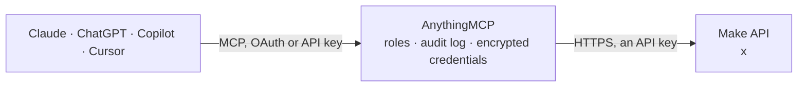

<!-- Generated by scripts/export-github-catalog.mjs in the anythingmcp-website repository. Do not edit by hand. -->

# Make MCP connector

Let your AI work with Make (formerly Integromat): list organizations, teams and scenarios, read blueprints, run history and errors, connections, data stores and webhooks; with your confirmation run a … The AnythingMCP connector gives Claude, ChatGPT, Microsoft Copilot, Cursor and Gemini 18 MCP tools for Make: 14 read and 4 can change data.

**Category:** [Productivity](../productivity.md) · **Tools:** 18 · **Setup guide:** [anythingmcp.com](https://anythingmcp.com/guides/make-to-mcp) · [Deutsch](https://anythingmcp.com/de/guides/make-to-mcp) · [Italiano](https://anythingmcp.com/it/guides/make-to-mcp) · [Español](https://anythingmcp.com/es/guides/make-to-mcp) · [日本語](https://anythingmcp.com/ja/guides/make-to-mcp) · [Русский](https://anythingmcp.com/ru/guides/make-to-mcp) · [中文](https://anythingmcp.com/zh/guides/make-to-mcp)

## Start without code

No installation and no terminal: AnythingMCP Cloud runs the Make connector for you, operated by helpcode.ai in Frankfurt, Germany.

1. **Click the button above** and create an account or sign in. The Make connector opens, ready to install.
2. **Paste the API key or token from your Make account.** Every click is in the [step-by-step guide](https://anythingmcp.com/guides/make-to-mcp).
3. **Click Install.** AnythingMCP shows the address of your MCP server.
4. **Add that address to your assistant:** [Claude](https://anythingmcp.com/guides/connect-make-to-claude) · [ChatGPT](https://anythingmcp.com/guides/connect-make-to-chatgpt) · [Microsoft Copilot](https://anythingmcp.com/guides/connect-make-to-copilot) · [Cursor](https://anythingmcp.com/guides/connect-make-to-cursor) · [Gemini CLI](https://anythingmcp.com/guides/connect-make-to-gemini) · [Meta Muse](https://anythingmcp.com/guides/connect-make-to-muse).
5. **Ask your first question**, for example: *What is the status, scheduling and next run time of the scenario named 'Invoices -> Customer Email' in our Finance team?*

Prefer help with the setup? [Talk to us](https://anythingmcp.com/contact).

## How it works

- **The AI client** speaks MCP (Streamable HTTP) to AnythingMCP and only sees tool names, descriptions and results. It never gets the Make credentials.
- **AnythingMCP** checks the client's role, builds the call from the tool definition, adds the credentials (an API key), calls Make, logs the call and returns the result.
- **Make** sees an ordinary API client with the rights of the account the credentials belong to.

## Tools

| Tool | What it does | Access |
|---|---|---|
| [`make_get_current_user`](#make_get_current_user) | Read the Make user the API token belongs to: id, name, email, language, time zone and the ids of their teams (userTeamIds). | read |
| [`make_list_organizations`](#make_list_organizations) | List the Make organizations the user belongs to with id, name, zone, plan (productName), teams, number of scenarios and active scenarios. | read |
| [`make_list_teams`](#make_list_teams) | List the teams of a Make organization with id, name and operations limit. | read |
| [`make_list_scenarios`](#make_list_scenarios) | List the scenarios (automations) of a team or of a whole organization: id, name, whether active (isActive) or paused, invalid or locked, scheduling, apps… | read |
| [`make_get_scenario`](#make_get_scenario) | Read one scenario: name, description, team, folder, active or paused, scheduling (on demand, interval, immediately), apps used, created and last edited by,… | read |
| [`make_get_scenario_blueprint`](#make_get_scenario_blueprint) | Read a scenario's blueprint: the modules of the flow in order, their apps, mappings and filters, plus scheduling. | read |
| [`make_run_scenario`](#make_run_scenario) | Run a scenario now, on demand. | write |
| [`make_activate_scenario`](#make_activate_scenario) | Activate (turn on) a scenario so it runs on its schedule or trigger. | write |
| [`make_deactivate_scenario`](#make_deactivate_scenario) | Deactivate (turn off) a scenario so it stops running on its schedule or trigger. | write |
| [`make_list_scenario_logs`](#make_list_scenario_logs) | List the run history of a scenario, newest first: each execution with id, status (1 success, 2 warning, 3 error), time, duration in ms, operations, data… | read |
| [`make_get_execution`](#make_get_execution) | Read the result of one scenario execution: status (RUNNING, SUCCESS, WARNING, ERROR, PAUSED), outputs and, on error, the error name, message and module. | read |
| [`make_list_connections`](#make_list_connections) | List the connections (sign-ins to other apps such as Google or Slack) of a team: id, name, app (accountName), type, expiry and whether they can be upgraded. | read |
| [`make_list_data_stores`](#make_list_data_stores) | List the data stores (small built-in databases scenarios read and write) of a team: id, name, number of records, size used and maximum size. | read |
| [`make_list_data_store_records`](#make_list_data_store_records) | List the records of a data store: each with its key and data, plus the data structure (spec) and the total count. | read |
| [`make_add_data_store_record`](#make_add_data_store_record) | Add a record to a data store. | write |
| [`make_list_hooks`](#make_list_hooks) | List the webhooks and mailhooks of a team: id, name, type, app, whether enabled, the scenario that uses it and how many requests wait in its queue. | read |
| [`make_list_incomplete_executions`](#make_list_incomplete_executions) | List the incomplete executions of a scenario: runs that stopped on an error and were stored so they can be resolved or retried. | read |
| [`make_get_incomplete_execution`](#make_get_incomplete_execution) | Read one incomplete execution: scenario, organization, whether resolved, the execution id, retry settings and attempts. | read |

## Tool reference

Every parameter as the AI client sees it in `tools/list`. Source: [`packages/backend/src/adapters/intl/make.json`](../../../packages/backend/src/adapters/intl/make.json).

### `make_get_current_user`

Read the Make user the API token belongs to: id, name, email, language, time zone and the ids of their teams (userTeamIds). Free check that the token works; call it first.

**Access:** read · **Call:** `GET /users/me`

No parameters.

### `make_list_organizations`

List the Make organizations the user belongs to with id, name, zone, plan (productName), teams, number of scenarios and active scenarios. The organization's zone must match the zone this connector uses; plan and license details are only filled for organizations in this zone.

**Access:** read · **Call:** `GET /organizations`

| Parameter | Type | Required | Description |
|---|---|---|---|
| `limit` | integer | no | Items per page (default 50 here). |
| `offset` | integer | no | Number of items to skip, for the next page (offset + limit). |

### `make_list_teams`

List the teams of a Make organization with id, name and operations limit. Scenarios, connections, data stores and webhooks belong to a team.

**Access:** read · **Call:** `GET /teams`

| Parameter | Type | Required | Description |
|---|---|---|---|
| `organizationId` | integer | yes | Organization id from make_list_organizations. |
| `limit` | integer | no | Items per page (default 50 here). |
| `offset` | integer | no | Number of items to skip, for the next page (offset + limit). |

### `make_list_scenarios`

List the scenarios (automations) of a team or of a whole organization: id, name, whether active (isActive) or paused, invalid or locked, scheduling, apps used, last edit, next run, operations used and the number of incomplete executions (dlqCount). Give teamId or organizationId. More: call again with offset raised by limit.

**Access:** read · **Call:** `GET /scenarios`

| Parameter | Type | Required | Description |
|---|---|---|---|
| `teamId` | integer | no | Team id, a number, from make_list_teams (or authUser.userTeamIds in make_get_current_user). |
| `organizationId` | integer | no | Organization id, to list the scenarios of every team in it. Give this or teamId. |
| `folderId` | integer | no | Only scenarios in this folder. |
| `isActive` | boolean | no | true only active scenarios, false only inactive ones. |
| `name` | string | no | Only scenarios whose name contains this text. |
| `limit` | integer | no | Items per page (default 50 here). |
| `offset` | integer | no | Number of items to skip, for the next page (offset + limit). |

### `make_get_scenario`

Read one scenario: name, description, team, folder, active or paused, scheduling (on demand, interval, immediately), apps used, created and last edited by, next run, operations, errors and incomplete executions count. The flow itself is in make_get_scenario_blueprint.

**Access:** read · **Call:** `GET /scenarios/{scenarioId}`

| Parameter | Type | Required | Description |
|---|---|---|---|
| `scenarioId` | integer | yes | Scenario id, a number, from make_list_scenarios. |

### `make_get_scenario_blueprint`

Read a scenario's blueprint: the modules of the flow in order, their apps, mappings and filters, plus scheduling. Useful to explain or debug what a scenario does. Large scenarios are cut at about 100 KB. Module settings can contain values the scenario sends; do not repeat secrets you may find there.

**Access:** read · **Call:** `GET /scenarios/{scenarioId}/blueprint`

| Parameter | Type | Required | Description |
|---|---|---|---|
| `scenarioId` | integer | yes | Scenario id, a number, from make_list_scenarios. |

### `make_run_scenario`

Run a scenario now, on demand. Confirm with the user first: name the scenario, the input data, and what it will do (it can send emails, create records or call other apps, and it uses Make operations), and wait for their yes. The scenario must be active. With responsive true Make waits up to 40 seconds and returns the status (1 success, 2 warning, 3 error); otherwise it returns the executionId at once: check it later with make_get_execution.

**Access:** write · **Call:** `POST /scenarios/{scenarioId}/run`

| Parameter | Type | Required | Description |
|---|---|---|---|
| `scenarioId` | integer | yes | Scenario id, a number, from make_list_scenarios. |
| `data` | object | no | Scenario inputs, keyed by input name, when the scenario defines inputs, e.g. {"email": "jane@example.com"}. Required inputs must be given. |
| `responsive` | boolean | no | true waits up to 40 seconds for the run to finish and returns its status and outputs. Default false. |

### `make_activate_scenario`

Activate (turn on) a scenario so it runs on its schedule or trigger. Confirm with the user first: name the scenario and its schedule, and wait for their yes. A scenario scheduled at an interval also runs once right away.

**Access:** write · **Call:** `POST /scenarios/{scenarioId}/start`

| Parameter | Type | Required | Description |
|---|---|---|---|
| `scenarioId` | integer | yes | Scenario id, a number, from make_list_scenarios. |

### `make_deactivate_scenario`

Deactivate (turn off) a scenario so it stops running on its schedule or trigger. Confirm with the user first: name the scenario and wait for their yes. Webhook data that arrives while it is off waits in the queue up to its limit.

**Access:** write · **Call:** `POST /scenarios/{scenarioId}/stop`

| Parameter | Type | Required | Description |
|---|---|---|---|
| `scenarioId` | integer | yes | Scenario id, a number, from make_list_scenarios. |

### `make_list_scenario_logs`

List the run history of a scenario, newest first: each execution with id, status (1 success, 2 warning, 3 error), time, duration in ms, operations, data transfer and whether it was started by hand. Filter by status and time.

**Access:** read · **Call:** `GET /scenarios/{scenarioId}/logs`

| Parameter | Type | Required | Description |
|---|---|---|---|
| `scenarioId` | integer | no | Scenario id, a number, from make_list_scenarios. |
| `status` | `1` \| `2` \| `3` | no | 1 success, 2 warning, 3 error. |
| `from` | integer | no | Only runs after this time, as Unix milliseconds. |
| `to` | integer | no | Only runs before this time, as Unix milliseconds. |
| `limit` | integer | no | Items per page (default 20 here). |
| `offset` | integer | no | Number of items to skip, for the next page (offset + limit). |

### `make_get_execution`

Read the result of one scenario execution: status (RUNNING, SUCCESS, WARNING, ERROR, PAUSED), outputs and, on error, the error name, message and module. Use the executionId from make_run_scenario or make_list_scenario_logs.

**Access:** read · **Call:** `GET /scenarios/{scenarioId}/executions/{executionId}`

| Parameter | Type | Required | Description |
|---|---|---|---|
| `scenarioId` | integer | yes | Scenario id, a number, from make_list_scenarios. |
| `executionId` | string | yes | Execution id, e.g. from make_run_scenario. |

### `make_list_connections`

List the connections (sign-ins to other apps such as Google or Slack) of a team: id, name, app (accountName), type, expiry and whether they can be upgraded. Never returns passwords, keys or tokens.

**Access:** read · **Call:** `GET /connections`

| Parameter | Type | Required | Description |
|---|---|---|---|
| `teamId` | integer | yes | Team id, a number, from make_list_teams (or authUser.userTeamIds in make_get_current_user). |

### `make_list_data_stores`

List the data stores (small built-in databases scenarios read and write) of a team: id, name, number of records, size used and maximum size.

**Access:** read · **Call:** `GET /data-stores`

| Parameter | Type | Required | Description |
|---|---|---|---|
| `teamId` | integer | yes | Team id, a number, from make_list_teams (or authUser.userTeamIds in make_get_current_user). |
| `limit` | integer | no | Items per page (default 50 here). |
| `offset` | integer | no | Number of items to skip, for the next page (offset + limit). |

### `make_list_data_store_records`

List the records of a data store: each with its key and data, plus the data structure (spec) and the total count. Data stores can hold personal data: show only what the user needs. More: call again with offset raised by limit.

**Access:** read · **Call:** `GET /data-stores/{dataStoreId}/data`

| Parameter | Type | Required | Description |
|---|---|---|---|
| `dataStoreId` | integer | yes | Data store id from make_list_data_stores. |
| `limit` | integer | no | Items per page (default 20 here). |
| `offset` | integer | no | Number of items to skip, for the next page (offset + limit). |

### `make_add_data_store_record`

Add a record to a data store. Confirm with the user first: show the key and the data and wait for their yes. The data must fit the store's data structure (see spec in make_list_data_store_records); scenarios that read the store will see it.

**Access:** write · **Call:** `POST /data-stores/{dataStoreId}/data`

| Parameter | Type | Required | Description |
|---|---|---|---|
| `dataStoreId` | integer | yes | Data store id from make_list_data_stores. |
| `key` | string | no | Optional unique key for the record; Make generates one when left out. |
| `data` | object | yes | The record, keyed by the field names of the data structure, e.g. {"email": "jane@example.com", "score": 3}. |

### `make_list_hooks`

List the webhooks and mailhooks of a team: id, name, type, app, whether enabled, the scenario that uses it and how many requests wait in its queue. The webhook address itself is left out: anyone who has it can start the scenario.

**Access:** read · **Call:** `GET /hooks`

| Parameter | Type | Required | Description |
|---|---|---|---|
| `teamId` | integer | yes | Team id, a number, from make_list_teams (or authUser.userTeamIds in make_get_current_user). |
| `typeName` | `gateway-webhook` \| `gateway-mailhook` | no | Only webhooks or only mailhooks. |

### `make_list_incomplete_executions`

List the incomplete executions of a scenario: runs that stopped on an error and were stored so they can be resolved or retried. Each with id, reason, date, size, whether resolved, and retry attempts.

**Access:** read · **Call:** `GET /dlqs`

| Parameter | Type | Required | Description |
|---|---|---|---|
| `scenarioId` | integer | yes | Scenario id, a number, from make_list_scenarios. |
| `status` | `unresolved` \| `resolved` \| `scheduled` \| `inprogress` | no | Only incomplete executions with this status. |

### `make_get_incomplete_execution`

Read one incomplete execution: scenario, organization, whether resolved, the execution id, retry settings and attempts.

**Access:** read · **Call:** `GET /dlqs/{dlqId}`

| Parameter | Type | Required | Description |
|---|---|---|---|
| `dlqId` | string | yes | Incomplete execution id from make_list_incomplete_executions. |

## Run it yourself

AnythingMCP is open source (AGPL-3.0). [Run it with Docker](../../../README.md#run-it-yourself), open **Connectors → Store**, pick **Make** and enter `MAKE_ZONE`, `MAKE_API_TOKEN`, then add your MCP server URL to the AI client.

[← Productivity connectors](../productivity.md) · [All categories](../README.md)
