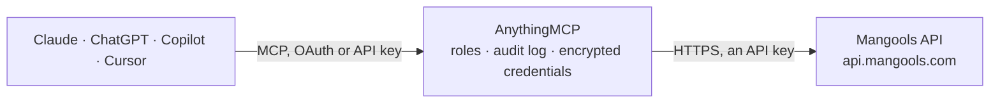

<!-- Generated by scripts/export-github-catalog.mjs in the anythingmcp-website repository. Do not edit by hand. -->

# Mangools MCP connector

SEO data from the Mangools suite through its official API: KWFinder keyword research and keyword difficulty, SERPChecker result pages, LinkMiner backlinks, SiteProfiler domain metrics, SERPWatcher … The AnythingMCP connector gives Claude, ChatGPT, Microsoft Copilot, Cursor and Gemini 27 MCP tools for Mangools, all read-only.

**Category:** [Analytics](../analytics.md) · **Tools:** 27 · **Setup guide:** [anythingmcp.com](https://anythingmcp.com/guides/mangools-to-mcp) · [Deutsch](https://anythingmcp.com/de/guides/mangools-to-mcp) · [Italiano](https://anythingmcp.com/it/guides/mangools-to-mcp) · [Español](https://anythingmcp.com/es/guides/mangools-to-mcp) · [日本語](https://anythingmcp.com/ja/guides/mangools-to-mcp) · [Русский](https://anythingmcp.com/ru/guides/mangools-to-mcp) · [中文](https://anythingmcp.com/zh/guides/mangools-to-mcp)

## Start without code

No installation and no terminal: AnythingMCP Cloud runs the Mangools connector for you, operated by helpcode.ai in Frankfurt, Germany.

1. **Click the button above** and create an account or sign in. The Mangools connector opens, ready to install.
2. **Paste the API key or token from your Mangools account.** Every click is in the [step-by-step guide](https://anythingmcp.com/guides/mangools-to-mcp).
3. **Click Install.** AnythingMCP shows the address of your MCP server.
4. **Add that address to your assistant:** [Claude](https://anythingmcp.com/guides/connect-mangools-to-claude) · [ChatGPT](https://anythingmcp.com/guides/connect-mangools-to-chatgpt) · [Microsoft Copilot](https://anythingmcp.com/guides/connect-mangools-to-copilot) · [Cursor](https://anythingmcp.com/guides/connect-mangools-to-cursor) · [Gemini CLI](https://anythingmcp.com/guides/connect-mangools-to-gemini) · [Meta Muse](https://anythingmcp.com/guides/connect-mangools-to-muse).
5. **Ask your first question**, for example: *Get the KWFinder SERP for 'solar string inverter SMA M3' for location Italy (2380), language Italian (1004).*

Prefer help with the setup? [Talk to us](https://anythingmcp.com/contact).

## How it works

- **The AI client** speaks MCP (Streamable HTTP) to AnythingMCP and only sees tool names, descriptions and results. It never gets the Mangools credentials.
- **AnythingMCP** checks the client's role, builds the call from the tool definition, adds the credentials (an API key), calls Mangools, logs the call and returns the result.
- **Mangools** sees an ordinary API client with the rights of the account the credentials belong to.

## Tools

| Tool | What it does | Access |
|---|---|---|
| [`mangools_get_limits`](#mangools_get_limits) | Show the account's remaining quota in every Mangools pool (keyword lookups, SERP lookups, backlink rows, tracked keywords, URL metrics...) and when each resets. | read |
| [`mangools_search_locations`](#mangools_search_locations) | Search geotargeting locations by name (country, region or city) and return up to 100 matches with location id, type and country code. | read |
| [`mangools_get_related_keywords`](#mangools_get_related_keywords) | KWFinder keyword research: related keywords for a seed keyword with search volume, monthly volume history, CPC, PPC competition and keyword difficulty. | read |
| [`mangools_get_competitor_keywords`](#mangools_get_competitor_keywords) | KWFinder competitor research: the keywords a domain or URL ranks for in Google in one location, with position, search volume, estimated visits, CPC and… | read |
| [`mangools_get_competitor_domains`](#mangools_get_competitor_domains) | Domains that compete with a domain for the same organic keywords, with the number of shared keywords. | read |
| [`mangools_get_keyword_serp`](#mangools_get_keyword_serp) | KWFinder keyword detail: keyword difficulty, the organic Google results (top 10 per page) with their authority metrics, the result count and the… | read |
| [`mangools_get_keyword_metrics`](#mangools_get_keyword_metrics) | Get metrics for a list of keywords you already have (up to your plan's related-keywords-rows, at least 200): search volume and 12-month history, CPC, PPC,… | read |
| [`mangools_get_keyword_gap`](#mangools_get_keyword_gap) | Keyword gap analysis: keywords that up to 5 competitor domains rank for and your domain does not, per competitor, ordered by the competitor's position, with… | read |
| [`mangools_list_keyword_lists`](#mangools_list_keyword_lists) | List the keyword lists saved in KWFinder with id, name and the ids of the keywords in each. | read |
| [`mangools_get_keyword_list`](#mangools_get_keyword_list) | Get one saved keyword list with full data for every keyword: search volume, monthly volumes, CPC, PPC, keyword difficulty and location. | read |
| [`mangools_list_keyword_history`](#mangools_list_keyword_history) | The account's last 100 KWFinder lookups (related keywords, competitor keywords, keyword gap) with keyword or URL, location and time. | read |
| [`mangools_get_serp_analysis`](#mangools_get_serp_analysis) | SERPChecker: the full Google result page for a keyword with organic and paid results, SERP features, above-the-fold coverage, CTR per result and authority… | read |
| [`mangools_get_url_metrics`](#mangools_get_url_metrics) | Authority metrics for one URL: Moz Domain Authority and Page Authority, Majestic Citation Flow and Trust Flow. | read |
| [`mangools_get_backlinks`](#mangools_get_backlinks) | LinkMiner: backlinks of a URL, domain or path, up to 500 per page, with source URL, anchor text, Citation and Trust Flow, link type and first/last seen dates. | read |
| [`mangools_get_link_metrics`](#mangools_get_link_metrics) | Link authority of a URL, domain or subdomain from Majestic: Citation Flow, Trust Flow, referring domains and backlink counts. | read |
| [`mangools_get_site_overview`](#mangools_get_site_overview) | SiteProfiler overview of a domain or URL: Moz DA/PA, Majestic CF/TF, rank and referring-IP history since 2016 and social shares. | read |
| [`mangools_get_site_backlink_profile`](#mangools_get_site_backlink_profile) | SiteProfiler backlink profile of a domain or URL: referring domains and IPs, link types, top anchors and link growth. | read |
| [`mangools_get_site_top_content`](#mangools_get_site_top_content) | SiteProfiler top content: the site's most linked and most shared pages with their metrics. | read |
| [`mangools_get_site_competitors`](#mangools_get_site_competitors) | SiteProfiler competitors: domains competing with the site for organic keywords, with their authority metrics. | read |
| [`mangools_get_site_audience`](#mangools_get_site_audience) | SiteProfiler audience: estimated traffic by country and audience signals of the site. | read |
| [`mangools_list_trackings`](#mangools_list_trackings) | SERPWatcher: list the rank tracking campaigns of the account, newest first, with tracking id, domain, location, platform and the number of tracked keywords. | read |
| [`mangools_get_tracking_detail`](#mangools_get_tracking_detail) | SERPWatcher: one tracking with its keyword list, each keyword with id, text, currently ranking URL, tags and last check. | read |
| [`mangools_get_tracking_stats`](#mangools_get_tracking_stats) | SERPWatcher statistics for a tracking over a date range: per keyword the current, best and average rank, rank change, estimated visits, rank history, Map… | read |
| [`mangools_list_tracked_keywords`](#mangools_list_tracked_keywords) | SERPWatcher: all tracked keywords of a tracking with current rank, search volume, monthly volumes and active flag. | read |
| [`mangools_list_ai_monitors`](#mangools_list_ai_monitors) | AI Search Watcher: list the brand monitors of the account with id, brand name, domain, location, language and monitoring state. | read |
| [`mangools_get_ai_monitor`](#mangools_get_ai_monitor) | AI Search Watcher: how often a brand is mentioned and cited by AI answer engines (ChatGPT, Gemini, Claude, Google AI Overviews...) across the monitor's… | read |
| [`mangools_list_ai_models`](#mangools_list_ai_models) | AI Search Watcher: the AI models available for brand monitoring, with numeric id, name and whether each can still be added to a monitor. | read |

## Tool reference

Every parameter as the AI client sees it in `tools/list`. Source: [`packages/backend/src/adapters/intl/mangools.json`](../../../packages/backend/src/adapters/intl/mangools.json).

### `mangools_get_limits`

Show the account's remaining quota in every Mangools pool (keyword lookups, SERP lookups, backlink rows, tracked keywords, URL metrics...) and when each resets. Call it before expensive lookups or after a 429 CreditLimit answer.

**Access:** read · **Call:** `GET /kwfinder/limits`

No parameters.

### `mangools_search_locations`

Search geotargeting locations by name (country, region or city) and return up to 100 matches with location id, type and country code. The id is the location_id every KWFinder, SERPChecker and SERPWatcher tool takes. Does not use quota.

**Access:** read · **Call:** `GET /mangools/locations`

| Parameter | Type | Required | Description |
|---|---|---|---|
| `query` | string | yes | Location name, e.g. Germany, Bavaria or New York. |

### `mangools_get_related_keywords`

KWFinder keyword research: related keywords for a seed keyword with search volume, monthly volume history, CPC, PPC competition and keyword difficulty. The seed keyword comes first. Costs one keyword lookup (repeating the same request within 24 hours is free).

**Access:** read · **Call:** `GET /kwfinder/related-keywords`

| Parameter | Type | Required | Description |
|---|---|---|---|
| `kw` | string | yes | Seed keyword. |
| `location_id` | integer | no | Location id from mangools_search_locations (Google geotarget id, e.g. 2840 United States, 2276 Germany). 0 means anywhere. |
| `language_id` | integer | no | Language id (Google Ads language id, e.g. 1000 English, 1001 German). 0 means any language. |

### `mangools_get_competitor_keywords`

KWFinder competitor research: the keywords a domain or URL ranks for in Google in one location, with position, search volume, estimated visits, CPC and keyword difficulty. Costs one keyword lookup (repeat within 24 hours is free).

**Access:** read · **Call:** `GET /kwfinder/competitor-keywords`

| Parameter | Type | Required | Description |
|---|---|---|---|
| `url` | string | yes | Target URL, domain or subdomain, e.g. example.com or https://example.com/blog/. |
| `location_id` | integer | yes | Location id from mangools_search_locations (Google geotarget id, e.g. 2840 United States, 2276 Germany). 0 means anywhere. |

### `mangools_get_competitor_domains`

Domains that compete with a domain for the same organic keywords, with the number of shared keywords. Free, but needs a mangools_get_competitor_keywords call for the same url and location in the last 24 hours (otherwise HTTP 422 No result).

**Access:** read · **Call:** `GET /kwfinder/competitor-domain`

| Parameter | Type | Required | Description |
|---|---|---|---|
| `url` | string | yes | Target URL, domain or subdomain, e.g. example.com or https://example.com/blog/. |
| `location_id` | integer | yes | Location id from mangools_search_locations (Google geotarget id, e.g. 2840 United States, 2276 Germany). 0 means anywhere. |

### `mangools_get_keyword_serp`

KWFinder keyword detail: keyword difficulty, the organic Google results (top 10 per page) with their authority metrics, the result count and the click-through rate per position. Costs one SERP lookup (repeat within 24 hours is free).

**Access:** read · **Call:** `GET /kwfinder/serps`

| Parameter | Type | Required | Description |
|---|---|---|---|
| `kw` | string | yes | Keyword to analyse. |
| `location_id` | integer | no | Location id from mangools_search_locations (Google geotarget id, e.g. 2840 United States, 2276 Germany). 0 means anywhere. |
| `language_id` | integer | no | Language id (Google Ads language id, e.g. 1000 English, 1001 German). 0 means any language. |
| `platform_id` | `1` \| `2` | no | 1 desktop (default), 2 mobile. |
| `page` | integer | no | Results page, starting at 0. |

### `mangools_get_keyword_metrics`

Get metrics for a list of keywords you already have (up to your plan's related-keywords-rows, at least 200): search volume and 12-month history, CPC, PPC, cached keyword difficulty and organic results. Read-only although it uses POST. Costs one keyword lookup per call.

**Access:** read · **Call:** `POST /kwfinder/keyword-imports`

| Parameter | Type | Required | Description |
|---|---|---|---|
| `keywords` | string[] | yes | Keywords to look up, e.g. ["seo agency", "seo specialist"]. |
| `location_id` | integer | yes | Location id from mangools_search_locations (Google geotarget id, e.g. 2840 United States, 2276 Germany). 0 means anywhere. |
| `language_id` | integer | yes | Language id (Google Ads language id, e.g. 1000 English, 1001 German). 0 means any language. |

### `mangools_get_keyword_gap`

Keyword gap analysis: keywords that up to 5 competitor domains rank for and your domain does not, per competitor, ordered by the competitor's position, with search volume and difficulty. Read-only although it uses POST.

**Access:** read · **Call:** `POST /kwfinder/gap-analysis`

| Parameter | Type | Required | Description |
|---|---|---|---|
| `domain` | string | yes | Your domain, e.g. example.com. |
| `competitors` | string[] | yes | 1 to 5 competitor domains. |
| `location_id` | integer | yes | Location id from mangools_search_locations (Google geotarget id, e.g. 2840 United States, 2276 Germany). 0 means anywhere. |
| `page` | integer | no | Page number, from 1 (only Premium, Agency, Custom and API Pro plans get more than page 1). |

### `mangools_list_keyword_lists`

List the keyword lists saved in KWFinder with id, name and the ids of the keywords in each. Use mangools_get_keyword_list to load the keyword data of one list. Does not use quota.

**Access:** read · **Call:** `GET /kwfinder/lists`

No parameters.

### `mangools_get_keyword_list`

Get one saved keyword list with full data for every keyword: search volume, monthly volumes, CPC, PPC, keyword difficulty and location. Does not use quota.

**Access:** read · **Call:** `GET /kwfinder/lists/{list_id}`

| Parameter | Type | Required | Description |
|---|---|---|---|
| `list_id` | string | yes | List id from mangools_list_keyword_lists. |

### `mangools_list_keyword_history`

The account's last 100 KWFinder lookups (related keywords, competitor keywords, keyword gap) with keyword or URL, location and time. Use it to repeat a recent lookup for free within 24 hours.

**Access:** read · **Call:** `GET /kwfinder/requests`

No parameters.

### `mangools_get_serp_analysis`

SERPChecker: the full Google result page for a keyword with organic and paid results, SERP features, above-the-fold coverage, CTR per result and authority metrics (Moz DA/PA, Majestic CF/TF) of every result URL. Costs one SERP lookup.

**Access:** read · **Call:** `GET /serpchecker/serps`

| Parameter | Type | Required | Description |
|---|---|---|---|
| `kw` | string | yes | Keyword. |
| `location_id` | integer | yes | Location id from mangools_search_locations (Google geotarget id, e.g. 2840 United States, 2276 Germany). 0 means anywhere. |
| `platform_id` | `1` \| `2` | no | 1 desktop (default), 2 mobile. |

### `mangools_get_url_metrics`

Authority metrics for one URL: Moz Domain Authority and Page Authority, Majestic Citation Flow and Trust Flow. Use it to size up a competitor page without a full SERP lookup. Counts toward the daily URL metrics pool (repeats within 24 hours are free).

**Access:** read · **Call:** `GET /serpchecker/url-metrics`

| Parameter | Type | Required | Description |
|---|---|---|---|
| `url` | string | yes | Target URL, domain or subdomain, e.g. example.com or https://example.com/blog/. |

### `mangools_get_backlinks`

LinkMiner: backlinks of a URL, domain or path, up to 500 per page, with source URL, anchor text, Citation and Trust Flow, link type and first/last seen dates. Each returned link counts toward the Backlink rows quota, so keep pages small.

**Access:** read · **Call:** `GET /linkminer/links`

| Parameter | Type | Required | Description |
|---|---|---|---|
| `url` | string | yes | URL, domain or path to get backlinks for. |
| `source` | `0` \| `1` \| `2` | no | 0 all backlinks, 1 new, 2 lost. |
| `page` | integer | no | Page number from 0; each page holds up to 500 links. |
| `links_per_domain` | integer | no | Backlinks per referring domain: 1 for one per domain, 0 for all. |

### `mangools_get_link_metrics`

Link authority of a URL, domain or subdomain from Majestic: Citation Flow, Trust Flow, referring domains and backlink counts. A quick check before pulling backlinks. Counts toward the daily LinkMiner URL metrics pool.

**Access:** read · **Call:** `GET /linkminer/url-metrics`

| Parameter | Type | Required | Description |
|---|---|---|---|
| `url` | string | yes | Target URL, domain or subdomain, e.g. example.com or https://example.com/blog/. |

### `mangools_get_site_overview`

SiteProfiler overview of a domain or URL: Moz DA/PA, Majestic CF/TF, rank and referring-IP history since 2016 and social shares. Call it first: the other SiteProfiler tools need an overview of the same URL from the last 24 hours.

**Access:** read · **Call:** `GET /siteprofiler/overview`

| Parameter | Type | Required | Description |
|---|---|---|---|
| `url` | string | yes | Target URL, domain or subdomain, e.g. example.com or https://example.com/blog/. |

### `mangools_get_site_backlink_profile`

SiteProfiler backlink profile of a domain or URL: referring domains and IPs, link types, top anchors and link growth. Needs mangools_get_site_overview for the same URL within 24 hours (otherwise HTTP 429 Not in history).

**Access:** read · **Call:** `GET /siteprofiler/backlink-profile`

| Parameter | Type | Required | Description |
|---|---|---|---|
| `url` | string | yes | Target URL, domain or subdomain, e.g. example.com or https://example.com/blog/. |

### `mangools_get_site_top_content`

SiteProfiler top content: the site's most linked and most shared pages with their metrics. Needs mangools_get_site_overview for the same URL within 24 hours (otherwise HTTP 429 Not in history).

**Access:** read · **Call:** `GET /siteprofiler/top-content`

| Parameter | Type | Required | Description |
|---|---|---|---|
| `url` | string | yes | Target URL, domain or subdomain, e.g. example.com or https://example.com/blog/. |

### `mangools_get_site_competitors`

SiteProfiler competitors: domains competing with the site for organic keywords, with their authority metrics. Needs mangools_get_site_overview for the same URL within 24 hours (otherwise HTTP 429 Not in history).

**Access:** read · **Call:** `GET /siteprofiler/competitors`

| Parameter | Type | Required | Description |
|---|---|---|---|
| `url` | string | yes | Target URL, domain or subdomain, e.g. example.com or https://example.com/blog/. |

### `mangools_get_site_audience`

SiteProfiler audience: estimated traffic by country and audience signals of the site. Needs mangools_get_site_overview for the same URL within 24 hours (otherwise HTTP 429 Not in history).

**Access:** read · **Call:** `GET /siteprofiler/audience`

| Parameter | Type | Required | Description |
|---|---|---|---|
| `url` | string | yes | Target URL, domain or subdomain, e.g. example.com or https://example.com/blog/. |

### `mangools_list_trackings`

SERPWatcher: list the rank tracking campaigns of the account, newest first, with tracking id, domain, location, platform and the number of tracked keywords. Start here for rank tracking questions. Does not use quota.

**Access:** read · **Call:** `GET /serpwatcher/trackings`

| Parameter | Type | Required | Description |
|---|---|---|---|
| `from` | string | no | Optional: only trackings created from this date (YYYY-MM-DD). |
| `to` | string | no | Optional: only trackings created up to this date (YYYY-MM-DD). |
| `is_with_deleted` | `true` \| `false` | no | true to include deleted trackings. |

### `mangools_get_tracking_detail`

SERPWatcher: one tracking with its keyword list, each keyword with id, text, currently ranking URL, tags and last check. No rank history; use mangools_get_tracking_stats for positions over time.

**Access:** read · **Call:** `GET /serpwatcher/trackings/{tracking_id}/detail`

| Parameter | Type | Required | Description |
|---|---|---|---|
| `tracking_id` | string | yes | Tracking id from mangools_list_trackings. |
| `to` | string | no | Optional end date (YYYY-MM-DD). |
| `is_with_deleted` | `true` \| `false` | no | true to include deleted keywords. |

### `mangools_get_tracking_stats`

SERPWatcher statistics for a tracking over a date range: per keyword the current, best and average rank, rank change, estimated visits, rank history, Map Pack and Featured Snippet presence and SERP features, plus annotations. Read-only although it uses POST.

**Access:** read · **Call:** `POST /serpwatcher/trackings/{tracking_id}/stats`

| Parameter | Type | Required | Description |
|---|---|---|---|
| `tracking_id` | string | yes | Tracking id from mangools_list_trackings. |
| `from` | string | no | Start date, YYYY-MM-DD. |
| `to` | string | no | End date, YYYY-MM-DD. |
| `keyword_ids` | string[] | no | Optional: only these tracked keyword ids (from mangools_get_tracking_detail). |

### `mangools_list_tracked_keywords`

SERPWatcher: all tracked keywords of a tracking with current rank, search volume, monthly volumes and active flag. Trim the answer with fields. Does not use quota.

**Access:** read · **Call:** `GET /serpwatcher/trackings/{tracking_id}/tracked-keywords`

| Parameter | Type | Required | Description |
|---|---|---|---|
| `tracking_id` | string | yes | Tracking id from mangools_list_trackings. |
| `fields` | string | no | Optional comma-separated attributes: tracking_id,keyword_id,kw,location_id,platform_id,rank,sv,active,history. |

### `mangools_list_ai_monitors`

AI Search Watcher: list the brand monitors of the account with id, brand name, domain, location, language and monitoring state. Use the id with mangools_get_ai_monitor.

**Access:** read · **Call:** `GET /aiwatcher/monitors`

No parameters.

### `mangools_get_ai_monitor`

AI Search Watcher: how often a brand is mentioned and cited by AI answer engines (ChatGPT, Gemini, Claude, Google AI Overviews...) across the monitor's prompts, with citation sources and visibility over time.

**Access:** read · **Call:** `GET /aiwatcher/monitor/{id}`

| Parameter | Type | Required | Description |
|---|---|---|---|
| `id` | string | yes | Monitor id from mangools_list_ai_monitors. |
| `models` | string | no | Optional comma-separated model ids from mangools_list_ai_models; 0 for an all-models overview. |
| `from` | string | no | Optional start date, YYYY-MM-DD. |
| `to` | string | no | Optional end date, YYYY-MM-DD. |

### `mangools_list_ai_models`

AI Search Watcher: the AI models available for brand monitoring, with numeric id, name and whether each can still be added to a monitor. Use the ids to filter mangools_get_ai_monitor.

**Access:** read · **Call:** `GET /aiwatcher/models`

No parameters.

## Run it yourself

AnythingMCP is open source (AGPL-3.0). [Run it with Docker](../../../README.md#run-it-yourself), open **Connectors → Store**, pick **Mangools** and enter `MANGOOLS_API_KEY`, then add your MCP server URL to the AI client.

[← Analytics connectors](../analytics.md) · [All categories](../README.md)
