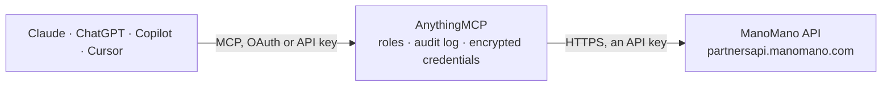

<!-- Generated by scripts/export-github-catalog.mjs in the anythingmcp-website repository. Do not edit by hand. -->

# ManoMano MCP connector

Sell on ManoMano, the European DIY and garden marketplace, from an AI agent: orders with acceptance, shipment and refunds, offer prices and stock, competitiveness against other sellers, catalog … The AnythingMCP connector gives Claude, ChatGPT, Microsoft Copilot, Cursor and Gemini 17 MCP tools for ManoMano: 9 read and 8 can change data.

**Category:** [E-commerce](../e-commerce.md) · **Tools:** 17 · **Setup guide:** [anythingmcp.com](https://anythingmcp.com/guides/manomano-to-mcp) · [Deutsch](https://anythingmcp.com/de/guides/manomano-to-mcp) · [Italiano](https://anythingmcp.com/it/guides/manomano-to-mcp) · [Español](https://anythingmcp.com/es/guides/manomano-to-mcp) · [日本語](https://anythingmcp.com/ja/guides/manomano-to-mcp) · [Русский](https://anythingmcp.com/ru/guides/manomano-to-mcp) · [中文](https://anythingmcp.com/zh/guides/manomano-to-mcp)

## Start without code

No installation and no terminal: AnythingMCP Cloud runs the ManoMano connector for you, operated by helpcode.ai in Frankfurt, Germany.

1. **Click the button above** and create an account or sign in. The ManoMano connector opens, ready to install.
2. **Paste the API key or token from your ManoMano account.** Every click is in the [step-by-step guide](https://anythingmcp.com/guides/manomano-to-mcp).
3. **Click Install.** AnythingMCP shows the address of your MCP server.
4. **Add that address to your assistant:** [Claude](https://anythingmcp.com/guides/connect-manomano-to-claude) · [ChatGPT](https://anythingmcp.com/guides/connect-manomano-to-chatgpt) · [Microsoft Copilot](https://anythingmcp.com/guides/connect-manomano-to-copilot) · [Cursor](https://anythingmcp.com/guides/connect-manomano-to-cursor) · [Gemini CLI](https://anythingmcp.com/guides/connect-manomano-to-gemini) · [Meta Muse](https://anythingmcp.com/guides/connect-manomano-to-muse).
5. **Ask your first question**, for example: *Show order FR-2026-0487 for customer Leclercq, I need totals and VAT breakdown.*

Prefer help with the setup? [Talk to us](https://anythingmcp.com/contact).

## How it works

- **The AI client** speaks MCP (Streamable HTTP) to AnythingMCP and only sees tool names, descriptions and results. It never gets the ManoMano credentials.
- **AnythingMCP** checks the client's role, builds the call from the tool definition, adds the credentials (an API key), calls ManoMano, logs the call and returns the result.
- **ManoMano** sees an ordinary API client with the rights of the account the credentials belong to.

## Tools

| Tool | What it does | Access |
|---|---|---|
| [`manomano_list_orders`](#manomano_list_orders) | List the orders of this seller contract with status, prices and VAT details, customer and addresses, products (seller_sku, quantity, price) and carrier. | read |
| [`manomano_get_order`](#manomano_get_order) | Read one order in full: status, totals with and without VAT, ManoMano and seller discounts, VAT and invoice liability, B2B flags, customer, billing and… | read |
| [`manomano_accept_order`](#manomano_accept_order) | Accept a PENDING order; it moves to PREPARATION and the seller must ship it. | write |
| [`manomano_refuse_order`](#manomano_refuse_order) | Refuse a PENDING order. | write |
| [`manomano_ship_order`](#manomano_ship_order) | Confirm the shipment of a parcel of an order in PREPARATION: carrier, tracking number and URL, and the products in the parcel. | write |
| [`manomano_refund_order`](#manomano_refund_order) | Refund products of an order, fully or partly. | write |
| [`manomano_list_offers`](#manomano_list_offers) | Read offers of this seller contract: SKU, price (VAT included), stock, carrier grid and delivery window, ManoMano product id and page link, and the status… | read |
| [`manomano_update_offers`](#manomano_update_offers) | Change the price and/or stock of existing offers by SKU. | write |
| [`manomano_unfreeze_offers`](#manomano_unfreeze_offers) | Hand the price and/or stock of offers back to the product feed: after this, the next feed import overwrites the values set through the API. | write |
| [`manomano_upsert_offers`](#manomano_upsert_offers) | Create offers or replace them completely, up to 20 per call: stock, pricing, shipping (weight and carrier grid) and packaging are all required and replace… | write |
| [`manomano_get_offer_competitiveness`](#manomano_get_offer_competitiveness) | Compare your offers with the competition for given SKUs: the current best offer and its price and delivery mode, whether yours is the best offer, and the… | read |
| [`manomano_list_competitiveness_changes`](#manomano_list_competitiveness_changes) | List the competitiveness data of every offer whose competitive situation changed within a date range: best offer, whether yours is the best, and the… | read |
| [`manomano_search_products_by_ean`](#manomano_search_products_by_ean) | Look up products in the ManoMano catalog by EAN and country, up to 200 at once: title, ManoMano id (mmid) and whether an offer can be published on it (with… | read |
| [`manomano_list_fulfillment_stock`](#manomano_list_fulfillment_stock) | Read ManoFulfillment (MMF) warehouse stock per SKU: available for sale, reserved, inbound, in returns and unfulfillable (with the reasons). | read |
| [`manomano_list_invoice_requests`](#manomano_list_invoice_requests) | List the invoices customers are waiting for, oldest request first, with order reference, request date and order date. | read |
| [`manomano_get_order_documents`](#manomano_get_order_documents) | List the invoice or credit note documents already uploaded for an order. | read |
| [`manomano_upload_order_document`](#manomano_upload_order_document) | Upload an invoice or credit note PDF for an order. | write |

## Tool reference

Every parameter as the AI client sees it in `tools/list`. Source: [`packages/backend/src/adapters/fr/manomano.json`](../../../packages/backend/src/adapters/fr/manomano.json).

### `manomano_list_orders`

List the orders of this seller contract with status, prices and VAT details, customer and addresses, products (seller_sku, quantity, price) and carrier. Filter by status (PENDING for orders to accept, PREPARATION for orders to ship), by creation or status-change date, by carrier or order reference. Up to 50 per page; content holds the orders and pagination the page count.

**Access:** read · **Call:** `GET /orders/v1/orders`

| Parameter | Type | Required | Description |
|---|---|---|---|
| `status` | `PENDING` \| `PREPARATION` \| `SHIPPED` \| `REFUSED` \| `REFUNDING` \| `REFUNDED` | no | Only orders in this status. PENDING waits for acceptance, PREPARATION is to ship, REFUNDING/REFUNDED do not apply to ManoFulfillment orders. |
| `order_reference` | string | no | A ManoMano order reference, e.g. M2022080713464. |
| `carrier` | string | no | Only orders with this carrier, e.g. UPS. Not for ManoFulfillment sellers. |
| `created_at_start` | string | no | Created at or after this date-time, ISO 8601 (e.g. 2026-10-01T00:00:00Z). |
| `created_at_end` | string | no | Created at or before this date-time, ISO 8601. |
| `status_updated_at_start` | string | no | Status changed at or after this date-time, ISO 8601. Best filter for polling changes. |
| `status_updated_at_end` | string | no | Status changed at or before this date-time, ISO 8601. |
| `page` | integer | no | Page number, starting at 1. |
| `limit` | integer | no | Orders per page, 1 to 50. |

### `manomano_get_order`

Read one order in full: status, totals with and without VAT, ManoMano and seller discounts, VAT and invoice liability, B2B flags, customer, billing and shipping addresses, and every product with seller_sku, quantity, price and carrier. Read it before accepting, shipping or refunding.

**Access:** read · **Call:** `GET /orders/v1/orders/{order_reference}`

| Parameter | Type | Required | Description |
|---|---|---|---|
| `order_reference` | string | yes | The ManoMano order reference, e.g. M2022080713464. |

### `manomano_accept_order`

Accept a PENDING order; it moves to PREPARATION and the seller must ship it. Acts on the live marketplace: show the user exactly what will change and get a yes from the user first.

**Access:** write · **Call:** `POST /orders/v1/accept-orders`

| Parameter | Type | Required | Description |
|---|---|---|---|
| `order_reference` | string | yes | The ManoMano order reference. |

### `manomano_refuse_order`

Refuse a PENDING order. The customer is refunded: the order goes to REFUNDING, then REFUSED. Cannot be undone. Acts on the live marketplace: show the user exactly what will change and get a yes from the user first.

**Access:** write · **Call:** `POST /orders/v1/refuse-orders`

| Parameter | Type | Required | Description |
|---|---|---|---|
| `order_reference` | string | yes | The ManoMano order reference. |

### `manomano_ship_order`

Confirm the shipment of a parcel of an order in PREPARATION: carrier, tracking number and URL, and the products in the parcel. The order moves to SHIPPED and the customer is notified. For an order sent in several parcels, call once per parcel. Acts on the live marketplace: show the user exactly what will change and get a yes from the user first.

**Access:** write · **Call:** `POST /orders/v1/shippings`

| Parameter | Type | Required | Description |
|---|---|---|---|
| `order_reference` | string | yes | The ManoMano order reference. |
| `carrier` | string | yes | Carrier name, e.g. UPS, Colissimo, DHL, GLS, Chronopost, DPD. |
| `tracking_number` | string | yes | Tracking number of the parcel. |
| `tracking_url` | string | yes | Public tracking URL of the parcel. |
| `products` | object[] | yes | The products concerned, each with its seller_sku and quantity (from manomano_get_order). |

### `manomano_refund_order`

Refund products of an order, fully or partly. The order goes to REFUNDING, then REFUNDED once the money is returned. NO_STOCK when the seller cannot deliver, CUSTOMER_CANCEL when the customer withdrew. Cannot be undone. Acts on the live marketplace: show the user exactly what will change and get a yes from the user first.

**Access:** write · **Call:** `POST /orders/v1/refunds`

| Parameter | Type | Required | Description |
|---|---|---|---|
| `order_reference` | string | yes | The ManoMano order reference. |
| `products` | object[] | yes | The products concerned, each with its seller_sku and quantity (from manomano_get_order). |
| `refund_reason` | `NO_STOCK` \| `CUSTOMER_CANCEL` | yes | NO_STOCK for a seller reason (no stock, cannot deliver), CUSTOMER_CANCEL for a customer reason (withdrawal). |
| `refund_shipping_fees` | boolean | no | Also refund the shipping fees. |

### `manomano_list_offers`

Read offers of this seller contract: SKU, price (VAT included), stock, carrier grid and delivery window, ManoMano product id and page link, and the status of the last price or stock update (IN PROGRESS, ERROR with the error list, COMPLETED). Online offers only unless offer_online is false. Filter by SKUs or by the request_id of an update.

**Access:** read · **Call:** `GET /api/v1/offer-information/offers`

| Parameter | Type | Required | Description |
|---|---|---|---|
| `skus` | string | no | SKUs separated by commas. |
| `request_id` | string | no | Only offers changed by this update, using the request id returned by manomano_update_offers. |
| `offer_online` | boolean | no | false to read offline offers instead of online ones. |
| `page` | integer | no | Page number, starting at 1. |
| `limit` | integer | no | Offers per page. |

### `manomano_update_offers`

Change the price and/or stock of existing offers by SKU. By default the new values are frozen, so the product feed import no longer overwrites them; set frozen_price or frozen_stock to false to let the feed keep control. Applied asynchronously: keep the returned request id and check it with manomano_list_offers (request_id). Acts on the live marketplace: show the user exactly what will change and get a yes from the user first.

**Access:** write · **Call:** `PATCH /api/v2/offer-information/offers`

| Parameter | Type | Required | Description |
|---|---|---|---|
| `items` | object[] | yes | The offers to change, each with its sku and a price, a stock or both. |

### `manomano_unfreeze_offers`

Hand the price and/or stock of offers back to the product feed: after this, the next feed import overwrites the values set through the API. Acts on the live marketplace: show the user exactly what will change and get a yes from the user first.

**Access:** write · **Call:** `PATCH /api/v1/offer-information/offers-unfreeze`

| Parameter | Type | Required | Description |
|---|---|---|---|
| `skus` | string[] | yes | SKUs to unfreeze. |
| `fields` | `PRICE` \| `STOCK`[] | yes | What to unfreeze: PRICE, STOCK or both. |

### `manomano_upsert_offers`

Create offers or replace them completely, up to 20 per call: stock, pricing, shipping (weight and carrier grid) and packaging are all required and replace what is there. A new SKU with the EAN of a product already in the ManoMano catalog becomes an offer without a product import. For a simple price or stock change use manomano_update_offers instead. Each SKU has its own result in content[].response.status. Installed switched off because it overwrites whole offers. Acts on the live marketplace: show the user exactly what will change and get a yes from the user first.

**Access:** write · **Call:** `PUT /api/v1/offers`

| Parameter | Type | Required | Description |
|---|---|---|---|
| `offers` | object[] | yes | 1 to 20 complete offers. |

### `manomano_get_offer_competitiveness`

Compare your offers with the competition for given SKUs: the current best offer and its price and delivery mode, whether yours is the best offer, and the other offers on the same product, per platform. Read-only.

**Access:** read · **Call:** `POST /api/v1/competitiveness/offers/search`

| Parameter | Type | Required | Description |
|---|---|---|---|
| `skus` | string[] | yes | SKUs to look up. |
| `page` | integer | no | Page number. |
| `limit` | integer | no | Offers per page, up to 250. |

### `manomano_list_competitiveness_changes`

List the competitiveness data of every offer whose competitive situation changed within a date range: best offer, whether yours is the best, and the competing offers. Both dates are required. Read-only.

**Access:** read · **Call:** `POST /api/v1/competitiveness/offers/search`

| Parameter | Type | Required | Description |
|---|---|---|---|
| `updated_at_from` | string | yes | Start of the window, ISO 8601 (e.g. 2026-10-01T00:00:00Z). |
| `updated_at_to` | string | yes | End of the window, ISO 8601. |
| `page` | integer | no | Page number. |
| `limit` | integer | no | Offers per page, up to 250. |

### `manomano_search_products_by_ean`

Look up products in the ManoMano catalog by EAN and country, up to 200 at once: title, ManoMano id (mmid) and whether an offer can be published on it (with the reason when not). EANs not in the catalog are simply missing from the answer. Read-only.

**Access:** read · **Call:** `POST /product-catalog/seller-catalog/api/v1/products/ean/search`

| Parameter | Type | Required | Description |
|---|---|---|---|
| `products` | object[] | yes | EAN and locale pairs. |

### `manomano_list_fulfillment_stock`

Read ManoFulfillment (MMF) warehouse stock per SKU: available for sale, reserved, inbound, in returns and unfulfillable (with the reasons). Only for a ManoFulfillment contract; other contracts get an error.

**Access:** read · **Call:** `GET /mano-fulfillment/catalog/v1/offers/stock`

| Parameter | Type | Required | Description |
|---|---|---|---|
| `sku` | string | no | Only this SKU. |
| `page` | integer | no | Page number. |
| `limit` | integer | no | Items per page (default 30). |

### `manomano_list_invoice_requests`

List the invoices customers are waiting for, oldest request first, with order reference, request date and order date. The seller has 3 working days after shipment to provide the invoice.

**Access:** read · **Call:** `GET /api/v1/invoice-requests`

No parameters.

### `manomano_get_order_documents`

List the invoice or credit note documents already uploaded for an order.

**Access:** read · **Call:** `GET /api/v1/orders/{order_reference}/documents`

| Parameter | Type | Required | Description |
|---|---|---|---|
| `order_reference` | string | yes | The ManoMano order reference. |
| `document_type` | `INVOICE` \| `CREDIT_NOTE` | no | INVOICE or CREDIT_NOTE. |

### `manomano_upload_order_document`

Upload an invoice or credit note PDF for an order. The document is added (never replaces an earlier one), shown in the Toolbox and in the customer's account, and the customer is notified. A credit note needs an invoice first. file_url is the address of the PDF; the connector downloads it and uploads it. Acts on the live marketplace: show the user exactly what will change and get a yes from the user first.

**Access:** write · **Call:** `POST /api/v1/orders/{order_reference}/documents`

| Parameter | Type | Required | Description |
|---|---|---|---|
| `order_reference` | string | yes | The ManoMano order reference. |
| `document_type` | `INVOICE` \| `CREDIT_NOTE` | yes | INVOICE or CREDIT_NOTE. |
| `file_url` | string | yes | https address of the PDF to upload. |

## Run it yourself

AnythingMCP is open source (AGPL-3.0). [Run it with Docker](../../../README.md#run-it-yourself), open **Connectors → Store**, pick **ManoMano** and enter `MANOMANO_API_KEY`, `MANOMANO_SELLER_CONTRACT_ID`, then add your MCP server URL to the AI client.

[← E-commerce connectors](../e-commerce.md) · [All categories](../README.md)
