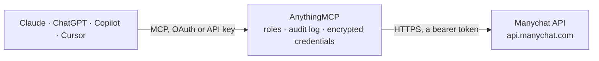

<!-- Generated by scripts/export-github-catalog.mjs in the anythingmcp-website repository. Do not edit by hand. -->

# Manychat MCP connector

Let your AI work with a Manychat account on Instagram, WhatsApp, Messenger and Telegram: find contacts and read their tags and fields, tag contacts, update fields and contact details, list flows and … The AnythingMCP connector gives Claude, ChatGPT, Microsoft Copilot, Cursor and Gemini 22 MCP tools for Manychat: 10 read and 12 can change data.

**Category:** [Marketing Automation](../marketing-automation.md) · **Tools:** 22 · **Setup guide:** [anythingmcp.com](https://anythingmcp.com/guides/manychat-to-mcp) · [Deutsch](https://anythingmcp.com/de/guides/manychat-to-mcp) · [Italiano](https://anythingmcp.com/it/guides/manychat-to-mcp) · [Español](https://anythingmcp.com/es/guides/manychat-to-mcp) · [日本語](https://anythingmcp.com/ja/guides/manychat-to-mcp) · [Русский](https://anythingmcp.com/ru/guides/manychat-to-mcp) · [中文](https://anythingmcp.com/zh/guides/manychat-to-mcp)

## Start without code

No installation and no terminal: AnythingMCP Cloud runs the Manychat connector for you, operated by helpcode.ai in Frankfurt, Germany.

1. **Click the button above** and create an account or sign in. The Manychat connector opens, ready to install.
2. **Paste the API key or token from your Manychat account.** Every click is in the [step-by-step guide](https://anythingmcp.com/guides/manychat-to-mcp).
3. **Click Install.** AnythingMCP shows the address of your MCP server.
4. **Add that address to your assistant:** [Claude](https://anythingmcp.com/guides/connect-manychat-to-claude) · [ChatGPT](https://anythingmcp.com/guides/connect-manychat-to-chatgpt) · [Microsoft Copilot](https://anythingmcp.com/guides/connect-manychat-to-copilot) · [Cursor](https://anythingmcp.com/guides/connect-manychat-to-cursor) · [Gemini CLI](https://anythingmcp.com/guides/connect-manychat-to-gemini) · [Meta Muse](https://anythingmcp.com/guides/connect-manychat-to-muse).
5. **Ask your first question**, for example: *Find contact for booking lead Marco Rossi and show his WhatsApp number, tags and last interaction.*

Prefer help with the setup? [Talk to us](https://anythingmcp.com/contact).

## How it works

- **The AI client** speaks MCP (Streamable HTTP) to AnythingMCP and only sees tool names, descriptions and results. It never gets the Manychat credentials.
- **AnythingMCP** checks the client's role, builds the call from the tool definition, adds the credentials (a bearer token), calls Manychat, logs the call and returns the result.
- **Manychat** sees an ordinary API client with the rights of the account the credentials belong to.

## Tools

| Tool | What it does | Access |
|---|---|---|
| [`manychat_get_account`](#manychat_get_account) | Read the connected Manychat account (page): id, name, category, username, timezone and is_pro. | read |
| [`manychat_list_tags`](#manychat_list_tags) | List the account's tags with id and name. | read |
| [`manychat_list_custom_fields`](#manychat_list_custom_fields) | List the account's contact (custom) fields with id, name, type (text, number, date, datetime, boolean) and description. | read |
| [`manychat_list_bot_fields`](#manychat_list_bot_fields) | List the account's bot fields (account-wide values shared by every contact) with id, name, type, description and current value. | read |
| [`manychat_list_flows`](#manychat_list_flows) | List the automations (flows) of the account with their ns id, name and folder, plus the folders. | read |
| [`manychat_list_growth_tools`](#manychat_list_growth_tools) | List the growth tools (entry points such as ref links, QR codes, comment triggers and widgets) with id, name and type. | read |
| [`manychat_get_contact`](#manychat_get_contact) | Get one contact by id: name, channels (Messenger, Instagram username, WhatsApp phone, email, SMS phone) and their opt-ins, subscription state, last… | read |
| [`manychat_find_contacts_by_name`](#manychat_find_contacts_by_name) | Find contacts by full name (up to 100, no paging). | read |
| [`manychat_find_contacts_by_custom_field`](#manychat_find_contacts_by_custom_field) | Find contacts whose text or number custom field has a given value (up to 100, most recently updated first). | read |
| [`manychat_find_contact_by_email_or_phone`](#manychat_find_contact_by_email_or_phone) | Find one contact by email address or by phone number. | read |
| [`manychat_tag_contact`](#manychat_tag_contact) | Add an existing tag to a contact, by tag name. | write |
| [`manychat_untag_contact`](#manychat_untag_contact) | Remove a tag from one contact, by tag name. | write |
| [`manychat_set_contact_fields`](#manychat_set_contact_fields) | Set one or more custom field values of a contact (up to 20 per call), each by field_id or field_name. | write |
| [`manychat_create_contact`](#manychat_create_contact) | Create a contact from a phone number, WhatsApp number or email (at least one). | write |
| [`manychat_update_contact`](#manychat_update_contact) | Update a contact's name, gender, SMS phone, email and their opt-ins. | write |
| [`manychat_create_tag`](#manychat_create_tag) | Create a new tag in the account, to use with manychat_tag_contact. | write |
| [`manychat_delete_tag`](#manychat_delete_tag) | Delete a tag from the account and from every contact that has it. | write |
| [`manychat_create_custom_field`](#manychat_create_custom_field) | Create a contact (custom) field. | write |
| [`manychat_set_bot_fields`](#manychat_set_bot_fields) | Set one or more bot field values (account-wide, up to 20 per call), each by field_id or field_name. | write |
| [`manychat_send_flow`](#manychat_send_flow) | Start an automation (flow) for one contact, which sends its messages on the contact's channel. | write |
| [`manychat_send_text_message`](#manychat_send_text_message) | Send a plain text message to one contact on Messenger, Instagram, WhatsApp or Telegram. | write |
| [`manychat_send_content`](#manychat_send_content) | Send rich content to one contact in Manychat's v2 content format: up to 10 messages (text, image, video, audio, file, cards) with buttons, actions and quick… | write |

## Tool reference

Every parameter as the AI client sees it in `tools/list`. Source: [`packages/backend/src/adapters/intl/manychat.json`](../../../packages/backend/src/adapters/intl/manychat.json).

### `manychat_get_account`

Read the connected Manychat account (page): id, name, category, username, timezone and is_pro. Checks the API key.

**Access:** read · **Call:** `GET /fb/page/getInfo`

No parameters.

### `manychat_list_tags`

List the account's tags with id and name. Tag names are what the tagging tools take.

**Access:** read · **Call:** `GET /fb/page/getTags`

No parameters.

### `manychat_list_custom_fields`

List the account's contact (custom) fields with id, name, type (text, number, date, datetime, boolean) and description. Use the id or name with manychat_set_contact_fields and manychat_find_contacts_by_custom_field.

**Access:** read · **Call:** `GET /fb/page/getCustomFields`

No parameters.

### `manychat_list_bot_fields`

List the account's bot fields (account-wide values shared by every contact) with id, name, type, description and current value.

**Access:** read · **Call:** `GET /fb/page/getBotFields`

No parameters.

### `manychat_list_flows`

List the automations (flows) of the account with their ns id, name and folder, plus the folders. Use ns as flow_ns in manychat_send_flow.

**Access:** read · **Call:** `GET /fb/page/getFlows`

No parameters.

### `manychat_list_growth_tools`

List the growth tools (entry points such as ref links, QR codes, comment triggers and widgets) with id, name and type.

**Access:** read · **Call:** `GET /fb/page/getGrowthTools`

No parameters.

### `manychat_get_contact`

Get one contact by id: name, channels (Messenger, Instagram username, WhatsApp phone, email, SMS phone) and their opt-ins, subscription state, last interaction and last seen, live chat URL, tags and custom field values.

**Access:** read · **Call:** `GET /fb/subscriber/getInfo`

| Parameter | Type | Required | Description |
|---|---|---|---|
| `subscriber_id` | integer | yes | Contact (subscriber) id: from manychat_find_contacts_by_name, manychat_find_contact_by_email_or_phone or the contact card in Manychat. Pass the digits exactly as returned. |

### `manychat_find_contacts_by_name`

Find contacts by full name (up to 100, no paging). Returns the same details as manychat_get_contact.

**Access:** read · **Call:** `GET /fb/subscriber/findByName`

| Parameter | Type | Required | Description |
|---|---|---|---|
| `name` | string | yes | Full name of the contact, e.g. Jane Doe. |

### `manychat_find_contacts_by_custom_field`

Find contacts whose text or number custom field has a given value (up to 100, most recently updated first). Date and boolean fields cannot be searched.

**Access:** read · **Call:** `GET /fb/subscriber/findByCustomField`

| Parameter | Type | Required | Description |
|---|---|---|---|
| `field_id` | integer | yes | Custom field id from manychat_list_custom_fields (a text or number field). |
| `field_value` | string | yes | Exact value to look for. |

### `manychat_find_contact_by_email_or_phone`

Find one contact by email address or by phone number. Give exactly one of email or phone.

**Access:** read · **Call:** `GET /fb/subscriber/findBySystemField`

| Parameter | Type | Required | Description |
|---|---|---|---|
| `email` | string | no | Email address of the contact. |
| `phone` | string | no | Phone number with country code, e.g. +15405550100. |

### `manychat_tag_contact`

Add an existing tag to a contact, by tag name. Adding a tag can start automations that listen for it. Confirm with the user first.

**Access:** write · **Call:** `POST /fb/subscriber/addTagByName`

| Parameter | Type | Required | Description |
|---|---|---|---|
| `subscriber_id` | integer | yes | Contact (subscriber) id: from manychat_find_contacts_by_name, manychat_find_contact_by_email_or_phone or the contact card in Manychat. Pass the digits exactly as returned. |
| `tag_name` | string | yes | Tag name as listed by manychat_list_tags. |

### `manychat_untag_contact`

Remove a tag from one contact, by tag name. The tag itself stays in the account. Confirm with the user first.

**Access:** write · **Call:** `POST /fb/subscriber/removeTagByName`

| Parameter | Type | Required | Description |
|---|---|---|---|
| `subscriber_id` | integer | yes | Contact (subscriber) id: from manychat_find_contacts_by_name, manychat_find_contact_by_email_or_phone or the contact card in Manychat. Pass the digits exactly as returned. |
| `tag_name` | string | yes | Tag name as listed by manychat_list_tags. |

### `manychat_set_contact_fields`

Set one or more custom field values of a contact (up to 20 per call), each by field_id or field_name. Overwrites the current values and can start automations. Confirm with the user first.

**Access:** write · **Call:** `POST /fb/subscriber/setCustomFields`

| Parameter | Type | Required | Description |
|---|---|---|---|
| `subscriber_id` | integer | yes | Contact (subscriber) id: from manychat_find_contacts_by_name, manychat_find_contact_by_email_or_phone or the contact card in Manychat. Pass the digits exactly as returned. |
| `fields` | object[] | yes | Fields to set, e.g. [{"field_name": "City", "field_value": "Lyon"}]. |

### `manychat_create_contact`

Create a contact from a phone number, WhatsApp number or email (at least one). An SMS phone needs has_opt_in_sms and, when true, consent_phrase; an email needs has_opt_in_email. A whatsapp_phone alone creates a WhatsApp contact. Fails if the contact exists. Importing contacts needs a paid plan. Confirm with the user first.

**Access:** write · **Call:** `POST /fb/subscriber/createSubscriber`

| Parameter | Type | Required | Description |
|---|---|---|---|
| `first_name` | string | no | First name. |
| `last_name` | string | no | Last name. |
| `phone` | string | no | SMS phone number with country code, e.g. +15405550100. |
| `whatsapp_phone` | string | no | WhatsApp number with country code, e.g. +15405550100. |
| `email` | string | no | Email address. |
| `gender` | string | no | Gender, e.g. male or female. |
| `has_opt_in_sms` | boolean | no | Whether the contact agreed to receive SMS. Required with phone. |
| `has_opt_in_email` | boolean | no | Whether the contact agreed to receive email. Required with email. |
| `consent_phrase` | string | no | The consent text the contact agreed to. Required when has_opt_in_sms is true. |

### `manychat_update_contact`

Update a contact's name, gender, SMS phone, email and their opt-ins. The WhatsApp number cannot be changed here. Same opt-in rules as manychat_create_contact. Overwrites the values sent. Confirm with the user first.

**Access:** write · **Call:** `POST /fb/subscriber/updateSubscriber`

| Parameter | Type | Required | Description |
|---|---|---|---|
| `subscriber_id` | integer | yes | Contact (subscriber) id: from manychat_find_contacts_by_name, manychat_find_contact_by_email_or_phone or the contact card in Manychat. Pass the digits exactly as returned. |
| `first_name` | string | no | First name. |
| `last_name` | string | no | Last name. |
| `phone` | string | no | SMS phone number with country code. |
| `email` | string | no | Email address. |
| `gender` | string | no | Gender. |
| `has_opt_in_sms` | boolean | no | SMS opt-in. Required with phone. |
| `has_opt_in_email` | boolean | no | Email opt-in. Required with email. |
| `consent_phrase` | string | no | Consent text. Required when has_opt_in_sms is true. |

### `manychat_create_tag`

Create a new tag in the account, to use with manychat_tag_contact. Confirm with the user first.

**Access:** write · **Call:** `POST /fb/page/createTag`

| Parameter | Type | Required | Description |
|---|---|---|---|
| `name` | string | yes | Name of the new tag. |

### `manychat_delete_tag`

Delete a tag from the account and from every contact that has it. Automations using it lose it, and it cannot be undone. Installed switched off. Name the tag and the effect and confirm with the user first.

**Access:** write · **Call:** `POST /fb/page/removeTagByName`

| Parameter | Type | Required | Description |
|---|---|---|---|
| `tag_name` | string | yes | Name of the tag to delete, as listed by manychat_list_tags. |

### `manychat_create_custom_field`

Create a contact (custom) field. Confirm with the user first.

**Access:** write · **Call:** `POST /fb/page/createCustomField`

| Parameter | Type | Required | Description |
|---|---|---|---|
| `caption` | string | yes | Name of the new field. |
| `type` | `text` \| `number` \| `date` \| `datetime` \| `boolean` | yes | Field type. |
| `description` | string | no | Optional description. |

### `manychat_set_bot_fields`

Set one or more bot field values (account-wide, up to 20 per call), each by field_id or field_name. Every automation that reads the field sees the new value. Confirm with the user first.

**Access:** write · **Call:** `POST /fb/page/setBotFields`

| Parameter | Type | Required | Description |
|---|---|---|---|
| `fields` | object[] | yes | Bot fields to set, e.g. [{"field_name": "promo_code", "field_value": "FALL10"}]. |

### `manychat_send_flow`

Start an automation (flow) for one contact, which sends its messages on the contact's channel. Messaging rules apply: outside the 24-hour window only content the channel allows goes out (on WhatsApp, a flow that starts with an approved template). This sends real messages: name the contact and the flow and confirm with the user first.

**Access:** write · **Call:** `POST /fb/sending/sendFlow`

| Parameter | Type | Required | Description |
|---|---|---|---|
| `subscriber_id` | integer | yes | Contact (subscriber) id: from manychat_find_contacts_by_name, manychat_find_contact_by_email_or_phone or the contact card in Manychat. Pass the digits exactly as returned. |
| `flow_ns` | string | yes | Flow ns id from manychat_list_flows, e.g. content20240101000000_123456. |

### `manychat_send_text_message`

Send a plain text message to one contact on Messenger, Instagram, WhatsApp or Telegram. Only inside the 24-hour window after the contact's last message (check last_interaction). This sends a real message: show the user the recipient and the exact text and confirm with the user first.

**Access:** write · **Call:** `POST /fb/sending/sendContent`

| Parameter | Type | Required | Description |
|---|---|---|---|
| `subscriber_id` | integer | yes | Contact (subscriber) id: from manychat_find_contacts_by_name, manychat_find_contact_by_email_or_phone or the contact card in Manychat. Pass the digits exactly as returned. |
| `channel` | `instagram` \| `whatsapp` \| `telegram` | no | Channel of the contact. Leave empty for Facebook Messenger. |
| `text` | string | yes | Message text. |

### `manychat_send_content`

Send rich content to one contact in Manychat's v2 content format: up to 10 messages (text, image, video, audio, file, cards) with buttons, actions and quick replies. What a channel accepts differs (WhatsApp: text with url or flow buttons only). Only inside the 24-hour window. This sends a real message: show the user the recipient and the content and confirm with the user first.

**Access:** write · **Call:** `POST /fb/sending/sendContent`

| Parameter | Type | Required | Description |
|---|---|---|---|
| `subscriber_id` | integer | yes | Contact (subscriber) id: from manychat_find_contacts_by_name, manychat_find_contact_by_email_or_phone or the contact card in Manychat. Pass the digits exactly as returned. |
| `data` | object | yes | Content object, e.g. {"version": "v2", "content": {"type": "instagram", "messages": [{"type": "text", "text": "Hi", "buttons": [{"type": "url", "caption": "Open", "url": "https://example.com"}]}]}}. Omit content.type for Messenger. |
| `message_tag` | string | no | Legacy Messenger message tag (e.g. ACCOUNT_UPDATE). Meta retired message tags on Messenger in February 2026; leave empty. |

## Run it yourself

AnythingMCP is open source (AGPL-3.0). [Run it with Docker](../../../README.md#run-it-yourself), open **Connectors → Store**, pick **Manychat** and enter `MANYCHAT_API_KEY`, then add your MCP server URL to the AI client.

[← Marketing Automation connectors](../marketing-automation.md) · [All categories](../README.md)
