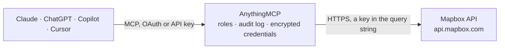

<!-- Generated by scripts/export-github-catalog.mjs in the anythingmcp-website repository. Do not edit by hand. -->

# Mapbox MCP connector

Drive Mapbox APIs (geocoding, directions, isochrones, matrix, tilequery) from any AI agent. 8 tools, access-token query auth. The AnythingMCP connector gives Claude, ChatGPT, Microsoft Copilot, Cursor and Gemini 8 MCP tools for Mapbox, all read-only.

**Category:** [Maps](../maps.md) · **Tools:** 8 · **Setup guide:** [anythingmcp.com](https://anythingmcp.com/guides/mapbox-to-mcp) · [Deutsch](https://anythingmcp.com/de/guides/mapbox-to-mcp) · [Italiano](https://anythingmcp.com/it/guides/mapbox-to-mcp) · [Español](https://anythingmcp.com/es/guides/mapbox-to-mcp) · [日本語](https://anythingmcp.com/ja/guides/mapbox-to-mcp) · [Русский](https://anythingmcp.com/ru/guides/mapbox-to-mcp) · [中文](https://anythingmcp.com/zh/guides/mapbox-to-mcp)

## Start without code

No installation and no terminal: AnythingMCP Cloud runs the Mapbox connector for you, operated by helpcode.ai in Frankfurt, Germany.

1. **Click the button above** and create an account or sign in. The Mapbox connector opens, ready to install.
2. **Paste the API key or token from your Mapbox account.** Every click is in the [step-by-step guide](https://anythingmcp.com/guides/mapbox-to-mcp).
3. **Click Install.** AnythingMCP shows the address of your MCP server.
4. **Add that address to your assistant:** [Claude](https://anythingmcp.com/guides/connect-mapbox-to-claude) · [ChatGPT](https://anythingmcp.com/guides/connect-mapbox-to-chatgpt) · [Microsoft Copilot](https://anythingmcp.com/guides/connect-mapbox-to-copilot) · [Cursor](https://anythingmcp.com/guides/connect-mapbox-to-cursor) · [Gemini CLI](https://anythingmcp.com/guides/connect-mapbox-to-gemini) · [Meta Muse](https://anythingmcp.com/guides/connect-mapbox-to-muse).
5. **Ask your first question**, for example: *What's the precise coordinates and full place name for customer address Kauppatie 7, Tampere, Finland?*

Prefer help with the setup? [Talk to us](https://anythingmcp.com/contact).

## How it works

- **The AI client** speaks MCP (Streamable HTTP) to AnythingMCP and only sees tool names, descriptions and results. It never gets the Mapbox credentials.
- **AnythingMCP** checks the client's role, builds the call from the tool definition, adds the credentials (a key in the query string), calls Mapbox, logs the call and returns the result.
- **Mapbox** sees an ordinary API client with the rights of the account the credentials belong to.

## Tools

| Tool | What it does | Access |
|---|---|---|
| [`mapbox_geocode_forward`](#mapbox_geocode_forward) | Forward geocoding (address text → coordinates). | read |
| [`mapbox_geocode_reverse`](#mapbox_geocode_reverse) | Reverse geocoding (coordinates → address). | read |
| [`mapbox_directions`](#mapbox_directions) | Compute driving / walking / cycling directions between waypoints. | read |
| [`mapbox_isochrone`](#mapbox_isochrone) | Get the area reachable within N minutes from a starting point (an 'isochrone' — like 'how far can I drive in 15 min?'). | read |
| [`mapbox_matrix`](#mapbox_matrix) | Compute travel-time and distance MATRIX between many origins and destinations (e.g. 5 warehouses × 100 customers = 500 cells). | read |
| [`mapbox_static_image`](#mapbox_static_image) | Generate a static PNG/JPG map of a location with optional pin overlays. | read |
| [`mapbox_tilequery`](#mapbox_tilequery) | Query features in a vector tileset at a specific point — e.g. find which neighborhood a coordinate falls in. | read |
| [`mapbox_list_styles`](#mapbox_list_styles) | List custom map styles owned by your account. | read |

## Tool reference

Every parameter as the AI client sees it in `tools/list`. Source: [`packages/backend/src/adapters/intl/mapbox.json`](../../../packages/backend/src/adapters/intl/mapbox.json).

### `mapbox_geocode_forward`

Forward geocoding (address text → coordinates). Returns ranked candidates with [longitude, latitude], place_name, address components.

**Access:** read · **Call:** `GET /search/geocode/v6/forward`

| Parameter | Type | Required | Description |
|---|---|---|---|
| `q` | string | yes | Free-text address or place name. |
| `limit` | integer | no | Max results (1-10, default 5). |
| `country` | string | no | Comma-separated ISO 3166-1 alpha-2 codes to limit results (e.g. 'us,ca'). |
| `proximity` | string | no | 'lng,lat' coordinate to bias results toward (e.g. user's current location). |
| `language` | string | no | IETF tag for the language of results (en, de, fr, es, ja, zh, etc.). |
| `types` | string | no | Comma-separated place types: country,region,postcode,district,place,locality,neighborhood,address,poi. |

### `mapbox_geocode_reverse`

Reverse geocoding (coordinates → address). Pass longitude + latitude.

**Access:** read · **Call:** `GET /search/geocode/v6/reverse`

| Parameter | Type | Required | Description |
|---|---|---|---|
| `longitude` | number | yes | Longitude in decimal degrees. |
| `latitude` | number | yes | Latitude in decimal degrees. |
| `types` | string | no | Place types to consider. |
| `language` | string | no | Result language tag. |
| `limit` | integer | no | Max results (default 1). |

### `mapbox_directions`

Compute driving / walking / cycling directions between waypoints. Returns route geometry, duration (seconds), distance (meters), turn-by-turn steps.

**Access:** read · **Call:** `GET /directions/v5/mapbox/{profile}/{coordinates}`

| Parameter | Type | Required | Description |
|---|---|---|---|
| `profile` | string | yes | driving, walking, cycling, driving-traffic. |
| `coordinates` | string | yes | Semicolon-separated 'lng,lat' waypoints (2-25). E.g. '13.4050,52.5200;9.9937,53.5511'. |
| `alternatives` | boolean | no | Return alternative routes too. |
| `geometries` | string | no | geojson, polyline, polyline6 (default polyline). |
| `overview` | string | no | full, simplified, false. |
| `steps` | boolean | no | Include turn-by-turn steps. |
| `language` | string | no | Voice/text language. |

### `mapbox_isochrone`

Get the area reachable within N minutes from a starting point (an 'isochrone' — like 'how far can I drive in 15 min?'). Returns a GeoJSON polygon.

**Access:** read · **Call:** `GET /isochrone/v1/mapbox/{profile}/{coordinates}`

| Parameter | Type | Required | Description |
|---|---|---|---|
| `profile` | string | yes | driving, walking, cycling. |
| `coordinates` | string | yes | Origin 'lng,lat'. |
| `contours_minutes` | string | no | Comma-separated minute thresholds (e.g. '5,10,15'). Max 4 contours, max 60 min each. |
| `contours_meters` | string | no | Or distance-based: '500,1000,1500' meters (alternative to minutes). |
| `polygons` | boolean | no | If true return polygons (default), if false return linestrings. |
| `generalize` | number | no | Smoothing in meters (positive number). |

### `mapbox_matrix`

Compute travel-time and distance MATRIX between many origins and destinations (e.g. 5 warehouses × 100 customers = 500 cells). Returns durations[][] in seconds and distances[][] in meters.

**Access:** read · **Call:** `GET /directions-matrix/v1/mapbox/{profile}/{coordinates}`

| Parameter | Type | Required | Description |
|---|---|---|---|
| `profile` | string | yes | driving, walking, cycling, driving-traffic. |
| `coordinates` | string | yes | Semicolon-separated 'lng,lat' (max 25 for driving/walking/cycling, 10 for driving-traffic). |
| `sources` | string | no | Comma-separated 0-based indices into coordinates to use as sources. 'all' to use all. |
| `destinations` | string | no | Same for destinations. |
| `annotations` | string | no | duration, distance, or 'duration,distance' (default duration only). |

### `mapbox_static_image`

Generate a static PNG/JPG map of a location with optional pin overlays. Returns the image binary URL.

**Access:** read · **Call:** `GET /styles/v1/{username}/{style_id}/static/{overlay}{lng},{lat},{zoom}/{width}x{height}`

| Parameter | Type | Required | Description |
|---|---|---|---|
| `username` | string | yes | Mapbox style username (typically 'mapbox' for built-in styles). |
| `style_id` | string | yes | Style ID, e.g. 'streets-v12', 'outdoors-v12', 'satellite-v9'. |
| `overlay` | string | no | Optional pin overlay, e.g. 'pin-s-a+9ed4bd(-87.0186,32.4055)'. |
| `lng` | number | yes | Center longitude. |
| `lat` | number | yes | Center latitude. |
| `zoom` | number | yes | 0-22. |
| `width` | integer | yes | Pixels (max 1280). |
| `height` | integer | yes | Pixels (max 1280). |

### `mapbox_tilequery`

Query features in a vector tileset at a specific point — e.g. find which neighborhood a coordinate falls in.

**Access:** read · **Call:** `GET /v4/{tileset_id}/tilequery/{lng},{lat}.json`

| Parameter | Type | Required | Description |
|---|---|---|---|
| `tileset_id` | string | yes | Tileset ID, e.g. 'mapbox.mapbox-streets-v8'. |
| `lng` | number | yes | Longitude. |
| `lat` | number | yes | Latitude. |
| `radius` | integer | no | Search radius in meters (default 0). |
| `layers` | string | no | Comma-separated layer names to query. |
| `limit` | integer | no | Max features (default 5, max 50). |

### `mapbox_list_styles`

List custom map styles owned by your account. Use to discover style IDs for the static-image endpoint.

**Access:** read · **Call:** `GET /styles/v1/{username}`

| Parameter | Type | Required | Description |
|---|---|---|---|
| `username` | string | yes | Mapbox account username. |

## Run it yourself

AnythingMCP is open source (AGPL-3.0). [Run it with Docker](../../../README.md#run-it-yourself), open **Connectors → Store**, pick **Mapbox** and enter `MAPBOX_ACCESS_TOKEN`, then add your MCP server URL to the AI client.

[← Maps connectors](../maps.md) · [All categories](../README.md)
