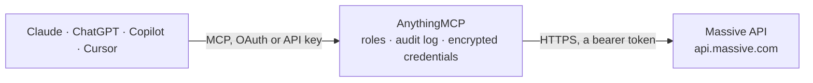

<!-- Generated by scripts/export-github-catalog.mjs in the anythingmcp-website repository. Do not edit by hand. -->

# Massive MCP connector

Market data from Massive (formerly Polygon.io): US stock, option, index, forex and crypto price bars, trades, quotes and snapshots, ticker details, news with sentiment, financial statements and … The AnythingMCP connector gives Claude, ChatGPT, Microsoft Copilot, Cursor and Gemini 33 MCP tools for Massive, all read-only.

**Category:** [Finance](../finance.md) · **Tools:** 33 · **Setup guide:** [anythingmcp.com](https://anythingmcp.com/guides/massive-to-mcp) · [Deutsch](https://anythingmcp.com/de/guides/massive-to-mcp) · [Italiano](https://anythingmcp.com/it/guides/massive-to-mcp) · [Español](https://anythingmcp.com/es/guides/massive-to-mcp) · [日本語](https://anythingmcp.com/ja/guides/massive-to-mcp) · [Русский](https://anythingmcp.com/ru/guides/massive-to-mcp) · [中文](https://anythingmcp.com/zh/guides/massive-to-mcp)

## Start without code

No installation and no terminal: AnythingMCP Cloud runs the Massive connector for you, operated by helpcode.ai in Frankfurt, Germany.

1. **Click the button above** and create an account or sign in. The Massive connector opens, ready to install.
2. **Paste the API key or token from your Massive account.** Every click is in the [step-by-step guide](https://anythingmcp.com/guides/massive-to-mcp).
3. **Click Install.** AnythingMCP shows the address of your MCP server.
4. **Add that address to your assistant:** [Claude](https://anythingmcp.com/guides/connect-massive-to-claude) · [ChatGPT](https://anythingmcp.com/guides/connect-massive-to-chatgpt) · [Microsoft Copilot](https://anythingmcp.com/guides/connect-massive-to-copilot) · [Cursor](https://anythingmcp.com/guides/connect-massive-to-cursor) · [Gemini CLI](https://anythingmcp.com/guides/connect-massive-to-gemini) · [Meta Muse](https://anythingmcp.com/guides/connect-massive-to-muse).
5. **Ask your first question**, for example: *What was the last trade for AAPL right now — price, size, exchange and timestamp?*

Prefer help with the setup? [Talk to us](https://anythingmcp.com/contact).

## How it works

- **The AI client** speaks MCP (Streamable HTTP) to AnythingMCP and only sees tool names, descriptions and results. It never gets the Massive credentials.
- **AnythingMCP** checks the client's role, builds the call from the tool definition, adds the credentials (a bearer token), calls Massive, logs the call and returns the result.
- **Massive** sees an ordinary API client with the rights of the account the credentials belong to.

## Tools

| Tool | What it does | Access |
|---|---|---|
| [`massive_get_market_status`](#massive_get_market_status) | Get whether US stock, options and futures markets, forex, crypto and the main indices are open, closed, in pre-market or after-hours right now, with the… | read |
| [`massive_get_market_holidays`](#massive_get_market_holidays) | List upcoming US market holidays and early closes per exchange (NYSE, Nasdaq, OTC) with date, status (closed or early-close) and opening and closing times. | read |
| [`massive_get_aggregates`](#massive_get_aggregates) | Get price bars (open, high, low, close, volume, VWAP, trade count) for a stock, option, forex pair, crypto pair or index over a date range, at any size from… | read |
| [`massive_get_previous_close`](#massive_get_previous_close) | Get the previous trading day's bar (open, high, low, close, volume, VWAP) for a stock, option, forex pair, crypto pair or index. | read |
| [`massive_get_daily_open_close`](#massive_get_daily_open_close) | Get the open, high, low, close, volume and pre-market and after-hours prices of a stock, option or index on one date. | read |
| [`massive_list_trades`](#massive_list_trades) | List the individual trades (tick data) of a stock, option or crypto ticker for a day or time range: price, size, exchange, conditions and SIP, participant… | read |
| [`massive_list_quotes`](#massive_list_quotes) | List the quotes (NBBO for stocks, BBO for forex) of a stock, option or forex ticker for a day or time range: bid and ask price and size, exchanges,… | read |
| [`massive_get_last_trade`](#massive_get_last_trade) | Get the most recent trade of a US stock or an option contract: price, size, exchange, conditions and timestamp. | read |
| [`massive_get_last_quote`](#massive_get_last_quote) | Get the most recent NBBO quote of a US stock: bid and ask price, size, exchanges and timestamp. | read |
| [`massive_get_snapshots`](#massive_get_snapshots) | Get current snapshots for up to 250 tickers of any asset class at once (universal snapshot): last trade and quote, today's session (open, high, low, close,… | read |
| [`massive_get_stock_snapshot`](#massive_get_stock_snapshot) | Get the current snapshot of one US stock: today's and the previous day's bars, the current minute bar, last trade, last quote, and today's change and change… | read |
| [`massive_get_gainers_losers`](#massive_get_gainers_losers) | Get the 20 US stocks with the largest percentage gain or loss today (minimum volume 10,000), with their snapshots. | read |
| [`massive_list_tickers`](#massive_list_tickers) | Search and list tickers of stocks, ETFs, indices, forex and crypto by name, type, market, exchange, CIK or CUSIP, active or delisted: ticker, name, market,… | read |
| [`massive_get_ticker_details`](#massive_get_ticker_details) | Get the details of one ticker: company name, description, homepage, address, phone, SIC code and industry, market capitalisation, shares outstanding,… | read |
| [`massive_list_ticker_types`](#massive_list_ticker_types) | List the ticker type codes with their descriptions (CS common stock, ETF, ADRC, PFD and more), optionally per asset class and locale. | read |
| [`massive_list_exchanges`](#massive_list_exchanges) | List the exchanges, trading venues and reporting facilities Massive covers: id, name, MIC, operating MIC, type, asset class, locale and website. | read |
| [`massive_get_related_companies`](#massive_get_related_companies) | List companies related to a stock (peers and competitors derived from news and returns), as tickers. | read |
| [`massive_list_news`](#massive_list_news) | List recent news articles about a ticker or the market: title, author, publisher, publication time, URL, description, keywords, tickers mentioned and… | read |
| [`massive_list_income_statements`](#massive_list_income_statements) | List a company's quarterly, annual or trailing-twelve-month income statements from SEC filings: revenue, cost of revenue, gross profit, operating expenses,… | read |
| [`massive_list_balance_sheets`](#massive_list_balance_sheets) | List a company's quarterly, annual or trailing-twelve-month balance sheets from SEC filings: cash, receivables, inventories, current and total assets,… | read |
| [`massive_list_cash_flow_statements`](#massive_list_cash_flow_statements) | List a company's quarterly, annual or trailing-twelve-month cash flow statements from SEC filings: operating, investing and financing cash flows, capital… | read |
| [`massive_list_financial_ratios`](#massive_list_financial_ratios) | Get current valuation, profitability, liquidity and leverage ratios per company (end of day): price, market cap, enterprise value, P/E, P/B, P/S, P/CF,… | read |
| [`massive_list_dividends`](#massive_list_dividends) | List cash dividends of stocks: ex-dividend, record, payment and declaration dates, cash amount, currency, frequency per year and distribution type, past and… | read |
| [`massive_list_splits`](#massive_list_splits) | List stock splits and reverse splits: execution date, split from and split to, adjustment type. | read |
| [`massive_list_options_contracts`](#massive_list_options_contracts) | List options contracts (reference data, no prices): option ticker, underlying, call or put, strike, expiration, exercise style and shares per contract;… | read |
| [`massive_get_options_chain`](#massive_get_options_chain) | Get the option chain of an underlying with prices: per contract the day bar, last quote and trade, greeks (delta, gamma, theta, vega), implied volatility,… | read |
| [`massive_get_option_contract_snapshot`](#massive_get_option_contract_snapshot) | Get the snapshot of one option contract: day bar, last quote and trade, greeks, implied volatility, open interest, break-even price and underlying price. | read |
| [`massive_convert_currency`](#massive_convert_currency) | Convert an amount between two currencies at the latest rate (forex or crypto), with the last quote used. | read |
| [`massive_get_last_forex_quote`](#massive_get_last_forex_quote) | Get the latest bid and ask quote of a currency pair, e.g. EUR to USD. | read |
| [`massive_get_last_crypto_trade`](#massive_get_last_crypto_trade) | Get the latest trade of a crypto pair, e.g. BTC to USD: price, size, exchange and timestamp. | read |
| [`massive_get_technical_indicator`](#massive_get_technical_indicator) | Get SMA, EMA, RSI or MACD values for a stock, option, forex, crypto or index ticker, newest first: one value per bar (MACD with signal and histogram). | read |
| [`massive_get_treasury_yields`](#massive_get_treasury_yields) | Get US Treasury yields per day for maturities from 1 month to 30 years (in percent), sourced from the Federal Reserve. | read |
| [`massive_get_inflation`](#massive_get_inflation) | Get US inflation indicators per month: CPI, core CPI and CPI year-over-year change, PCE and core PCE price indexes and PCE spending, sourced from the… | read |

## Tool reference

Every parameter as the AI client sees it in `tools/list`. Source: [`packages/backend/src/adapters/intl/massive.json`](../../../packages/backend/src/adapters/intl/massive.json).

### `massive_get_market_status`

Get whether US stock, options and futures markets, forex, crypto and the main indices are open, closed, in pre-market or after-hours right now, with the server time. No parameters.

**Access:** read · **Call:** `GET /v1/marketstatus/now`

No parameters.

### `massive_get_market_holidays`

List upcoming US market holidays and early closes per exchange (NYSE, Nasdaq, OTC) with date, status (closed or early-close) and opening and closing times.

**Access:** read · **Call:** `GET /v1/marketstatus/upcoming`

No parameters.

### `massive_get_aggregates`

Get price bars (open, high, low, close, volume, VWAP, trade count) for a stock, option, forex pair, crypto pair or index over a date range, at any size from seconds to years, e.g. 1 day, 5 minute or 1 week bars.

**Access:** read · **Call:** `GET /v2/aggs/ticker/{ticker}/range/{multiplier}/{timespan}/{from}/{to}`

| Parameter | Type | Required | Description |
|---|---|---|---|
| `ticker` | string | yes | Case-sensitive ticker. Stocks: AAPL. Options: O:SPY251219C00650000. Forex: C:EURUSD. Crypto: X:BTCUSD. Indices: I:SPX. |
| `multiplier` | integer | yes | Bar size multiplier, e.g. 1 with timespan day for daily bars, 5 with minute for 5-minute bars. |
| `timespan` | `second` \| `minute` \| `hour` \| `day` \| `week` \| `month` \| `quarter` \| `year` | yes | Bar unit. |
| `from` | string | yes | Start of the window, YYYY-MM-DD or a Unix timestamp in milliseconds. |
| `to` | string | yes | End of the window, YYYY-MM-DD or a Unix timestamp in milliseconds. |
| `adjusted` | boolean | no | false for prices not adjusted for splits; default true. |
| `sort` | `asc` \| `desc` | no | asc (oldest first) or desc (newest first). |
| `limit` | integer | no | Maximum base aggregates used to build the bars, up to 50000 (default 5000). |

### `massive_get_previous_close`

Get the previous trading day's bar (open, high, low, close, volume, VWAP) for a stock, option, forex pair, crypto pair or index.

**Access:** read · **Call:** `GET /v2/aggs/ticker/{ticker}/prev`

| Parameter | Type | Required | Description |
|---|---|---|---|
| `ticker` | string | yes | Case-sensitive ticker. Stocks: AAPL. Options: O:SPY251219C00650000. Forex: C:EURUSD. Crypto: X:BTCUSD. Indices: I:SPX. |
| `adjusted` | boolean | no | false for prices not adjusted for splits; default true. |

### `massive_get_daily_open_close`

Get the open, high, low, close, volume and pre-market and after-hours prices of a stock, option or index on one date.

**Access:** read · **Call:** `GET /v1/open-close/{ticker}/{date}`

| Parameter | Type | Required | Description |
|---|---|---|---|
| `ticker` | string | yes | Case-sensitive ticker. Stocks: AAPL. Options: O:SPY251219C00650000. Forex: C:EURUSD. Crypto: X:BTCUSD. Indices: I:SPX. |
| `date` | string | yes | Trading day, YYYY-MM-DD. |
| `adjusted` | boolean | no | false for prices not adjusted for splits; default true. |

### `massive_list_trades`

List the individual trades (tick data) of a stock, option or crypto ticker for a day or time range: price, size, exchange, conditions and SIP, participant and TRF timestamps. Needs a Developer plan or higher.

**Access:** read · **Call:** `GET /v3/trades/{ticker}`

| Parameter | Type | Required | Description |
|---|---|---|---|
| `ticker` | string | yes | Case-sensitive ticker. Stocks: AAPL. Options: O:SPY251219C00650000. Forex: C:EURUSD. Crypto: X:BTCUSD. Indices: I:SPX. |
| `timestamp` | string | no | One day (YYYY-MM-DD) or an exact nanosecond timestamp. |
| `timestamp_gte` | string | no | From this time on: YYYY-MM-DD or a nanosecond timestamp. |
| `timestamp_lte` | string | no | Up to this time: YYYY-MM-DD or a nanosecond timestamp. |
| `order` | `asc` \| `desc` | no | Sort direction. |
| `limit` | integer | no | Results per page, 1 to 50000. |
| `cursor` | string | no | Next page: the cursor value from next_url of the previous answer (the part after cursor=). |

### `massive_list_quotes`

List the quotes (NBBO for stocks, BBO for forex) of a stock, option or forex ticker for a day or time range: bid and ask price and size, exchanges, conditions and timestamps. Needs an Advanced plan for stocks (Developer or higher for options).

**Access:** read · **Call:** `GET /v3/quotes/{ticker}`

| Parameter | Type | Required | Description |
|---|---|---|---|
| `ticker` | string | yes | Case-sensitive ticker. Stocks: AAPL. Options: O:SPY251219C00650000. Forex: C:EURUSD. Crypto: X:BTCUSD. Indices: I:SPX. |
| `timestamp` | string | no | One day (YYYY-MM-DD) or an exact nanosecond timestamp. |
| `timestamp_gte` | string | no | From this time on: YYYY-MM-DD or a nanosecond timestamp. |
| `timestamp_lte` | string | no | Up to this time: YYYY-MM-DD or a nanosecond timestamp. |
| `order` | `asc` \| `desc` | no | Sort direction. |
| `limit` | integer | no | Results per page, 1 to 50000. |
| `cursor` | string | no | Next page: the cursor value from next_url of the previous answer (the part after cursor=). |

### `massive_get_last_trade`

Get the most recent trade of a US stock or an option contract: price, size, exchange, conditions and timestamp.

**Access:** read · **Call:** `GET /v2/last/trade/{ticker}`

| Parameter | Type | Required | Description |
|---|---|---|---|
| `ticker` | string | yes | Stock ticker such as AAPL, or option ticker such as O:SPY251219C00650000. |

### `massive_get_last_quote`

Get the most recent NBBO quote of a US stock: bid and ask price, size, exchanges and timestamp.

**Access:** read · **Call:** `GET /v2/last/nbbo/{ticker}`

| Parameter | Type | Required | Description |
|---|---|---|---|
| `ticker` | string | yes | Case-sensitive US stock ticker, e.g. AAPL, MSFT, BRK.B. |

### `massive_get_snapshots`

Get current snapshots for up to 250 tickers of any asset class at once (universal snapshot): last trade and quote, today's session (open, high, low, close, change, volume), and for options the greeks, implied volatility and open interest. Needs a paid plan.

**Access:** read · **Call:** `GET /v3/snapshot`

| Parameter | Type | Required | Description |
|---|---|---|---|
| `ticker_any_of` | string | no | Comma-separated tickers, up to 250, mixing asset classes, e.g. AAPL,NVDA,X:BTCUSD,C:EURUSD,I:SPX,O:SPY251219C00650000. |
| `type` | `stocks` \| `options` \| `crypto` \| `fx` \| `indices` | no | Only this asset class. |
| `order` | `asc` \| `desc` | no | Sort direction. |
| `limit` | integer | no | Results per page, 1 to 250. |
| `cursor` | string | no | Next page: the cursor value from next_url of the previous answer (the part after cursor=). |

### `massive_get_stock_snapshot`

Get the current snapshot of one US stock: today's and the previous day's bars, the current minute bar, last trade, last quote, and today's change and change percent. Needs a Starter plan or higher.

**Access:** read · **Call:** `GET /v2/snapshot/locale/us/markets/stocks/tickers/{ticker}`

| Parameter | Type | Required | Description |
|---|---|---|---|
| `ticker` | string | yes | Case-sensitive US stock ticker, e.g. AAPL, MSFT, BRK.B. |

### `massive_get_gainers_losers`

Get the 20 US stocks with the largest percentage gain or loss today (minimum volume 10,000), with their snapshots. Needs a Starter plan or higher.

**Access:** read · **Call:** `GET /v2/snapshot/locale/us/markets/stocks/{direction}`

| Parameter | Type | Required | Description |
|---|---|---|---|
| `direction` | `gainers` \| `losers` | yes | gainers or losers. |
| `include_otc` | boolean | no | true includes OTC securities; default false. |

### `massive_list_tickers`

Search and list tickers of stocks, ETFs, indices, forex and crypto by name, type, market, exchange, CIK or CUSIP, active or delisted: ticker, name, market, locale, primary exchange, type, currency, CIK, FIGI codes.

**Access:** read · **Call:** `GET /v3/reference/tickers`

| Parameter | Type | Required | Description |
|---|---|---|---|
| `search` | string | no | Words in the ticker or company name, e.g. apple. |
| `ticker` | string | no | One exact ticker. |
| `type` | string | no | Ticker type code, e.g. CS (common stock), ETF, ADRC, PFD, WARRANT, INDEX. All codes: massive_list_ticker_types. |
| `market` | `stocks` \| `crypto` \| `fx` \| `otc` \| `indices` | no | Market. |
| `exchange` | string | no | Primary exchange MIC, e.g. XNAS (Nasdaq), XNYS (NYSE). |
| `cusip` | string | no | CUSIP to look up (it is not returned in the answer). |
| `cik` | string | no | SEC CIK, e.g. 0000320193. |
| `date` | string | no | Tickers as they were on this date, YYYY-MM-DD. |
| `active` | boolean | no | true (default) for actively traded tickers, false for delisted ones. |
| `order` | `asc` \| `desc` | no | Sort direction. |
| `sort` | `ticker` \| `name` \| `market` \| `locale` \| `primary_exchange` \| `type` \| `cik` \| `last_updated_utc` \| `delisted_utc` | no | Sort field, default ticker. |
| `limit` | integer | no | Results per page, 1 to 1000. |
| `cursor` | string | no | Next page: the cursor value from next_url of the previous answer (the part after cursor=). |

### `massive_get_ticker_details`

Get the details of one ticker: company name, description, homepage, address, phone, SIC code and industry, market capitalisation, shares outstanding, employees, listing date, primary exchange, CIK, FIGI and logo URLs.

**Access:** read · **Call:** `GET /v3/reference/tickers/{ticker}`

| Parameter | Type | Required | Description |
|---|---|---|---|
| `ticker` | string | yes | Case-sensitive US stock ticker, e.g. AAPL, MSFT, BRK.B. |
| `date` | string | no | Details as of this date, YYYY-MM-DD; default today. |

### `massive_list_ticker_types`

List the ticker type codes with their descriptions (CS common stock, ETF, ADRC, PFD and more), optionally per asset class and locale.

**Access:** read · **Call:** `GET /v3/reference/tickers/types`

| Parameter | Type | Required | Description |
|---|---|---|---|
| `asset_class` | `stocks` \| `options` \| `crypto` \| `fx` \| `indices` | no | Asset class. |
| `locale` | `us` \| `global` | no | us or global. |

### `massive_list_exchanges`

List the exchanges, trading venues and reporting facilities Massive covers: id, name, MIC, operating MIC, type, asset class, locale and website.

**Access:** read · **Call:** `GET /v3/reference/exchanges`

| Parameter | Type | Required | Description |
|---|---|---|---|
| `asset_class` | `stocks` \| `options` \| `crypto` \| `fx` \| `futures` | no | Asset class. |
| `locale` | `us` \| `global` | no | us or global. |

### `massive_get_related_companies`

List companies related to a stock (peers and competitors derived from news and returns), as tickers.

**Access:** read · **Call:** `GET /v1/related-companies/{ticker}`

| Parameter | Type | Required | Description |
|---|---|---|---|
| `ticker` | string | yes | Case-sensitive US stock ticker, e.g. AAPL, MSFT, BRK.B. |

### `massive_list_news`

List recent news articles about a ticker or the market: title, author, publisher, publication time, URL, description, keywords, tickers mentioned and per-ticker sentiment with reasoning.

**Access:** read · **Call:** `GET /v2/reference/news`

| Parameter | Type | Required | Description |
|---|---|---|---|
| `ticker` | string | no | Only articles about this ticker, e.g. AAPL. |
| `published_utc_gte` | string | no | Published on or after, YYYY-MM-DD or an ISO 8601 time. |
| `published_utc_lte` | string | no | Published on or before, YYYY-MM-DD or an ISO 8601 time. |
| `order` | `asc` \| `desc` | no | Sort direction. |
| `limit` | integer | no | Results per page, 1 to 1000. |
| `sort` | `published_utc` | no | Sort field, published_utc. |
| `cursor` | string | no | Next page: the cursor value from next_url of the previous answer (the part after cursor=). |

### `massive_list_income_statements`

List a company's quarterly, annual or trailing-twelve-month income statements from SEC filings: revenue, cost of revenue, gross profit, operating expenses, R&D, SG&A, operating income, EBITDA, interest, taxes, net income, basic and diluted EPS and shares, with fiscal year and quarter, period end and filing date. Needs a Stocks Advanced plan or the Financials expansion.

**Access:** read · **Call:** `GET /stocks/financials/v1/income-statements`

| Parameter | Type | Required | Description |
|---|---|---|---|
| `tickers` | string | no | Ticker of the company, e.g. AAPL. |
| `cik` | string | no | SEC CIK of the company, e.g. 0000320193. |
| `timeframe` | `quarterly` \| `annual` \| `trailing_twelve_months` | no | quarterly, annual or trailing_twelve_months. |
| `fiscal_year` | integer | no | Fiscal year, e.g. 2025. |
| `fiscal_quarter` | integer | no | Fiscal quarter 1 to 4. |
| `period_end_gte` | string | no | Periods ending on or after, YYYY-MM-DD. |
| `period_end_lte` | string | no | Periods ending on or before, YYYY-MM-DD. |
| `filing_date_gte` | string | no | Filed on or after, YYYY-MM-DD. |
| `filing_date_lte` | string | no | Filed on or before, YYYY-MM-DD. |
| `limit` | integer | no | Results per page, 1 to 50000. |
| `sort` | string | no | Comma-separated sort columns with .asc or .desc; default here period_end.desc (latest first). |

### `massive_list_balance_sheets`

List a company's quarterly, annual or trailing-twelve-month balance sheets from SEC filings: cash, receivables, inventories, current and total assets, property, goodwill, payables, debt, current and total liabilities, equity, with fiscal year and quarter, period end and filing date. Needs a Stocks Advanced plan or the Financials expansion.

**Access:** read · **Call:** `GET /stocks/financials/v1/balance-sheets`

| Parameter | Type | Required | Description |
|---|---|---|---|
| `tickers` | string | no | Ticker of the company, e.g. AAPL. |
| `cik` | string | no | SEC CIK of the company, e.g. 0000320193. |
| `timeframe` | `quarterly` \| `annual` \| `trailing_twelve_months` | no | quarterly, annual or trailing_twelve_months. |
| `fiscal_year` | integer | no | Fiscal year, e.g. 2025. |
| `fiscal_quarter` | integer | no | Fiscal quarter 1 to 4. |
| `period_end_gte` | string | no | Periods ending on or after, YYYY-MM-DD. |
| `period_end_lte` | string | no | Periods ending on or before, YYYY-MM-DD. |
| `filing_date_gte` | string | no | Filed on or after, YYYY-MM-DD. |
| `filing_date_lte` | string | no | Filed on or before, YYYY-MM-DD. |
| `limit` | integer | no | Results per page, 1 to 50000. |
| `sort` | string | no | Comma-separated sort columns with .asc or .desc; default here period_end.desc (latest first). |

### `massive_list_cash_flow_statements`

List a company's quarterly, annual or trailing-twelve-month cash flow statements from SEC filings: operating, investing and financing cash flows, capital expenditures, depreciation, dividends, buybacks, net change in cash, with fiscal year and quarter, period end and filing date. Needs a Stocks Advanced plan or the Financials expansion.

**Access:** read · **Call:** `GET /stocks/financials/v1/cash-flow-statements`

| Parameter | Type | Required | Description |
|---|---|---|---|
| `tickers` | string | no | Ticker of the company, e.g. AAPL. |
| `cik` | string | no | SEC CIK of the company, e.g. 0000320193. |
| `timeframe` | `quarterly` \| `annual` \| `trailing_twelve_months` | no | quarterly, annual or trailing_twelve_months. |
| `fiscal_year` | integer | no | Fiscal year, e.g. 2025. |
| `fiscal_quarter` | integer | no | Fiscal quarter 1 to 4. |
| `period_end_gte` | string | no | Periods ending on or after, YYYY-MM-DD. |
| `period_end_lte` | string | no | Periods ending on or before, YYYY-MM-DD. |
| `filing_date_gte` | string | no | Filed on or after, YYYY-MM-DD. |
| `filing_date_lte` | string | no | Filed on or before, YYYY-MM-DD. |
| `limit` | integer | no | Results per page, 1 to 50000. |
| `sort` | string | no | Comma-separated sort columns with .asc or .desc; default here period_end.desc (latest first). |

### `massive_list_financial_ratios`

Get current valuation, profitability, liquidity and leverage ratios per company (end of day): price, market cap, enterprise value, P/E, P/B, P/S, P/CF, EV/EBITDA, EV/sales, EPS, dividend yield, ROA, ROE, debt to equity, current and quick ratio, free cash flow. Filters make it a stock screener. Needs a Stocks Advanced plan or the Financials expansion.

**Access:** read · **Call:** `GET /stocks/financials/v1/ratios`

| Parameter | Type | Required | Description |
|---|---|---|---|
| `ticker` | string | no | One ticker, e.g. AAPL. |
| `ticker_any_of` | string | no | Comma-separated tickers to compare, e.g. AAPL,MSFT,GOOGL. |
| `cik` | string | no | SEC CIK. |
| `market_cap_gte` | number | no | Market capitalisation at least, in USD. |
| `market_cap_lte` | number | no | Market capitalisation at most, in USD. |
| `price_to_earnings_gte` | number | no | P/E ratio at least. |
| `price_to_earnings_lte` | number | no | P/E ratio at most. |
| `dividend_yield_gte` | number | no | Dividend yield at least, as a fraction (0.03 = 3%). |
| `dividend_yield_lte` | number | no | Dividend yield at most, as a fraction. |
| `limit` | integer | no | Results per page, 1 to 50000. |
| `sort` | string | no | Comma-separated sort columns with .asc or .desc, e.g. market_cap.desc; default ticker.asc. |

### `massive_list_dividends`

List cash dividends of stocks: ex-dividend, record, payment and declaration dates, cash amount, currency, frequency per year and distribution type, past and declared.

**Access:** read · **Call:** `GET /stocks/v1/dividends`

| Parameter | Type | Required | Description |
|---|---|---|---|
| `ticker` | string | no | Ticker, e.g. AAPL. |
| `ex_dividend_date_gte` | string | no | Ex-dividend date on or after, YYYY-MM-DD. |
| `ex_dividend_date_lte` | string | no | Ex-dividend date on or before, YYYY-MM-DD. |
| `distribution_type` | `recurring` \| `special` \| `supplemental` \| `irregular` \| `unknown` | no | Kind of distribution. |
| `limit` | integer | no | Results per page, 1 to 5000. |
| `sort` | string | no | Comma-separated sort columns with .asc or .desc; default here ex_dividend_date.desc. |

### `massive_list_splits`

List stock splits and reverse splits: execution date, split from and split to, adjustment type.

**Access:** read · **Call:** `GET /stocks/v1/splits`

| Parameter | Type | Required | Description |
|---|---|---|---|
| `ticker` | string | no | Ticker, e.g. NVDA. |
| `execution_date_gte` | string | no | Executed on or after, YYYY-MM-DD. |
| `execution_date_lte` | string | no | Executed on or before, YYYY-MM-DD. |
| `adjustment_type` | `forward_split` \| `reverse_split` \| `stock_dividend` | no | Kind of split. |
| `limit` | integer | no | Results per page, 1 to 5000. |
| `sort` | string | no | Comma-separated sort columns with .asc or .desc; default execution_date.desc. |

### `massive_list_options_contracts`

List options contracts (reference data, no prices): option ticker, underlying, call or put, strike, expiration, exercise style and shares per contract; filter by underlying, type, expiration and strike range.

**Access:** read · **Call:** `GET /v3/reference/options/contracts`

| Parameter | Type | Required | Description |
|---|---|---|---|
| `underlying_ticker` | string | no | Underlying stock, e.g. AAPL. |
| `contract_type` | `call` \| `put` | no | call or put. |
| `expiration_date` | string | no | Exact expiration date, YYYY-MM-DD. |
| `expiration_date_gte` | string | no | Expiring on or after, YYYY-MM-DD. |
| `expiration_date_lte` | string | no | Expiring on or before, YYYY-MM-DD. |
| `strike_price_gte` | number | no | Strike at least. |
| `strike_price_lte` | number | no | Strike at most. |
| `expired` | boolean | no | true for expired contracts; default false. |
| `as_of` | string | no | Contracts as they were on this date, YYYY-MM-DD. |
| `order` | `asc` \| `desc` | no | Sort direction. |
| `sort` | `ticker` \| `underlying_ticker` \| `expiration_date` \| `strike_price` | no | Sort field, default ticker. |
| `limit` | integer | no | Results per page, 1 to 1000. |
| `cursor` | string | no | Next page: the cursor value from next_url of the previous answer (the part after cursor=). |

### `massive_get_options_chain`

Get the option chain of an underlying with prices: per contract the day bar, last quote and trade, greeks (delta, gamma, theta, vega), implied volatility, open interest, break-even price and the underlying price. Filter by expiration, strike range and type to keep it small. Needs an Options Starter plan or higher.

**Access:** read · **Call:** `GET /v3/snapshot/options/{underlying}`

| Parameter | Type | Required | Description |
|---|---|---|---|
| `underlying` | string | yes | Underlying ticker, e.g. AAPL or I:SPX. |
| `contract_type` | `call` \| `put` | no | call or put. |
| `expiration_date` | string | no | Exact expiration date, YYYY-MM-DD. |
| `expiration_date_gte` | string | no | Expiring on or after, YYYY-MM-DD. |
| `expiration_date_lte` | string | no | Expiring on or before, YYYY-MM-DD. |
| `strike_price_gte` | number | no | Strike at least. |
| `strike_price_lte` | number | no | Strike at most. |
| `order` | `asc` \| `desc` | no | Sort direction. |
| `sort` | `ticker` \| `expiration_date` \| `strike_price` | no | Sort field, default ticker. |
| `limit` | integer | no | Results per page, 1 to 250. |
| `cursor` | string | no | Next page: the cursor value from next_url of the previous answer (the part after cursor=). |

### `massive_get_option_contract_snapshot`

Get the snapshot of one option contract: day bar, last quote and trade, greeks, implied volatility, open interest, break-even price and underlying price. Needs an Options Starter plan or higher.

**Access:** read · **Call:** `GET /v3/snapshot/options/{underlying}/{contract}`

| Parameter | Type | Required | Description |
|---|---|---|---|
| `underlying` | string | yes | Underlying ticker, e.g. AAPL. |
| `contract` | string | yes | Option ticker with the O: prefix, e.g. O:AAPL271217C00250000. |

### `massive_convert_currency`

Convert an amount between two currencies at the latest rate (forex or crypto), with the last quote used.

**Access:** read · **Call:** `GET /v1/conversion/{from}/{to}`

| Parameter | Type | Required | Description |
|---|---|---|---|
| `from` | string | yes | Currency to convert from, e.g. EUR or BTC. |
| `to` | string | yes | Currency to convert to, e.g. USD. |
| `amount` | number | no | Amount to convert, default 1. |
| `precision` | `0` \| `1` \| `2` \| `3` \| `4` | no | Decimal places of the result, 0 to 4 (default 2). |

### `massive_get_last_forex_quote`

Get the latest bid and ask quote of a currency pair, e.g. EUR to USD.

**Access:** read · **Call:** `GET /v1/last_quote/currencies/{from}/{to}`

| Parameter | Type | Required | Description |
|---|---|---|---|
| `from` | string | yes | Base currency, e.g. EUR. |
| `to` | string | yes | Quote currency, e.g. USD. |

### `massive_get_last_crypto_trade`

Get the latest trade of a crypto pair, e.g. BTC to USD: price, size, exchange and timestamp.

**Access:** read · **Call:** `GET /v1/last/crypto/{from}/{to}`

| Parameter | Type | Required | Description |
|---|---|---|---|
| `from` | string | yes | Crypto symbol, e.g. BTC. |
| `to` | string | yes | Quote currency, e.g. USD. |

### `massive_get_technical_indicator`

Get SMA, EMA, RSI or MACD values for a stock, option, forex, crypto or index ticker, newest first: one value per bar (MACD with signal and histogram).

**Access:** read · **Call:** `GET /v1/indicators/{indicator}/{ticker}`

| Parameter | Type | Required | Description |
|---|---|---|---|
| `indicator` | `sma` \| `ema` \| `rsi` \| `macd` | yes | sma, ema, rsi or macd. |
| `ticker` | string | yes | Case-sensitive ticker. Stocks: AAPL. Options: O:SPY251219C00650000. Forex: C:EURUSD. Crypto: X:BTCUSD. Indices: I:SPX. |
| `timespan` | `minute` \| `hour` \| `day` \| `week` \| `month` \| `quarter` \| `year` | no | Bar size the indicator is computed on, default day. |
| `window` | integer | no | sma, ema, rsi: window length (default 50 for sma and ema, 14 for rsi). |
| `short_window` | integer | no | macd: short window (default 12). |
| `long_window` | integer | no | macd: long window (default 26). |
| `signal_window` | integer | no | macd: signal window (default 9). |
| `series_type` | `close` \| `open` \| `high` \| `low` | no | Price used, default close. |
| `adjusted` | boolean | no | false for prices not adjusted for splits; default true. |
| `timestamp` | string | no | One date, YYYY-MM-DD, or a millisecond timestamp. |
| `timestamp_gte` | string | no | From this date on, YYYY-MM-DD. |
| `timestamp_lte` | string | no | Up to this date, YYYY-MM-DD. |
| `order` | `asc` \| `desc` | no | Sort direction. |
| `limit` | integer | no | Results per page, 1 to 5000. |

### `massive_get_treasury_yields`

Get US Treasury yields per day for maturities from 1 month to 30 years (in percent), sourced from the Federal Reserve.

**Access:** read · **Call:** `GET /fed/v1/treasury-yields`

| Parameter | Type | Required | Description |
|---|---|---|---|
| `date` | string | no | One date, YYYY-MM-DD. |
| `date_gte` | string | no | From this date on, YYYY-MM-DD. |
| `date_lte` | string | no | Up to this date, YYYY-MM-DD. |
| `limit` | integer | no | Results per page, 1 to 50000. |
| `sort` | string | no | date.desc (default here, latest first) or date.asc. |

### `massive_get_inflation`

Get US inflation indicators per month: CPI, core CPI and CPI year-over-year change, PCE and core PCE price indexes and PCE spending, sourced from the Federal Reserve.

**Access:** read · **Call:** `GET /fed/v1/inflation`

| Parameter | Type | Required | Description |
|---|---|---|---|
| `date` | string | no | One date, YYYY-MM-DD. |
| `date_gte` | string | no | From this date on, YYYY-MM-DD. |
| `date_lte` | string | no | Up to this date, YYYY-MM-DD. |
| `limit` | integer | no | Results per page, 1 to 50000. |
| `sort` | string | no | date.desc (default here, latest first) or date.asc. |

## Run it yourself

AnythingMCP is open source (AGPL-3.0). [Run it with Docker](../../../README.md#run-it-yourself), open **Connectors → Store**, pick **Massive** and enter `MASSIVE_API_KEY`, then add your MCP server URL to the AI client.

[← Finance connectors](../finance.md) · [All categories](../README.md)
