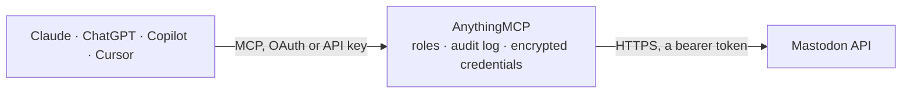

<!-- Generated by scripts/export-github-catalog.mjs in the anythingmcp-website repository. Do not edit by hand. -->

# Mastodon MCP connector

Read & post on any Mastodon instance from any AI agent. 10 tools, Bearer token auth. The AnythingMCP connector gives Claude, ChatGPT, Microsoft Copilot, Cursor and Gemini 10 MCP tools for Mastodon: 9 read and 1 can change data.

**Category:** [Social Media](../social.md) · **Tools:** 10 · **Setup guide:** [anythingmcp.com](https://anythingmcp.com/guides/mastodon-to-mcp) · [Deutsch](https://anythingmcp.com/de/guides/mastodon-to-mcp) · [Italiano](https://anythingmcp.com/it/guides/mastodon-to-mcp) · [Español](https://anythingmcp.com/es/guides/mastodon-to-mcp) · [日本語](https://anythingmcp.com/ja/guides/mastodon-to-mcp) · [Русский](https://anythingmcp.com/ru/guides/mastodon-to-mcp) · [中文](https://anythingmcp.com/zh/guides/mastodon-to-mcp)

## Start without code

No installation and no terminal: AnythingMCP Cloud runs the Mastodon connector for you, operated by helpcode.ai in Frankfurt, Germany.

1. **Click the button above** and create an account or sign in. The Mastodon connector opens, ready to install.
2. **Paste the API key or token from your Mastodon account.** Every click is in the [step-by-step guide](https://anythingmcp.com/guides/mastodon-to-mcp).
3. **Click Install.** AnythingMCP shows the address of your MCP server.
4. **Add that address to your assistant:** [Claude](https://anythingmcp.com/guides/connect-mastodon-to-claude) · [ChatGPT](https://anythingmcp.com/guides/connect-mastodon-to-chatgpt) · [Microsoft Copilot](https://anythingmcp.com/guides/connect-mastodon-to-copilot) · [Cursor](https://anythingmcp.com/guides/connect-mastodon-to-cursor) · [Gemini CLI](https://anythingmcp.com/guides/connect-mastodon-to-gemini) · [Meta Muse](https://anythingmcp.com/guides/connect-mastodon-to-muse).
5. **Ask your first question**, for example: *Lookup account for @greenworks@techverse.social and show their profile counts and display name.*

Prefer help with the setup? [Talk to us](https://anythingmcp.com/contact).

## How it works

- **The AI client** speaks MCP (Streamable HTTP) to AnythingMCP and only sees tool names, descriptions and results. It never gets the Mastodon credentials.
- **AnythingMCP** checks the client's role, builds the call from the tool definition, adds the credentials (a bearer token), calls Mastodon, logs the call and returns the result.
- **Mastodon** sees an ordinary API client with the rights of the account the credentials belong to.

## Tools

| Tool | What it does | Access |
|---|---|---|
| [`mastodon_verify_credentials`](#mastodon_verify_credentials) | Return the authenticated account: id, username, acct (full handle), display_name, note, avatar, statuses_count, followers_count, following_count. | read |
| [`mastodon_get_account`](#mastodon_get_account) | Fetch a public account by ID. | read |
| [`mastodon_account_statuses`](#mastodon_account_statuses) | Get a user's recent statuses (toots). | read |
| [`mastodon_home_timeline`](#mastodon_home_timeline) | Get the authenticated user's home timeline (their follows). | read |
| [`mastodon_public_timeline`](#mastodon_public_timeline) | Get the public timeline. | read |
| [`mastodon_hashtag_timeline`](#mastodon_hashtag_timeline) | Get statuses tagged with a hashtag (no # prefix). | read |
| [`mastodon_search`](#mastodon_search) | Full-text search across accounts, statuses and hashtags. | read |
| [`mastodon_get_status`](#mastodon_get_status) | Fetch a single status by ID. | read |
| [`mastodon_post_status`](#mastodon_post_status) | Post a new status (toot). | read |
| [`mastodon_delete_status`](#mastodon_delete_status) | Delete one of your own statuses. | write |

## Tool reference

Every parameter as the AI client sees it in `tools/list`. Source: [`packages/backend/src/adapters/intl/mastodon.json`](../../../packages/backend/src/adapters/intl/mastodon.json).

### `mastodon_verify_credentials`

Return the authenticated account: id, username, acct (full handle), display_name, note, avatar, statuses_count, followers_count, following_count.

**Access:** read · **Call:** `GET /api/v1/accounts/verify_credentials`

No parameters.

### `mastodon_get_account`

Fetch a public account by ID. For lookup by handle, use mastodon_search.

**Access:** read · **Call:** `GET /api/v1/accounts/{account_id}`

| Parameter | Type | Required | Description |
|---|---|---|---|
| `account_id` | string | yes | Account ID. |

### `mastodon_account_statuses`

Get a user's recent statuses (toots).

**Access:** read · **Call:** `GET /api/v1/accounts/{account_id}/statuses`

| Parameter | Type | Required | Description |
|---|---|---|---|
| `account_id` | string | yes | Account ID. |
| `limit` | integer | no | Max 40. |
| `max_id` | string | no | Pagination — return statuses older than this id. |
| `since_id` | string | no | Pagination — return statuses newer than this id. |
| `exclude_replies` | boolean | no | Skip replies. |
| `exclude_reblogs` | boolean | no | Skip boosts. |
| `only_media` | boolean | no | Only statuses with attachments. |

### `mastodon_home_timeline`

Get the authenticated user's home timeline (their follows).

**Access:** read · **Call:** `GET /api/v1/timelines/home`

| Parameter | Type | Required | Description |
|---|---|---|---|
| `limit` | integer | no | Max 40. |
| `max_id` | string | no | Older than. |
| `since_id` | string | no | Newer than. |

### `mastodon_public_timeline`

Get the public timeline. `local=true` = only this instance's accounts; `remote=true` = only federated. Default: federated public.

**Access:** read · **Call:** `GET /api/v1/timelines/public`

| Parameter | Type | Required | Description |
|---|---|---|---|
| `local` | boolean | no | Only this instance. |
| `remote` | boolean | no | Only federated remote accounts. |
| `only_media` | boolean | no | Only statuses with media. |
| `limit` | integer | no | Max 40. |

### `mastodon_hashtag_timeline`

Get statuses tagged with a hashtag (no # prefix).

**Access:** read · **Call:** `GET /api/v1/timelines/tag/{hashtag}`

| Parameter | Type | Required | Description |
|---|---|---|---|
| `hashtag` | string | yes | Tag, no '#'. |
| `local` | boolean | no | Only local accounts. |
| `limit` | integer | no | Max 40. |
| `max_id` | string | no | Older than. |

### `mastodon_search`

Full-text search across accounts, statuses and hashtags. Pass a full status URL in `q` to look up federated content by URL.

**Access:** read · **Call:** `GET /api/v2/search`

| Parameter | Type | Required | Description |
|---|---|---|---|
| `q` | string | yes | Query text or URL. |
| `type` | string | no | Restrict: 'accounts', 'statuses', or 'hashtags'. |
| `resolve` | boolean | no | If true and `q` is a URL, fetch it from the remote instance. |
| `limit` | integer | no | Max 40. |

### `mastodon_get_status`

Fetch a single status by ID. Returns content, account, media, mentions, tags, replies/favourites/reblogs counts.

**Access:** read · **Call:** `GET /api/v1/statuses/{status_id}`

| Parameter | Type | Required | Description |
|---|---|---|---|
| `status_id` | string | yes | Status ID (per-instance). |

### `mastodon_post_status`

Post a new status (toot). `status` is the text; optionally include `in_reply_to_id` to thread.

**Access:** read · **Call:** `POST /api/v1/statuses`

| Parameter | Type | Required | Description |
|---|---|---|---|
| `status` | string | yes | Status text. Most instances cap at 500 chars. |
| `in_reply_to_id` | string | no | ID of status this is a reply to. |
| `sensitive` | boolean | no | Mark media as sensitive (CW). |
| `spoiler_text` | string | no | Content warning text (subject line). |
| `visibility` | string | no | 'public', 'unlisted', 'private', 'direct'. |
| `language` | string | no | ISO 639-1 language code. |

### `mastodon_delete_status`

Delete one of your own statuses.

**Access:** write · **Call:** `DELETE /api/v1/statuses/{status_id}`

| Parameter | Type | Required | Description |
|---|---|---|---|
| `status_id` | string | yes | Status ID. |

## Run it yourself

AnythingMCP is open source (AGPL-3.0). [Run it with Docker](../../../README.md#run-it-yourself), open **Connectors → Store**, pick **Mastodon** and enter `MASTODON_INSTANCE_URL`, `MASTODON_ACCESS_TOKEN`, then add your MCP server URL to the AI client.

[← Social Media connectors](../social.md) · [All categories](../README.md)
