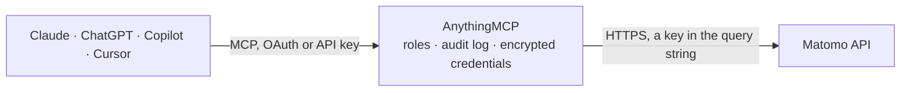

<!-- Generated by scripts/export-github-catalog.mjs in the anythingmcp-website repository. Do not edit by hand. -->

# Matomo MCP connector

Matomo web analytics: visits, page and entry-page reports, referrers, countries and devices, goal conversions and live visitor detail. The AnythingMCP connector gives Claude, ChatGPT, Microsoft Copilot, Cursor and Gemini 10 MCP tools for Matomo, all read-only.

**Category:** [Analytics](../analytics.md) · **Tools:** 10 · **Setup guide:** [anythingmcp.com](https://anythingmcp.com/guides/matomo-to-mcp) · [Deutsch](https://anythingmcp.com/de/guides/matomo-to-mcp) · [Italiano](https://anythingmcp.com/it/guides/matomo-to-mcp) · [Español](https://anythingmcp.com/es/guides/matomo-to-mcp) · [日本語](https://anythingmcp.com/ja/guides/matomo-to-mcp) · [Русский](https://anythingmcp.com/ru/guides/matomo-to-mcp) · [中文](https://anythingmcp.com/zh/guides/matomo-to-mcp)

## Start without code

No installation and no terminal: AnythingMCP Cloud runs the Matomo connector for you, operated by helpcode.ai in Frankfurt, Germany.

1. **Click the button above** and create an account or sign in. The Matomo connector opens, ready to install.
2. **Paste the API key or token from your Matomo account.** Every click is in the [step-by-step guide](https://anythingmcp.com/guides/matomo-to-mcp).
3. **Click Install.** AnythingMCP shows the address of your MCP server.
4. **Add that address to your assistant:** [Claude](https://anythingmcp.com/guides/connect-matomo-to-claude) · [ChatGPT](https://anythingmcp.com/guides/connect-matomo-to-chatgpt) · [Microsoft Copilot](https://anythingmcp.com/guides/connect-matomo-to-copilot) · [Cursor](https://anythingmcp.com/guides/connect-matomo-to-cursor) · [Gemini CLI](https://anythingmcp.com/guides/connect-matomo-to-gemini) · [Meta Muse](https://anythingmcp.com/guides/connect-matomo-to-muse).
5. **Ask your first question**, for example: *Show page stats for /pricing on site BrightWave.de for last30 (idSite unknown to me).*

Prefer help with the setup? [Talk to us](https://anythingmcp.com/contact).

## How it works

- **The AI client** speaks MCP (Streamable HTTP) to AnythingMCP and only sees tool names, descriptions and results. It never gets the Matomo credentials.
- **AnythingMCP** checks the client's role, builds the call from the tool definition, adds the credentials (a key in the query string), calls Matomo, logs the call and returns the result.
- **Matomo** sees an ordinary API client with the rights of the account the credentials belong to.

## Tools

| Tool | What it does | Access |
|---|---|---|
| [`matomo_get_version`](#matomo_get_version) | Read the Matomo version of this instance. | read |
| [`matomo_list_sites`](#matomo_list_sites) | List the sites this token can report on, with their id, name, main URL, timezone and currency. | read |
| [`matomo_get_visits_summary`](#matomo_get_visits_summary) | Read the headline numbers for a period: visits, unique visitors, actions, bounce rate, average visit duration and actions per visit. | read |
| [`matomo_get_page_urls`](#matomo_get_page_urls) | Read the page report: which URLs were viewed, how often, their average time on page, bounce rate and exit rate. | read |
| [`matomo_get_entry_pages`](#matomo_get_entry_pages) | Read which pages visitors *arrived* on, with entries, bounce rate and the visits that followed — the landing-page view, not the pageview view. | read |
| [`matomo_get_referrers`](#matomo_get_referrers) | Read where the traffic came from: search engines, websites, social networks, campaigns and direct entry, with visits and actions for each. | read |
| [`matomo_get_countries`](#matomo_get_countries) | Read the visits broken down by country, with visit counts, actions and bounce rate — the geography of the audience. | read |
| [`matomo_get_device_types`](#matomo_get_device_types) | Read the visits broken down by device type — desktop, smartphone, tablet — with visits, actions and bounce rate. | read |
| [`matomo_get_goals`](#matomo_get_goals) | Read goal conversions for a period: conversions, conversion rate and revenue, overall or for one goal. | read |
| [`matomo_get_last_visits`](#matomo_get_last_visits) | Read individual recent visits with their referrer, country, device, and the pages each one viewed in order. | read |

## Tool reference

Every parameter as the AI client sees it in `tools/list`. Source: [`packages/backend/src/adapters/intl/matomo.json`](../../../packages/backend/src/adapters/intl/matomo.json).

### `matomo_get_version`

Read the Matomo version of this instance. No site, period or date needed — the fastest way to tell a URL problem from a token problem.

**Access:** read · **Call:** `GET /index.php`

No parameters.

### `matomo_list_sites`

List the sites this token can report on, with their id, name, main URL, timezone and currency. Every other tool needs one of these ids.

**Access:** read · **Call:** `GET /index.php`

No parameters.

### `matomo_get_visits_summary`

Read the headline numbers for a period: visits, unique visitors, actions, bounce rate, average visit duration and actions per visit.

**Access:** read · **Call:** `GET /index.php`

| Parameter | Type | Required | Description |
|---|---|---|---|
| `idSite` | number | yes | Numeric site id. Matomo hosts many sites and every report is scoped to one. |
| `period` | string | yes | Reporting period: day, week, month, year or range. |
| `date` | string | yes | Date or keyword: YYYY-MM-DD, `today`, `yesterday`, `last7`, `last30`, or `2026-09-01,2026-09-30` with period=range. |
| `segment` | string | no | Matomo segment expression, e.g. countryCode==de;deviceType==smartphone. |

### `matomo_get_page_urls`

Read the page report: which URLs were viewed, how often, their average time on page, bounce rate and exit rate.

**Access:** read · **Call:** `GET /index.php`

| Parameter | Type | Required | Description |
|---|---|---|---|
| `idSite` | number | yes | Numeric site id. Matomo hosts many sites and every report is scoped to one. |
| `period` | string | yes | Reporting period: day, week, month, year or range. |
| `date` | string | yes | Date or keyword: YYYY-MM-DD, `today`, `yesterday`, `last7`, `last30`, or `2026-09-01,2026-09-30` with period=range. |
| `segment` | string | no | Matomo segment expression. |
| `flat` | number | no | Pass 1 to flatten the URL hierarchy into full paths instead of a folder tree. |
| `filter_limit` | number | no | Rows to return (default 100; -1 for all). |
| `filter_sort_column` | string | no | Column to sort by, e.g. nb_hits or nb_visits. |

### `matomo_get_entry_pages`

Read which pages visitors *arrived* on, with entries, bounce rate and the visits that followed — the landing-page view, not the pageview view.

**Access:** read · **Call:** `GET /index.php`

| Parameter | Type | Required | Description |
|---|---|---|---|
| `idSite` | number | yes | Numeric site id. Matomo hosts many sites and every report is scoped to one. |
| `period` | string | yes | Reporting period: day, week, month, year or range. |
| `date` | string | yes | Date or keyword: YYYY-MM-DD, `today`, `yesterday`, `last7`, `last30`, or `2026-09-01,2026-09-30` with period=range. |
| `segment` | string | no | Matomo segment expression. |
| `flat` | number | no | Pass 1 to flatten the URL hierarchy. |
| `filter_limit` | number | no | Rows to return. |

### `matomo_get_referrers`

Read where the traffic came from: search engines, websites, social networks, campaigns and direct entry, with visits and actions for each.

**Access:** read · **Call:** `GET /index.php`

| Parameter | Type | Required | Description |
|---|---|---|---|
| `idSite` | number | yes | Numeric site id. Matomo hosts many sites and every report is scoped to one. |
| `period` | string | yes | Reporting period: day, week, month, year or range. |
| `date` | string | yes | Date or keyword: YYYY-MM-DD, `today`, `yesterday`, `last7`, `last30`, or `2026-09-01,2026-09-30` with period=range. |
| `segment` | string | no | Matomo segment expression. |
| `filter_limit` | number | no | Rows to return. |

### `matomo_get_countries`

Read the visits broken down by country, with visit counts, actions and bounce rate — the geography of the audience.

**Access:** read · **Call:** `GET /index.php`

| Parameter | Type | Required | Description |
|---|---|---|---|
| `idSite` | number | yes | Numeric site id. Matomo hosts many sites and every report is scoped to one. |
| `period` | string | yes | Reporting period: day, week, month, year or range. |
| `date` | string | yes | Date or keyword: YYYY-MM-DD, `today`, `yesterday`, `last7`, `last30`, or `2026-09-01,2026-09-30` with period=range. |
| `segment` | string | no | Matomo segment expression. |
| `filter_limit` | number | no | Rows to return. |

### `matomo_get_device_types`

Read the visits broken down by device type — desktop, smartphone, tablet — with visits, actions and bounce rate.

**Access:** read · **Call:** `GET /index.php`

| Parameter | Type | Required | Description |
|---|---|---|---|
| `idSite` | number | yes | Numeric site id. Matomo hosts many sites and every report is scoped to one. |
| `period` | string | yes | Reporting period: day, week, month, year or range. |
| `date` | string | yes | Date or keyword: YYYY-MM-DD, `today`, `yesterday`, `last7`, `last30`, or `2026-09-01,2026-09-30` with period=range. |
| `segment` | string | no | Matomo segment expression. |

### `matomo_get_goals`

Read goal conversions for a period: conversions, conversion rate and revenue, overall or for one goal.

**Access:** read · **Call:** `GET /index.php`

| Parameter | Type | Required | Description |
|---|---|---|---|
| `idSite` | number | yes | Numeric site id. Matomo hosts many sites and every report is scoped to one. |
| `period` | string | yes | Reporting period: day, week, month, year or range. |
| `date` | string | yes | Date or keyword: YYYY-MM-DD, `today`, `yesterday`, `last7`, `last30`, or `2026-09-01,2026-09-30` with period=range. |
| `idGoal` | string | no | Numeric goal id, or leave empty for all goals combined. |
| `segment` | string | no | Matomo segment expression. |

### `matomo_get_last_visits`

Read individual recent visits with their referrer, country, device, and the pages each one viewed in order. The qualitative detail behind the aggregates.

**Access:** read · **Call:** `GET /index.php`

| Parameter | Type | Required | Description |
|---|---|---|---|
| `idSite` | number | yes | Numeric site id. Matomo hosts many sites and every report is scoped to one. |
| `period` | string | yes | Reporting period: day, week, month, year or range. |
| `date` | string | yes | Date or keyword: YYYY-MM-DD, `today`, `yesterday`, `last7`, `last30`, or `2026-09-01,2026-09-30` with period=range. |
| `segment` | string | no | Matomo segment expression. |
| `filter_limit` | number | no | Visits to return (default 100). |

## Run it yourself

AnythingMCP is open source (AGPL-3.0). [Run it with Docker](../../../README.md#run-it-yourself), open **Connectors → Store**, pick **Matomo** and enter `MATOMO_URL`, `MATOMO_TOKEN`, then add your MCP server URL to the AI client.

[← Analytics connectors](../analytics.md) · [All categories](../README.md)
