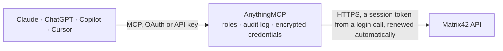

<!-- Generated by scripts/export-github-catalog.mjs in the anythingmcp-website repository. Do not edit by hand. -->

# Matrix42 MCP connector

Matrix42 Enterprise Service Management: query any configuration item, incident, service request, asset or user with Matrix42's fragment query API. The AnythingMCP connector gives Claude, ChatGPT, Microsoft Copilot, Cursor and Gemini 7 MCP tools for Matrix42, all read-only.

**Category:** [IT Service Management](../itsm.md) · **Tools:** 7 · **Setup guide:** [anythingmcp.com](https://anythingmcp.com/guides/matrix42-to-mcp) · [Deutsch](https://anythingmcp.com/de/guides/matrix42-to-mcp) · [Italiano](https://anythingmcp.com/it/guides/matrix42-to-mcp) · [Español](https://anythingmcp.com/es/guides/matrix42-to-mcp) · [日本語](https://anythingmcp.com/ja/guides/matrix42-to-mcp) · [Русский](https://anythingmcp.com/ru/guides/matrix42-to-mcp) · [中文](https://anythingmcp.com/zh/guides/matrix42-to-mcp)

## Start without code

No installation and no terminal: AnythingMCP Cloud runs the Matrix42 connector for you, operated by helpcode.ai in Frankfurt, Germany.

1. **Click the button above** and create an account or sign in. The Matrix42 connector opens, ready to install.
2. **Paste the API key or token from your Matrix42 account.** Every click is in the [step-by-step guide](https://anythingmcp.com/guides/matrix42-to-mcp).
3. **Click Install.** AnythingMCP shows the address of your MCP server.
4. **Add that address to your assistant:** [Claude](https://anythingmcp.com/guides/connect-matrix42-to-claude) · [ChatGPT](https://anythingmcp.com/guides/connect-matrix42-to-chatgpt) · [Microsoft Copilot](https://anythingmcp.com/guides/connect-matrix42-to-copilot) · [Cursor](https://anythingmcp.com/guides/connect-matrix42-to-cursor) · [Gemini CLI](https://anythingmcp.com/guides/connect-matrix42-to-gemini) · [Meta Muse](https://anythingmcp.com/guides/connect-matrix42-to-muse).
5. **Ask your first question**, for example: *Show incident INC-2026-0451: who it's assigned to, state, created date and short title*

Prefer help with the setup? [Talk to us](https://anythingmcp.com/contact).

## How it works

- **The AI client** speaks MCP (Streamable HTTP) to AnythingMCP and only sees tool names, descriptions and results. It never gets the Matrix42 credentials.
- **AnythingMCP** checks the client's role, builds the call from the tool definition, adds the credentials (a session token from a login call, renewed automatically), calls Matrix42, logs the call and returns the result.
- **Matrix42** sees an ordinary API client with the rights of the account the credentials belong to.

## Tools

| Tool | What it does | Access |
|---|---|---|
| [`matrix42_query_fragments`](#matrix42_query_fragments) | Query any Matrix42 Data Definition (fragment type) with a column list and an A-SQL where clause. | read |
| [`matrix42_get_fragment_schema`](#matrix42_get_fragment_schema) | Check column names and types for one Data Definition: returns the Schema (ColumnName, ColumnType) of the columns you name plus one sample row. | read |
| [`matrix42_query_incidents`](#matrix42_query_incidents) | Query incidents: activities (SPSActivityClassBase) of CI type SPSActivityTypeIncident, with your column list and an optional A-SQL where clause. | read |
| [`matrix42_query_service_requests`](#matrix42_query_service_requests) | Query service requests: activities (SPSActivityClassBase) of CI type SPSActivityTypeServiceRequest, with your column list and an optional A-SQL where clause. | read |
| [`matrix42_query_assets`](#matrix42_query_assets) | Query the asset base: hardware and software configuration items with their name, type, serial number, status and assigned user. | read |
| [`matrix42_query_users`](#matrix42_query_users) | Query people (SPSUserClassBase) with their name, e-mail and other columns you name. | read |
| [`matrix42_get_object`](#matrix42_get_object) | Read one object by its CI type and object id, returning the fragments it is made of (add full=true for the multi-fragments too). | read |

## Tool reference

Every parameter as the AI client sees it in `tools/list`. Source: [`packages/backend/src/adapters/de/matrix42.json`](../../../packages/backend/src/adapters/de/matrix42.json).

### `matrix42_query_fragments`

Query any Matrix42 Data Definition (fragment type) with a column list and an A-SQL where clause. The general-purpose read — everything in Matrix42 is reachable this way.

**Access:** read · **Call:** `GET /api/data/fragments/{fragmentName}`

| Parameter | Type | Required | Description |
|---|---|---|---|
| `fragmentName` | string | yes | Data Definition name, e.g. SPSActivityClassBase, SPSAssetClassBase, SPSUserClassBase. Not a CI type name such as SPSActivityTypeIncident. |
| `columns` | string | yes | Comma-separated A-SQL column list. Required: without it Matrix42 returns only the IDs. |
| `where` | string | no | A-SQL filter over that Data Definition's columns, e.g. State = 3. |
| `sort` | string | no | Sort expression, e.g. `CreatedDate DESC` or `Name ASC, CreatedDate DESC`. |
| `pageSize` | number | no | Rows per page. |
| `pageNumber` | number | no | Page to return, used with pageSize. |

### `matrix42_get_fragment_schema`

Check column names and types for one Data Definition: returns the Schema (ColumnName, ColumnType) of the columns you name plus one sample row. A column that does not exist fails the call, which is how to confirm a name before a larger query.

**Access:** read · **Call:** `GET /api/data/fragments/{fragmentName}/schema-info`

| Parameter | Type | Required | Description |
|---|---|---|---|
| `fragmentName` | string | yes | Data Definition name, e.g. SPSActivityClassBase. |
| `columns` | string | yes | Comma-separated column names to check. |

### `matrix42_query_incidents`

Query incidents: activities (SPSActivityClassBase) of CI type SPSActivityTypeIncident, with your column list and an optional A-SQL where clause.

**Access:** read · **Call:** `GET /api/data/fragments/SPSActivityClassBase`

| Parameter | Type | Required | Description |
|---|---|---|---|
| `columns` | string | yes | Comma-separated A-SQL column list. Required: without it Matrix42 returns only the IDs. Columns are SPSActivityClassBase's. |
| `where` | string | no | A-SQL filter over SPSActivityClassBase columns, e.g. State = 3. The incident type filter is added for you. |
| `sort` | string | no | Sort expression, e.g. `CreatedDate DESC` or `Name ASC, CreatedDate DESC`. |
| `pageSize` | number | no | Rows per page. |
| `pageNumber` | number | no | Page to return, used with pageSize. |

### `matrix42_query_service_requests`

Query service requests: activities (SPSActivityClassBase) of CI type SPSActivityTypeServiceRequest, with your column list and an optional A-SQL where clause.

**Access:** read · **Call:** `GET /api/data/fragments/SPSActivityClassBase`

| Parameter | Type | Required | Description |
|---|---|---|---|
| `columns` | string | yes | Comma-separated A-SQL column list. Required: without it Matrix42 returns only the IDs. Columns are SPSActivityClassBase's. |
| `where` | string | no | A-SQL filter over SPSActivityClassBase columns, e.g. State = 3. The service-request type filter is added for you. |
| `sort` | string | no | Sort expression, e.g. `CreatedDate DESC` or `Name ASC, CreatedDate DESC`. |
| `pageSize` | number | no | Rows per page. |
| `pageNumber` | number | no | Page to return, used with pageSize. |

### `matrix42_query_assets`

Query the asset base: hardware and software configuration items with their name, type, serial number, status and assigned user.

**Access:** read · **Call:** `GET /api/data/fragments/SPSAssetClassBase`

| Parameter | Type | Required | Description |
|---|---|---|---|
| `columns` | string | yes | Comma-separated A-SQL column list. Required: without it Matrix42 returns only the IDs. E.g. ID,Name,SerialNumber,InventoryNumber. |
| `where` | string | no | A-SQL filter over SPSAssetClassBase columns. |
| `sort` | string | no | Sort expression, e.g. `CreatedDate DESC` or `Name ASC, CreatedDate DESC`. |
| `pageSize` | number | no | Rows per page. |
| `pageNumber` | number | no | Page to return, used with pageSize. |

### `matrix42_query_users`

Query people (SPSUserClassBase) with their name, e-mail and other columns you name. The quickest call for checking that the API token exchange works.

**Access:** read · **Call:** `GET /api/data/fragments/SPSUserClassBase`

| Parameter | Type | Required | Description |
|---|---|---|---|
| `columns` | string | yes | Comma-separated A-SQL column list. Required: without it Matrix42 returns only the IDs. E.g. ID,FirstName,LastName,MailAddress. |
| `where` | string | no | A-SQL filter, e.g. MailAddress LIKE '%@example.com'. |
| `sort` | string | no | Sort expression, e.g. `CreatedDate DESC` or `Name ASC, CreatedDate DESC`. |
| `pageSize` | number | no | Rows per page. |
| `pageNumber` | number | no | Page to return, used with pageSize. |

### `matrix42_get_object`

Read one object by its CI type and object id, returning the fragments it is made of (add full=true for the multi-fragments too).

**Access:** read · **Call:** `GET /api/data/objects/{ciName}/{objectId}`

| Parameter | Type | Required | Description |
|---|---|---|---|
| `ciName` | string | yes | Configuration Item type, e.g. SPSActivityTypeIncident, SPSActivityTypeServiceRequest. |
| `objectId` | string | yes | Matrix42 object id (GUID). |
| `full` | boolean | no | Also load the multi-fragments (default false). |

## Run it yourself

AnythingMCP is open source (AGPL-3.0). [Run it with Docker](../../../README.md#run-it-yourself), open **Connectors → Store**, pick **Matrix42** and enter `MATRIX42_URL`, `MATRIX42_API_TOKEN`, then add your MCP server URL to the AI client.

[← IT Service Management connectors](../itsm.md) · [All categories](../README.md)
