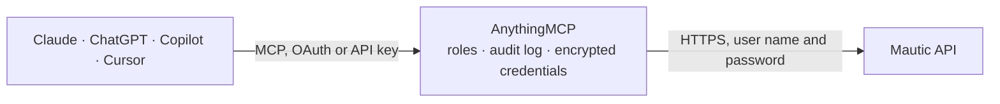

<!-- Generated by scripts/export-github-catalog.mjs in the anythingmcp-website repository. Do not edit by hand. -->

# Mautic MCP connector

Mautic open-source marketing automation: contacts and their activity, segments, campaigns, e-mails with their send statistics, forms and form submissions. The AnythingMCP connector gives Claude, ChatGPT, Microsoft Copilot, Cursor and Gemini 10 MCP tools for Mautic, all read-only.

**Category:** [Marketing Automation](../marketing-automation.md) · **Tools:** 10 · **Setup guide:** [anythingmcp.com](https://anythingmcp.com/guides/mautic-to-mcp) · [Deutsch](https://anythingmcp.com/de/guides/mautic-to-mcp) · [Italiano](https://anythingmcp.com/it/guides/mautic-to-mcp) · [Español](https://anythingmcp.com/es/guides/mautic-to-mcp) · [日本語](https://anythingmcp.com/ja/guides/mautic-to-mcp) · [Русский](https://anythingmcp.com/ru/guides/mautic-to-mcp) · [中文](https://anythingmcp.com/zh/guides/mautic-to-mcp)

## Start without code

No installation and no terminal: AnythingMCP Cloud runs the Mautic connector for you, operated by helpcode.ai in Frankfurt, Germany.

1. **Click the button above** and create an account or sign in. The Mautic connector opens, ready to install.
2. **Paste the API key or token from your Mautic account.** Every click is in the [step-by-step guide](https://anythingmcp.com/guides/mautic-to-mcp).
3. **Click Install.** AnythingMCP shows the address of your MCP server.
4. **Add that address to your assistant:** [Claude](https://anythingmcp.com/guides/connect-mautic-to-claude) · [ChatGPT](https://anythingmcp.com/guides/connect-mautic-to-chatgpt) · [Microsoft Copilot](https://anythingmcp.com/guides/connect-mautic-to-copilot) · [Cursor](https://anythingmcp.com/guides/connect-mautic-to-cursor) · [Gemini CLI](https://anythingmcp.com/guides/connect-mautic-to-gemini) · [Meta Muse](https://anythingmcp.com/guides/connect-mautic-to-muse).
5. **Ask your first question**, for example: *Show full contact record for contact id 42 (Maja Lindström)*

Prefer help with the setup? [Talk to us](https://anythingmcp.com/contact).

## How it works

- **The AI client** speaks MCP (Streamable HTTP) to AnythingMCP and only sees tool names, descriptions and results. It never gets the Mautic credentials.
- **AnythingMCP** checks the client's role, builds the call from the tool definition, adds the credentials (user name and password), calls Mautic, logs the call and returns the result.
- **Mautic** sees an ordinary API client with the rights of the account the credentials belong to.

## Tools

| Tool | What it does | Access |
|---|---|---|
| [`mautic_list_contacts`](#mautic_list_contacts) | List contacts with their e-mail, name, company, points and stage. | read |
| [`mautic_get_contact`](#mautic_get_contact) | Read one contact in full: every field, their points, the segments and campaigns they belong to, and their owner. | read |
| [`mautic_get_contact_activity`](#mautic_get_contact_activity) | Read one contact's activity timeline: page hits, e-mail opens and clicks, form submissions and campaign steps, in order. | read |
| [`mautic_list_segments`](#mautic_list_segments) | List segments with their name, alias and the number of contacts in each. | read |
| [`mautic_list_segment_contacts`](#mautic_list_segment_contacts) | List the contacts in one segment — who would actually receive a send to that segment. | read |
| [`mautic_list_campaigns`](#mautic_list_campaigns) | List campaigns with their name, description, publish status and the number of contacts in each. | read |
| [`mautic_list_emails`](#mautic_list_emails) | List e-mails with their subject, type, publish status and send statistics — sent count, read count and the resulting read rate. | read |
| [`mautic_get_email`](#mautic_get_email) | Read one e-mail in full: its subject, from address, HTML body, the segments it targets and its send and read counts. | read |
| [`mautic_list_forms`](#mautic_list_forms) | List forms with their name, alias, publish status and submission count — the capture points feeding the contact base. | read |
| [`mautic_list_form_submissions`](#mautic_list_form_submissions) | List the submissions of one form with their date, IP, referrer and the field values submitted — the raw leads. | read |

## Tool reference

Every parameter as the AI client sees it in `tools/list`. Source: [`packages/backend/src/adapters/intl/mautic.json`](../../../packages/backend/src/adapters/intl/mautic.json).

### `mautic_list_contacts`

List contacts with their e-mail, name, company, points and stage. Pass `!is:anonymous` in search — anonymous visitors otherwise swamp the results.

**Access:** read · **Call:** `GET /contacts`

| Parameter | Type | Required | Description |
|---|---|---|---|
| `search` | string | no | Mautic search string, e.g. `!is:anonymous email:*@example.com`. |
| `limit` | number | no | Rows to return (default 30). |
| `start` | number | no | Rows to skip — an offset, not a page number. |
| `orderBy` | string | no | Column to sort by, e.g. date_added. |
| `orderByDir` | string | no | `ASC` or `DESC`. |

### `mautic_get_contact`

Read one contact in full: every field, their points, the segments and campaigns they belong to, and their owner.

**Access:** read · **Call:** `GET /contacts/{contactId}`

| Parameter | Type | Required | Description |
|---|---|---|---|
| `contactId` | number | yes | Numeric Mautic contact id. |

### `mautic_get_contact_activity`

Read one contact's activity timeline: page hits, e-mail opens and clicks, form submissions and campaign steps, in order.

**Access:** read · **Call:** `GET /contacts/{contactId}/activity`

| Parameter | Type | Required | Description |
|---|---|---|---|
| `contactId` | number | yes | Numeric Mautic contact id. |
| `limit` | number | no | Events to return. |
| `page` | number | no | Page number, starting at 1. |
| `search` | string | no | Search string to filter the timeline events by. |

### `mautic_list_segments`

List segments with their name, alias and the number of contacts in each. No parameters — the quickest check that the API is enabled and Basic auth works.

**Access:** read · **Call:** `GET /segments`

| Parameter | Type | Required | Description |
|---|---|---|---|
| `limit` | number | no | Rows to return. |
| `start` | number | no | Rows to skip, for paging. |

### `mautic_list_segment_contacts`

List the contacts in one segment — who would actually receive a send to that segment. Takes the segment's alias, not its id (Mautic's `segment:` search command matches aliases).

**Access:** read · **Call:** `GET /contacts`

| Parameter | Type | Required | Description |
|---|---|---|---|
| `segmentAlias` | string | yes | Segment alias, the `alias` field returned by mautic_list_segments (e.g. newsletter-de), not the numeric id. |
| `limit` | number | no | Rows to return. |
| `start` | number | no | Rows to skip, for paging. |

### `mautic_list_campaigns`

List campaigns with their name, description, publish status and the number of contacts in each.

**Access:** read · **Call:** `GET /campaigns`

| Parameter | Type | Required | Description |
|---|---|---|---|
| `limit` | number | no | Rows to return. |
| `start` | number | no | Rows to skip, for paging. |

### `mautic_list_emails`

List e-mails with their subject, type, publish status and send statistics — sent count, read count and the resulting read rate.

**Access:** read · **Call:** `GET /emails`

| Parameter | Type | Required | Description |
|---|---|---|---|
| `limit` | number | no | Rows to return. |
| `start` | number | no | Rows to skip, for paging. |
| `search` | string | no | Search fragment matched against name and subject. |

### `mautic_get_email`

Read one e-mail in full: its subject, from address, HTML body, the segments it targets and its send and read counts.

**Access:** read · **Call:** `GET /emails/{emailId}`

| Parameter | Type | Required | Description |
|---|---|---|---|
| `emailId` | number | yes | Numeric Mautic e-mail id. |

### `mautic_list_forms`

List forms with their name, alias, publish status and submission count — the capture points feeding the contact base.

**Access:** read · **Call:** `GET /forms`

| Parameter | Type | Required | Description |
|---|---|---|---|
| `limit` | number | no | Rows to return. |
| `start` | number | no | Rows to skip, for paging. |

### `mautic_list_form_submissions`

List the submissions of one form with their date, IP, referrer and the field values submitted — the raw leads.

**Access:** read · **Call:** `GET /forms/{formId}/submissions`

| Parameter | Type | Required | Description |
|---|---|---|---|
| `formId` | number | yes | Numeric form id. |
| `limit` | number | no | Rows to return. |
| `start` | number | no | Rows to skip, for paging. |

## Run it yourself

AnythingMCP is open source (AGPL-3.0). [Run it with Docker](../../../README.md#run-it-yourself), open **Connectors → Store**, pick **Mautic** and enter `MAUTIC_URL`, `MAUTIC_USERNAME`, `MAUTIC_PASSWORD`, then add your MCP server URL to the AI client.

[← Marketing Automation connectors](../marketing-automation.md) · [All categories](../README.md)
