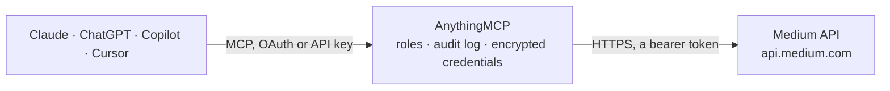

<!-- Generated by scripts/export-github-catalog.mjs in the anythingmcp-website repository. Do not edit by hand. -->

# Medium MCP connector

Publish posts to Medium (your own profile or a publication) from any AI agent. 5 tools, integration-token Bearer auth. The AnythingMCP connector gives Claude, ChatGPT, Microsoft Copilot, Cursor and Gemini 5 MCP tools for Medium: 3 read and 2 can change data.

**Category:** [Publishing](../publishing.md) · **Tools:** 5 · **Setup guide:** [anythingmcp.com](https://anythingmcp.com/guides/medium-to-mcp) · [Deutsch](https://anythingmcp.com/de/guides/medium-to-mcp) · [Italiano](https://anythingmcp.com/it/guides/medium-to-mcp) · [Español](https://anythingmcp.com/es/guides/medium-to-mcp) · [日本語](https://anythingmcp.com/ja/guides/medium-to-mcp) · [Русский](https://anythingmcp.com/ru/guides/medium-to-mcp) · [中文](https://anythingmcp.com/zh/guides/medium-to-mcp)

## Start without code

No installation and no terminal: AnythingMCP Cloud runs the Medium connector for you, operated by helpcode.ai in Frankfurt, Germany.

1. **Click the button above** and create an account or sign in. The Medium connector opens, ready to install.
2. **Paste the API key or token from your Medium account.** Every click is in the [step-by-step guide](https://anythingmcp.com/guides/medium-to-mcp).
3. **Click Install.** AnythingMCP shows the address of your MCP server.
4. **Add that address to your assistant:** [Claude](https://anythingmcp.com/guides/connect-medium-to-claude) · [ChatGPT](https://anythingmcp.com/guides/connect-medium-to-chatgpt) · [Microsoft Copilot](https://anythingmcp.com/guides/connect-medium-to-copilot) · [Cursor](https://anythingmcp.com/guides/connect-medium-to-cursor) · [Gemini CLI](https://anythingmcp.com/guides/connect-medium-to-gemini) · [Meta Muse](https://anythingmcp.com/guides/connect-medium-to-muse).
5. **Ask your first question**, for example: *What's my Medium user id and username for this integration token?*

Prefer help with the setup? [Talk to us](https://anythingmcp.com/contact).

## How it works

- **The AI client** speaks MCP (Streamable HTTP) to AnythingMCP and only sees tool names, descriptions and results. It never gets the Medium credentials.
- **AnythingMCP** checks the client's role, builds the call from the tool definition, adds the credentials (a bearer token), calls Medium, logs the call and returns the result.
- **Medium** sees an ordinary API client with the rights of the account the credentials belong to.

## Tools

| Tool | What it does | Access |
|---|---|---|
| [`medium_me`](#medium_me) | Return the authenticated user: id, username, name, url, imageUrl. | read |
| [`medium_list_user_publications`](#medium_list_user_publications) | List publications the user contributes to. | read |
| [`medium_get_publication_contributors`](#medium_get_publication_contributors) | List contributors of a publication. | read |
| [`medium_create_post`](#medium_create_post) | Create a post under the user's own profile. | write |
| [`medium_create_post_under_publication`](#medium_create_post_under_publication) | Create a post under a publication. | write |

## Tool reference

Every parameter as the AI client sees it in `tools/list`. Source: [`packages/backend/src/adapters/intl/medium.json`](../../../packages/backend/src/adapters/intl/medium.json).

### `medium_me`

Return the authenticated user: id, username, name, url, imageUrl.

**Access:** read · **Call:** `GET /me`

No parameters.

### `medium_list_user_publications`

List publications the user contributes to. Returns each publication's id, name, description, url, imageUrl.

**Access:** read · **Call:** `GET /users/{userId}/publications`

| Parameter | Type | Required | Description |
|---|---|---|---|
| `userId` | string | yes | User ID from medium_me. |

### `medium_get_publication_contributors`

List contributors of a publication.

**Access:** read · **Call:** `GET /publications/{publicationId}/contributors`

| Parameter | Type | Required | Description |
|---|---|---|---|
| `publicationId` | string | yes | Publication ID. |

### `medium_create_post`

Create a post under the user's own profile. Required: userId + title + contentFormat + content.

**Access:** write · **Call:** `POST /users/{userId}/posts`

| Parameter | Type | Required | Description |
|---|---|---|---|
| `userId` | string | yes | User ID. |
| `title` | string | yes | Post title. |
| `contentFormat` | string | yes | html or markdown. |
| `content` | string | yes | Post body (HTML or Markdown). |
| `canonicalUrl` | string | no | Canonical URL if cross-posting. |
| `tags` | any[] | no | Up to 5 tag strings, each ≤25 chars. |
| `publishStatus` | string | no | public (default), draft, unlisted. |
| `license` | string | no | all-rights-reserved (default), cc-40-by, cc-40-by-sa, cc-40-by-nd, cc-40-by-nc, cc-40-by-nc-nd, cc-40-by-nc-sa, cc-40-zero, public-domain. |
| `notifyFollowers` | boolean | no | Notify followers (default true for public posts). |

### `medium_create_post_under_publication`

Create a post under a publication. Same fields as medium_create_post but pass publicationId instead of userId.

**Access:** write · **Call:** `POST /publications/{publicationId}/posts`

| Parameter | Type | Required | Description |
|---|---|---|---|
| `publicationId` | string | yes | Publication ID. |
| `title` | string | yes | Title. |
| `contentFormat` | string | yes | html or markdown. |
| `content` | string | yes | Body. |
| `canonicalUrl` | string | no | Canonical URL. |
| `tags` | any[] | no | Tags. |
| `publishStatus` | string | no | public, draft, unlisted. |
| `license` | string | no | License. |
| `notifyFollowers` | boolean | no | Notify followers. |

## Run it yourself

AnythingMCP is open source (AGPL-3.0). [Run it with Docker](../../../README.md#run-it-yourself), open **Connectors → Store**, pick **Medium** and enter `MEDIUM_INTEGRATION_TOKEN`, then add your MCP server URL to the AI client.

[← Publishing connectors](../publishing.md) · [All categories](../README.md)
