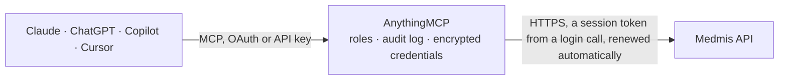

<!-- Generated by scripts/export-github-catalog.mjs in the anythingmcp-website repository. Do not edit by hand. -->

# Medmis MCP connector

Medmis clinic management platform (Russia): branches, specialists and schedules, appointments, patients, invoices, payments, price list, stock, to-do tasks and occupational check-ups. The AnythingMCP connector gives Claude, ChatGPT, Microsoft Copilot, Cursor and Gemini 31 MCP tools for Medmis: 28 read and 3 can change data.

**Category:** [Healthcare](../healthcare.md) · **Tools:** 31 · **Setup guide:** [anythingmcp.com](https://anythingmcp.com/guides/medmis-to-mcp) · [Deutsch](https://anythingmcp.com/de/guides/medmis-to-mcp) · [Italiano](https://anythingmcp.com/it/guides/medmis-to-mcp) · [Español](https://anythingmcp.com/es/guides/medmis-to-mcp) · [日本語](https://anythingmcp.com/ja/guides/medmis-to-mcp) · [Русский](https://anythingmcp.com/ru/guides/medmis-to-mcp) · [中文](https://anythingmcp.com/zh/guides/medmis-to-mcp)

## Start without code

No installation and no terminal: AnythingMCP Cloud runs the Medmis connector for you, operated by helpcode.ai in Frankfurt, Germany.

1. **Click the button above** and create an account or sign in. The Medmis connector opens, ready to install.
2. **Paste the API key or token from your Medmis account.** Every click is in the [step-by-step guide](https://anythingmcp.com/guides/medmis-to-mcp).
3. **Click Install.** AnythingMCP shows the address of your MCP server.
4. **Add that address to your assistant:** [Claude](https://anythingmcp.com/guides/connect-medmis-to-claude) · [ChatGPT](https://anythingmcp.com/guides/connect-medmis-to-chatgpt) · [Microsoft Copilot](https://anythingmcp.com/guides/connect-medmis-to-copilot) · [Cursor](https://anythingmcp.com/guides/connect-medmis-to-cursor) · [Gemini CLI](https://anythingmcp.com/guides/connect-medmis-to-gemini) · [Meta Muse](https://anythingmcp.com/guides/connect-medmis-to-muse).
5. **Ask your first question**, for example: *Open invoice 2026-INV-078 for patient Belyaev at branch Moscow Central dated 2026-10-12*

Prefer help with the setup? [Talk to us](https://anythingmcp.com/contact).

## How it works

- **The AI client** speaks MCP (Streamable HTTP) to AnythingMCP and only sees tool names, descriptions and results. It never gets the Medmis credentials.
- **AnythingMCP** checks the client's role, builds the call from the tool definition, adds the credentials (a session token from a login call, renewed automatically), calls Medmis, logs the call and returns the result.
- **Medmis** sees an ordinary API client with the rights of the account the credentials belong to.

## Tools

| Tool | What it does | Access |
|---|---|---|
| [`medmis_list_branches`](#medmis_list_branches) | List the clinic's branches (филиалы): id, code, name, official name, address, phone, e-mail, working hours, licence and UTC offset. | read |
| [`medmis_get_branch`](#medmis_get_branch) | Get one branch by id with its address, contacts, working hours, licence data and UTC offset. | read |
| [`medmis_list_employees`](#medmis_list_employees) | List the specialists (doctors and other staff with schedules): id, name, mobile phone, specializations with their ids, branches and whether they are dismissed. | read |
| [`medmis_list_employee_services`](#medmis_list_employee_services) | List the services one specialist can provide, after service categories, individual settings and exclusions are applied. | read |
| [`medmis_get_schedule_grid`](#medmis_get_schedule_grid) | Working schedule of specialists for one or more branches and a date range: per specialist and day the schedule id, working hours and slots, optionally only… | read |
| [`medmis_list_appointments`](#medmis_list_appointments) | List appointments (записи на приём) with filters: period, branches, patients, specialists, specializations, statuses, types, tags, creation or change time. | read |
| [`medmis_get_appointment`](#medmis_get_appointment) | Get one appointment by id: schedule, start and end (UTC and local), status, patient, specialist and specialization, source, visit type, cabinet, tags,… | read |
| [`medmis_list_appointment_reference`](#medmis_list_appointment_reference) | Read an appointment reference list: statuses, types (in person, telemedicine), visitations (first or repeat visit), sources (how the booking came in) or tags. | read |
| [`medmis_list_patients`](#medmis_list_patients) | Search patients with filters: name parts (partial match), e-mail or mobile phone (exact), outpatient card number, birth date or age range, sex, tags,… | read |
| [`medmis_get_patient`](#medmis_get_patient) | Get one patient's full record by id: name, birth date and age, contacts, sex, tags, card and contract numbers, identity document, address, branch, consents,… | read |
| [`medmis_list_patient_reference`](#medmis_list_patient_reference) | Read a patient reference list: tags, attractions (acquisition sources) or identity_doc_types (identity document types). | read |
| [`medmis_list_invoices`](#medmis_list_invoices) | List patient invoices (счета) with filters: period, branches, patients, appointments, paid or not, deleted, change time. | read |
| [`medmis_get_invoice`](#medmis_get_invoice) | Get one patient invoice by its numeric id: number, date, amount, duration, patient, appointment, payment and notes. | read |
| [`medmis_list_invoice_services`](#medmis_list_invoice_services) | List the lines (services and goods) of one invoice with quantities, prices and discounts. | read |
| [`medmis_list_payments`](#medmis_list_payments) | List payments with filters: period, branches, patients, payment type (1 standard payment, 2 prepared partial refund, 3 completed partial refund, 7… | read |
| [`medmis_get_payment`](#medmis_get_payment) | Get one payment by id with its amounts per payment method, cash desk, fiscal flag, notes and patient. | read |
| [`medmis_list_service_categories`](#medmis_list_service_categories) | List the price list's service categories, optionally below a parent category, by name or for one branch. | read |
| [`medmis_list_services`](#medmis_list_services) | Search the price list's services (услуги): code, PMU code, name, type (0 service, 1 goods, 2 lab test), category and price. | read |
| [`medmis_list_reserves`](#medmis_list_reserves) | List reserves (time held in a specialist's schedule for a person, with name and phone) with filters: period, branches, specialists, patients, tags, creation… | read |
| [`medmis_get_reserve`](#medmis_get_reserve) | Get one reserve by id: a time held in a specialist's schedule for a person, with branch, specialist, date and time, the person's name and phone, comment,… | read |
| [`medmis_list_stores`](#medmis_list_stores) | List the stores (warehouses) of one branch. | read |
| [`medmis_list_store_materials`](#medmis_list_store_materials) | Search the store nomenclature (materials, medicines, consumables) by name or code; isSection separates folders from items. | read |
| [`medmis_get_stock_levels`](#medmis_get_stock_levels) | Stock on hand of materials per store, optionally for one store or one material. | read |
| [`medmis_list_material_series`](#medmis_list_material_series) | List batches (series) of store materials with expiry, optionally only expired ones or for one material. | read |
| [`medmis_list_tasks`](#medmis_list_tasks) | List internal to-do tasks with filters: author, performer, responsible user, patient, status (0 to do, 2 in progress, 4 paused, 6 done), priority (0 high, 2… | read |
| [`medmis_list_checkup_companies`](#medmis_list_checkup_companies) | List the companies of the occupational medical check-up module (Профосмотры): the employers the clinic examines staff for. | read |
| [`medmis_list_checkup_contracts`](#medmis_list_checkup_contracts) | List check-up contracts with filters: company (B2B), patient (B2C), status, branch and creation date. | read |
| [`medmis_list_checkup_patients`](#medmis_list_checkup_patients) | List the people (check-ups) under check-up contracts with filters: contract, patient, status and check-up date. | read |
| [`medmis_create_appointment`](#medmis_create_appointment) | Book an appointment in a free slot of a specialist's schedule. | write |
| [`medmis_update_appointment`](#medmis_update_appointment) | Change an existing appointment: status (e.g. cancel or confirm), start and end time in UTC, comment, tags, cabinet, source, type or visit type. | write |
| [`medmis_create_task`](#medmis_create_task) | Create an internal to-do task, optionally linked to a patient, with performers, responsible user, start, deadline, status and priority. | write |

## Tool reference

Every parameter as the AI client sees it in `tools/list`. Source: [`packages/backend/src/adapters/intl/medmis.json`](../../../packages/backend/src/adapters/intl/medmis.json).

### `medmis_list_branches`

List the clinic's branches (филиалы): id, code, name, official name, address, phone, e-mail, working hours, licence and UTC offset. The id is the branchId other tools filter by.

**Access:** read · **Call:** `GET /v1/Branches`

| Parameter | Type | Required | Description |
|---|---|---|---|
| `page` | integer | no | Page number, starting at 1. |
| `pageSize` | integer | no | Rows per page, 1 to 100 (default 100). |

### `medmis_get_branch`

Get one branch by id with its address, contacts, working hours, licence data and UTC offset.

**Access:** read · **Call:** `GET /v1/Branches/{branchId}`

| Parameter | Type | Required | Description |
|---|---|---|---|
| `branchId` | string | yes | Branch UUID from medmis_list_branches. |

### `medmis_list_employees`

List the specialists (doctors and other staff with schedules): id, name, mobile phone, specializations with their ids, branches and whether they are dismissed. Filter by branch or specialization. The employee id and the employeeSpecializationID are what the schedule and appointment tools take.

**Access:** read · **Call:** `GET /v1/Employees`

| Parameter | Type | Required | Description |
|---|---|---|---|
| `branchIds` | string[] | no | Only these branches (specialists with a schedule there) (UUIDs). |
| `specializationIds` | string[] | no | Only these specializations (UUIDs). |
| `includeDismissed` | boolean | no | Include dismissed specialists (default true). |
| `page` | integer | no | Page number, starting at 1. |
| `pageSize` | integer | no | Rows per page, 1 to 100 (default 100). |

### `medmis_list_employee_services`

List the services one specialist can provide, after service categories, individual settings and exclusions are applied.

**Access:** read · **Call:** `GET /v1/Employees/{employeeId}/services`

| Parameter | Type | Required | Description |
|---|---|---|---|
| `employeeId` | string | yes | Specialist UUID from medmis_list_employees. |
| `page` | integer | no | Page number, starting at 1. |
| `pageSize` | integer | no | Rows per page, 1 to 100 (default 100). |

### `medmis_get_schedule_grid`

Working schedule of specialists for one or more branches and a date range: per specialist and day the schedule id, working hours and slots, optionally only the free ones. Use it to find a free slot before booking. Needs at least one branch and both dates.

**Access:** read · **Call:** `GET /v1/Schedule/grid`

| Parameter | Type | Required | Description |
|---|---|---|---|
| `branchIds` | string[] | yes | Branch UUIDs, at least one (from medmis_list_branches). |
| `dateFrom` | string | yes | First day, YYYY-MM-DD. |
| `dateTo` | string | yes | Last day, YYYY-MM-DD. |
| `onlyFreeSlots` | boolean | no | true returns only free slots (default false). |
| `employeeIds` | string[] | no | Only these specialists (UUIDs). |
| `specializationIds` | string[] | no | Only these specializations (UUIDs). |

### `medmis_list_appointments`

List appointments (записи на приём) with filters: period, branches, patients, specialists, specializations, statuses, types, tags, creation or change time. Returns id, schedule, times (UTC and local), status, patient, specialist, source, visit type, cabinet and tags.

**Access:** read · **Call:** `GET /v1/Appointments`

| Parameter | Type | Required | Description |
|---|---|---|---|
| `dateFrom` | string | no | First appointment day, YYYY-MM-DD. |
| `dateTo` | string | no | Last appointment day, YYYY-MM-DD. |
| `ids` | string[] | no | Only these appointments (UUIDs). |
| `branchIds` | string[] | no | Only these branches (UUIDs). |
| `patientIds` | string[] | no | Only these patients (UUIDs). |
| `employeeIds` | string[] | no | Only these specialists (UUIDs). |
| `specializationIds` | string[] | no | Only these specializations (UUIDs). |
| `statusIds` | integer[] | no | Only these status ids (from medmis_list_appointment_reference with dictionary=statuses). |
| `typeIds` | integer[] | no | Only these appointment type ids (dictionary=types). |
| `tags` | string[] | no | Only appointments carrying all of these tags. |
| `updatedAtAfter` | string | no | Changed after, yyyy-MM-ddTHH:mm:ss in UTC. |
| `updatedAtBefore` | string | no | Changed before, yyyy-MM-ddTHH:mm:ss in UTC. |
| `createdAtAfter` | string | no | Created after, yyyy-MM-ddTHH:mm:ss in UTC. |
| `createdAtBefore` | string | no | Created before, yyyy-MM-ddTHH:mm:ss in UTC. |
| `page` | integer | no | Page number, starting at 1. |
| `pageSize` | integer | no | Rows per page, 1 to 100 (default 100). |

### `medmis_get_appointment`

Get one appointment by id: schedule, start and end (UTC and local), status, patient, specialist and specialization, source, visit type, cabinet, tags, comment and whether a paid invoice exists.

**Access:** read · **Call:** `GET /v1/Appointments/{appointmentId}`

| Parameter | Type | Required | Description |
|---|---|---|---|
| `appointmentId` | string | yes | Appointment UUID from medmis_list_appointments. |

### `medmis_list_appointment_reference`

Read an appointment reference list: statuses, types (in person, telemedicine), visitations (first or repeat visit), sources (how the booking came in) or tags. Returns id/name pairs to read or filter appointments.

**Access:** read · **Call:** `GET /v1/Appointments/{dictionary}`

| Parameter | Type | Required | Description |
|---|---|---|---|
| `dictionary` | `statuses` \| `types` \| `visitations` \| `sources` \| `tags` | yes | Which reference list to read. |
| `page` | integer | no | Page number, starting at 1. |
| `pageSize` | integer | no | Rows per page, 1 to 100 (default 100). |

### `medmis_list_patients`

Search patients with filters: name parts (partial match), e-mail or mobile phone (exact), outpatient card number, birth date or age range, sex, tags, acquisition source, creation date and marketing consents. Returns contact data, card number, balances and flags; identity document numbers, INN and SNILS are left out of the list (use medmis_get_patient for one patient).

**Access:** read · **Call:** `GET /v1/Patients`

| Parameter | Type | Required | Description |
|---|---|---|---|
| `lastname` | string | no | Surname, partial match. |
| `firstname` | string | no | First name, partial match. |
| `middlename` | string | no | Patronymic, partial match. |
| `email` | string | no | E-mail, exact match. |
| `mobilephone` | string | no | Mobile phone, exact match as stored (e.g. 79161234567). |
| `outpatientCardNumber` | string | no | Outpatient card number, exact match. |
| `ids` | string[] | no | Only these patients (UUIDs). |
| `birthdateAfter` | string | no | Born after, YYYY-MM-DD. |
| `birthdateBefore` | string | no | Born before, YYYY-MM-DD. |
| `ageAfter` | integer | no | Older than this many years. |
| `ageBefore` | integer | no | Younger than this many years. |
| `sex` | `Male` \| `Female` | no | Sex. |
| `tags` | string[] | no | Only patients with these tags. |
| `attractionIds` | string[] | no | Only these acquisition sources (dictionary=attractions) (UUIDs). |
| `createdAfter` | string | no | Created after, YYYY-MM-DD. |
| `createdBefore` | string | no | Created before, YYYY-MM-DD. |
| `agreeEmail` | boolean | no | Consent to e-mail. |
| `agreeSms` | boolean | no | Consent to SMS. |
| `agreeWhatsapp` | boolean | no | Consent to WhatsApp. |
| `agreePush` | boolean | no | Consent to push notifications. |
| `page` | integer | no | Page number, starting at 1. |
| `pageSize` | integer | no | Rows per page, 1 to 100 (default 100). |

### `medmis_get_patient`

Get one patient's full record by id: name, birth date and age, contacts, sex, tags, card and contract numbers, identity document, address, branch, consents, debtor and minor flags, and account balances. Contains personal and health-related data; show only what the user needs.

**Access:** read · **Call:** `GET /v1/Patients/{patientId}`

| Parameter | Type | Required | Description |
|---|---|---|---|
| `patientId` | string | yes | Patient UUID from medmis_list_patients or an appointment. |

### `medmis_list_patient_reference`

Read a patient reference list: tags, attractions (acquisition sources) or identity_doc_types (identity document types). Returns id/name pairs.

**Access:** read · **Call:** `GET /v1/Patients/{dictionary}`

| Parameter | Type | Required | Description |
|---|---|---|---|
| `dictionary` | `tags` \| `attractions` \| `identity_doc_types` | yes | Which reference list to read. |
| `page` | integer | no | Page number, starting at 1. |
| `pageSize` | integer | no | Rows per page, 1 to 100 (default 100). |

### `medmis_list_invoices`

List patient invoices (счета) with filters: period, branches, patients, appointments, paid or not, deleted, change time. Returns id, number, date, amount, patient, appointment, payment and notes.

**Access:** read · **Call:** `GET /v1/PatientInvoices`

| Parameter | Type | Required | Description |
|---|---|---|---|
| `dateFrom` | string | no | First invoice day, YYYY-MM-DD. |
| `dateTo` | string | no | Last invoice day, YYYY-MM-DD. |
| `ids` | integer[] | no | Only these invoice ids (numbers). |
| `branchIds` | string[] | no | Only these branches (UUIDs). |
| `patientIds` | string[] | no | Only these patients (UUIDs). |
| `appointmentIds` | string[] | no | Only these appointments (UUIDs). |
| `isPaid` | boolean | no | true paid only, false unpaid only. |
| `isDeleted` | boolean | no | true deleted only, false active only; omit for both. |
| `updatedAtAfter` | string | no | Changed after, yyyy-MM-ddTHH:mm:ss in UTC. |
| `updatedAtBefore` | string | no | Changed before, yyyy-MM-ddTHH:mm:ss in UTC. |
| `page` | integer | no | Page number, starting at 1. |
| `pageSize` | integer | no | Rows per page, 1 to 100 (default 100). |

### `medmis_get_invoice`

Get one patient invoice by its numeric id: number, date, amount, duration, patient, appointment, payment and notes.

**Access:** read · **Call:** `GET /v1/PatientInvoices/{invoiceId}`

| Parameter | Type | Required | Description |
|---|---|---|---|
| `invoiceId` | integer | yes | Numeric invoice id from medmis_list_invoices. |

### `medmis_list_invoice_services`

List the lines (services and goods) of one invoice with quantities, prices and discounts.

**Access:** read · **Call:** `GET /v1/PatientInvoices/{invoiceId}/services`

| Parameter | Type | Required | Description |
|---|---|---|---|
| `invoiceId` | integer | yes | Numeric invoice id from medmis_list_invoices. |
| `page` | integer | no | Page number, starting at 1. |
| `pageSize` | integer | no | Rows per page, 1 to 100 (default 100). |

### `medmis_list_payments`

List payments with filters: period, branches, patients, payment type (1 standard payment, 2 prepared partial refund, 3 completed partial refund, 7 auto-deleted), fiscalised or not, deleted, change time. Returns amounts by method (cash, card, bonus points, insurance, company), cash desk, fiscal flag and patient.

**Access:** read · **Call:** `GET /v1/Payments`

| Parameter | Type | Required | Description |
|---|---|---|---|
| `dateFrom` | string | no | First payment day, YYYY-MM-DD. |
| `dateTo` | string | no | Last payment day, YYYY-MM-DD. |
| `ids` | string[] | no | Only these payments (UUIDs). |
| `branchIds` | string[] | no | Only these branches (UUIDs). |
| `patientIds` | string[] | no | Only these patients (UUIDs). |
| `typeIds` | integer[] | no | Payment types: 1 standard, 2 partial refund prepared, 3 partial refund completed, 7 auto-deleted. |
| `isFiscaled` | boolean | no | true fiscalised only, false not fiscalised. |
| `isDeleted` | boolean | no | true deleted only, false active only; omit for both. |
| `updatedAtAfter` | string | no | Changed after, yyyy-MM-ddTHH:mm:ss in UTC. |
| `updatedAtBefore` | string | no | Changed before, yyyy-MM-ddTHH:mm:ss in UTC. |
| `page` | integer | no | Page number, starting at 1. |
| `pageSize` | integer | no | Rows per page, 1 to 100 (default 100). |

### `medmis_get_payment`

Get one payment by id with its amounts per payment method, cash desk, fiscal flag, notes and patient.

**Access:** read · **Call:** `GET /v1/Payments/{paymentId}`

| Parameter | Type | Required | Description |
|---|---|---|---|
| `paymentId` | string | yes | Payment UUID from medmis_list_payments. |

### `medmis_list_service_categories`

List the price list's service categories, optionally below a parent category, by name or for one branch.

**Access:** read · **Call:** `GET /v1/Pricelist/service_categories`

| Parameter | Type | Required | Description |
|---|---|---|---|
| `ids` | string[] | no | Only these categories (UUIDs). |
| `parentId` | string | no | Parent category UUID; omit for all. |
| `name` | string | no | Category name, partial match. |
| `branchId` | string | no | Branch UUID. |
| `includeDeleted` | boolean | no | Include deleted categories (default false). |
| `page` | integer | no | Page number, starting at 1. |
| `pageSize` | integer | no | Rows per page, 1 to 100 (default 100). |

### `medmis_list_services`

Search the price list's services (услуги): code, PMU code, name, type (0 service, 1 goods, 2 lab test), category and price.

**Access:** read · **Call:** `GET /v1/Pricelist/services`

| Parameter | Type | Required | Description |
|---|---|---|---|
| `name` | string | no | Service name, partial match. |
| `code` | string | no | Service code, exact. |
| `codePMU` | string | no | PMU code (Russian medical services nomenclature), exact. |
| `serviceCategoryId` | string | no | Category UUID from medmis_list_service_categories. |
| `typeId` | `0` \| `1` \| `2` | no | 0 service, 1 goods, 2 lab test. |
| `ids` | string[] | no | Only these services (UUIDs). |
| `includeDeleted` | boolean | no | Include deleted services (default false). |
| `page` | integer | no | Page number, starting at 1. |
| `pageSize` | integer | no | Rows per page, 1 to 100 (default 100). |

### `medmis_list_reserves`

List reserves (time held in a specialist's schedule for a person, with name and phone) with filters: period, branches, specialists, patients, tags, creation time.

**Access:** read · **Call:** `GET /v1/Reserves`

| Parameter | Type | Required | Description |
|---|---|---|---|
| `dateFrom` | string | no | First day, YYYY-MM-DD. |
| `dateTo` | string | no | Last day, YYYY-MM-DD. |
| `ids` | string[] | no | Only these reserves (UUIDs). |
| `branchIds` | string[] | no | Only these branches (UUIDs). |
| `employeeIds` | string[] | no | Only these specialists (UUIDs). |
| `patientIds` | string[] | no | Only these patients (UUIDs). |
| `tags` | string[] | no | Only reserves with these tags. |
| `createdAtAfter` | string | no | Created after, yyyy-MM-ddTHH:mm:ss in UTC. |
| `createdAtBefore` | string | no | Created before, yyyy-MM-ddTHH:mm:ss in UTC. |
| `page` | integer | no | Page number, starting at 1. |
| `pageSize` | integer | no | Rows per page, 1 to 100 (default 100). |

### `medmis_get_reserve`

Get one reserve by id: a time held in a specialist's schedule for a person, with branch, specialist, date and time, the person's name and phone, comment, tags and auto-extension settings.

**Access:** read · **Call:** `GET /v1/Reserves/{reserveId}`

| Parameter | Type | Required | Description |
|---|---|---|---|
| `reserveId` | string | yes | Reserve UUID from medmis_list_reserves. |

### `medmis_list_stores`

List the stores (warehouses) of one branch. The id is the storeId for medmis_get_stock_levels.

**Access:** read · **Call:** `GET /v1/Store/{branchId}`

| Parameter | Type | Required | Description |
|---|---|---|---|
| `branchId` | string | yes | Branch UUID from medmis_list_branches. |
| `page` | integer | no | Page number, starting at 1. |
| `pageSize` | integer | no | Rows per page, 1 to 100 (default 100). |

### `medmis_list_store_materials`

Search the store nomenclature (materials, medicines, consumables) by name or code; isSection separates folders from items.

**Access:** read · **Call:** `GET /v1/Store/materials`

| Parameter | Type | Required | Description |
|---|---|---|---|
| `search` | string | no | Text matched against name and code. |
| `isSection` | boolean | no | true folders only, false materials only; omit for both. |
| `page` | integer | no | Page number, starting at 1. |
| `pageSize` | integer | no | Rows per page, 1 to 100 (default 100). |

### `medmis_get_stock_levels`

Stock on hand of materials per store, optionally for one store or one material.

**Access:** read · **Call:** `GET /v1/Store/rest`

| Parameter | Type | Required | Description |
|---|---|---|---|
| `storeId` | integer | no | Store id from medmis_list_stores. |
| `storeMaterialId` | integer | no | Material id from medmis_list_store_materials. |
| `page` | integer | no | Page number, starting at 1. |
| `pageSize` | integer | no | Rows per page, 1 to 100 (default 100). |

### `medmis_list_material_series`

List batches (series) of store materials with expiry, optionally only expired ones or for one material.

**Access:** read · **Call:** `GET /v1/Store/material-series`

| Parameter | Type | Required | Description |
|---|---|---|---|
| `storeMaterialId` | integer | no | Material id from medmis_list_store_materials. |
| `search` | string | no | Series number, partial match. |
| `expiredOnly` | boolean | no | Only expired series (default false). |
| `page` | integer | no | Page number, starting at 1. |
| `pageSize` | integer | no | Rows per page, 1 to 100 (default 100). |

### `medmis_list_tasks`

List internal to-do tasks with filters: author, performer, responsible user, patient, status (0 to do, 2 in progress, 4 paused, 6 done), priority (0 high, 2 medium, 4 low), tags and creation, change, start or deadline time.

**Access:** read · **Call:** `GET /v1/Todo/tasks`

| Parameter | Type | Required | Description |
|---|---|---|---|
| `ids` | integer[] | no | Only these task ids. |
| `tags` | string[] | no | Only tasks with these tags. |
| `authorUserID` | string | no | Author user UUID. |
| `performerUserID` | string | no | Performer user UUID. |
| `responsibleUserID` | string | no | Responsible user UUID. |
| `patientID` | string | no | Linked patient UUID. |
| `todoTaskStatusIDs` | integer[] | no | Statuses: 0 to do, 2 in progress, 4 paused, 6 done. |
| `todoTaskPriorityIDs` | integer[] | no | Priorities: 0 high, 2 medium, 4 low. |
| `createdAfter` | string | no | Created after, ISO 8601 UTC. |
| `createdBefore` | string | no | Created before, ISO 8601 UTC. |
| `modifiedAfter` | string | no | Changed after, ISO 8601 UTC. |
| `modifiedBefore` | string | no | Changed before, ISO 8601 UTC. |
| `startAfter` | string | no | Start after, ISO 8601 UTC. |
| `startBefore` | string | no | Start before, ISO 8601 UTC. |
| `deadlineAfter` | string | no | Deadline after, ISO 8601 UTC. |
| `deadlineBefore` | string | no | Deadline before, ISO 8601 UTC. |
| `page` | integer | no | Page number, starting at 1. |
| `pageSize` | integer | no | Rows per page, 1 to 100 (default 100). |

### `medmis_list_checkup_companies`

List the companies of the occupational medical check-up module (Профосмотры): the employers the clinic examines staff for.

**Access:** read · **Call:** `GET /v1/Profex/companies`

| Parameter | Type | Required | Description |
|---|---|---|---|
| `page` | integer | no | Page number, starting at 1. |
| `pageSize` | integer | no | Rows per page, 1 to 100 (default 100). |

### `medmis_list_checkup_contracts`

List check-up contracts with filters: company (B2B), patient (B2C), status, branch and creation date.

**Access:** read · **Call:** `GET /v1/Profex/contracts`

| Parameter | Type | Required | Description |
|---|---|---|---|
| `profexCompanyId` | integer | no | Company id from medmis_list_checkup_companies. |
| `patientId` | string | no | Patient UUID (B2C contracts). |
| `stateId` | integer | no | Contract status id. |
| `branchId` | string | no | Branch UUID. |
| `ids` | integer[] | no | Only these contract ids. |
| `createdAtAfter` | string | no | Created from this day, yyyy-MM-ddTHH:mm:ss (time ignored). |
| `createdAtBefore` | string | no | Created up to this day, yyyy-MM-ddTHH:mm:ss (time ignored). |
| `page` | integer | no | Page number, starting at 1. |
| `pageSize` | integer | no | Rows per page, 1 to 100 (default 100). |

### `medmis_list_checkup_patients`

List the people (check-ups) under check-up contracts with filters: contract, patient, status and check-up date.

**Access:** read · **Call:** `GET /v1/Profex/contract-patients`

| Parameter | Type | Required | Description |
|---|---|---|---|
| `profexContractId` | integer | no | Contract id from medmis_list_checkup_contracts. |
| `patientId` | string | no | Patient UUID. |
| `stateId` | integer | no | Status id. |
| `ids` | integer[] | no | Only these check-up ids. |
| `profexDateAfter` | string | no | Check-up from this day, yyyy-MM-ddTHH:mm:ss (time ignored). |
| `profexDateBefore` | string | no | Check-up up to this day, yyyy-MM-ddTHH:mm:ss (time ignored). |
| `page` | integer | no | Page number, starting at 1. |
| `pageSize` | integer | no | Rows per page, 1 to 100 (default 100). |

### `medmis_create_appointment`

Book an appointment in a free slot of a specialist's schedule. Take scheduleId and a free slot from medmis_get_schedule_grid and employeeSpecializationID from medmis_list_employees; times are local clinic time HH:mm. Installed switched off; confirm patient, specialist, day and time with the user first.

**Access:** write · **Call:** `POST /v1/Appointments`

| Parameter | Type | Required | Description |
|---|---|---|---|
| `scheduleId` | string | yes | Schedule UUID of the specialist's working day (from medmis_get_schedule_grid). |
| `employeeSpecializationID` | string | yes | UUID of the specialist's specialization (from medmis_list_employees). |
| `timeFrom` | string | yes | Start, local time HH:mm, e.g. 10:00. |
| `timeTo` | string | yes | End, local time HH:mm, e.g. 10:30. |
| `patientId` | string | yes | Patient UUID from medmis_list_patients. |
| `statusId` | integer | no | Status id (dictionary=statuses); omit for the default. |
| `sourceID` | integer | no | Booking source id (dictionary=sources). |
| `typeId` | integer | no | Appointment type id (dictionary=types), e.g. in person or telemedicine. |
| `visitation` | `0` \| `1` \| `2` | no | 0 not set, 1 first visit, 2 repeat visit. |
| `comment` | string | no | Comment shown on the appointment. |
| `tags` | string | no | Existing tags in the form \|tag1\|tag2\|. |
| `cabinetID` | string | no | Cabinet (room) UUID. |

### `medmis_update_appointment`

Change an existing appointment: status (e.g. cancel or confirm), start and end time in UTC, comment, tags, cabinet, source, type or visit type. Only the fields you pass change. Installed switched off; confirm the change with the user first.

**Access:** write · **Call:** `PATCH /v1/Appointments/{appointmentId}`

| Parameter | Type | Required | Description |
|---|---|---|---|
| `appointmentId` | string | yes | Appointment UUID from medmis_list_appointments. |
| `statusId` | integer | no | New status id (dictionary=statuses). |
| `statusSubId` | integer | no | Status sub-id, if the status uses one. |
| `datetimeFrom` | string | no | New start, ISO 8601 UTC. |
| `datetimeTo` | string | no | New end, ISO 8601 UTC. |
| `comment` | string | no | Comment (replaces the current one). |
| `tags` | string | no | Tags \|tag1\|tag2\| (replaces the current ones). |
| `cabinetID` | string | no | Cabinet UUID. |
| `sourceID` | integer | no | Booking source id. |
| `typeId` | integer | no | Appointment type id. |
| `visitation` | `0` \| `1` \| `2` | no | 0 not set, 1 first visit, 2 repeat visit. |

### `medmis_create_task`

Create an internal to-do task, optionally linked to a patient, with performers, responsible user, start, deadline, status and priority. Installed switched off.

**Access:** write · **Call:** `POST /v1/Todo/tasks`

| Parameter | Type | Required | Description |
|---|---|---|---|
| `name` | string | yes | Task title. |
| `description` | string | no | Task description. |
| `patientID` | string | no | Linked patient UUID. |
| `performerUserIDsArray` | string[] | no | Performer user UUIDs. |
| `responsibleUserID` | string | no | Responsible user UUID. |
| `startDateUtc` | string | no | Start, ISO 8601 UTC. |
| `deadlineDateUtc` | string | no | Deadline, ISO 8601 UTC. |
| `todoTaskStatusID` | `0` \| `2` \| `4` \| `6` | no | 0 to do (default), 2 in progress, 4 paused, 6 done. |
| `todoTaskPriorityID` | `0` \| `2` \| `4` | no | 0 high, 2 medium, 4 low. |
| `tagsArray` | string[] | no | Tags. |

## Run it yourself

AnythingMCP is open source (AGPL-3.0). [Run it with Docker](../../../README.md#run-it-yourself), open **Connectors → Store**, pick **Medmis** and enter `MEDMIS_URL`, `MEDMIS_LOGIN`, `MEDMIS_PASSWORD`, `MEDMIS_SYSTEM_NAME`, then add your MCP server URL to the AI client.

[← Healthcare connectors](../healthcare.md) · [All categories](../README.md)
