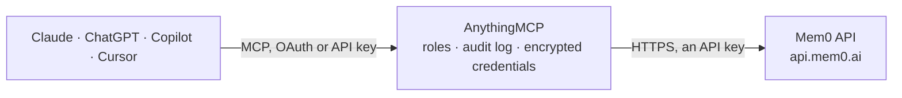

<!-- Generated by scripts/export-github-catalog.mjs in the anythingmcp-website repository. Do not edit by hand. -->

# Mem0 MCP connector

Give your AI a long-term memory with the Mem0 Platform: store facts from conversations per user, agent or session, search them by meaning, list, read, correct and trace the history of memories, and … The AnythingMCP connector gives Claude, ChatGPT, Microsoft Copilot, Cursor and Gemini 16 MCP tools for Mem0: 11 read and 5 can change data.

**Category:** [Public Data](../data.md) · **Tools:** 16 · **Setup guide:** [anythingmcp.com](https://anythingmcp.com/guides/mem0-to-mcp) · [Deutsch](https://anythingmcp.com/de/guides/mem0-to-mcp) · [Italiano](https://anythingmcp.com/it/guides/mem0-to-mcp) · [Español](https://anythingmcp.com/es/guides/mem0-to-mcp) · [日本語](https://anythingmcp.com/ja/guides/mem0-to-mcp) · [Русский](https://anythingmcp.com/ru/guides/mem0-to-mcp) · [中文](https://anythingmcp.com/zh/guides/mem0-to-mcp)

## Start without code

No installation and no terminal: AnythingMCP Cloud runs the Mem0 connector for you, operated by helpcode.ai in Frankfurt, Germany.

1. **Click the button above** and create an account or sign in. The Mem0 connector opens, ready to install.
2. **Paste the API key or token from your Mem0 account.** Every click is in the [step-by-step guide](https://anythingmcp.com/guides/mem0-to-mcp).
3. **Click Install.** AnythingMCP shows the address of your MCP server.
4. **Add that address to your assistant:** [Claude](https://anythingmcp.com/guides/connect-mem0-to-claude) · [ChatGPT](https://anythingmcp.com/guides/connect-mem0-to-chatgpt) · [Microsoft Copilot](https://anythingmcp.com/guides/connect-mem0-to-copilot) · [Cursor](https://anythingmcp.com/guides/connect-mem0-to-cursor) · [Gemini CLI](https://anythingmcp.com/guides/connect-mem0-to-gemini) · [Meta Muse](https://anythingmcp.com/guides/connect-mem0-to-muse).
5. **Ask your first question**, for example: *Does the user maria.garcia@solartek.es have a Mem0 profile summarizing billing or invoice preferences?*

Prefer help with the setup? [Talk to us](https://anythingmcp.com/contact).

## How it works

- **The AI client** speaks MCP (Streamable HTTP) to AnythingMCP and only sees tool names, descriptions and results. It never gets the Mem0 credentials.
- **AnythingMCP** checks the client's role, builds the call from the tool definition, adds the credentials (an API key), calls Mem0, logs the call and returns the result.
- **Mem0** sees an ordinary API client with the rights of the account the credentials belong to.

## Tools

| Tool | What it does | Access |
|---|---|---|
| [`mem0_ping`](#mem0_ping) | Check the Mem0 API key and show the organization id, project id and account email it works on. | read |
| [`mem0_add_memories`](#mem0_add_memories) | Store memories from a conversation in Mem0: Mem0 extracts the lasting facts and saves them under the given user, agent, app or run (at least one id is… | write |
| [`mem0_search_memories`](#mem0_search_memories) | Search Mem0 memories by meaning with a natural-language query, within filters that name at least one user_id, agent_id, app_id or run_id. | read |
| [`mem0_list_memories`](#mem0_list_memories) | List all Mem0 memories that match filters (at least one user_id, agent_id, app_id or run_id), page by page, with optional date range, categories and keyword. | read |
| [`mem0_get_memory`](#mem0_get_memory) | Read one Mem0 memory by id: its text, user, agent, app and session ids, metadata, categories, creation, update and expiration dates. | read |
| [`mem0_update_memory`](#mem0_update_memory) | Replace the text, metadata or expiration date of one Mem0 memory, e.g. to correct a wrong fact. | write |
| [`mem0_get_memory_history`](#mem0_get_memory_history) | Show how one Mem0 memory changed over time: each entry has the old and new text, the event (ADD, UPDATE, DELETE), the conversation input that caused it and… | read |
| [`mem0_list_entities`](#mem0_list_entities) | List the users, agents, apps and runs that have memories in the Mem0 project, with their type, name, memory count and dates, plus totals per type. | read |
| [`mem0_get_entity`](#mem0_get_entity) | Read one Mem0 entity (a user, agent, app or run): id, name, owner, metadata and dates. | read |
| [`mem0_get_user_profile`](#mem0_get_user_profile) | Read the memory profile Mem0 builds for a user: a summary of who they are and what they prefer. | read |
| [`mem0_create_user`](#mem0_create_user) | Register a user id in the Mem0 project with optional metadata, before any memory is added for it. | write |
| [`mem0_list_events`](#mem0_list_events) | List the memory operations of the Mem0 project (add and search events) with type, status (PENDING, RUNNING, SUCCEEDED, FAILED), payload, results, latency… | read |
| [`mem0_get_event`](#mem0_get_event) | Read one Mem0 event, e.g. the event_id returned by mem0_add_memories: status, the memories it added, updated or deleted, latency, timestamps and the error… | read |
| [`mem0_get_stats`](#mem0_get_stats) | Show Mem0 usage statistics: total memories, add events, search (retrieval) events and the plan's retrieval limit, and memories per user, agent and run. | read |
| [`mem0_delete_memory`](#mem0_delete_memory) | Delete one Mem0 memory permanently. | write |
| [`mem0_delete_entity`](#mem0_delete_entity) | Delete a Mem0 user, agent, app or run together with all of its memories. | write |

## Tool reference

Every parameter as the AI client sees it in `tools/list`. Source: [`packages/backend/src/adapters/intl/mem0.json`](../../../packages/backend/src/adapters/intl/mem0.json).

### `mem0_ping`

Check the Mem0 API key and show the organization id, project id and account email it works on.

**Access:** read · **Call:** `GET /v1/ping/`

No parameters.

### `mem0_add_memories`

Store memories from a conversation in Mem0: Mem0 extracts the lasting facts and saves them under the given user, agent, app or run (at least one id is required). Runs asynchronously: returns an event_id to check with mem0_get_event; with infer false the messages are stored verbatim at once. Counts against the plan's memory limit.

**Access:** write · **Call:** `POST /v3/memories/add/`

| Parameter | Type | Required | Description |
|---|---|---|---|
| `messages` | object[] | yes | Conversation to learn from, oldest first: [{"role": "user", "content": "I'm vegetarian and allergic to nuts."}, {"role": "assistant", "content": "Noted."}]. |
| `user_id` | string | no | User the memories belong to. |
| `agent_id` | string | no | Agent the memories belong to. |
| `app_id` | string | no | App the memories belong to. |
| `run_id` | string | no | Run or session the memories belong to. |
| `metadata` | object | no | Your own key-value metadata attached to every extracted memory, e.g. {"source": "support-chat"}. |
| `infer` | boolean | no | false stores each message verbatim without extraction (synchronous). Default true. |
| `expiration_date` | string | no | YYYY-MM-DD after which the memories are hidden from search and lists. |
| `custom_instructions` | string | no | Instructions for what to extract in this call, overriding the project's setting. |
| `includes` | string | no | Hint of what to include, e.g. food preferences. |
| `excludes` | string | no | Hint of what to leave out, e.g. health data. |
| `immutable` | boolean | no | true keeps the stored memories out of later updates and merges. |

### `mem0_search_memories`

Search Mem0 memories by meaning with a natural-language query, within filters that name at least one user_id, agent_id, app_id or run_id. Returns the most relevant memories with score, categories, metadata and dates. Counts as a retrieval call on the plan.

**Access:** read · **Call:** `POST /v3/memories/search/`

| Parameter | Type | Required | Description |
|---|---|---|---|
| `query` | string | yes | What to look for, e.g. What does the user eat? |
| `filters` | object | yes | Scope and conditions, at least one entity id: {"user_id": "alice"} or {"AND": [{"user_id": "alice"}, {"categories": {"contains": "food"}}]}. |
| `top_k` | integer | no | Number of results, default 10. |
| `threshold` | number | no | Minimum relevance score, default 0.1; 0 disables the cut. |
| `rerank` | boolean | no | true reorders the hits with Mem0's reranker (slower, better ordering). |
| `categories` | string[] | no | Only memories tagged with any of these categories. |
| `fields` | string[] | no | Return only these fields per memory, e.g. ["id", "memory", "score"]. |
| `show_expired` | boolean | no | true also returns memories past their expiration_date. |

### `mem0_list_memories`

List all Mem0 memories that match filters (at least one user_id, agent_id, app_id or run_id), page by page, with optional date range, categories and keyword. Answer carries count, next and results.

**Access:** read · **Call:** `POST /v3/memories/`

| Parameter | Type | Required | Description |
|---|---|---|---|
| `filters` | object | yes | Scope and conditions, at least one entity id: {"user_id": "alice"}; also AND, OR, NOT and operators such as {"created_at": {"gte": "2026-01-01"}}. |
| `page` | integer | no | Page number, starting at 1. |
| `page_size` | integer | no | Memories per page, default 50. |
| `start_date` | string | no | Only memories created on or after this date (YYYY-MM-DD). |
| `end_date` | string | no | Only memories created on or before this date (YYYY-MM-DD). |
| `categories` | string[] | no | Only memories tagged with any of these categories. |
| `keywords` | string | no | Free-text keyword filter on top of filters. |
| `fields` | string[] | no | Return only these fields, e.g. ["id", "memory", "created_at"]. |
| `show_expired` | boolean | no | true also lists memories past their expiration_date. |

### `mem0_get_memory`

Read one Mem0 memory by id: its text, user, agent, app and session ids, metadata, categories, creation, update and expiration dates.

**Access:** read · **Call:** `GET /v1/memories/{memory_id}/`

| Parameter | Type | Required | Description |
|---|---|---|---|
| `memory_id` | string | yes | Memory id (UUID) from a search or list. |

### `mem0_update_memory`

Replace the text, metadata or expiration date of one Mem0 memory, e.g. to correct a wrong fact. The old text stays in mem0_get_memory_history. Confirm the memory and the new text with the user first.

**Access:** write · **Call:** `PUT /v1/memories/{memory_id}/`

| Parameter | Type | Required | Description |
|---|---|---|---|
| `memory_id` | string | yes | Memory id (UUID). |
| `text` | string | no | New text of the memory. |
| `metadata` | object | no | New metadata; replaces the existing metadata. |
| `expiration_date` | string | no | New expiration date YYYY-MM-DD. |

### `mem0_get_memory_history`

Show how one Mem0 memory changed over time: each entry has the old and new text, the event (ADD, UPDATE, DELETE), the conversation input that caused it and the timestamp.

**Access:** read · **Call:** `GET /v1/memories/{memory_id}/history/`

| Parameter | Type | Required | Description |
|---|---|---|---|
| `memory_id` | string | yes | Memory id (UUID). |

### `mem0_list_entities`

List the users, agents, apps and runs that have memories in the Mem0 project, with their type, name, memory count and dates, plus totals per type.

**Access:** read · **Call:** `GET /v1/entities/`

| Parameter | Type | Required | Description |
|---|---|---|---|
| `page` | integer | no | Page number, starting at 1. |
| `page_size` | integer | no | Entities per page. |

### `mem0_get_entity`

Read one Mem0 entity (a user, agent, app or run): id, name, owner, metadata and dates.

**Access:** read · **Call:** `GET /v2/entities/{entity_type}/{entity_id}/`

| Parameter | Type | Required | Description |
|---|---|---|---|
| `entity_type` | `user` \| `agent` \| `app` \| `run` | yes | Kind of entity. |
| `entity_id` | string | yes | The entity's id as used when memories were added, e.g. the user_id. |

### `mem0_get_user_profile`

Read the memory profile Mem0 builds for a user: a summary of who they are and what they prefer. Built in the background; a 200 answer with a status and no profile means it is not ready yet, 404 means the user is unknown.

**Access:** read · **Call:** `GET /v2/entities/user/{user_id}/profile/`

| Parameter | Type | Required | Description |
|---|---|---|---|
| `user_id` | string | yes | The user_id used when memories were added. |

### `mem0_create_user`

Register a user id in the Mem0 project with optional metadata, before any memory is added for it.

**Access:** write · **Call:** `POST /v1/users/`

| Parameter | Type | Required | Description |
|---|---|---|---|
| `user_id` | string | yes | Stable user id from your own system. |
| `metadata` | object | no | Key-value metadata about the user, e.g. {"plan": "pro"}. |

### `mem0_list_events`

List the memory operations of the Mem0 project (add and search events) with type, status (PENDING, RUNNING, SUCCEEDED, FAILED), payload, results, latency and dates. Answer carries count, next and results.

**Access:** read · **Call:** `GET /v1/events/`

No parameters.

### `mem0_get_event`

Read one Mem0 event, e.g. the event_id returned by mem0_add_memories: status, the memories it added, updated or deleted, latency, timestamps and the error if it failed.

**Access:** read · **Call:** `GET /v1/event/{event_id}/`

| Parameter | Type | Required | Description |
|---|---|---|---|
| `event_id` | string | yes | Event id (UUID). |

### `mem0_get_stats`

Show Mem0 usage statistics: total memories, add events, search (retrieval) events and the plan's retrieval limit, and memories per user, agent and run.

**Access:** read · **Call:** `GET /v1/stats/`

No parameters.

### `mem0_delete_memory`

Delete one Mem0 memory permanently. It cannot be restored. Installed switched off. Confirm the memory id and text with the user before calling.

**Access:** write · **Call:** `DELETE /v1/memories/{memory_id}/`

| Parameter | Type | Required | Description |
|---|---|---|---|
| `memory_id` | string | yes | Memory id (UUID) to delete. |
| `delete_linked` | boolean | no | true also deletes memories linked to this one; the answer then has cascade_count. |

### `mem0_delete_entity`

Delete a Mem0 user, agent, app or run together with all of its memories. It cannot be undone. Installed switched off. Confirm with the user before calling.

**Access:** write · **Call:** `DELETE /v2/entities/{entity_type}/{entity_id}/`

| Parameter | Type | Required | Description |
|---|---|---|---|
| `entity_type` | `user` \| `agent` \| `app` \| `run` | yes | Kind of entity. |
| `entity_id` | string | yes | The entity's id. |

## Run it yourself

AnythingMCP is open source (AGPL-3.0). [Run it with Docker](../../../README.md#run-it-yourself), open **Connectors → Store**, pick **Mem0** and enter `MEM0_API_KEY`, then add your MCP server URL to the AI client.

[← Public Data connectors](../data.md) · [All categories](../README.md)
