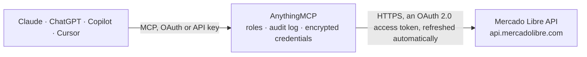

<!-- Generated by scripts/export-github-catalog.mjs in the anythingmcp-website repository. Do not edit by hand. -->

# Mercado Libre MCP connector

LATAM's largest marketplace: read items, catalog products and their competing listings, orders, shipping costs, fees, visits, trends and buyer questions, manage the seller's own listings (create, … The AnythingMCP connector gives Claude, ChatGPT, Microsoft Copilot, Cursor and Gemini 41 MCP tools for Mercado Libre: 32 read and 9 can change data.

**Category:** [E-commerce](../e-commerce.md) · **Tools:** 41 · **Setup guide:** [anythingmcp.com](https://anythingmcp.com/guides/mercado-libre-to-mcp) · [Deutsch](https://anythingmcp.com/de/guides/mercado-libre-to-mcp) · [Italiano](https://anythingmcp.com/it/guides/mercado-libre-to-mcp) · [Español](https://anythingmcp.com/es/guides/mercado-libre-to-mcp) · [日本語](https://anythingmcp.com/ja/guides/mercado-libre-to-mcp) · [Русский](https://anythingmcp.com/ru/guides/mercado-libre-to-mcp) · [中文](https://anythingmcp.com/zh/guides/mercado-libre-to-mcp)

## Start without code

No installation and no terminal: AnythingMCP Cloud runs the Mercado Libre connector for you, operated by helpcode.ai in Frankfurt, Germany.

1. **Click the button above** and create an account or sign in. The Mercado Libre connector opens, ready to install.
2. **Sign in with your Mercado Libre account** when AnythingMCP asks. The first time, an admin creates a small app in the Mercado Libre developer console. Every click is in the [step-by-step guide](https://anythingmcp.com/guides/mercado-libre-to-mcp).
3. **Click Install.** AnythingMCP shows the address of your MCP server.
4. **Add that address to your assistant:** [Claude](https://anythingmcp.com/guides/connect-mercado-libre-to-claude) · [ChatGPT](https://anythingmcp.com/guides/connect-mercado-libre-to-chatgpt) · [Microsoft Copilot](https://anythingmcp.com/guides/connect-mercado-libre-to-copilot) · [Cursor](https://anythingmcp.com/guides/connect-mercado-libre-to-cursor) · [Gemini CLI](https://anythingmcp.com/guides/connect-mercado-libre-to-gemini) · [Meta Muse](https://anythingmcp.com/guides/connect-mercado-libre-to-muse).
5. **Ask your first question**, for example: *Show me details for order MLB-ORD-2026-0345 that was marked paid last week*

Prefer help with the setup? [Talk to us](https://anythingmcp.com/contact).

## How it works

- **The AI client** speaks MCP (Streamable HTTP) to AnythingMCP and only sees tool names, descriptions and results. It never gets the Mercado Libre credentials.
- **AnythingMCP** checks the client's role, builds the call from the tool definition, adds the credentials (an OAuth 2.0 access token, refreshed automatically), calls Mercado Libre, logs the call and returns the result.
- **Mercado Libre** sees an ordinary API client with the rights of the account the credentials belong to.

## Tools

| Tool | What it does | Access |
|---|---|---|
| [`mercado_libre_get_item`](#mercado_libre_get_item) | Fetch full details for a Mercado Libre item by id. | read |
| [`mercado_libre_get_user`](#mercado_libre_get_user) | Get a user's public profile (typically used to inspect a seller). | read |
| [`mercado_libre_list_orders`](#mercado_libre_list_orders) | List orders for an authenticated seller. | read |
| [`mercado_libre_predict_category`](#mercado_libre_predict_category) | Suggest the category for a new listing from its title (the category predictor). | read |
| [`mercado_libre_get_category`](#mercado_libre_get_category) | Read a category and the rules a listing in it must follow: path_from_root, listing_allowed, status, and settings such as max_title_length, buying_modes,… | read |
| [`mercado_libre_get_category_attributes`](#mercado_libre_get_category_attributes) | List the attributes (technical specifications) of a category: id, name, value_type, allowed values with their value_id, and tags. | read |
| [`mercado_libre_get_category_sale_terms`](#mercado_libre_get_category_sale_terms) | List the sale terms of a category, such as WARRANTY_TYPE and WARRANTY_TIME with their allowed values and units, to fill sale_terms when creating or changing… | read |
| [`mercado_libre_list_listing_types`](#mercado_libre_list_listing_types) | List the listing types of a site (e.g. gold_pro, gold_special, free) with their names. | read |
| [`mercado_libre_list_seller_items`](#mercado_libre_list_seller_items) | List the ids of a seller's listings, 50 per page by default (max 100), optionally filtered by status or SKU. | read |
| [`mercado_libre_validate_listing`](#mercado_libre_validate_listing) | Check a new listing without publishing it. | read |
| [`mercado_libre_create_listing`](#mercado_libre_create_listing) | Publish a new listing on the seller's account; it goes live and can sell at once. | write |
| [`mercado_libre_update_listing`](#mercado_libre_update_listing) | Change a listing: price, stock (available_quantity), pictures, attributes, sale terms, video or shipping. | write |
| [`mercado_libre_set_listing_status`](#mercado_libre_set_listing_status) | Pause a listing (hidden from buyers, can be reactivated) or reactivate a paused one. | write |
| [`mercado_libre_close_listing`](#mercado_libre_close_listing) | End a listing for good (status closed). | write |
| [`mercado_libre_get_listing_description`](#mercado_libre_get_listing_description) | Read the description text of a listing (plain_text), with its creation and update dates. | read |
| [`mercado_libre_add_listing_description`](#mercado_libre_add_listing_description) | Add the description to a listing that has none yet, typically right after mercado_libre_create_listing. | write |
| [`mercado_libre_update_listing_description`](#mercado_libre_update_listing_description) | Replace the description of a listing. | write |
| [`mercado_libre_get_items`](#mercado_libre_get_items) | Read up to 20 listings in one call (items multiget). | read |
| [`mercado_libre_get_order`](#mercado_libre_get_order) | Get one order by id: status, date, buyer nickname, order_items (listing, variation, quantity, unit price), payments, total_amount, shipping id, tags and the… | read |
| [`mercado_libre_get_shipment_costs`](#mercado_libre_get_shipment_costs) | Get the cost breakdown of a shipment: what the buyer paid (receiver) and what the seller pays (senders), with discounts and the gross amount. | read |
| [`mercado_libre_get_free_shipping_cost`](#mercado_libre_get_free_shipping_cost) | Quote what the seller pays to offer free shipping (Mercado Envios) for a listing or for a package size: returns the coverage cost the seller pays and, with… | read |
| [`mercado_libre_get_listing_prices`](#mercado_libre_get_listing_prices) | Work out the selling fees for a price on a site: per listing type, the sale_fee_amount Mercado Libre keeps on each sale (with sale_fee_details: percentage,… | read |
| [`mercado_libre_get_item_visits`](#mercado_libre_get_item_visits) | Get the total visits of one or more listings between two dates. | read |
| [`mercado_libre_get_item_visits_by_day`](#mercado_libre_get_item_visits_by_day) | Get the daily visits of one listing over the last N days (time window up to 150 days). | read |
| [`mercado_libre_get_product`](#mercado_libre_get_product) | Get a catalog product by id: name, family, attributes, pictures, main features, the domain and buy_box_winner (the listing currently winning the product… | read |
| [`mercado_libre_list_product_items`](#mercado_libre_list_product_items) | List the listings that compete on a catalog product page: item_id, seller_id, price, currency, condition, listing type, shipping (free shipping, logistic… | read |
| [`mercado_libre_get_item_price_to_win`](#mercado_libre_get_item_price_to_win) | Check how a catalog listing competes for the product page: status (winning, sharing_first_place, competing, listed), price_to_win (the price that would make… | read |
| [`mercado_libre_get_category_trends`](#mercado_libre_get_category_trends) | Get the most searched keywords of a category on a site, by recent growth and volume. | read |
| [`mercado_libre_search_questions`](#mercado_libre_search_questions) | Search buyers' questions on the seller's listings: by seller (all listings) or by one listing, optionally only UNANSWERED ones. | read |
| [`mercado_libre_post_answer`](#mercado_libre_post_answer) | Publish the seller's answer to a buyer's question on a listing. | write |
| [`mercado_libre_list_seller_promotions`](#mercado_libre_list_seller_promotions) | List the promotions the seller is invited to or runs (seller-promotions API): id, type (DEAL, MARKETPLACE_CAMPAIGN, PRICE_DISCOUNT, LIGHTNING, DOD, VOLUME,… | read |
| [`mercado_libre_get_promotion`](#mercado_libre_get_promotion) | Get the details of one promotion: name, type, status, dates, deadline to join, benefits and, for seller campaigns, the discount rules. | read |
| [`mercado_libre_list_promotion_items`](#mercado_libre_list_promotion_items) | List the seller's listings in a promotion with their status there (candidate = invited, pending, started, finished), price and original_price. | read |
| [`mercado_libre_get_item_promotions`](#mercado_libre_get_item_promotions) | List every promotion a listing takes part in or is invited to: promotion id, type, status (candidate, pending, started), the price in the promotion and the… | read |
| [`mercado_libre_add_item_to_promotion`](#mercado_libre_add_item_to_promotion) | Add a listing to a promotion, or accept an invitation, at a promotional price. | write |
| [`mercado_libre_remove_item_from_promotion`](#mercado_libre_remove_item_from_promotion) | Take a listing out of a promotion; it goes back to its normal price. | write |
| [`mercado_libre_list_advertisers`](#mercado_libre_list_advertisers) | List the Mercado Ads advertiser accounts the signed-in user can reach for Product Ads: advertiser_id, site_id and name. | read |
| [`mercado_libre_search_ad_campaigns`](#mercado_libre_search_ad_campaigns) | List Product Ads campaigns of an advertiser with their status, budget, strategy and ACOS target and, with a date range and metrics, their results: clicks,… | read |
| [`mercado_libre_get_ad_campaign`](#mercado_libre_get_ad_campaign) | Get one Product Ads campaign: name, status, budget, strategy, ACOS or ROAS target and, with a date range and metrics, its results (clicks, prints, cost,… | read |
| [`mercado_libre_search_product_ads`](#mercado_libre_search_product_ads) | List the Product Ads (one per promoted listing) of an advertiser with their status and campaign and, with a date range and metrics, each ad's results:… | read |
| [`mercado_libre_search_ad_groups`](#mercado_libre_search_ad_groups) | Find the Product Ads ad groups of an advertiser, e.g. the ad group of given listings: returns each ad group's id, name, status, campaign_id and… | read |

## Tool reference

Every parameter as the AI client sees it in `tools/list`. Source: [`packages/backend/src/adapters/br/mercado-libre.json`](../../../packages/backend/src/adapters/br/mercado-libre.json).

### `mercado_libre_get_item`

Fetch full details for a Mercado Libre item by id. Returns title, description, price, currency, listing type, all attributes (brand, model, condition, …), pictures, available_quantity, sold_quantity, warranty, seller_id, and shipping options.

**Access:** read · **Call:** `GET /items/{item_id}`

| Parameter | Type | Required | Description |
|---|---|---|---|
| `item_id` | string | yes | Mercado Libre item id including site prefix (e.g. 'MLB1234567890'). |

### `mercado_libre_get_user`

Get a user's public profile (typically used to inspect a seller). Returns id, nickname, country_id, registration_date, seller_reputation (level_id, transactions completed/canceled, ratings positive/neutral/negative), and listing site.

**Access:** read · **Call:** `GET /users/{user_id}`

| Parameter | Type | Required | Description |
|---|---|---|---|
| `user_id` | string | yes | Mercado Libre user/seller id (numeric, e.g. '123456789'). |

### `mercado_libre_list_orders`

List orders for an authenticated seller. Requires an OAuth2 token belonging to the seller. Returns order id, status (paid/cancelled/confirmed), date_created, total amount, buyer summary, order items, and shipping details.

**Access:** read · **Call:** `GET /orders/search`

| Parameter | Type | Required | Description |
|---|---|---|---|
| `seller` | string | yes | Seller id (must match the authenticated user's id). |
| `order_status` | string | no | Optional filter: 'paid', 'cancelled', 'confirmed', 'payment_required', 'payment_in_process'. |
| `sort` | string | no | Sort order: 'date_asc' or 'date_desc' (default). |
| `limit` | number | no | Max results (default 50, max 50). |
| `offset` | number | no | Offset for pagination. |

### `mercado_libre_predict_category`

Suggest the category for a new listing from its title (the category predictor). Returns up to 8 predictions, most likely first, each with category_id, category_name, domain_id and the attributes it read from the title (e.g. BRAND, MODEL). Start here before creating a listing.

**Access:** read · **Call:** `GET /sites/{site_id}/domain_discovery/search`

| Parameter | Type | Required | Description |
|---|---|---|---|
| `site_id` | `MLB` \| `MLA` \| `MLM` \| `MLC` \| `MCO` \| `MPE` \| `MLU` | yes | Site code: MLB=Brasil, MLA=Argentina, MLM=Mexico, MLC=Chile, MCO=Colombia, MPE=Peru, MLU=Uruguay. |
| `q` | string | yes | Product title in the site's language, e.g. 'celular iphone 15 128gb'. |
| `limit` | integer | no | Number of predictions, 1 to 8 (default 4). |

### `mercado_libre_get_category`

Read a category and the rules a listing in it must follow: path_from_root, listing_allowed, status, and settings such as max_title_length, buying_modes, currencies, item_conditions, max_pictures_per_item, minimum_price and shipping_modes.

**Access:** read · **Call:** `GET /categories/{category_id}`

| Parameter | Type | Required | Description |
|---|---|---|---|
| `category_id` | string | yes | Category id, e.g. 'MLB1055' (from mercado_libre_predict_category). |

### `mercado_libre_get_category_attributes`

List the attributes (technical specifications) of a category: id, name, value_type, allowed values with their value_id, and tags. Attributes tagged required must be sent to create a listing, new_required ones when the condition is new; read_only ones cannot be set.

**Access:** read · **Call:** `GET /categories/{category_id}/attributes`

| Parameter | Type | Required | Description |
|---|---|---|---|
| `category_id` | string | yes | Category id, e.g. 'MLB1055' (from mercado_libre_predict_category). |

### `mercado_libre_get_category_sale_terms`

List the sale terms of a category, such as WARRANTY_TYPE and WARRANTY_TIME with their allowed values and units, to fill sale_terms when creating or changing a listing.

**Access:** read · **Call:** `GET /categories/{category_id}/sale_terms`

| Parameter | Type | Required | Description |
|---|---|---|---|
| `category_id` | string | yes | Category id, e.g. 'MLB1055' (from mercado_libre_predict_category). |

### `mercado_libre_list_listing_types`

List the listing types of a site (e.g. gold_pro, gold_special, free) with their names. A listing needs a listing_type_id; exposure and selling fees depend on it.

**Access:** read · **Call:** `GET /sites/{site_id}/listing_types`

| Parameter | Type | Required | Description |
|---|---|---|---|
| `site_id` | `MLB` \| `MLA` \| `MLM` \| `MLC` \| `MCO` \| `MPE` \| `MLU` | yes | Site code: MLB=Brasil, MLA=Argentina, MLM=Mexico, MLC=Chile, MCO=Colombia, MPE=Peru, MLU=Uruguay. |

### `mercado_libre_list_seller_items`

List the ids of a seller's listings, 50 per page by default (max 100), optionally filtered by status or SKU. Use mercado_libre_get_user with user_id 'me' to find your own seller id, and mercado_libre_get_item for the details of each id. offset stops at 1000.

**Access:** read · **Call:** `GET /users/{user_id}/items/search`

| Parameter | Type | Required | Description |
|---|---|---|---|
| `user_id` | string | yes | Seller id (numeric). Must be the account the connector is signed in with. |
| `status` | `active` \| `paused` \| `closed` \| `under_review` \| `inactive` | no | Only listings in this status. |
| `seller_sku` | string | no | Only listings whose SELLER_SKU attribute has this value. |
| `orders` | string | no | Sort order, e.g. start_time_desc (default stop_time_asc). |
| `limit` | integer | no | Results per page (default 50, max 100). |
| `offset` | integer | no | Results to skip, for paging. |

### `mercado_libre_validate_listing`

Check a new listing without publishing it. Takes the same fields as mercado_libre_create_listing; an empty answer (HTTP 204) means it would be accepted. Otherwise Mercado Libre answers 400 with a cause list: each cause has a type. Causes of type 'error' (missing attributes, wrong fields, title not allowed) block the listing and must be fixed. Causes of type 'warning' only advise (e.g. shipping.lost_me1_by_user, item.shipping.mandatory_free_shipping): a 400 whose causes are all warnings means the listing would still be accepted, so report the warnings and go ahead. Run this before creating.

**Access:** read · **Call:** `POST /items/validate`

| Parameter | Type | Required | Description |
|---|---|---|---|
| `category_id` | string | yes | Category id, e.g. 'MLB1055' (from mercado_libre_predict_category). |
| `family_name` | string | no | Generic product name shared by its variants, e.g. 'Apple iPhone 15 128GB'. Required for sellers on the User Products model (most sellers now); Mercado Libre then writes the title itself. At most the category's max_title_length. |
| `title` | string | no | Listing title, only for sellers still on the old model (Product + brand + model + key specs, no condition, stock or shipping words). If Mercado Libre answers 'The fields [title] are invalid', send family_name instead. |
| `price` | number | yes | Price in the site currency, e.g. 199.9. |
| `currency_id` | string | yes | Currency of the site: BRL, ARS, MXN, CLP, COP, PEN or UYU. |
| `available_quantity` | integer | yes | Units in stock (0 creates the listing paused, out of stock). |
| `buying_mode` | `buy_it_now` \| `classified` \| `auction` | yes | buy_it_now for normal product listings. |
| `listing_type_id` | string | yes | Listing type, e.g. gold_special (classic) or gold_pro (premium); see mercado_libre_list_listing_types. |
| `condition` | `new` \| `used` \| `not_specified` | yes | Item condition. |
| `pictures` | object[] | yes | Pictures as [{"source": "https://...jpg"}]: public image URLs, the first one is the cover. The category sets the maximum (max_pictures_per_item). |
| `attributes` | object[] | no | Technical specifications as [{"id": "BRAND", "value_name": "Apple"}] or with "value_id" for list values. Send every attribute tagged required in mercado_libre_get_category_attributes (often BRAND, MODEL and GTIN); a SKU goes in SELLER_SKU. |
| `sale_terms` | object[] | no | Sale terms such as the warranty: [{"id": "WARRANTY_TYPE", "value_name": "Garantia do vendedor"}, {"id": "WARRANTY_TIME", "value_name": "90 dias"}]. Allowed values: mercado_libre_get_category_sale_terms. |
| `video_id` | string | no | Optional YouTube video id. |
| `shipping` | object | no | Optional shipping settings, e.g. {"mode": "me2", "free_shipping": false, "local_pick_up": false}. Leave out to use the seller's defaults. |

### `mercado_libre_create_listing`

Publish a new listing on the seller's account; it goes live and can sell at once. Send family_name (User Products sellers) or title, never both. Get category_id from mercado_libre_predict_category and the required attributes from mercado_libre_get_category_attributes, run mercado_libre_validate_listing first, then add the text with mercado_libre_add_listing_description. Show the user the listing and wait for confirmation; never retry a successful create.

**Access:** write · **Call:** `POST /items`

| Parameter | Type | Required | Description |
|---|---|---|---|
| `category_id` | string | yes | Category id, e.g. 'MLB1055' (from mercado_libre_predict_category). |
| `family_name` | string | no | Generic product name shared by its variants, e.g. 'Apple iPhone 15 128GB'. Required for sellers on the User Products model (most sellers now); Mercado Libre then writes the title itself. At most the category's max_title_length. |
| `title` | string | no | Listing title, only for sellers still on the old model (Product + brand + model + key specs, no condition, stock or shipping words). If Mercado Libre answers 'The fields [title] are invalid', send family_name instead. |
| `price` | number | yes | Price in the site currency, e.g. 199.9. |
| `currency_id` | string | yes | Currency of the site: BRL, ARS, MXN, CLP, COP, PEN or UYU. |
| `available_quantity` | integer | yes | Units in stock (0 creates the listing paused, out of stock). |
| `buying_mode` | `buy_it_now` \| `classified` \| `auction` | yes | buy_it_now for normal product listings. |
| `listing_type_id` | string | yes | Listing type, e.g. gold_special (classic) or gold_pro (premium); see mercado_libre_list_listing_types. |
| `condition` | `new` \| `used` \| `not_specified` | yes | Item condition. |
| `pictures` | object[] | yes | Pictures as [{"source": "https://...jpg"}]: public image URLs, the first one is the cover. The category sets the maximum (max_pictures_per_item). |
| `attributes` | object[] | no | Technical specifications as [{"id": "BRAND", "value_name": "Apple"}] or with "value_id" for list values. Send every attribute tagged required in mercado_libre_get_category_attributes (often BRAND, MODEL and GTIN); a SKU goes in SELLER_SKU. |
| `sale_terms` | object[] | no | Sale terms such as the warranty: [{"id": "WARRANTY_TYPE", "value_name": "Garantia do vendedor"}, {"id": "WARRANTY_TIME", "value_name": "90 dias"}]. Allowed values: mercado_libre_get_category_sale_terms. |
| `video_id` | string | no | Optional YouTube video id. |
| `shipping` | object | no | Optional shipping settings, e.g. {"mode": "me2", "free_shipping": false, "local_pick_up": false}. Leave out to use the seller's defaults. |

### `mercado_libre_update_listing`

Change a listing: price, stock (available_quantity), pictures, attributes, sale terms, video or shipping. Send only the fields to change; pictures and attributes replace the whole list. title only while nothing has sold and only on old-model listings (with family_name set, change family_name instead). Stock 0 pauses the listing. Confirm with the user first.

**Access:** write · **Call:** `PUT /items/{item_id}`

| Parameter | Type | Required | Description |
|---|---|---|---|
| `item_id` | string | yes | Listing id with its site prefix, e.g. 'MLB1234567890'. |
| `price` | number | no | New price in the listing currency. |
| `available_quantity` | integer | no | New stock. 0 pauses the listing as out of stock; a positive number reactivates it. |
| `title` | string | no | New title. Only allowed while sold_quantity is 0 and the listing has no family_name. |
| `family_name` | string | no | New generic product name (User Products listings), only while no item of the product has sold. |
| `pictures` | object[] | no | Pictures as [{"source": "https://...jpg"}]: public image URLs, the first one is the cover. The category sets the maximum (max_pictures_per_item). |
| `attributes` | object[] | no | Technical specifications as [{"id": "BRAND", "value_name": "Apple"}] or with "value_id" for list values. Send every attribute tagged required in mercado_libre_get_category_attributes (often BRAND, MODEL and GTIN); a SKU goes in SELLER_SKU. |
| `sale_terms` | object[] | no | Sale terms such as the warranty: [{"id": "WARRANTY_TYPE", "value_name": "Garantia do vendedor"}, {"id": "WARRANTY_TIME", "value_name": "90 dias"}]. Allowed values: mercado_libre_get_category_sale_terms. |
| `video_id` | string | no | YouTube video id. |
| `shipping` | object | no | Shipping settings, e.g. {"free_shipping": true}. |

### `mercado_libre_set_listing_status`

Pause a listing (hidden from buyers, can be reactivated) or reactivate a paused one. A listing paused for lack of stock comes back by itself when mercado_libre_update_listing sets stock above 0. To end a listing for good use mercado_libre_close_listing. Confirm with the user first.

**Access:** write · **Call:** `PUT /items/{item_id}`

| Parameter | Type | Required | Description |
|---|---|---|---|
| `item_id` | string | yes | Listing id with its site prefix, e.g. 'MLB1234567890'. |
| `status` | `paused` \| `active` | yes | paused hides the listing, active reactivates it. |

### `mercado_libre_close_listing`

End a listing for good (status closed). A closed listing cannot be reactivated, only relisted as a new one, so pause it with mercado_libre_set_listing_status unless the user wants it gone. Installed switched off; confirm with the user first.

**Access:** write · **Call:** `PUT /items/{item_id}`

| Parameter | Type | Required | Description |
|---|---|---|---|
| `item_id` | string | yes | Listing id with its site prefix, e.g. 'MLB1234567890'. |

### `mercado_libre_get_listing_description`

Read the description text of a listing (plain_text), with its creation and update dates.

**Access:** read · **Call:** `GET /items/{item_id}/description`

| Parameter | Type | Required | Description |
|---|---|---|---|
| `item_id` | string | yes | Listing id with its site prefix, e.g. 'MLB1234567890'. |

### `mercado_libre_add_listing_description`

Add the description to a listing that has none yet, typically right after mercado_libre_create_listing. Plain text only (line breaks as \n, no HTML or emoji). If the listing already has a description Mercado Libre refuses it; use mercado_libre_update_listing_description. Confirm the text with the user first.

**Access:** write · **Call:** `POST /items/{item_id}/description`

| Parameter | Type | Required | Description |
|---|---|---|---|
| `item_id` | string | yes | Listing id with its site prefix, e.g. 'MLB1234567890'. |
| `plain_text` | string | yes | Description in plain text, in the site's language. |

### `mercado_libre_update_listing_description`

Replace the description of a listing. Plain text only (line breaks as \n, no HTML or emoji); an error names the position of a character that is not allowed. Possible whether or not the listing has sales. Confirm the text with the user first.

**Access:** write · **Call:** `PUT /items/{item_id}/description`

| Parameter | Type | Required | Description |
|---|---|---|---|
| `item_id` | string | yes | Listing id with its site prefix, e.g. 'MLB1234567890'. |
| `plain_text` | string | yes | New description in plain text, in the site's language. |

### `mercado_libre_get_items`

Read up to 20 listings in one call (items multiget). Returns one entry per id with a code (200, 404, ...) and a body holding the listing. Pass attributes to get only the fields you need, e.g. id,title,price,available_quantity,sold_quantity,status. Use instead of many mercado_libre_get_item calls.

**Access:** read · **Call:** `GET /items`

| Parameter | Type | Required | Description |
|---|---|---|---|
| `ids` | string | yes | Comma-separated listing ids with site prefix, at most 20, e.g. 'MLB1234567890,MLB2345678901'. |
| `attributes` | string | no | Comma-separated fields to return, e.g. 'id,title,price,available_quantity,sold_quantity,status'. Leave out for the whole listing. |

### `mercado_libre_get_order`

Get one order by id: status, date, buyer nickname, order_items (listing, variation, quantity, unit price), payments, total_amount, shipping id, tags and the pack it belongs to. Order ids come from mercado_libre_list_orders. Only orders of the signed-in seller.

**Access:** read · **Call:** `GET /orders/{order_id}`

| Parameter | Type | Required | Description |
|---|---|---|---|
| `order_id` | string | yes | Numeric order id, e.g. '2000001234567890'. |

### `mercado_libre_get_shipment_costs`

Get the cost breakdown of a shipment: what the buyer paid (receiver) and what the seller pays (senders), with discounts and the gross amount. The shipment id is shipping.id of an order from mercado_libre_get_order.

**Access:** read · **Call:** `GET /shipments/{shipment_id}/costs`

| Parameter | Type | Required | Description |
|---|---|---|---|
| `shipment_id` | string | yes | Numeric shipment id. |

### `mercado_libre_get_free_shipping_cost`

Quote what the seller pays to offer free shipping (Mercado Envios) for a listing or for a package size: returns the coverage cost the seller pays and, with verbose, the breakdown and discounts. Pass item_id for an existing listing, or dimensions with item_price, listing_type_id, mode, condition and logistic_type for a product not yet listed; leaving them out gives inconsistent quotes.

**Access:** read · **Call:** `GET /users/{user_id}/shipping_options/free`

| Parameter | Type | Required | Description |
|---|---|---|---|
| `user_id` | string | yes | Seller id (numeric), the signed-in account. |
| `item_id` | string | no | Listing id, e.g. 'MLB1234567890'. Either this or dimensions. |
| `dimensions` | string | no | Package height x width x length in cm and weight in grams, e.g. '10x20x30,500'. |
| `item_price` | number | no | Selling price, with dimensions. |
| `listing_type_id` | string | no | gold_special (classic) or gold_pro (premium), with dimensions. |
| `mode` | string | no | Shipping mode, usually me2. |
| `condition` | `new` \| `used` | no | Item condition. |
| `logistic_type` | string | no | drop_off, cross_docking, xd_drop_off or fulfillment. |
| `free_shipping` | boolean | no | Whether the listing offers free shipping. |
| `verbose` | boolean | no | true adds the cost breakdown. |

### `mercado_libre_get_listing_prices`

Work out the selling fees for a price on a site: per listing type, the sale_fee_amount Mercado Libre keeps on each sale (with sale_fee_details: percentage, fixed fee, installments add-on), the listing_fee_amount and the currency. Add category_id and listing_type_id for an exact figure, e.g. to check a margin before setting a price.

**Access:** read · **Call:** `GET /sites/{site_id}/listing_prices`

| Parameter | Type | Required | Description |
|---|---|---|---|
| `site_id` | string | yes | Site id, e.g. 'MLB', 'MLA', 'MLM'. |
| `price` | number | yes | Selling price. |
| `category_id` | string | no | Category id, e.g. 'MLB1055'. |
| `listing_type_id` | string | no | gold_special (classic) or gold_pro (premium). Leave out for all types. |
| `currency_id` | string | no | Currency, e.g. BRL, ARS, MXN. |
| `logistic_type` | string | no | drop_off, cross_docking or fulfillment, where the fee depends on it. |
| `quantity` | integer | no | Quantity, for fees that depend on stock. |

### `mercado_libre_get_item_visits`

Get the total visits of one or more listings between two dates. Returns, per listing, total_visits and the date range. For a day-by-day series of one listing use mercado_libre_get_item_visits_by_day.

**Access:** read · **Call:** `GET /items/visits`

| Parameter | Type | Required | Description |
|---|---|---|---|
| `ids` | string | yes | Comma-separated listing ids, e.g. 'MLB1234567890,MLB2345678901'. |
| `date_from` | string | yes | Start date, YYYY-MM-DD. |
| `date_to` | string | yes | End date, YYYY-MM-DD. |

### `mercado_libre_get_item_visits_by_day`

Get the daily visits of one listing over the last N days (time window up to 150 days). Returns total_visits and a results array with the visits per day, to spot a drop or a peak.

**Access:** read · **Call:** `GET /items/{item_id}/visits/time_window`

| Parameter | Type | Required | Description |
|---|---|---|---|
| `item_id` | string | yes | Listing id with site prefix, e.g. 'MLB1234567890'. |
| `last` | integer | yes | Number of days to cover. |
| `unit` | `day` | no | Interval unit; only day. |
| `ending` | string | no | Last day of the window, YYYY-MM-DD (default today). |

### `mercado_libre_get_product`

Get a catalog product by id: name, family, attributes, pictures, main features, the domain and buy_box_winner (the listing currently winning the product page, with its price and seller). Catalog product ids look like 'MLB12345678' and appear as catalog_product_id on a listing.

**Access:** read · **Call:** `GET /products/{product_id}`

| Parameter | Type | Required | Description |
|---|---|---|---|
| `product_id` | string | yes | Catalog product id, e.g. 'MLB12345678'. |

### `mercado_libre_list_product_items`

List the listings that compete on a catalog product page: item_id, seller_id, price, currency, condition, listing type, shipping (free shipping, logistic type) and official store. Use it to compare your price with the other sellers of the same product; mercado_libre_get_item_price_to_win says what your listing needs to win.

**Access:** read · **Call:** `GET /products/{product_id}/items`

| Parameter | Type | Required | Description |
|---|---|---|---|
| `product_id` | string | yes | Catalog product id, e.g. 'MLB12345678'. |
| `limit` | integer | no | Results per page. |
| `offset` | integer | no | Results to skip, for paging. |

### `mercado_libre_get_item_price_to_win`

Check how a catalog listing competes for the product page: status (winning, sharing_first_place, competing, listed), price_to_win (the price that would make it win), the current winner and the boosts that count (free shipping, installments, Full). Only for catalog listings of the signed-in seller.

**Access:** read · **Call:** `GET /items/{item_id}/price_to_win`

| Parameter | Type | Required | Description |
|---|---|---|---|
| `item_id` | string | yes | Catalog listing id, e.g. 'MLB1234567890'. |

### `mercado_libre_get_category_trends`

Get the most searched keywords of a category on a site, by recent growth and volume. Each entry has the keyword and a url to the search. Useful to pick words for titles and attributes.

**Access:** read · **Call:** `GET /trends/{site_id}/{category_id}`

| Parameter | Type | Required | Description |
|---|---|---|---|
| `site_id` | string | yes | Site id, e.g. 'MLB', 'MLA'. |
| `category_id` | string | yes | Category id, e.g. 'MLB1055'. |

### `mercado_libre_search_questions`

Search buyers' questions on the seller's listings: by seller (all listings) or by one listing, optionally only UNANSWERED ones. Returns each question's id, text, status, date, item_id and the answer if there is one, plus total for paging. Answer with mercado_libre_post_answer.

**Access:** read · **Call:** `GET /questions/search`

| Parameter | Type | Required | Description |
|---|---|---|---|
| `seller_id` | string | no | Seller id (numeric), the signed-in account. Either this or item. |
| `item` | string | no | Listing id, for the questions of one listing. |
| `status` | `UNANSWERED` \| `ANSWERED` \| `CLOSED_UNANSWERED` \| `UNDER_REVIEW` \| `BANNED` \| `DELETED` \| `DISABLED` | no | Only questions in this status. |
| `sort_fields` | string | no | Sort fields, e.g. 'date_created' or 'item_id,date_created'. |
| `sort_types` | `ASC` \| `DESC` | no | Sort direction. |
| `limit` | integer | no | Results per page. |
| `offset` | integer | no | Results to skip, for paging. |

### `mercado_libre_post_answer`

Publish the seller's answer to a buyer's question on a listing. The answer is public on the listing at once and cannot be edited afterwards. Write it in the site's language (Portuguese on MLB, Spanish elsewhere). Confirm the text with the user first.

**Access:** write · **Call:** `POST /answers`

| Parameter | Type | Required | Description |
|---|---|---|---|
| `question_id` | integer | yes | Question id, from mercado_libre_search_questions. |
| `text` | string | yes | Answer text, up to 2000 characters, no links or contact details. |

### `mercado_libre_list_seller_promotions`

List the promotions the seller is invited to or runs (seller-promotions API): id, type (DEAL, MARKETPLACE_CAMPAIGN, PRICE_DISCOUNT, LIGHTNING, DOD, VOLUME, SELLER_CAMPAIGN, SMART, PRICE_MATCHING, ...), status, start, finish and deadline dates, name and benefits (who funds the discount). Use the id and type with mercado_libre_list_promotion_items and mercado_libre_add_item_to_promotion.

**Access:** read · **Call:** `GET /seller-promotions/users/{user_id}`

| Parameter | Type | Required | Description |
|---|---|---|---|
| `user_id` | string | yes | Seller id (numeric), the signed-in account. |

### `mercado_libre_get_promotion`

Get the details of one promotion: name, type, status, dates, deadline to join, benefits and, for seller campaigns, the discount rules. Needs the promotion type as well as the id (both from mercado_libre_list_seller_promotions).

**Access:** read · **Call:** `GET /seller-promotions/promotions/{promotion_id}`

| Parameter | Type | Required | Description |
|---|---|---|---|
| `promotion_id` | string | yes | Promotion id, e.g. 'P-MLB1806015' or 'C-MLB302'. |
| `promotion_type` | string | yes | Promotion type, e.g. DEAL, MARKETPLACE_CAMPAIGN, SELLER_CAMPAIGN, VOLUME, DOD, LIGHTNING, SMART, PRICE_MATCHING. |

### `mercado_libre_list_promotion_items`

List the seller's listings in a promotion with their status there (candidate = invited, pending, started, finished), price and original_price. Filter by status or one item_id. Pages of up to 50: pass paging.searchAfter from the answer as search_after for the next page (expires after 5 minutes); it is missing on the last page.

**Access:** read · **Call:** `GET /seller-promotions/promotions/{promotion_id}/items`

| Parameter | Type | Required | Description |
|---|---|---|---|
| `promotion_id` | string | yes | Promotion id. |
| `promotion_type` | string | yes | Promotion type, e.g. DEAL, MARKETPLACE_CAMPAIGN, SELLER_CAMPAIGN. |
| `status` | `candidate` \| `pending` \| `started` \| `finished` | no | Only items in this promotion status. |
| `status_item` | `active` \| `paused` | no | Only listings in this listing status (default active). |
| `item_id` | string | no | Only this listing. |
| `limit` | integer | no | Results per page (default and max 50). |
| `search_after` | string | no | paging.searchAfter of the previous page. |

### `mercado_libre_get_item_promotions`

List every promotion a listing takes part in or is invited to: promotion id, type, status (candidate, pending, started), the price in the promotion and the original price, and for co-funded campaigns the meli and seller percentages.

**Access:** read · **Call:** `GET /seller-promotions/items/{item_id}`

| Parameter | Type | Required | Description |
|---|---|---|---|
| `item_id` | string | yes | Listing id with site prefix, e.g. 'MLB1234567890'. |

### `mercado_libre_add_item_to_promotion`

Add a listing to a promotion, or accept an invitation, at a promotional price. DEAL, SELLER_CAMPAIGN, DOD and LIGHTNING take a deal_price you set (LIGHTNING also stock); MARKETPLACE_CAMPAIGN, VOLUME, SMART and PRICE_MATCHING only need promotion_id and type (plus offer_id for SMART and PRICE_MATCHING), the price comes from the invitation. The discount is live for buyers once the promotion runs. Confirm price and promotion with the user first.

**Access:** write · **Call:** `POST /seller-promotions/items/{item_id}`

| Parameter | Type | Required | Description |
|---|---|---|---|
| `item_id` | string | yes | Listing id with site prefix. |
| `promotion_id` | string | no | Promotion id. Not needed for PRICE_DISCOUNT. |
| `promotion_type` | string | yes | Promotion type: DEAL, MARKETPLACE_CAMPAIGN, PRICE_DISCOUNT, LIGHTNING, DOD, VOLUME, PRE_NEGOTIATED, SELLER_CAMPAIGN, SMART, PRICE_MATCHING, UNHEALTHY_STOCK. |
| `deal_price` | number | no | Price during the promotion, for promotions where the seller sets it. |
| `top_deal_price` | number | no | Optional lower price for loyalty buyers (levels 3 to 6), where the promotion allows it. |
| `offer_id` | string | no | Candidate offer id, for SMART, PRICE_MATCHING and pre-negotiated promotions. |
| `stock` | integer | no | Units reserved for a LIGHTNING deal. |
| `start_date` | string | no | Start, ISO 8601, for a PRICE_DISCOUNT. |
| `finish_date` | string | no | End, ISO 8601, for a PRICE_DISCOUNT. |

### `mercado_libre_remove_item_from_promotion`

Take a listing out of a promotion; it goes back to its normal price. Some promotions do not allow it once started (a running LIGHTNING deal can only be paused). Confirm with the user first.

**Access:** write · **Call:** `DELETE /seller-promotions/items/{item_id}`

| Parameter | Type | Required | Description |
|---|---|---|---|
| `item_id` | string | yes | Listing id with site prefix. |
| `promotion_type` | string | yes | Promotion type, e.g. DEAL, SELLER_CAMPAIGN, PRICE_DISCOUNT, DOD. |
| `promotion_id` | string | no | Promotion id, where the type has one. |
| `offer_id` | string | no | Offer id, for SMART and PRICE_MATCHING. |

### `mercado_libre_list_advertisers`

List the Mercado Ads advertiser accounts the signed-in user can reach for Product Ads: advertiser_id, site_id and name. Product Ads tools need both the advertiser_id and its site_id.

**Access:** read · **Call:** `GET /advertising/advertisers`

No parameters.

### `mercado_libre_search_ad_campaigns`

List Product Ads campaigns of an advertiser with their status, budget, strategy and ACOS target and, with a date range and metrics, their results: clicks, prints, ctr, cost, cpc, acos, roas, units and amounts sold. metrics_summary adds totals; aggregation_type DAILY gives a series per day. Dates go back 90 days.

**Access:** read · **Call:** `GET /advertising/{site_id}/advertisers/{advertiser_id}/product_ads/campaigns/search`

| Parameter | Type | Required | Description |
|---|---|---|---|
| `site_id` | string | yes | Advertiser's site id, e.g. 'MLB', from mercado_libre_list_advertisers. |
| `advertiser_id` | string | yes | Advertiser id, from mercado_libre_list_advertisers. |
| `status` | string | no | Comma-separated campaign statuses: active, paused. |
| `date_from` | string | no | YYYY-MM-DD; required with metrics. |
| `date_to` | string | no | YYYY-MM-DD; required with metrics. |
| `metrics` | string | no | Comma-separated metrics, e.g. 'clicks,prints,ctr,cost,cpc,acos,roas,units_quantity,total_amount'. |
| `metrics_summary` | boolean | no | true adds summed metrics. |
| `aggregation_type` | `DAILY` | no | DAILY for one row per day. |
| `limit` | integer | no | Results per page. |
| `offset` | integer | no | Results to skip; limit + offset at most 10000. |

### `mercado_libre_get_ad_campaign`

Get one Product Ads campaign: name, status, budget, strategy, ACOS or ROAS target and, with a date range and metrics, its results (clicks, prints, cost, acos, roas, sales, impression share and lost share by budget or rank).

**Access:** read · **Call:** `GET /advertising/{site_id}/product_ads/campaigns/{campaign_id}`

| Parameter | Type | Required | Description |
|---|---|---|---|
| `site_id` | string | yes | Advertiser's site id, e.g. 'MLB'. |
| `campaign_id` | string | yes | Campaign id, from mercado_libre_search_ad_campaigns. |
| `date_from` | string | no | YYYY-MM-DD; required with metrics. |
| `date_to` | string | no | YYYY-MM-DD; required with metrics. |
| `metrics` | string | no | Comma-separated metrics, e.g. 'clicks,prints,cost,acos,roas,total_amount,impression_share,lost_impression_share_by_budget'. |
| `aggregation_type` | `DAILY` | no | DAILY for one row per day. |

### `mercado_libre_search_product_ads`

List the Product Ads (one per promoted listing) of an advertiser with their status and campaign and, with a date range and metrics, each ad's results: clicks, prints, cost, cpc, acos, roas, units and amounts sold. Filter by campaign or by listing. metrics_summary adds totals; dates go back 90 days.

**Access:** read · **Call:** `GET /advertising/{site_id}/advertisers/{advertiser_id}/product_ads/ads/search`

| Parameter | Type | Required | Description |
|---|---|---|---|
| `site_id` | string | yes | Advertiser's site id, e.g. 'MLB'. |
| `advertiser_id` | string | yes | Advertiser id, from mercado_libre_list_advertisers. |
| `campaign_id` | string | no | Only ads of this campaign. |
| `item_id` | string | no | Only the ad of this listing. |
| `date_from` | string | no | YYYY-MM-DD; required with metrics. |
| `date_to` | string | no | YYYY-MM-DD; required with metrics. |
| `metrics` | string | no | Comma-separated metrics, e.g. 'clicks,prints,ctr,cost,cpc,acos,roas,units_quantity,total_amount'. |
| `metrics_summary` | boolean | no | true adds summed metrics. |
| `aggregation_type` | `DAILY` | no | DAILY for one row per day. |
| `limit` | integer | no | Results per page. |
| `offset` | integer | no | Results to skip; limit + offset at most 10000. |

### `mercado_libre_search_ad_groups`

Find the Product Ads ad groups of an advertiser, e.g. the ad group of given listings: returns each ad group's id, name, status, campaign_id and ad_group_external_id (the listing id). Use it to see which campaign promotes a listing.

**Access:** read · **Call:** `GET /advertising/{site_id}/advertisers/{advertiser_id}/product_ads/ad_groups/search`

| Parameter | Type | Required | Description |
|---|---|---|---|
| `site_id` | string | yes | Advertiser's site id, e.g. 'MLB'. |
| `advertiser_id` | string | yes | Advertiser id, from mercado_libre_list_advertisers. |
| `item_ids` | string | no | Comma-separated listing ids. |
| `campaign_id` | string | no | Only ad groups of this campaign. |
| `limit` | integer | no | Results per page. |
| `offset` | integer | no | Results to skip. |

## Run it yourself

AnythingMCP is open source (AGPL-3.0). [Run it with Docker](../../../README.md#run-it-yourself), open **Connectors → Store**, pick **Mercado Libre** and enter `MERCADO_LIBRE_CLIENT_ID`, `MERCADO_LIBRE_CLIENT_SECRET`, `MERCADO_LIBRE_SITE_DOMAIN`, then add your MCP server URL to the AI client.

[← E-commerce connectors](../e-commerce.md) · [All categories](../README.md)
