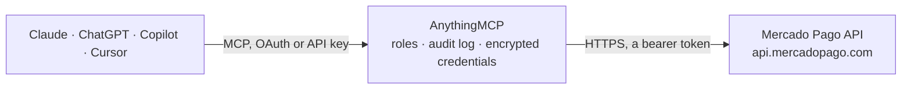

<!-- Generated by scripts/export-github-catalog.mjs in the anythingmcp-website repository. Do not edit by hand. -->

# Mercado Pago MCP connector

Mercado Pago seller account (Argentina, Brazil, Mexico, Chile, Colombia, Peru, Uruguay): payments with fees, net amounts and release dates, merchant orders, subscriptions, payment methods, and the … The AnythingMCP connector gives Claude, ChatGPT, Microsoft Copilot, Cursor and Gemini 13 MCP tools for Mercado Pago: 11 read and 2 can change data.

**Category:** [Payments](../payments.md) · **Tools:** 13 · **Setup guide:** [anythingmcp.com](https://anythingmcp.com/guides/mercado-pago-to-mcp) · [Deutsch](https://anythingmcp.com/de/guides/mercado-pago-to-mcp) · [Italiano](https://anythingmcp.com/it/guides/mercado-pago-to-mcp) · [Español](https://anythingmcp.com/es/guides/mercado-pago-to-mcp) · [日本語](https://anythingmcp.com/ja/guides/mercado-pago-to-mcp) · [Русский](https://anythingmcp.com/ru/guides/mercado-pago-to-mcp) · [中文](https://anythingmcp.com/zh/guides/mercado-pago-to-mcp)

## Start without code

No installation and no terminal: AnythingMCP Cloud runs the Mercado Pago connector for you, operated by helpcode.ai in Frankfurt, Germany.

1. **Click the button above** and create an account or sign in. The Mercado Pago connector opens, ready to install.
2. **Paste the API key or token from your Mercado Pago account.** Every click is in the [step-by-step guide](https://anythingmcp.com/guides/mercado-pago-to-mcp).
3. **Click Install.** AnythingMCP shows the address of your MCP server.
4. **Add that address to your assistant:** [Claude](https://anythingmcp.com/guides/connect-mercado-pago-to-claude) · [ChatGPT](https://anythingmcp.com/guides/connect-mercado-pago-to-chatgpt) · [Microsoft Copilot](https://anythingmcp.com/guides/connect-mercado-pago-to-copilot) · [Cursor](https://anythingmcp.com/guides/connect-mercado-pago-to-cursor) · [Gemini CLI](https://anythingmcp.com/guides/connect-mercado-pago-to-gemini) · [Meta Muse](https://anythingmcp.com/guides/connect-mercado-pago-to-muse).
5. **Ask your first question**, for example: *Show me payment 1790345621 details (status, gross, net, fees, release date) for Loja Verde Comercio Ltda.*

Prefer help with the setup? [Talk to us](https://anythingmcp.com/contact).

## How it works

- **The AI client** speaks MCP (Streamable HTTP) to AnythingMCP and only sees tool names, descriptions and results. It never gets the Mercado Pago credentials.
- **AnythingMCP** checks the client's role, builds the call from the tool definition, adds the credentials (a bearer token), calls Mercado Pago, logs the call and returns the result.
- **Mercado Pago** sees an ordinary API client with the rights of the account the credentials belong to.

## Tools

| Tool | What it does | Access |
|---|---|---|
| [`mercado_pago_get_account`](#mercado_pago_get_account) | Get the Mercado Pago account behind the access token: user id, nickname, name, e-mail, country, site (MLA Argentina, MLB Brazil, MLM Mexico, MLC Chile, MCO… | read |
| [`mercado_pago_search_payments`](#mercado_pago_search_payments) | Search the payments received by the account (the last 12 months at most): id, status, amount, net received after fees, fees, payment method, installments,… | read |
| [`mercado_pago_get_payment`](#mercado_pago_get_payment) | Get every detail of one payment by id: status and status_detail, amounts, fees and net received, refunds, payment method and card brand, installments,… | read |
| [`mercado_pago_search_merchant_orders`](#mercado_pago_search_merchant_orders) | Search merchant orders (the order behind a Checkout Pro or QR sale, grouping its payments and shipments) of the last 90 days: status opened, closed or… | read |
| [`mercado_pago_get_merchant_order`](#mercado_pago_get_merchant_order) | Get one merchant order by id: status, order_status, total and paid amounts, items, its payments and shipments. | read |
| [`mercado_pago_list_payment_methods`](#mercado_pago_list_payment_methods) | List the payment methods available to the account in its country: id (visa, master, pix, bolbradesco, account_money...), name, type (credit_card,… | read |
| [`mercado_pago_list_release_reports`](#mercado_pago_list_release_reports) | List the released money reports (Dinero liberado / Dinheiro liberado: the money that became available, with each payment, fee, refund and withdrawal)… | read |
| [`mercado_pago_create_release_report`](#mercado_pago_create_release_report) | Ask Mercado Pago to generate a released money report (Dinero liberado / Dinheiro liberado: the money that became available, with each payment, fee, refund… | write |
| [`mercado_pago_download_release_report`](#mercado_pago_download_release_report) | Download one released money report by its file_name (from mercado_pago_list_release_reports). | read |
| [`mercado_pago_list_settlement_reports`](#mercado_pago_list_settlement_reports) | List the account money reports (Dinero en cuenta, formerly "all transactions": every movement of the account balance) already generated for the account,… | read |
| [`mercado_pago_create_settlement_report`](#mercado_pago_create_settlement_report) | Ask Mercado Pago to generate a account money report (Dinero en cuenta, formerly "all transactions": every movement of the account balance) for a period. | write |
| [`mercado_pago_download_settlement_report`](#mercado_pago_download_settlement_report) | Download one account money report by its file_name (from mercado_pago_list_settlement_reports). | read |
| [`mercado_pago_search_subscriptions`](#mercado_pago_search_subscriptions) | Search subscriptions (preapprovals) of the account: id, status (pending, authorized, paused, cancelled), payer e-mail, plan, reason, amount and frequency,… | read |

## Tool reference

Every parameter as the AI client sees it in `tools/list`. Source: [`packages/backend/src/adapters/br/mercado-pago.json`](../../../packages/backend/src/adapters/br/mercado-pago.json).

### `mercado_pago_get_account`

Get the Mercado Pago account behind the access token: user id, nickname, name, e-mail, country, site (MLA Argentina, MLB Brazil, MLM Mexico, MLC Chile, MCO Colombia, MPE Peru, MLU Uruguay) and account type. Use it to check the connection.

**Access:** read · **Call:** `GET /users/me`

No parameters.

### `mercado_pago_search_payments`

Search the payments received by the account (the last 12 months at most): id, status, amount, net received after fees, fees, payment method, installments, payer, external reference and money release date. Filter by status and a date range on date_created, date_approved, date_last_updated or money_release_date. paging.total is the number of matches; page with offset.

**Access:** read · **Call:** `GET /v1/payments/search`

| Parameter | Type | Required | Description |
|---|---|---|---|
| `status` | `approved` \| `pending` \| `authorized` \| `in_process` \| `in_mediation` \| `rejected` \| `cancelled` \| `refunded` \| `charged_back` | no | Payment status. |
| `range` | `date_created` \| `date_approved` \| `date_last_updated` \| `money_release_date` | no | Which date begin_date and end_date apply to. Default date_created. |
| `begin_date` | string | no | Start of the range. ISO 8601 with milliseconds and offset, e.g. 2026-10-01T00:00:00.000-03:00, or relative: NOW, NOW-7DAYS, NOW-1MONTH. |
| `end_date` | string | no | End of the range. ISO 8601 with milliseconds and offset, e.g. 2026-10-01T00:00:00.000-03:00, or relative: NOW, NOW-7DAYS, NOW-1MONTH. |
| `external_reference` | string | no | Your own reference (order number) sent when the payment was created. |
| `sort` | `date_created` \| `date_approved` \| `date_last_updated` \| `money_release_date` \| `id` | no | Sort field. Default date_created. |
| `criteria` | `desc` \| `asc` | no | Sort direction. |
| `limit` | integer | no | Payments per page, 1 to 100. |
| `offset` | integer | no | How many to skip, for paging. |

### `mercado_pago_get_payment`

Get every detail of one payment by id: status and status_detail, amounts, fees and net received, refunds, payment method and card brand, installments, payer, items and shipping in additional_info, release date and the related order.

**Access:** read · **Call:** `GET /v1/payments/{payment_id}`

| Parameter | Type | Required | Description |
|---|---|---|---|
| `payment_id` | string | yes | Payment id (number), e.g. 183750898422. |

### `mercado_pago_search_merchant_orders`

Search merchant orders (the order behind a Checkout Pro or QR sale, grouping its payments and shipments) of the last 90 days: status opened, closed or expired, paid and total amounts, payments, items. Page with offset.

**Access:** read · **Call:** `GET /merchant_orders/search`

| Parameter | Type | Required | Description |
|---|---|---|---|
| `status` | `opened` \| `closed` \| `expired` | no | Order status. |
| `external_reference` | string | no | Your own reference sent with the preference. |
| `preference_id` | string | no | Checkout Pro preference id. |
| `date_created_from` | string | no | Created on or after, ISO 8601, e.g. 2026-10-01T00:00:00.000-03:00. |
| `date_created_to` | string | no | Created on or before, ISO 8601. |
| `limit` | integer | no | Orders per page, 1 to 100. |
| `offset` | integer | no | How many to skip, for paging. |

### `mercado_pago_get_merchant_order`

Get one merchant order by id: status, order_status, total and paid amounts, items, its payments and shipments.

**Access:** read · **Call:** `GET /merchant_orders/{merchant_order_id}`

| Parameter | Type | Required | Description |
|---|---|---|---|
| `merchant_order_id` | string | yes | Merchant order id (number). |

### `mercado_pago_list_payment_methods`

List the payment methods available to the account in its country: id (visa, master, pix, bolbradesco, account_money...), name, type (credit_card, debit_card, ticket, bank_transfer...), status, minimum and maximum amount and accreditation time in minutes.

**Access:** read · **Call:** `GET /v1/payment_methods`

No parameters.

### `mercado_pago_list_release_reports`

List the released money reports (Dinero liberado / Dinheiro liberado: the money that became available, with each payment, fee, refund and withdrawal) already generated for the account, newest last: id, begin_date, end_date, status (pending, processing, processed, failed), file_name and format. Download a processed one with mercado_pago_download_release_report.

**Access:** read · **Call:** `GET /v1/account/release_report/list`

No parameters.

### `mercado_pago_create_release_report`

Ask Mercado Pago to generate a released money report (Dinero liberado / Dinheiro liberado: the money that became available, with each payment, fee, refund and withdrawal) for a period. Generation is asynchronous: list the reports after a minute or two and download the file once its status is processed. Dates are UTC, e.g. 2026-10-01T00:00:00Z; Mercado Pago refuses an end date in the future or beyond its own cut-off and names the latest allowed date in the error. Creates a file on the account; moves no money.

**Access:** write · **Call:** `POST /v1/account/release_report`

| Parameter | Type | Required | Description |
|---|---|---|---|
| `begin_date` | string | yes | Start of the period, UTC, e.g. 2026-10-01T00:00:00Z. |
| `end_date` | string | yes | End of the period, UTC, e.g. 2026-10-15T23:59:59Z. |

### `mercado_pago_download_release_report`

Download one released money report by its file_name (from mercado_pago_list_release_reports). CSV reports come back as text (semicolon-separated, a header row first); XLSX reports come back as a file. Very large reports are cut at 200 KB: generate a shorter period instead.

**Access:** read · **Call:** `GET /v1/account/release_report/{file_name}`

| Parameter | Type | Required | Description |
|---|---|---|---|
| `file_name` | string | yes | file_name from the report list, e.g. release-report-123456789-2026-10-21-111911.csv. |

### `mercado_pago_list_settlement_reports`

List the account money reports (Dinero en cuenta, formerly "all transactions": every movement of the account balance) already generated for the account, newest last: id, begin_date, end_date, status (pending, processing, processed, failed), file_name and format. Download a processed one with mercado_pago_download_settlement_report.

**Access:** read · **Call:** `GET /v1/account/settlement_report/list`

No parameters.

### `mercado_pago_create_settlement_report`

Ask Mercado Pago to generate a account money report (Dinero en cuenta, formerly "all transactions": every movement of the account balance) for a period. Generation is asynchronous: list the reports after a minute or two and download the file once its status is processed. Dates are UTC, e.g. 2026-10-01T00:00:00Z; Mercado Pago refuses an end date in the future or beyond its own cut-off and names the latest allowed date in the error. Creates a file on the account; moves no money.

**Access:** write · **Call:** `POST /v1/account/settlement_report`

| Parameter | Type | Required | Description |
|---|---|---|---|
| `begin_date` | string | yes | Start of the period, UTC, e.g. 2026-10-01T00:00:00Z. |
| `end_date` | string | yes | End of the period, UTC, e.g. 2026-10-15T23:59:59Z. |

### `mercado_pago_download_settlement_report`

Download one account money report by its file_name (from mercado_pago_list_settlement_reports). CSV reports come back as text (semicolon-separated, a header row first); XLSX reports come back as a file. Very large reports are cut at 200 KB: generate a shorter period instead.

**Access:** read · **Call:** `GET /v1/account/settlement_report/{file_name}`

| Parameter | Type | Required | Description |
|---|---|---|---|
| `file_name` | string | yes | file_name from the report list, e.g. release-report-123456789-2026-10-21-111911.csv. |

### `mercado_pago_search_subscriptions`

Search subscriptions (preapprovals) of the account: id, status (pending, authorized, paused, cancelled), payer e-mail, plan, reason, amount and frequency, next payment date. Page with offset.

**Access:** read · **Call:** `GET /preapproval/search`

| Parameter | Type | Required | Description |
|---|---|---|---|
| `status` | `pending` \| `authorized` \| `paused` \| `cancelled` | no | Subscription status. |
| `payer_email` | string | no | Payer e-mail. |
| `preapproval_plan_id` | string | no | Only subscriptions of this plan. |
| `limit` | integer | no | Subscriptions per page, 1 to 100. |
| `offset` | integer | no | How many to skip, for paging. |

## Run it yourself

AnythingMCP is open source (AGPL-3.0). [Run it with Docker](../../../README.md#run-it-yourself), open **Connectors → Store**, pick **Mercado Pago** and enter `MERCADO_PAGO_ACCESS_TOKEN`, then add your MCP server URL to the AI client.

[← Payments connectors](../payments.md) · [All categories](../README.md)
