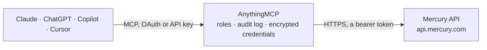

<!-- Generated by scripts/export-github-catalog.mjs in the anythingmcp-website repository. Do not edit by hand. -->

# Mercury MCP connector

Let your AI read your Mercury business banking: accounts and balances, transactions, cards, statements, recipients, Treasury, credit and users. The AnythingMCP connector gives Claude, ChatGPT, Microsoft Copilot, Cursor and Gemini 22 MCP tools for Mercury: 19 read and 3 can change data.

**Category:** [Banking](../banking.md) · **Tools:** 22 · **Setup guide:** [anythingmcp.com](https://anythingmcp.com/guides/mercury-to-mcp) · [Deutsch](https://anythingmcp.com/de/guides/mercury-to-mcp) · [Italiano](https://anythingmcp.com/it/guides/mercury-to-mcp) · [Español](https://anythingmcp.com/es/guides/mercury-to-mcp) · [日本語](https://anythingmcp.com/ja/guides/mercury-to-mcp) · [Русский](https://anythingmcp.com/ru/guides/mercury-to-mcp) · [中文](https://anythingmcp.com/zh/guides/mercury-to-mcp)

## Start without code

No installation and no terminal: AnythingMCP Cloud runs the Mercury connector for you, operated by helpcode.ai in Frankfurt, Germany.

1. **Click the button above** and create an account or sign in. The Mercury connector opens, ready to install.
2. **Paste the API key or token from your Mercury account.** Every click is in the [step-by-step guide](https://anythingmcp.com/guides/mercury-to-mcp).
3. **Click Install.** AnythingMCP shows the address of your MCP server.
4. **Add that address to your assistant:** [Claude](https://anythingmcp.com/guides/connect-mercury-to-claude) · [ChatGPT](https://anythingmcp.com/guides/connect-mercury-to-chatgpt) · [Microsoft Copilot](https://anythingmcp.com/guides/connect-mercury-to-copilot) · [Cursor](https://anythingmcp.com/guides/connect-mercury-to-cursor) · [Gemini CLI](https://anythingmcp.com/guides/connect-mercury-to-gemini) · [Meta Muse](https://anythingmcp.com/guides/connect-mercury-to-muse).
5. **Ask your first question**, for example: *Status and available balance of checking account 'Operating - 001' and most recent statement period?*

Prefer help with the setup? [Talk to us](https://anythingmcp.com/contact).

## How it works

- **The AI client** speaks MCP (Streamable HTTP) to AnythingMCP and only sees tool names, descriptions and results. It never gets the Mercury credentials.
- **AnythingMCP** checks the client's role, builds the call from the tool definition, adds the credentials (a bearer token), calls Mercury, logs the call and returns the result.
- **Mercury** sees an ordinary API client with the rights of the account the credentials belong to.

## Tools

| Tool | What it does | Access |
|---|---|---|
| [`mercury_get_organization`](#mercury_get_organization) | Read your Mercury organization: id, legal business name, DBAs, EIN, kind (business or personal) and plan. | read |
| [`mercury_list_accounts`](#mercury_list_accounts) | List the Mercury bank accounts (checking and savings) with id, name, nickname, kind, status, available and current balance. | read |
| [`mercury_get_account`](#mercury_get_account) | Read one Mercury account by id: name, kind, status, available and current balance. | read |
| [`mercury_list_account_transactions`](#mercury_list_account_transactions) | List the transactions of one Mercury account, newest first by default: amount, status, kind, created and posted dates, counterparty, description, note,… | read |
| [`mercury_list_transactions`](#mercury_list_transactions) | List transactions across all Mercury accounts, oldest first by default: amount, status, kind, dates, counterparty, description, note, category, merchant and… | read |
| [`mercury_get_transaction`](#mercury_get_transaction) | Read one Mercury transaction by id with amount, status, dates, counterparty, note, category, merchant, card, attachments (receipts, check images; links are… | read |
| [`mercury_list_cards`](#mercury_list_cards) | List Mercury debit and credit cards with id, account, nickname, name on card, last four digits, status, virtual or physical, cardholder user id and spend… | read |
| [`mercury_get_card`](#mercury_get_card) | Read one Mercury card by id: account, nickname, name on card, last four digits, status, type, kind, cardholder, spend limit, budgets and locks. | read |
| [`mercury_list_account_cards`](#mercury_list_account_cards) | List the cards linked to one Mercury account: card id, name on card, last four digits, network, status, type, cardholder and spend limit. | read |
| [`mercury_list_account_statements`](#mercury_list_account_statements) | List the monthly statements of one Mercury account: statement id, period start and end, ending balance and a download link for the PDF. | read |
| [`mercury_list_recipients`](#mercury_list_recipients) | List the payment recipients saved in Mercury with id, name, nickname, status, business flag, emails, default payment method (ach, check, domesticWire,… | read |
| [`mercury_get_recipient`](#mercury_get_recipient) | Read one Mercury recipient by id: name, status, emails, default payment method, bank name and date last paid. | read |
| [`mercury_list_treasury_accounts`](#mercury_list_treasury_accounts) | List Mercury Treasury accounts with id, status, available and current balance and the monthly net returns (dividends minus fees). | read |
| [`mercury_list_treasury_transactions`](#mercury_list_treasury_transactions) | List the transactions of one Mercury Treasury account: type (deposits, withdrawals, dividends, fees, interest), description, amount, balance after, day and… | read |
| [`mercury_list_treasury_statements`](#mercury_list_treasury_statements) | List the statements and tax documents of one Mercury Treasury account: id, document type (MonthlyStatement, TradeConfirmation, 1099 and others),… | read |
| [`mercury_list_credit_accounts`](#mercury_list_credit_accounts) | List Mercury credit (IO card) accounts with id, status, available and current balance. | read |
| [`mercury_list_users`](#mercury_list_users) | List the people with access to the Mercury organization: user id, first and last name, email and role (administrator, bookkeeper, customUser, cardOnlyUser,… | read |
| [`mercury_list_categories`](#mercury_list_categories) | List the custom expense categories of the organization (id and name, and whether each applies to card spend, reimbursements or other transactions). | read |
| [`mercury_list_payment_approval_requests`](#mercury_list_payment_approval_requests) | List payment requests waiting for, or past, approval in Mercury: request id, account, recipient, amount, payment method, status (pendingApproval, approved,… | read |
| [`mercury_freeze_card`](#mercury_freeze_card) | Freeze a Mercury card so it cannot be used, for example when it is lost. | write |
| [`mercury_unfreeze_card`](#mercury_unfreeze_card) | Unfreeze a frozen Mercury card so it can be used again. | write |
| [`mercury_update_transaction`](#mercury_update_transaction) | Set or clear the note and the custom category of a Mercury transaction. | write |

## Tool reference

Every parameter as the AI client sees it in `tools/list`. Source: [`packages/backend/src/adapters/intl/mercury.json`](../../../packages/backend/src/adapters/intl/mercury.json).

### `mercury_get_organization`

Read your Mercury organization: id, legal business name, DBAs, EIN, kind (business or personal) and plan. Cheap; use it first to check the token.

**Access:** read · **Call:** `GET /organization`

No parameters.

### `mercury_list_accounts`

List the Mercury bank accounts (checking and savings) with id, name, nickname, kind, status, available and current balance. Account and routing numbers are removed on purpose; read them in the Mercury app. Amounts are decimal numbers in dollars (negative for money going out). Call this first: most tools need an account id.

**Access:** read · **Call:** `GET /accounts`

| Parameter | Type | Required | Description |
|---|---|---|---|
| `limit` | integer | no | Maximum results, 1 to 1000 (Mercury default 1000). |
| `order` | `asc` \| `desc` | no | Sort order: asc or desc. |
| `start_after` | string | no | Cursor for the next page: page.nextPage of the previous answer (an id). Leave it out for the first page; page.nextPage is missing on the last page. |

### `mercury_get_account`

Read one Mercury account by id: name, kind, status, available and current balance. Account and routing numbers are removed on purpose. Amounts are decimal numbers in dollars (negative for money going out).

**Access:** read · **Call:** `GET /account/{accountId}`

| Parameter | Type | Required | Description |
|---|---|---|---|
| `accountId` | string | yes | Account id from mercury_list_accounts. |

### `mercury_list_account_transactions`

List the transactions of one Mercury account, newest first by default: amount, status, kind, created and posted dates, counterparty, description, note, category, merchant and card. Without start Mercury returns the last 30 days. Filter by dates (createdAt), status, search text or category. Paged with offset; total says how many match. Amounts are decimal numbers in dollars (negative for money going out). Counterparty bank details are removed. Financial data: share only what the user asked for.

**Access:** read · **Call:** `GET /account/{accountId}/transactions`

| Parameter | Type | Required | Description |
|---|---|---|---|
| `accountId` | string | yes | Account id from mercury_list_accounts. |
| `start` | string | no | Earliest createdAt date, YYYY-MM-DD or ISO 8601. Default: 30 days ago. |
| `end` | string | no | Latest createdAt date, YYYY-MM-DD or ISO 8601. Default: today. |
| `status` | `pending` \| `sent` \| `cancelled` \| `failed` \| `reversed` \| `blocked` | no | Only transactions in this status. |
| `search` | string | no | Search in descriptions, notes, memos and counterparty names. |
| `mercuryCategory` | string | no | Mercury's merchant type, e.g. Software or Restaurants. |
| `categoryId` | string | no | Custom category id from mercury_list_categories. |
| `order` | `asc` \| `desc` | no | desc (newest first, the default) or asc. |
| `limit` | integer | no | Maximum results, 1 to 1000 (default 100). |
| `offset` | integer | no | Number of results to skip, for the next page. |

### `mercury_list_transactions`

List transactions across all Mercury accounts, oldest first by default: amount, status, kind, dates, counterparty, description, note, category, merchant and card. Filter by account, card, status, created or posted dates, search text or category. Paged with start_after = page.nextPage. Amounts are decimal numbers in dollars (negative for money going out). Counterparty bank details are removed. Financial data: share only what the user asked for.

**Access:** read · **Call:** `GET /transactions`

| Parameter | Type | Required | Description |
|---|---|---|---|
| `accountId` | string[] | no | Only these accounts (ids from mercury_list_accounts). |
| `cardId` | string[] | no | Only these cards (ids from mercury_list_cards). |
| `status` | `pending` \| `sent` \| `cancelled` \| `failed` \| `reversed` \| `blocked`[] | no | Only these statuses. |
| `start` | string | no | Earliest createdAt date, YYYY-MM-DD or ISO 8601. |
| `end` | string | no | Latest createdAt date, YYYY-MM-DD or ISO 8601. |
| `postedStart` | string | no | Earliest postedAt date, YYYY-MM-DD or ISO 8601. |
| `postedEnd` | string | no | Latest postedAt date, YYYY-MM-DD or ISO 8601. |
| `search` | string | no | Search in descriptions, notes, memos and counterparty names. |
| `mercuryCategory` | string | no | Mercury's merchant type, e.g. Software. |
| `categoryId` | string | no | Custom category id from mercury_list_categories. |
| `limit` | integer | no | Maximum results, 1 to 1000 (default 100). |
| `order` | `asc` \| `desc` | no | Sort order: asc or desc. |
| `start_after` | string | no | Cursor for the next page: page.nextPage of the previous answer (an id). Leave it out for the first page; page.nextPage is missing on the last page. |

### `mercury_get_transaction`

Read one Mercury transaction by id with amount, status, dates, counterparty, note, category, merchant, card, attachments (receipts, check images; links are temporary), exchange details and GL allocations. Counterparty bank details are removed.

**Access:** read · **Call:** `GET /transaction/{transactionId}`

| Parameter | Type | Required | Description |
|---|---|---|---|
| `transactionId` | string | yes | Transaction id from a transaction list. |

### `mercury_list_cards`

List Mercury debit and credit cards with id, account, nickname, name on card, last four digits, status, virtual or physical, cardholder user id and spend limits or budgets. Never returns the card number or CVC. Filter by account, status, type, kind or cardholder.

**Access:** read · **Call:** `GET /cards`

| Parameter | Type | Required | Description |
|---|---|---|---|
| `accountId` | string[] | no | Only cards of these accounts. |
| `status` | `active` \| `frozen` \| `cancelled` \| `inactive` \| `expired` \| `suspended`[] | no | Only these statuses. |
| `type` | `virtual` \| `physical`[] | no | virtual or physical. |
| `kind` | `debit` \| `credit`[] | no | debit or credit. |
| `userId` | string | no | Only cards of this cardholder (id from mercury_list_users). |
| `limit` | integer | no | Maximum results, 1 to 1000 (Mercury default 1000). |
| `order` | `asc` \| `desc` | no | Sort order: asc or desc. |
| `start_after` | string | no | Cursor for the next page: page.nextPage of the previous answer (an id). Leave it out for the first page; page.nextPage is missing on the last page. |

### `mercury_get_card`

Read one Mercury card by id: account, nickname, name on card, last four digits, status, type, kind, cardholder, spend limit, budgets and locks. Never returns the card number or CVC.

**Access:** read · **Call:** `GET /cards/{cardId}`

| Parameter | Type | Required | Description |
|---|---|---|---|
| `cardId` | string | yes | Card id from mercury_list_cards or a transaction. |

### `mercury_list_account_cards`

List the cards linked to one Mercury account: card id, name on card, last four digits, network, status, type, cardholder and spend limit. Mercury marks this endpoint as the older view; mercury_list_cards has more detail.

**Access:** read · **Call:** `GET /account/{accountId}/cards`

| Parameter | Type | Required | Description |
|---|---|---|---|
| `accountId` | string | yes | Account id from mercury_list_accounts. |

### `mercury_list_account_statements`

List the monthly statements of one Mercury account: statement id, period start and end, ending balance and a download link for the PDF. Account and routing numbers and the statement's transaction list are left out. Filter by date range.

**Access:** read · **Call:** `GET /account/{accountId}/statements`

| Parameter | Type | Required | Description |
|---|---|---|---|
| `accountId` | string | yes | Account id from mercury_list_accounts. |
| `start` | string | no | Earliest statement date, YYYY-MM-DD. |
| `end` | string | no | Latest statement date, YYYY-MM-DD. |
| `limit` | integer | no | Maximum results, 1 to 1000 (Mercury default 1000). |
| `order` | `asc` \| `desc` | no | Sort order: asc or desc. |
| `start_after` | string | no | Cursor for the next page: page.nextPage of the previous answer (an id). Leave it out for the first page; page.nextPage is missing on the last page. |

### `mercury_list_recipients`

List the payment recipients saved in Mercury with id, name, nickname, status, business flag, emails, default payment method (ach, check, domesticWire, internationalWire, realTimePayment), bank name and date last paid. Account numbers, IBANs and routing numbers are removed on purpose. Read only: this connector cannot pay a recipient.

**Access:** read · **Call:** `GET /recipients`

| Parameter | Type | Required | Description |
|---|---|---|---|
| `limit` | integer | no | Maximum results, 1 to 1000 (Mercury default 1000). |
| `order` | `asc` \| `desc` | no | Sort order: asc or desc. |
| `start_after` | string | no | Cursor for the next page: page.nextPage of the previous answer (an id). Leave it out for the first page; page.nextPage is missing on the last page. |

### `mercury_get_recipient`

Read one Mercury recipient by id: name, status, emails, default payment method, bank name and date last paid. Bank account details are removed on purpose.

**Access:** read · **Call:** `GET /recipient/{recipientId}`

| Parameter | Type | Required | Description |
|---|---|---|---|
| `recipientId` | string | yes | Recipient id from mercury_list_recipients or a transaction's counterpartyId. |

### `mercury_list_treasury_accounts`

List Mercury Treasury accounts with id, status, available and current balance and the monthly net returns (dividends minus fees). Amounts are decimal numbers in dollars (negative for money going out).

**Access:** read · **Call:** `GET /treasury`

| Parameter | Type | Required | Description |
|---|---|---|---|
| `limit` | integer | no | Maximum results, 1 to 1000 (Mercury default 1000). |
| `order` | `asc` \| `desc` | no | Sort order: asc or desc. |
| `start_after` | string | no | Cursor for the next page: page.nextPage of the previous answer (an id). Leave it out for the first page; page.nextPage is missing on the last page. |

### `mercury_list_treasury_transactions`

List the transactions of one Mercury Treasury account: type (deposits, withdrawals, dividends, fees, interest), description, amount, balance after, day and security. Next page: pass cursor from the previous answer. Amounts are decimal numbers in dollars (negative for money going out).

**Access:** read · **Call:** `GET /treasury/{treasuryId}/transactions`

| Parameter | Type | Required | Description |
|---|---|---|---|
| `treasuryId` | string | yes | Treasury account id from mercury_list_treasury_accounts. |
| `limit` | integer | no | Maximum results, 1 to 1000 (default 100). |
| `order` | `asc` \| `desc` | no | Sort order: asc or desc. |
| `cursor` | integer | no | cursor from the previous answer, for the next page. |

### `mercury_list_treasury_statements`

List the statements and tax documents of one Mercury Treasury account: id, document type (MonthlyStatement, TradeConfirmation, 1099 and others), description, period and a download link. Filter by document type.

**Access:** read · **Call:** `GET /treasury/{treasuryId}/statements`

| Parameter | Type | Required | Description |
|---|---|---|---|
| `treasuryId` | string | yes | Treasury account id from mercury_list_treasury_accounts. |
| `documentType` | `MonthlyStatement` \| `TradeConfirmation` \| `1099` \| `1099R` \| `1042S` \| `5498` \| `5498ESA` \| `1099Q` \| `FMV` \| `SDIRA` | no | Only this document type. |
| `limit` | integer | no | Maximum results, 1 to 1000 (Mercury default 1000). |
| `order` | `asc` \| `desc` | no | Sort order: asc or desc. |
| `start_after` | string | no | Cursor for the next page: page.nextPage of the previous answer (an id). Leave it out for the first page; page.nextPage is missing on the last page. |

### `mercury_list_credit_accounts`

List Mercury credit (IO card) accounts with id, status, available and current balance. Amounts are decimal numbers in dollars (negative for money going out).

**Access:** read · **Call:** `GET /credit`

No parameters.

### `mercury_list_users`

List the people with access to the Mercury organization: user id, first and last name, email and role (administrator, bookkeeper, customUser, cardOnlyUser, employee). Personal data: show only what the user asked for.

**Access:** read · **Call:** `GET /users`

| Parameter | Type | Required | Description |
|---|---|---|---|
| `limit` | integer | no | Maximum results, 1 to 1000 (Mercury default 1000). |
| `order` | `asc` \| `desc` | no | Sort order: asc or desc. |
| `start_after` | string | no | Cursor for the next page: page.nextPage of the previous answer (an id). Leave it out for the first page; page.nextPage is missing on the last page. |

### `mercury_list_categories`

List the custom expense categories of the organization (id and name, and whether each applies to card spend, reimbursements or other transactions). Use the id with mercury_list_transactions or mercury_update_transaction.

**Access:** read · **Call:** `GET /categories`

| Parameter | Type | Required | Description |
|---|---|---|---|
| `limit` | integer | no | Maximum results, 1 to 1000 (Mercury default 1000). |
| `order` | `asc` \| `desc` | no | Sort order: asc or desc. |
| `start_after` | string | no | Cursor for the next page: page.nextPage of the previous answer (an id). Leave it out for the first page; page.nextPage is missing on the last page. |

### `mercury_list_payment_approval_requests`

List payment requests waiting for, or past, approval in Mercury: request id, account, recipient, amount, payment method, status (pendingApproval, approved, rejected, cancelled), memo, scheduled date and requester. Read only: it shows requests made elsewhere; this connector cannot create, approve or cancel them.

**Access:** read · **Call:** `GET /request-send-money`

| Parameter | Type | Required | Description |
|---|---|---|---|
| `accountId` | string | no | Only requests from this account. |
| `status` | `pendingApproval` \| `approved` \| `rejected` \| `cancelled` | no | Only requests in this status. |
| `limit` | integer | no | Maximum results, 1 to 1000 (Mercury default 1000). |
| `start_after` | string | no | Cursor for the next page: page.nextPage of the previous answer (an id). Leave it out for the first page; page.nextPage is missing on the last page. |

### `mercury_freeze_card`

Freeze a Mercury card so it cannot be used, for example when it is lost. The card must be active; reversible with mercury_unfreeze_card. Confirm the card (nickname and last four digits) with the user before calling. Installed switched off; needs a token allowed to manage cards.

**Access:** write · **Call:** `POST /cards/{cardId}/freeze`

| Parameter | Type | Required | Description |
|---|---|---|---|
| `cardId` | string | yes | Card id from mercury_list_cards. |

### `mercury_unfreeze_card`

Unfreeze a frozen Mercury card so it can be used again. Only when the user explicitly asks; confirm the card (nickname and last four digits) before calling. Installed switched off; needs a token allowed to manage cards.

**Access:** write · **Call:** `POST /cards/{cardId}/unfreeze`

| Parameter | Type | Required | Description |
|---|---|---|---|
| `cardId` | string | yes | Card id from mercury_list_cards. |

### `mercury_update_transaction`

Set or clear the note and the custom category of a Mercury transaction. Leave a field out to keep it; send an empty note to clear it. Changes apply immediately and overwrite the old values. Show the user the transaction and the change and confirm before calling. Installed switched off; needs a token allowed to update transactions.

**Access:** write · **Call:** `PATCH /transaction/{transactionId}`

| Parameter | Type | Required | Description |
|---|---|---|---|
| `transactionId` | string | yes | Transaction id from a transaction list. |
| `note` | string | no | New note text; an empty string clears the note. |
| `categoryId` | string | no | Custom category id from mercury_list_categories. |

## Run it yourself

AnythingMCP is open source (AGPL-3.0). [Run it with Docker](../../../README.md#run-it-yourself), open **Connectors → Store**, pick **Mercury** and enter `MERCURY_API_TOKEN`, then add your MCP server URL to the AI client.

[← Banking connectors](../banking.md) · [All categories](../README.md)
